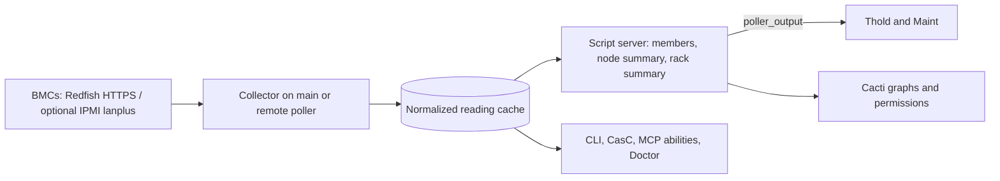

<!-- translations:start -->
[English](README.md) | [简体中文](docs/i18n/zh-CN/README.md) | [हिन्दी](docs/i18n/hi-IN/README.md) | [Español (España)](docs/i18n/es-ES/README.md) | [Español (Latinoamérica)](docs/i18n/es-419/README.md) | [العربية (السعودية)](docs/i18n/ar-SA/README.md) | [Afrikaans](docs/i18n/af-ZA/README.md) | [አማርኛ](docs/i18n/am-ET/README.md) | [العربية (مصر)](docs/i18n/ar-EG/README.md) | [العربية (المغرب)](docs/i18n/ar-MA/README.md) | [বাংলা](docs/i18n/bn-BD/README.md) | [Bosanski](docs/i18n/bs-BA/README.md) | [Deutsch](docs/i18n/de-DE/README.md) | [فارسی](docs/i18n/fa-IR/README.md) | [Filipino](docs/i18n/fil-PH/README.md) | [Français](docs/i18n/fr-FR/README.md) | [Français (Maroc)](docs/i18n/fr-MA/README.md) | [Français (Sénégal)](docs/i18n/fr-SN/README.md) | [Hausa](docs/i18n/ha-NG/README.md) | [עברית](docs/i18n/he-IL/README.md) | [Hrvatski](docs/i18n/hr-HR/README.md) | [Bahasa Indonesia](docs/i18n/id-ID/README.md) | [Igbo](docs/i18n/ig-NG/README.md) | [Italiano](docs/i18n/it-IT/README.md) | [日本語](docs/i18n/ja-JP/README.md) | [한국어](docs/i18n/ko-KR/README.md) | [Malagasy](docs/i18n/mg-MG/README.md) | [मराठी](docs/i18n/mr-IN/README.md) | [Bahasa Melayu](docs/i18n/ms-MY/README.md) | [Nederlands](docs/i18n/nl-NL/README.md) | [Polski](docs/i18n/pl-PL/README.md) | [Português (Brasil)](docs/i18n/pt-BR/README.md) | [Русский](docs/i18n/ru-RU/README.md) | [Kinyarwanda](docs/i18n/rw-RW/README.md) | [Soomaali](docs/i18n/so-SO/README.md) | [Српски](docs/i18n/sr-RS/README.md) | [Svenska](docs/i18n/sv-SE/README.md) | [Kiswahili](docs/i18n/sw-KE/README.md) | [தமிழ்](docs/i18n/ta-IN/README.md) | [తెలుగు](docs/i18n/te-IN/README.md) | [ไทย](docs/i18n/th-TH/README.md) | [Türkçe](docs/i18n/tr-TR/README.md) | [Українська](docs/i18n/uk-UA/README.md) | [اردو](docs/i18n/ur-PK/README.md) | [Tiếng Việt](docs/i18n/vi-VN/README.md) | [isiXhosa](docs/i18n/xh-ZA/README.md) | [Yorùbá](docs/i18n/yo-NG/README.md) | [繁體中文](docs/i18n/zh-TW/README.md) | [isiZulu](docs/i18n/zu-ZA/README.md)
<!-- translations:end -->

# plugin_redfish

A Cacti 1.2 plugin that brings server power draw, inlet temperature, fan state, and power supply health from baseboard management controllers (BMCs) into Cacti as ordinary devices, data sources, and graphs, using Redfish with an optional read-only IPMI fallback and rack-level power rollups. Thold and Maint alert on and suppress them through standard Cacti data sources.

> **Status: in development, no release yet (`0.1.0-dev`).** This plugin is not affiliated with the Cacti project. It installs on Cacti 1.2.31 or later under PHP 8.2 or later and implements the Redfish collector, encrypted credential vault, Cacti device and graph provisioning, optional read-only IPMI fallback, rack power rollup, Cacti Maint window display, remote data collector replication and agent endpoints, CasC provider and operator CLI, MCP abilities, and Doctor diagnostic checks. CI tests fixtures, the DMTF Redfish Mockup Server (subsystem, legacy-only, and HPE iLO Gen11 mockups), and Thold v1.8.2 with Maint v1.3; no live physical BMC or pilot fleet has been qualified yet. The design and research are in [docs/PLAN.md](docs/PLAN.md), [docs/research/](docs/research/), and [docs/decisions/](docs/decisions/).

## Implemented capabilities

### Core collector, vault, and Cacti objects

- **Lifecycle and schema.** Installs, upgrades, disables, and uninstalls through Cacti's plugin API (`Schema::VERSION = 3`, 12 tables). Tables are kept on uninstall unless *Keep Plugin Tables on Uninstall* is cleared. Entry points parse on PHP 8.0 and refuse PHP below 8.2 or missing `ext-openssl` with an explicit error message.
- **Registry and permissions.** Realms *Redfish View* (`redfish_health.php`), *Redfish Operator* (`redfish_operator.php`), and *Redfish Admin* (`redfish_bmcs.php`, `redfish_credentials.php`), plus settings under **Configuration > Settings > Redfish**. The BMC registry supports CSV import (credentials referenced by name; passwords in import files are refused) and JSON export. BMC records and credentials follow Cacti device permissions.
- **Encrypted credential vault.** Passwords are stored encrypted with AES-256-GCM in `plugin_redfish_secret`. The key lives outside the database (`/etc/cacti/redfish-vault.key` by default) as 64 hexadecimal characters (`openssl rand -hex 32`) or 32 raw bytes, owned by the poller user, unreadable by other users, in a directory writable only by root or that user. A 32-character printable passphrase is refused. **Back up the key file with the database**; without it, stored passwords must be entered again.
- **TLS and read-only Redfish client.** TLS verification is enabled by default using the system CA store, a per-BMC CA bundle, or an SPKI SHA-256 pin; per-BMC unverified opt-out stays visible as a health warning and Doctor check warning. The client allows only `GET` plus Redfish session login (`POST`) and logout (`DELETE`), with optional per-BMC Basic fallback when sessions are unavailable. Discovery prefers new Redfish subsystem and sensor resources and falls back to deprecated `Power` and `Thermal` resources.
- **Collector execution.** `poller_redfish.php` starts from `poller_bottom`, runs one master process per poller via Cacti's process registry with configurable worker processes (`redfish_workers`), acquires per-BMC leases, enforces a time budget (`redfish_collector_budget`), applies exponential backoff, and cleans up the plugin's own prior session after a crash.
- **Templates, devices, and graphs.** Imports `templates/redfish-templates.xml` by hash and copies three script server data query XML files (`redfish_fans.xml`, `redfish_temperatures.xml`, `redfish_psus.xml`) into `<cacti>/resource/script_server/` without overwriting user-modified files. **Create Device** and **Add Graphs** require confirmation of a provisioning plan, attach queries to a mapped server device or create a "Redfish BMC" device under `.invalid` with availability checks disabled, and link each Redfish graph back to the device's Redfish graphs via `graph_buttons`.
- **Cache-only script server inputs.** `scripts/ss_redfish_members.php` serves per-member fan, temperature, and PSU readings, and `scripts/ss_redfish_summary.php` serves "Redfish Node Summary" metrics (power, inlet and maximum temperature, bad fan and PSU counts, node health, and age of the last good read). Script server calls read only the local cache and never contact a BMC. Missing, stale, or gone-member readings return `U` (never `0`), while `age` always reports a value so thresholds detect silent BMCs.

**When a BMC's members change** (such as a replaced fan or a firmware update that renames sensors), run **Add Graphs** again. A previously present fan or power supply that becomes absent counts in `fans_bad` or `psus_bad` until accepted; a slot that was never populated does not. Gone members keep their existing data sources and graphs, which read `U` thereafter until deleted by hand. Deleting a Cacti device unmaps its BMC and removes its rack assignment while keeping the BMC and cache; deleting a BMC or uninstalling the plugin keeps Cacti devices and graphs.

### Optional IPMI fallback

- **Opt-in per BMC.** Off by default (`protocols` defaults to `redfish`; enabling IPMI fallback sets `redfish,ipmi`).
- **Scoped fallback trigger.** Runs only when Redfish collection fails with an eligible failure class; never triggers on `AuthRejected`, `CredentialUnavailable`, `AddressRefused`, `OperationRefused`, or `Deadline`.
- **Safe execution.** Invokes `ipmitool` over `-I lanplus` via array-form `proc_open()` with no shell, bounded wall-clock timeout, and a 256 KiB output limit. Passwords are supplied via `IPMITOOL_PASSWORD` (`-E`) or a mode-0600 temporary file (`-f`) deleted in `finally`, never on CLI argv.
- **Read-only command allowlist.** Only five read-only subcommands are permitted: `dcmi power reading`, `sdr type Temperature`, `sdr type Fan`, `sdr type Power Supply`, and `chassis status`. Mutating commands are refused.
- **Normalized output and posture warning.** `IpmiNormalizer` maps readings into the same `Observation`/`Member`/`Reading` model, emitting `U` for missing or unparsable sensors. Enabling IPMI fallback raises a warning on the health page and in the `redfish.bmc_security` Doctor check reminding operators to restrict UDP 623 to a management VLAN.

### Rack power rollup

- **Rack registry.** Schema version 3 adds `plugin_redfish_rack` (unique `(site_id, name)`, optional `power_budget_watts`, `min_coverage_pct` defaulting to `80`, and notes) and `plugin_redfish_rack_member` (at most one rack assignment per `host_id`, optional `bmc_id` and `unit_position`, automatically removed when a Cacti device is deleted).
- **Coverage-guarded totals.** `RackPowerSummary` sums fresh member `power_watts` readings from the local cache and calculates budget utilization and headroom. When reporting member coverage drops below `min_coverage_pct`, `power_watts`, `utilization_pct`, and `headroom_watts` return `U` so collector failures never appear as a drop in rack power.
- **Thold-ready script server input.** `scripts/ss_redfish_rack.php` (`ss_redfish_rack(<rack_id>)`) returns `power_watts`, `power_budget_watts`, `utilization_pct`, `headroom_watts`, `members_total`, `members_reporting`, and `coverage_pct` from the local cache only.

### Cacti Maint integration

- Thold thresholds on Redfish data sources alert and Cacti Maint suppresses them with no changes to either plugin.
- `MaintWindow` checks active Maint schedules for each mapped Cacti host (one-time `mtype=1` and recurring `mtype=2` schedules, plus `plugin_maint_check_cacti_host()` when loaded) and marks active maintenance on the Redfish Health page (`[MAINT]`), in `cli/redfish.php health` output, and in the `redfish-get-health` ability.

### Remote data collectors

- `INFO` declares `remote_collect:1`. BMCs accept any `poller_id >= 1`, and `poller_redfish.php --poller=N` collects only enabled BMCs assigned to that poller.
- **`replicate_out` hook.** Replicates only non-secret configuration tables scoped to the target remote poller via `replicate_out_table()`: `plugin_redfish_bmc`, `plugin_redfish_credential` metadata (no ciphertext), `plugin_redfish_rack`, and `plugin_redfish_rack_member`. `plugin_redfish_secret` is not replicated, and vault key files remain strictly local on each poller.
- **`remote_agent` hook.** Exposes read-only `redfish_health` and `redfish_discovery` actions accepting only numeric `poller_id` and `bmc_id` parameters. Unexpected parameters are refused and zero credentials or secrets are returned.

### Ecosystem hooks (CasC, MCP abilities, and Doctor)

- **CasC provider (`casc_register_providers`).** Registers the `redfish` provider (schema version `1`) with pure-PHP YAML and XML export, parsing (with XXE refused), validation, diff planning, and apply. Credentials appear only as vault references (`vault:redfish:<name>`); raw secret keys (`pass`, `secret`, `token`, `private_key`, `vault_key`, `auth_token`) are rejected. Applying requires an exact SHA-256 `PLAN_HASH`.
- **MCP / Abilities API (`abilities_register`).** Registers three read-only abilities gated on the Redfish View realm (`redfish_health.php`) and Cacti device permissions, returning zero credentials:
  - `redfish-list-bmcs` (optional `poller_id`)
  - `redfish-get-rack-power` (optional `rack_id`)
  - `redfish-get-health` (optional `bmc_id`)
- **Doctor checks (`doctor_register_checks`).** Registers five local, read-only diagnostic checks that never contact a BMC or return key material:
  - `redfish.schema`: schema version currency
  - `redfish.vault_key`: vault key readability and permissions
  - `redfish.collector_runs`: poller collector budget and freshness
  - `redfish.bmc_security`: enabled BMCs with unverified TLS or IPMI fallback
  - `redfish.rack_power`: rack power budget compliance and coverage floor

## CLI

Run from the Cacti root directory with PHP 8.2 or later:

```sh
# Operator and CasC CLI (reads --file=PATH or stdin for validate, plan, and apply)
php plugins/redfish/cli/redfish.php export --format=yaml|xml
php plugins/redfish/cli/redfish.php validate [--file=PATH] [--format=yaml|xml]
php plugins/redfish/cli/redfish.php plan [--file=PATH] [--format=yaml|xml]
php plugins/redfish/cli/redfish.php apply [--file=PATH] [--format=yaml|xml] --confirm=<PLAN_HASH>
php plugins/redfish/cli/redfish.php health --format=text|json

# Collector entry point (normally started by poller_bottom)
php plugins/redfish/poller_redfish.php [--poller=N] [--force] [--debug]

# Rack power summary script server entry point
php plugins/redfish/scripts/ss_redfish_rack.php <rack_id>
```

## Access roles

| Realm | Access |
| --- | --- |
| Redfish View | Existing monitoring pages. |
| Redfish Operator | Monitoring plus the Operations page and personal triage acknowledgments. |
| Redfish Admin | Operator access plus the existing configuration and administrative actions. |

After copying upgrade files, open the Plugins page as an administrator to register the realms. Assign the Operator realm explicitly under **Configuration > Users** or user groups. Upgrades retain the existing View and Admin realm IDs and grants. Admin access inherits Operator access, and Operator access inherits View access on each request; this does not add stored grants to users or groups. Plugin settings also require Redfish Admin access in addition to Cacti's Settings permission.

Cacti device permissions limit the rows and actions available to each user; unmapped objects require an administrator. Operators can release a collection hold on a permitted BMC for the next scheduled run. Credentials, configuration, mapping, deletion, and other administrative changes remain in the administrative pages. Acknowledgments last only in the current user's session, for at most one hour and only while the same observation remains fresh. New or changed observations invalidate them. They never mark a failed measurement healthy or suppress alerts.

## Why

Every server has a BMC that reports power and thermal state independently of the operating system, so it keeps answering when the OS is down. The data serves capacity and cost tracking, early warning of a failed fan or power supply, and, in high-performance computing, power-capping decisions. The plugin is not HPC-specific.

Cacti covers part of this today:

- **Vendor SNMP packages.** The 1.2.x branch ships Dell iDRAC and HPE iLO templates that need an SNMP agent and are vendor specific; milestone 1 research found that neither reports power draw in watts ([docs/research/overlap.md](docs/research/overlap.md)).
- **A credential type without a collector.** plugin_credentials defines an "IPMI / Redfish (BMC)" credential but reads no BMC.
- **No rack-level view.** Cacti core has no rack object; a device has a free-text `location` field.

The plugin polls BMCs out of band from Cacti's poll cycle on the main poller or remote data collectors, caches normalized readings, and exposes them through script server data queries, node summaries, and rack power summaries. It reuses Cacti's graphing, permissions, Thold, and Maint, and does not change BMC state.

## Scope and status

| Phase | Scope | Milestones | Status |
|---|---|---|---|
| 0, research | Vendor matrix, confirmation of upstream behavior on live BMCs, polling cost, data query spike | [M1](https://github.com/somethingwithproof/plugin_redfish/milestone/1) | Done, pending real-BMC firmware captures |
| 1, observe | BMC registry, credentials, TLS, Redfish collector, normalized readings, devices, per-index graphs, Thold alerting, Maint integration, health page | [M2](https://github.com/somethingwithproof/plugin_redfish/milestone/2), [M3](https://github.com/somethingwithproof/plugin_redfish/milestone/3), [M4](https://github.com/somethingwithproof/plugin_redfish/milestone/4) | Implemented; M4 pilot fleet qualification pending |
| 2, ipmi | Read-only IPMI (`lanplus`) fallback via `ipmitool`, off by default | [M5](https://github.com/somethingwithproof/plugin_redfish/milestone/5) | Implemented |
| 3, racks | Rack registry, rack power totals with coverage floor, budget headroom, `ss_redfish_rack.php` | [M6](https://github.com/somethingwithproof/plugin_redfish/milestone/6) | Implemented |
| 4, remote and ecosystem | Remote data collectors (`replicate_out`, `remote_agent`), CasC provider and CLI, MCP abilities, Doctor checks | [M7](https://github.com/somethingwithproof/plugin_redfish/milestone/7) | Implemented |

Out of scope: setting power caps or any other BMC configuration, power control, firmware update, console access, a plugin-owned alerting engine, and scheduler integration.

## Compatibility targets

| Component | Target |
|---|---|
| Cacti | 1.2.31 or later, no core patches |
| Database | MariaDB 10.2 or MySQL 5.7 or later: one BMC per device is held by a unique key on a generated column |
| PHP | 8.2 or later; entry points stay parseable on 8.0 so an unsupported runtime gets a refusal instead of a broken Cacti UI |
| PHP extensions | `ext-openssl` (required by Cacti 1.2.31); no `ext-curl` and no Composer runtime dependencies |
| Optional tools | `ipmitool` on pollers that collect BMCs with IPMI fallback enabled |
| BMCs | Dell iDRAC, HPE iLO, Lenovo XCC, and OpenBMC, by firmware range; see [the vendor matrix](docs/research/vendor-matrix.md) |
| Redfish | New subsystem and sensor resources first, deprecated `Power` and `Thermal` as fallback |
| Thold, Maint | No changes required (CI exercises Thold v1.8.2 and Maint v1.3) |

## Design

- [docs/PLAN.md](docs/PLAN.md) is the full plan: architecture, upstream facts it depends on, measurement model, security boundaries, performance arithmetic, testing, and risks.
- [docs/decisions/](docs/decisions/) holds architecture decision records for choices already made.
- [docs/REQUIREMENTS.md](docs/REQUIREMENTS.md) maps every requirement ID to its issue.



## Security

BMC credentials control out-of-band management of servers. The design keeps secrets out of command lines, logs, CasC exports, remote agent payloads, MCP responses, and web pages; encrypts stored passwords with AES-256-GCM using a local vault key file per poller; verifies TLS by default; runs `ipmitool` from an explicit argument array with allowlisted read-only subcommands; and uses read-only BMC accounts. See [docs/PLAN.md](docs/PLAN.md#security) and [SECURITY.md](SECURITY.md).

## Operator guide

See [docs/operator-guide.md](docs/operator-guide.md) for installation prerequisites, vault and TLS setup, BMC registration, graph creation, alert intervals, backup, and failure handling. The guide does not declare a real vendor firmware line supported until a redacted capture from that firmware passes the suite.

## Development and testing

CI (`.github/workflows/plugin-ci-workflow.yml`) lints entry points on PHP 8.0, runs Pest unit (`phpunit.xml`) and lifecycle integration (`phpunit-integration.xml`) suites and PHPStan level 9 across PHP 8.2 to 8.5 against Cacti `release/1.2.31` and `1.2.x`, verifies refusal on PHP 8.1, exercises the DMTF Redfish Mockup Server (subsystem, legacy-only, and HPE iLO Gen11 mockups) and Thold v1.8.2 / Maint v1.3 end to end, and checks gettext catalogs, workflows, and REUSE licensing.

Local checks before pushing:

```sh
sh tests/lint-workflows.sh
sh locales/build_gettext.sh --check
CACTI_PATH=/path/to/cacti phpstan analyse -c phpstan.neon --no-progress
```

Run Pest with `--configuration=phpunit.xml` for unit and source-rule tests, or `--configuration=phpunit-integration.xml` with `CACTI_PATH` and `REDFISH_TEST_DATABASE=disposable` against a disposable Cacti database for lifecycle integration tests.

## How work is tracked

- **Milestones** follow the plan's milestones. Each has an epic issue listing its sub-issues and exit evidence.
- **Issues** are typed by label: `type: requirement`, `type: research`, `type: decision`, `type: epic`. Requirement issues state numbered, testable requirements (`REQ-AREA-NNN`) and acceptance criteria.
- **Labels** also carry `area:`, `phase:`, `priority:`, and `status:`. See [CONTRIBUTING.md](CONTRIBUTING.md#labels).
- The [project board](https://github.com/users/somethingwithproof/projects/12) shows all issues across milestones.

## Contributing

Read [CONTRIBUTING.md](CONTRIBUTING.md). Commits need a DCO sign-off. Design discussion happens on issues; open decisions carry the `type: decision` label. Evidence from real BMCs is the most useful contribution now; redact addresses, serial numbers, and credentials before posting any capture.

## License

GNU General Public License v2.0, the same license as Cacti and its plugins. See [LICENSE](LICENSE).
