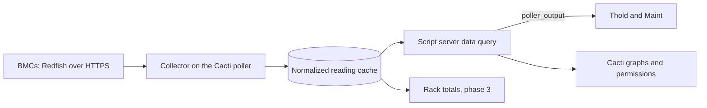

# plugin_redfish

A Cacti 1.2 plugin that brings server power draw, inlet temperature, fan state, and power supply health from baseboard management controllers (BMCs) into Cacti as ordinary devices, data sources, and graphs, using Redfish with an optional IPMI fallback. Thold and Maint then alert on and suppress them, and a later phase adds rack-level power totals.

> **Status: in development, no release yet (0.1.0-dev).** Milestone 2 (foundation) is merged on `main`; milestone 3 (Cacti objects and alerting) is in review. This plugin is not affiliated with the Cacti project. It installs on Cacti 1.2.31 under PHP 8.2 or later, registers BMCs and credentials, reads power, temperatures, fans, and power supply health from each BMC over Redfish into its own cache, and shows collection health. Milestone 3 adds Cacti devices, per-member and summary graphs, and Thold and Maint support through ordinary data sources. It has been tested only against a fake BMC built from hand-written fixtures and the DMTF Redfish mockup server, never a real BMC. The design and research are in [docs/PLAN.md](docs/PLAN.md), [docs/research/](docs/research/), and [docs/decisions/](docs/decisions/).

### What milestone 2 ships

- Install, upgrade, disable, and uninstall through Cacti's plugin API, with tables kept on uninstall unless the setting is cleared. On PHP older than 8.2 the plugin refuses to install or enable and says why.
- Realms "Redfish View" (health page) and "Redfish Admin" (BMCs and credentials pages), and settings under Configuration > Settings > Redfish.
- A BMC registry with CSV import and JSON export. Import files must not contain passwords; credentials are referenced by name.
- Credentials stored encrypted with AES-256-GCM. The key is a file outside the database, `/etc/cacti/redfish-vault.key` by default, holding 64 hexadecimal characters (`openssl rand -hex 32`) or exactly 32 random bytes, owned by the poller user, not readable by other users, in a directory only the poller user or root can write. A key of 32 printable characters is refused as a passphrase. **Back up the key file with the database**; without it every stored password must be entered again.
- TLS verification on by default, with a per-BMC CA bundle or SPKI SHA-256 pin. A logged, per-BMC unverified opt-out stays on the health page as a warning.
- A read-only Redfish client: `GET` plus the session login and logout only, checked against an allowlist before any request is sent.
- A collector started from `poller_bottom` for BMCs on the main poller, with per-BMC leases and deadlines, backoff, and cleanup after a crash of the one session the plugin recorded. Remote collectors are not supported yet; they need an explicit choice of how the collector reaches the database and the key (phase 4).
- BMC records and credentials follow Cacti device permissions: a Redfish Admin sees, changes, and binds only BMCs on devices they may see, and only credentials that no BMC on a hidden device uses.

### What milestone 3 adds

- Templates shipped as Cacti template XML in `templates/` and imported with Cacti's own importer at install and upgrade, matched by hash, so an import updates the plugin's objects and adds nothing twice. The three data query files are copied to `<cacti>/resource/script_server/` with a recorded hash; the plugin never replaces a file there that it did not write, and the health page warns administrators when the templates or a query file are not in place. **Reinstall the Redfish Templates** on the BMCs page imports them again; it needs Cacti's Import Templates permission.
- **Create Device** or **Add Graphs** on each BMC ([ADR 0015](docs/decisions/0015-attach-to-the-server-device-or-create-one-per-bmc.md)). A BMC mapped to a server's existing device gets its data queries and graphs on that device. An unmapped BMC gets a new device from the "Redfish BMC" device template, with availability checks off and a host name under `.invalid`, so Cacti never contacts the BMC and never shows its address. Either way an administrator first confirms a plan listing what will be added. Both need Cacti's device management permission as well as Redfish Admin; a new device the creator could not see is removed again.
- Three script server data queries, "Redfish Fans", "Redfish Temperatures", and "Redfish Power Supplies", indexed by the BMC's member key, with a graph per member: fan speed in percent or RPM (whichever unit the BMC reports), temperature, and power supply input and output watts, each with its health code.
- A "Redfish Node Summary" input with power, inlet temperature, the highest temperature, fans and supplies not OK, node health, and the age of the last good read, drawn on four graphs: power, temperatures, component health, and data age. Thold thresholds on these data sources alert, and Maint suppresses them, with no change to either plugin.
- The script server answers only from the plugin's cache and never contacts a BMC. A value that is missing, stale, of another unit, or from a member that is gone is `U`, so graphs show a gap, never zero; `age` always has a value, so a threshold on it catches a BMC that stopped answering.
- A graph link from each Redfish graph to the device's Redfish graphs, shown only to users Cacti lets see the device.

**When a BMC's members change** (a fan replaced, a firmware update renaming sensors), choose **Add Graphs** again. A fan or power supply that was present and is now absent or gone counts in `fans_bad` or `psus_bad` until you do, so a pulled fan alerts; a slot that was never filled does not. Add Graphs accepts the members the BMC reports now, and Cacti indexes the queries again; a member that is gone keeps its data source and graph, which read `U` from then on, and a new member gets a graph. Delete the graphs of members that are gone by hand once their history is no longer needed.

Deleting a device unmaps its BMC and keeps the BMC and its cache. Deleting a BMC, or uninstalling the plugin, keeps its device and graphs.

## Why

Every server has a BMC that reports power and thermal state independently of the operating system, so it keeps answering when the OS is down. The data serves capacity and cost tracking, early warning of a failed fan or power supply, and, in high-performance computing, power-capping decisions. The plugin is not HPC-specific.

Cacti covers part of this today:

- **Vendor SNMP packages.** The 1.2.x branch ships Dell iDRAC and HPE iLO templates that need an SNMP agent and are vendor specific; milestone 1 research found that neither reports power draw in watts ([docs/research/overlap.md](docs/research/overlap.md)).
- **A credential type without a collector.** plugin_credentials defines an "IPMI / Redfish (BMC)" credential but reads no BMC.
- **No rack-level view.** Cacti core has no rack object; a device has a free-text `location` field.

The plugin polls BMCs out of band from Cacti's poll cycle, caches normalized readings, and exposes them through a script server data query and summary data sources. It reuses Cacti's graphing, permissions, Thold, Maint, and remote data collectors, and does not change BMC state.

## Planned scope

| Phase | Scope | Milestones |
|---|---|---|
| 0, research | Vendor matrix, confirmation of upstream behavior on live BMCs, polling cost, data query spike | [M1](https://github.com/somethingwithproof/plugin_redfish/milestone/1) |
| 1, observe | BMC registry, credentials, TLS, Redfish collector, normalized readings, devices, per-index graphs, Thold alerting, Maint suppression, health page | [M2](https://github.com/somethingwithproof/plugin_redfish/milestone/2), [M3](https://github.com/somethingwithproof/plugin_redfish/milestone/3), [M4](https://github.com/somethingwithproof/plugin_redfish/milestone/4) |
| 2, ipmi | IPMI fallback for BMCs without usable Redfish, off by default | [M5](https://github.com/somethingwithproof/plugin_redfish/milestone/5) |
| 3, racks | Rack registry, rack power totals with coverage, budget headroom | [M6](https://github.com/somethingwithproof/plugin_redfish/milestone/6) |
| 4, remote | Cacti remote data collectors for isolated BMC networks | [M7](https://github.com/somethingwithproof/plugin_redfish/milestone/7) |

Out of scope: setting power caps or any other BMC configuration, power control, firmware update, console access, a plugin-owned alerting engine, and scheduler integration.

## Compatibility targets

| Component | Target |
|---|---|
| Cacti | 1.2.31 or later, no core patches |
| Database | MariaDB 10.2 or MySQL 5.7 or later: one BMC per device is held by a unique key on a generated column |
| PHP | 8.2 or later; `setup.php` stays parseable on 8.0 so an unsupported runtime gets a refusal instead of a broken Cacti UI |
| BMCs | Dell iDRAC, HPE iLO, Lenovo XCC, and OpenBMC, by firmware range; see [the vendor matrix](docs/research/vendor-matrix.md) |
| Redfish | New subsystem and sensor resources first, deprecated `Power` and `Thermal` as fallback |
| Thold, Maint | No changes required |

## Design

- [docs/PLAN.md](docs/PLAN.md) is the full plan: architecture, upstream facts it depends on (with sources and assumptions still to confirm), measurement model, security boundaries, performance arithmetic, testing, and risks.
- [docs/decisions/](docs/decisions/) holds architecture decision records for choices already made.
- [docs/REQUIREMENTS.md](docs/REQUIREMENTS.md) maps every requirement ID to its issue.

## Security

BMC credentials control out-of-band management of servers. The design keeps them out of command lines, logs, and pages, verifies TLS by default, runs any external command from an argument array with allowlisted subcommands, and uses read-only BMC accounts. See [docs/PLAN.md](docs/PLAN.md#security) and [SECURITY.md](SECURITY.md).

## How work is tracked

- **Milestones** follow the plan's milestones. Each has an epic issue listing its sub-issues and exit evidence.
- **Issues** are typed by label: `type: requirement`, `type: research`, `type: decision`, `type: epic`. Requirement issues state numbered, testable requirements (`REQ-AREA-NNN`) and acceptance criteria.
- **Labels** also carry `area:`, `phase:`, `priority:`, and `status:`. See [CONTRIBUTING.md](CONTRIBUTING.md#labels).
- The [project board](https://github.com/users/somethingwithproof/projects/12) shows all issues across milestones.

## Contributing

Read [CONTRIBUTING.md](CONTRIBUTING.md). Commits need a DCO sign-off. Design discussion happens on issues; open decisions carry the `type: decision` label. Evidence from real BMCs is the most useful contribution now; redact addresses, serial numbers, and credentials before posting any capture.

## License

GNU General Public License v2.0, the same license as Cacti and its plugins. See [LICENSE](LICENSE).
