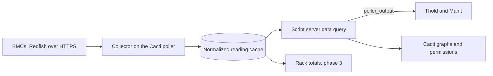

# plugin_redfish

A Cacti 1.2 plugin that brings server power draw, inlet temperature, fan state, and power supply health from baseboard management controllers (BMCs) into Cacti as ordinary devices, data sources, and graphs, using Redfish with an optional IPMI fallback. Thold and Maint then alert on and suppress them, and a later phase adds rack-level power totals.

> **Status: in development.** Milestone 1 research is merged; milestone 2 (foundation) is in progress. Plugin code is not published here yet. Milestone 1 confirmed the design against documentation and upstream source (PR #67); the results, with sources, are in [docs/research/](docs/research/), and [docs/PLAN.md](docs/PLAN.md) is at revision 2. Checks that need real BMCs remain open in each research page's live-checks table. Nothing below describes shipped behavior.

## Why

Every server has a BMC that reports power and thermal state independently of the operating system, so it keeps answering when the OS is down. The data serves capacity and cost tracking, early warning of a failed fan or power supply, and, in high-performance computing, power-capping decisions. The plugin is not HPC-specific.

Cacti covers part of this today:

- **Vendor SNMP packages.** The 1.2.x branch ships Dell iDRAC and HPE iLO templates that need an SNMP agent and are vendor specific; whether they report node power draw is a milestone 1 question.
- **A credential type without a collector.** plugin_credentials defines an "IPMI / Redfish (BMC)" credential but reads no BMC.
- **No rack-level view.** Cacti core has no rack object; a device has a free-text `location` field.

The plugin polls BMCs out of band from Cacti's poll cycle, caches normalized readings, and exposes them through a script server data query and summary data sources. It reuses Cacti's graphing, permissions, Thold, Maint, and remote data collectors, and does not change BMC state.

## Planned scope

| Phase | Scope | Milestones |
|---|---|---|
| 0, research | Vendor matrix, confirmation of upstream behavior on live BMCs, polling cost, data query spike | [M1](https://github.com/somethingwithproof/plugin_redfish/milestone/1) |
| 1, observe | BMC registry, credentials, TLS, Redfish collector, normalized readings, devices, per-index graphs, Thold alerting, Maint suppression, health page | [M2](https://github.com/somethingwithproof/plugin_redfish/milestone/2), [M3](https://github.com/somethingwithproof/plugin_redfish/milestone/3), [M4](https://github.com/somethingwithproof/plugin_redfish/milestone/4) |
| 2, ipmi | IPMI fallback for BMCs without usable Redfish, off by default | [M5](https://github.com/somethingwithproof/plugin_redfish/milestone/5) |
| 3, racks | Rack registry, rack power totals with coverage, budget headroom | [M6](https://github.com/somethingwithproof/plugin_redfish/milestone/6) |
| 4, remote | Cacti remote data collectors for isolated BMC networks | [M7](https://github.com/somethingwithproof/plugin_redfish/milestone/7) |

Out of scope: setting power caps or any other BMC configuration, power control, firmware update, console access, a plugin-owned alerting engine, and scheduler integration.

## Compatibility targets

| Component | Target |
|---|---|
| Cacti | 1.2.31 or later, no core patches |
| PHP | 8.2 or later; `setup.php` stays parseable on 8.0 so an unsupported runtime gets a refusal instead of a broken Cacti UI |
| BMCs | Dell iDRAC, HPE iLO, Lenovo XCC, and OpenBMC, by firmware range set in milestone 1 |
| Redfish | New subsystem and sensor resources first, deprecated `Power` and `Thermal` as fallback |
| Thold, Maint | No changes required |

## Design

- [docs/PLAN.md](docs/PLAN.md) is the full plan: architecture, upstream facts it depends on (with sources and assumptions still to confirm), measurement model, security boundaries, performance arithmetic, testing, and risks.
- [docs/decisions/](docs/decisions/) holds architecture decision records for choices already made.
- [docs/REQUIREMENTS.md](docs/REQUIREMENTS.md) maps every requirement ID to its issue.

## Security

BMC credentials control out-of-band management of servers. The design keeps them out of command lines, logs, and pages, verifies TLS by default, runs any external command from an argument array with allowlisted subcommands, and uses read-only BMC accounts. See [docs/PLAN.md](docs/PLAN.md#security) and [SECURITY.md](SECURITY.md).

## How work is tracked

- **Milestones** follow the plan's milestones. Each has an epic issue listing its sub-issues and exit evidence.
- **Issues** are typed by label: `type: requirement`, `type: research`, `type: decision`, `type: epic`. Requirement issues state numbered, testable requirements (`REQ-AREA-NNN`) and acceptance criteria.
- **Labels** also carry `area:`, `phase:`, `priority:`, and `status:`. See [CONTRIBUTING.md](CONTRIBUTING.md#labels).
- The [project board](https://github.com/users/somethingwithproof/projects/12) shows all issues across milestones.

## Contributing

Read [CONTRIBUTING.md](CONTRIBUTING.md). Commits need a DCO sign-off. Design discussion happens on issues; open decisions carry the `type: decision` label. Evidence from real BMCs is the most useful contribution now; redact addresses, serial numbers, and credentials before posting any capture.

## License

GNU General Public License v2.0, the same license as Cacti and its plugins. See [LICENSE](LICENSE).
