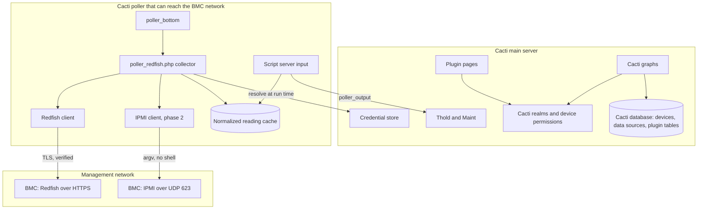

# Cacti 1.2 Redfish and IPMI Power and Thermal Plugin Plan

Status: in development, plan revision 2 (2026-11-15). Revision 2 adds the documentation and source research for milestone 1; see [Milestone 1 research](#milestone-1-research). Nothing described here as a plugin capability is published yet. Statements about the Redfish standard, BMC firmware, ipmitool, Cacti core, and Cacti plugins describe upstream behavior as observed on the date and revision named in each source. Anything that was not verified is marked as an assumption and has a research issue; items that need real BMC hardware or a running Cacti are marked *live*. Owner is not assigned; size estimates are in [research/estimates.md](research/estimates.md), and calendar time is not estimated.

`plugin_redfish` is a Cacti 1.2 plugin that reads power draw, temperatures, fan state, and power supply health from server baseboard management controllers (BMCs) over Redfish, with IPMI as an optional fallback, and presents them as ordinary Cacti devices, data sources, and graphs. Thold and Maint then work on them unchanged, and a later phase adds rack-level totals.

## Why this plugin

Operators who run servers need the same few answers from every machine: how much power it draws, how warm the air entering it is, whether a fan or power supply has failed. The BMC knows all of this independently of the operating system, so it keeps answering when the OS is down, hung, or not yours to log in to. This is useful for capacity and cost tracking, for spotting a failed supply or fan before a thermal shutdown, and, in high-performance computing, as the input to power-capping decisions. The plugin is deliberately not HPC-specific: it needs no scheduler, no cluster concept, and no particular vendor.

Cacti has partial answers today:

1. **SNMP vendor packages.** The `1.2.x` branch ships `Dell_iDrac` and `HPE_iLO` template packages and lm-sensors script server queries ([install/templates](https://github.com/Cacti/cacti/tree/1.2.x/install/templates), [resource/script_server](https://github.com/Cacti/cacti/tree/1.2.x/resource/script_server)). They depend on the BMC or the OS running an SNMP agent and are vendor specific. Milestone 1 research found no watts-based data in either package ([#27](https://github.com/somethingwithproof/plugin_redfish/issues/27), [research/overlap.md](research/overlap.md)).
2. **A credential type without a collector.** plugin_credentials defines a stored credential type named "IPMI / Redfish (BMC)" but does not read from any BMC ([plugin_credentials `includes/arrays.php`](https://github.com/Cacti/plugin_credentials/blob/ead895662c031872f92c7bdeb67f9a6df03f1b4d/includes/arrays.php)).
3. **Adjacent plugins.** plugin_hmib reads the SNMP Host Resources MIB, which is operating-system data, and plugin_apcupsd reads UPS state. Neither reads a BMC ([plugin_hmib README](https://github.com/Cacti/plugin_hmib/blob/develop/README.md), [plugin_apcupsd README](https://github.com/Cacti/plugin_apcupsd/blob/develop/README.md)).

The Cacti GitHub organization has no Redfish or IPMI collector plugin (public repository list, 34 repositories, checked 2026-11-14 and again 2026-11-15).

The plugin closes the gap by polling BMCs out of band from Cacti's poll cycle, caching normalized readings in its own tables, and exposing the cache to Cacti through a script server data query and summary data sources. It reuses Cacti's graphing, permissions, remote data collectors, Thold, Maint, and (by decision #9) its credential store, instead of building parallel versions of them.

## Goals and non-goals

**Goals**

- Per-node power draw, inlet temperature, other temperature sensors, fan state, and power supply health from Redfish, with the same normalized names across vendors.
- Alerting and maintenance through Thold and Maint, so one notification path covers SNMP and BMC data.
- BMC credentials that never appear on a command line, in a log, or in a rendered page, and TLS verification on by default.
- Read-only operation. The plugin never changes BMC state, including power limits.
- Rack-level power totals (phase 3), with an explicit rule for what a total means when some members have not reported.
- Predictable load on BMCs, which are small embedded systems, with measured per-BMC request cost.
- No required Cacti core patches.

**Non-goals**

- Setting power caps, fan modes, or any other BMC configuration. Reading a limit is in scope; changing one needs a separate decision ([#18](https://github.com/somethingwithproof/plugin_redfish/issues/18)).
- Power control (on, off, reset), firmware update, virtual media, or console access.
- A plugin-owned alerting, incident, or notification engine.
- A scheduler integration. HPC users consume the data through Cacti; schedulers are research ([#64](https://github.com/somethingwithproof/plugin_redfish/issues/64)).
- Replacing SNMP-based vendor templates. They remain valid for operators who use them.
- Redfish management of non-server equipment such as switches and PDUs in the first phases. PDU data is research ([#66](https://github.com/somethingwithproof/plugin_redfish/issues/66)).

## Release phases

Each phase ships to users. Later phases are re-estimated after the phase before them.

| Phase | Label | Scope | Depends on |
|---|---|---|---|
| 0 | Research | Vendor coverage matrix, confirmation of every fact below against live BMCs, polling cost, graph and data query spike (milestone 1) | Nothing |
| 1 | Planned | Redfish observe mode: BMC registry, credentials, TLS, collector, normalized model, devices, per-index graphs, Thold alerting, Maint suppression, health page (milestones 2 to 4) | Phase 0 |
| 2 | Planned | IPMI fallback for BMCs without usable Redfish, off by default (milestone 5) | Phase 1, security review |
| 3 | Planned | Rack registry, rack power totals and budget headroom (milestone 6) | Phase 1 |
| 4 | Planned | Remote data collectors for BMCs on isolated management networks (milestone 7) | Phase 1, security review |
| - | Research | Power-cap integration, energy accounting, PDU data | Demand after phase 1 |

## Compatibility

**Cacti.** Minimum Cacti release is 1.2.31, with no core patches. The plugin uses only APIs present in that release; milestone 1 confirms each signature at 1.2.31 and records differences on the current `1.2.x` branch ([#21](https://github.com/somethingwithproof/plugin_redfish/issues/21)):

- Plugin lifecycle and hooks: `api_plugin_register_hook()`, `api_plugin_register_realm()`, `api_plugin_db_table_create()` ([lib/plugins.php](https://github.com/Cacti/cacti/blob/release/1.2.31/lib/plugins.php)). Research: hook and realm registration only works when the function that calls them has `install`, `upgrade` or `setup` in its name, so call them from `plugin_redfish_install()` and `plugin_redfish_upgrade()`, not from a class method; `api_plugin_db_table_create()` skips an existing table on 1.2.31 and refreshes its schema on `1.2.x`, so migrations must not depend on either ([research/cacti-core.md](research/cacti-core.md)).
- Devices: `api_device_save()` ([lib/api_device.php](https://github.com/Cacti/cacti/blob/release/1.2.31/lib/api_device.php)).
- Templates: `import_xml_data()` ([lib/import.php](https://github.com/Cacti/cacti/blob/release/1.2.31/lib/import.php)).
- Background work: `exec_background()` and `register_process_start()` ([lib/poller.php](https://github.com/Cacti/cacti/blob/release/1.2.31/lib/poller.php)). `exec_background()` takes one executable path and an argument list (the path is shell-quoted on `1.2.x`); pass the PHP binary as the path and the script in the arguments. `exec_background_process()` exists only on `1.2.x` and is not used.
- Script server input: functions of the form `ss_<name>($hostname, $host_id, $snmp_auth, $cmd, $arg1, $arg2)` with `index`, `query`, and `get` commands, as in [scripts/ss_host_cpu.php](https://github.com/Cacti/cacti/blob/release/1.2.31/scripts/ss_host_cpu.php).
- Remote collectors: `call_remote_data_collector()` ([lib/functions.php](https://github.com/Cacti/cacti/blob/release/1.2.31/lib/functions.php)) and the `remote_agent` hook ([remote_agent.php](https://github.com/Cacti/cacti/blob/release/1.2.31/remote_agent.php)).

**PHP.** The plugin requires PHP 8.2 or later, matching the Cacti 1.2.x floor. The `1.2.x` branch declares `"php": ">=8.2"` ([branch composer.json](https://github.com/Cacti/cacti/blob/1.2.x/composer.json), commit `30010fc5`); the 1.2.31 release still declares `>=8.0` ([release composer.json](https://github.com/Cacti/cacti/blob/release/1.2.31/composer.json)). Because Cacti includes plugin files on every request, a parse error in a plugin breaks the whole Cacti UI:

- `setup.php`, `INFO`, and every file Cacti includes before the version check use only PHP 8.0 syntax.
- `plugin_redfish_check_config()` and `plugin_redfish_install()` refuse to proceed when `version_compare(PHP_VERSION, '8.2.0', '<')`, with a message naming the required version.
- Hook shims return early under the same condition, before the autoloader is registered.
- CI lints `setup.php` and the shim files under PHP 8.0.

Code loaded after the check may use language features through PHP 8.2 and nothing from 8.3 or later. Properties are always declared. PHPStan runs at `phpVersion` 8.2. See [ADR 0008](decisions/0008-php-82-floor-with-80-parse-guard.md).

**BMC firmware.** Support is stated per vendor family and firmware range, not as "Redfish compatible". The target families are Dell iDRAC, HPE iLO, Lenovo XClarity Controller (XCC), and OpenBMC, plus at least one more vendor if a pilot site has one. Milestone 1 produces the matrix: which resources each exposes, at which schema versions, and which authentication modes work ([#19](https://github.com/somethingwithproof/plugin_redfish/issues/19)). A firmware line is listed as supported only when a fixture captured from it passes the test suite.

**IPMI tooling.** The IPMI fallback needs a client. `ipmitool` is the common one and its upstream repository is archived (see below), so the tool choice is a decision ([#14](https://github.com/somethingwithproof/plugin_redfish/issues/14)).

**Plugin metadata.** `INFO` declares `compat = 1.2.31`, `homepage` set to the repository, and `capabilities = online_view:1, online_mgmt:1, offline_view:0, offline_mgmt:0, remote_collect:0` in phases 1 to 3. Phase 4 changes `remote_collect` to 1 after its review. Research confirmed the gating: on a remote poller (`poller_id` above 1) `lib/plugins.php` runs `poller_bottom` only for plugins declaring `remote_poller:1` and `poller_output` only for `remote_collect:1`. With these phase 1 to 3 capabilities, hooks do not run on remote pollers, so **phases 1 to 3 support BMC devices on the main poller only**; phase 4 adds `remote_poller:1` and `remote_collect:1` ([research/cacti-core.md](research/cacti-core.md)).

## Upstream behavior the design depends on

Each row is either verified by reading the cited source on the date given, or is listed under "Assumptions to confirm" with a research issue. A change in any row changes the design.

**Redfish standard (DMTF)**

| Fact | Consequence | Source |
|---|---|---|
| Services must support HTTP Basic authentication over HTTPS only, and must also provide session login. When multi-factor authentication is enabled, Basic is rejected for accounts not configured to bypass it. Basic may be disabled through `AccountService.HTTPBasicAuth`. The standard `ReadOnly` role (`Login`, `ConfigureSelf`) can read every resource the plugin needs and delete its own session. | Basic is a fallback. Sessions are preferred but add a login per use. | DSP0266 1.23.0, sections 13.3.3 and 13.3.4 |
| A session is created by POST to the URI in the service root `Links.Sessions` (`/redfish/v1/SessionService/Sessions` in the specification's example) with `UserName` and `Password`. The response carries an `X-Auth-Token` header and a `Location` header. The client sends the token on later requests and ends the session with DELETE on the `Location` URI. | The client holds a token, which is a secret, for the life of a session, and must log out. | DSP0266 1.23.0, section 13.3.4.2 and 13.3.4.4 |
| Session timeout and the number of simultaneous sessions are implementation defined. | Session limits and idle timeouts differ per vendor; a collector that leaks sessions can lock out other users. | DSP0266 1.23.0, section 13.3.4 |
| The specification defines no request rate limit. A search of the text for 429 and "Too Many Requests" found none; 503 Service Unavailable and `Retry-After` appear with other meanings. | Rate limits, if any, are vendor behavior and must be measured. | DSP0266 1.23.0, searched 2026-11-14 |
| Services must support TLS 1.2 or later, and implementations must support replacing the default certificate. | A BMC may present a certificate that no public CA signed; the trust model needs a decision. | DSP0266 1.23.0, sections 13.1.1 and 13.1.3 |
| Services may support `$expand`, `$filter`, and `$select`, and must advertise support in `ProtocolFeaturesSupported` in the service root. | One request can sometimes replace many, but support must be probed per BMC. | DSP0266 1.23.0, section 7.3 |
| Unauthenticated access is limited to the service root, the metadata document, the OData service document, the OpenAPI document, and `/redfish`. | Sensor data always needs credentials. | DSP0266 1.23.0, section 13.3.2.1 |

The specification is [DSP0266 1.23.0](https://www.dmtf.org/sites/default/files/standards/documents/DSP0266_1.23.0.pdf), dated 2025-09-05.

**Redfish schemas (DMTF, versioned JSON schema files at `redfish.dmtf.org/schemas/v1/`, fetched 2026-11-14)**

| Fact | Consequence | Source |
|---|---|---|
| `Power` and `Thermal` are deprecated from version 1.7.0 in favor of `PowerSubsystem` and `ThermalSubsystem`. The latest published versions are `Power.v1_7_3` and `Thermal.v1_7_3`. | Legacy resources still appear on many BMCs and must be supported as a fallback. | [Power.v1_7_3](https://redfish.dmtf.org/schemas/v1/Power.v1_7_3.json), [Thermal.v1_7_3](https://redfish.dmtf.org/schemas/v1/Thermal.v1_7_3.json) |
| On `Chassis`, the `Power` and `Thermal` links are deprecated from `v1_15_0`, which also added the `PowerSubsystem`, `ThermalSubsystem`, and `EnvironmentMetrics` links. `Sensors` was added in `v1_9_0`. The latest published `Chassis` is `v1_29_0`. | Discovery starts at each Chassis and checks which links exist. | [Chassis.v1_29_0](https://redfish.dmtf.org/schemas/v1/Chassis.v1_29_0.json) |
| Latest published versions: `PowerSubsystem.v1_2_0`, `ThermalSubsystem.v1_5_0`, `EnvironmentMetrics.v1_7_0`, `Sensor.v1_14_0`, `PowerSupply.v1_8_0`, `Fan.v1_6_0`. | The plugin reads a property when present and does not require a minimum version beyond what it needs. | [schema index](https://redfish.dmtf.org/schemas/v1/) |
| `EnvironmentMetrics` has `PowerWatts`, `TemperatureCelsius`, `EnergykWh`, and `FanSpeedsPercent` from its first version, and `PowerLimitWatts` (a control, not a reading) from `v1_1_0`; `AmbientTemperatureCelsius` was added in `v1_4_0`. Each reading is an excerpt of a `Sensor` with a `Reading` value. | One resource can give node power. `TemperatureCelsius` is defined only as a temperature "for this resource" and DMTF's own mockup sources it from a CPU sensor, so it is never used for inlet or ambient (confirmed, [research/redfish-standard.md](research/redfish-standard.md)). | [EnvironmentMetrics.v1_7_0](https://redfish.dmtf.org/schemas/v1/EnvironmentMetrics.v1_7_0.json) |
| `Sensor.ReadingType` includes `Temperature`, `Power`, `Rotational`, and `Percent`. `PhysicalContext` includes `Intake`, `Exhaust`, `PowerSupply`, and `Chassis`; `Intake` is described as "the air intake point or points or region of the chassis". | Inlet temperature can be identified by `PhysicalContext` of `Intake` where a BMC sets it. | [Sensor.v1_14_0](https://redfish.dmtf.org/schemas/v1/Sensor.v1_14_0.json), [PhysicalContext](https://redfish.dmtf.org/schemas/v1/PhysicalContext.json) |
| `Fan` has `SpeedPercent` (a `SensorFanExcerpt` with `Reading`, `SpeedRPM`, `DataSourceUri`) and `SecondarySpeedPercent` from `v1_5_0`, and a `Status`; legacy `Thermal.Fans[]` has `Reading` with `ReadingUnits` of `RPM` or `Percent`. | Fan speed has two units; the model stores the unit with the value. The unit comes from the referenced sensor or `ReadingUnits`, never the property name: Lenovo's documented example puts an RPM value in `SpeedPercent.Reading`, and Dell's excerpt carries only `SpeedRPM` ([research/sensors.md](research/sensors.md)). | [Fan.v1_6_0](https://redfish.dmtf.org/schemas/v1/Fan.v1_6_0.json), Thermal.v1_7_3 |
| Legacy power draw is `Power.PowerControl[].PowerConsumedWatts`; legacy temperatures are `Thermal.Temperatures[].ReadingCelsius` with `PhysicalContext`; legacy supplies are `Power.PowerSupplies[]` with `PowerInputWatts` and `LastPowerOutputWatts`. | The normalized model maps both generations to the same fields. | Power.v1_7_3, Thermal.v1_7_3 |
| `Status.Health` is one of `OK`, `Warning`, `Critical`, and may be null. `Status.State` has 13 values including `Enabled`, `Absent`, `Degraded`, and `StandbyOffline`. | Health maps to a numeric code for Thold; null maps to unknown. See the proposed mapping in [research/health-mapping.md](research/health-mapping.md); failure shapes are unverified on every vendor (*live*). |
| `ThermalSubsystem/ThermalMetrics.TemperatureSummaryCelsius` has `Intake`, `Exhaust`, `Ambient` and `Internal`, each with a `Reading` and `DataSourceUri`. Dell iDRAC9 and iDRAC10 and DMTF's mockup fill `Intake`; HPE iLO 6 documents `Ambient` only. | The standard marker for inlet temperature, and the first source for `inlet_celsius`. | [ThermalMetrics.v1_3_3](https://redfish.dmtf.org/schemas/v1/ThermalMetrics.v1_3_3.json), [research/sensors.md](research/sensors.md) | [Resource.json](https://redfish.dmtf.org/schemas/v1/Resource.json) |

**Vendor and implementation behavior**

| Fact | Consequence | Source |
|---|---|---|
| OpenBMC `bmcweb` builds the legacy `Power` and `Thermal` resources only when `redfish-allow-deprecated-power-thermal` is enabled; the default is disabled, and the option's description says it will be removed in June 2026. The new `PowerSubsystem`, `ThermalSubsystem`, and sensors collection are built by `redfish-new-powersubsystem-thermalsubsystem`, default enabled. Basic and session authentication are both enabled by default. | On OpenBMC the new model is the only one by default. A plugin that reads only `Power` and `Thermal` finds nothing. | [bmcweb `meson.options`](https://github.com/openbmc/bmcweb/blob/c9ba80ef3d4ea680662af14856f333534a5ac56f/meson.options) at commit `c9ba80ef` |
| The same file notes that Redfish 2025.3 clarified fan sensors as `Percent` readings, and that `bmcweb` reports `Rotational` unless `redfish-allow-rotational-fans` is disabled. | Fan units differ between OpenBMC builds. | `meson.options`, option `redfish-allow-rotational-fans` |
| Lenovo XCC2 documents `Power`, `Thermal`, `PowerSubsystem`, `ThermalSubsystem`, `ThermalMetrics`, and `Fan` resources, none marked deprecated, and documents `GET /redfish/v1/Chassis/1/EnvironmentMetrics` with `PowerWatts` sourced from the "Sys Power" sensor and `TemperatureCelsius` from the "Ambient Temp" sensor. | XCC2 offers both generations. Its temperature in `EnvironmentMetrics` is labeled ambient, which may or may not be the inlet. | [XCC2 power, thermal and redundancy](https://pubs.lenovo.com/xcc2-restapi/power_thermal_redundancy), [XCC2 EnvironmentMetrics](https://pubs.lenovo.com/xcc2-restapi/environmentmetrics_properties_get) |
| HPE iLO 6 (v1.73 chassis definitions) documents `Chassis.v1_25_1` with links to `Power`, `Thermal`, `ThermalSubsystem`, and `EnvironmentMetrics`, and does not document `PowerSubsystem` on that page. It also documents HPE-specific `Oem.Hpe.ChassisPowerWatts`, `Oem.Hpe.NodePowerWatts`, and `Oem.Hpe.ChassisInputPowerWatts`. | iLO 6 needs the legacy or `EnvironmentMetrics` path; OEM properties are a possible source of node power. | [iLO 6 v1.73 Chassis](https://servermanagementportal.ext.hpe.com/docs/redfishservices/ilos/ilo6/ilo6_173/ilo6_chassis_resourcedefns173) |

Research added Dell iDRAC9 7.20.10.05 and iDRAC10 1.10.17.00 (vendor mockups, both generations present; inlet and exhaust sensors are labelled `SystemBoard`, `EnvironmentMetrics` has `PowerWatts` only), HPE iLO 6 firmware gates (`ThermalSubsystem` and `Sensors` 1.64, `EnvironmentMetrics.PowerWatts` 1.68, `EnergykWh` 1.73, `PowerSubsystem` 1.79), Lenovo XCC2 session limits (16 open sessions, default idle timeout 300 s) and OpenBMC session defaults (1800 s). Details and sources: [research/vendor-matrix.md](research/vendor-matrix.md), [research/sessions.md](research/sessions.md).

**IPMI**

| Fact | Consequence | Source |
|---|---|---|
| The `ipmitool` repository is archived on GitHub; the last push was 2023-02-09 and the latest tag is `IPMITOOL_1_8_19`. | The fallback depends on a tool with no upstream maintenance. Distributions may carry patches. | GitHub API for `ipmitool/ipmitool`, 2026-11-14 |
| The manual documents `-E` (password from the environment variable `IPMI_PASSWORD` or `IPMITOOL_PASSWORD`), `-f` (password from a file), and `-P` (password on the command line, "if supported it will be obscured in the process list"). | Only `-E` or `-f` are acceptable. `-P` is never used. | [`doc/ipmitool.1.in`](https://github.com/ipmitool/ipmitool/blob/be11d948f89b10be094e28d8a0a5e8fb532c7b60/doc/ipmitool.1.in) at commit `be11d948` |
| The manual documents `-C` for the lanplus cipher suite (default 17; "in ipmitool 1.8.18 and earlier the default was 3, which was insecure") and `-L` for privilege level (default ADMINISTRATOR, choices CALLBACK, USER, OPERATOR, ADMINISTRATOR). | The plugin passes an explicit cipher suite and `USER` privilege. | `doc/ipmitool.1.in` |
| `ipmitool dcmi power reading` reads power; `ipmitool dcmi power set_limit` and `activate` change it. `ipmitool sdr type Temperature` lists temperature sensors. | The plugin runs a fixed allowlist of read-only subcommands. | `doc/ipmitool.1.in` |
| `dcmi power reading` prints human-readable lines such as "Instantaneous power reading: N Watts", not a machine format. | Parsing is text matching and needs fixtures from each BMC family. | [`lib/ipmi_dcmi.c`](https://github.com/ipmitool/ipmitool/blob/be11d948f89b10be094e28d8a0a5e8fb532c7b60/lib/ipmi_dcmi.c) |
| IPMI 2.0 lanplus authentication has the BMC send a salted hash of a requested user's password before the client authenticates, so anyone who can reach UDP port 623 can collect hashes for valid user names and attack them offline. Cipher suite 0 allows access without a valid password. US-CERT advised isolating IPMI on a management network, using unique strong passwords, and disabling cipher 0. | IPMI-over-LAN is a weaker channel than Redfish over TLS. It is off by default and documented as such. | [Rapid7, 2013-07-02](https://www.rapid7.com/blog/post/2013/07/02/a-penetration-testers-guide-to-ipmi/), [CISA TA13-207A](https://www.cisa.gov/news-events/alerts/2013/07/26/risks-using-intelligent-platform-management-interface-ipmi) (archived, last revised 2016-10-07) |

**PHP**

| Fact | Consequence | Source |
|---|---|---|
| Since PHP 7.4.0, `proc_open()` accepts the command as an array; the process is started without a shell and PHP handles argument escaping. `proc_open()` takes an `env_vars` array for the child's environment. | Commands are built as argument arrays, never strings, and secrets travel in the child's environment or a file. | [php.net proc_open](https://www.php.net/manual/en/function.proc-open.php) |
| libcurl's `CURLOPT_SSL_VERIFYPEER` defaults to enabled. `CURLOPT_PINNEDPUBLICKEY` takes a PEM or DER file or `sha256//` hashes and is checked independently of `CURLOPT_SSL_VERIFYPEER`; PHP has had the option since 7.0.7. | The plugin never disables verification globally; pinning is the per-BMC alternative to a CA. | [libcurl SSL_VERIFYPEER](https://curl.se/libcurl/c/CURLOPT_SSL_VERIFYPEER.html), [PINNEDPUBLICKEY](https://curl.se/libcurl/c/CURLOPT_PINNEDPUBLICKEY.html), [php.net curl_setopt](https://www.php.net/manual/en/function.curl-setopt.php) |

**Cacti core 1.2.31 (tag `release/1.2.31`, commit `1e8eaca2`)**

| Fact | Consequence | Source |
|---|---|---|
| The `host` table has `poller_id`, `site_id`, `location varchar(40)`, `external_id`, and SNMP credential columns as plain `varchar`. The device form describes `location` as "free form text" that "can be a room, rack location, etc." | A rack can be a device `location` string with no schema change, at the cost of free text. | `cacti.sql`; `include/global_form.php` |
| The `sites` table has name, address, coordinates, timezone, and notes, and no rack column. `graph_tree_items` can reference a `host_id` or `site_id`. There is no rack object in core. | A rack is either a convention on existing fields or a plugin table. | `cacti.sql` |
| `AVAIL_NONE` is 0, so a device can have no availability check. A device template has no availability field (`host_template` holds `id`, `hash`, `name`, `class`); availability is `host.availability_method`. | The plugin sets `availability_method` 0 through `api_device_save()` on each device it creates. Objects with no network address (a rack total) are devices created that way. | `include/global_constants.php`, `cacti.sql`; [research/cacti-core.md](research/cacti-core.md) |
| Core ships aggregate graphs with `AGGREGATE_TOTAL_TYPE_SIMILAR` and `AGGREGATE_TOTAL_TYPE_ALL`. | A rack power graph can be an aggregate of node graphs. Thold hides its "Create Threshold" button for aggregate graphs (plugin_thold `setup.php`, source read; not run), so alerting on a rack total needs a real data source. | `lib/aggregate.php`, `include/global_arrays.php` |
| `poller_output` is applied through `api_plugin_hook_function('poller_output', $rrd_update_array)`. | Thold sees polled data sources only. | `lib/poller.php` |
| `remote_agent.php` dispatches unknown actions to `api_plugin_hook_function('remote_agent', ...)` and authorizes callers by matching their address, or the reverse DNS name of their address, to an enabled poller's hostname. `call_remote_data_collector()` rejects URLs that contain `://`, `@`, or `../`, or do not begin with `/`. | Phase 4 actions rely on address-based authorization. | `remote_agent.php`, `lib/functions.php` |
| Cacti 1.2.31 has no general secret-encryption helper: a search of `lib/` and `include/` for `openssl_encrypt`, `sodium`, and `*crypt` functions found only the rrdtool proxy RSA helpers. | The plugin cannot rely on a core secret store at the minimum Cacti version. | search of tag `release/1.2.31`, 2026-11-14 |
| The `1.2.x` branch (commit `e2d5c258`, re-read 2026-11-15; `30010fc5` earlier; `include/cacti_version` 1.2.32) defines `cacti_secret_key()`, `cacti_encrypt_secret()`, `cacti_encrypt_secret_with_key()` and the matching `cacti_decrypt_secret()` and `cacti_decrypt_secret_with_key()` in `lib/functions.php`. 1.2.32 had no release tag on 2026-11-14. | Encrypted secrets from core are available only in 1.2.32 and later. | [lib/functions.php](https://github.com/Cacti/cacti/blob/30010fc5ff3eb7000c29db93631330a8ee163d0a/lib/functions.php) |

**Cacti organization plugins (checked 2026-11-14)**

| Fact | Consequence | Source |
|---|---|---|
| plugin_credentials stores credentials encrypted, defines a type `ipmi` named "IPMI / Redfish (BMC)" with fields `username`, `password` (secret), and `protocol` (`ipmi` or `redfish`), and exposes `credentials_get($id)`. Its `INFO` declares `compat = 1.2.29` and `remote_collect:0`. It carries a compatible copy of the core secret functions for Cacti 1.2.29 to 1.2.31. The repository has no releases or tags. | It is the natural credential store, and it does not run on remote collectors. | [README and `includes/arrays.php`](https://github.com/Cacti/plugin_credentials/tree/ead895662c031872f92c7bdeb67f9a6df03f1b4d) at commit `ead89566` |
| plugin_thold declares `remote_collect:1` and `compat = 1.2.29`; plugin_maint declares `remote_collect:0`. | Thold can evaluate on collectors; Maint's behavior with remote collectors is for phase 4 to confirm. | `INFO` files of each plugin, default branches |
| The 1.2.x branch ships `Dell_iDrac.xml.gz` and `HPE_iLO.xml.gz` and lm-sensors script server queries. | Existing SNMP coverage overlaps in intent, not in transport. | [install/templates](https://github.com/Cacti/cacti/tree/1.2.x/install/templates) |

**Assumptions to confirm.** These were plan inputs that were not verified in revision 1. Milestone 1 research (documentation and source, 2026-11-15) settled some and narrowed the rest; items needing real BMC hardware or a running Cacti stay open and are marked *live*. Nothing here is described as fact elsewhere in this repository unless confirmed.

- Dell resources by generation: **confirmed from Dell's published iDRAC9 7.20.10.05 and iDRAC10 1.10.17.00 mockups** (both generations present). Older Dell generations, HPE iLO 5 and the other families were not read; Dell's API guide could not be fetched (HTTP 403). Fixtures from real BMCs are *live* ([research/vendor-matrix.md](research/vendor-matrix.md), [#19](https://github.com/somethingwithproof/plugin_redfish/issues/19)).
- Ambient and inlet are the same measurement: **not equivalent by the schema**; the standard `Intake` summary is the source, and vendor ambient readings stay separate. Equivalence on Lenovo is *live* ([research/sensors.md](research/sensors.md), [#24](https://github.com/somethingwithproof/plugin_redfish/issues/24)).
- Session limits, idle timeouts, rate limits and latency: **partly documented** (Lenovo XCC2: 16 sessions, 300 s default; OpenBMC: 1800 s default, no count limit found in source; HPE: limited, number not found; Dell: not found). Rate limits: none in the specification and none found in OpenBMC's server. Failure modes, latency and refresh interval are *live* ([research/sessions.md](research/sessions.md), [research/polling-cost.md](research/polling-cost.md), [#22](https://github.com/somethingwithproof/plugin_redfish/issues/22), [#23](https://github.com/somethingwithproof/plugin_redfish/issues/23)).
- Whether an unclosed or per-poll session is logged or limited: *live*. Design decided from documentation: one session per run, always deleted, never cached.
- How vendors report a missing or failed fan or supply: the standard and OpenBMC's source are read; every vendor capture shows healthy hardware only. *Live* ([research/health-mapping.md](research/health-mapping.md), [#25](https://github.com/somethingwithproof/plugin_redfish/issues/25)).
- Whether telemetry is a cheaper source: **recommendation: not in phase 1** (reports need configuration or `ConfigureManager` to enable; Lenovo has no fan report; Dell iDRAC9 sensor reports are disabled in the capture). Cost per node is *live* ([research/telemetry.md](research/telemetry.md), [#26](https://github.com/somethingwithproof/plugin_redfish/issues/26)).
- Whether the shipped SNMP packages report node power in watts: **they do not** (text search of both packages and their queries); runtime import and naming checks are *live* ([research/overlap.md](research/overlap.md), [#27](https://github.com/somethingwithproof/plugin_redfish/issues/27)).
- plugin_credentials as a dependency: **source read; recommended with conditions**; no release or tag exists; installation and API stability questions are *live* or owner actions ([research/credentials.md](research/credentials.md), [#28](https://github.com/somethingwithproof/plugin_redfish/issues/28)).
- Variable fans, sensors and supplies in one data query: **re-index behavior read from Cacti source; stable key rule proposed** (the vendor member identifier); the spike on a running Cacti is *live* ([research/data-query.md](research/data-query.md), [#29](https://github.com/somethingwithproof/plugin_redfish/issues/29)).
- Aggregate graphs cannot be thresholded: **confirmed for Thold's graph button by source; not run**; other core limits recorded in [research/cacti-core.md](research/cacti-core.md) ([#21](https://github.com/somethingwithproof/plugin_redfish/issues/21)).

## Milestone 1 research

Documentation and source research for issues #8 and #19 to #30, 2026-11-15. No BMC was contacted and no Cacti instance was run. Details, sources pinned to commits or releases, and the *live* checks per issue are in the files below.

| Issue | Document | Result |
|---|---|---|
| [#8](https://github.com/somethingwithproof/plugin_redfish/issues/8), [#19](https://github.com/somethingwithproof/plugin_redfish/issues/19) | [vendor-matrix.md](research/vendor-matrix.md) | Both generations on Dell captures; HPE gated by firmware; choose the source per reading. Decision #8 is the maintainer's |
| [#20](https://github.com/somethingwithproof/plugin_redfish/issues/20) | [redfish-standard.md](research/redfish-standard.md) | Plan rows confirmed against DSP0266 1.23.0 and the schemas; additions on `Intake`, roles, tree stability. Live replay open |
| [#21](https://github.com/somethingwithproof/plugin_redfish/issues/21) | [cacti-core.md](research/cacti-core.md) | Signatures and hooks confirmed at both refs; capability gating, entrypoint rule and availability corrections |
| [#22](https://github.com/somethingwithproof/plugin_redfish/issues/22) | [sessions.md](research/sessions.md) | Session per run, no cached token; limits partly documented |
| [#23](https://github.com/somethingwithproof/plugin_redfish/issues/23) | [polling-cost.md](research/polling-cost.md) | `R` derived (8 to 31 per node); `L` live |
| [#24](https://github.com/somethingwithproof/plugin_redfish/issues/24) | [sensors.md](research/sensors.md) | Inlet rules and fan unit rules; no fixture-backed rule on OpenBMC |
| [#25](https://github.com/somethingwithproof/plugin_redfish/issues/25) | [health-mapping.md](research/health-mapping.md) | Proposed mapping; failure shapes live |
| [#26](https://github.com/somethingwithproof/plugin_redfish/issues/26) | [telemetry.md](research/telemetry.md) | Not adopted in phase 1 |
| [#27](https://github.com/somethingwithproof/plugin_redfish/issues/27) | [overlap.md](research/overlap.md) | No watts in shipped packages; naming rules |
| [#28](https://github.com/somethingwithproof/plugin_redfish/issues/28) | [credentials.md](research/credentials.md) | Use with conditions; no release exists |
| [#29](https://github.com/somethingwithproof/plugin_redfish/issues/29) | [data-query.md](research/data-query.md) | Stable key rule from Cacti re-index source; spike live |
| [#30](https://github.com/somethingwithproof/plugin_redfish/issues/30) | [estimates.md](research/estimates.md) | Size ranges; calendar time not estimated |
| (transport) | [transport.md](research/transport.md) | plugin_cloud's socket client choice carries over; four BMC-specific questions |

Estimates (production lines, ranges from measured lines of plugin_cloudflare and plugin_smokeping): milestone 2 4,500 to 6,500; milestone 3 2,500 to 4,000; milestone 4 100 to 300 (plus tests and documentation counted separately); milestone 5 1,200 to 2,000; milestone 6 1,500 to 2,500; milestone 7 1,000 to 1,500.

## Architecture

The collector runs outside Cacti's per-device polling threads. It reads BMCs on its own schedule with a time budget, writes normalized readings into plugin tables, and Cacti's poller reads only the cache ([ADR 0005](decisions/0005-collect-out-of-band-and-serve-from-cache.md)). A slow or unreachable BMC therefore costs the collector time, not Cacti's poll cycle.

| Component | Responsibility | Interfaces | Failure behavior |
|---|---|---|---|
| Plugin pages | BMC registry, mapping, health, rack views | Cacti page framework, csrf-magic, realms | Show cached data with its age; never contact a BMC during a page request |
| Collector (`poller_redfish.php`) | Walk the BMC list, call the clients, normalize, write the cache and health | `poller_bottom`, `exec_background()`, `register_process_start()` | One instance per poller; time budget per run; per-BMC concurrency of one; resumes next cycle |
| Redfish client | Authenticate, discover, read, log out | HTTPS with verification, bounded timeouts, bounded same-origin redirect handling (DSP0266 section 6.3), response size cap | Any failure yields unknown values and a health record, never zero |
| IPMI client (phase 2) | Run an allowlisted read-only command set | `proc_open()` with an argument array, secrets in the environment | Non-zero exit, timeout, or unparsable output yields unknown |
| Credential resolver | Return username and password at run time | Credential store API (decision #9) | Resolution failure fails closed and is logged without the secret |
| Script server input | Return index lists and values from the cache | Cacti script server | `U` for missing or stale values; `age` always numeric |
| Rack service (phase 3) | Compute rack totals from the cache | Plugin tables | Totals state how many members reported |
| `remote_agent` actions (phase 4) | Health and discovery on a remote collector | `remote_agent` hook, `call_remote_data_collector()` | Collector unreachable means stale, never healthy |

### Topologies

1. **BMC network reachable from the main Cacti poller** (phases 1 to 3). The collector runs on the main poller (`poller_id` 1). Devices assigned to a remote data collector are not collected until phase 4, because the plugin's hooks do not run there with the phase 1 to 3 capabilities.
2. **BMC network isolated behind a Cacti remote data collector** (phase 4). The collector runs on the remote collector, reads the BMCs locally, and values reach the main server through the normal poller output path. Credentials must be available on the collector, which plugin_credentials does not support today ([#17](https://github.com/somethingwithproof/plugin_redfish/issues/17)).

## Cacti objects

| Object | Created from | Notes |
|---|---|---|
| Device | Existing server device (mapped) or a "Redfish BMC" device template; each device the plugin creates gets `availability_method` 0 (None) through `api_device_save()`, because a device template cannot carry availability | Decision #11 settles the default |
| Per-index data query | "Redfish Sensors" script server data query | Indexes are fans, temperature sensors, and power supplies of the device |
| Per-index data sources and graphs | Data templates per kind: fan, temperature, power supply | Created through Cacti's data query and graph APIs |
| Summary data source | "Redfish Node Summary" data template, script server input | Polled; reaches Thold through `poller_output` |
| Rack objects (phase 3) | Plugin rack table; a template-marked device per rack for totals | Decision #15 settles the rack model |

Templates ship as Cacti template XML in the plugin and are imported with `import_xml_data()` at install and upgrade, matched by hash so re-imports update. Per-index graphs follow the pattern used by plugin_cloudflare, where one data query supplies the indexes (its tunnels) and one device carries many indexed graphs ([plugin_cloudflare tree](https://github.com/somethingwithproof/plugin_cloudflare/tree/a26f78dc48473ff97f518fab3e7a37cf00538c43), `templates/resource/cloudflare_tunnels.xml`). Milestone 1 builds a spike for variable index counts ([#29](https://github.com/somethingwithproof/plugin_redfish/issues/29)).

## Normalized measurement model

The collector maps every source to one set of readings. Each reading has a value, a unit, an observation time, a source (`redfish.environment`, `redfish.sensor`, `redfish.legacy`, `ipmi.dcmi`, `ipmi.sdr`), and a freshness.

| Reading | Unit | Per | Preferred Redfish source | Fallbacks |
|---|---|---|---|---|
| `power_watts` | W | node | `EnvironmentMetrics.PowerWatts.Reading` | `Power.PowerControl[].PowerConsumedWatts`; a `Sensor` of type `Power` for the chassis; vendor OEM property if the matrix shows no other source; `dcmi power reading` over IPMI |
| `inlet_celsius` | degrees C | node | `ThermalMetrics.TemperatureSummaryCelsius.Intake.Reading`, accepted per family only after its air-intake meaning is confirmed (Dell and DMTF yes; Lenovo documents it as `Inlet Water Temp` or `Ambient Temp`, so it stays stored under its source name and `inlet_celsius` is `U` until a pilot confirms) | A `Sensor` with `ReadingType` `Temperature` and `PhysicalContext` `Intake`; `Thermal.Temperatures[]` with `PhysicalContext` `Intake`; a named vendor rule only where a fixture shows it (Dell `SystemBoardInletTemp`, whose `PhysicalContext` is `SystemBoard`; Lenovo `Ambient Temp`, unconfirmed as intake). `EnvironmentMetrics.TemperatureCelsius` is never used ([research/sensors.md](research/sensors.md)) |
| `temperature_celsius` | degrees C | sensor | `Sensor` entries of type `Temperature` | `Thermal.Temperatures[]`; `ipmitool sdr type Temperature` |
| `fan_speed` | percent or RPM, with the unit stored | fan | `ThermalSubsystem` `Fans` members: `SpeedPercent` and `SecondarySpeedPercent`, unit taken from `Reading` plus the referenced sensor, or `SpeedRPM` when only that is present | `EnvironmentMetrics.FanSpeedsPercent`; `Thermal.Fans[].Reading` with `ReadingUnits` |
| `psu_input_watts`, `psu_output_watts` | W | supply | `PowerSupply` and its metrics | `Power.PowerSupplies[]` |
| `health_code` | 0 OK, 1 Warning, 2 Critical | node, fan, supply | `Status.Health` of each member; a subsystem rollup is not used alone (a Dell iDRAC10 capture shows `Warning` on `PowerSubsystem` with both supplies `OK`) | `Status.State` of `Absent` or `Degraded` maps per the proposed table in [research/health-mapping.md](research/health-mapping.md); unverified on failed hardware |
| `age` | seconds | node | time since the last successful read of that node | |

Rules:

- A value the plugin cannot vouch for is unknown (`U`), never zero. RRDtool's unknown value `U` leaves a gap in graphs, where zero would draw a false reading.
- Units are stored with values. A fan reported in percent is never presented as RPM.
- Ambient and inlet are different names. `inlet_celsius` is filled only from a reading the BMC marks as intake (the `Intake` summary or a sensor with `Intake` context) or a named, fixture-backed vendor rule, and a vendor ambient reading is stored under `ambient_celsius` until the matrix shows it is equivalent ([#24](https://github.com/somethingwithproof/plugin_redfish/issues/24)).
- A fan or supply that the BMC lists as `Absent` is reported as absent, not as a failed zero reading.

| Dimension | States | Evidence |
|---|---|---|
| Freshness | Current, delayed, stale, never observed | Observation time against the collection interval |
| Reachability | Reachable, auth failed, TLS failed, timed out, unsupported | Result of the last collection attempt, with the failure class |
| Source | Redfish new model, Redfish legacy model, IPMI | Which resources answered |
| Administrative | Enabled, disabled | Plugin records |

## Redfish collection

Per BMC and per run, the client:

1. Opens a TLS connection with verification as configured for that BMC ([ADR 0006](decisions/0006-verify-tls-and-keep-credentials-off-command-lines-and-logs.md)). Redirects are followed only within bounds: at most 3 hops, same host and port, https, a `/redfish/` path, credentials re-sent to that origin only ([research/transport.md](research/transport.md)).
2. Reads the service root and `ProtocolFeaturesSupported`; records the Redfish version and vendor.
3. Authenticates. Session login is the default and Basic is a per-BMC fallback; research #22 decides whether a token is cached between runs or a session is created and deleted each run.
4. Enumerates `Chassis` members and, for each, checks for the `Sensors`, `EnvironmentMetrics`, `ThermalSubsystem`, `PowerSubsystem`, `Power`, and `Thermal` links, in that order of preference ([ADR 0004](decisions/0004-prefer-subsystem-resources-with-legacy-fallback.md)).
5. Reads only the resources needed for the normalized readings, using `$select` or `$expand` where the BMC advertises them and research #23 shows a benefit.
6. Ends the session and writes readings, source, and health in one transaction.

The client reads only URIs it discovered from the service root, never URIs supplied by the operator beyond the BMC address, and ignores `@odata.id` values that point to a different host.

## IPMI fallback (phase 2)

IPMI covers BMCs with no usable Redfish: older generations or Redfish disabled by policy. It is off by default and enabled per BMC.

- Commands are a fixed allowlist: `dcmi power reading`, `sdr type Temperature`, `sdr type Fan`, and `sdr type "Power Supply"`. `dcmi power set_limit`, `activate`, `deactivate`, `chassis power`, `raw`, and `mc` subcommands are never built ([#56](https://github.com/somethingwithproof/plugin_redfish/issues/56)).
- The command is an argument array passed to `proc_open()`, never a string. Host, interface, cipher suite, and privilege are validated against allowlists. The password is passed through the child's environment (`-E`) or a mode 0600 file (`-f`), never `-P`.
- Interface is `lanplus`, cipher suite is explicit, and privilege is `USER`. The account on the BMC should be a read-only user.
- Output parsing is text matching with fixtures per BMC family ([#57](https://github.com/somethingwithproof/plugin_redfish/issues/57)).
- The client binary is decision #14, given that `ipmitool` is archived.

## Alerting and maintenance

The "Redfish Node Summary" data source returns, from the cache:

| Value | Meaning | Missing or stale data |
|---|---|---|
| `power_watts` | Latest node power | `U` |
| `inlet_celsius` | Latest inlet temperature | `U` |
| `max_temp_celsius` | Highest temperature reading on the node | `U` |
| `fans_bad` | Fans whose health is not OK, absent members counted separately | `U` |
| `psus_bad` | Power supplies whose health is not OK | `U` |
| `health_code` | Worst node health | `U` |
| `age` | Seconds since the last successful read | Always numeric, so Thold can alert on a BMC that stopped answering |

Thold thresholds and Maint schedules apply with no change to either plugin ([ADR 0002](decisions/0002-alert-through-cacti-data-sources.md)). Stated limits:

- **Sampling alignment.** Cacti polls on its own interval and the collector runs on its own. If the collector interval is longer than Cacti's, the same reading repeats; `age` shows it. Documentation tells operators to set Thold durations to at least one collector interval.
- **Summary values.** Alerts see the summary, not every sensor. Per-index data sources can be thresholded individually.
- **Overlap with vendor alerts.** BMCs send their own alerts (SNMP traps, email). The plugin does not read or disable them.

Maint suppresses notifications for the device; collection continues during maintenance.

## Racks (phase 3)

Rack-level totals need a rack to exist in Cacti. Core has no rack object. Its `host.location` field is a 40-character free-text field whose help text names rack location as an example, and sites are a different granularity (address, coordinates, timezone). Decision #15 chooses between using `location` text, using sites or tree branches, and a plugin-owned rack table seeded from `location`.

A rack total is computed by the plugin and published through a script server data source so Thold can alert on it ([#16](https://github.com/somethingwithproof/plugin_redfish/issues/16)). Its meaning must be explicit:

- The total is the sum of the latest fresh node `power_watts` for the rack's members.
- Alongside it the source publishes `members_total`, `members_reporting`, and `coverage_pct`. A total with incomplete coverage is a lower bound, and the plugin labels it as one.
- The total is `U` when coverage falls below a configured floor, so a failed collector cannot look like a power drop.
- Optional rack budget (watts) yields `headroom_watts` when coverage is complete.

Cacti's aggregate graphs can draw a rack total without a plugin data source, but the plan does not rely on them for alerting until research #21 confirms whether they can be thresholded.

## Remote and distributed operation (phase 4)

When the BMC network is only reachable from a Cacti remote data collector, that collector runs the collector job, the clients, and the script server input ([ADR 0007](decisions/0007-use-cacti-remote-collectors.md)):

- Plugin configuration tables replicate to remote collectors through the `replicate_out` hook; the collector reads credentials locally, which requires decision #17.
- The collector handles only BMCs whose device `poller_id` matches.
- The reading cache lives in the collector's local database. Values reach the main server through the normal poller output path.
- The main server asks for health and discovery through `remote_agent` actions, called with `call_remote_data_collector()`. Actions are read-only and take only identifiers.

`remote_agent` authorizes callers by address, as the table above records. Documentation requires https for collector traffic and a restricted network between pollers.

## Code structure

Plugin code is object-oriented where Cacti's plugin contract allows it. No maintained Cacti plugin ships a class layout to copy, so milestone 2 defines the layout.

**Where procedural code remains.** Cacti calls plugins by function name, so these entry points stay procedural, parse on PHP 8.0, check the PHP version, validate input, and hand off to a class:

- `setup.php` lifecycle functions: `plugin_redfish_install()`, `plugin_redfish_uninstall()`, `plugin_redfish_version()`, `plugin_redfish_check_config()`, `plugin_redfish_upgrade()`.
- Hook callbacks: `config_arrays`, `config_settings`, `draw_navigation_text`, `poller_bottom`, `replicate_out`, `remote_agent`, `graph_buttons`, `api_device_save`, `device_remove`, `device_action_array`, `device_action_prepare`, `device_action_execute`.
- Page scripts, which include `include/auth.php`, read request variables with `get_filter_request_var()`, and call a page class.
- The script server input function and the collector CLI entry point.

**Layout.** Classes live in `lib/*.php` under `Cacti\Redfish`, one class per file, loaded by a small `spl_autoload_register()` loader registered only after the PHP version check. No Composer runtime dependency is added. Files stay at depth 2 or less because the gettext build scans only `find . -maxdepth 2`. Settings use `config_settings`, logging uses `cacti_log()` with a `REDFISH` tag, strings use the `redfish` text domain, and realms are "Redfish View" and "Redfish Admin". The slug and namespace are provisional until decision #12.

| Kind | Examples | Notes |
|---|---|---|
| Value objects | `Bmc`, `Reading`, `Observation`, `Rack` | `readonly` classes built by named constructors such as `Bmc::fromRow()` |
| Enums | `Freshness`, `Reachability`, `SourceKind`, `HealthCode` | String-backed and stored as `varchar` values, not list positions |
| Repositories | `BmcRepository`, `ReadingRepository`, `RackRepository` | The only classes that issue SQL, always through `db_*_prepared()`; take an explicit connection so remote collector code chooses local or main |
| Clients | `RedfishClient`, `IpmiClient` | Behind interfaces so tests use fixtures; the only classes that open sockets or processes |
| Normalizers | `NewModelNormalizer`, `LegacyModelNormalizer`, `IpmiNormalizer` | Pure functions from decoded responses to readings; tested on captured fixtures |
| Services | `FreshnessEvaluator`, `RackTotals`, `CredentialResolver` | Return decisions as objects; side effects are applied by a separate runner |
| Infrastructure | `Clock`, `HttpTransport` | Injected, so tests are deterministic |

Rules: dependencies come in through constructors; interfaces exist only at real boundaries (HTTP, process execution, database, clock, credential store); `fromRow()` is the only place loose database values are normalized, and its behavior on empty strings, `NULL`, and malformed values is pinned by tests first; PHPStan runs on the class tree with Cacti core on its scan path.

## Storage, jobs, upgrades, and recovery

Plugin tables hold the BMC registry, device mappings, racks, the reading cache, collection health, and audit records. They are created and upgraded with Cacti's tracked plugin table API, and the stored plugin version changes only after a migration succeeds. Secrets are not stored in plugin tables except through the credential backend chosen in decision #9.

The collector runs from `poller_bottom` through `exec_background()` as one `register_process_start()` process per poller, with a time budget. Runs are idempotent: an interrupted run leaves the cache consistent and the next run continues. Disabling the plugin stops jobs and leaves BMCs untouched. Uninstalling offers an export, asks whether to drop plugin tables, and asks whether to delete plugin-created devices. Backup documentation covers the Cacti database and the credential key; a restore test is part of release qualification.

## Performance

BMCs are small embedded systems. Per-request latency and tolerance for concurrent sessions are vendor behavior and are measured in milestone 1, not assumed. The arithmetic below is illustrative, with the symbols to be replaced by measurements.

Let `N` be the number of BMCs, `R` the requests per BMC per run, `L` the mean request latency, `W` the number of BMCs read in parallel, and `T` the collection interval.

- A node with 8 fans and 2 power supplies read without `$expand` might need about 17 requests: one login, about 15 reads (one each for `EnvironmentMetrics`, `ThermalSubsystem`, `PowerSubsystem`, the two member collections, and each member), and one logout. This count is a hypothetical example, not a measurement. Research derived counts from vendor captures: a Dell iDRAC10 R770 new-model walk is 20 reads (22 with login and logout), an iDRAC9 R660xs 29 reads (31), and the legacy `Power` plus `Thermal` walk 6 and 7 reads (8 and 9), because of several `Chassis` members, `ThermalMetrics`, per-rotor fans and per-supply metrics ([research/polling-cost.md](research/polling-cost.md)). `L` is not measured (*live*).
- Time per BMC is `R × L`. With `R = 17` and `L = 0.5 s`, that is 8.5 s.
- Total work is `N × R × L`. At `N = 1,000` it is 8,500 s of request time, so finishing within `T = 300 s` needs `W` of at least 29 BMCs in parallel, with each BMC still read by one worker at a time.
- Requests per second against the management network is about `N × R / T`, 57 per second at the same values.
- Cacti objects: a node with 8 fans, 6 temperature sensors, and 2 supplies has 16 indexed data sources plus one summary, so 17,000 data sources and a similar number of graphs at 1,000 nodes.

Engineering targets, to be measured, not yet demonstrated:

- The collector finishes within `T` at 1,000 BMCs with a bounded `W`, and exposes `N`, `R`, and `W` on the health page.
- A BMC is never read by two workers at once, and a failing BMC backs off instead of being retried every run.
- The plugin overview page responds in under two seconds at 1,000 BMCs.
- The script server input answers from the cache without contacting a BMC.
- No page request contacts a BMC.

The setup screen shows request rate and Cacti object count before a bulk import.

## Security

| Boundary | Control |
|---|---|
| Browser to Cacti | Cacti session, csrf-magic, plugin realms, device permissions, prepared queries, contextual escaping |
| Administrator input to BMC address | Only administrators add BMCs; addresses are validated as hostnames or IPs; no URL, scheme, port path, or redirect is accepted from input; the client refuses link-local addresses and any scheme other than https unless a documented allowlist enables them (requirements in [#34](https://github.com/somethingwithproof/plugin_redfish/issues/34)) |
| Credential storage | Secrets are stored through one backend (decision #9), encrypted at rest, never rendered back to the browser, never logged, never in URLs, never on a command line |
| Credentials in transit to BMC | HTTPS with verification by default; Basic only over HTTPS; IPMI over lanplus with a named cipher suite and a read-only account |
| Process execution (IPMI) | Argument arrays through `proc_open()`, allowlisted subcommands, validated operands, secrets via environment or a 0600 file, fixed timeouts, no shell |
| Logs and errors | Redaction of passwords, tokens, and `Authorization` and `X-Auth-Token` headers; BMC response bodies are not logged unredacted |
| BMC account privilege | Documentation requires a read-only Redfish role and an IPMI `USER` account; the plugin never needs a privilege that can change state |
| Main server to remote collector (phase 4) | Cacti's `remote_agent` authorization and the configured https scheme; actions are read-only and take identifiers only |

TLS verification is on by default. The per-BMC options are a CA bundle, a pinned public key, or an explicit, logged, per-BMC "do not verify" setting that appears as a health warning; there is no global switch ([#10](https://github.com/somethingwithproof/plugin_redfish/issues/10)). Credentials never appear in examples in this repository.

Phase 2 needs a security review covering command construction, environment handling, and output parsing. Phase 4 needs a review of the `remote_agent` actions and collector credential handling.

## Testing

- **Fixtures.** Captured, redacted Redfish trees from each vendor family and firmware in the matrix, a fake Redfish server that replays them with injected faults (slow, 401, 429, 503, truncated body, certificate error), and recorded `ipmitool` outputs for phase 2.
- **Normalizers.** Table tests from fixture to readings, including legacy and new models for the same hardware where available.
- **Matrix.** Cacti 1.2.31 and current `1.2.x`, every PHP minor in the CI matrix; `setup.php` and shims also linted under PHP 8.0.
- **Credential and log safety.** A test that runs the collector with sentinel secrets and scans logs, process arguments, error output, and rendered pages for them.
- **TLS.** Wrong CA, expired certificate, hostname mismatch, and a pinned key that changes must each fail and be reported with the right class.
- **Command safety.** Operand fuzzing proves no operator-supplied value reaches a shell or alters the subcommand.
- **Permissions.** Every page, graph, and data source as an administrator, a scoped user, a revoked user, and a user with no access to unmapped BMCs.
- **Failure scenarios before each phase release:** BMC down, auth failure, session limit reached, TLS failure, DNS failure, clock skew, full storage, interrupted collector, duplicate collector start, credential store unavailable, maintenance start and expiry, interrupted upgrade.
- **Harness.** Use the harness maintained Cacti plugins use, and confirm the choice with maintainers before adding test or CI infrastructure ([#13](https://github.com/somethingwithproof/plugin_redfish/issues/13)).

## Milestones

| Milestone | Phase | Deliverables | Exit evidence |
|---|---|---|---|
| 1. Research | 0 | Vendor matrix, confirmation of each fact and assumption, auth and session behavior, polling cost, telemetry evaluation, overlap review, credential store evaluation, data query spike, estimates | Fixtures captured from each target family; every assumption confirmed or the plan corrected |
| 2. Foundation | 1 | PHP guard, lifecycle, realms, code layout, BMC registry, credential handling, TLS, Redfish client, discovery, normalized model, collector, health page, test harness | Fresh install and upgrade at 1.2.31; install refused cleanly on PHP 8.1; secrets absent from logs, arguments, and pages; unauthorized access rejected |
| 3. Cacti objects and alerting | 1 | Template XML, device mapping, per-index data query, summary data source, graphs, Thold and Maint validation, permission suite, performance | Thold fires and recovers on fixture failures; Maint suppresses; measured collector time at target BMC counts |
| 4. Phase 1 release | 1 | Documentation, packaging, backup and failure qualification, pilots | Pilots on at least two vendor families |
| 5. IPMI fallback | 2 | Command allowlist, parser, security posture, review | Security review complete; no operator input reaches a shell |
| 6. Racks | 3 | Rack model, totals with coverage, budget headroom, views | Totals correct with members missing, stale, and added |
| 7. Remote collectors | 4 | Remote collection, replication, `remote_agent` actions, credential availability, review | Offline, recovery, and replication scenarios produce correct state; security review complete |

## Open decisions

| Decision | Options | Needed before | Decided by |
|---|---|---|---|
| Redfish resource model | New subsystem resources first with legacy fallback (proposed); legacy only; new only | Milestone 2 | Milestone 1 vendor matrix |
| Credential storage | plugin_credentials (proposed); plugin-owned encrypted store using core helpers; secret references only | Milestone 2 | Cacti maintainers and research #28 |
| TLS trust for BMC certificates | CA bundle or per-BMC pin with an explicit unverified opt-out (proposed); CA bundle only | Milestone 2 | Plugin maintainer and pilots |
| BMC to Cacti device mapping | Map onto the existing server device, create a BMC device only when none exists (proposed); always a separate BMC device | Milestone 3 | Plugin maintainer and pilots |
| Repository and name | `Cacti/plugin_redfish`, or another name; slug `redfish` | Before any code is published | Cacti maintainers |
| Test harness | Whatever maintained plugins use | Milestone 2 | Cacti maintainers |
| IPMI client | `ipmitool`; FreeIPMI; a native implementation; ship no IPMI | Milestone 5 | Research and security review |
| Rack model | Plugin rack table seeded from `location` (proposed); `location` text only; sites; tree branches | Milestone 6 | Plugin maintainer and pilots |
| Rack totals | Plugin data source with coverage (proposed); aggregate graphs only | Milestone 6 | Research #21 |
| Remote collector credentials | Replicate encrypted secrets; collector-local secrets; extend plugin_credentials | Milestone 7 | Cacti maintainers |
| Power-limit writes | Never (proposed); a separate opt-in plugin or phase | After phase 1 | Cacti maintainers and demand |

## Risks

| Risk | Effect | Mitigation |
|---|---|---|
| BMC firmware varies in resource coverage and units | Wrong or missing values on some hardware | Vendor matrix, per-source labels, fixtures per firmware, unknown instead of guessed |
| Polling exhausts BMC sessions or CPU | Operators locked out of BMCs, BMC resets | Per-BMC concurrency of one, measured limits, session logout, backoff, documented read-only account |
| Credential exposure | Control of server out-of-band management | One credential backend, redaction tests, no command-line secrets, log scans in CI |
| Self-signed BMC certificates push operators to disable TLS checks | Man-in-the-middle on the management network | Per-BMC pinning, a warning for every unverified BMC, no global off switch |
| `ipmitool` is archived | Unpatched tool on the poller | IPMI is optional and off by default; allowlisted subcommands; decision #14 |
| Address-based `remote_agent` authorization | A host sharing a poller's address can call actions | https, restricted network, read-only identifier-only actions |
| Rack totals mislead when members are missing | False power drops or false headroom | Coverage published with every total; `U` below a floor |
| Dependency on a pre-release credential plugin | Release blocked or API change | Decision #9 and research #28 before milestone 2 |
| Volunteer capacity | Later phases stall | Each phase ships on its own |

## Research

Not scheduled; revisited after phase 1 (telemetry as a source is evaluated in [research/telemetry.md](research/telemetry.md) and not adopted in phase 1):

- Power-cap integration for HPC schedulers, including how a scheduler would read the data and whether any write path belongs in this project ([#64](https://github.com/somethingwithproof/plugin_redfish/issues/64)).
- Energy accounting from `EnergykWh` counters and cost reports, including counter resets ([#65](https://github.com/somethingwithproof/plugin_redfish/issues/65)).
- Rack PDU and branch-circuit data through Redfish power distribution resources, to compare with node sums ([#66](https://github.com/somethingwithproof/plugin_redfish/issues/66)).

## Upstream process

This repository holds the plan and tracks its requirements as GitHub issues and milestones. Before code is proposed for the Cacti organization, open an issue there describing the problem, the phase plan, and the open decisions, and ask maintainers about the repository, name, credential store, and test harness ([#12](https://github.com/somethingwithproof/plugin_redfish/issues/12), [#43](https://github.com/somethingwithproof/plugin_redfish/issues/43)). Any change to plugin_credentials, Thold, or Maint is proposed on that repository first, as a separate issue and pull request. No Thold or Maint change is planned.
