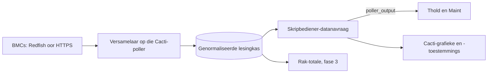

<!-- Source: README.md; SHA256: 7b4e83a58a1adc844cb0615ef30e95476cba2851f96bb454d2a816fb2774724d -->

<!-- translations:start -->
[English](../../../README.md) | [简体中文](../zh-CN/README.md) | [हिन्दी](../hi-IN/README.md) | [Español (España)](../es-ES/README.md) | [Español (Latinoamérica)](../es-419/README.md) | [العربية (السعودية)](../ar-SA/README.md) | [Afrikaans](README.md) | [አማርኛ](../am-ET/README.md) | [العربية (مصر)](../ar-EG/README.md) | [العربية (المغرب)](../ar-MA/README.md) | [বাংলা](../bn-BD/README.md) | [Deutsch](../de-DE/README.md) | [فارسی](../fa-IR/README.md) | [Filipino](../fil-PH/README.md) | [Français](../fr-FR/README.md) | [Français (Maroc)](../fr-MA/README.md) | [Français (Sénégal)](../fr-SN/README.md) | [Hausa](../ha-NG/README.md) | [עברית](../he-IL/README.md) | [Bahasa Indonesia](../id-ID/README.md) | [Igbo](../ig-NG/README.md) | [Italiano](../it-IT/README.md) | [日本語](../ja-JP/README.md) | [한국어](../ko-KR/README.md) | [Malagasy](../mg-MG/README.md) | [मराठी](../mr-IN/README.md) | [Bahasa Melayu](../ms-MY/README.md) | [Nederlands](../nl-NL/README.md) | [Polski](../pl-PL/README.md) | [Português (Brasil)](../pt-BR/README.md) | [Русский](../ru-RU/README.md) | [Kinyarwanda](../rw-RW/README.md) | [Soomaali](../so-SO/README.md) | [Svenska](../sv-SE/README.md) | [Kiswahili](../sw-KE/README.md) | [தமிழ்](../ta-IN/README.md) | [తెలుగు](../te-IN/README.md) | [ไทย](../th-TH/README.md) | [Türkçe](../tr-TR/README.md) | [Українська](../uk-UA/README.md) | [اردو](../ur-PK/README.md) | [Tiếng Việt](../vi-VN/README.md) | [isiXhosa](../xh-ZA/README.md) | [Yorùbá](../yo-NG/README.md) | [繁體中文](../zh-TW/README.md) | [isiZulu](../zu-ZA/README.md)
<!-- translations:end -->

# plugin_redfish

'n Cacti 1.2-inprop wat bedienerkragverbruik, inlaattemperatuur, waaierstatus en kragbron-gesondheid vanaf basisbordbestuursbeheerders (BMCs) as gewone toestelle, databronne en grafieke na Cacti bring deur gebruik te maak van Redfish met 'n opsionele IPMI-terugval. Thold en Maint kan dan daarop waarsku en waarskuwings onderdruk, en 'n latere fase voeg rakvlak-kragtotale by.

> **Status: in ontwikkeling, nog geen vrystelling nie (0.1.0-dev).** Mylpale 2 (grondslag) en 3 (Cacti-objekte en waarskuwings) is op `main` saamgevoeg. Hierdie inprop is nie aan die Cacti-projek geaffilieer nie. Dit installeer op Cacti 1.2.31 onder PHP 8.2 of later, registreer BMCs en aanmeldbesonderhede, lees krag, temperature, waaiers en kragbron-gesondheid vanaf elke BMC oor Redfish na sy eie kas, en vertoon die versamelingsgesondheid. Dit voeg Cacti-toestelle, per-lid- en opsommingsgrafieke, en Thold- en Maint-ondersteuning deur gewone databronne by. CI het 'n skyn-BMC getoets wat uit handgeskrewe toetsdata en die DMTF Redfish-skynbediener gebou is; geen werklike BMC of loodsvloot is al gekwalifiseer nie. Die ontwerp en navorsing is in [docs/PLAN.md](../../PLAN.md), [docs/research/](../../research) en [docs/decisions/](../../decisions).

### Wat mylpaal 2 lewer

- Installeer, gradeer op, deaktiveer en deïnstalleer deur Cacti se inprop-API, met tabelle wat tydens deïnstallasie behou word tensy die instelling verwyder word. Op PHP ouer as 8.2 weier die inprop om te installeer of te aktiveer en verduidelik hoekom.
- Domeine "Redfish View" (gesondheidsbladsy), "Redfish Operator" (bedryfsbladsy) en "Redfish Admin" (BMCs- en aanmeldbesonderhede-bladsye), en instellings onder Configuration > Settings > Redfish.
- 'n BMC-register met CSV-invoer en JSON-uitvoer. Invoerlêers mag nie wagwoorde bevat nie; daar word per naam na aanmeldbesonderhede verwys.
- Aanmeldbesonderhede word geënkripteer gestoor met AES-256-GCM. Die sleutel is 'n lêer buite die databasis, by verstek `/etc/cacti/redfish-vault.key`, wat 64 heksadesimale karakters (`openssl rand -hex 32`) of presies 32 ewekansige grepe bevat, in besit is van die poller-gebruiker, nie deur ander gebruikers leesbaar is nie, en in 'n gids lê waar slegs die poller-gebruiker of root kan skryf. 'n Sleutel van 32 drukbare karakters word as 'n wagwoordfrase geweier. **Rugsteun die sleutellêer saam met die databasis**; daarsonder moet elke gestoorde wagwoord weer ingevoer word.
- TLS-verifikasie is by verstek aan, met 'n per-BMC CA-bundel of SPKI SHA-256-pin. 'n Gelogde, per-BMC ongeverifieerde onttrekking bly as 'n waarskuwing op die gesondheidsbladsy.
- 'n Leesalleen Redfish-kliënt: slegs `GET` plus die sessie-aanmelding en -afmelding, gekontroleer teen 'n toelaatlys voordat enige versoek gestuur word.
- 'n Versamelaar wat vanaf `poller_bottom` begin word vir BMCs op die hoofpoller, met per-BMC-huurtye en -spertye, terugtree-intervalle en opruiming ná 'n omval van die een sessie wat die inprop aangeteken het. Afgeleë versamelaars word nog nie ondersteun nie; hulle vereis 'n uitdruklike keuse oor hoe die versamelaar die databasis en die sleutel bereik (fase 4).
- BMC-rekords en aanmeldbesonderhede volg Cacti-toesteltoestemmings: 'n Redfish Admin sien, wysig en bind slegs BMCs op toestelle wat hulle mag sien, en slegs aanmeldbesonderhede wat deur geen BMC op 'n versteekte toestel gebruik word nie.

### Wat mylpaal 3 byvoeg

- Sjablone wat as Cacti-sjabloon-XML in `templates/` verskeep word en tydens installasie en opgradering met Cacti se eie invoerder ingevoer word, gepas volgens hutsmerk, sodat 'n invoer die inprop se objekte opdateer en niks twee keer byvoeg nie. Die drie datanavraag-lêers word na `<cacti>/resource/script_server/` gekopieer met 'n aangetekende hutsmerk; die inprop vervang nooit 'n lêer daar wat hy nie self geskryf het nie, en die gesondheidsbladsy waarsku administrateurs wanneer die sjablone of 'n navraaglêer nie in plek is nie. **Reinstall the Redfish Templates** op die BMCs-bladsy voer dit weer in; dit vereis Cacti se Import Templates-toestemming.
- **Create Device** of **Add Graphs** op elke BMC ([ADR 0015](../../decisions/0015-attach-to-the-server-device-or-create-one-per-bmc.md)). 'n BMC wat aan 'n bediener se bestaande toestel gekoppel is, kry sy datanavrae en grafieke op daardie toestel. 'n Ongekoppelde BMC kry 'n nuwe toestel vanaf die "Redfish BMC"-toestelsjabloon, met beskikbaarheidstoetse afgeskakel en 'n gasheernaam onder `.invalid`, sodat Cacti nooit die BMC kontak nie en nooit sy adres wys nie. In albei gevalle bevestig 'n administrateur eers 'n plan wat lys wat bygevoeg sal word. Albei vereis Cacti se toestelbestuur-toestemming sowel as Redfish Admin; 'n nuwe toestel wat die skepper nie kon sien nie, word weer verwyder.
- Drie skripbediener-datanavrae, "Redfish Fans", "Redfish Temperatures" en "Redfish Power Supplies", geïndekseer deur die BMC se lidsleutel, met 'n grafiek per lid: waaierspoed in persent of RPM (watter eenheid die BMC ook al rapporteer), temperatuur, en kragbron se inset- en uitset-watt, elk met sy gesondheidskode.
- 'n "Redfish Node Summary"-invoer met krag, inlaattemperatuur, die hoogste temperatuur, waaiers en kragbronne wat nie OK is nie, nodusgesondheid, en die ouderdom van die laaste goeie lesing, geteken op vier grafieke: krag, temperature, komponentgesondheid en data-ouderdom. Thold-drempels op hierdie databronne waarsku, en Maint onderdruk dit, sonder enige verandering aan enige van die twee inproppe.
- Die skripbediener antwoord slegs vanuit die inprop se kas en kontak nooit 'n BMC nie. 'n Waarde wat ontbreek, verouderd is, van 'n ander eenheid is, of van 'n lid is wat verdwyn het, is `U`, sodat grafieke 'n gaping wys, nooit nul nie; `age` het altyd 'n waarde, sodat 'n drempel daarop 'n BMC vang wat opgehou het om te antwoord.
- 'n Grafiekskakel vanaf elke Redfish-grafiek na die toestel se Redfish-grafieke, slegs gewys aan gebruikers wat Cacti toelaat om die toestel te sien.

**Wanneer 'n BMC se lede verander** ('n waaier vervang, 'n fermware-opdatering wat sensors hernoem), kies weer **Add Graphs**. 'n Waaier of kragbron wat teenwoordig was en nou afwesig of weg is, tel in `fans_bad` of `psus_bad` totdat u dit doen, sodat 'n uitgetrekte waaier waarsku; 'n gleuf wat nooit gevul was nie, doen nie. Add Graphs aanvaar die lede wat die BMC nou rapporteer, en Cacti indekseer die navrae weer; 'n lid wat weg is, behou sy databron en grafiek, wat van toe af `U` lees, en 'n nuwe lid kry 'n grafiek. Skrap die grafieke van lede wat weg is handmatig sodra hul geskiedenis nie meer nodig is nie.

Die skrapping van 'n toestel ontkoppel sy BMC en behou die BMC en sy kas. Die skrapping van 'n BMC, of die deïnstallasie van die inprop, behou sy toestel en grafieke.

## Toegangsrolle

| Domein | Toegang |
| --- | --- |
| Redfish View | Bestaande moniteringsbladsye. |
| Redfish Operator | Monitering plus die bedryfsbladsy en persoonlike siftingserkennings. |
| Redfish Admin | Operator-toegang plus die bestaande konfigurasie- en administratiewe handelinge. |

Nadat opgraderingslêers gekopieer is, maak die Plugins-bladsy as 'n administrateur oop om
die nuwe domein te registreer. Ken die Operator-domein uitdruklik toe onder **Configuration > Users** of gebruikersgroepe.
Opgraderings behou die bestaande View- en Admin-domein-ID's en toekennings. Admin-toegang
erf Operator-toegang, en Operator-toegang erf View-toegang met elke versoek;
dit voeg nie gestoorde toekennings by gebruikers of groepe nie. Inprop-instellings vereis ook
Redfish Admin-toegang benewens Cacti se Settings-toestemming.

Cacti-toesteltoestemmings beperk steeds die rye en handelinge wat vir elke gebruiker beskikbaar is; ongekoppelde objekte vereis 'n administrateur. Operateurs kan 'n versamelingsopskorting op 'n toegelate BMC vir die volgende geskeduleerde lopie vrystel.
Aanmeldbesonderhede, konfigurasie, koppeling, skrapping en ander administratiewe veranderinge
bly in die administratiewe bladsye. Erkennings duur slegs in die huidige
gebruiker se sessie, vir hoogstens een uur en slegs terwyl dieselfde waarneming vars bly.
Nuwe of gewysigde waarnemings maak dit ongeldig. Dit merk nooit 'n mislukte
meting as gesond nie en onderdruk nie waarskuwings nie.

## Hoekom

Elke bediener het 'n BMC wat krag- en termiese toestand onafhanklik van die bedryfstelsel rapporteer, sodat dit aanhou antwoord wanneer die bedryfstelsel af is. Die data dien vir kapasiteits- en kostenasporing, vroeë waarskuwing van 'n mislukte waaier of kragbron, en in hoëprestasie-rekenaarwese vir kragbeperkingsbesluite. Die inprop is nie HPC-spesifiek nie.

Cacti dek vandag 'n deel hiervan:

- **Verskaffer-SNMP-pakkette.** Die 1.2.x-tak verskeep Dell iDRAC- en HPE iLO-sjablone wat 'n SNMP-agent benodig en verskafferspesifiek is; navorsing in mylpaal 1 het bevind dat geeneen van beide kragverbruik in watt rapporteer nie ([docs/research/overlap.md](../../research/overlap.md)).
- **'n Aanmeldbesonderheid-tipe sonder 'n versamelaar.** plugin_credentials definieer 'n "IPMI / Redfish (BMC)"-aanmeldbesonderheid, maar lees geen BMC nie.
- **Geen rakvlak-aansig nie.** Cacti-kern het geen rakobjek nie; 'n toestel het 'n vryteks-`location`-veld.

Die inprop peil BMCs buite die band van Cacti se peilsiklus, kas genormaliseerde lesings en stel dit beskikbaar deur middel van 'n skripbediener-datanavraag en opsommingsdatabronne. Dit hergebruik Cacti se grafieke, toestemmings, Thold en Maint, en verander nie BMC-toestand nie. Ondersteuning vir afgeleë dataversamelaars word vir fase 4 beplan; huidige versameling loop slegs op die hoofpoller.

## Beplande omvang

| Fase | Omvang | Mylpale |
|---|---|---|
| 0, navorsing | Verskaffermatriks, bevestiging van stroomop-gedrag op lewendige BMCs, peilkoste, datanavraag-toets | [M1](https://github.com/somethingwithproof/plugin_redfish/milestone/1) |
| 1, waarneming | BMC-register, aanmeldbesonderhede, TLS, Redfish-versamelaar, genormaliseerde lesings, toestelle, per-indeks-grafieke, Thold-waarskuwings, Maint-onderdrukking, gesondheidsbladsy | [M2](https://github.com/somethingwithproof/plugin_redfish/milestone/2), [M3](https://github.com/somethingwithproof/plugin_redfish/milestone/3), [M4](https://github.com/somethingwithproof/plugin_redfish/milestone/4) |
| 2, ipmi | IPMI-terugval vir BMCs sonder bruikbare Redfish, by verstek af | [M5](https://github.com/somethingwithproof/plugin_redfish/milestone/5) |
| 3, rakke | Rakregister, rakkragtotale met dekking, begrotingspeling | [M6](https://github.com/somethingwithproof/plugin_redfish/milestone/6) |
| 4, afgeleë | Cacti afgeleë dataversamelaars vir geïsoleerde BMC-netwerke | [M7](https://github.com/somethingwithproof/plugin_redfish/milestone/7) |

Buite omvang: die stel van kraglimiete of enige ander BMC-konfigurasie, kragbeheer, fermware-opdatering, konsoletoegang, 'n eie waarskuwingsenjin vir die inprop, en skeduleerder-integrasie.

## Versoenbaarheidsteikens

| Komponent | Teiken |
|---|---|
| Cacti | 1.2.31 of later, geen kernlappies nie |
| Databasis | MariaDB 10.2 of MySQL 5.7 of later: een BMC per toestel word gehou deur 'n unieke sleutel op 'n gegenereerde kolom |
| PHP | 8.2 of later; `setup.php` bly ontleedbaar op 8.0 sodat 'n onondersteunde looptyd 'n weiering kry in plaas van 'n stukkende Cacti-UI |
| BMCs | Dell iDRAC, HPE iLO, Lenovo XCC en OpenBMC, volgens fermwarereeks; sien [die verskaffermatriks](../../research/vendor-matrix.md) |
| Redfish | Nuwe substelsel- en sensorhulpbronne eerste, verouderde `Power` en `Thermal` as terugval |
| Thold, Maint | Geen veranderinge nodig nie |

## Ontwerp

- [docs/PLAN.md](../../PLAN.md) is die volledige plan: argitektuur, stroomop-feite waarop dit steun (met bronne en aannames wat nog bevestig moet word), metingsmodel, sekuriteitsgrense, werkverrigtingsrekenkunde, toetsing en risiko's.
- [docs/decisions/](../../decisions) bevat argitektuurbesluitrekords vir keuses wat reeds gemaak is.
- [docs/REQUIREMENTS.md](../../REQUIREMENTS.md) karteer elke vereiste-ID na sy kwessie.

## Sekuriteit

BMC-aanmeldbesonderhede beheer buiteband-bestuur van bedieners. Die ontwerp hou dit uit opdragreëls, logs en bladsye, verifieer TLS by verstek, voer enige eksterne opdrag vanaf 'n argument-skikking uit met toelaatlys-subopdragte, en gebruik leesalleen BMC-rekeninge. Sien [docs/PLAN.md](../../PLAN.md#security) en [SECURITY.md](../../../SECURITY.md).

## Operateursgids

Sien [docs/operator-guide.md](../../operator-guide.md) vir installasievoorvereistes, kluis- en TLS-opstelling, BMC-registrasie, grafiekskepping, waarskuwingsintervalle, rugsteun en mislukkingshantering. Die gids verklaar nie 'n werklike verskaffer-fermwarelyn as ondersteun totdat 'n geredigeerde vaslegging van daardie fermware die toetspakket slaag nie.

## Hoe werk nagespoor word

- **Mylpale** volg die plan se mylpale. Elkeen het 'n epiese kwessie wat sy sub-kwessies en uitgangsbewyse lys.
- **Kwessies** word volgens etiket getipeer: `type: requirement`, `type: research`, `type: decision`, `type: epic`. Vereistekwessies meld genommerde, toetsbare vereistes (`REQ-AREA-NNN`) en aanvaardingskriteria.
- **Etikette** dra ook `area:`, `phase:`, `priority:` en `status:`. Sien [CONTRIBUTING.md](../../../CONTRIBUTING.md#labels).
- Die [projekbord](https://github.com/users/somethingwithproof/projects/12) wys alle kwessies oor mylpale heen.

## Bydraes

Lees [CONTRIBUTING.md](../../../CONTRIBUTING.md). Toewydings benodig 'n DCO-aftekening. Ontwerpbespreking vind op kwessies plaas; oop besluite dra die `type: decision`-etiket. Bewyse vanaf werklike BMCs is nou die nuttigste bydrae; redigeer adresse, reeksnommers en aanmeldbesonderhede voordat enige vaslegging geplaas word.

## Lisensie

GNU General Public License v2.0, dieselfde lisensie as Cacti en sy inproppe. Sien [LICENSE](../../../LICENSE).
