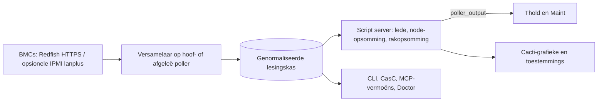

<!-- Source: README.md; SHA256: cf31b9f80d6c00020bbe08e80951d4de1c910793911d040ae7a66b54e8a2eaf0 -->

<!-- translations:start -->
[English](../../../README.md) | [简体中文](../zh-CN/README.md) | [हिन्दी](../hi-IN/README.md) | [Español (España)](../es-ES/README.md) | [Español (Latinoamérica)](../es-419/README.md) | [العربية (السعودية)](../ar-SA/README.md) | [Afrikaans](README.md) | [አማርኛ](../am-ET/README.md) | [العربية (مصر)](../ar-EG/README.md) | [العربية (المغرب)](../ar-MA/README.md) | [বাংলা](../bn-BD/README.md) | [Bosanski](../bs-BA/README.md) | [Deutsch](../de-DE/README.md) | [فارسی](../fa-IR/README.md) | [Filipino](../fil-PH/README.md) | [Français](../fr-FR/README.md) | [Français (Maroc)](../fr-MA/README.md) | [Français (Sénégal)](../fr-SN/README.md) | [Hausa](../ha-NG/README.md) | [עברית](../he-IL/README.md) | [Hrvatski](../hr-HR/README.md) | [Bahasa Indonesia](../id-ID/README.md) | [Igbo](../ig-NG/README.md) | [Italiano](../it-IT/README.md) | [日本語](../ja-JP/README.md) | [한국어](../ko-KR/README.md) | [Malagasy](../mg-MG/README.md) | [मराठी](../mr-IN/README.md) | [Bahasa Melayu](../ms-MY/README.md) | [Nederlands](../nl-NL/README.md) | [Polski](../pl-PL/README.md) | [Português (Brasil)](../pt-BR/README.md) | [Русский](../ru-RU/README.md) | [Kinyarwanda](../rw-RW/README.md) | [Soomaali](../so-SO/README.md) | [Српски](../sr-RS/README.md) | [Svenska](../sv-SE/README.md) | [Kiswahili](../sw-KE/README.md) | [தமிழ்](../ta-IN/README.md) | [తెలుగు](../te-IN/README.md) | [ไทย](../th-TH/README.md) | [Türkçe](../tr-TR/README.md) | [Українська](../uk-UA/README.md) | [اردو](../ur-PK/README.md) | [Tiếng Việt](../vi-VN/README.md) | [isiXhosa](../xh-ZA/README.md) | [Yorùbá](../yo-NG/README.md) | [繁體中文](../zh-TW/README.md) | [isiZulu](../zu-ZA/README.md)
<!-- translations:end -->

# plugin_redfish

'n Cacti 1.2-inprop wat bedienerkragverbruik, inlaattemperatuur, waaiertoestand en kragtoevoergesondheid vanaf basisbord-bestuursbeheerders (BMCs) as gewone toestelle, databronne en grafieke na Cacti bring, deur Redfish te gebruik met 'n opsionele leesalleen-IPMI-terugval en kragopsommings op rakvlak. Thold en Maint waarsku daaroor en onderdruk waarskuwings deur middel van standaard Cacti-databronne.

> **Status: in ontwikkeling, nog geen vrystelling nie (`0.1.0-dev`).** Hierdie inprop is nie aan die Cacti-projek verbonde nie. Dit installeer op Cacti 1.2.31 of nuwer onder PHP 8.2 of nuwer en implementeer die Redfish-versamelaar, geënkripteerde geloofsbriefkluis, Cacti-toestel- en grafiekvoorsiening, opsionele leesalleen-IPMI-terugval, rakkragopsomming, Cacti Maint-venstervertoning, afgeleë dataversamelaar-replikasie en agent-eindpunte, CasC-verskaffer en operateur-CLI, MCP-vermoëns en Doctor-diagnostiese kontroles. CI toets toetsdata, die DMTF Redfish Mockup Server (substelsel-, slegs-erfenis- en HPE iLO Gen11-modelle) en Thold v1.8.2 met Maint v1.3; geen werklike fisiese BMC of loodsvloot is nog gekwalifiseer nie. Die ontwerp en navorsing is in [docs/PLAN.md](../../PLAN.md), [docs/research/](../../research/) en [docs/decisions/](../../decisions/).

## Geïmplementeerde vermoëns

### Kernversamelaar, kluis en Cacti-objekte

- **Lewensiklus en skema.** Installeer, gradeer op, deaktiveer en deïnstalleer deur Cacti se inprop-API (`Schema::VERSION = 3`, 12 tabelle). Tabelle word behou tydens deïnstallasie tensy *Keep Plugin Tables on Uninstall* gedeselekteer word. Ingangspunte ontleed op PHP 8.0 en weier PHP laer as 8.2 of ontbrekende `ext-openssl` met 'n uitdruklike foutboodskap.
- **Register en toestemmings.** Rêels *Redfish View* (`redfish_health.php`), *Redfish Operator* (`redfish_operator.php`) en *Redfish Admin* (`redfish_bmcs.php`, `redfish_credentials.php`), plus instellings onder **Configuration > Settings > Redfish**. Die BMC-register ondersteun CSV-invoer (geloofsbriewe per naam verwys; wagwoorde in invoerlêers word geweier) en JSON-uitvoer. BMC-rekords en geloofsbriewe volg Cacti-toesteltoestemmings.
- **Geënkripteerde geloofsbriefkluis.** Wagwoorde word geënkripteer met AES-256-GCM in `plugin_redfish_secret` gestoor. Die sleutel bly buite die databasis (`/etc/cacti/redfish-vault.key` by verstek) as 64 heksadesimale karakters (`openssl rand -hex 32`) of 32 rou grepe, besit deur die poller-gebruiker, onleesbaar vir ander gebruikers, in 'n gids wat slegs deur root of daardie gebruiker skryfbaar is. 'n 32-karakter drukbare wagfrase word geweier. **Rugsteun die sleutellêer saam met die databasis**; daarsonder moet gestoorde wagwoorde weer ingevoer word.
- **TLS en leesalleen Redfish-kliënt.** TLS-verifikasie is by verstek geaktiveer met die stelsel-CA-stoor, 'n per-BMC CA-bundel of 'n SPKI SHA-256-speld; per-BMC ongeverifieerde uitsluiting bly sigbaar as 'n gesondheidswaarskuwing en Doctor-kontrolewaarskuwing. Die kliënt laat slegs `GET` plus Redfish-sessie-aanmelding (`POST`) en -afmelding (`DELETE`) toe, met opsionele per-BMC Basic-terugval wanneer sessies onbeskikbaar is. Ontdekking verkies nuwe Redfish-substelsel- en sensorhulpbronne en val terug op verouderde `Power`- en `Thermal`-hulpbronne.
- **Versamelaar-uitvoering.** `poller_redfish.php` begin vanaf `poller_bottom`, voer een meesterproses per poller via Cacti se prosesregister uit met konfigureerbare werkerprosesse (`redfish_workers`), verkry per-BMC-huurkontrakte, dwing 'n tydbegroting (`redfish_collector_budget`) af, pas eksponensiële terugval toe en maak die inprop se eie vorige sessie ná 'n ongeluk skoon.
- **Sjablone, toestelle en grafieke.** Voer `templates/redfish-templates.xml` volgens huts in en kopieer drie script server-datanavraag-XML-lêers (`redfish_fans.xml`, `redfish_temperatures.xml`, `redfish_psus.xml`) na `<cacti>/resource/script_server/` sonder om gebruikergemodifiseerde lêers te oorskryf. **Create Device** en **Add Graphs** vereis bevestiging van 'n voorsieningsplan, heg navrae aan 'n gekarteerde bedienertoestel of skep 'n "Redfish BMC"-toestel onder `.invalid` met beskikbaarheidskontroles gedeaktiveer, en skakel elke Redfish-grafiek terug na die toestel se Redfish-grafieke via `graph_buttons`.
- **Slegs-kas script server-insette.** `scripts/ss_redfish_members.php` bedien per-lid waaier-, temperatuur- en PSU-lesings, en `scripts/ss_redfish_summary.php` bedien "Redfish Node Summary"-metrieke (krag, inlaat- en maksimum temperatuur, foutiewe waaier- en PSU-tellings, nodegesondheid en ouderdom van die laaste goeie lesing). Script server-oproepe lees slegs die plaaslike kas en kontak nooit 'n BMC nie. Ontbrekende, verouderde of verdwene lidlesings gee `U` terug (nooit `0` nie), terwyl `age` altyd 'n waarde rapporteer sodat drempels stil BMCs opspoor.

**Wanneer 'n BMC se lede verander** (soos 'n vervangde waaier of 'n firmware-opdatering wat sensors hernoem), voer **Add Graphs** weer uit. 'n Voorheen aanwesige waaier of kragtoevoer wat afwesig raak, tel in `fans_bad` of `psus_bad` totdat dit aanvaar word; 'n gleuf wat nooit gevul was nie, tel nie. Verdwene lede behou hul bestaande databronne en grafieke, wat daarna `U` lees totdat dit met die hand verwyder word. Die verwydering van 'n Cacti-toestel ontkoppel sy BMC en verwyder sy raktoewysing terwyl die BMC en kas behou word; die verwydering van 'n BMC of deïnstallasie van die inprop behou Cacti-toestelle en grafieke.

### Opsionele IPMI-terugval

- **Intekening per BMC.** By verstek afgeskakel (`protocols` is by verstek `redfish`; aktivering van IPMI-terugval stel `redfish,ipmi`).
- **Beperkte terugvalsneller.** Loop slegs wanneer Redfish-versameling misluk met 'n kwalifiserende mislukkingsklas; sneller nooit op `AuthRejected`, `CredentialUnavailable`, `AddressRefused`, `OperationRefused` of `Deadline` nie.
- **Veilige uitvoering.** Roep `ipmitool` oor `-I lanplus` via skikkingvorm `proc_open()` sonder dop, begrensde werklike tydlimiet en 'n 256 KiB-uitvoerlimiet aan. Wagwoorde word verskaf via `IPMITOOL_PASSWORD` (`-E`) of 'n modus-0600 tydelike lêer (`-f`) wat in `finally` verwyder word, nooit op CLI-argv nie.
- **Leesalleen-opdragtoelatingslys.** Slegs vyf leesalleen-subopdragte word toegelaat: `dcmi power reading`, `sdr type Temperature`, `sdr type Fan`, `sdr type Power Supply` en `chassis status`. Veranderende opdragte word geweier.
- **Genormaliseerde uitvoer en postuurwaarskuwing.** `IpmiNormalizer` karteer lesings in dieselfde `Observation`/`Member`/`Reading`-model en lewer `U` vir ontbrekende of ontleedbare sensors. Aktivering van IPMI-terugval wek 'n waarskuwing op die gesondheidsbladsy en in die `redfish.bmc_security` Doctor-kontrole wat operateurs herinner om UDP 623 tot 'n bestuurs-VLAN te beperk.

### Rakkragopsomming

- **Rakregister.** Skemaweergawe 3 voeg `plugin_redfish_rack` (unieke `(site_id, name)`, opsionele `power_budget_watts`, `min_coverage_pct` met verstek `80` en notas) en `plugin_redfish_rack_member` (hoogstens een raktoewysing per `host_id`, opsionele `bmc_id` en `unit_position`, outomaties verwyder wanneer 'n Cacti-toestel verwyder word) by.
- **Dekkingsbeskermde totale.** `RackPowerSummary` tel vars lid-`power_watts`-lesings uit die plaaslike kas op en bereken begrotingbenutting en oorblywende kapasiteit. Wanneer rapporterende liddekking onder `min_coverage_pct` daal, gee `power_watts`, `utilization_pct` en `headroom_watts` `U` terug sodat versamelaarmislukkings nooit as 'n daling in rakkrag verskyn nie.
- **Thold-gereed script server-invoer.** `scripts/ss_redfish_rack.php` (`ss_redfish_rack(<rack_id>)`) gee `power_watts`, `power_budget_watts`, `utilization_pct`, `headroom_watts`, `members_total`, `members_reporting` en `coverage_pct` slegs uit die plaaslike kas terug.

### Cacti Maint-integrasie

- Thold-drempels op Redfish-databronne waarsku en Cacti Maint onderdruk hulle sonder veranderinge aan enige van beide inproppe.
- `MaintWindow` kontroleer aktiewe Maint-skedules vir elke gekarteerde Cacti-gasheer (eenmalige `mtype=1` en herhalende `mtype=2` skedules, plus `plugin_maint_check_cacti_host()` wanneer gelaai) en merk aktiewe instandhouding op die Redfish-gesondheidsbladsy (`[MAINT]`), in `cli/redfish.php health`-uitvoer en in die `redfish-get-health`-vermoë.

### Afgeleë dataversamelaars

- `INFO` verklaar `remote_collect:1`. BMCs aanvaar enige `poller_id >= 1`, en `poller_redfish.php --poller=N` versamel slegs geaktiveerde BMCs wat aan daardie poller toegewys is.
- **`replicate_out`-haak.** Repliseer slegs nie-geheime konfigurasietabelle wat tot die teiken afgeleë poller beperk is via `replicate_out_table()`: `plugin_redfish_bmc`, `plugin_redfish_credential`-metadata (geen syferteks), `plugin_redfish_rack` en `plugin_redfish_rack_member`. `plugin_redfish_secret` word nie gerepliseer nie, en kluissleutellêers bly streng plaaslik op elke poller.
- **`remote_agent`-haak.** Stel leesalleen-aksies `redfish_health` en `redfish_discovery` bloot wat slegs numeriese `poller_id`- en `bmc_id`-parameters aanvaar. Onverwagte parameters word geweier en geen geloofsbriewe of geheime word teruggegee nie.

### Ekosisteemhake (CasC, MCP-vermoëns en Doctor)

- **CasC-verskaffer (`casc_register_providers`).** Registreer die `redfish`-verskaffer (skemaweergawe `1`) met suiwer-PHP YAML- en XML-uitvoer, ontleding (met XXE geweier), validering, verskilbeplanning en toepassing. Geloofsbriewe verskyn slegs as kluisverwysings (`vault:redfish:<name>`); rou geheime sleutels (`pass`, `secret`, `token`, `private_key`, `vault_key`, `auth_token`) word verwerp. Toepassing vereis 'n presiese SHA-256 `PLAN_HASH`.
- **MCP / Abilities API (`abilities_register`).** Registreer drie leesalleen-vermoëns wat deur die Redfish View-rêel (`redfish_health.php`) en Cacti-toesteltoestemmings beheer word, en gee geen geloofsbriewe terug nie:
  - `redfish-list-bmcs` (opsionele `poller_id`)
  - `redfish-get-rack-power` (opsionele `rack_id`)
  - `redfish-get-health` (opsionele `bmc_id`)
- **Doctor-kontroles (`doctor_register_checks`).** Registreer vyf plaaslike, leesalleen diagnostiese kontroles wat nooit 'n BMC kontak of sleutelmateriaal teruggee nie:
  - `redfish.schema`: aktualiteit van skemaweergawe
  - `redfish.vault_key`: leesbaarheid en toestemmings van kluissleutel
  - `redfish.collector_runs`: poller-versamelaarbegroting en varsheid
  - `redfish.bmc_security`: geaktiveerde BMCs met ongeverifieerde TLS of IPMI-terugval
  - `redfish.rack_power`: nakoming van rakkragbegroting en dekkingsvloer

## CLI

Voer vanaf die Cacti-wortelgids uit met PHP 8.2 of nuwer:

```sh
# Operator and CasC CLI (reads --file=PATH or stdin for validate, plan, and apply)
php plugins/redfish/cli/redfish.php export --format=yaml|xml
php plugins/redfish/cli/redfish.php validate [--file=PATH] [--format=yaml|xml]
php plugins/redfish/cli/redfish.php plan [--file=PATH] [--format=yaml|xml]
php plugins/redfish/cli/redfish.php apply [--file=PATH] [--format=yaml|xml] --confirm=<PLAN_HASH>
php plugins/redfish/cli/redfish.php health --format=text|json

# Collector entry point (normally started by poller_bottom)
php plugins/redfish/poller_redfish.php [--poller=N] [--force] [--debug]

# Rack power summary script server entry point
php plugins/redfish/scripts/ss_redfish_rack.php <rack_id>
```

## Toegangsrolle

| Rêel | Toegang |
| --- | --- |
| Redfish View | Bestaande moniteringsbladsye. |
| Redfish Operator | Monitering plus die Bedryfsbladsy en persoonlike triage-erkennings. |
| Redfish Admin | Operateurtoegang plus die bestaande konfigurasie en administratiewe aksies. |

Ná die kopiëring van opgraderingslêers, maak die Plugins-bladsy as administrateur oop om die rêels te registreer. Ken die Operator-rêel uitdruklik toe onder **Configuration > Users** of gebruikersgroepe. Opgraderings behou die bestaande View- en Admin-rêel-ID's en toekennings. Admin-toegang erf Operator-toegang, en Operator-toegang erf View-toegang by elke versoek; dit voeg nie gestoorde toekennings by gebruikers of groepe nie. Inprop-instellings vereis ook Redfish Admin-toegang benewens Cacti se Settings-toestemming.

Cacti-toesteltoestemmings beperk die rye en aksies wat vir elke gebruiker beskikbaar is; ongekarteerde objekte vereis 'n administrateur. Operateurs kan 'n versamelingshou op 'n toegelate BMC vrystel vir die volgende geskeduleerde loop. Geloofsbriewe, konfigurasie, kartering, verwydering en ander administratiewe veranderinge bly in die administratiewe bladsye. Erkennings duur slegs in die huidige gebruiker se sessie, vir hoogstens een uur en slegs terwyl dieselfde waarneming vars bly. Nuwe of veranderde waarnemings maak dit ongeldig. Hulle merk nooit 'n mislukte meting as gesond nie en onderdruk nooit waarskuwings nie.

## Waarom

Elke bediener het 'n BMC wat krag- en termiese toestand onafhanklik van die bedryfstelsel rapporteer, sodat dit bly antwoord wanneer die bedryfstelsel af is. Die data dien vir kapasiteits- en kostenasporing, vroeë waarskuwing van 'n mislukte waaier of kragtoevoer, en, in hoëprestasie-rekenaarwese, kragbeperkingsbesluite. Die inprop is nie HPC-spesifiek nie.

Cacti dek vandag 'n deel hiervan:

- **Verskaffer-SNMP-pakkette.** Die 1.2.x-tak lewer Dell iDRAC- en HPE iLO-sjablone wat 'n SNMP-agent benodig en verskafferspesifiek is; mylpaal 1-navorsing het bevind dat geeneen kragverbruik in watt rapporteer nie ([docs/research/overlap.md](../../research/overlap.md)).
- **'n Geloofsbrieftipe sonder 'n versamelaar.** plugin_credentials definieer 'n "IPMI / Redfish (BMC)"-geloofsbrief maar lees geen BMC nie.
- **Geen rakvlak-aansig nie.** Cacti-kern het geen rakobjek nie; 'n toestel het 'n vrye-teks `location`-veld.

Die inprop peil BMCs buite band van Cacti se peilsiklus op die hoofpoller of afgeleë dataversamelaars, kas genormaliseerde lesings en stel dit beskikbaar deur script server-datanavrae, node-opsommings en rakkragopsommings. Dit hergebruik Cacti se grafieke, toestemmings, Thold en Maint, en verander nie die BMC-toestand nie.

## Omvang en status

| Fase | Omvang | Mylpale | Status |
|---|---|---|---|
| 0, navorsing | Verskaffermatriks, bevestiging van stroomop-gedrag op lewendige BMCs, peilkoste, datanavraag-toets | [M1](https://github.com/somethingwithproof/plugin_redfish/milestone/1) | Klaar, hangende werklike BMC-firmware-opnames |
| 1, waarneming | BMC-register, geloofsbriewe, TLS, Redfish-versamelaar, genormaliseerde lesings, toestelle, per-indeks grafieke, Thold-waarskuwings, Maint-integrasie, gesondheidsbladsy | [M2](https://github.com/somethingwithproof/plugin_redfish/milestone/2), [M3](https://github.com/somethingwithproof/plugin_redfish/milestone/3), [M4](https://github.com/somethingwithproof/plugin_redfish/milestone/4) | Geïmplementeer; M4-loodsvlootkwalifikasie hangende |
| 2, ipmi | Leesalleen IPMI (`lanplus`)-terugval via `ipmitool`, by verstek af | [M5](https://github.com/somethingwithproof/plugin_redfish/milestone/5) | Geïmplementeer |
| 3, rakke | Rakregister, rakkragtotale met dekkingsvloer, begrotingsmarge, `ss_redfish_rack.php` | [M6](https://github.com/somethingwithproof/plugin_redfish/milestone/6) | Geïmplementeer |
| 4, afgeleë en ekosisteem | Afgeleë dataversamelaars (`replicate_out`, `remote_agent`), CasC-verskaffer en CLI, MCP-vermoëns, Doctor-kontroles | [M7](https://github.com/somethingwithproof/plugin_redfish/milestone/7) | Geïmplementeer |

Buite omvang: die stel van kragbeperkings of enige ander BMC-konfigurasie, kragbeheer, firmware-opdatering, konsoletoegang, 'n inprop-besitte waarskuwingsenjin en skeduleerder-integrasie.

## Versoenbaarheidsdoelwitte

| Komponent | Doelwit |
|---|---|
| Cacti | 1.2.31 of nuwer, geen kernregstellings nie |
| Databasis | MariaDB 10.2 of MySQL 5.7 of nuwer: een BMC per toestel word gehou deur 'n unieke sleutel op 'n gegenereerde kolom |
| PHP | 8.2 of nuwer; ingangspunte bly ontleedbaar op 8.0 sodat 'n onondersteunde looptyd 'n weiering kry in plaas van 'n stukkende Cacti-UI |
| PHP-uitbreidings | `ext-openssl` (vereis deur Cacti 1.2.31); geen `ext-curl` en geen Composer-looptydafhanklikhede nie |
| Opsionele gereedskap | `ipmitool` op pollers wat BMCs versamel met IPMI-terugval geaktiveer |
| BMCs | Dell iDRAC, HPE iLO, Lenovo XCC en OpenBMC, volgens firmware-reeks; sien [die verskaffermatriks](../../research/vendor-matrix.md) |
| Redfish | Nuwe substelsel- en sensorhulpbronne eerste, verouderde `Power` en `Thermal` as terugval |
| Thold, Maint | Geen veranderinge benodig nie (CI oefen Thold v1.8.2 en Maint v1.3) |

## Ontwerp

- [docs/PLAN.md](../../PLAN.md) is die volledige plan: argitektuur, stroomop-feite waarop dit berus, metingsmodel, sekuriteitsgrense, werkverrigtingberekening, toetsing en risiko's.
- [docs/decisions/](../../decisions/) bevat argitektuurbesluitrekords vir keuses wat reeds gemaak is.
- [docs/REQUIREMENTS.md](../../REQUIREMENTS.md) karteer elke vereiste-ID na sy kwessie.



## Sekuriteit

BMC-geloofsbriewe beheer buite-band-bestuur van bedieners. Die ontwerp hou geheime uit opdragreëls, logs, CasC-uitvoere, afgeleë agent-vragte, MCP-antwoorde en webbladsye; enkripteer gestoorde wagwoorde met AES-256-GCM met 'n plaaslike kluissleutellêer per poller; verifieer TLS by verstek; voer `ipmitool` uit vanaf 'n uitdruklike argumentskikking met toegelate leesalleen-subopdragte; en gebruik leesalleen BMC-rekeninge. Sien [docs/PLAN.md](../../PLAN.md#security) en [SECURITY.md](../../../SECURITY.md).

## Operateursgids

Sien [docs/operator-guide.md](../../operator-guide.md) vir installasievoorvereistes, kluis- en TLS-opstelling, BMC-registrasie, grafiekskepping, waarskuwingsintervalle, rugsteun en mislukkingshantering. Die gids verklaar geen werklike verskaffer-firmware-lyn as ondersteun nie totdat 'n geredigeerde opname van daardie firmware die toetssuite slaag.

## Ontwikkeling en toetsing

CI (`.github/workflows/plugin-ci-workflow.yml`) lint ingangspunte op PHP 8.0, voer Pest eenheids- (`phpunit.xml`) en lewensiklus-integrasiesuites (`phpunit-integration.xml`) en PHPStan vlak 9 oor PHP 8.2 tot 8.5 teen Cacti `release/1.2.31` en `1.2.x` uit, verifieer weiering op PHP 8.1, oefen die DMTF Redfish Mockup Server (substelsel-, slegs-erfenis- en HPE iLO Gen11-modelle) en Thold v1.8.2 / Maint v1.3 end-tot-end, en kontroleer gettext-katalogusse, werkvloeie en REUSE-lisensiëring.

Plaaslike kontroles voor stoot:

```sh
sh tests/lint-workflows.sh
sh locales/build_gettext.sh --check
CACTI_PATH=/path/to/cacti phpstan analyse -c phpstan.neon --no-progress
```

Voer Pest uit met `--configuration=phpunit.xml` vir eenheids- en bronreëltoetse, of `--configuration=phpunit-integration.xml` met `CACTI_PATH` en `REDFISH_TEST_DATABASE=disposable` teen 'n weggooibare Cacti-databasis vir lewensiklus-integrasietoetse.

## Hoe werk nagespoor word

- **Mylpale** volg die plan se mylpale. Elkeen het 'n epiese kwessie wat sy subkwessies en uitgangsbewyse lys.
- **Kwessies** word volgens etiket getipeer: `type: requirement`, `type: research`, `type: decision`, `type: epic`. Vereistekwessies meld genommerde, toetsbare vereistes (`REQ-AREA-NNN`) en aanvaardingskriteria.
- **Etikette** dra ook `area:`, `phase:`, `priority:` en `status:`. Sien [CONTRIBUTING.md](../../../CONTRIBUTING.md#labels).
- Die [projekbord](https://github.com/users/somethingwithproof/projects/12) wys alle kwessies oor mylpale heen.

## Bydraes

Lees [CONTRIBUTING.md](../../../CONTRIBUTING.md). Verpligtinge benodig 'n DCO-aftekening (sign-off). Ontwerpbespreking vind op kwessies plaas; oop besluite dra die `type: decision`-etiket. Bewyse vanaf werklike BMCs is tans die nuttigste bydrae; redigeer adresse, reeksnommers en geloofsbriewe voordat enige opname geplaas word.

## Lisensie

GNU General Public License v2.0, dieselfde lisensie as Cacti en sy inproppe. Sien [LICENSE](../../../LICENSE).
