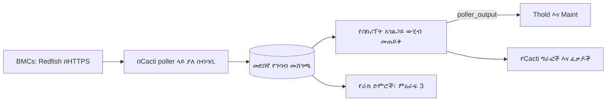

<!-- Source: README.md; SHA256: 7b4e83a58a1adc844cb0615ef30e95476cba2851f96bb454d2a816fb2774724d -->

<!-- translations:start -->
[English](../../../README.md) | [简体中文](../zh-CN/README.md) | [हिन्दी](../hi-IN/README.md) | [Español (España)](../es-ES/README.md) | [Español (Latinoamérica)](../es-419/README.md) | [العربية (السعودية)](../ar-SA/README.md) | [Afrikaans](../af-ZA/README.md) | [አማርኛ](README.md) | [العربية (مصر)](../ar-EG/README.md) | [العربية (المغرب)](../ar-MA/README.md) | [বাংলা](../bn-BD/README.md) | [Deutsch](../de-DE/README.md) | [فارسی](../fa-IR/README.md) | [Filipino](../fil-PH/README.md) | [Français](../fr-FR/README.md) | [Français (Maroc)](../fr-MA/README.md) | [Français (Sénégal)](../fr-SN/README.md) | [Hausa](../ha-NG/README.md) | [עברית](../he-IL/README.md) | [Bahasa Indonesia](../id-ID/README.md) | [Igbo](../ig-NG/README.md) | [Italiano](../it-IT/README.md) | [日本語](../ja-JP/README.md) | [한국어](../ko-KR/README.md) | [Malagasy](../mg-MG/README.md) | [मराठी](../mr-IN/README.md) | [Bahasa Melayu](../ms-MY/README.md) | [Nederlands](../nl-NL/README.md) | [Polski](../pl-PL/README.md) | [Português (Brasil)](../pt-BR/README.md) | [Русский](../ru-RU/README.md) | [Kinyarwanda](../rw-RW/README.md) | [Soomaali](../so-SO/README.md) | [Svenska](../sv-SE/README.md) | [Kiswahili](../sw-KE/README.md) | [தமிழ்](../ta-IN/README.md) | [తెలుగు](../te-IN/README.md) | [ไทย](../th-TH/README.md) | [Türkçe](../tr-TR/README.md) | [Українська](../uk-UA/README.md) | [اردو](../ur-PK/README.md) | [Tiếng Việt](../vi-VN/README.md) | [isiXhosa](../xh-ZA/README.md) | [Yorùbá](../yo-NG/README.md) | [繁體中文](../zh-TW/README.md) | [isiZulu](../zu-ZA/README.md)
<!-- translations:end -->

# plugin_redfish

የአገልጋይ የኃይል ፍጆታ፣ የመግቢያ ሙቀት፣ የአየር ማራገቢያ ሁኔታ እና የኃይል አቅርቦት ጤናን ከመሠረታዊ ሰሌዳ አስተዳደር ተቆጣጣሪዎች (BMCs) በአማራጭ IPMI ተተኪ በRedfish አማካኝነት እንደ መደበኛ መሣሪያዎች፣ የውሂብ ምንጮች እና ግራፎች ወደ Cacti የሚያመጣ የCacti 1.2 ተሰኪ ነው። ከዚያም Thold እና Maint ማንቂያዎችን ያሰማሉ እንዲሁም ይገድባሉ፣ እና ቀጣይ ምዕራፍ በራክ ደረጃ የኃይል ድምሮችን ይጨምራል።

> **ሁኔታ፦ በልማት ላይ፣ ገና የተለቀቀ የለም (0.1.0-dev)።** ምዕራፍ 2 (መሠረት) እና ምዕራፍ 3 (የCacti ነገሮች እና ማንቂያ) በ`main` ላይ ተዋህደዋል። ይህ ተሰኪ ከCacti ፕሮጀክት ጋር ግንኙነት የለውም። በPHP 8.2 ወይም ከዚያ በላይ ባለው ስር በCacti 1.2.31 ላይ ይጫናል፣ BMCዎችን እና የማረጋገጫ መረጃዎችን ይመዘግባል፣ ኃይልን፣ ሙቀቶችን፣ ማራገቢያዎችን እና የኃይል አቅርቦት ጤናን ከእያንዳንዱ BMC በRedfish አማካኝነት ወደ ራሱ መሸጎጫ ያነባል፣ እንዲሁም የስብስብ ጤናን ያሳያል። በመደበኛ የውሂብ ምንጮች በኩል የCacti መሣሪያዎችን፣ የእያንዳንዱን አባል እና የማጠቃለያ ግራፎችን፣ እንዲሁም የThold እና Maint ድጋፍን ይጨምራል። CI በእጅ ከተጻፉ መሞከሪያዎች እና ከDMTF Redfish የሙከራ አገልጋይ የተገነባ የውሸት BMC ሞክሯል፤ ምንም እውነተኛ BMC ወይም የሙከራ ስብስብ አልተረጋገጠም። ንድፉ እና ምርምሩ በ[docs/PLAN.md](../../PLAN.md)፣ [docs/research/](../../research) እና [docs/decisions/](../../decisions) ውስጥ ይገኛሉ።

### ምዕራፍ 2 የሚያቀርበው

- በCacti የተሰኪ API በኩል መጫን፣ ማሻሻል፣ ማሰናከል እና ማራገፍ፤ ቅንብሩ ካልተጸዳ በስተቀር ሲራገፍ ሠንጠረዦች ተጠብቀው ይቆያሉ። ከ8.2 በፊት በነበረ PHP ላይ ተሰኪው ለመጫን ወይም ለማንቃት እምቢ ይላል እንዲሁም ምክንያቱን ይገልጻል።
- "Redfish View" (የጤና ገጽ)፣ "Redfish Operator" (የክወናዎች ገጽ) እና "Redfish Admin" (የBMCዎች እና የማረጋገጫ መረጃዎች ገጾች) ግዛቶች፣ እንዲሁም በConfiguration > Settings > Redfish ስር ያሉ ቅንብሮች።
- CSV ማስገቢያ እና JSON ማውጫ ያለው የBMC መዝገብ። የሚገቡ ፋይሎች የይለፍ ቃላትን መያዝ የለባቸውም፤ የማረጋገጫ መረጃዎች በስም ይጠቀሳሉ።
- በAES-256-GCM ተመስጥረው የተቀመጡ የማረጋገጫ መረጃዎች። ቁልፉ ከውሂብ ጎታው ውጭ ያለ ፋይል ሲሆን፣ በነባሪ `/etc/cacti/redfish-vault.key` ነው፤ 64 ሄክሳዴሲማል ቁምፊዎችን (`openssl rand -hex 32`) ወይም በትክክል 32 የዘፈቀደ ባይቶችን የያዘ፣ በpoller ተጠቃሚ ባለቤትነት የተያዘ፣ በሌሎች ተጠቃሚዎች የማይነበብ፣ እና poller ተጠቃሚው ወይም root ብቻ ሊጽፍበት በሚችል አቃፊ ውስጥ ይገኛል። የ32 ሊታተሙ የሚችሉ ቁምፊዎች ቁልፍ እንደ የይለፍ ሐረግ ተቆጥሮ ተቀባይነት አያገኝም። **የቁልፍ ፋይሉን ከውሂብ ጎታው ጋር ምትኬ ያስቀምጡ**፤ ያለ እሱ የተቀመጠ እያንዳንዱ የይለፍ ቃል እንደገና መግባት አለበት።
- የTLS ማረጋገጫ በነባሪ በርቷል፣ ለእያንዳንዱ BMC የCA ጥቅል ወይም የSPKI SHA-256 ፒን አለው። የተመዘገበ፣ ለእያንዳንዱ BMC ያልተረጋገጠ የመውጣት ምርጫ በጤና ገጹ ላይ እንደ ማስጠንቀቂያ ይቆያል።
- ለንባብ ብቻ የሆነ የRedfish ደንበኛ፦ `GET` ከክፍለ ጊዜ መግቢያ እና መውጫ ጋር ብቻ፣ ማንኛውም ጥያቄ ከመላኩ በፊት ከተፈቀዱ ዝርዝር ጋር ይረጋገጣል።
- በዋናው poller ላይ ላሉ BMCዎች ከ`poller_bottom` የሚጀምር ሰብሳቢ፣ ለእያንዳንዱ BMC ኪራዮች እና የጊዜ ገደቦች፣ መዘግየት፣ እና ተሰኪው የመዘገበው አንድ ክፍለ ጊዜ ከተበላሸ በኋላ ጽዳት አለው። የርቀት ሰብሳቢዎች ገና አይደገፉም፤ ሰብሳቢው ወደ ውሂብ ጎታው እና ወደ ቁልፉ እንዴት እንደሚደርስ ግልጽ ምርጫ ያስፈልጋቸዋል (ምዕራፍ 4)።
- የBMC መዝገቦች እና የማረጋገጫ መረጃዎች የCacti መሣሪያ ፈቃዶችን ይከተላሉ፦ አንድ Redfish Admin ማየት በሚችላቸው መሣሪያዎች ላይ ያሉ BMCዎችን ብቻ፣ እና በተደበቀ መሣሪያ ላይ ያለ ምንም BMC የማይጠቀምባቸውን የማረጋገጫ መረጃዎች ብቻ ያያል፣ ይለውጣል እና ያገናኛል።

### ምዕራፍ 3 የሚጨምረው

- በ`templates/` ውስጥ እንደ Cacti አብነት XML የቀረቡ እና በመጫን እና በማሻሻል ጊዜ በCacti የራሱ አስገቢ የሚገቡ አብነቶች፣ በሃሽ የተዛመዱ ናቸው፣ ስለዚህ ማስገባቱ የተሰኪውን ነገሮች ያዘምናል እና ምንም ነገር ሁለት ጊዜ አይጨምርም። ሦስቱ የውሂብ መጠይቅ ፋይሎች በተመዘገበ ሃሽ ወደ `<cacti>/resource/script_server/` ይቀዳሉ፤ ተሰኪው እሱ ያልጻፈውን ፋይል እዚያ በፍጹም አይተካም፣ እና አብነቶቹ ወይም የመጠይቅ ፋይሉ በቦታቸው በማይገኙበት ጊዜ የጤና ገጹ አስተዳዳሪዎችን ያስጠነቅቃል። በBMCዎች ገጽ ላይ ያለው **Reinstall the Redfish Templates** እንደገና ያስገባቸዋል፤ የCactiን የአብነቶች ማስገባት ፈቃድ ይፈልጋል።
- በእያንዳንዱ BMC ላይ **Create Device** ወይም **Add Graphs** ([ADR 0015](../../decisions/0015-attach-to-the-server-device-or-create-one-per-bmc.md))። ከአገልጋይ ነባር መሣሪያ ጋር የተገናኘ BMC የውሂብ መጠይቆቹን እና ግራፎቹን በዚያ መሣሪያ ላይ ያገኛል። ያልተገናኘ BMC ከ"Redfish BMC" መሣሪያ አብነት አዲስ መሣሪያ ያገኛል፣ የመገኘት ፍተሻዎች ጠፍተው እና በ`.invalid` ስር ያለ የአስተናጋጅ ስም ይኖረዋል፣ ስለዚህ Cacti BMCውን በፍጹም አያገኘውም እና አድራሻውንም አያሳይም። በሁለቱም መንገድ አንድ አስተዳዳሪ በመጀመሪያ ምን እንደሚጨመር የሚዘረዝር ዕቅድ ያረጋግጣል። ሁለቱም ከRedfish Admin በተጨማሪ የCactiን የመሣሪያ አስተዳደር ፈቃድ ይፈልጋሉ፤ ፈጣሪው ማየት ያልቻለው አዲስ መሣሪያ እንደገና ይወገዳል።
- በBMC አባል ቁልፍ የተመዘገቡ ሦስት የስክሪፕት አገልጋይ የውሂብ መጠይቆች፣ "Redfish Fans"፣ "Redfish Temperatures" እና "Redfish Power Supplies"፣ ለእያንዳንዱ አባል ግራፍ ያላቸው፦ የማራገቢያ ፍጥነት በመቶኛ ወይም በRPM (BMCው ሪፖርት በሚያደርገው መለኪያ)፣ ሙቀት፣ እና የኃይል አቅርቦት ግብዓት እና ውፅዓት ዋት፣ እያንዳንዳቸው ከጤና ኮዳቸው ጋር።
- ኃይል፣ የመግቢያ ሙቀት፣ ከፍተኛው ሙቀት፣ ደህና ያልሆኑ ማራገቢያዎች እና አቅርቦቶች፣ የኖድ ጤና፣ እና የመጨረሻው ጥሩ ንባብ ዕድሜ ያለው "Redfish Node Summary" ግብዓት፣ በአራት ግራፎች ላይ የተሳለ፦ ኃይል፣ ሙቀቶች፣ የክፍሎች ጤና እና የውሂብ ዕድሜ። በእነዚህ የውሂብ ምንጮች ላይ ያሉ የThold ገደቦች ማንቂያ ያሰማሉ፣ እና Maint በሁለቱም ተሰኪዎች ላይ ምንም ለውጥ ሳያደርግ ይገድባቸዋል።
- የስክሪፕት አገልጋዩ ከተሰኪው መሸጎጫ ብቻ ይመልሳል እና BMCውን በፍጹም አያገኝም። የጎደለ፣ የቆየ፣ የሌላ መለኪያ ወይም ከሄደ አባል የመጣ እሴት `U` ነው፣ ስለዚህ ግራፎች ክፍተት ያሳያሉ እንጂ ዜሮ አያሳዩም፤ `age` ሁልጊዜ እሴት አለው፣ ስለዚህ በእሱ ላይ ያለ ገደብ መልስ መስጠት ያቆመ BMCን ይይዛል።
- ከእያንዳንዱ የRedfish ግራፍ ወደ መሣሪያው የRedfish ግራፎች የሚወስድ የግራፍ አገናኝ፣ Cacti መሣሪያውን እንዲያዩ ለሚፈቅድላቸው ተጠቃሚዎች ብቻ የሚታይ።

**የBMC አባላት ሲለወጡ** (ማራገቢያ ሲቀየር፣ የፈርምዌር ማሻሻያ ዳሳሾችን ዳግም ሲሰይም)፣ እንደገና **Add Graphs**ን ይምረጡ። ቀደም ሲል የነበረ እና አሁን የሌለ ወይም የጠፋ ማራገቢያ ወይም የኃይል አቅርቦት ይህንን እስኪያደርጉ ድረስ በ`fans_bad` ወይም `psus_bad` ውስጥ ይቆጠራል፣ ስለዚህ የተነቀለ ማራገቢያ ማንቂያ ያሰማል፤ ፈጽሞ ያልተሞላ ቦታ ግን አይቆጠርም። Add Graphs BMCው አሁን ሪፖርት የሚያደርጋቸውን አባላት ይቀበላል፣ እና Cacti መጠይቆቹን እንደገና ይመዘግባል፤ የሄደ አባል የውሂብ ምንጩን እና ግራፉን ይዞ ይቆያል፣ ከዚያን ጊዜ ጀምሮ `U` ያነባሉ፣ እና አዲስ አባል ግራፍ ያገኛል። ታሪካቸው ከአሁን በኋላ የማያስፈልግ ሲሆን የሄዱ አባላትን ግራፎች በእጅ ይሰርዙ።

መሣሪያን መሰረዝ BMCውን ከግንኙነት ያላቅቃል እና BMCውንና መሸጎጫውን ይጠብቃል። BMCን መሰረዝ ወይም ተሰኪውን ማራገፍ መሣሪያውን እና ግራፎቹን ይጠብቃል።

## የመዳረሻ ሚናዎች

| ግዛት | መዳረሻ |
| --- | --- |
| Redfish View | ነባር የክትትል ገጾች። |
| Redfish Operator | ክትትል እና የክወናዎች ገጽ እንዲሁም የግል የማጣሪያ ማረጋገጫዎች። |
| Redfish Admin | የOperator መዳረሻ እና ነባር የውቅር እና የአስተዳደር እርምጃዎች። |

የማሻሻያ ፋይሎችን ከቀዱ በኋላ አዲሱን ግዛት ለመመዝገብ እንደ አስተዳዳሪ የPlugins ገጹን ይክፈቱ። የOperator ግዛቱን በ**Configuration > Users** ወይም በተጠቃሚ ቡድኖች ስር በግልጽ ይመድቡ። ማሻሻያዎች ነባሮቹን የView እና የAdmin ግዛት መታወቂያዎች እና ፈቃዶች ይጠብቃሉ። የAdmin መዳረሻ በእያንዳንዱ ጥያቄ የOperator መዳረሻን ይወርሳል፣ የOperator መዳረሻም የView መዳረሻን ይወርሳል፤ ይህ ለተጠቃሚዎች ወይም ለቡድኖች የተቀመጡ ፈቃዶችን አይጨምርም። የተሰኪ ቅንብሮችም ከCacti የSettings ፈቃድ በተጨማሪ የRedfish Admin መዳረሻን ይፈልጋሉ።

የCacti መሣሪያ ፈቃዶች አሁንም ለእያንዳንዱ ተጠቃሚ የሚገኙትን ረድፎች እና እርምጃዎች ይገድባሉ፤ ያልተገናኙ ነገሮች አስተዳዳሪን ይፈልጋሉ። ኦፕሬተሮች ለቀጣዩ የታቀደ ሩጫ በተፈቀደ BMC ላይ የስብስብ እገዳን መልቀቅ ይችላሉ። የማረጋገጫ መረጃዎች፣ ውቅር፣ ግንኙነት፣ መሰረዝ እና ሌሎች የአስተዳደር ለውጦች በአስተዳደር ገጾች ውስጥ ይቆያሉ። ማረጋገጫዎች የሚቆዩት አሁን ባለው የተጠቃሚ ክፍለ ጊዜ ውስጥ ብቻ ነው፣ ቢበዛ ለአንድ ሰዓት እና ያው ምልከታ ትኩስ ሆኖ እስከቆየ ድረስ ብቻ ነው። አዲስ ወይም የተለወጡ ምልከታዎች ውድቅ ያደርጓቸዋል። የወደቀ ልኬትን ጤናማ አድርገው በፍጹም አያመለክቱም ወይም ማንቂያዎችን አይገድቡም።

## ለምን

እያንዳንዱ አገልጋይ ከስርዓተ ክወናው ነጻ በሆነ መልኩ የኃይል እና የሙቀት ሁኔታን ሪፖርት የሚያደርግ BMC አለው፣ ስለዚህ OS በሚወድቅበት ጊዜ መልስ መስጠቱን ይቀጥላል። ውሂቡ አቅምን እና ወጪን ለመከታተል፣ የወደቀ ማራገቢያ ወይም የኃይል አቅርቦት ቀደምት ማስጠንቀቂያ ለመስጠት፣ እና በከፍተኛ አፈጻጸም ስሌት ውስጥ የኃይል ገደብ ውሳኔዎችን ለማድረግ ያገለግላል። ተሰኪው ለHPC ብቻ የተወሰነ አይደለም።

Cacti ዛሬ የዚህን ከፊል ይሸፍናል፦

- **የአቅራቢ SNMP ጥቅሎች።** የ1.2.x ቅርንጫፍ የSNMP ወኪል የሚያስፈልጋቸው እና በአቅራቢ ላይ የተመሠረቱ የDell iDRAC እና የHPE iLO አብነቶችን ያቀርባል፤ የምዕራፍ 1 ምርምር ሁለቱም የኃይል ፍጆታን በዋት ሪፖርት እንደማያደርጉ ደርሶበታል ([docs/research/overlap.md](../../research/overlap.md))።
- **ሰብሳቢ የሌለው የማረጋገጫ መረጃ ዓይነት።** plugin_credentials የ"IPMI / Redfish (BMC)" የማረጋገጫ መረጃን ይገልጻል ነገር ግን ምንም BMC አያነብም።
- **በራክ ደረጃ እይታ የለም።** የCacti ዋና ክፍል የራክ ነገር የለውም፤ አንድ መሣሪያ ነጻ-ጽሑፍ `location` መስክ አለው።

ተሰኪው ከCacti የpoll ዑደት ውጭ BMCዎችን ይጠይቃል፣ መደበኛ የሆኑ ንባቦችን ያሸጉጣል፣ እና በስክሪፕት አገልጋይ የውሂብ መጠይቅ እና በማጠቃለያ የውሂብ ምንጮች በኩል ያቀርባቸዋል። የCactiን ግራፍ መሳያ፣ ፈቃዶች፣ Thold እና Maint እንደገና ይጠቀማል፣ እና የBMC ሁኔታን አይለውጥም። የርቀት ውሂብ ሰብሳቢ ድጋፍ ለምዕራፍ 4 ታቅዷል፤ የአሁኑ ስብስብ በዋናው poller ላይ ብቻ ይሠራል።

## የታቀደ ወሰን

| ምዕራፍ | ወሰን | የድርሻ ምዕራፎች |
|---|---|---|
| 0፣ ምርምር | የአቅራቢዎች ሠንጠረዥ፣ በቀጥታ BMCዎች ላይ የupstream ባህሪ ማረጋገጫ፣ የpolling ወጪ፣ የውሂብ መጠይቅ ሙከራ | [M1](https://github.com/somethingwithproof/plugin_redfish/milestone/1) |
| 1፣ መመልከት | የBMC መዝገብ፣ የማረጋገጫ መረጃዎች፣ TLS፣ የRedfish ሰብሳቢ፣ መደበኛ ንባቦች፣ መሣሪያዎች፣ በመረጃ ጠቋሚ ግራፎች፣ የThold ማንቂያ፣ የMaint ገደብ፣ የጤና ገጽ | [M2](https://github.com/somethingwithproof/plugin_redfish/milestone/2), [M3](https://github.com/somethingwithproof/plugin_redfish/milestone/3), [M4](https://github.com/somethingwithproof/plugin_redfish/milestone/4) |
| 2፣ ipmi | ጠቃሚ Redfish ለሌላቸው BMCዎች የIPMI ተተኪ፣ በነባሪ የጠፋ | [M5](https://github.com/somethingwithproof/plugin_redfish/milestone/5) |
| 3፣ ራኮች | የራክ መዝገብ፣ ሽፋን ያላቸው የራክ የኃይል ድምሮች፣ የበጀት ክፍተት | [M6](https://github.com/somethingwithproof/plugin_redfish/milestone/6) |
| 4፣ ርቀት | ለተነጠሉ የBMC አውታረ መረቦች የCacti የርቀት ውሂብ ሰብሳቢዎች | [M7](https://github.com/somethingwithproof/plugin_redfish/milestone/7) |

ከወሰን ውጭ፦ የኃይል ገደቦችን ወይም ማንኛውንም ሌላ የBMC ውቅር ማዘጋጀት፣ የኃይል ቁጥጥር፣ የፈርምዌር ማሻሻያ፣ የኮንሶል መዳረሻ፣ በተሰኪ የተያዘ የማንቂያ ሞተር እና የመርሐግብር አስያዥ ውህደት።

## የተኳኋኝነት ዒላማዎች

| አካል | ዒላማ |
|---|---|
| Cacti | 1.2.31 ወይም ከዚያ በላይ፣ ያለ ዋና ጥገናዎች |
| የውሂብ ጎታ | MariaDB 10.2 ወይም MySQL 5.7 ወይም ከዚያ በላይ፦ በአንድ መሣሪያ አንድ BMC በተፈጠረ አምድ ላይ ባለ ልዩ ቁልፍ ይያዛል |
| PHP | 8.2 ወይም ከዚያ በላይ፤ የማይደገፍ አሂድ ጊዜ ከተሰበረ የCacti UI ይልቅ እምቢታ እንዲያገኝ `setup.php` በ8.0 ላይ ሊተነተን የሚችል ሆኖ ይቆያል |
| BMCዎች | Dell iDRAC፣ HPE iLO፣ Lenovo XCC እና OpenBMC፣ በፈርምዌር ክልል፤ [የአቅራቢዎች ሠንጠረዥ](../../research/vendor-matrix.md)ን ይመልከቱ |
| Redfish | መጀመሪያ አዲስ ንዑስ ስርዓት እና የዳሳሽ ሀብቶች፣ የተተዉት `Power` እና `Thermal` እንደ ተተኪ |
| Thold, Maint | ምንም ለውጦች አያስፈልጉም |

## ንድፍ

- [docs/PLAN.md](../../PLAN.md) ሙሉው ዕቅድ ነው፦ አርክቴክቸር፣ የሚመካባቸው የupstream እውነታዎች (ገና መረጋገጥ ካለባቸው ምንጮች እና ግምቶች ጋር)፣ የልኬት ሞዴል፣ የደህንነት ወሰኖች፣ የአፈጻጸም ስሌት፣ ሙከራ እና አደጋዎች።
- [docs/decisions/](../../decisions) አስቀድመው ለተደረጉ ምርጫዎች የአርክቴክቸር ውሳኔ መዝገቦችን ይዟል።
- [docs/REQUIREMENTS.md](../../REQUIREMENTS.md) እያንዳንዱን የመስፈርት መታወቂያ ከጉዳዩ ጋር ያገናኛል።

## ደህንነት

የBMC የማረጋገጫ መረጃዎች የአገልጋዮችን ከባንድ ውጭ አስተዳደር ይቆጣጠራሉ። ንድፉ ከትዕዛዝ መስመሮች፣ ከመዝገቦች እና ከገጾች ውጭ ያቆያቸዋል፣ TLSን በነባሪ ያረጋግጣል፣ ማንኛውንም ውጫዊ ትዕዛዝ ከተፈቀዱ ንዑስ ትዕዛዞች ጋር ከክርክር ድርድር ያስኬዳል፣ እና ለንባብ ብቻ የሆኑ የBMC መለያዎችን ይጠቀማል። [docs/PLAN.md](../../PLAN.md#security) እና [SECURITY.md](../../../SECURITY.md)ን ይመልከቱ።

## የኦፕሬተር መመሪያ

ለመጫኛ ቅድመ ሁኔታዎች፣ ለvault እና ለTLS ማዋቀር፣ ለBMC ምዝገባ፣ ለግራፍ ፈጠራ፣ ለማንቂያ ክፍተቶች፣ ለምትኬ እና ለብልሽት አያያዝ [docs/operator-guide.md](../../operator-guide.md)ን ይመልከቱ። ከዚያ ፈርምዌር የተገኘ የተስተካከለ ቅጂ የሙከራ ስብስቡን እስኪያልፍ ድረስ መመሪያው የአንድን እውነተኛ አቅራቢ የፈርምዌር መስመር የተደገፈ እንደሆነ አያውጅም።

## ሥራ እንዴት እንደሚከታተል

- **የድርሻ ምዕራፎች** የዕቅዱን ምዕራፎች ይከተላሉ። እያንዳንዱ ንዑስ ጉዳዮቹን እና የመውጫ ማስረጃውን የሚዘረዝር ኤፒክ ጉዳይ አለው።
- **ጉዳዮች** በመለያ ይመደባሉ፦ `type: requirement`፣ `type: research`፣ `type: decision`፣ `type: epic`። የመስፈርት ጉዳዮች የተቆጠሩ፣ ሊሞከሩ የሚችሉ መስፈርቶችን (`REQ-AREA-NNN`) እና የመቀበያ መስፈርቶችን ይገልጻሉ።
- **መለያዎች** እንዲሁ `area:`፣ `phase:`፣ `priority:` እና `status:`ን ይይዛሉ። [CONTRIBUTING.md](../../../CONTRIBUTING.md#labels)ን ይመልከቱ።
- [የፕሮጀክት ሰሌዳው](https://github.com/users/somethingwithproof/projects/12) በሁሉም ምዕራፎች ውስጥ ያሉትን ጉዳዮች በሙሉ ያሳያል።

## አስተዋጽኦ ማድረግ

[CONTRIBUTING.md](../../../CONTRIBUTING.md)ን ያንብቡ። ኮሚቶች የDCO ፊርማ ያስፈልጋቸዋል። የንድፍ ውይይት በጉዳዮች ላይ ይካሄዳል፤ ክፍት ውሳኔዎች የ`type: decision` መለያን ይይዛሉ። ከእውነተኛ BMCዎች የሚገኝ ማስረጃ አሁን በጣም ጠቃሚው አስተዋጽኦ ነው፤ ማንኛውንም ቅጂ ከመለጠፍዎ በፊት አድራሻዎችን፣ ተከታታይ ቁጥሮችን እና የማረጋገጫ መረጃዎችን ያስወግዱ።

## ፈቃድ

GNU General Public License v2.0፣ ከCacti እና ከተሰኪዎቹ ጋር ተመሳሳይ ፈቃድ። [LICENSE](../../../LICENSE)ን ይመልከቱ።
