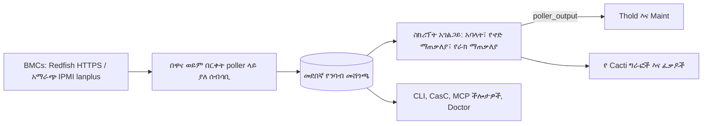

<!-- Source: README.md; SHA256: cf31b9f80d6c00020bbe08e80951d4de1c910793911d040ae7a66b54e8a2eaf0 -->

<!-- translations:start -->
[English](../../../README.md) | [简体中文](../zh-CN/README.md) | [हिन्दी](../hi-IN/README.md) | [Español (España)](../es-ES/README.md) | [Español (Latinoamérica)](../es-419/README.md) | [العربية (السعودية)](../ar-SA/README.md) | [Afrikaans](../af-ZA/README.md) | [አማርኛ](README.md) | [العربية (مصر)](../ar-EG/README.md) | [العربية (المغرب)](../ar-MA/README.md) | [বাংলা](../bn-BD/README.md) | [Bosanski](../bs-BA/README.md) | [Deutsch](../de-DE/README.md) | [فارسی](../fa-IR/README.md) | [Filipino](../fil-PH/README.md) | [Français](../fr-FR/README.md) | [Français (Maroc)](../fr-MA/README.md) | [Français (Sénégal)](../fr-SN/README.md) | [Hausa](../ha-NG/README.md) | [עברית](../he-IL/README.md) | [Hrvatski](../hr-HR/README.md) | [Bahasa Indonesia](../id-ID/README.md) | [Igbo](../ig-NG/README.md) | [Italiano](../it-IT/README.md) | [日本語](../ja-JP/README.md) | [한국어](../ko-KR/README.md) | [Malagasy](../mg-MG/README.md) | [मराठी](../mr-IN/README.md) | [Bahasa Melayu](../ms-MY/README.md) | [Nederlands](../nl-NL/README.md) | [Polski](../pl-PL/README.md) | [Português (Brasil)](../pt-BR/README.md) | [Русский](../ru-RU/README.md) | [Kinyarwanda](../rw-RW/README.md) | [Soomaali](../so-SO/README.md) | [Српски](../sr-RS/README.md) | [Svenska](../sv-SE/README.md) | [Kiswahili](../sw-KE/README.md) | [தமிழ்](../ta-IN/README.md) | [తెలుగు](../te-IN/README.md) | [ไทย](../th-TH/README.md) | [Türkçe](../tr-TR/README.md) | [Українська](../uk-UA/README.md) | [اردو](../ur-PK/README.md) | [Tiếng Việt](../vi-VN/README.md) | [isiXhosa](../xh-ZA/README.md) | [Yorùbá](../yo-NG/README.md) | [繁體中文](../zh-TW/README.md) | [isiZulu](../zu-ZA/README.md)
<!-- translations:end -->

# plugin_redfish

የአገልጋይ የኃይል ፍጆታን፣ የመግቢያ ሙቀትን፣ የማራገቢያ ሁኔታን እና የኃይል አቅርቦት ጤንነትን ከቤዝቦርድ ማኔጅመንት መቆጣጠሪያዎች (BMCs) ወደ Cacti እንደ መደበኛ መሣሪያዎች፣ የውሂብ ምንጮች እና ግራፎች የሚያመጣ የ Cacti 1.2 ተሰኪ ነው፤ ይህም Redfishን ከአማራጭ ተነባቢ-ብቻ IPMI ተለዋጭ እና በራክ ደረጃ የኃይል ማጠቃለያ ጋር ይጠቀማል። Thold እና Maint በመደበኛ የ Cacti የውሂብ ምንጮች በኩል ማንቂያዎችን ያስነሳሉ እንዲሁም ያፍናሉ።

> **ሁኔታ፡ በልማት ላይ፣ ገና የተለቀቀ እትም የለም (`0.1.0-dev`)።** ይህ ተሰኪ ከ Cacti ፕሮጀክት ጋር የተቆራኘ አይደለም። ከ PHP 8.2 ወይም ከዚያ በላይ በሆነ ስርዓት ላይ በ Cacti 1.2.31 ወይም ከዚያ በላይ ላይ ይጫናል፤ እንዲሁም የ Redfish ሰብሳቢውን፣ የተመሰጠረ የምስክርነት ካዝናን፣ የ Cacti መሣሪያ እና ግራፍ አቅርቦትን፣ አማራጭ ተነባቢ-ብቻ IPMI ተለዋጭን፣ የራክ ኃይል ማጠቃለያን፣ የ Cacti Maint መስኮት ማሳያን፣ የርቀት የውሂብ ሰብሳቢ ማባዛትን እና የኤጀንት መጨረሻ ነጥቦችን፣ የ CasC አቅራቢን እና የኦፕሬተር CLIን፣ የ MCP ችሎታዎችን እና የ Doctor ምርመራ ፍተሻዎችን ተግባራዊ ያደርጋል። CI የሙከራ ናሙናዎችን፣ DMTF Redfish Mockup Serverን (subsystem፣ legacy-only እና HPE iLO Gen11 ሞክአፖች) እና Thold v1.8.2ን ከ Maint v1.3 ጋር ይፈትሻል፤ እስካሁን ምንም እውነተኛ አካላዊ BMC ወይም የሙከራ መርከብ (pilot fleet) አልተረጋገጠም። ዲዛይኑ እና ምርምሩ በ [docs/PLAN.md](../../PLAN.md)፣ [docs/research/](../../research/) እና [docs/decisions/](../../decisions/) ውስጥ ይገኛሉ።

## ተግባራዊ የሆኑ ችሎታዎች

### ዋና ሰብሳቢ፣ ካዝና እና የ Cacti ነገሮች

- **የሕይወት ዑደት እና ስኪማ።** በ Cacti ተሰኪ API (`Schema::VERSION = 3`፣ 12 ሠንጠረዦች) በኩል ይጫናል፣ ይሻሻላል፣ ይሰናከላል እና ይራገፋል። *Keep Plugin Tables on Uninstall* ካልተነሳ በስተቀር ሲራገፍ ሠንጠረዦቹ ይቀመጣሉ። የመግቢያ ነጥቦች በ PHP 8.0 ላይ ይተነተናሉ እና ከ 8.2 በታች የሆነ PHP ወይም የ `ext-openssl` አለመኖር ሲኖር ግልጽ የስህተት መልዕክት በመስጠት ይከለክላሉ።
- **መዝገብ እና ፈቃዶች።** *Redfish View* (`redfish_health.php`)፣ *Redfish Operator* (`redfish_operator.php`) እና *Redfish Admin* (`redfish_bmcs.php`, `redfish_credentials.php`) ግዛቶች (realms)፣ እንዲሁም በ **Configuration > Settings > Redfish** ስር ያሉ ቅንብሮች። የ BMC መዝገቡ የ CSV ማስመጣትን (ምስክርነቶች በስም ይጠቀሳሉ፤ በማስመጫ ፋይሎች ውስጥ ያሉ የይለፍ ቃላት ውድቅ ይደረጋሉ) እና የ JSON መላክን ይደግፋል። የ BMC መዝገቦች እና ምስክርነቶች የ Cacti መሣሪያ ፈቃዶችን ይከተላሉ።
- **የተመሰጠረ የምስክርነት ካዝና።** የይለፍ ቃላት በ `plugin_redfish_secret` ውስጥ በ AES-256-GCM ተመስጥረው ይቀመጣሉ። ቁልፉ ከውሂብ ጎታው ውጭ (በነባሪ `/etc/cacti/redfish-vault.key`) እንደ 64 ሄክሳዴሲማል ቁምፊዎች (`openssl rand -hex 32`) ወይም 32 ጥሬ ባይቶች ሆኖ ይቀመጣል፤ ባለቤቱ የ poller ተጠቃሚው ሲሆን ለሌሎች ተጠቃሚዎች የማይነበብ እና በ root ወይም በዚያ ተጠቃሚ ብቻ ሊጻፍበት በሚችል አቃፊ ውስጥ ይገኛል። 32 ቁምፊ ያለው ሊታተም የሚችል የይለፍ ሐረግ ውድቅ ይደረጋል። **የቁልፍ ፋይሉን ከውሂብ ጎታው ጋር በመጠባበቂያ (backup) ያስቀምጡ**፤ ያለ እሱ የተቀመጡ የይለፍ ቃላት እንደገና መግባት አለባቸው።
- **TLS እና ተነባቢ-ብቻ Redfish ደንበኛ።** የ TLS ማረጋገጫ የስርዓት CA ማከማቻን፣ ለእያንዳንዱ BMC የተዘጋጀ የ CA ጥቅልን ወይም SPKI SHA-256 ፒንን በመጠቀም በነባሪ ነቅቷል፤ ለእያንዳንዱ BMC ያልተረጋገጠ ምርጫ ማድረግ እንደ የጤና ማስጠንቀቂያ እና የ Doctor ፍተሻ ማስጠንቀቂያ ሆኖ መታየቱን ይቀጥላል። ደንበኛው `GET`ን እና የ Redfish ክፍለ-ጊዜ መግቢያ (`POST`) እና መውጫ (`DELETE`) ብቻ ይፈቅዳል፤ ክፍለ-ጊዜዎች በማይገኙበት ጊዜ ለእያንዳንዱ BMC አማራጭ Basic ተለዋጭ አለው። ግኝት (Discovery) አዲሶቹን የ Redfish subsystem እና sensor ሀብቶችን ያስቀድማል እና ወደ ተተዉት `Power` እና `Thermal` ሀብቶች ይመለሳል።
- **የሰብሳቢ አፈጻጸም።** `poller_redfish.php` ከ `poller_bottom` ይነሳል፣ በ Cacti የሂደት መዝገብ በኩል በእያንዳንዱ poller አንድ ዋና ሂደት ከሚዋቀሩ ሠራተኛ ሂደቶች (`redfish_workers`) ጋር ያስኬዳል፣ በእያንዳንዱ BMC ኪራይ (leases) ይይዛል፣ የጊዜ በጀትን (`redfish_collector_budget`) ያስፈጽማል፣ ገላጭ (exponential) የመመለስ መዘግየትን ይተገብራል እና ከብልሽት በኋላ የተሰኪውን የራሱን የቀድሞ ክፍለ-ጊዜ ያጸዳል።
- **አብነቶች፣ መሣሪያዎች እና ግራፎች።** `templates/redfish-templates.xml`ን በሃሽ ያስገባል እና በተጠቃሚ የተሻሻሉ ፋይሎችን ሳይተካ ሦስት የስክሪፕት አገልጋይ የውሂብ መጠይቅ XML ፋይሎችን (`redfish_fans.xml`, `redfish_temperatures.xml`, `redfish_psus.xml`) ወደ `<cacti>/resource/script_server/` ይገለብጣል። **Create Device** እና **Add Graphs** የአቅርቦት ዕቅድ ማረጋገጫ ይፈልጋሉ፣ መጠይቆችን ከተገናኘ የአገልጋይ መሣሪያ ጋር ያያይዛሉ ወይም የመገኘት ፍተሻዎች ተሰናክለው በ `.invalid` ስር "Redfish BMC" መሣሪያ ይፈጥራሉ፣ እንዲሁም እያንዳንዱን የ Redfish ግራፍ በ `graph_buttons` በኩል ወደ መሣሪያው የ Redfish ግራፎች መልሰው ያገናኛሉ።
- **መሸጎጫ-ብቻ (Cache-only) የስክሪፕት አገልጋይ ግብዓቶች።** `scripts/ss_redfish_members.php` በእያንዳንዱ አባል የማራገቢያ፣ የሙቀት እና የ PSU ንባቦችን ያቀርባል፣ እና `scripts/ss_redfish_summary.php` የ "Redfish Node Summary" መለኪያዎችን (ኃይል፣ የመግቢያ እና ከፍተኛ ሙቀት፣ የተበላሹ ማራገቢያዎች እና PSUs ብዛት፣ የኖድ ጤንነት እና የመጨረሻው ትክክለኛ ንባብ ዕድሜ) ያቀርባል። የስክሪፕት አገልጋይ ጥሪዎች የአካባቢውን መሸጎጫ ብቻ ያነባሉ እና በፍጹም BMCን አያነጋግሩም። የጎደሉ፣ ያረጁ ወይም የጠፉ አባላት ንባቦች `U`ን ይመልሳሉ (በፍጹም `0` አይመልሱም)፣ `age` ግን ገደቦች ዝም ያሉ BMCsን እንዲያገኙ ሁልጊዜ እሴት ሪፖርት ያደርጋል።

**የ BMC አባላት ሲቀየሩ** (ለምሳሌ የተቀየረ ማራገቢያ ወይም ዳሳሾችን እንደገና የሚሰይም የፈርምዌር ማዘመኛ)፣ **Add Graphs**ን እንደገና ያስኪዱ። ቀደም ሲል የነበረ ማራገቢያ ወይም የኃይል አቅርቦት ከጠፋ ተቀባይነት እስኪያገኝ ድረስ በ `fans_bad` ወይም `psus_bad` ውስጥ ይቆጠራል፤ ፈጽሞ ያልተሞላ ቦታ ግን አይቆጠርም። የጠፉ አባላት ነባር የውሂብ ምንጮቻቸውን እና ግራፎቻቸውን ይዘው ይቆያሉ፣ እነዚህም በእጅ እስኪሰረዙ ድረስ ከዚያ በኋላ `U` ያነባሉ። የ Cacti መሣሪያን መሰረዝ የ BMC እና መሸጎጫውን ጠብቆ የ BMC ግንኙነቱን ያነሳል እና የራክ ምደባውን ያስወግዳል፤ BMCን መሰረዝ ወይም ተሰኪውን ማራገፍ የ Cacti መሣሪያዎችን እና ግራፎችን እንደተጠበቁ ያቆያል።

### አማራጭ IPMI ተለዋጭ

- **በእያንዳንዱ BMC በፍላጎት የሚነቃ።** በነባሪ ጠፍቷል (`protocols` በነባሪ `redfish` ነው፤ IPMI ተለዋጭን ማንቃት ወደ `redfish,ipmi` ያስተካክላል)።
- **የተገደበ ተለዋጭ ቀስቃሽ።** የሚሰራው የ Redfish ስብስብ ብቁ በሆነ የውድቀት ክፍል ሲወድቅ ብቻ ነው፤ በ `AuthRejected`፣ `CredentialUnavailable`፣ `AddressRefused`፣ `OperationRefused` ወይም `Deadline` ላይ በፍጹም አይነሳም።
- **ደህንነቱ የተጠበቀ አፈጻጸም።** `ipmitool`ን በ `-I lanplus` ላይ ያለ ሼል በድርድር-ቅርጽ `proc_open()`፣ በተገደበ የግድግዳ-ሰዓት ጊዜ ማብቂያ እና በ 256 KiB የውጤት ገደብ ይጠራል። የይለፍ ቃላት የሚቀርቡት በ `IPMITOOL_PASSWORD` (`-E`) ወይም በ `finally` ውስጥ በሚሰረዝ mode-0600 ጊዜያዊ ፋይል (`-f`) በኩል እንጂ በ CLI argv ላይ በፍጹም አይደለም።
- **ተነባቢ-ብቻ የትዕዛዝ ፈቃድ ዝርዝር።** አምስት ተነባቢ-ብቻ ንዑስ ትዕዛዞች ብቻ ይፈቀዳሉ፡ `dcmi power reading`፣ `sdr type Temperature`፣ `sdr type Fan`፣ `sdr type Power Supply` እና `chassis status`። ለውጥ የሚያደርጉ ትዕዛዞች ውድቅ ይደረጋሉ።
- **መደበኛ የሆነ ውጤት እና የሁኔታ ማስጠንቀቂያ።** `IpmiNormalizer` ንባቦችን ወደ ተመሳሳዩ `Observation`/`Member`/`Reading` ሞዴል ያዛምዳል፣ ለጎደሉ ወይም ሊተነተኑ ለማይችሉ ዳሳሾች `U` ያወጣል። IPMI ተለዋጭን ማንቃት በጤና ገጹ ላይ እና በ `redfish.bmc_security` Doctor ፍተሻ ውስጥ ኦፕሬተሮች UDP 623ን ወደ አስተዳደር VLAN እንዲገድቡ የሚያስታውስ ማስጠንቀቂያ ያስነሳል።

### የራክ ኃይል ማጠቃለያ

- **የራክ መዝገብ።** የስኪማ እትም 3 `plugin_redfish_rack`ን (ልዩ `(site_id, name)`፣ አማራጭ `power_budget_watts`፣ ነባሪው `80` የሆነ `min_coverage_pct` እና ማስታወሻዎች) እና `plugin_redfish_rack_member`ን (በአንድ `host_id` ቢበዛ አንድ የራክ ምደባ፣ አማራጭ `bmc_id` እና `unit_position`፣ የ Cacti መሣሪያ ሲሰረዝ በራስ-ሰር ይወገዳል) ያክላል።
- **በሽፋን የተጠበቁ ድምሮች።** `RackPowerSummary` ከአካባቢው መሸጎጫ ትኩስ የአባላት `power_watts` ንባቦችን ይደምራል እና የበጀት አጠቃቀምን እና ቀሪ ክፍተትን (headroom) ያሰላል። ሪፖርት የሚያደርጉ አባላት ሽፋን ከ `min_coverage_pct` በታች ሲወርድ፣ የሰብሳቢ ውድቀቶች በራክ ኃይል ላይ እንደ መቀነስ እንዳይታዩ `power_watts`፣ `utilization_pct` እና `headroom_watts` `U`ን ይመልሳሉ።
- **ለ Thold ዝግጁ የሆነ የስክሪፕት አገልጋይ ግብዓት።** `scripts/ss_redfish_rack.php` (`ss_redfish_rack(<rack_id>)`) ከአካባቢው መሸጎጫ ብቻ `power_watts`፣ `power_budget_watts`፣ `utilization_pct`፣ `headroom_watts`፣ `members_total`፣ `members_reporting` እና `coverage_pct`ን ይመልሳል።

### የ Cacti Maint ውህደት

- በ Redfish የውሂብ ምንጮች ላይ ያሉ የ Thold ገደቦች ማንቂያ ያሰማሉ እና Cacti Maint በሁለቱም ተሰኪዎች ላይ ምንም ለውጥ ሳይደረግ ያፍናቸዋል።
- `MaintWindow` ለእያንዳንዱ የተገናኘ የ Cacti አስተናጋጅ ንቁ የ Maint መርሐግብሮችን (አንድ-ጊዜ `mtype=1` እና ተደጋጋሚ `mtype=2` መርሐግብሮች፣ እንዲሁም ሲጫን `plugin_maint_check_cacti_host()`) ይፈትሻል እና ንቁ ጥገናን በ Redfish ጤና ገጽ (`[MAINT]`)፣ በ `cli/redfish.php health` ውጤት እና በ `redfish-get-health` ችሎታ ውስጥ ምልክት ያደርጋል።

### የርቀት የውሂብ ሰብሳቢዎች

- `INFO` `remote_collect:1`ን ያውጃል። BMCs ማንኛውንም `poller_id >= 1` ይቀበላሉ፣ እና `poller_redfish.php --poller=N` ለዚያ poller የተመደቡ የነቁ BMCsን ብቻ ይሰበስባል።
- **`replicate_out` መንጠቆ (hook)።** በ `replicate_out_table()` በኩል ለታለመው የርቀት poller የተገደቡ ምስጢራዊ ያልሆኑ የውቅር ሠንጠረዦችን ብቻ ያባዛል፡ `plugin_redfish_bmc`፣ `plugin_redfish_credential` ሜታዳታ (ያለ ምስጢራዊ ጽሑፍ)፣ `plugin_redfish_rack` እና `plugin_redfish_rack_member`። `plugin_redfish_secret` አይባዛም፣ እና የካዝና ቁልፍ ፋይሎች በእያንዳንዱ poller ላይ በጥብቅ በአካባቢው ይቆያሉ።
- **`remote_agent` መንጠቆ (hook)።** ቁጥራዊ `poller_id` እና `bmc_id` መለኪያዎችን ብቻ የሚቀበሉ ተነባቢ-ብቻ `redfish_health` እና `redfish_discovery` እርምጃዎችን ያጋልጣል። ያልተጠበቁ መለኪያዎች ውድቅ ይደረጋሉ እና ምንም ምስክርነቶች ወይም ምስጢሮች አይመለሱም።

### የሥነ-ምህዳር መንጠቆዎች (CasC፣ MCP ችሎታዎች እና Doctor)

- **CasC አቅራቢ (`casc_register_providers`)።** የ `redfish` አቅራቢን (የስኪማ እትም `1`) በንጹሕ-PHP YAML እና XML መላክ፣ መተንተን (XXEን በመከልከል)፣ ማረጋገጥ፣ የልዩነት ዕቅድ ማውጣት እና መተግበር ጋር ይመዘግባል። ምስክርነቶች የሚታዩት እንደ የካዝና ማጣቀሻዎች (`vault:redfish:<name>`) ብቻ ነው፤ ጥሬ የምስጢር ቁልፎች (`pass`, `secret`, `token`, `private_key`, `vault_key`, `auth_token`) ውድቅ ይደረጋሉ። መተግበር ትክክለኛ SHA-256 `PLAN_HASH` ይፈልጋል።
- **MCP / Abilities API (`abilities_register`)።** በ Redfish View ግዛት (`redfish_health.php`) እና በ Cacti መሣሪያ ፈቃዶች የተገደቡ ሦስት ተነባቢ-ብቻ ችሎታዎችን ይመዘግባል፣ ምንም ምስክርነት አይመልሱም፡
  - `redfish-list-bmcs` (አማራጭ `poller_id`)
  - `redfish-get-rack-power` (አማራጭ `rack_id`)
  - `redfish-get-health` (አማራጭ `bmc_id`)
- **የ Doctor ፍተሻዎች (`doctor_register_checks`)።** ፈጽሞ BMCን የማያነጋግሩ ወይም የቁልፍ ቁሳቁስ የማይመልሱ አምስት አካባቢያዊ፣ ተነባቢ-ብቻ የምርመራ ፍተሻዎችን ይመዘግባል፡
  - `redfish.schema`፡ የስኪማ እትም ወቅታዊነት
  - `redfish.vault_key`፡ የካዝና ቁልፍ ተነባቢነት እና ፈቃዶች
  - `redfish.collector_runs`፡ የ poller ሰብሳቢ በጀት እና ትኩስነት
  - `redfish.bmc_security`፡ ያልተረጋገጠ TLS ወይም IPMI ተለዋጭ ያላቸው የነቁ BMCs
  - `redfish.rack_power`፡ የራክ ኃይል በጀት ተገዢነት እና የሽፋን ዝቅተኛ ወለል

## CLI

በ PHP 8.2 ወይም ከዚያ በላይ ከ Cacti ሥር አቃፊ ያስኪዱ፡

```sh
# Operator and CasC CLI (reads --file=PATH or stdin for validate, plan, and apply)
php plugins/redfish/cli/redfish.php export --format=yaml|xml
php plugins/redfish/cli/redfish.php validate [--file=PATH] [--format=yaml|xml]
php plugins/redfish/cli/redfish.php plan [--file=PATH] [--format=yaml|xml]
php plugins/redfish/cli/redfish.php apply [--file=PATH] [--format=yaml|xml] --confirm=<PLAN_HASH>
php plugins/redfish/cli/redfish.php health --format=text|json

# Collector entry point (normally started by poller_bottom)
php plugins/redfish/poller_redfish.php [--poller=N] [--force] [--debug]

# Rack power summary script server entry point
php plugins/redfish/scripts/ss_redfish_rack.php <rack_id>
```

## የመዳረሻ ሚናዎች

| ግዛት | መዳረሻ |
| --- | --- |
| Redfish View | ነባር የክትትል ገጾች። |
| Redfish Operator | ክትትል እና የኦፕሬሽን ገጽ እንዲሁም የግል ትሪጅ እውቅናዎች (acknowledgments)። |
| Redfish Admin | የኦፕሬተር መዳረሻ እና ነባሩ ውቅር እንዲሁም አስተዳደራዊ እርምጃዎች። |

የማሻሻያ ፋይሎችን ከገለበጡ በኋላ ግዛቶቹን ለመመዝገብ የ Plugins ገጹን እንደ አስተዳዳሪ ይክፈቱ። የ Operator ግዛትን በ **Configuration > Users** ወይም በተጠቃሚ ቡድኖች ስር በግልጽ ይመድቡ። ማሻሻያዎች ነባሩን የ View እና Admin ግዛት መለያዎችን እና ፈቃዶችን ይጠብቃሉ። የ Admin መዳረሻ በእያንዳንዱ ጥያቄ ላይ የ Operator መዳረሻን ይወርሳል፣ እና የ Operator መዳረሻ የ View መዳረሻን ይወርሳል፤ ይህ ለተጠቃሚዎች ወይም ለቡድኖች የተቀመጡ ፈቃዶችን አያክልም። የተሰኪ ቅንብሮች ከ Cacti የ Settings ፈቃድ በተጨማሪ የ Redfish Admin መዳረሻንም ይፈልጋሉ።

የ Cacti መሣሪያ ፈቃዶች ለእያንዳንዱ ተጠቃሚ የሚገኙትን ረድፎች እና እርምጃዎች ይገድባሉ፤ ያልተገናኙ ነገሮች አስተዳዳሪን ይፈልጋሉ። ኦፕሬተሮች ለቀጣዩ የታቀደ ሩጫ በተፈቀደ BMC ላይ የስብስብ እገዳን መልቀቅ ይችላሉ። ምስክርነቶች፣ ውቅር፣ ማዛመድ፣ መሰረዝ እና ሌሎች አስተዳደራዊ ለውጦች በአስተዳደራዊ ገጾች ውስጥ ይቆያሉ። እውቅናዎች የሚቆዩት በአሁኑ የተጠቃሚ ክፍለ-ጊዜ ውስጥ ብቻ፣ ቢበዛ ለአንድ ሰዓት እና ተመሳሳዩ ምልከታ ትኩስ ሆኖ እስከቆየ ድረስ ብቻ ነው። አዲስ ወይም የተለወጡ ምልከታዎች ውድቅ ያደርጓቸዋል። የወደቀ መለኪያን በፍጹም እንደ ጤናማ አይቆጥሩም ወይም ማንቂያዎችን አያፍኑም።

## ለምን

እያንዳንዱ አገልጋይ ከስርዓተ ክወናው ነጻ በሆነ መልኩ የኃይል እና የሙቀት ሁኔታን የሚያሳውቅ BMC አለው፣ ስለዚህ ስርዓተ ክወናው ሲቆም እንኳን ምላሽ መስጠቱን ይቀጥላል። ውሂቡ ለአቅም እና ለወጪ ክትትል፣ ለተበላሸ ማራገቢያ ወይም የኃይል አቅርቦት ቀደምት ማስጠንቀቂያ እና ከፍተኛ አፈጻጸም ባለው ስሌት ውስጥ ለኃይል-መገደብ ውሳኔዎች ያገለግላል። ተሰኪው ለ HPC ብቻ የተወሰነ አይደለም።

Cacti ዛሬ ከዚህ ውስጥ የተወሰነውን ይሸፍናል፡

- **የአቅራቢ SNMP ጥቅሎች።** የ 1.2.x ቅርንጫፍ የ SNMP ወኪል የሚያስፈልጋቸው እና በአቅራቢ ላይ የተወሰኑ የ Dell iDRAC እና HPE iLO አብነቶችን ያቀርባል፤ የምዕራፍ 1 ምርምር አንዳቸውም የኃይል ፍጆታን በዋት እንደማይዘግቡ አረጋግጧል ([docs/research/overlap.md](../../research/overlap.md))።
- **ሰብሳቢ የሌለው የምስክርነት ዓይነት።** plugin_credentials "IPMI / Redfish (BMC)" የሚባል ምስክርነት ይገልጻል ነገር ግን ምንም BMC አያነብም።
- **የራክ-ደረጃ ዕይታ የለም።** የ Cacti ዋና ክፍል የራክ ነገር የለውም፤ አንድ መሣሪያ ነጻ-ጽሑፍ የሆነ `location` መስክ አለው።

ተሰኪው በዋናው poller ወይም በርቀት የውሂብ ሰብሳቢዎች ላይ ከ Cacti የምርጫ ዑደት ውጭ (out of band) BMCsን ይጠይቃል፣ መደበኛ የሆኑ ንባቦችን ያከማቻል እና በስክሪፕት አገልጋይ የውሂብ መጠይቆች፣ የኖድ ማጠቃለያዎች እና የራክ ኃይል ማጠቃለያዎች በኩል ያቀርባቸዋል። የ Cactiን ግራፍ ማውጣት፣ ፈቃዶች፣ Thold እና Maintን እንደገና ይጠቀማል፣ እንዲሁም የ BMC ሁኔታን አይለውጥም።

## ወሰን እና ሁኔታ

| ደረጃ | ወሰን | ምዕራፎች | ሁኔታ |
|---|---|---|---|
| 0፣ ምርምር | የአቅራቢ ማትሪክስ፣ በቀጥታ BMCs ላይ የላይኛው ባህሪ ማረጋገጫ፣ የምርጫ ወጪ፣ የውሂብ መጠይቅ ሙከራ | [M1](https://github.com/somethingwithproof/plugin_redfish/milestone/1) | ተጠናቋል፣ የእውነተኛ BMC ፈርምዌር ቅጂዎች በመጠባበቅ ላይ |
| 1፣ ምልከታ | የ BMC መዝገብ፣ ምስክርነቶች፣ TLS፣ Redfish ሰብሳቢ፣ መደበኛ ንባቦች፣ መሣሪያዎች፣ በእያንዳንዱ መረጃ ጠቋሚ ግራፎች፣ Thold ማንቂያ፣ Maint ውህደት፣ የጤና ገጽ | [M2](https://github.com/somethingwithproof/plugin_redfish/milestone/2), [M3](https://github.com/somethingwithproof/plugin_redfish/milestone/3), [M4](https://github.com/somethingwithproof/plugin_redfish/milestone/4) | ተግባራዊ ሆኗል፤ የ M4 የሙከራ መርከብ ማረጋገጫ በመጠባበቅ ላይ |
| 2፣ ipmi | በ `ipmitool` በኩል ተነባቢ-ብቻ IPMI (`lanplus`) ተለዋጭ፣ በነባሪ ጠፍቷል | [M5](https://github.com/somethingwithproof/plugin_redfish/milestone/5) | ተግባራዊ ሆኗል |
| 3፣ ራኮች | የራክ መዝገብ፣ ከሽፋን ወለል ጋር የራክ ኃይል ድምሮች፣ የበጀት ቀሪ ክፍተት፣ `ss_redfish_rack.php` | [M6](https://github.com/somethingwithproof/plugin_redfish/milestone/6) | ተግባራዊ ሆኗል |
| 4፣ የርቀት እና ሥነ-ምህዳር | የርቀት የውሂብ ሰብሳቢዎች (`replicate_out`, `remote_agent`)፣ CasC አቅራቢ እና CLI፣ MCP ችሎታዎች፣ Doctor ፍተሻዎች | [M7](https://github.com/somethingwithproof/plugin_redfish/milestone/7) | ተግባራዊ ሆኗል |

ከወሰን ውጭ፡ የኃይል ገደቦችን ወይም ሌላ ማንኛውንም የ BMC ውቅር ማዘጋጀት፣ የኃይል ቁጥጥር፣ የፈርምዌር ማዘመን፣ የኮንሶል መዳረሻ፣ በተሰኪ የተያዘ የማንቂያ ሞተር እና የመርሐግብር አውጪ ውህደት።

## የተኳኋኝነት ዒላማዎች

| አካል | ዒላማ |
|---|---|
| Cacti | 1.2.31 ወይም ከዚያ በላይ፣ ምንም ዋና ጥገናዎች (core patches) የሉም |
| የውሂብ ጎታ | MariaDB 10.2 ወይም MySQL 5.7 ወይም ከዚያ በላይ፡ በተፈጠረ ዓምድ ላይ ባለ ልዩ ቁልፍ በአንድ መሣሪያ አንድ BMC ይያዛል |
| PHP | 8.2 ወይም ከዚያ በላይ፤ የማይደገፍ አካባቢ የተሰበረ Cacti UI ከማግኘት ይልቅ እምቢታ እንዲያገኝ የመግቢያ ነጥቦች በ 8.0 ላይ ሊተነተኑ ይችላሉ |
| የ PHP ቅጥያዎች | `ext-openssl` (በ Cacti 1.2.31 የሚፈለግ)፤ `ext-curl` የለም እና የ Composer የአፈጻጸም ጥገኞች የሉም |
| አማራጭ መሣሪያዎች | IPMI ተለዋጭ የነቃላቸው BMCsን በሚሰበስቡ pollers ላይ `ipmitool` |
| BMCs | Dell iDRAC፣ HPE iLO፣ Lenovo XCC እና OpenBMC፣ በፈርምዌር ክልል፤ [የአቅራቢ ማትሪክስን](../../research/vendor-matrix.md) ይመልከቱ |
| Redfish | መጀመሪያ አዲስ የ subsystem እና sensor ሀብቶች፣ የተተዉ `Power` እና `Thermal` እንደ ተለዋጭ |
| Thold, Maint | ምንም ለውጦች አያስፈልጉም (CI Thold v1.8.2ን እና Maint v1.3ን ይለማመዳል) |

## ዲዛይን

- [docs/PLAN.md](../../PLAN.md) ሙሉው ዕቅድ ነው፡ አርክቴክቸር፣ የሚመረኮዝባቸው የላይኛው እውነታዎች፣ የመለኪያ ሞዴል፣ የደህንነት ድንበሮች፣ የአፈጻጸም ስሌት፣ ሙከራ እና አደጋዎች።
- [docs/decisions/](../../decisions/) አስቀድመው ለተደረጉ ምርጫዎች የአርክቴክቸር ውሳኔ መዝገቦችን ይይዛል።
- [docs/REQUIREMENTS.md](../../REQUIREMENTS.md) እያንዳንዱን የመስፈርት መለያ ከጉዳዩ ጋር ያዛምዳል።



## ደህንነት

የ BMC ምስክርነቶች የአገልጋዮችን ከባንድ-ውጭ አስተዳደር ይቆጣጠራሉ። ዲዛይኑ ምስጢሮችን ከትዕዛዝ መስመሮች፣ መዝገቦች፣ የ CasC መላኪያዎች፣ የርቀት ኤጀንት ጭነቶች፣ የ MCP ምላሾች እና የድር ገጾች ውጭ ያቆያል፤ የተቀመጡ የይለፍ ቃላትን በእያንዳንዱ poller በአካባቢያዊ የካዝና ቁልፍ ፋይል በመጠቀም በ AES-256-GCM ያመሰጥራል፤ TLSን በነባሪ ያረጋግጣል፤ `ipmitool`ን በተፈቀዱ ተነባቢ-ብቻ ንዑስ ትዕዛዞች ከግልጽ የአርግመንት ድርድር ያስኪዳል፤ እንዲሁም ተነባቢ-ብቻ የ BMC መለያዎችን ይጠቀማል። [docs/PLAN.md](../../PLAN.md#security) እና [SECURITY.md](../../../SECURITY.md)ን ይመልከቱ።

## የኦፕሬተር መመሪያ

የመጫኛ ቅድመ ሁኔታዎችን፣ የካዝና እና TLS ማዋቀርን፣ የ BMC ምዝገባን፣ የግራፍ ፈጠራን፣ የማንቂያ ክፍተቶችን፣ መጠባበቂያን እና የውድቀት አያያዝን ለማየት [docs/operator-guide.md](../../operator-guide.md)ን ይመልከቱ። መመሪያው ከዚያ ፈርምዌር የተወሰደ የተስተካከለ ቅጂ የሙከራ ስብስቡን እስኪያልፍ ድረስ የትኛውንም እውነተኛ የአቅራቢ ፈርምዌር መስመር እንደሚደገፍ አያውጅም።

## ልማት እና ሙከራ

CI (`.github/workflows/plugin-ci-workflow.yml`) በ PHP 8.0 ላይ የመግቢያ ነጥቦችን ይፈትሻል፣ የ Pest ዩኒት (`phpunit.xml`) እና የሕይወት ዑደት ውህደት (`phpunit-integration.xml`) ስብስቦችን እና PHPStan ደረጃ 9ን ከ PHP 8.2 እስከ 8.5 በ Cacti `release/1.2.31` እና `1.2.x` ላይ ያስኪዳል፣ በ PHP 8.1 ላይ እምቢታን ያረጋግጣል፣ DMTF Redfish Mockup Serverን (subsystem፣ legacy-only እና HPE iLO Gen11 ሞክአፖች) እና Thold v1.8.2 / Maint v1.3ን ከጫፍ እስከ ጫፍ ይለማመዳል፣ እንዲሁም የ gettext ካታሎጎችን፣ የሥራ ፍሰቶችን እና የ REUSE ፈቃድ አሰጣጥን ይፈትሻል።

ከመግፋት (push) በፊት አካባቢያዊ ፍተሻዎች፡

```sh
sh tests/lint-workflows.sh
sh locales/build_gettext.sh --check
CACTI_PATH=/path/to/cacti phpstan analyse -c phpstan.neon --no-progress
```

ለዩኒት እና ለምንጭ-ደንብ ሙከራዎች Pestን በ `--configuration=phpunit.xml` ያስኪዱ፣ ወይም ለሕይወት ዑደት ውህደት ሙከራዎች ከሚጣል የ Cacti ውሂብ ጎታ አንጻር `--configuration=phpunit-integration.xml`ን ከ `CACTI_PATH` እና `REDFISH_TEST_DATABASE=disposable` ጋር ይጠቀሙ።

## ሥራ እንዴት እንደሚከታተል

- **ምዕራፎች** የዕቅዱን ምዕራፎች ይከተላሉ። እያንዳንዱ ንዑስ-ጉዳዮቹን እና የመውጫ ማስረጃውን የሚዘረዝር ኤፒክ ጉዳይ አለው።
- **ጉዳዮች** በመለያ ተከፋፍለዋል፡ `type: requirement`፣ `type: research`፣ `type: decision`፣ `type: epic`። የመስፈርት ጉዳዮች ቁጥር የተሰጣቸው፣ ሊፈተሹ የሚችሉ መስፈርቶችን (`REQ-AREA-NNN`) እና የመቀበያ መስፈርቶችን ይገልጻሉ።
- **መለያዎች** እንዲሁ `area:`፣ `phase:`፣ `priority:` እና `status:`ን ይይዛሉ። [CONTRIBUTING.md](../../../CONTRIBUTING.md#labels)ን ይመልከቱ።
- [የፕሮጀክት ሰሌዳው](https://github.com/users/somethingwithproof/projects/12) በምዕራፎች ውስጥ ያሉትን ሁሉንም ጉዳዮች ያሳያል።

## አስተዋጽኦ ማድረግ

[CONTRIBUTING.md](../../../CONTRIBUTING.md)ን ያንብቡ። ኮሚቶች የ DCO ፊርማ (sign-off) ያስፈልጋቸዋል። የዲዛይን ውይይት በጉዳዮች ላይ ይካሄዳል፤ ክፍት ውሳኔዎች `type: decision` መለያ ይይዛሉ። ከእውነተኛ BMCs የተገኙ ማስረጃዎች አሁን በጣም ጠቃሚው አስተዋጽኦ ናቸው፤ ማንኛውንም ቅጂ ከመለጠፍዎ በፊት አድራሻዎችን፣ ተከታታይ ቁጥሮችን እና ምስክርነቶችን ይደብቁ።

## ፈቃድ

GNU General Public License v2.0፣ ከ Cacti እና ከተሰኪዎቹ ጋር ተመሳሳይ ፈቃድ። [LICENSE](../../../LICENSE)ን ይመልከቱ።
