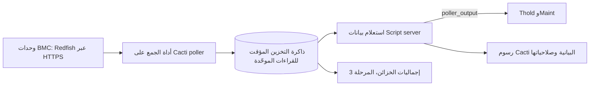

<!-- Source: README.md; SHA256: 7b4e83a58a1adc844cb0615ef30e95476cba2851f96bb454d2a816fb2774724d -->

<!-- translations:start -->
[English](../../../README.md) | [简体中文](../zh-CN/README.md) | [हिन्दी](../hi-IN/README.md) | [Español (España)](../es-ES/README.md) | [Español (Latinoamérica)](../es-419/README.md) | [العربية (السعودية)](../ar-SA/README.md) | [Afrikaans](../af-ZA/README.md) | [አማርኛ](../am-ET/README.md) | [العربية (مصر)](README.md) | [العربية (المغرب)](../ar-MA/README.md) | [বাংলা](../bn-BD/README.md) | [Deutsch](../de-DE/README.md) | [فارسی](../fa-IR/README.md) | [Filipino](../fil-PH/README.md) | [Français](../fr-FR/README.md) | [Français (Maroc)](../fr-MA/README.md) | [Français (Sénégal)](../fr-SN/README.md) | [Hausa](../ha-NG/README.md) | [עברית](../he-IL/README.md) | [Bahasa Indonesia](../id-ID/README.md) | [Igbo](../ig-NG/README.md) | [Italiano](../it-IT/README.md) | [日本語](../ja-JP/README.md) | [한국어](../ko-KR/README.md) | [Malagasy](../mg-MG/README.md) | [मराठी](../mr-IN/README.md) | [Bahasa Melayu](../ms-MY/README.md) | [Nederlands](../nl-NL/README.md) | [Polski](../pl-PL/README.md) | [Português (Brasil)](../pt-BR/README.md) | [Русский](../ru-RU/README.md) | [Kinyarwanda](../rw-RW/README.md) | [Soomaali](../so-SO/README.md) | [Svenska](../sv-SE/README.md) | [Kiswahili](../sw-KE/README.md) | [தமிழ்](../ta-IN/README.md) | [తెలుగు](../te-IN/README.md) | [ไทย](../th-TH/README.md) | [Türkçe](../tr-TR/README.md) | [Українська](../uk-UA/README.md) | [اردو](../ur-PK/README.md) | [Tiếng Việt](../vi-VN/README.md) | [isiXhosa](../xh-ZA/README.md) | [Yorùbá](../yo-NG/README.md) | [繁體中文](../zh-TW/README.md) | [isiZulu](../zu-ZA/README.md)
<!-- translations:end -->

# plugin_redfish

إضافة لنظام Cacti 1.2 تجلب بيانات استهلاك الطاقة للخوادم، ودرجة حرارة مدخل الهواء، وحالة المراوح، وسلامة وحدات إمداد الطاقة من وحدات إدارة اللوحة الأم (BMCs) إلى Cacti كأجهزة ومصادر بيانات ورسوم بيانية اعتيادية، باستخدام Redfish مع خيار احتياطي عبر IPMI. تتولى إضافتا Thold وMaint بعد ذلك إصدار التنبيهات وكتمها، وتضيف مرحلة لاحقة إجماليات استهلاك الطاقة على مستوى الخزانة (Rack).

> **الحالة: قيد التطوير، لا يوجد إصدار رسمي بعد (0.1.0-dev).** تم دمج المَعلمين 2 (الأساس) و3 (كائنات Cacti والتنبيهات) على فرع `main`. هذه الإضافة غير تابعة لمشروع Cacti. تُثبَّت على Cacti 1.2.31 مع PHP 8.2 أو أحدث، وتسجّل وحدات BMC وبيانات الاعتماد، وتقرأ الطاقة ودرجات الحرارة والمراوح وسلامة وحدات إمداد الطاقة من كل وحدة BMC عبر Redfish في ذاكرة التخزين المؤقت الخاصة بها، وتعرض حالة الجمع. كما تضيف أجهزة Cacti ورسوماً بيانية لكل عنصر وملخصات، ودعماً لإضافتي Thold وMaint عبر مصادر بيانات اعتيادية. اختبر التكامل المستمر (CI) وحدة BMC وهمية مبنية من بيانات اختبار مكتوبة يدوياً وخادم محاكاة DMTF Redfish؛ ولم يتم اعتماد أي وحدة BMC حقيقية أو مجموعة خوادم تجريبية بعد. تتوفر تفاصيل التصميم والأبحاث في [docs/PLAN.md](../../PLAN.md)، و[docs/research/](../../research)، و[docs/decisions/](../../decisions).

### ما يقدمه المَعلم 2

- التثبيت والترقية والتعطيل وإلغاء التثبيت عبر واجهة برمجة الإضافات في Cacti، مع الاحتفاظ بالجداول عند إلغاء التثبيت ما لم يتم إلغاء تفعيل الإعداد الخاص بذلك. على إصدارات PHP الأقدم من 8.2، ترفض الإضافة التثبيت أو التفعيل وتوضح السبب.
- نطاقات الصلاحيات (Realms): "Redfish View" (صفحة الحالة الصحية)، و"Redfish Operator" (صفحة العمليات)، و"Redfish Admin" (صفحتا وحدات BMC وبيانات الاعتماد)، بالإضافة إلى الإعدادات تحت Configuration > Settings > Redfish.
- سجل لوحدات BMC يدعم الاستيراد بصيغة CSV والتصدير بصيغة JSON. يجب ألا تحتوي ملفات الاستيراد على كلمات مرور؛ إذ يُشار إلى بيانات الاعتماد بالاسم.
- تُحفظ بيانات الاعتماد مشفّرة باستخدام AES-256-GCM. المفتاح عبارة عن ملف خارج قاعدة البيانات، مساره الافتراضي `/etc/cacti/redfish-vault.key`، ويحتوي على 64 محرفاً سداسياً عشرياً (`openssl rand -hex 32`) أو 32 بايت عشوائياً بالضبط، ويكون مملوكاً لمستخدم أداة الجمع (poller user)، وغير قابل للقراءة من قِبل المستخدمين الآخرين، وفي مجلد لا يملك صلاحية الكتابة فيه سوى مستخدم الـ poller أو root. يُرفض المفتاح المكوّن من 32 محرفاً قابلاً للطباعة باعتباره عبارة مرور (passphrase). **احرص على نسخ ملف المفتاح احتياطياً مع قاعدة البيانات**؛ فبدونه يجب إعادة إدخال جميع كلمات المرور المحفوظة.
- تفعيل التحقق من TLS افتراضياً، مع حزمة CA مخصصة لكل وحدة BMC أو تثبيت بصمة SPKI SHA-256. يظل خيار تعطيل التحقق المسجّل لكل وحدة BMC ظاهراً كتحذير في صفحة الحالة الصحية.
- عميل Redfish للقراءة فقط: يقتصر على طلبات `GET` وتسجيل الدخول والخروج للجلسة فقط، ويُفحص مقابل قائمة سماح قبل إرسال أي طلب.
- أداة جمع (collector) تنطلق من `poller_bottom` لوحدات BMC على الـ poller الرئيسي، مع مُهل زمنية ومواعيد نهائية لكل وحدة BMC، وآلية تراجع زمني (backoff)، وتنظيف الجلسة الوحيدة التي سجلتها الإضافة بعد أي تعطل. لا تزال وحدات الجمع البعيدة غير مدعومة بعد؛ فهي تتطلب اختياراً صريحاً لكيفية وصول وحدة الجمع إلى قاعدة البيانات والمفتاح (المرحلة 4).
- تتبع سجلات وحدات BMC وبيانات الاعتماد صلاحيات الأجهزة في Cacti: يرى مسؤول Redfish Admin ويعدّل ويربط فقط وحدات BMC الخاصة بالأجهزة التي يحق له رؤيتها، وفقط بيانات الاعتماد التي لا تستخدمها أي وحدة BMC على جهاز مخفي.

### ما يضيفه المَعلم 3

- قوالب مضمّنة كملفات XML لقوالب Cacti في `templates/` وتُستورد عبر مستورد Cacti نفسه عند التثبيت والترقية، وتُطابق عبر التجزئة (hash)، بحيث يحدّث الاستيراد كائنات الإضافة ولا يضيف أي شيء مرتين. تُنسخ ملفات استعلام البيانات الثلاثة إلى `<cacti>/resource/script_server/` مع تسجيل بصمة التجزئة؛ ولا تستبدل الإضافة أبداً أي ملف هناك لم تقم هي بكتابته، كما تحذّر صفحة الحالة الصحية المسؤولين عندما لا تكون القوالب أو أحد ملفات الاستعلام في مكانه. يعيد خيار **Reinstall the Redfish Templates** في صفحة وحدات BMC استيرادها مجدداً؛ ويتطلب صلاحية Import Templates في Cacti.
- **Create Device** أو **Add Graphs** على كل وحدة BMC ([ADR 0015](../../decisions/0015-attach-to-the-server-device-or-create-one-per-bmc.md)). تحصل وحدة BMC المرتبطة بجهاز خادم موجود على استعلامات البيانات والرسوم البيانية على ذلك الجهاز. أما وحدة BMC غير المرتبطة فتحصل على جهاز جديد من قالب الجهاز "Redfish BMC"، مع تعطيل فحوصات التوافر واستخدام اسم مضيف تحت النطاق `.invalid`، بحيث لا يتصل Cacti بوحدة BMC أبداً ولا يعرض عنوانها. وفي كلتا الحالتين، يؤكد المسؤول أولاً خطة توضح ما سيتم إضافته. يتطلب كلا الخيارين صلاحية إدارة الأجهزة في Cacti بالإضافة إلى Redfish Admin؛ وأي جهاز جديد لا يستطيع منشئه رؤيته يُحذف مجدداً.
- ثلاثة استعلامات بيانات عبر script server هي: "Redfish Fans" و"Redfish Temperatures" و"Redfish Power Supplies"، مفهرسة بمفتاح العنصر في وحدة BMC، مع رسم بياني لكل عنصر: سرعة المروحة بالنسبة المئوية أو RPM (أياً كانت الوحدة التي تُبلغ بها وحدة BMC)، ودرجة الحرارة، وطاقة الإدخال والإخراج بالواط لوحدة إمداد الطاقة، كلٌ مع رمز حالته الصحية.
- مُدخل "Redfish Node Summary" يضم الطاقة، ودرجة حرارة مدخل الهواء، وأعلى درجة حرارة، والمراوح ووحدات الإمداد غير السليمة، وصحة العقدة، وعمر آخر قراءة صالحة، وتُرسم في أربعة رسوم بيانية: الطاقة، ودرجات الحرارة، وصحة المكونات، وعمر البيانات. تُصدر عتبات Thold على مصادر البيانات هذه تنبيهات، وتكتمها إضافة Maint، دون أي تعديل على أيٍّ من الإضافتين.
- يجيب الـ script server من ذاكرة التخزين المؤقت للإضافة فقط ولا يتصل بوحدة BMC أبداً. أي قيمة مفقودة أو قديمة أو بوحدة قياس أخرى أو لعنصر لم يعد موجوداً تكون قيمتها `U`، فتظهر الرسوم البيانية فجوة وليس صفراً أبداً؛ بينما يملك `age` قيمة دائماً، لذا تكتشف أي عتبة عليه وحدة BMC التي توقفت عن الاستجابة.
- رابط رسم بياني من كل رسم بياني لـ Redfish إلى رسوم Redfish البيانية الخاصة بالجهاز، ويظهر فقط للمستخدمين الذين يسمح لهم Cacti برؤية الجهاز.

**عند تغيّر عناصر وحدة BMC** (استبدال مروحة، أو تحديث برنامج ثابت يغيّر أسماء المستشعرات)، اختر **Add Graphs** مجدداً. أي مروحة أو وحدة إمداد طاقة كانت موجودة وأصبحت غائبة أو مفقودة تُحتسب ضمن `fans_bad` أو `psus_bad` حتى تفعل ذلك، بحيث يصدر تنبيه عند نزع مروحة؛ أما المنفذ الذي لم يكن مشغولاً أصلاً فلا يُحتسب. يقبل Add Graphs العناصر التي تُبلغ عنها وحدة BMC الآن، ويعيد Cacti فهرسة الاستعلامات؛ ويحتفظ العنصر المفقود بمصدر بياناته ورسمه البياني اللذين يقرآن `U` منذ ذلك الحين، بينما يحصل العنصر الجديد على رسم بياني. احذف الرسوم البيانية للعناصر المفقودة يدوياً بمجرد الاستغناء عن سجلها التاريخي.

حذف الجهاز يفك ارتباط وحدة BMC الخاصة به مع الإبقاء على وحدة BMC وذاكرة التخزين المؤقت الخاصة بها. وحذف وحدة BMC، أو إلغاء تثبيت الإضافة، يبقي على جهازها ورسومها البيانية.

## أدوار الوصول

| النطاق (Realm) | مستوى الوصول |
| --- | --- |
| Redfish View | صفحات المراقبة الحالية. |
| Redfish Operator | المراقبة بالإضافة إلى صفحة العمليات وإقرارات الفرز الشخصية. |
| Redfish Admin | صلاحيات Operator بالإضافة إلى الإعدادات الحالية والإجراءات الإدارية. |

بعد نسخ ملفات الترقية، افتح صفحة Plugins بصفتك مسؤولاً لتسجيل النطاق الجديد. امنح نطاق Operator صراحةً من خلال **Configuration > Users** أو مجموعات المستخدمين. تحتفظ الترقيات بمعرّفات نطاقَي View وAdmin وصلاحياتهما الممنوحة الحالية. يرث وصول Admin صلاحيات Operator، ويرث وصول Operator صلاحيات View عند كل طلب؛ ولا يضيف هذا منح صلاحيات مخزّنة للمستخدمين أو المجموعات. تتطلب إعدادات الإضافة أيضاً صلاحية Redfish Admin بالإضافة إلى صلاحية Settings في Cacti.

تظل صلاحيات الأجهزة في Cacti مقيِّدةً للصفوف والإجراءات المتاحة لكل مستخدم؛ وتتطلب الكائنات غير المرتبطة وجود مسؤول. يمكن للمشغّلين تحرير تعليق الجمع عن وحدة BMC مسموح بها لدورة التشغيل المجدولة التالية. وتظل بيانات الاعتماد، والإعدادات، والربط، والحذف، وغيرها من التغييرات الإدارية في الصفحات الإدارية. تدوم الإقرارات في جلسة المستخدم الحالية فقط، ولمدة ساعة واحدة على الأكثر، وطالما بقيت الملاحظة نفسها حديثة. وتبطلها الملاحظات الجديدة أو المتغيرة، كما أنها لا تجعل القياس الفاشل سليماً أبداً ولا تكتم التنبيهات.

## لماذا هذه الإضافة

يحتوي كل خادم على وحدة BMC تُبلغ عن حالة الطاقة والحرارة بشكل مستقل عن نظام التشغيل، لذا تستمر في الاستجابة حتى عند توقف نظام التشغيل. تفيد هذه البيانات في تتبع السعة والتكلفة، والإنذار المبكر بتعطل مروحة أو وحدة إمداد طاقة، وفي قرارات تحديد سقف استهلاك الطاقة (power-capping) في الحوسبة عالية الأداء. الإضافة ليست مخصصة للحوسبة عالية الأداء فقط.

يغطي Cacti جزءاً من هذا حالياً:

- **حزم SNMP من المورّدين.** يتضمن فرع 1.2.x قوالب لـ Dell iDRAC وHPE iLO تتطلب وكيل SNMP ومرتبطة بمورّد محدد؛ وقد وجدت أبحاث المَعلم 1 أن أياً منهما لا يُبلغ عن استهلاك الطاقة بالواط ([docs/research/overlap.md](../../research/overlap.md)).
- **نوع بيانات اعتماد بلا أداة جمع.** يعرّف plugin_credentials نوع بيانات اعتماد "IPMI / Redfish (BMC)" لكنه لا يقرأ من أي وحدة BMC.
- **عدم وجود عرض على مستوى الخزانة.** لا يحتوي نواة Cacti على كائن للخزانة؛ بل يملك الجهاز حقل `location` نصياً حراً.

تستعلم الإضافة من وحدات BMC خارج النطاق (out of band) عن دورة استطلاع Cacti، وتخزّن القراءات الموحّدة مؤقتاً، وتعرضها عبر استعلام بيانات script server ومصادر بيانات ملخصة. وهي تعيد استخدام الرسوم البيانية، والصلاحيات، وThold، وMaint في Cacti، ولا تغيّر حالة وحدة BMC. من المخطط دعم وحدات جمع البيانات البعيدة في المرحلة 4؛ بينما يعمل الجمع الحالي على الـ poller الرئيسي فقط.

## النطاق المخطط

| المرحلة | النطاق | المعالم |
|---|---|---|
| 0، البحث | مصفوفة المورّدين، تأكيد السلوك الفعلي على وحدات BMC حية، تكلفة الاستطلاع، تجربة مبدئية لاستعلام البيانات | [M1](https://github.com/somethingwithproof/plugin_redfish/milestone/1) |
| 1، المراقبة | سجل وحدات BMC، بيانات الاعتماد، TLS، أداة جمع Redfish، القراءات الموحّدة، الأجهزة، الرسوم البيانية لكل فهرس، تنبيهات Thold، كتم Maint، صفحة الحالة الصحية | [M2](https://github.com/somethingwithproof/plugin_redfish/milestone/2)، [M3](https://github.com/somethingwithproof/plugin_redfish/milestone/3)، [M4](https://github.com/somethingwithproof/plugin_redfish/milestone/4) |
| 2، ipmi | خيار احتياطي عبر IPMI لوحدات BMC التي لا تملك Redfish قابلاً للاستخدام، معطّل افتراضياً | [M5](https://github.com/somethingwithproof/plugin_redfish/milestone/5) |
| 3، الخزائن | سجل الخزائن، إجماليات طاقة الخزانة مع نسبة التغطية، هامش الميزانية | [M6](https://github.com/somethingwithproof/plugin_redfish/milestone/6) |
| 4، الجمع البعيد | وحدات جمع بيانات بعيدة في Cacti لشبكات BMC المعزولة | [M7](https://github.com/somethingwithproof/plugin_redfish/milestone/7) |

خارج النطاق: ضبط حدود الطاقة أو أي إعدادات أخرى على وحدة BMC، التحكم في الطاقة، تحديث البرامج الثابتة، الوصول إلى وحدة التحكم (console)، محرك تنبيهات مملوك للإضافة، والتكامل مع المجدول.

## أهداف التوافق

| المكوّن | الهدف |
|---|---|
| Cacti | 1.2.31 أو أحدث، دون تعديلات على النواة |
| قاعدة البيانات | MariaDB 10.2 أو MySQL 5.7 أو أحدث: يُفرض وجود وحدة BMC واحدة لكل جهاز عبر مفتاح فريد على عمود مولَّد |
| PHP | 8.2 أو أحدث؛ يظل `setup.php` قابلاً للتحليل على 8.0 بحيث تحصل بيئة التشغيل غير المدعومة على رفض واضح بدلاً من تعطل واجهة Cacti |
| وحدات BMC | Dell iDRAC، وHPE iLO، وLenovo XCC، وOpenBMC، حسب نطاق البرنامج الثابت؛ راجع [مصفوفة المورّدين](../../research/vendor-matrix.md) |
| Redfish | موارد الأنظمة الفرعية والمستشعرات الجديدة أولاً، مع `Power` و`Thermal` المهجورين كخيار احتياطي |
| Thold، Maint | لا يتطلبان أي تعديلات |

## التصميم

- [docs/PLAN.md](../../PLAN.md) هي الخطة الكاملة: المعمارية، والحقائق الأساسية التي تعتمد عليها (مع المصادر والافتراضات التي لا تزال بحاجة للتأكيد)، ونموذج القياس، والحدود الأمنية، وحسابات الأداء، والاختبار، والمخاطر.
- [docs/decisions/](../../decisions) يحتوي على سجلات قرارات المعمارية للخيارات التي تم البت فيها بالفعل.
- [docs/REQUIREMENTS.md](../../REQUIREMENTS.md) يربط كل معرّف متطلب بالمشكلة (issue) الخاصة به.

## الأمان

تتحكم بيانات اعتماد وحدة BMC في الإدارة خارج النطاق للخوادم. يُبقي التصميم هذه البيانات خارج سطور الأوامر والسجلات والصفحات، ويتحقق من TLS افتراضياً، وينفّذ أي أمر خارجي من مصفوفة وسائط مع قائمة سماح للأوامر الفرعية، ويستخدم حسابات BMC للقراءة فقط. راجع [docs/PLAN.md](../../PLAN.md#security) و[SECURITY.md](../../../SECURITY.md).

## دليل المشغّل

راجع [docs/operator-guide.md](../../operator-guide.md) للاطلاع على متطلبات التثبيت المسبقة، وإعداد الخزنة (vault) وTLS، وتسجيل وحدات BMC، وإنشاء الرسوم البيانية، وفترات التنبيه، والنسخ الاحتياطي، والتعامل مع الأعطال. لا يعلن الدليل دعم أي خط برامج ثابتة حقيقي لمورّد حتى تجتاز نسخة ممسوحة البيانات الحساسة (redacted capture) من ذلك البرنامج الثابت مجموعة الاختبارات.

## آلية تتبع العمل

- **المعالم** تتبع معالم الخطة. ولكل منها مشكلة رئيسية (epic issue) تسرد مشاكلها الفرعية وأدلة الإنجاز.
- **المشاكل** مصنّفة بالتسميات: `type: requirement`، و`type: research`، و`type: decision`، و`type: epic`. وتنص مشاكل المتطلبات على متطلبات مرقّمة وقابلة للاختبار (`REQ-AREA-NNN`) ومعايير القبول.
- تحمل **التسميات** أيضاً `area:` و`phase:` و`priority:` و`status:`. راجع [CONTRIBUTING.md](../../../CONTRIBUTING.md#labels).
- تعرض [لوحة المشروع](https://github.com/users/somethingwithproof/projects/12) جميع المشاكل عبر المعالم.

## المساهمة

اقرأ [CONTRIBUTING.md](../../../CONTRIBUTING.md). تتطلب الـ commits توقيع DCO (DCO sign-off). وتجري مناقشات التصميم في المشاكل؛ كما تحمل القرارات المفتوحة تسمية `type: decision`. وتُعد الأدلة المستخلصة من وحدات BMC حقيقية المساهمة الأكثر فائدة الآن؛ احرص على إخفاء العناوين والأرقام التسلسلية وبيانات الاعتماد قبل نشر أي بيانات ملتقطة.

## الترخيص

رخصة GNU General Public License v2.0، وهي نفس رخصة Cacti وإضافاته. راجع [LICENSE](../../../LICENSE).
