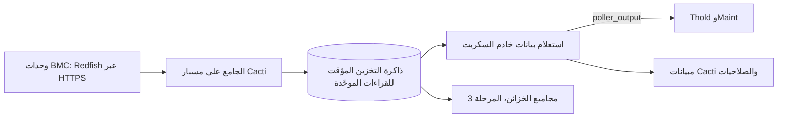

<!-- Source: README.md; SHA256: 7b4e83a58a1adc844cb0615ef30e95476cba2851f96bb454d2a816fb2774724d -->

<!-- translations:start -->
[English](../../../README.md) | [简体中文](../zh-CN/README.md) | [हिन्दी](../hi-IN/README.md) | [Español (España)](../es-ES/README.md) | [Español (Latinoamérica)](../es-419/README.md) | [العربية (السعودية)](../ar-SA/README.md) | [Afrikaans](../af-ZA/README.md) | [አማርኛ](../am-ET/README.md) | [العربية (مصر)](../ar-EG/README.md) | [العربية (المغرب)](README.md) | [বাংলা](../bn-BD/README.md) | [Bosanski](../bs-BA/README.md) | [Deutsch](../de-DE/README.md) | [فارسی](../fa-IR/README.md) | [Filipino](../fil-PH/README.md) | [Français](../fr-FR/README.md) | [Français (Maroc)](../fr-MA/README.md) | [Français (Sénégal)](../fr-SN/README.md) | [Hausa](../ha-NG/README.md) | [עברית](../he-IL/README.md) | [Hrvatski](../hr-HR/README.md) | [Bahasa Indonesia](../id-ID/README.md) | [Igbo](../ig-NG/README.md) | [Italiano](../it-IT/README.md) | [日本語](../ja-JP/README.md) | [한국어](../ko-KR/README.md) | [Malagasy](../mg-MG/README.md) | [मराठी](../mr-IN/README.md) | [Bahasa Melayu](../ms-MY/README.md) | [Nederlands](../nl-NL/README.md) | [Polski](../pl-PL/README.md) | [Português (Brasil)](../pt-BR/README.md) | [Русский](../ru-RU/README.md) | [Kinyarwanda](../rw-RW/README.md) | [Soomaali](../so-SO/README.md) | [Српски](../sr-RS/README.md) | [Svenska](../sv-SE/README.md) | [Kiswahili](../sw-KE/README.md) | [தமிழ்](../ta-IN/README.md) | [తెలుగు](../te-IN/README.md) | [ไทย](../th-TH/README.md) | [Türkçe](../tr-TR/README.md) | [Українська](../uk-UA/README.md) | [اردو](../ur-PK/README.md) | [Tiếng Việt](../vi-VN/README.md) | [isiXhosa](../xh-ZA/README.md) | [Yorùbá](../yo-NG/README.md) | [繁體中文](../zh-TW/README.md) | [isiZulu](../zu-ZA/README.md)
<!-- translations:end -->

# plugin_redfish

إضافة لـ Cacti 1.2 تجلب استهلاك الطاقة للخوادم، ودرجة حرارة مدخل الهواء، وحالة المراوح، وصحة وحدات التغذية الكهربائية من وحدات التحكم في الإدارة الأساسية (BMCs) إلى Cacti كأجهزة عادية، ومصادر بيانات، ومبيانات، باستخدام Redfish مع خيار احتياطي عبر IPMI. بعد ذلك تتولى إضافتا Thold وMaint إرسال التنبيهات وكتمها، بينما تضيف مرحلة لاحقة مجاميع استهلاك الطاقة على مستوى الخزانة.

> **الحالة: قيد التطوير، لا يوجد إصدار رسمي بعد (0.1.0-dev).** تم دمج المعلمَين 2 (الأساس) و3 (كائنات Cacti والتنبيهات) في الفرع `main`. هذه الإضافة غير تابعة لمشروع Cacti. تُثبَّت على Cacti 1.2.31 مع PHP 8.2 أو أحدث، وتُسجِّل وحدات BMC وبيانات الاعتماد، وتقرأ الطاقة ودرجات الحرارة والمراوح وصحة وحدات التغذية الكهربائية من كل وحدة BMC عبر Redfish إلى ذاكرة التخزين المؤقت الخاصة بها، وتعرض حالة التجميع. كما تضيف أجهزة Cacti، ومبيانات لكل عنصر ومبيانات ملخصة، ودعم Thold وMaint عبر مصادر البيانات العادية. اختُبرت في التكامل المستمر (CI) وحدة BMC وهمية مبنية من تجهيزات مكتوبة يدوياً وخادم المحاكاة DMTF Redfish؛ ولم يتم بعدُ تأهيل أي وحدة BMC حقيقية أو أسطول تجريبي. تتوفر وثائق التصميم والبحث في [docs/PLAN.md](../../PLAN.md)، و[docs/research/](../../research)، و[docs/decisions/](../../decisions).

### ما يقدّمه المعلم 2

- التثبيت والترقية والتعطيل وإلغاء التثبيت عبر واجهة برمجة الإضافات الخاصة بـ Cacti، مع الاحتفاظ بالجداول عند إلغاء التثبيت ما لم يتم إلغاء تفعيل هذا الإعداد. في إصدارات PHP الأقدم من 8.2 ترفض الإضافة التثبيت أو التفعيل وتُبيّن السبب.
- نطاقات الصلاحيات (Realms): "Redfish View" (صفحة الحالة الصحية)، و"Redfish Operator" (صفحة العمليات)، و"Redfish Admin" (صفحتا وحدات BMC وبيانات الاعتماد)، بالإضافة إلى الإعدادات تحت Configuration > Settings > Redfish.
- سجل لوحدات BMC مع استيراد بصيغة CSV وتصدير بصيغة JSON. يجب ألا تحتوي ملفات الاستيراد على كلمات مرور؛ إذ يُشار إلى بيانات الاعتماد بالاسم.
- تُخزَّن بيانات الاعتماد مشفّرة بخوارزمية AES-256-GCM. المفتاح عبارة عن ملف خارج قاعدة البيانات، مساره الافتراضي `/etc/cacti/redfish-vault.key`، ويحتوي على 64 محرفاً ست عشرياً (`openssl rand -hex 32`) أو 32 بايت عشوائياً بالضبط، يملكه مستخدم المسبار (poller)، وغير قابل للقراءة من طرف المستخدمين الآخرين، وفي مجلد لا يملك صلاحية الكتابة فيه سوى مستخدم المسبار أو root. يُرفض أي مفتاح مكوّن من 32 محرفاً قابلاً للطباعة باعتباره عبارة مرور. **احتفظ بنسخة احتياطية من ملف المفتاح مع قاعدة البيانات**؛ فبدونه يجب إعادة إدخال كل كلمة مرور مخزَّنة.
- التحقق من TLS مفعَّل افتراضياً، مع حزمة CA أو تثبيت بصمة SPKI SHA-256 لكل وحدة BMC. أي استثناء مُسجَّل لإلغاء التحقق لوحدة BMC معيّنة يبقى ظاهراً في صفحة الحالة الصحية كتحذير.
- عميل Redfish للقراءة فقط: طلبات `GET` بالإضافة إلى تسجيل الدخول والخروج من الجلسة فقط، مع التحقق من كل طلب مقابل قائمة سماح قبل إرساله.
- جامع بيانات ينطلق من `poller_bottom` لوحدات BMC الموجودة على المسبار الرئيسي، مع عقود إيجار ومهل زمنية لكل وحدة BMC، وآلية تراجع تدريجي (backoff)، وتنظيف الجلسة الوحيدة التي سجّلتها الإضافة بعد أي تعطل. المجمّعات البعيدة غير مدعومة بعد؛ فهي تتطلب اختياراً صريحاً لكيفية وصول المجمّع إلى قاعدة البيانات والمفتاح (المرحلة 4).
- تتبع سجلات وحدات BMC وبيانات الاعتماد صلاحيات الأجهزة في Cacti: فلا يرى مدير Redfish (Redfish Admin) ولا يُعدِّل ولا يربط إلا وحدات BMC الموجودة على الأجهزة المسموح له برؤيتها، ولا يرى إلا بيانات الاعتماد التي لا تستخدمها أي وحدة BMC على جهاز مخفي.

### ما يضيفه المعلم 3

- تُرفق القوالب بصيغة XML لقوالب Cacti في `templates/` وتُستورد باستخدام أداة الاستيراد الخاصة بـ Cacti عند التثبيت والترقية، مع المطابقة عبر بصمة التجزئة (hash)، بحيث يُحدِّث الاستيراد كائنات الإضافة ولا يضيف أي شيء مرتين. تُنسخ ملفات استعلام البيانات الثلاثة إلى `<cacti>/resource/script_server/` مع تسجيل بصمة التجزئة؛ ولا تستبدل الإضافة أبداً أي ملف هناك لم تقم هي بكتابته، كما تحذّر صفحة الحالة الصحية المديرين عندما لا تكون القوالب أو أحد ملفات الاستعلام في مكانها. يقوم زر **إعادة تثبيت قوالب Redfish (Reinstall the Redfish Templates)** في صفحة وحدات BMC باستيرادها مجدداً؛ ويتطلب صلاحية Import Templates في Cacti.
- **إنشاء جهاز (Create Device)** أو **إضافة مبيانات (Add Graphs)** لكل وحدة BMC ([ADR 0015](../../decisions/0015-attach-to-the-server-device-or-create-one-per-bmc.md)). تحصل وحدة BMC المربوطة بجهاز خادم موجود مسبقاً على استعلامات بياناتها ومبياناتها على ذلك الجهاز. أما وحدة BMC غير المربوطة فتحصل على جهاز جديد من قالب الجهاز "Redfish BMC"، مع تعطيل فحوصات التوفّر واسم مضيف ضمن النطاق `.invalid`، بحيث لا يتصل Cacti بوحدة BMC أبداً ولا يعرض عنوانها. وفي كلتا الحالتين، يؤكد المدير أولاً خطةً تسرد ما سيتم إضافته. ويتطلب كلا الإجراءين صلاحية إدارة الأجهزة في Cacti إلى جانب صلاحية Redfish Admin؛ وإذا أُنشئ جهاز جديد لا يمكن لمنشئه رؤيته فإنه يُحذف مجدداً.
- ثلاثة استعلامات بيانات لخادم السكربت: "Redfish Fans" و"Redfish Temperatures" و"Redfish Power Supplies"، مفهرسة بمفتاح العنصر الخاص بوحدة BMC، مع مبيان لكل عنصر: سرعة المروحة بالنسبة المئوية أو بعدد الدورات في الدقيقة (RPM) أياً كانت الوحدة التي تبلغ عنها وحدة BMC، ودرجة الحرارة، واستطاعة الدخل والخرج بالواط لوحدة التغذية الكهربائية، كلٌّ مع رمز حالته الصحية.
- مدخل "Redfish Node Summary" يضم الطاقة، ودرجة حرارة مدخل الهواء، وأعلى درجة حرارة، والمراوح ووحدات التغذية غير السليمة، وصحة العقدة، وعمر آخر قراءة صالحة، مرسومةً على أربعة مبيانات: الطاقة، ودرجات الحرارة، وصحة المكونات، وعمر البيانات. تُطلِق عتبات Thold على مصادر البيانات هذه تنبيهات، وتكتمها إضافة Maint، دون أي تعديل على أي من الإضافتين.
- يجيب خادم السكربت من ذاكرة التخزين المؤقت للإضافة فقط ولا يتصل بوحدة BMC أبداً. أي قيمة مفقودة أو قديمة أو بوحدة قياس مختلفة أو لعنصر لم يعد موجوداً تكون قيمتها `U`، فتُظهر المبيانات فجوة لا صفراً؛ بينما تملك `age` قيمة دائماً، لذا فإن وضع عتبة عليها يرصد أي وحدة BMC توقفت عن الاستجابة.
- رابط مبيان من كل مبيان Redfish إلى مبيانات Redfish الخاصة بالجهاز، ولا يظهر إلا للمستخدمين الذين يسمح لهم Cacti برؤية الجهاز.

**عند تغيّر عناصر وحدة BMC** (استبدال مروحة، أو تحديث برنامج ثابت يعيد تسمية المستشعرات)، اختر **إضافة مبيانات (Add Graphs)** مجدداً. فالمروحة أو وحدة التغذية التي كانت حاضرة ثم أصبحت غائبة أو مفقودة تُحتسب في `fans_bad` أو `psus_bad` إلى أن تفعل ذلك، مما يضمن إطلاق تنبيه عند نزع مروحة؛ أما المنفذ الذي لم يكن مملوءاً أصلاً فلا يُحتسب. يعتمد خيار إضافة المبيانات العناصر التي تبلغ عنها وحدة BMC الآن، ويعيد Cacti فهرسة الاستعلامات؛ ويحتفظ العنصر المفقود بمصدر بياناته ومبيانه اللذين يقرآن `U` من ذلك الحين فصاعداً، بينما يحصل العنصر الجديد على مبيان. احذف مبيانات العناصر المفقودة يدوياً عندما لا تعد بحاجة إلى سجلها التاريخي.

حذف جهاز يفك ربط وحدة BMC الخاصة به مع الاحتفاظ بوحدة BMC وذاكرة تخزينها المؤقت. وحذف وحدة BMC، أو إلغاء تثبيت الإضافة، يحتفظ بجهازها ومبياناتها.

## أدوار الوصول

| النطاق | الصلاحية |
| --- | --- |
| Redfish View | صفحات المراقبة الحالية. |
| Redfish Operator | المراقبة بالإضافة إلى صفحة العمليات وإقرارات الفرز الشخصية. |
| Redfish Admin | صلاحيات المشغّل بالإضافة إلى الإعدادات الحالية والإجراءات الإدارية. |

بعد نسخ ملفات الترقية، افتح صفحة الإضافات (Plugins) بصفتك مديراً لتسجيل النطاق الجديد. عيّن نطاق المشغّل (Operator) صراحةً تحت **Configuration > Users** أو مجموعات المستخدمين. تحتفظ الترقيات بمعرّفات وتخويلات نطاقي View وAdmin الحالية. ترث صلاحية Admin صلاحية Operator، وترث صلاحية Operator صلاحية View عند كل طلب؛ ولا يضيف هذا تخويلات مخزَّنة للمستخدمين أو المجموعات. كما تتطلب إعدادات الإضافة صلاحية Redfish Admin إضافةً إلى صلاحية Settings في Cacti.

تستمر صلاحيات الأجهزة في Cacti في تقييد الصفوف والإجراءات المتاحة لكل مستخدم؛ وتتطلب الكائنات غير المربوطة مديراً. يمكن للمشغّلين (Operators) تحرير تعليق الجمع على وحدة BMC مسموح بها للدورة المجدولة التالية. وتبقى بيانات الاعتماد، والإعدادات، والربط، والحذف، وسائر التغييرات الإدارية ضمن الصفحات الإدارية. تدوم الإقرارات في جلسة المستخدم الحالية فقط، لمدة ساعة واحدة كحد أقصى وطالما بقيت الملاحظة نفسها حديثة. وتُبطِلها أي ملاحظة جديدة أو متغيّرة. وهي لا تجعل أي قياس فاشل يبدو سليماً ولا تكتم التنبيهات أبداً.

## لماذا

يمتلك كل خادم وحدة BMC تبلّغ عن حالة الطاقة والحرارة بشكل مستقل عن نظام التشغيل، ولذا تواصل الاستجابة حتى عندما يكون نظام التشغيل متوقفاً. وتخدم هذه البيانات تتبع السعة والتكاليف، والإنذار المبكر بتعطل مروحة أو وحدة تغذية كهربائية، وفي الحوسبة عالية الأداء قرارات تحديد سقف الطاقة. وهذه الإضافة ليست مخصصة للحوسبة عالية الأداء فقط.

يغطي Cacti جزءاً من هذا اليوم:

- **حزم SNMP الخاصة بالمصنّعين.** يشحن الفرع 1.2.x قوالب Dell iDRAC وHPE iLO التي تحتاج إلى وكيل SNMP وتبقى خاصة بكل مصنّع؛ وقد وجدت أبحاث المعلم 1 أن أياً منهما لا يبلّغ عن استهلاك الطاقة بالواط ([docs/research/overlap.md](../../research/overlap.md)).
- **نوع بيانات اعتماد دون جامع بيانات.** تعرّف إضافة plugin_credentials نوع اعتماد "IPMI / Redfish (BMC)" لكنها لا تقرأ أي وحدة BMC.
- **غياب العرض على مستوى الخزانة.** لا يضم نواة Cacti أي كائن للخزانة؛ بل يكتفي الجهاز بحقل نص حر باسم `location`.

تستطلع الإضافة وحدات BMC خارج النطاق وبمعزل عن دورة الاستطلاع في Cacti، وتخزّن القراءات الموحّدة مؤقتاً، وتعرضها عبر استعلام بيانات خادم السكربت ومصادر بيانات ملخصة. كما تعيد استخدام مبيانات Cacti وصلاحياته وThold وMaint، ولا تغيّر حالة وحدة BMC. ودعم مجمّعات البيانات البعيدة مخطط له في المرحلة 4؛ بينما يعمل الجمع الحالي على المسبار الرئيسي فقط.

## النطاق المخطط له

| المرحلة | النطاق | المعالم |
|---|---|---|
| 0، البحث | مصفوفة المصنّعين، التحقق من السلوك الأساسي على وحدات BMC حية، تكلفة الاستطلاع، تجربة أولية لاستعلام البيانات | [M1](https://github.com/somethingwithproof/plugin_redfish/milestone/1) |
| 1، المراقبة | سجل وحدات BMC، بيانات الاعتماد، TLS، جامع Redfish، القراءات الموحّدة، الأجهزة، مبيانات لكل فهرس، تنبيهات Thold، الكتم عبر Maint، صفحة الحالة الصحية | [M2](https://github.com/somethingwithproof/plugin_redfish/milestone/2)، [M3](https://github.com/somethingwithproof/plugin_redfish/milestone/3)، [M4](https://github.com/somethingwithproof/plugin_redfish/milestone/4) |
| 2، ipmi | خيار احتياطي عبر IPMI لوحدات BMC التي لا تملك Redfish صالحاً للاستخدام، معطّل افتراضياً | [M5](https://github.com/somethingwithproof/plugin_redfish/milestone/5) |
| 3، الخزائن | سجل الخزائن، مجاميع طاقة الخزانة مع التغطية، هامش الميزانية | [M6](https://github.com/somethingwithproof/plugin_redfish/milestone/6) |
| 4، البعيد | مجمّعات بيانات Cacti البعيدة لشبكات BMC المعزولة | [M7](https://github.com/somethingwithproof/plugin_redfish/milestone/7) |

خارج النطاق: ضبط سقوف الطاقة أو أي إعداد آخر لوحدة BMC، التحكم في الطاقة، تحديث البرنامج الثابت، الوصول إلى وحدة التحكم الطرفية (console)، محرك تنبيهات مملوك للإضافة، والتكامل مع المجدول.

## أهداف التوافق

| المكوّن | الهدف |
|---|---|
| Cacti | 1.2.31 أو أحدث، دون تعديلات على النواة |
| قاعدة البيانات | MariaDB 10.2 أو MySQL 5.7 أو أحدث: يُفرض قيد وحدة BMC واحدة لكل جهاز عبر مفتاح فريد على عمود مولَّد |
| PHP | 8.2 أو أحدث؛ يبقى الملف `setup.php` قابلاً للتحليل على الإصدار 8.0 حتى تتلقى بيئة التشغيل غير المدعومة رسالة رفض بدل تعطل واجهة Cacti |
| وحدات BMC | Dell iDRAC وHPE iLO وLenovo XCC وOpenBMC، حسب نطاق البرنامج الثابت؛ انظر [مصفوفة المصنّعين](../../research/vendor-matrix.md) |
| Redfish | موارد الأنظمة الفرعية والمستشعرات الجديدة أولاً، مع `Power` و`Thermal` المتقادمين كخيار احتياطي |
| Thold وMaint | لا يلزم أي تعديل |

## التصميم

- [docs/PLAN.md](../../PLAN.md) هي الخطة الكاملة: البنية المعمارية، والحقائق الأساسية التي تعتمد عليها (مع المصادر والافتراضات التي ما تزال بحاجة إلى تأكيد)، ونموذج القياس، والحدود الأمنية، وحسابات الأداء، والاختبارات، والمخاطر.
- [docs/decisions/](../../decisions) يضم سجلات القرارات المعمارية للخيارات المتخذة مسبقاً.
- [docs/REQUIREMENTS.md](../../REQUIREMENTS.md) يربط كل معرّف متطلب بقضيته المقابلة.

## الأمان

تتحكم بيانات اعتماد BMC في الإدارة خارج النطاق للخوادم. يُبعدها التصميم عن أسطر الأوامر والسجلات والصفحات، ويتحقق من TLS افتراضياً، وينفّذ أي أمر خارجي من مصفوفة وسائط مع أوامر فرعية مسموح بها فقط، ويستخدم حسابات BMC للقراءة فقط. انظر [docs/PLAN.md](../../PLAN.md#security) و[SECURITY.md](../../../SECURITY.md).

## دليل المشغّل

انظر [docs/operator-guide.md](../../operator-guide.md) للاطلاع على متطلبات التثبيت المسبقة، وإعداد الخزنة (vault) وTLS، وتسجيل وحدات BMC، وإنشاء المبيانات، وفترات التنبيه، والنسخ الاحتياطي، والتعامل مع الأعطال. ولا يعلن الدليل دعم أي خط برنامج ثابت حقيقي لمصنّع معيّن إلا بعد اجتياز التقاط منقّح من ذلك البرنامج الثابت لمجموعة الاختبارات.

## كيفية تتبع العمل

- **المعالم (Milestones)** تتبع معالم الخطة. ولكل معلم قضية ملحميّة (epic issue) تسرد قضاياه الفرعية وأدلة الإنجاز.
- **القضايا (Issues)** مصنّفة حسب التسميات: `type: requirement`، و`type: research`، و`type: decision`، و`type: epic`. وتنص قضايا المتطلبات على متطلبات مرقّمة وقابلة للاختبار (`REQ-AREA-NNN`) ومعايير القبول.
- **التسميات (Labels)** تحمل أيضاً `area:` و`phase:` و`priority:` و`status:`. انظر [CONTRIBUTING.md](../../../CONTRIBUTING.md#labels).
- تعرض [لوحة المشروع](https://github.com/users/somethingwithproof/projects/12) جميع القضايا عبر المعالم.

## المساهمة

اقرأ [CONTRIBUTING.md](../../../CONTRIBUTING.md). تتطلب الإيداعات (commits) توقيع DCO sign-off. وتجري مناقشات التصميم في القضايا؛ وتحمل القرارات المفتوحة التسمية `type: decision`. وتُعد الأدلة المستمدة من وحدات BMC حقيقية أفيد مساهمة حالياً؛ يرجى تنقيح العناوين والأرقام التسلسلية وبيانات الاعتماد قبل نشر أي التقاط.

## الرخصة

رخصة جنو العمومية الإصدار 2.0 (GNU General Public License v2.0)، وهي الرخصة نفسها الخاصة بـ Cacti وإضافاته. انظر [LICENSE](../../../LICENSE).
