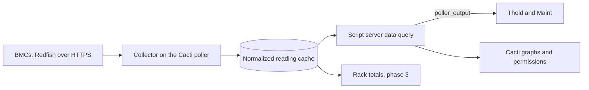

<!-- Source: README.md; SHA256: 7b4e83a58a1adc844cb0615ef30e95476cba2851f96bb454d2a816fb2774724d -->

<!-- translations:start -->
[English](../../../README.md) | [简体中文](../zh-CN/README.md) | [हिन्दी](../hi-IN/README.md) | [Español (España)](../es-ES/README.md) | [Español (Latinoamérica)](../es-419/README.md) | [العربية (السعودية)](README.md) | [Afrikaans](../af-ZA/README.md) | [አማርኛ](../am-ET/README.md) | [العربية (مصر)](../ar-EG/README.md) | [العربية (المغرب)](../ar-MA/README.md) | [বাংলা](../bn-BD/README.md) | [Deutsch](../de-DE/README.md) | [فارسی](../fa-IR/README.md) | [Filipino](../fil-PH/README.md) | [Français](../fr-FR/README.md) | [Français (Maroc)](../fr-MA/README.md) | [Français (Sénégal)](../fr-SN/README.md) | [Hausa](../ha-NG/README.md) | [עברית](../he-IL/README.md) | [Bahasa Indonesia](../id-ID/README.md) | [Igbo](../ig-NG/README.md) | [Italiano](../it-IT/README.md) | [日本語](../ja-JP/README.md) | [한국어](../ko-KR/README.md) | [Malagasy](../mg-MG/README.md) | [मराठी](../mr-IN/README.md) | [Bahasa Melayu](../ms-MY/README.md) | [Nederlands](../nl-NL/README.md) | [Polski](../pl-PL/README.md) | [Português (Brasil)](../pt-BR/README.md) | [Русский](../ru-RU/README.md) | [Kinyarwanda](../rw-RW/README.md) | [Soomaali](../so-SO/README.md) | [Svenska](../sv-SE/README.md) | [Kiswahili](../sw-KE/README.md) | [தமிழ்](../ta-IN/README.md) | [తెలుగు](../te-IN/README.md) | [ไทย](../th-TH/README.md) | [Türkçe](../tr-TR/README.md) | [Українська](../uk-UA/README.md) | [اردو](../ur-PK/README.md) | [Tiếng Việt](../vi-VN/README.md) | [isiXhosa](../xh-ZA/README.md) | [Yorùbá](../yo-NG/README.md) | [繁體中文](../zh-TW/README.md) | [isiZulu](../zu-ZA/README.md)
<!-- translations:end -->

# plugin_redfish

إضافة إلى Cacti 1.2 تعرض استهلاك طاقة الخادم ودرجة حرارة الهواء الداخل وحالة المراوح وسلامة وحدات الطاقة من متحكمات إدارة اللوحة الأساسية (BMC) ضمن أجهزة Cacti ومصادر بياناته ورسومه العادية، باستخدام Redfish مع بديل IPMI اختياري ضمن الخطة. تتيح Thold وMaint التنبيه وكتم الإشعارات، وتضيف مرحلة لاحقة إجماليات الطاقة على مستوى الرفوف.

> **الحالة: قيد التطوير، ولم يصدر إصدار بعد (0.1.0-dev).** دُمجت المرحلتان 2 (الأساس) و3 (كائنات Cacti والتنبيهات) في `main`. هذه الإضافة غير تابعة لمشروع Cacti. تُثبت على Cacti 1.2.31 مع PHP 8.2 أو أحدث، وتسجل وحدات BMC وبيانات الاعتماد، وتقرأ الطاقة والحرارة والمراوح وسلامة وحدات الطاقة عبر Redfish إلى ذاكرتها المؤقتة، وتعرض سلامة الجمع. تضيف أجهزة Cacti ورسوم الأعضاء والملخصات، وتدعم Thold وMaint عبر مصادر بيانات عادية. اختبرت CI وحدة BMC وهمية ببيانات مكتوبة يدويًا وخادم محاكاة Redfish من DMTF؛ ولم تُؤهّل أي وحدة BMC حقيقية أو بيئة تجريبية. يوجد التصميم والبحث في [docs/PLAN.md](../../PLAN.md) و[docs/research/](../../research) و[docs/decisions/](../../decisions).

### ما توفره المرحلة 2

- التثبيت والترقية والتعطيل وإلغاء التثبيت عبر واجهة إضافات Cacti، مع الاحتفاظ بالجداول عند الإزالة ما لم يُلغَ الإعداد. ترفض الإضافة التثبيت أو التفعيل على PHP الأقدم من 8.2 وتوضح السبب.
- نطاقات الصلاحيات «Redfish View» لصفحة السلامة، و«Redfish Operator» لصفحة العمليات، و«Redfish Admin» لصفحات BMC وبيانات الاعتماد، وإعدادات ضمن Configuration > Settings > Redfish.
- سجل BMC يدعم استيراد CSV وتصدير JSON. يجب ألا تحتوي ملفات الاستيراد على كلمات مرور؛ تُشار إلى بيانات الاعتماد بالاسم.
- بيانات اعتماد مشفرة باستخدام AES-256-GCM. المفتاح ملف خارج قاعدة البيانات، افتراضيًا `/etc/cacti/redfish-vault.key`، يحتوي على 64 حرفًا سداسيًا عشريًا (`openssl rand -hex 32`) أو 32 بايت عشوائيًا بالضبط. يملكه مستخدم المستطلِع ولا يقرؤه الآخرون، ويوجد في دليل لا يكتب فيه إلا مستخدم المستطلِع أو root. يُرفض مفتاح من 32 حرفًا قابلًا للطباعة باعتباره عبارة مرور. **انسخ ملف المفتاح احتياطيًا مع قاعدة البيانات**؛ بدونه يجب إدخال جميع كلمات المرور المحفوظة مجددًا.
- التحقق من TLS مفعّل افتراضيًا، مع حزمة CA أو تثبيت SPKI SHA-256 لكل BMC. يُسجل تعطيل التحقق لكل وحدة ويبقى تحذيرًا في صفحة السلامة.
- عميل Redfish للقراءة فقط: يسمح بـ `GET` وتسجيل الجلسة والخروج منها فقط، وتُفحص قائمة السماح قبل إرسال أي طلب.
- جامع بيانات يبدأ من `poller_bottom` لوحدات BMC على المستطلِع الرئيسي، مع حجوزات ومهل لكل BMC وتراجع بين المحاولات وتنظيف الجلسة الوحيدة التي سجلتها الإضافة بعد تعطل التشغيل. لا تُدعم الجامعات البعيدة بعد؛ إذ يلزم تحديد كيفية وصولها إلى قاعدة البيانات والمفتاح صراحةً في المرحلة 4.
- تتبع سجلات BMC وبيانات الاعتماد صلاحيات أجهزة Cacti: لا يرى مسؤول Redfish أو يغيّر أو يربط إلا وحدات BMC على أجهزة يمكنه رؤيتها، ولا يتعامل إلا مع بيانات اعتماد لا تستخدمها BMC على جهاز مخفي.

### ما تضيفه المرحلة 3

- قوالب XML لـ Cacti ضمن `templates/`، تُستورد بأداة Cacti عند التثبيت والترقية وتُطابق بالتجزئة لتحديث الكائنات دون تكرار. تُنسخ ملفات استعلام البيانات الثلاثة إلى `<cacti>/resource/script_server/` مع تسجيل التجزئة؛ ولا تستبدل الإضافة ملفًا لم تكتبه. تحذر صفحة السلامة المسؤولين عند غياب القوالب أو ملفات الاستعلام. يعيد **Reinstall the Redfish Templates** في صفحة BMC استيرادها، ويتطلب صلاحية Import Templates في Cacti.
- **Create Device** أو **Add Graphs** لكل BMC ([ADR 0015](../../decisions/0015-attach-to-the-server-device-or-create-one-per-bmc.md)). تحصل BMC المرتبطة بجهاز خادم موجود على استعلاماتها ورسومها على ذلك الجهاز. تحصل BMC غير المرتبطة على جهاز جديد من قالب «Redfish BMC» مع تعطيل اختبارات التوفر واسم مضيف ضمن `.invalid`، فلا يتصل Cacti بوحدة BMC ولا يُظهر عنوانها. يؤكد المسؤول أولًا خطة بما سيُضاف في الحالتين. يتطلب الإجراء صلاحية إدارة أجهزة Cacti وRedfish Admin؛ ويُزال الجهاز الجديد إن لم يتمكن منشئه من رؤيته.
- ثلاثة استعلامات لخادم السكربتات: «Redfish Fans» و«Redfish Temperatures» و«Redfish Power Supplies»، مفهرسة بمفتاح عضو BMC، مع رسم لكل عضو: سرعة المروحة بالنسبة المئوية أو RPM وفق الوحدة المبلّغ عنها، ودرجة الحرارة، وقدرة دخل وخروج وحدات الطاقة بالواط، مع رمز السلامة لكل منها.
- مُدخل «Redfish Node Summary» يتضمن الطاقة وحرارة الهواء الداخل وأعلى حرارة والمراوح ووحدات الطاقة غير السليمة وسلامة العقدة وعمر آخر قراءة ناجحة. تُرسم في أربعة رسوم: الطاقة والحرارة وسلامة المكونات وعمر البيانات. تنبه Thold على مصادر البيانات هذه، وتكتم Maint التنبيهات، دون تعديل أي منهما.
- يجيب خادم السكربتات من ذاكرة الإضافة المؤقتة فقط ولا يتصل بوحدة BMC. تُعاد القيمة المفقودة أو القديمة أو ذات الوحدة المختلفة أو التابعة لعضو اختفى كـ `U`، فتظهر فجوة لا صفرًا؛ ولـ `age` قيمة دائمًا، فتكتشف العتبة عليه وحدة BMC التي توقفت عن الرد.
- رابط من كل رسم Redfish إلى رسوم Redfish للجهاز، لا يظهر إلا لمن تسمح لهم Cacti برؤية الجهاز.

**عند تغيّر أعضاء BMC**، كاستبدال مروحة أو تحديث برنامج ثابت يعيد تسمية المستشعرات، اختر **Add Graphs** مجددًا. تُحسب المروحة أو وحدة الطاقة التي كانت موجودة ثم غابت ضمن `fans_bad` أو `psus_bad` حتى تفعل ذلك، فيؤدي سحب المروحة إلى تنبيه؛ أما الفتحة التي لم تُشغل مطلقًا فلا تُحسب. يقبل Add Graphs الأعضاء التي تبلغ عنها BMC الآن ويعيد Cacti فهرسة الاستعلامات. يحتفظ العضو المختفي بمصدر بياناته ورسمه اللذين يقرآن `U` من حينها، ويحصل العضو الجديد على رسم. احذف رسوم الأعضاء المختفية يدويًا فقط عندما لا تحتاج إلى تاريخها.

يؤدي حذف الجهاز إلى إلغاء ربط BMC مع الاحتفاظ بها وبذاكرتها المؤقتة. ويحتفظ حذف BMC أو إزالة الإضافة بالجهاز ورسومه.

## أدوار الوصول

| نطاق الصلاحيات | الوصول |
| --- | --- |
| Redfish View | صفحات المراقبة الموجودة. |
| Redfish Operator | المراقبة وصفحة العمليات والإقرارات الشخصية أثناء التحقيق. |
| Redfish Admin | صلاحيات المشغّل مع إعدادات وإجراءات الإدارة الموجودة. |

بعد نسخ ملفات الترقية، افتح صفحة Plugins كمسؤول لتسجيل النطاق الجديد. امنح Operator صراحةً ضمن **Configuration > Users** أو مجموعات المستخدمين. تحتفظ الترقيات بمعرّفات ومنح View وAdmin الحالية. يرث Admin صلاحيات Operator ويرث Operator صلاحيات View في كل طلب، دون إضافة منح محفوظة للمستخدمين أو المجموعات. تتطلب إعدادات الإضافة Redfish Admin إلى جانب صلاحية Settings في Cacti.

تظل صلاحيات أجهزة Cacti تحدد الصفوف والإجراءات المتاحة لكل مستخدم؛ وتتطلب الكائنات غير المرتبطة مسؤولًا. يستطيع المشغّلون رفع تعليق الجمع عن BMC مسموح بها للتشغيل المجدول التالي. تبقى تغييرات بيانات الاعتماد والإعدادات والربط والحذف وسائر الإدارة في صفحات الإدارة. تستمر الإقرارات في جلسة المستخدم الحالية فقط، لمدة أقصاها ساعة وما دامت الملاحظة نفسها حديثة. تُبطلها الملاحظات الجديدة أو المتغيرة. ولا تجعل قياسًا فاشلًا سليمًا أو تكتم التنبيهات.

## الدافع

لكل خادم BMC تبلغ عن حالة الطاقة والحرارة باستقلال عن نظام التشغيل، فتستمر بالرد عند تعطله. تخدم البيانات تتبع السعة والتكلفة والإنذار المبكر بتعطل مروحة أو وحدة طاقة وقرارات تحديد الطاقة في الحوسبة عالية الأداء. الإضافة ليست خاصة بـ HPC.

يغطي Cacti بعض ذلك حاليًا:

- **حزم SNMP الخاصة بالمصنعين.** يرفق الفرع 1.2.x قوالب Dell iDRAC وHPE iLO التي تحتاج إلى وكيل SNMP وتخص مصنعًا بعينه؛ ووجد بحث المرحلة 1 أن أيًا منهما لا يبلغ عن استهلاك الطاقة بالواط ([docs/research/overlap.md](../../research/overlap.md)).
- **نوع بيانات اعتماد دون جامع.** يعرّف plugin_credentials بيانات اعتماد «IPMI / Redfish (BMC)» لكنه لا يقرأ BMC.
- **غياب عرض الرفوف.** لا يملك نواة Cacti كائن رف؛ للجهاز حقل نص حر `location`.

تستطلع الإضافة وحدات BMC خارج دورة استطلاع Cacti، وتخزن قراءات موحدة وتعرضها عبر استعلام خادم سكربتات ومصادر بيانات ملخصة. تعيد استخدام رسوم Cacti وصلاحياته وThold وMaint، ولا تغيّر حالة BMC. دعم جامعات البيانات البعيدة مخطط للمرحلة 4؛ ويعمل الجمع حاليًا على المستطلع الرئيسي فقط.

## النطاق المخطط

| المرحلة | النطاق | المعالم |
|---|---|---|
| 0، البحث | مصفوفة المصنعين، تأكيد سلوك المنبع على BMC حقيقية، تكلفة الاستطلاع، وتجربة استعلام البيانات | [M1](https://github.com/somethingwithproof/plugin_redfish/milestone/1) |
| 1، المراقبة | سجل BMC وبيانات الاعتماد وTLS وجامع Redfish والقراءات الموحدة والأجهزة والرسوم لكل فهرس وتنبيهات Thold وكتم Maint وصفحة السلامة | [M2](https://github.com/somethingwithproof/plugin_redfish/milestone/2)، [M3](https://github.com/somethingwithproof/plugin_redfish/milestone/3)، [M4](https://github.com/somethingwithproof/plugin_redfish/milestone/4) |
| 2، IPMI | بديل IPMI لوحدات BMC التي لا توفر Redfish صالحًا، معطل افتراضيًا | [M5](https://github.com/somethingwithproof/plugin_redfish/milestone/5) |
| 3، الرفوف | سجل الرفوف وإجماليات الطاقة مع التغطية والهامش المتبقي من الميزانية | [M6](https://github.com/somethingwithproof/plugin_redfish/milestone/6) |
| 4، البعيد | جامعات Cacti البعيدة لشبكات BMC المعزولة | [M7](https://github.com/somethingwithproof/plugin_redfish/milestone/7) |

خارج النطاق: ضبط حدود الطاقة أو أي إعداد BMC آخر، والتحكم بالطاقة، وتحديث البرامج الثابتة، والوصول إلى وحدة التحكم، ومحرك تنبيهات خاص بالإضافة، والتكامل مع المجدولات.

## أهداف التوافق

| المكوّن | الهدف |
|---|---|
| Cacti | 1.2.31 أو أحدث، دون رقع للنواة |
| قاعدة البيانات | MariaDB 10.2 أو MySQL 5.7 أو أحدث؛ يضمن مفتاح فريد على عمود مولّد وجود BMC واحدة لكل جهاز |
| PHP | 8.2 أو أحدث؛ يبقى `setup.php` قابلًا للتحليل في 8.0 لرفض بيئة غير مدعومة بدل تعطيل واجهة Cacti |
| BMC | Dell iDRAC وHPE iLO وLenovo XCC وOpenBMC بحسب نطاق البرامج الثابتة؛ راجع [مصفوفة المصنعين](../../research/vendor-matrix.md) |
| Redfish | موارد الأنظمة الفرعية والمستشعرات الجديدة أولًا، مع `Power` و`Thermal` المهملين كبديل |
| Thold وMaint | لا يلزم تغيير |

## التصميم

- [docs/PLAN.md](../../PLAN.md) هي الخطة الكاملة: المعمارية وحقائق المنبع التي يعتمد عليها التصميم، بمصادرها وافتراضاتها غير المؤكدة، ونموذج القياس وحدود الأمان وحسابات الأداء والاختبار والمخاطر.
- [docs/decisions/](../../decisions) يحتوي سجلات القرارات المعمارية المتخذة.
- [docs/REQUIREMENTS.md](../../REQUIREMENTS.md) يربط كل معرّف متطلب بقضيته.

## الأمان

تتحكم بيانات اعتماد BMC في إدارة الخوادم خارج النطاق. يبقيها التصميم خارج أسطر الأوامر والسجلات والصفحات، ويتحقق من TLS افتراضيًا، ويشغّل الأوامر الخارجية بمصفوفات معاملات وأوامر فرعية مسموحة، ويستخدم حسابات BMC للقراءة فقط. راجع [docs/PLAN.md](../../PLAN.md#security) و[SECURITY.md](../../../SECURITY.md).

## دليل المشغّل

راجع [docs/operator-guide.md](docs/operator-guide.md) لمتطلبات التثبيت وإعداد الخزنة وTLS وتسجيل BMC وإنشاء الرسوم وفواصل التنبيه والنسخ الاحتياطي ومعالجة الفشل. لا يعلن الدليل دعم خط برامج ثابتة حقيقي حتى تجتاز بيانات ملتقطة منه بعد تنقيحها مجموعة الاختبارات.

## تتبع العمل

- تتبع **المعالم** الخطة؛ ولكل منها قضية رئيسية تسرد قضاياها الفرعية وأدلة الاكتمال.
- تُصنف **القضايا** بالوسوم `type: requirement` و`type: research` و`type: decision` و`type: epic`. تسرد قضايا المتطلبات بنودًا مرقمة قابلة للاختبار (`REQ-AREA-NNN`) ومعايير قبول.
- تحمل **الوسوم** أيضًا `area:` و`phase:` و`priority:` و`status:`. راجع [CONTRIBUTING.md](../../../CONTRIBUTING.md#labels).
- تعرض [لوحة المشروع](https://github.com/users/somethingwithproof/projects/12) جميع القضايا عبر المعالم.

## المساهمة

اقرأ [CONTRIBUTING.md](../../../CONTRIBUTING.md). تحتاج الإيداعات إلى توقيع DCO. تُناقش التصاميم في القضايا، وتحمل القرارات المفتوحة وسم `type: decision`. الأدلة من BMC حقيقية هي المساهمة الأكثر نفعًا الآن؛ نقّح العناوين والأرقام التسلسلية وبيانات الاعتماد قبل نشر أي بيانات ملتقطة.

## الترخيص

رخصة GNU العامة الإصدار 2.0، وهي رخصة Cacti وإضافاته نفسها. راجع [LICENSE](../../../LICENSE).
