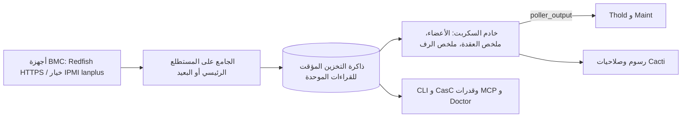

<!-- Source: README.md; SHA256: 6972a6c9ac754cd60e63c5caf971451ea8fe6e279eef757d886e1a168d3eef01 -->

<!-- translations:start -->
[English](../../../README.md) | [简体中文](../zh-CN/README.md) | [हिन्दी](../hi-IN/README.md) | [Español (España)](../es-ES/README.md) | [Español (Latinoamérica)](../es-419/README.md) | [العربية (السعودية)](README.md) | [Afrikaans](../af-ZA/README.md) | [አማርኛ](../am-ET/README.md) | [العربية (مصر)](../ar-EG/README.md) | [العربية (المغرب)](../ar-MA/README.md) | [বাংলা](../bn-BD/README.md) | [Bosanski](../bs-BA/README.md) | [Deutsch](../de-DE/README.md) | [فارسی](../fa-IR/README.md) | [Filipino](../fil-PH/README.md) | [Français](../fr-FR/README.md) | [Français (Maroc)](../fr-MA/README.md) | [Français (Sénégal)](../fr-SN/README.md) | [Hausa](../ha-NG/README.md) | [עברית](../he-IL/README.md) | [Hrvatski](../hr-HR/README.md) | [Bahasa Indonesia](../id-ID/README.md) | [Igbo](../ig-NG/README.md) | [Italiano](../it-IT/README.md) | [日本語](../ja-JP/README.md) | [한국어](../ko-KR/README.md) | [Malagasy](../mg-MG/README.md) | [मराठी](../mr-IN/README.md) | [Bahasa Melayu](../ms-MY/README.md) | [Nederlands](../nl-NL/README.md) | [Polski](../pl-PL/README.md) | [Português (Brasil)](../pt-BR/README.md) | [Русский](../ru-RU/README.md) | [Kinyarwanda](../rw-RW/README.md) | [Soomaali](../so-SO/README.md) | [Српски](../sr-RS/README.md) | [Svenska](../sv-SE/README.md) | [Kiswahili](../sw-KE/README.md) | [தமிழ்](../ta-IN/README.md) | [తెలుగు](../te-IN/README.md) | [ไทย](../th-TH/README.md) | [Türkçe](../tr-TR/README.md) | [Українська](../uk-UA/README.md) | [اردو](../ur-PK/README.md) | [Tiếng Việt](../vi-VN/README.md) | [isiXhosa](../xh-ZA/README.md) | [Yorùbá](../yo-NG/README.md) | [繁體中文](../zh-TW/README.md) | [isiZulu](../zu-ZA/README.md)
<!-- translations:end -->

# plugin_redfish

إضافة لـ Cacti 1.2 تجلب استهلاك الطاقة للخادم ودرجة حرارة المدخل وحالة المراوح وصحة مزودات الطاقة من وحدات التحكم في إدارة اللوحة الأم (BMC) إلى Cacti بوصفها أجهزة ومصادر بيانات ورسوماً بيانية عادية، باستخدام Redfish مع خيار بديل للقراءة فقط عبر IPMI وتجميع الطاقة على مستوى الرف. يتولى Thold وMaint التنبيه عليها وكتمها عبر مصادر بيانات Cacti القياسية.

> **الحالة: قيد التطوير، لا يوجد إصدار بعد (`0.1.0-dev`).** هذه الإضافة غير تابعة لمشروع Cacti. يتم تثبيتها على Cacti 1.2.31 أو أحدث ضمن PHP 8.2 أو أحدث، وتنفذ جامع Redfish، وخزنة بيانات الاعتماد المشفرة، وتوفير أجهزة ورسوم Cacti، وخيار IPMI البديل للقراءة فقط، وتجميع طاقة الرف، وعرض نوافذ Maint في Cacti، ونسخ جامع البيانات البعيد ونقاط نهاية الوكيل، ومزود CasC وواجهة سطر الأوامر للمشغل، وقدرات MCP، وفحوصات Doctor التشخيصية. تختبر CI التجهيزات التجريبية وخادم DMTF Redfish Mockup Server (نماذج النظام الفرعي والقديم فقط وHPE iLO Gen11) وThold v1.8.2 مع Maint v1.3؛ ولم يتم اعتماد أي جهاز BMC فعلي أو أسطول تجريبي بعد. التصميم والأبحاث موجودة في [docs/PLAN.md](../../PLAN.md) و[docs/research/](../../research/) و[docs/decisions/](../../decisions/).

## القدرات المنفذة

### الجامع الأساسي والخزنة وكائنات Cacti

- **دورة الحياة والمخطط.** التثبيت والترقية والتعطيل وإلغاء التثبيت عبر واجهة برمجة إضافات Cacti (`Schema::VERSION = 3`، 12 جدولاً). يتم الاحتفاظ بالجداول عند إلغاء التثبيت ما لم يتم إلغاء تحديد *Keep Plugin Tables on Uninstall*. نقاط الدخول قابلة للتحليل على PHP 8.0 وترفض إصدارات PHP الأقل من 8.2 أو غياب `ext-openssl` برسالة خطأ صريحة.
- **السجل والصلاحيات.** نطاقات *Redfish View* (`redfish_health.php`) و*Redfish Operator* (`redfish_operator.php`) و*Redfish Admin* (`redfish_bmcs.php`, `redfish_credentials.php`)، بالإضافة إلى الإعدادات ضمن **Configuration > Settings > Redfish**. يدعم سجل BMC الاستيراد بصيغة CSV (تُشار بيانات الاعتماد بالاسم؛ وتُرفض كلمات المرور في ملفات الاستيراد) والتصدير بصيغة JSON. تتبع سجلات BMC وبيانات الاعتماد صلاحيات الأجهزة في Cacti.
- **خزنة بيانات الاعتماد المشفرة.** تُخزّن كلمات المرور مشفرة باستخدام AES-256-GCM في `plugin_redfish_secret`. يعيش المفتاح خارج قاعدة البيانات (`/etc/cacti/redfish-vault.key` افتراضياً) بوصفه 64 محرفاً ست عشرياً (`openssl rand -hex 32`) أو 32 بايت خام، مملوكاً لمستخدم المستطلع، وغير قابل للقراءة من المستخدمين الآخرين، داخل دليل قابل للكتابة فقط من قِبل root أو ذلك المستخدم. تُرفض عبارة المرور القابلة للطباعة المكونة من 32 محرفاً. **انسخ ملف المفتاح احتياطياً مع قاعدة البيانات**؛ بدونه يجب إعادة إدخال كلمات المرور المخزنة.
- **TLS وعميل Redfish للقراءة فقط.** يكون التحقق من TLS مفعّلاً افتراضياً باستخدام مخزن CA للنظام أو حزمة CA لكل BMC أو تثبيت SPKI SHA-256؛ ويبقى خيار عدم التحقق لكل BMC ظاهراً كتحذير صحة وتحذير فحص Doctor. يسمح العميل فقط بـ `GET` بالإضافة إلى تسجيل دخول جلسة Redfish (`POST`) وتسجيل الخروج (`DELETE`)، مع خيار بديل Basic لكل BMC عند تعذر الجلسات. يفضل الاكتشاف موارد النظام الفرعي والمستشعرات الجديدة في Redfish ويعود إلى موارد `Power` و`Thermal` المهجورة كخيار بديل.
- **تنفيذ الجامع.** يبدأ `poller_redfish.php` من `poller_bottom`، ويشغّل عملية رئيسية واحدة لكل مستطلع عبر سجل عمليات Cacti مع عمليات عاملة قابلة للتكوين (`redfish_workers`)، ويحصل على عقود إيجار لكل BMC، ويفرض ميزانية زمنية (`redfish_collector_budget`)، ويطبق تراجعاً أسياً، وينظف الجلسة السابقة الخاصة بالإضافة بعد أي تعطل.
- **القوالب والأجهزة والرسوم البيانية.** يستورد `templates/redfish-templates.xml` حسب التجزئة وينسخ ثلاثة ملفات XML لاستعلامات بيانات خادم السكربت (`redfish_fans.xml`, `redfish_temperatures.xml`, `redfish_psus.xml`) إلى `<cacti>/resource/script_server/` دون الكتابة فوق الملفات التي عدّلها المستخدم. يتطلب **Create Device** و**Add Graphs** تأكيد خطة توفير، ويربطان الاستعلامات بجهاز خادم معيّن أو ينشئان جهاز "Redfish BMC" ضمن `.invalid` مع تعطيل فحوصات التوافر، ويربطان كل رسم بياني لـ Redfish بالرسوم البيانية لـ Redfish الخاصة بالجهاز عبر `graph_buttons`.
- **مدخلات خادم السكربت من الذاكرة المؤقتة فقط.** يقدم `scripts/ss_redfish_members.php` قراءات المراوح ودرجات الحرارة ومزودات الطاقة لكل عضو، ويقدم `scripts/ss_redfish_summary.php` مقاييس "Redfish Node Summary" (الطاقة، درجة حرارة المدخل والقصوى، أعداد المراوح ومزودات الطاقة المعطلة، صحة العقدة، وعمر آخر قراءة صالحة). تقرأ استدعاءات خادم السكربت الذاكرة المؤقتة المحلية فقط ولا تتصل أبداً بأي BMC. تعيد القراءات المفقودة أو القديمة أو الخاصة بالأعضاء المفقودين القيمة `U` (وليس `0` أبداً)، بينما يبلّغ `age` دائماً عن قيمة لتتمكن الحدود من اكتشاف أجهزة BMC الصامتة.

**عند تغير أعضاء BMC** (مثل استبدال مروحة أو تحديث برنامج ثابت يعيد تسمية المستشعرات)، شغّل **Add Graphs** مجدداً. تُحتسب المروحة أو مزود الطاقة الذي كان موجوداً سابقاً ثم أصبح غائباً ضمن `fans_bad` أو `psus_bad` حتى يتم قبوله؛ أما الفتحة التي لم تكن مشغولة قط فلا تُحتسب. يحتفظ الأعضاء المفقودون بمصادر البيانات والرسوم البيانية الحالية الخاصة بهم، والتي تقرأ `U` بعد ذلك حتى يتم حذفها يدوياً. يؤدي حذف جهاز Cacti إلى إلغاء ربط BMC الخاص به وإزالة تعيينه في الرف مع الإبقاء على BMC والذاكرة المؤقتة؛ بينما يبقي حذف BMC أو إلغاء تثبيت الإضافة على أجهزة Cacti ورسومها البيانية.

### خيار IPMI البديل الاختياري

- **تفعيل اختياري لكل BMC.** معطّل افتراضياً (`protocols` يكون `redfish` افتراضياً؛ وتفعيل خيار IPMI البديل يضبطه إلى `redfish,ipmi`).
- **مشغل بديل محدد النطاق.** يعمل فقط عندما يفشل جمع Redfish بفئة فشل مؤهلة؛ ولا ينطلق أبداً عند `AuthRejected` أو `CredentialUnavailable` أو `AddressRefused` أو `OperationRefused` أو `Deadline`.
- **تنفيذ آمن.** يستدعي `ipmitool` عبر `-I lanplus` باستخدام `proc_open()` بصيغة مصفوفة دون غلاف أوامر، وبمهلة زمنية محددة وبحد أقصى للمخرجات قدره 256 KiB. تُمرَّر كلمات المرور عبر `IPMITOOL_PASSWORD` (`-E`) أو ملف مؤقت بصلاحية 0600 (`-f`) يُحذف داخل `finally`، وليس أبداً في وسائط سطر الأوامر argv.
- **قائمة مسموحة لأوامر القراءة فقط.** يُسمح فقط بخمسة أوامر فرعية للقراءة فقط: `dcmi power reading` و`sdr type Temperature` و`sdr type Fan` و`sdr type Power Supply` و`chassis status`. وتُرفض الأوامر المعدِّلة.
- **مخرجات موحدة وتحذير وضع الأمان.** يحوّل `IpmiNormalizer` القراءات إلى نموذج `Observation`/`Member`/`Reading` نفسه، ويُخرج `U` للمستشعرات المفقودة أو غير القابلة للتحليل. يثير تفعيل خيار IPMI البديل تحذيراً في صفحة الصحة وفي فحص Doctor `redfish.bmc_security` لتذكير المشغلين بتقييد UDP 623 على شبكة VLAN للإدارة.

### تجميع طاقة الرف

- **سجل الرفوف.** يضيف الإصدار 3 من المخطط `plugin_redfish_rack` (`(site_id, name)` فريد، و`power_budget_watts` اختياري، و`min_coverage_pct` بقيمة افتراضية `80`، وملاحظات) و`plugin_redfish_rack_member` (تعيين رف واحد كحد أقصى لكل `host_id`، و`bmc_id` و`unit_position` اختياريان، ويُزال تلقائياً عند حذف جهاز Cacti).
- **مجاميع محمية بالتغطية.** يجمع `RackPowerSummary` قراءات `power_watts` الحديثة للأعضاء من الذاكرة المؤقتة المحلية ويحسب استهلاك الميزانية والهامش المتاح. عندما تنخفض نسبة تغطية الأعضاء المبلّغين عن `min_coverage_pct`، تعيد `power_watts` و`utilization_pct` و`headroom_watts` القيمة `U` حتى لا تظهر إخفاقات الجامع أبداً كانخفاض في طاقة الرف.
- **مدخل خادم سكربت جاهز لـ Thold.** يعيد `scripts/ss_redfish_rack.php` (`ss_redfish_rack(<rack_id>)`) كلاً من `power_watts` و`power_budget_watts` و`utilization_pct` و`headroom_watts` و`members_total` و`members_reporting` و`coverage_pct` من الذاكرة المؤقتة المحلية فقط.

### التكامل مع Cacti Maint

- تنبّه حدود Thold على مصادر بيانات Redfish ويكتمها Cacti Maint دون أي تغييرات على أي من الإضافتين.
- يتحقق `MaintWindow` من جداول Maint النشطة لكل مضيف Cacti معيّن (الجداول لمرة واحدة `mtype=1` والمتكررة `mtype=2`، بالإضافة إلى `plugin_maint_check_cacti_host()` عند تحميلها) ويضع علامة الصيانة النشطة في صفحة صحة Redfish (`[MAINT]`)، وفي مخرجات `cli/redfish.php health`، وفي قدرة `redfish-get-health`.

### جامعات البيانات البعيدة

- يعلن `INFO` عن `remote_collect:1`. تقبل أجهزة BMC أي `poller_id >= 1`، ويجمع `poller_redfish.php --poller=N` فقط أجهزة BMC المفعلة المعينة لذلك المستطلع.
- **خطاف `replicate_out`.** ينسخ فقط جداول التكوين غير السرية المخصصة للمستطلع البعيد المستهدف عبر `replicate_out_table()`: `plugin_redfish_bmc` والبيانات الوصفية لـ `plugin_redfish_credential` (دون نص مشفر) و`plugin_redfish_rack` و`plugin_redfish_rack_member`. لا يتم نسخ `plugin_redfish_secret`، وتبقى ملفات مفاتيح الخزنة محلية تماماً على كل مستطلع.
- **خطاف `remote_agent`.** يتيح إجرائي القراءة فقط `redfish_health` و`redfish_discovery` اللذين يقبلان فقط المعاملين الرقميين `poller_id` و`bmc_id`. تُرفض المعاملات غير المتوقعة ولا تُعاد أي بيانات اعتماد أو أسرار.

### خطافات المنظومة (CasC وقدرات MCP وDoctor)

- **مزود CasC (`casc_register_providers`).** يسجل المزود `redfish` (إصدار المخطط `1`) مع تصدير YAML وXML بلغة PHP خالصة، وتحليل (مع رفض XXE)، وتحقق، وتخطيط الفروقات، وتطبيق. تظهر بيانات الاعتماد فقط كإشارات إلى الخزنة (`vault:redfish:<name>`)؛ وتُرفض مفاتيح الأسرار الخام (`pass`, `secret`, `token`, `private_key`, `vault_key`, `auth_token`). يتطلب التطبيق قيمة `PLAN_HASH` SHA-256 مطابقة تماماً.
- **واجهة MCP / Abilities (`abilities_register`).** تسجل ثلاث قدرات للقراءة فقط محكومة بنطاق Redfish View (`redfish_health.php`) وصلاحيات أجهزة Cacti، دون إعادة أي بيانات اعتماد:
  - `redfish-list-bmcs` (`poller_id` اختياري)
  - `redfish-get-rack-power` (`rack_id` اختياري)
  - `redfish-get-health` (`bmc_id` اختياري)
- **فحوصات Doctor (`doctor_register_checks`).** تسجل خمسة فحوصات تشخيصية محلية للقراءة فقط لا تتصل أبداً بأي BMC ولا تعيد أي مواد مفاتيح:
  - `redfish.schema`: حداثة إصدار المخطط
  - `redfish.vault_key`: قابلية قراءة مفتاح الخزنة وصلاحياته
  - `redfish.collector_runs`: ميزانية جامع المستطلع وحداثة القراءات
  - `redfish.bmc_security`: أجهزة BMC المفعلة ذات TLS غير المتحقق منه أو خيار IPMI البديل
  - `redfish.rack_power`: الامتثال لميزانية طاقة الرف والحد الأدنى للتغطية

## واجهة سطر الأوامر CLI

شغّل من الدليل الجذر لـ Cacti باستخدام PHP 8.2 أو أحدث:

```sh
# Operator and CasC CLI (reads --file=PATH or stdin for validate, plan, and apply)
php plugins/redfish/cli/redfish.php export --format=yaml|xml
php plugins/redfish/cli/redfish.php validate [--file=PATH] [--format=yaml|xml]
php plugins/redfish/cli/redfish.php plan [--file=PATH] [--format=yaml|xml]
php plugins/redfish/cli/redfish.php apply [--file=PATH] [--format=yaml|xml] --confirm=<PLAN_HASH>
php plugins/redfish/cli/redfish.php health --format=text|json

# Collector entry point (normally started by poller_bottom)
php plugins/redfish/poller_redfish.php [--poller=N] [--force] [--debug]

# Rack power summary script server entry point
php plugins/redfish/scripts/ss_redfish_rack.php <rack_id>
```

## أدوار الوصول

| النطاق | الصلاحية |
| --- | --- |
| Redfish View | صفحات المراقبة الحالية. |
| Redfish Operator | المراقبة بالإضافة إلى صفحة العمليات وإقرارات الفرز الشخصية. |
| Redfish Admin | وصول المشغل بالإضافة إلى التكوين والإجراءات الإدارية الحالية. |

بعد نسخ ملفات الترقية، افتح صفحة Plugins بصفتك مسؤولاً لتسجيل النطاقات. عيّن نطاق Operator صراحةً ضمن **Configuration > Users** أو مجموعات المستخدمين. تحافظ الترقيات على معرفات ومنح نطاقي View وAdmin الحالية. يرث وصول Admin وصول Operator، ويرث وصول Operator وصول View في كل طلب؛ ولا يضيف ذلك منحاً مخزنة إلى المستخدمين أو المجموعات. تتطلب إعدادات الإضافة أيضاً وصول Redfish Admin بالإضافة إلى صلاحية Settings في Cacti.

تحد صلاحيات أجهزة Cacti من الصفوف والإجراءات المتاحة لكل مستخدم؛ وتتطلب الكائنات غير المعينة مسؤولاً. يمكن للمشغلين رفع تعليق الجمع عن BMC مسموح به للتشغيل المجدول التالي. تبقى بيانات الاعتماد والتكوين والربط والحذف والتغييرات الإدارية الأخرى في الصفحات الإدارية. تستمر الإقرارات فقط في جلسة المستخدم الحالية، لمدة ساعة واحدة كحد أقصى وفقط ما دامت الملاحظة نفسها حديثة. تبطلها الملاحظات الجديدة أو المتغيرة. وهي لا تضع أبداً علامة الصحة على قياس فاشل ولا تكتم التنبيهات.

## لماذا

يحتوي كل خادم على BMC يبلّغ عن حالة الطاقة والحرارة بشكل مستقل عن نظام التشغيل، ولذلك يستمر في الاستجابة عند تعطل نظام التشغيل. تفيد البيانات في تتبع السعة والتكلفة، والإنذار المبكر بتعطل مروحة أو مزود طاقة، وفي قرارات تحديد سقف الطاقة في الحوسبة عالية الأداء. الإضافة ليست مخصصة للحوسبة عالية الأداء وحدها.

يغطي Cacti جزءاً من ذلك اليوم:

- **حزم SNMP من الشركات المصنعة.** يشحن فرع 1.2.x قوالب Dell iDRAC وHPE iLO التي تحتاج إلى وكيل SNMP وتكون خاصة بكل مصنع؛ وقد وجد بحث المعلم 1 أن أياً منهما لا يبلغ عن استهلاك الطاقة بالواط ([docs/research/overlap.md](../../research/overlap.md)).
- **نوع بيانات اعتماد دون جامع.** يعرّف plugin_credentials بيانات اعتماد "IPMI / Redfish (BMC)" لكنه لا يقرأ أي BMC.
- **عدم وجود عرض على مستوى الرف.** لا يحتوي جوهر Cacti على كائن رف؛ بل يملك الجهاز حقل `location` نصياً حراً.

يستطلع هذا المكون الإضافي أجهزة BMC خارج النطاق بالنسبة لدورة استطلاع Cacti على المستطلع الرئيسي أو جامعات البيانات البعيدة، ويخزن القراءات الموحدة مؤقتاً، ويعرضها عبر استعلامات بيانات خادم السكربت وملخصات العقد وملخصات طاقة الرف. ويعيد استخدام الرسوم البيانية والصلاحيات وThold وMaint في Cacti، ولا يغيّر حالة BMC.

## النطاق والحالة

| المرحلة | النطاق | المعالم | الحالة |
|---|---|---|---|
| 0، البحث | مصفوفة المصنعين، تأكيد السلوك المسبق على أجهزة BMC حية، تكلفة الاستطلاع، تجربة استعلام البيانات | [M1](https://github.com/somethingwithproof/plugin_redfish/milestone/1) | منجز، بانتظار التقاطات البرامج الثابتة لأجهزة BMC حقيقية |
| 1، المراقبة | سجل BMC، بيانات الاعتماد، TLS، جامع Redfish، القراءات الموحدة، الأجهزة، الرسوم البيانية لكل فهرس، تنبيهات Thold، تكامل Maint، صفحة الصحة | [M2](https://github.com/somethingwithproof/plugin_redfish/milestone/2)، [M3](https://github.com/somethingwithproof/plugin_redfish/milestone/3)، [M4](https://github.com/somethingwithproof/plugin_redfish/milestone/4) | منفّذ؛ تأهيل الأسطول التجريبي للمعلم M4 قيد الانتظار |
| 2، ipmi | خيار بديل IPMI (`lanplus`) للقراءة فقط عبر `ipmitool`، معطّل افتراضياً | [M5](https://github.com/somethingwithproof/plugin_redfish/milestone/5) | منفّذ |
| 3، الرفوف | سجل الرفوف، إجماليات طاقة الرف مع حد التغطية الأدنى، هامش الميزانية، `ss_redfish_rack.php` | [M6](https://github.com/somethingwithproof/plugin_redfish/milestone/6) | منفّذ |
| 4، البعيد والمنظومة | جامعات البيانات البعيدة (`replicate_out`، `remote_agent`)، مزود CasC وCLI، قدرات MCP، فحوصات Doctor | [M7](https://github.com/somethingwithproof/plugin_redfish/milestone/7) | منفّذ |

خارج النطاق: ضبط حدود الطاقة أو أي تكوين آخر لـ BMC، التحكم بالطاقة، تحديث البرامج الثابتة، الوصول إلى وحدة التحكم، محرك تنبيهات مملوك للإضافة، والتكامل مع المجدول.

## أهداف التوافق

| المكون | الهدف |
|---|---|
| Cacti | 1.2.31 أو أحدث، دون تعديلات على الجوهر |
| قاعدة البيانات | MariaDB 10.2 أو MySQL 5.7 أو أحدث: يُضمن وجود BMC واحد لكل جهاز بمفتاح فريد على عمود مولَّد |
| PHP | 8.2 أو أحدث؛ تبقى نقاط الدخول قابلة للتحليل على 8.0 بحيث يتلقى وقت التشغيل غير المدعوم رفضاً بدلاً من واجهة Cacti معطوبة |
| إضافات PHP | `ext-openssl` (مطلوبة من Cacti 1.2.31)؛ بدون `ext-curl` وبدون اعتماديات تشغيل Composer |
| أدوات اختيارية | `ipmitool` على المستطلعات التي تجمع أجهزة BMC مع تفعيل خيار IPMI البديل |
| أجهزة BMC | Dell iDRAC وHPE iLO وLenovo XCC وOpenBMC حسب نطاق البرنامج الثابت؛ انظر [مصفوفة المصنعين](../../research/vendor-matrix.md) |
| Redfish | موارد النظام الفرعي والمستشعرات الجديدة أولاً، و`Power` و`Thermal` المهجورة كخيار بديل |
| Thold، Maint | لا يتطلبان أي تغييرات (تختبر CI الإصدار Thold v1.8.2 وMaint v1.3) |

## التصميم

- [docs/PLAN.md](../../PLAN.md) هو الخطة الكاملة: المعمارية، والحقائق الأولية التي تعتمد عليها، ونموذج القياس، وحدود الأمان، وحسابات الأداء، والاختبار، والمخاطر.
- [docs/decisions/](../../decisions/) يحتوي على سجلات القرارات المعمارية للخيارات المتخذة بالفعل.
- [docs/REQUIREMENTS.md](../../REQUIREMENTS.md) يربط كل معرف متطلب بالبلاغ الخاص به.



## الأمان

تتحكم بيانات اعتماد BMC في الإدارة خارج النطاق للخوادم. يُبقي التصميم الأسرار خارج سطور الأوامر والسجلات وتصديرات CasC وحمولات الوكيل البعيد واستجابات MCP وصفحات الويب؛ ويشفّر كلمات المرور المخزنة باستخدام AES-256-GCM عبر ملف مفتاح خزنة محلي لكل مستطلع؛ ويتحقق من TLS افتراضياً؛ ويشغّل `ipmitool` من مصفوفة وسائط صريحة مع أوامر فرعية مسموحة للقراءة فقط؛ ويستخدم حسابات BMC للقراءة فقط. انظر [docs/PLAN.md](../../PLAN.md#security) و[SECURITY.md](../../../SECURITY.md).

## دليل المشغل

انظر [docs/operator-guide.md](../../operator-guide.md) لمعرفة متطلبات التثبيت المسبقة، وإعداد الخزنة وTLS، وتسجيل BMC، وإنشاء الرسوم البيانية، وفترات التنبيه، والنسخ الاحتياطي، ومعالجة الأعطال. لا يعلن الدليل دعم أي سلسلة برامج ثابتة لمصنع حقيقي حتى يجتاز التقاط منقح من ذلك البرنامج الثابت حزمة الاختبارات.

## التطوير والاختبار

تتحقق CI ([.github/workflows/plugin-ci-workflow.yml](../../../.github/workflows/plugin-ci-workflow.yml)) من سلامة بنية نقاط الدخول على PHP 8.0، وتشغّل حزم اختبارات Pest للوحدة (`phpunit.xml`) وتكامل دورة الحياة (`phpunit-integration.xml`) وPHPStan بالمستوى 9 عبر PHP 8.2 إلى 8.5 مقابل Cacti `release/1.2.31` و`1.2.x`، وتتحقق من الرفض على PHP 8.1، وتختبر خادم DMTF Redfish Mockup Server (نماذج النظام الفرعي والقديم فقط وHPE iLO Gen11) وThold v1.8.2 / Maint v1.3 من البداية إلى النهاية، وتفحص فهارس gettext وسير العمل وتراخيص REUSE.

الفحوصات المحلية قبل الدفع:

```sh
sh tests/lint-workflows.sh
sh locales/build_gettext.sh --check
CACTI_PATH=/path/to/cacti phpstan analyse -c phpstan.neon --no-progress
```

شغّل Pest مع `--configuration=phpunit.xml` لاختبارات الوحدة وقواعد المصدر، أو `--configuration=phpunit-integration.xml` مع `CACTI_PATH` و`REDFISH_TEST_DATABASE=disposable` مقابل قاعدة بيانات Cacti مؤقتة لاختبارات تكامل دورة الحياة.

## كيفية تتبع العمل

- تتبع **المعالم** معالم الخطة. ولكل معلم بلاغ ملحمي يسرد البلاغات الفرعية وأدلة الإنجاز.
- تُصنّف **البلاغات** بالتسميات: `type: requirement`، `type: research`، `type: decision`، `type: epic`. تحدد بلاغات المتطلبات متطلبات مرقمة وقابلة للاختبار (`REQ-AREA-NNN`) ومعايير القبول.
- تحمل **التسميات** أيضاً `area:` و`phase:` و`priority:` و`status:`. انظر [CONTRIBUTING.md](../../../CONTRIBUTING.md#labels).
- تعرض [لوحة المشروع](https://github.com/users/somethingwithproof/projects/12) جميع البلاغات عبر المعالم.

## المساهمة

اقرأ [CONTRIBUTING.md](../../../CONTRIBUTING.md). تتطلب الإيداعات توقيع DCO (sign-off). تجري مناقشة التصميم في البلاغات؛ وتحمل القرارات المفتوحة التسمية `type: decision`. الأدلة المأخوذة من أجهزة BMC حقيقية هي المساهمة الأكثر فائدة الآن؛ احجب العناوين والأرقام التسلسلية وبيانات الاعتماد قبل نشر أي التقاط.

## الترخيص

رخصة GNU العمومية الإصدار 2.0، وهي نفس رخصة Cacti وإضافاته. انظر [LICENSE](../../../LICENSE).
