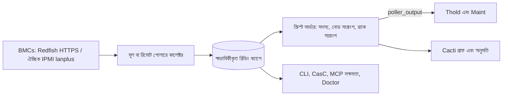

<!-- Source: README.md; SHA256: 6972a6c9ac754cd60e63c5caf971451ea8fe6e279eef757d886e1a168d3eef01 -->

<!-- translations:start -->
[English](../../../README.md) | [简体中文](../zh-CN/README.md) | [हिन्दी](../hi-IN/README.md) | [Español (España)](../es-ES/README.md) | [Español (Latinoamérica)](../es-419/README.md) | [العربية (السعودية)](../ar-SA/README.md) | [Afrikaans](../af-ZA/README.md) | [አማርኛ](../am-ET/README.md) | [العربية (مصر)](../ar-EG/README.md) | [العربية (المغرب)](../ar-MA/README.md) | [বাংলা](README.md) | [Bosanski](../bs-BA/README.md) | [Deutsch](../de-DE/README.md) | [فارسی](../fa-IR/README.md) | [Filipino](../fil-PH/README.md) | [Français](../fr-FR/README.md) | [Français (Maroc)](../fr-MA/README.md) | [Français (Sénégal)](../fr-SN/README.md) | [Hausa](../ha-NG/README.md) | [עברית](../he-IL/README.md) | [Hrvatski](../hr-HR/README.md) | [Bahasa Indonesia](../id-ID/README.md) | [Igbo](../ig-NG/README.md) | [Italiano](../it-IT/README.md) | [日本語](../ja-JP/README.md) | [한국어](../ko-KR/README.md) | [Malagasy](../mg-MG/README.md) | [मराठी](../mr-IN/README.md) | [Bahasa Melayu](../ms-MY/README.md) | [Nederlands](../nl-NL/README.md) | [Polski](../pl-PL/README.md) | [Português (Brasil)](../pt-BR/README.md) | [Русский](../ru-RU/README.md) | [Kinyarwanda](../rw-RW/README.md) | [Soomaali](../so-SO/README.md) | [Српски](../sr-RS/README.md) | [Svenska](../sv-SE/README.md) | [Kiswahili](../sw-KE/README.md) | [தமிழ்](../ta-IN/README.md) | [తెలుగు](../te-IN/README.md) | [ไทย](../th-TH/README.md) | [Türkçe](../tr-TR/README.md) | [Українська](../uk-UA/README.md) | [اردو](../ur-PK/README.md) | [Tiếng Việt](../vi-VN/README.md) | [isiXhosa](../xh-ZA/README.md) | [Yorùbá](../yo-NG/README.md) | [繁體中文](../zh-TW/README.md) | [isiZulu](../zu-ZA/README.md)
<!-- translations:end -->

# plugin_redfish

একটি Cacti 1.2 প্লাগইন যা বেসবোর্ড ম্যানেজমেন্ট কন্ট্রোলার (BMCs) থেকে সার্ভারের বিদ্যুৎ খরচ, ইনলেট তাপমাত্রা, ফ্যানের অবস্থা এবং পাওয়ার সাপ্লাইয়ের স্বাস্থ্য সাধারণ ডিভাইস, ডেটা সোর্স এবং গ্রাফ হিসেবে Cacti-তে নিয়ে আসে। এটি Redfish ব্যবহার করে, সাথে ঐচ্ছিক শুধুমাত্র-পাঠযোগ্য IPMI ফলব্যাক এবং র‍্যাক-স্তরের পাওয়ার রোলআপ রয়েছে। Thold এবং Maint স্ট্যান্ডার্ড Cacti ডেটা সোর্সের মাধ্যমে এগুলোর ওপর অ্যালার্ট দেয় এবং সেগুলো দমন করে।

> **অবস্থা: উন্নয়নাধীন, এখনো কোনো রিলিজ হয়নি (`0.1.0-dev`)।** এই প্লাগইনটি Cacti প্রকল্পের সাথে যুক্ত নয়। এটি PHP 8.2 বা পরবর্তী সংস্করণে Cacti 1.2.31 বা পরবর্তী সংস্করণে ইনস্টল হয় এবং Redfish কালেক্টর, এনক্রিপ্ট করা ক্রেডেনশিয়াল ভল্ট, Cacti ডিভাইস ও গ্রাফ প্রভিশনিং, ঐচ্ছিক শুধুমাত্র-পাঠযোগ্য IPMI ফলব্যাক, র‍্যাক পাওয়ার রোলআপ, Cacti Maint উইন্ডো প্রদর্শন, রিমোট ডেটা কালেক্টর রেপ্লিকেশন ও এজেন্ট এন্ডপয়েন্ট, CasC প্রোভাইডার ও অপারেটর CLI, MCP সক্ষমতা এবং Doctor ডায়াগনস্টিক পরীক্ষা বাস্তবায়ন করে। CI ফিক্সচার, DMTF Redfish Mockup Server (সাবসিস্টেম, লিগ্যাসি-অনলি এবং HPE iLO Gen11 মকআপ) এবং Maint v1.3-এর সাথে Thold v1.8.2 পরীক্ষা করে; এখনো কোনো বাস্তব ফিজিক্যাল BMC বা পাইলট ফ্লিট কোয়ালিফাই করা হয়নি। ডিজাইন ও গবেষণা রয়েছে [docs/PLAN.md](../../PLAN.md), [docs/research/](../../research/) এবং [docs/decisions/](../../decisions/)-এ।

## বাস্তবায়িত সক্ষমতাসমূহ

### মূল কালেক্টর, ভল্ট এবং Cacti অবজেক্ট

- **লাইফসাইকেল ও স্কিমা।** Cacti-এর প্লাগইন API (`Schema::VERSION = 3`, ১২টি টেবিল) ব্যবহার করে ইনস্টল, আপগ্রেড, নিষ্ক্রিয় এবং আনইনস্টল হয়। *Keep Plugin Tables on Uninstall* আনচেক না করলে আনইনস্টল করার সময় টেবিলগুলো রাখা হয়। এন্ট্রি পয়েন্টগুলো PHP 8.0-এ পার্স হয় এবং PHP 8.2-এর নিচে হলে বা `ext-openssl` না থাকলে স্পষ্ট ত্রুটি বার্তাসহ প্রত্যাখ্যান করে।
- **রেজিস্ট্রি ও অনুমতি।** **Configuration > Settings > Redfish**-এর অধীনে সেটিংসসহ *Redfish View* (`redfish_health.php`), *Redfish Operator* (`redfish_operator.php`) এবং *Redfish Admin* (`redfish_bmcs.php`, `redfish_credentials.php`) রিয়েলম রয়েছে। BMC রেজিস্ট্রি CSV আমদানি (নাম দ্বারা ক্রেডেনশিয়াল উল্লেখ; আমদানি ফাইলে পাসওয়ার্ড প্রত্যাখ্যান করা হয়) এবং JSON রপ্তানি সমর্থন করে। BMC রেকর্ড এবং ক্রেডেনশিয়াল Cacti ডিভাইস অনুমতি অনুসরণ করে।
- **এনক্রিপ্ট করা ক্রেডেনশিয়াল ভল্ট।** পাসওয়ার্ড `plugin_redfish_secret`-এ AES-256-GCM দ্বারা এনক্রিপ্ট করে সংরক্ষণ করা হয়। কী-টি ডাটাবেসের বাইরে (ডিফল্ট `/etc/cacti/redfish-vault.key`) ৬৪টি হেক্সাডেসিমাল অক্ষর (`openssl rand -hex 32`) বা ৩২টি র বাইট হিসেবে থাকে, পোলার ব্যবহারকারীর মালিকানাধীন, অন্য ব্যবহারকারীদের জন্য অপঠনযোগ্য এবং এমন একটি ডিরেক্টরিতে থাকে যা শুধুমাত্র root বা সেই ব্যবহারকারী লিখতে পারে। ৩২-অক্ষরের প্রিন্টেবল পাসফ্রেজ প্রত্যাখ্যান করা হয়। **ডাটাবেসের সাথে কী ফাইলটির ব্যাকআপ রাখুন**; এটি ছাড়া সংরক্ষিত পাসওয়ার্ডগুলো পুনরায় লিখতে হবে।
- **TLS এবং শুধুমাত্র-পাঠযোগ্য Redfish ক্লায়েন্ট।** সিস্টেম CA স্টোর, প্রতি-BMC CA বান্ডেল বা SPKI SHA-256 পিন ব্যবহার করে TLS যাচাইকরণ ডিফল্টরূপে সক্রিয় থাকে; প্রতি-BMC অযাচাইকৃত অপ্ট-আউট হেলথ সতর্কতা এবং Doctor পরীক্ষা সতর্কতা হিসেবে দৃশ্যমান থাকে। ক্লায়েন্ট কেবল `GET` এবং Redfish সেশন লগইন (`POST`) ও লগআউট (`DELETE`) অনুমোদন করে, সাথে সেশন অনুপলব্ধ হলে প্রতি-BMC Basic ফলব্যাকের বিকল্প থাকে। ডিসকভারি নতুন Redfish সাবসিস্টেম এবং সেন্সর রিসোর্সকে অগ্রাধিকার দেয় এবং অবচিত `Power` ও `Thermal` রিসোর্সে ফলব্যাক করে।
- **কালেক্টর নির্বাহ।** `poller_redfish.php` `poller_bottom` থেকে শুরু হয়, কনফিগারযোগ্য ওয়ার্কার প্রসেসসহ (`redfish_workers`) Cacti-এর প্রসেস রেজিস্ট্রির মাধ্যমে প্রতি পোলারে একটি মাস্টার প্রসেস চালায়, প্রতি-BMC লিজ নেয়, একটি সময় বাজেট (`redfish_collector_budget`) প্রয়োগ করে, এক্সপোনেনশিয়াল ব্যাকঅফ প্রয়োগ করে এবং ক্র্যাশের পর প্লাগইনটির নিজস্ব পূর্ববর্তী সেশন পরিষ্কার করে।
- **টেমপ্লেট, ডিভাইস এবং গ্রাফ।** হ্যাশ দ্বারা `templates/redfish-templates.xml` আমদানি করে এবং ব্যবহারকারীর পরিবর্তিত ফাইল ওভাররাইট না করে তিনটি স্ক্রিপ্ট সার্ভার ডেটা কোয়েরি XML ফাইল (`redfish_fans.xml`, `redfish_temperatures.xml`, `redfish_psus.xml`) `<cacti>/resource/script_server/`-এ কপি করে। **Create Device** এবং **Add Graphs**-এর জন্য প্রভিশনিং প্ল্যান নিশ্চিত করা প্রয়োজন হয়, ম্যাপ করা সার্ভার ডিভাইসে কোয়েরি যুক্ত করে অথবা উপলব্ধতা পরীক্ষা নিষ্ক্রিয় করে `.invalid`-এর অধীনে একটি "Redfish BMC" ডিভাইস তৈরি করে এবং `graph_buttons`-এর মাধ্যমে প্রতিটি Redfish গ্রাফকে ডিভাইসের Redfish গ্রাফে লিংক করে।
- **শুধুমাত্র-ক্যাশে স্ক্রিপ্ট সার্ভার ইনপুট।** `scripts/ss_redfish_members.php` প্রতি-সদস্য ফ্যান, তাপমাত্রা এবং PSU রিডিং সরবরাহ করে, আর `scripts/ss_redfish_summary.php` "Redfish Node Summary" মেট্রিক (পাওয়ার, ইনলেট ও সর্বোচ্চ তাপমাত্রা, ত্রুটিপূর্ণ ফ্যান ও PSU সংখ্যা, নোড হেলথ এবং শেষ ভালো রিডের বয়স) সরবরাহ করে। স্ক্রিপ্ট সার্ভার কল শুধুমাত্র স্থানীয় ক্যাশে পড়ে এবং কখনোই কোনো BMC-এর সাথে যোগাযোগ করে না। অনুপস্থিত, মেয়াদোত্তীর্ণ বা চলে যাওয়া সদস্যের রিডিং `U` ফেরত দেয় (কখনোই `0` নয়), যেখানে `age` সর্বদা একটি মান রিপোর্ট করে যাতে থ্রেশহোল্ড নীরব BMC শনাক্ত করতে পারে।

**কোনো BMC-এর সদস্য পরিবর্তিত হলে** (যেমন প্রতিস্থাপিত ফ্যান বা সেন্সরের নাম পরিবর্তনকারী ফার্মওয়্যার আপডেট), পুনরায় **Add Graphs** চালান। পূর্বে উপস্থিত ছিল এমন কোনো ফ্যান বা পাওয়ার সাপ্লাই অনুপস্থিত হলে গৃহীত না হওয়া পর্যন্ত `fans_bad` বা `psus_bad`-এ গণনা করা হয়; কখনোই পূর্ণ ছিল না এমন স্লট গণনা করা হয় না। চলে যাওয়া সদস্যরা তাদের বিদ্যমান ডেটা সোর্স এবং গ্রাফ বজায় রাখে, যা হাতে করে মুছে ফেলা না পর্যন্ত এরপর থেকে `U` পড়তে থাকে। একটি Cacti ডিভাইস মুছে ফেললে BMC এবং ক্যাশে অক্ষুণ্ণ রেখে এর BMC ম্যাপিং আনম্যাপ হয় এবং র‍্যাক অ্যাসাইনমেন্ট সরে যায়; BMC মুছে ফেললে বা প্লাগইন আনইনস্টল করলে Cacti ডিভাইস ও গ্রাফ অক্ষুণ্ণ থাকে।

### ঐচ্ছিক IPMI ফলব্যাক

- **প্রতি BMC অপ্ট-ইন।** ডিফল্টরূপে বন্ধ থাকে (`protocols` ডিফল্টরূপে `redfish`; IPMI ফলব্যাক সক্রিয় করলে `redfish,ipmi` সেট হয়)।
- **সীমিত ফলব্যাক ট্রিগার।** শুধুমাত্র তখনই চলে যখন Redfish সংগ্রহ উপযুক্ত ব্যর্থতার শ্রেণিসহ ব্যর্থ হয়; `AuthRejected`, `CredentialUnavailable`, `AddressRefused`, `OperationRefused` বা `Deadline`-এ কখনোই ট্রিগার হয় না।
- **নিরাপদ নির্বাহ।** শেল ছাড়াই অ্যারে-ফর্ম `proc_open()`, সীমাবদ্ধ ওয়াল-ক্লক টাইমআউট এবং ২৫৬ KiB আউটপুট সীমার মাধ্যমে `-I lanplus`-এর ওপর `ipmitool` আহ্বান করে। পাসওয়ার্ড `IPMITOOL_PASSWORD` (`-E`) বা `finally`-তে মুছে ফেলা mode-0600 অস্থায়ী ফাইলের (`-f`) মাধ্যমে সরবরাহ করা হয়, কখনোই CLI argv-তে নয়।
- **শুধুমাত্র-পাঠযোগ্য কমান্ড অনুমতি তালিকা।** শুধুমাত্র পাঁচটি শুধুমাত্র-পাঠযোগ্য সাবকমান্ড অনুমোদিত: `dcmi power reading`, `sdr type Temperature`, `sdr type Fan`, `sdr type Power Supply` এবং `chassis status`। পরিবর্তনকারী কমান্ড প্রত্যাখ্যান করা হয়।
- **স্বাভাবিকীকৃত আউটপুট ও ভঙ্গি সতর্কতা।** `IpmiNormalizer` রিডিংগুলোকে একই `Observation`/`Member`/`Reading` মডেলে ম্যাপ করে এবং অনুপস্থিত বা পার্সযোগ্য নয় এমন সেন্সরের জন্য `U` নির্গত করে। IPMI ফলব্যাক সক্রিয় করলে হেলথ পৃষ্ঠায় এবং `redfish.bmc_security` Doctor পরীক্ষায় একটি সতর্কতা ওঠে যা অপারেটরদের UDP 623-কে একটি ম্যানেজমেন্ট VLAN-এ সীমাবদ্ধ রাখার কথা মনে করিয়ে দেয়।

### র‍্যাক পাওয়ার রোলআপ

- **র‍্যাক রেজিস্ট্রি।** স্কিমা সংস্করণ ৩ যোগ করেছে `plugin_redfish_rack` (অনন্য `(site_id, name)`, ঐচ্ছিক `power_budget_watts`, ডিফল্ট `80` সহ `min_coverage_pct` এবং নোট) এবং `plugin_redfish_rack_member` (প্রতি `host_id` সর্বোচ্চ একটি র‍্যাক অ্যাসাইনমেন্ট, ঐচ্ছিক `bmc_id` এবং `unit_position`, Cacti ডিভাইস মুছে ফেলা হলে স্বয়ংক্রিয়ভাবে অপসারিত হয়)।
- **কভারেজ-সুরক্ষিত মোট হিসাব।** `RackPowerSummary` স্থানীয় ক্যাশে থেকে সদ্য সদস্য `power_watts` রিডিং যোগ করে এবং বাজেট ব্যবহার ও হেডরুম গণনা করে। যখন রিপোর্ট করা সদস্যের কভারেজ `min_coverage_pct`-এর নিচে নেমে যায়, তখন `power_watts`, `utilization_pct` এবং `headroom_watts` `U` ফেরত দেয় যাতে কালেক্টর ব্যর্থতা কখনোই র‍্যাক পাওয়ার হ্রাস হিসেবে না দেখায়।
- **Thold-প্রস্তুত স্ক্রিপ্ট সার্ভার ইনপুট।** `scripts/ss_redfish_rack.php` (`ss_redfish_rack(<rack_id>)`) শুধুমাত্র স্থানীয় ক্যাশে থেকে `power_watts`, `power_budget_watts`, `utilization_pct`, `headroom_watts`, `members_total`, `members_reporting` এবং `coverage_pct` ফেরত দেয়।

### Cacti Maint সমন্বয়

- Redfish ডেটা সোর্সে Thold থ্রেশহোল্ড অ্যালার্ট দেয় এবং কোনো প্লাগইনেই পরিবর্তন ছাড়াই Cacti Maint সেগুলো দমন করে।
- `MaintWindow` প্রতিটি ম্যাপ করা Cacti হোস্টের জন্য সক্রিয় Maint শিডিউল (এককালীন `mtype=1` এবং পুনরাবৃত্ত `mtype=2` শিডিউল, প্লাস লোড করা থাকলে `plugin_maint_check_cacti_host()`) পরীক্ষা করে এবং Redfish হেলথ পৃষ্ঠা (`[MAINT]`), `cli/redfish.php health` আউটপুট ও `redfish-get-health` সক্ষমতায় সক্রিয় রক্ষণাবেক্ষণ চিহ্নিত করে।

### রিমোট ডেটা কালেক্টর

- `INFO` `remote_collect:1` ঘোষণা করে। BMC-গুলো যেকোনো `poller_id >= 1` গ্রহণ করে এবং `poller_redfish.php --poller=N` কেবল সেই পোলারে নির্ধারিত সক্রিয় BMC-গুলো সংগ্রহ করে।
- **`replicate_out` হুক।** `replicate_out_table()`-এর মাধ্যমে লক্ষ্য রিমোট পোলারের জন্য সীমাবদ্ধ কেবল অ-গোপন কনফিগারেশন টেবিলগুলো রেপ্লিকেট করে: `plugin_redfish_bmc`, `plugin_redfish_credential` মেটাডেটা (কোনো সাইফারটেক্সট নয়), `plugin_redfish_rack` এবং `plugin_redfish_rack_member`। `plugin_redfish_secret` রেপ্লিকেট করা হয় না, এবং ভল্ট কী ফাইলগুলো প্রতিটি পোলারে কঠোরভাবে স্থানীয় থাকে।
- **`remote_agent` হুক।** শুধুমাত্র-পাঠযোগ্য `redfish_health` এবং `redfish_discovery` অ্যাকশন উন্মুক্ত করে যা কেবল সংখ্যাসূচক `poller_id` এবং `bmc_id` প্যারামিটার গ্রহণ করে। অপ্রত্যাশিত প্যারামিটার প্রত্যাখ্যান করা হয় এবং শূন্য ক্রেডেনশিয়াল বা গোপনীয় তথ্য ফেরত দেওয়া হয়।

### ইকোসিস্টেম হুক (CasC, MCP সক্ষমতা এবং Doctor)

- **CasC প্রোভাইডার (`casc_register_providers`)।** বিশুদ্ধ-PHP YAML এবং XML রপ্তানি, পার্সিং (XXE প্রত্যাখ্যাত), যাচাইকরণ, ডিফ পরিকল্পনা এবং প্রয়োগসহ `redfish` প্রোভাইডার (স্কিমা সংস্করণ `1`) নিবন্ধন করে। ক্রেডেনশিয়াল কেবল ভল্ট রেফারেন্স (`vault:redfish:<name>`) হিসেবে থাকে; কাঁচা সিক্রেট কী (`pass`, `secret`, `token`, `private_key`, `vault_key`, `auth_token`) প্রত্যাখ্যাত হয়। প্রয়োগ করার জন্য একটি হুবহু SHA-256 `PLAN_HASH` প্রয়োজন হয়।
- **MCP / Abilities API (`abilities_register`)।** Redfish View রিয়েলম (`redfish_health.php`) এবং Cacti ডিভাইস অনুমতি দ্বারা নিয়ন্ত্রিত তিনটি শুধুমাত্র-পাঠযোগ্য সক্ষমতা নিবন্ধন করে, যা শূন্য ক্রেডেনশিয়াল ফেরত দেয়:
  - `redfish-list-bmcs` (ঐচ্ছিক `poller_id`)
  - `redfish-get-rack-power` (ঐচ্ছিক `rack_id`)
  - `redfish-get-health` (ঐচ্ছিক `bmc_id`)
- **Doctor পরীক্ষা (`doctor_register_checks`)।** পাঁচটি স্থানীয়, শুধুমাত্র-পাঠযোগ্য ডায়াগনস্টিক পরীক্ষা নিবন্ধন করে যা কখনোই কোনো BMC-এর সাথে যোগাযোগ করে না বা কী উপাদান ফেরত দেয় না:
  - `redfish.schema`: স্কিমা সংস্করণের হালনাগাদ অবস্থা
  - `redfish.vault_key`: ভল্ট কী-এর পাঠযোগ্যতা ও অনুমতি
  - `redfish.collector_runs`: পোলার কালেক্টর বাজেট ও সতেজতা
  - `redfish.bmc_security`: অযাচাইকৃত TLS বা IPMI ফলব্যাকসহ সক্রিয় BMC-গুলো
  - `redfish.rack_power`: র‍্যাক পাওয়ার বাজেট সম্মতি ও কভারেজ ন্যূনতম সীমা

## CLI

PHP 8.2 বা পরবর্তী সংস্করণসহ Cacti রুট ডিরেক্টরি থেকে চালান:

```sh
# Operator and CasC CLI (reads --file=PATH or stdin for validate, plan, and apply)
php plugins/redfish/cli/redfish.php export --format=yaml|xml
php plugins/redfish/cli/redfish.php validate [--file=PATH] [--format=yaml|xml]
php plugins/redfish/cli/redfish.php plan [--file=PATH] [--format=yaml|xml]
php plugins/redfish/cli/redfish.php apply [--file=PATH] [--format=yaml|xml] --confirm=<PLAN_HASH>
php plugins/redfish/cli/redfish.php health --format=text|json

# Collector entry point (normally started by poller_bottom)
php plugins/redfish/poller_redfish.php [--poller=N] [--force] [--debug]

# Rack power summary script server entry point
php plugins/redfish/scripts/ss_redfish_rack.php <rack_id>
```

## প্রবেশাধিকার ভূমিকা

| রিয়েলম | প্রবেশাধিকার |
| --- | --- |
| Redfish View | বিদ্যমান মনিটরিং পৃষ্ঠাসমূহ। |
| Redfish Operator | মনিটরিং এবং অপারেশনস পৃষ্ঠা ও ব্যক্তিগত ট্রায়াজ স্বীকৃতি। |
| Redfish Admin | অপারেটর প্রবেশাধিকার এবং বিদ্যমান কনফিগারেশন ও প্রশাসনিক ক্রিয়াসমূহ। |

আপগ্রেড ফাইল কপি করার পর রিয়েলম নিবন্ধন করতে অ্যাডমিনিস্ট্রেটর হিসেবে Plugins পৃষ্ঠা খুলুন। **Configuration > Users** বা ব্যবহারকারী গোষ্ঠীর অধীনে Operator রিয়েলম স্পষ্টভাবে নির্ধারণ করুন। আপগ্রেডগুলো বিদ্যমান View এবং Admin রিয়েলম ID এবং অনুদান বজায় রাখে। প্রতিটি অনুরোধে Admin প্রবেশাধিকার Operator প্রবেশাধিকার উত্তরাধিকার সূত্রে পায় এবং Operator প্রবেশাধিকার View প্রবেশাধিকার উত্তরাধিকার সূত্রে পায়; এটি ব্যবহারকারী বা গোষ্ঠীতে সংরক্ষিত অনুদান যোগ করে না। প্লাগইন সেটিংসের জন্য Cacti-এর Settings অনুমতির পাশাপাশি Redfish Admin প্রবেশাধিকারও প্রয়োজন।

Cacti ডিভাইস অনুমতি প্রতিটি ব্যবহারকারীর জন্য উপলব্ধ সারি ও ক্রিয়া সীমিত করে; আনম্যাপ করা অবজেক্টের জন্য একজন অ্যাডমিনিস্ট্রেটর প্রয়োজন। অপারেটররা পরবর্তী নির্ধারিত রানের জন্য অনুমোদিত BMC-তে সংগ্রহ স্থগিতাদেশ তুলে নিতে পারেন। ক্রেডেনশিয়াল, কনফিগারেশন, ম্যাপিং, মুছে ফেলা এবং অন্যান্য প্রশাসনিক পরিবর্তন প্রশাসনিক পৃষ্ঠায় থাকে। স্বীকৃতিগুলো কেবল বর্তমান ব্যবহারকারীর সেশনে, সর্বোচ্চ এক ঘণ্টার জন্য এবং কেবল একই পর্যবেক্ষণ সতেজ থাকা পর্যন্ত স্থায়ী হয়। নতুন বা পরিবর্তিত পর্যবেক্ষণ সেগুলো অকার্যকর করে দেয়। সেগুলো কখনোই ব্যর্থ পরিমাপকে সুস্থ হিসেবে চিহ্নিত করে না বা অ্যালার্ট দমন করে না।

## কেন

প্রতিটি সার্ভারে একটি BMC থাকে যা অপারেটিং সিস্টেম থেকে স্বাধীনভাবে পাওয়ার এবং থার্মাল অবস্থা রিপোর্ট করে, তাই OS বন্ধ থাকলেও এটি সাড়া দিতে থাকে। ডেটাটি সক্ষমতা ও খরচ ট্র্যাকিং, ত্রুটিপূর্ণ ফ্যান বা পাওয়ার সাপ্লাইয়ের আগাম সতর্কতা এবং উচ্চ-ক্ষমতাসম্পন্ন কম্পিউটিংয়ে পাওয়ার-ক্যাপিং সিদ্ধান্তে কাজে লাগে। প্লাগইনটি কেবল HPC-নির্দিষ্ট নয়।

Cacti আজ এর কিছু অংশ কভার করে:

- **ভেন্ডর SNMP প্যাকেজ।** 1.2.x শাখায় Dell iDRAC এবং HPE iLO টেমপ্লেট রয়েছে যেগুলোর জন্য একটি SNMP এজেন্ট প্রয়োজন হয় এবং যেগুলো ভেন্ডর-নির্দিষ্ট; মাইলফলক ১ গবেষণায় দেখা গেছে এর কোনোটিই ওয়াটে বিদ্যুৎ খরচ রিপোর্ট করে না ([docs/research/overlap.md](../../research/overlap.md))।
- **কালেক্টরবিহীন একটি ক্রেডেনশিয়াল ধরন।** plugin_credentials একটি "IPMI / Redfish (BMC)" ক্রেডেনশিয়াল সংজ্ঞায়িত করে কিন্তু কোনো BMC পড়ে না।
- **কোনো র‍্যাক-স্তরের দৃশ্য নেই।** Cacti কোরে কোনো র‍্যাক অবজেক্ট নেই; একটি ডিভাইসে কেবল একটি ফ্রি-টেক্সট `location` ফিল্ড থাকে।

প্লাগইনটি মূল পোলার বা রিমোট ডেটা কালেক্টরে Cacti-এর পোল চক্র থেকে আউট-অফ-ব্যান্ড হয়ে BMC-গুলো পোল করে, স্বাভাবিকীকৃত রিডিং ক্যাশে করে এবং স্ক্রিপ্ট সার্ভার ডেটা কোয়েরি, নোড সারাংশ ও র‍্যাক পাওয়ার সারাংশের মাধ্যমে সেগুলো প্রকাশ করে। এটি Cacti-এর গ্রাফিং, অনুমতি, Thold এবং Maint পুনরায় ব্যবহার করে এবং BMC-এর অবস্থা পরিবর্তন করে না।

## পরিধি এবং অবস্থা

| পর্যায় | পরিধি | মাইলফলক | অবস্থা |
|---|---|---|---|
| ০, গবেষণা | ভেন্ডর ম্যাট্রিক্স, লাইভ BMC-তে আপস্ট্রিম আচরণ নিশ্চিতকরণ, পোলিং খরচ, ডেটা কোয়েরি স্পাইক | [M1](https://github.com/somethingwithproof/plugin_redfish/milestone/1) | সম্পন্ন, বাস্তব BMC ফার্মওয়্যার ক্যাপচার বাকি |
| ১, পর্যবেক্ষণ | BMC রেজিস্ট্রি, ক্রেডেনশিয়াল, TLS, Redfish কালেক্টর, স্বাভাবিকীকৃত রিডিং, ডিভাইস, প্রতি-ইনডেক্স গ্রাফ, Thold অ্যালার্টিং, Maint সমন্বয়, হেলথ পৃষ্ঠা | [M2](https://github.com/somethingwithproof/plugin_redfish/milestone/2), [M3](https://github.com/somethingwithproof/plugin_redfish/milestone/3), [M4](https://github.com/somethingwithproof/plugin_redfish/milestone/4) | বাস্তবায়িত; M4 পাইলট ফ্লিট যোগ্যতা নির্ধারণ বাকি |
| ২, ipmi | `ipmitool`-এর মাধ্যমে শুধুমাত্র-পাঠযোগ্য IPMI (`lanplus`) ফলব্যাক, ডিফল্টরূপে বন্ধ | [M5](https://github.com/somethingwithproof/plugin_redfish/milestone/5) | বাস্তবায়িত |
| ৩, র‍্যাক | র‍্যাক রেজিস্ট্রি, কভারেজ ফ্লোরসহ র‍্যাক পাওয়ার মোট, বাজেট হেডরুম, `ss_redfish_rack.php` | [M6](https://github.com/somethingwithproof/plugin_redfish/milestone/6) | বাস্তবায়িত |
| ৪, রিমোট ও ইকোসিস্টেম | রিমোট ডেটা কালেক্টর (`replicate_out`, `remote_agent`), CasC প্রোভাইডার ও CLI, MCP সক্ষমতা, Doctor পরীক্ষা | [M7](https://github.com/somethingwithproof/plugin_redfish/milestone/7) | বাস্তবায়িত |

পরিধির বাইরে: পাওয়ার ক্যাপ বা অন্য কোনো BMC কনফিগারেশন সেট করা, পাওয়ার নিয়ন্ত্রণ, ফার্মওয়্যার আপডেট, কনসোল অ্যাক্সেস, প্লাগইন-মালিকানাধীন অ্যালার্টিং ইঞ্জিন এবং শিডিউলার সমন্বয়।

## সামঞ্জস্যতা লক্ষ্যমাত্রা

| উপাদান | লক্ষ্যমাত্রা |
|---|---|
| Cacti | 1.2.31 বা পরবর্তী, কোনো কোর প্যাচ নয় |
| ডাটাবেস | MariaDB 10.2 বা MySQL 5.7 বা পরবর্তী: জেনারেটেড কলামে একটি অনন্য কী দ্বারা প্রতি ডিভাইসে একটি BMC নিশ্চিত করা হয় |
| PHP | 8.2 বা পরবর্তী; এন্ট্রি পয়েন্টগুলো 8.0-এ পার্সযোগ্য থাকে যাতে অসমর্থিত রানটাইম ভেঙে যাওয়া Cacti UI-এর পরিবর্তে প্রত্যাখ্যান পায় |
| PHP এক্সটেনশন | `ext-openssl` (Cacti 1.2.31 দ্বারা প্রয়োজনীয়); কোনো `ext-curl` নেই এবং কোনো Composer রানটাইম নির্ভরতা নেই |
| ঐচ্ছিক টুলস | যেসব পোলার IPMI ফলব্যাক সক্রিয় থাকা BMC সংগ্রহ করে সেগুলোতে `ipmitool` |
| BMCs | ফার্মওয়্যার পরিসীমা অনুযায়ী Dell iDRAC, HPE iLO, Lenovo XCC এবং OpenBMC; [ভেন্ডর ম্যাট্রিক্স](../../research/vendor-matrix.md) দেখুন |
| Redfish | প্রথমে নতুন সাবসিস্টেম এবং সেন্সর রিসোর্স, ফলব্যাক হিসেবে অবচিত `Power` এবং `Thermal` |
| Thold, Maint | কোনো পরিবর্তনের প্রয়োজন নেই (CI Thold v1.8.2 এবং Maint v1.3 পরীক্ষা করে) |

## ডিজাইন

- [docs/PLAN.md](../../PLAN.md) হলো সম্পূর্ণ পরিকল্পনা: আর্কিটেকচার, যে আপস্ট্রিম তথ্যের ওপর এটি নির্ভর করে, পরিমাপ মডেল, নিরাপত্তা সীমা, পারফরম্যান্স পাটিগণিত, পরীক্ষা এবং ঝুঁকি।
- [docs/decisions/](../../decisions/)-এ ইতিমধ্যে গৃহীত সিদ্ধান্তগুলোর জন্য আর্কিটেকচার সিদ্ধান্ত রেকর্ড রয়েছে।
- [docs/REQUIREMENTS.md](../../REQUIREMENTS.md) প্রতিটি রিকোয়ারমেন্ট ID-কে তার ইস্যুর সাথে ম্যাপ করে।



## নিরাপত্তা

BMC ক্রেডেনশিয়ালগুলো সার্ভারের আউট-অফ-ব্যান্ড ব্যবস্থাপনা নিয়ন্ত্রণ করে। ডিজাইনটি কমান্ড লাইন, লগ, CasC রপ্তানি, রিমোট এজেন্ট পেলোড, MCP প্রতিক্রিয়া এবং ওয়েব পৃষ্ঠা থেকে গোপন তথ্য দূরে রাখে; প্রতি পোলারে একটি স্থানীয় ভল্ট কী ফাইল ব্যবহার করে সংরক্ষিত পাসওয়ার্ড AES-256-GCM দ্বারা এনক্রিপ্ট করে; ডিফল্টরূপে TLS যাচাই করে; অনুমতি-তালিকাভুক্ত শুধুমাত্র-পাঠযোগ্য সাবকমান্ডসহ স্পষ্ট আর্গুমেন্ট অ্যারে থেকে `ipmitool` চালায়; এবং শুধুমাত্র-পাঠযোগ্য BMC অ্যাকাউন্ট ব্যবহার করে। [docs/PLAN.md](../../PLAN.md#security) এবং [SECURITY.md](../../../SECURITY.md) দেখুন।

## অপারেটর নির্দেশিকা

ইনস্টলেশনের পূর্বশর্ত, ভল্ট ও TLS সেটআপ, BMC নিবন্ধন, গ্রাফ তৈরি, অ্যালার্ট ব্যবধান, ব্যাকআপ এবং ব্যর্থতা ব্যবস্থাপনার জন্য [docs/operator-guide.md](../../operator-guide.md) দেখুন। সেই ফার্মওয়্যার থেকে প্রাপ্ত সম্পাদিত ক্যাপচার পরীক্ষার স্যুটে উত্তীর্ণ না হওয়া পর্যন্ত নির্দেশিকাটি কোনো বাস্তব ভেন্ডর ফার্মওয়্যার লাইনকে সমর্থিত ঘোষণা করে না।

## উন্নয়ন এবং পরীক্ষা

CI ([.github/workflows/plugin-ci-workflow.yml](../../../.github/workflows/plugin-ci-workflow.yml)) PHP 8.0-এ এন্ট্রি পয়েন্ট লিন্ট করে, Cacti `release/1.2.31` এবং `1.2.x`-এর বিপরীতে PHP 8.2 থেকে 8.5 জুড়ে Pest ইউনিট (`phpunit.xml`) এবং লাইফসাইকেল ইন্টিগ্রেশন (`phpunit-integration.xml`) স্যুট ও PHPStan লেভেল ৯ চালায়, PHP 8.1-এ প্রত্যাখ্যান যাচাই করে, DMTF Redfish Mockup Server (সাবসিস্টেম, লিগ্যাসি-অনলি এবং HPE iLO Gen11 মকআপ) ও Thold v1.8.2 / Maint v1.3 এন্ড-টু-এন্ড অনুশীলন করে এবং gettext ক্যাটালগ, ওয়ার্কফ্লো ও REUSE লাইসেন্সিং পরীক্ষা করে।

পুশ করার আগে স্থানীয় পরীক্ষাসমূহ:

```sh
sh tests/lint-workflows.sh
sh locales/build_gettext.sh --check
CACTI_PATH=/path/to/cacti phpstan analyse -c phpstan.neon --no-progress
```

ইউনিট এবং সোর্স-রুল পরীক্ষার জন্য `--configuration=phpunit.xml` সহ Pest চালান, অথবা লাইফসাইকেল ইন্টিগ্রেশন পরীক্ষার জন্য একটি ডিসপোজেবল Cacti ডাটাবেসের বিপরীতে `CACTI_PATH` এবং `REDFISH_TEST_DATABASE=disposable` সহ `--configuration=phpunit-integration.xml` ব্যবহার করুন।

## কাজ যেভাবে ট্র্যাক করা হয়

- **মাইলফলক** পরিকল্পনার মাইলফলক অনুসরণ করে। প্রতিটিতে একটি এপিক ইস্যু থাকে যেখানে এর উপ-ইস্যু এবং প্রস্থান প্রমাণ তালিকাভুক্ত থাকে।
- **ইস্যুসমূহ** লেবেল অনুযায়ী শ্রেণিবদ্ধ: `type: requirement`, `type: research`, `type: decision`, `type: epic`। রিকোয়ারমেন্ট ইস্যুগুলো সংখ্যাযুক্ত, পরীক্ষাযোগ্য প্রয়োজনীয়তা (`REQ-AREA-NNN`) এবং গ্রহণের মানদণ্ড উল্লেখ করে।
- **লেবেলসমূহে** `area:`, `phase:`, `priority:` এবং `status:`-ও থাকে। [CONTRIBUTING.md](../../../CONTRIBUTING.md#labels) দেখুন।
- [প্রজেক্ট বোর্ড](https://github.com/users/somethingwithproof/projects/12) সকল মাইলফলক জুড়ে সমস্ত ইস্যু দেখায়।

## অবদান রাখা

[CONTRIBUTING.md](../../../CONTRIBUTING.md) পড়ুন। কমিটগুলোতে DCO সাইন-অফ প্রয়োজন। ডিজাইন আলোচনা ইস্যুগুলোতে হয়; অমীমাংসিত সিদ্ধান্তগুলোতে `type: decision` লেবেল থাকে। বাস্তব BMC থেকে প্রাপ্ত প্রমাণ এখন সবচেয়ে উপকারী অবদান; যেকোনো ক্যাপচার পোস্ট করার আগে ঠিকানা, সিরিয়াল নম্বর এবং ক্রেডেনশিয়াল মুছে দিন।

## লাইসেন্স

GNU General Public License v2.0, Cacti এবং এর প্লাগইনগুলোর মতোই একই লাইসেন্স। [LICENSE](../../../LICENSE) দেখুন।
