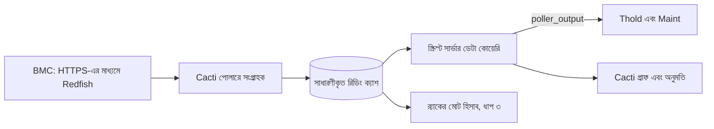

<!-- Source: README.md; SHA256: 7b4e83a58a1adc844cb0615ef30e95476cba2851f96bb454d2a816fb2774724d -->

<!-- translations:start -->
[English](../../../README.md) | [简体中文](../zh-CN/README.md) | [हिन्दी](../hi-IN/README.md) | [Español (España)](../es-ES/README.md) | [Español (Latinoamérica)](../es-419/README.md) | [العربية (السعودية)](../ar-SA/README.md) | [Afrikaans](../af-ZA/README.md) | [አማርኛ](../am-ET/README.md) | [العربية (مصر)](../ar-EG/README.md) | [العربية (المغرب)](../ar-MA/README.md) | [বাংলা](README.md) | [Bosanski](../bs-BA/README.md) | [Deutsch](../de-DE/README.md) | [فارسی](../fa-IR/README.md) | [Filipino](../fil-PH/README.md) | [Français](../fr-FR/README.md) | [Français (Maroc)](../fr-MA/README.md) | [Français (Sénégal)](../fr-SN/README.md) | [Hausa](../ha-NG/README.md) | [עברית](../he-IL/README.md) | [Hrvatski](../hr-HR/README.md) | [Bahasa Indonesia](../id-ID/README.md) | [Igbo](../ig-NG/README.md) | [Italiano](../it-IT/README.md) | [日本語](../ja-JP/README.md) | [한국어](../ko-KR/README.md) | [Malagasy](../mg-MG/README.md) | [मराठी](../mr-IN/README.md) | [Bahasa Melayu](../ms-MY/README.md) | [Nederlands](../nl-NL/README.md) | [Polski](../pl-PL/README.md) | [Português (Brasil)](../pt-BR/README.md) | [Русский](../ru-RU/README.md) | [Kinyarwanda](../rw-RW/README.md) | [Soomaali](../so-SO/README.md) | [Српски](../sr-RS/README.md) | [Svenska](../sv-SE/README.md) | [Kiswahili](../sw-KE/README.md) | [தமிழ்](../ta-IN/README.md) | [తెలుగు](../te-IN/README.md) | [ไทย](../th-TH/README.md) | [Türkçe](../tr-TR/README.md) | [Українська](../uk-UA/README.md) | [اردو](../ur-PK/README.md) | [Tiếng Việt](../vi-VN/README.md) | [isiXhosa](../xh-ZA/README.md) | [Yorùbá](../yo-NG/README.md) | [繁體中文](../zh-TW/README.md) | [isiZulu](../zu-ZA/README.md)
<!-- translations:end -->

# plugin_redfish

একটি Cacti 1.2 প্লাগইন যা বেসবোর্ড ম্যানেজমেন্ট কন্ট্রোলার (BMC) থেকে সার্ভারের বিদ্যুৎ ব্যবহার, ইনলেট তাপমাত্রা, ফ্যানের অবস্থা এবং পাওয়ার সাপ্লাইয়ের স্বাস্থ্যসংক্রান্ত তথ্য সাধারণ ডিভাইস, ডেটা সোর্স এবং গ্রাফ হিসেবে Cacti-তে নিয়ে আসে; এটি Redfish ব্যবহার করে এবং ঐচ্ছিকভাবে IPMI ফলব্যাক সমর্থন করে। এরপর Thold এবং Maint এগুলোর ওপর অ্যালার্ট দেয় ও তা দমন (suppress) করে, এবং পরবর্তী একটি ধাপে র‍্যাক-স্তরের মোট বিদ্যুৎ হিসাব যুক্ত করা হবে।

> **অবস্থা: উন্নয়ন পর্যায়ে রয়েছে, এখনো কোনো রিলিজ প্রকাশিত হয়নি (0.1.0-dev)।** মাইলফলক ২ (ভিত্তি) এবং ৩ (Cacti অবজেক্ট ও অ্যালার্টিং) `main` ব্রাঞ্চে মার্জ করা হয়েছে। এই প্লাগইনটি Cacti প্রকল্পের সাথে সংশ্লিষ্ট নয়। এটি PHP 8.2 বা তার পরবর্তী সংস্করণের অধীনে Cacti 1.2.31-এ ইনস্টল হয়, BMC এবং ক্রেডেনশিয়াল নিবন্ধন করে, Redfish-এর মাধ্যমে প্রতিটি BMC থেকে বিদ্যুৎ, তাপমাত্রা, ফ্যান এবং পাওয়ার সাপ্লাইয়ের স্বাস্থ্যসংক্রান্ত তথ্য পড়ে নিজস্ব ক্যাশে সংরক্ষণ করে এবং সংগ্রহের অবস্থা প্রদর্শন করে। এটি সাধারণ ডেটা সোর্সের মাধ্যমে Cacti ডিভাইস, প্রতি-সদস্য ও সারসংক্ষেপ গ্রাফ এবং Thold ও Maint-এর সমর্থন যুক্ত করে। CI-তে হাতে লেখা ফিক্সচার এবং DMTF Redfish মকআপ সার্ভার দিয়ে তৈরি একটি নকল BMC পরীক্ষা করা হয়েছে; কোনো বাস্তব BMC বা পরীক্ষামূলক সার্ভার বহরের ওপর এখনো পূর্ণাঙ্গ যাচাই সম্পন্ন হয়নি। এর নকশা ও গবেষণা [docs/PLAN.md](../../PLAN.md), [docs/research/](../../research) এবং [docs/decisions/](../../decisions)-এ রয়েছে।

### মাইলফলক ২-এ যা থাকছে

- Cacti-র প্লাগইন API-এর মাধ্যমে ইনস্টল, আপগ্রেড, নিষ্ক্রিয় (disable) এবং আনইনস্টল করা যায়; সেটিংটি মুছে ফেলা না হলে আনইনস্টলের সময় ডেটাবেস টেবিলগুলো সংরক্ষিত থাকে। PHP 8.2-এর চেয়ে পুরোনো সংস্করণে প্লাগইনটি ইনস্টল বা সক্রিয় হতে অস্বীকার করে এবং তার কারণ জানিয়ে দেয়।
- "Redfish View" (স্বাস্থ্য পাতা), "Redfish Operator" (অপারেশনস পাতা), এবং "Redfish Admin" (BMC এবং ক্রেডেনশিয়াল পাতা) রিয়েলম এবং Configuration > Settings > Redfish-এর অধীনে সেটিংস।
- CSV ইমপোর্ট এবং JSON এক্সপোর্ট সুবিধাসহ একটি BMC রেজিস্ট্রি। ইমপোর্ট ফাইলে পাসওয়ার্ড থাকা যাবে না; ক্রেডেনশিয়ালগুলো নাম দিয়ে রেফারেন্স করা হয়।
- ক্রেডেনশিয়ালগুলো AES-256-GCM দ্বারা এনক্রিপ্ট করে সংরক্ষণ করা হয়। কী (key) হলো ডেটাবেসের বাইরের একটি ফাইল, ডিফল্টভাবে `/etc/cacti/redfish-vault.key`, যাতে ৬৪টি হেক্সাডেসিমাল অক্ষর (`openssl rand -hex 32`) অথবা ঠিক ৩২টি র‍্যান্ডম বাইট থাকে; এর মালিকানা থাকবে পোলার ব্যবহারকারীর হাতে, অন্য ব্যবহারকারীরা এটি পড়তে পারবে না এবং এটি এমন একটি ডিরেক্টরিতে থাকবে যেখানে কেবল পোলার ব্যবহারকারী বা root লিখতে পারে। ৩২টি প্রিন্টযোগ্য অক্ষরের একটি কী পাসফ্রেজ হিসেবে প্রত্যাখ্যান করা হয়। **ডেটাবেসের সাথে কী ফাইলটিরও ব্যাকআপ রাখুন**; এটি ছাড়া সংরক্ষিত প্রতিটি পাসওয়ার্ড পুনরায় প্রবেশ করাতে হবে।
- ডিফল্টভাবে TLS যাচাইকরণ চালু থাকে, যেখানে প্রতি-BMC অনুযায়ী CA বান্ডেল বা SPKI SHA-256 পিন ব্যবহারের সুযোগ রয়েছে। লগ করা এবং প্রতি-BMC ভিত্তিক যাচাইবিহীন অপ্ট-আউট স্বাস্থ্য পাতায় সতর্কবার্তা হিসেবে থেকে যায়।
- একটি শুধুমাত্র-পঠনযোগ্য (read-only) Redfish ক্লায়েন্ট: শুধুমাত্র `GET` এবং সেশন লগইন ও লগআউট, যা কোনো অনুরোধ পাঠানোর আগেই একটি অ্যালাউলিস্টের বিপরীতে যাচাই করা হয়।
- মূল পোলারে থাকা BMC-গুলোর জন্য `poller_bottom` থেকে শুরু হওয়া একটি সংগ্রাহক (collector), যাতে প্রতি-BMC লিজ ও সময়সীমা, ব্যাকঅফ এবং ক্র্যাশের পর প্লাগইনের রেকর্ড করা একমাত্র সেশনটি পরিষ্কার করার ব্যবস্থা রয়েছে। রিমোট সংগ্রাহক এখনো সমর্থিত নয়; সংগ্রাহক কীভাবে ডেটাবেস ও কী-তে পৌঁছাবে সে বিষয়ে একটি সুস্পষ্ট সিদ্ধান্ত প্রয়োজন (ধাপ ৪)।
- BMC রেকর্ড এবং ক্রেডেনশিয়ালগুলো Cacti ডিভাইসের অনুমতি অনুসরণ করে: একজন Redfish Admin কেবল সেই ডিভাইসগুলোর BMC দেখতে, পরিবর্তন করতে এবং যুক্ত করতে পারেন যেগুলো দেখার অনুমতি তাঁর রয়েছে, এবং কেবল সেই ক্রেডেনশিয়ালগুলোই দেখতে পান যেগুলো কোনো লুকানো ডিভাইসের BMC ব্যবহার করে না।

### মাইলফলক ৩-এ নতুন যা যুক্ত হয়েছে

- টেমপ্লেটগুলো `templates/` ডিরেক্টরিতে Cacti টেমপ্লেট XML হিসেবে সরবরাহ করা হয় এবং ইনস্টল ও আপগ্রেডের সময় হ্যাশ মিলিয়ে Cacti-র নিজস্ব ইমপোর্টারের মাধ্যমে ইমপোর্ট করা হয়, ফলে কোনো ইমপোর্ট প্লাগইনের অবজেক্টগুলোকে হালনাগাদ করে এবং কোনো কিছু দুবার যোগ করে না। তিনটি ডেটা কোয়েরি ফাইল একটি রেকর্ডকৃত হ্যাশসহ `<cacti>/resource/script_server/`-এ কপি করা হয়; প্লাগইনটি সেখানে এমন কোনো ফাইল প্রতিস্থাপন করে না যা এটি নিজে লেখেনি, এবং টেমপ্লেট বা কোয়েরি ফাইল যথাস্থানে না থাকলে স্বাস্থ্য পাতায় অ্যাডমিনিস্ট্রেটরদের সতর্ক করা হয়। BMCs পাতায় থাকা **Reinstall the Redfish Templates** অপশনটি সেগুলো পুনরায় ইমপোর্ট করে; এর জন্য Cacti-র Import Templates অনুমতি প্রয়োজন।
- প্রতিটি BMC-তে **Create Device** বা **Add Graphs** সুবিধা ([ADR 0015](../../decisions/0015-attach-to-the-server-device-or-create-one-per-bmc.md))। সার্ভারের বিদ্যমান কোনো ডিভাইসের সাথে ম্যাপিং করা BMC সেই ডিভাইসেই তার ডেটা কোয়েরি ও গ্রাফ পায়। ম্যাপিং না করা BMC "Redfish BMC" ডিভাইস টেমপ্লেট থেকে একটি নতুন ডিভাইস পায়, যেখানে প্রাপ্যতা যাচাই (availability checks) বন্ধ থাকে এবং হোস্টের নাম `.invalid`-এর অধীনে থাকে, ফলে Cacti কখনোই BMC-র সাথে যোগাযোগ করে না এবং এর ঠিকানা প্রদর্শন করে না। উভয় ক্ষেত্রেই কী কী যুক্ত করা হবে তার একটি তালিকা সম্বলিত পরিকল্পনা অ্যাডমিনিস্ট্রেটর প্রথমে নিশ্চিত করেন। উভয় কাজের জন্যই Redfish Admin-এর পাশাপাশি Cacti-র ডিভাইস ব্যবস্থাপনা অনুমতি প্রয়োজন; নির্মাতা দেখতে পাবেন না এমন কোনো নতুন ডিভাইস তৈরি হলে তা আবার মুছে ফেলা হয়।
- "Redfish Fans", "Redfish Temperatures", এবং "Redfish Power Supplies" নামের তিনটি স্ক্রিপ্ট সার্ভার ডেটা কোয়েরি, যা BMC-র মেম্বার কী অনুযায়ী ইনডেক্স করা এবং প্রতি সদস্যের জন্য একটি করে গ্রাফ থাকে: শতাংশ বা RPM এককে ফ্যানের গতি (BMC যে এককে রিপোর্ট করে), তাপমাত্রা, এবং পাওয়ার সাপ্লাইয়ের ইনপুট ও আউটপুট ওয়াট, যার প্রতিটির সাথে নিজস্ব স্বাস্থ্য কোড থাকে।
- বিদ্যুৎ, ইনলেট তাপমাত্রা, সর্বোচ্চ তাপমাত্রা, অকেজো ফ্যান ও পাওয়ার সাপ্লাইয়ের সংখ্যা, নোডের স্বাস্থ্য এবং সর্বশেষ সফল রিডের বয়সসহ একটি "Redfish Node Summary" ইনপুট, যা চারটি গ্রাফে আঁকা হয়: বিদ্যুৎ, তাপমাত্রা, উপাদানের স্বাস্থ্য এবং ডেটার বয়স। এসব ডেটা সোর্সের ওপর নির্ধারিত Thold থ্রেশহোল্ড অ্যালার্ট দেয় এবং Maint কোনো প্লাগইনে পরিবর্তন না করেই সেগুলো দমন করে।
- স্ক্রিপ্ট সার্ভার কেবল প্লাগইনের ক্যাশ থেকেই উত্তর দেয় এবং কখনোই কোনো BMC-র সাথে যোগাযোগ করে না। কোনো মান অনুপস্থিত থাকলে, মেয়াদোত্তীর্ণ হলে, ভিন্ন এককের হলে বা বিদায় নেওয়া কোনো সদস্যের হলে তা `U` হয়, ফলে গ্রাফে শূন্যের বদলে ফাঁকা অংশ দেখায়; `age`-এর সবসময় একটি মান থাকে, তাই এর ওপর নির্ধারিত থ্রেশহোল্ড উত্তর দেওয়া বন্ধ করে দেওয়া BMC শনাক্ত করতে পারে।
- প্রতিটি Redfish গ্রাফ থেকে ডিভাইসটির Redfish গ্রাফগুলোতে যাওয়ার একটি গ্রাফ লিংক, যা কেবল সেই ব্যবহারকারীদেরই দেখানো হয় যাঁদের Cacti ডিভাইসটি দেখার অনুমতি দেয়।

**যখন কোনো BMC-র সদস্য পরিবর্তিত হয়** (যেমন একটি ফ্যান প্রতিস্থাপন করা হলো বা ফার্মওয়্যার আপডেটে সেন্সরের নাম বদলে গেল), তখন পুনরায় **Add Graphs** নির্বাচন করুন। আগে উপস্থিত ছিল কিন্তু এখন অনুপস্থিত বা অপসারিত কোনো ফ্যান বা পাওয়ার সাপ্লাই আপনি এটি না করা পর্যন্ত `fans_bad` বা `psus_bad`-এ গণনা হতে থাকে, ফলে খুলে নেওয়া ফ্যানের জন্য অ্যালার্ট আসে; তবে কখনোই পূর্ণ ছিল না এমন স্লট গণনায় আসে না। Add Graphs বর্তমানে BMC যেসব সদস্যের তথ্য দেয় সেগুলো গ্রহণ করে এবং Cacti কোয়েরিগুলো পুনরায় ইনডেক্স করে; অপসারিত সদস্যটির ডেটা সোর্স ও গ্রাফ থেকে যায়, যা এরপর থেকে `U` দেখায়, আর নতুন সদস্যের জন্য একটি গ্রাফ তৈরি হয়। অপসারিত সদস্যদের পুরোনো তথ্যের আর প্রয়োজন না থাকলে সেগুলোর গ্রাফ নিজ হাতে মুছে ফেলুন।

কোনো ডিভাইস মুছে ফেললে তার BMC-র ম্যাপিং বিচ্ছিন্ন হয়, কিন্তু BMC এবং তার ক্যাশ থেকে যায়। কোনো BMC মুছে ফেললে বা প্লাগইনটি আনইনস্টল করলে তার ডিভাইস ও গ্রাফগুলো থেকে যায়।

## অ্যাক্সেস রোলসমূহ

| রিয়েলম | অ্যাক্সেস |
| --- | --- |
| Redfish View | বিদ্যমান পর্যবেক্ষণ পাতাসমূহ। |
| Redfish Operator | পর্যবেক্ষণের পাশাপাশি অপারেশনস পাতা এবং ব্যক্তিগত ট্রায়াজ স্বীকৃতি (triage acknowledgments)। |
| Redfish Admin | অপারেটর অ্যাক্সেসের পাশাপাশি বিদ্যমান কনফিগারেশন এবং প্রশাসনিক কার্যক্রম। |

আপগ্রেড ফাইলগুলো কপি করার পর, নতুন রিয়েলমটি নিবন্ধন করতে অ্যাডমিনিস্ট্রেটর হিসেবে Plugins পাতাটি খুলুন। **Configuration > Users** বা ব্যবহারকারী গ্রুপের অধীনে সুস্পষ্টভাবে Operator রিয়েলমটি বরাদ্দ করুন। আপগ্রেডের সময় বিদ্যমান View এবং Admin রিয়েলম আইডি এবং অনুমতিগুলো অপরিবর্তিত থাকে। প্রতিটি অনুরোধে Admin অ্যাক্সেস স্বয়ংক্রিয়ভাবে Operator অ্যাক্সেস পায়, এবং Operator অ্যাক্সেস স্বয়ংক্রিয়ভাবে View অ্যাক্সেস পায়; এটি ব্যবহারকারী বা গ্রুপে কোনো স্থায়ী অনুমতি যোগ করে না। প্লাগইন সেটিংসের জন্য Cacti-র Settings অনুমতির পাশাপাশি Redfish Admin অ্যাক্সেসও প্রয়োজন।

Cacti ডিভাইসের অনুমতিগুলো এখনো প্রতিটি ব্যবহারকারীর জন্য প্রাপ্য সারি ও কার্যক্রম সীমাবদ্ধ রাখে; ম্যাপিংবিহীন অবজেক্টগুলোর জন্য একজন অ্যাডমিনিস্ট্রেটর প্রয়োজন। অপারেটররা অনুমোদিত BMC-র ওপর থাকা সংগ্রহ স্থগিতাদেশ (collection hold) পরবর্তী নির্ধারিত রানের জন্য মুক্ত করতে পারেন। ক্রেডেনশিয়াল, কনফিগারেশন, ম্যাপিং, অপসারণ এবং অন্যান্য প্রশাসনিক পরিবর্তন প্রশাসনিক পাতাগুলোতেই থাকে। স্বীকৃতিগুলো কেবল বর্তমান ব্যবহারকারীর সেশনেই, সর্বোচ্চ এক ঘণ্টার জন্য এবং একই পর্যবেক্ষণ সতেজ থাকা পর্যন্ত কার্যকর থাকে। নতুন বা পরিবর্তিত পর্যবেক্ষণ এগুলোকে অকার্যকর করে দেয়। এগুলো কখনোই কোনো ব্যর্থ পরিমাপকে সুস্থ হিসেবে চিহ্নিত করে না বা অ্যালার্ট দমন করে না।

## কেন এটি প্রয়োজন

প্রতিটি সার্ভারেই একটি BMC থাকে যা অপারেটিং সিস্টেম থেকে স্বাধীনভাবে বিদ্যুৎ এবং তাপমাত্রার অবস্থা জানায়, ফলে OS বন্ধ থাকলেও এটি উত্তর দিতে থাকে। এই ডেটা সক্ষমতা ও খরচ হিসাব রাখা, বিকল ফ্যান বা পাওয়ার সাপ্লাইয়ের আগাম সতর্কবার্তা পাওয়া এবং হাই-পারফরম্যান্স কম্পিউটিংয়ে পাওয়ার-ক্যাপিং সিদ্ধান্ত গ্রহণে কাজে লাগে। প্লাগইনটি কেবল HPC-র জন্য নির্দিষ্ট নয়।

বর্তমানে Cacti এর একটি অংশ সমর্থন করে:

- **ভেন্ডর SNMP প্যাকেজ।** 1.2.x শাখায় Dell iDRAC এবং HPE iLO টেমপ্লেট সরবরাহ করা হয়, যেগুলোর জন্য একটি SNMP এজেন্ট প্রয়োজন এবং এগুলো ভেন্ডর-নির্দিষ্ট; মাইলফলক ১-এর গবেষণায় দেখা গেছে যে এগুলোর কোনোটিই ওয়াট এককে বিদ্যুৎ ব্যবহারের তথ্য দেয় না ([docs/research/overlap.md](../../research/overlap.md))।
- **সংগ্রাহকহীন একটি ক্রেডেনশিয়াল ধরন।** plugin_credentials একটি "IPMI / Redfish (BMC)" ক্রেডেনশিয়াল নির্ধারণ করে কিন্তু কোনো BMC থেকে তথ্য পড়ে না।
- **র‍্যাক-স্তরের দৃশ্যপটের অভাব।** Cacti কোরে কোনো র‍্যাক অবজেক্ট নেই; একটি ডিভাইসে কেবল একটি ফ্রি-টেক্সট `location` ফিল্ড থাকে।

প্লাগইনটি Cacti-র পোল চক্র থেকে আউট-অফ-ব্যান্ড পদ্ধতিতে BMC-গুলো পোল করে, সাধারণীকৃত রিডিং ক্যাশ করে এবং স্ক্রিপ্ট সার্ভার ডেটা কোয়েরি ও সারসংক্ষেপ ডেটা সোর্সের মাধ্যমে সেগুলো প্রকাশ করে। এটি Cacti-র গ্রাফিং, অনুমতি ব্যবস্থা, Thold এবং Maint পুনঃব্যবহার করে এবং BMC-র কোনো অবস্থা পরিবর্তন করে না। রিমোট ডেটা সংগ্রাহকের সমর্থন ধাপ ৪-এ পরিকল্পিত রয়েছে; বর্তমানে তথ্য সংগ্রহ কেবল মূল পোলারেই চলে।

## পরিকল্পিত পরিধি

| ধাপ | পরিধি | মাইলফলক |
|---|---|---|
| ০, গবেষণা | ভেন্ডর ম্যাট্রিক্স, লাইভ BMC-তে আপস্ট্রিম আচরণ নিশ্চিতকরণ, পোলিং খরচ, ডেটা কোয়েরি পরীক্ষা | [M1](https://github.com/somethingwithproof/plugin_redfish/milestone/1) |
| ১, পর্যবেক্ষণ | BMC রেজিস্ট্রি, ক্রেডেনশিয়াল, TLS, Redfish সংগ্রাহক, সাধারণীকৃত রিডিং, ডিভাইস, প্রতি-ইনডেক্স গ্রাফ, Thold অ্যালার্টিং, Maint দমন, স্বাস্থ্য পাতা | [M2](https://github.com/somethingwithproof/plugin_redfish/milestone/2), [M3](https://github.com/somethingwithproof/plugin_redfish/milestone/3), [M4](https://github.com/somethingwithproof/plugin_redfish/milestone/4) |
| ২, ipmi | ব্যবহারযোগ্য Redfish না থাকা BMC-র জন্য IPMI ফলব্যাক, ডিফল্টভাবে বন্ধ | [M5](https://github.com/somethingwithproof/plugin_redfish/milestone/5) |
| ৩, র‍্যাক | র‍্যাক রেজিস্ট্রি, কভারেজসহ র‍্যাকের মোট বিদ্যুৎ হিসাব, বাজেট হেডরুম | [M6](https://github.com/somethingwithproof/plugin_redfish/milestone/6) |
| ৪, রিমোট | বিচ্ছিন্ন BMC নেটওয়ার্কের জন্য Cacti রিমোট ডেটা সংগ্রাহক | [M7](https://github.com/somethingwithproof/plugin_redfish/milestone/7) |

পরিধির বাইরে: পাওয়ার ক্যাপ বা অন্য কোনো BMC কনফিগারেশন নির্ধারণ, পাওয়ার নিয়ন্ত্রণ, ফার্মওয়্যার আপডেট, কনসোল অ্যাক্সেস, প্লাগইন-নিজস্ব অ্যালার্টিং ইঞ্জিন এবং শিডিউলার ইন্টিগ্রেশন।

## সামঞ্জস্যতার লক্ষ্যমাত্রা

| উপাদান | লক্ষ্যমাত্রা |
|---|---|
| Cacti | 1.2.31 বা তার পরবর্তী সংস্করণ, কোনো কোর প্যাচ ছাড়াই |
| ডেটাবেস | MariaDB 10.2 বা MySQL 5.7 বা তার পরবর্তী সংস্করণ: একটি জেনারেটেড কলামের ওপর ইউনিক কী দ্বারা প্রতি ডিভাইসে একটি BMC নিশ্চিত করা হয় |
| PHP | 8.2 বা তার পরবর্তী সংস্করণ; `setup.php` ফাইলটি 8.0-তে পার্সযোগ্য থাকে যাতে অসমর্থিত রানটাইমে Cacti UI ভেঙে যাওয়ার বদলে প্রত্যাখ্যান বার্তা পাওয়া যায় |
| BMC | ফার্মওয়্যার পরিসীমা অনুযায়ী Dell iDRAC, HPE iLO, Lenovo XCC এবং OpenBMC; দেখুন [ভেন্ডর ম্যাট্রিক্স](../../research/vendor-matrix.md) |
| Redfish | প্রথমে নতুন সাবসিস্টেম ও সেন্সর রিসোর্স, ফলব্যাক হিসেবে অবচিত `Power` এবং `Thermal` |
| Thold, Maint | কোনো পরিবর্তনের প্রয়োজন নেই |

## নকশা

- [docs/PLAN.md](../../PLAN.md) হলো পূর্ণাঙ্গ পরিকল্পনা: আর্কিটেকচার, এটি যেসব আপস্ট্রিম তথ্যের ওপর নির্ভর করে (উৎস এবং এখনো নিশ্চিত হওয়ার বাকি অনুমানসহ), পরিমাপ মডেল, নিরাপত্তা সীমা, কার্যক্ষমতার হিসাব, পরীক্ষা এবং ঝুঁকিসমূহ।
- [docs/decisions/](../../decisions)-এ ইতোমধ্যে নেওয়া সিদ্ধান্তগুলোর আর্কিটেকচার ডিসিশন রেকর্ড সংরক্ষিত রয়েছে।
- [docs/REQUIREMENTS.md](../../REQUIREMENTS.md) প্রতিটি রিকোয়ারমেন্ট আইডিকে তার সংশ্লিষ্ট ইস্যুর সাথে ম্যাপ করে।

## নিরাপত্তা

BMC ক্রেডেনশিয়ালগুলো সার্ভারের আউট-অফ-ব্যান্ড ব্যবস্থাপনা নিয়ন্ত্রণ করে। এই নকশা ক্রেডেনশিয়ালগুলোকে কমান্ড লাইন, লগ এবং ওয়েব পাতা থেকে দূরে রাখে, ডিফল্টভাবে TLS যাচাই করে, অ্যালাউলিস্টভুক্ত সাবকমান্ডসহ আর্গুমেন্ট অ্যারে থেকে যেকোনো বাহ্যিক কমান্ড চালায় এবং শুধুমাত্র-পঠনযোগ্য BMC অ্যাকাউন্ট ব্যবহার করে। দেখুন [docs/PLAN.md](../../PLAN.md#security) এবং [SECURITY.md](../../../SECURITY.md)।

## অপারেটর নির্দেশিকা

ইনস্টলেশনের পূর্বশর্ত, ভল্ট ও TLS সেটআপ, BMC নিবন্ধন, গ্রাফ তৈরি, অ্যালার্টের সময়সীমা, ব্যাকআপ এবং ত্রুটি ব্যবস্থাপনার জন্য [docs/operator-guide.md](../../operator-guide.md) দেখুন। কোনো বাস্তব ভেন্ডর ফার্মওয়্যার সিরিজ থেকে সংবেদনশীল তথ্য মুছে নেওয়া (redacted) ক্যাপচার টেস্ট স্যুট পাস না করা পর্যন্ত এই নির্দেশিকা সেই ফার্মওয়্যারকে সমর্থিত হিসেবে ঘোষণা করে না।

## যেভাবে কাজের অগ্রগতি অনুসরণ করা হয়

- **মাইলফলকসমূহ** পরিকল্পনার মাইলফলক অনুসরণ করে। প্রতিটিতে একটি এপিক ইস্যু থাকে যেখানে এর সাব-ইস্যু এবং সমাপ্তির প্রমাণ তালিকাভুক্ত থাকে।
- **ইস্যুগুলো** লেবেল দিয়ে শ্রেণিবদ্ধ করা হয়: `type: requirement`, `type: research`, `type: decision`, `type: epic`। রিকোয়ারমেন্ট ইস্যুগুলোতে নম্বরযুক্ত, পরীক্ষাযোগ্য রিকোয়ারমেন্ট (`REQ-AREA-NNN`) এবং গ্রহণযোগ্যতার মানদণ্ড উল্লেখ থাকে।
- **লেবেলগুলোতে** `area:`, `phase:`, `priority:`, এবং `status:`-ও থাকে। দেখুন [CONTRIBUTING.md](../../../CONTRIBUTING.md#labels)।
- [প্রজেক্ট বোর্ড](https://github.com/users/somethingwithproof/projects/12) সকল মাইলফলকের ইস্যুগুলো প্রদর্শন করে।

## অবদান রাখা

[CONTRIBUTING.md](../../../CONTRIBUTING.md) পড়ুন। কমিটগুলোতে DCO সাইন-অফ থাকা প্রয়োজন। নকশা সংক্রান্ত আলোচনা ইস্যুগুলোতে হয়; অমীমাংসিত সিদ্ধান্তগুলোতে `type: decision` লেবেল থাকে। বাস্তব BMC থেকে পাওয়া প্রমাণ এখন সবচেয়ে দরকারি অবদান; যেকোনো ক্যাপচার পোস্ট করার আগে ঠিকানা, সিরিয়াল নম্বর এবং ক্রেডেনশিয়াল মুছে (redact) নিন।

## লাইসেন্স

GNU General Public License v2.0, যা Cacti এবং এর প্লাগইনগুলোর মতোই একই লাইসেন্স। দেখুন [LICENSE](../../../LICENSE)।
