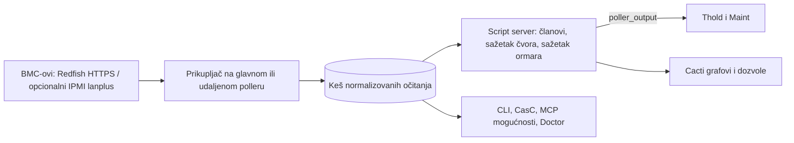

<!-- Source: README.md; SHA256: cf31b9f80d6c00020bbe08e80951d4de1c910793911d040ae7a66b54e8a2eaf0 -->

<!-- translations:start -->
[English](../../../README.md) | [简体中文](../zh-CN/README.md) | [हिन्दी](../hi-IN/README.md) | [Español (España)](../es-ES/README.md) | [Español (Latinoamérica)](../es-419/README.md) | [العربية (السعودية)](../ar-SA/README.md) | [Afrikaans](../af-ZA/README.md) | [አማርኛ](../am-ET/README.md) | [العربية (مصر)](../ar-EG/README.md) | [العربية (المغرب)](../ar-MA/README.md) | [বাংলা](../bn-BD/README.md) | [Bosanski](README.md) | [Deutsch](../de-DE/README.md) | [فارسی](../fa-IR/README.md) | [Filipino](../fil-PH/README.md) | [Français](../fr-FR/README.md) | [Français (Maroc)](../fr-MA/README.md) | [Français (Sénégal)](../fr-SN/README.md) | [Hausa](../ha-NG/README.md) | [עברית](../he-IL/README.md) | [Hrvatski](../hr-HR/README.md) | [Bahasa Indonesia](../id-ID/README.md) | [Igbo](../ig-NG/README.md) | [Italiano](../it-IT/README.md) | [日本語](../ja-JP/README.md) | [한국어](../ko-KR/README.md) | [Malagasy](../mg-MG/README.md) | [मराठी](../mr-IN/README.md) | [Bahasa Melayu](../ms-MY/README.md) | [Nederlands](../nl-NL/README.md) | [Polski](../pl-PL/README.md) | [Português (Brasil)](../pt-BR/README.md) | [Русский](../ru-RU/README.md) | [Kinyarwanda](../rw-RW/README.md) | [Soomaali](../so-SO/README.md) | [Српски](../sr-RS/README.md) | [Svenska](../sv-SE/README.md) | [Kiswahili](../sw-KE/README.md) | [தமிழ்](../ta-IN/README.md) | [తెలుగు](../te-IN/README.md) | [ไทย](../th-TH/README.md) | [Türkçe](../tr-TR/README.md) | [Українська](../uk-UA/README.md) | [اردو](../ur-PK/README.md) | [Tiếng Việt](../vi-VN/README.md) | [isiXhosa](../xh-ZA/README.md) | [Yorùbá](../yo-NG/README.md) | [繁體中文](../zh-TW/README.md) | [isiZulu](../zu-ZA/README.md)
<!-- translations:end -->

# plugin_redfish

Cacti 1.2 dodatak koji donosi potrošnju električne energije servera, ulaznu temperaturu, stanje ventilatora i ispravnost napajanja sa kontrolera za upravljanje matičnom pločom (BMC-ova) u Cacti kao obične uređaje, izvore podataka i grafove, koristeći Redfish uz opcionalnu IPMI rezervu samo za čitanje i zbirne preglede potrošnje energije na nivou ormara (rack). Thold i Maint alarmiraju na osnovu njih i potiskuju alarme putem standardnih Cacti izvora podataka.

> **Status: u razvoju, još bez izdanja (`0.1.0-dev`).** Ovaj dodatak nije povezan sa Cacti projektom. Instalira se na Cacti 1.2.31 ili noviji pod PHP-om 8.2 ili novijim i implementira Redfish prikupljač, šifrovani trezor akreditiva, kreiranje Cacti uređaja i grafova, opcionalnu IPMI rezervu samo za čitanje, zbirni pregled snage ormara, prikaz Cacti Maint prozora, replikaciju udaljenih prikupljača podataka i agent krajnje tačke, CasC provajder i operatorski CLI, MCP mogućnosti i Doctor dijagnostičke provjere. CI testira testne skupove, DMTF Redfish Mockup Server (podsistemske, samo naslijeđene i HPE iLO Gen11 makete) i Thold v1.8.2 sa Maint v1.3; nijedan stvarni fizički BMC niti pilot-flota još nisu kvalifikovani. Dizajn i istraživanje nalaze se u [docs/PLAN.md](../../PLAN.md), [docs/research/](../../research/) i [docs/decisions/](../../decisions/).

## Implementirane mogućnosti

### Osnovni prikupljač, trezor i Cacti objekti

- **Životni ciklus i šema.** Instalira se, nadograđuje, onemogućava i deinstalira putem Cacti API-ja za dodatke (`Schema::VERSION = 3`, 12 tabela). Tabele se čuvaju pri deinstalaciji osim ako se ne odznači *Keep Plugin Tables on Uninstall*. Ulazne tačke se parsiraju na PHP-u 8.0 i odbijaju PHP ispod 8.2 ili nedostatak `ext-openssl` uz eksplicitnu poruku o grešci.
- **Registar i dozvole.** Domeni (realms) *Redfish View* (`redfish_health.php`), *Redfish Operator* (`redfish_operator.php`) i *Redfish Admin* (`redfish_bmcs.php`, `redfish_credentials.php`), plus postavke pod **Configuration > Settings > Redfish**. BMC registar podržava CSV uvoz (akreditivi se navode po imenu; lozinke u datotekama za uvoz se odbijaju) i JSON izvoz. BMC zapisi i akreditivi prate Cacti dozvole za uređaje.
- **Šifrovani trezor akreditiva.** Lozinke se pohranjuju šifrovane pomoću AES-256-GCM u tabeli `plugin_redfish_secret`. Ključ se čuva izvan baze podataka (podrazumijevano `/etc/cacti/redfish-vault.key`) kao 64 heksadecimalna znaka (`openssl rand -hex 32`) ili 32 sirova bajta, u vlasništvu poller korisnika, nečitljiv drugim korisnicima, u direktoriju u koji mogu pisati samo root ili taj korisnik. Ispisiva pristupna fraza od 32 znaka se odbija. **Napravite sigurnosnu kopiju datoteke ključa zajedno s bazom podataka**; bez nje se pohranjene lozinke moraju ponovo unijeti.
- **TLS i Redfish klijent samo za čitanje.** TLS verifikacija je podrazumijevano uključena pomoću sistemskog CA spremišta, CA paketa po BMC-u ili SPKI SHA-256 pina; izuzeće bez verifikacije po BMC-u ostaje vidljivo kao zdravstveno upozorenje i upozorenje Doctor provjere. Klijent dozvoljava samo `GET` uz prijavu (`POST`) i odjavu (`DELETE`) Redfish sesije, uz opcionalnu Basic rezervu po BMC-u kada sesije nisu dostupne. Otkrivanje daje prednost novim Redfish podsistemskim i senzorskim resursima, a oslanja se na zastarjele resurse `Power` i `Thermal` kao rezervu.
- **Izvršavanje prikupljača.** `poller_redfish.php` se pokreće iz `poller_bottom`, pokreće jedan glavni proces po polleru putem Cacti registra procesa s podesivim radnim procesima (`redfish_workers`), pribavlja zakupe po BMC-u, provodi vremenski budžet (`redfish_collector_budget`), primjenjuje eksponencijalno odgađanje i čisti vlastitu prethodnu sesiju dodatka nakon pada.
- **Šabloni, uređaji i grafovi.** Uvozi `templates/redfish-templates.xml` po hašu i kopira tri XML datoteke upita podataka script servera (`redfish_fans.xml`, `redfish_temperatures.xml`, `redfish_psus.xml`) u `<cacti>/resource/script_server/` bez prepisivanja datoteka koje je korisnik izmijenio. **Create Device** i **Add Graphs** zahtijevaju potvrdu plana pripreme, pridružuju upite mapiranom serverskom uređaju ili kreiraju uređaj "Redfish BMC" pod `.invalid` sa isključenim provjerama dostupnosti, te povezuju svaki Redfish graf nazad na Redfish grafove uređaja putem `graph_buttons`.
- **Ulazi script servera samo iz keša.** `scripts/ss_redfish_members.php` servira očitanja ventilatora, temperatura i napajanja po članu, a `scripts/ss_redfish_summary.php` servira metrike "Redfish Node Summary" (snaga, ulazna i maksimalna temperatura, broj neispravnih ventilatora i napajanja, zdravlje čvora i starost posljednjeg dobrog očitanja). Pozivi script servera čitaju samo lokalni keš i nikada ne kontaktiraju BMC. Nedostajuća, zastarjela ili očitanja nestalih članova vraćaju `U` (nikada `0`), dok `age` uvijek prijavljuje vrijednost kako bi pragovi otkrili tihe BMC-ove.

**Kada se članovi BMC-a promijene** (kao što je zamijenjen ventilator ili ažuriranje firmvera koje preimenuje senzore), ponovo pokrenite **Add Graphs**. Prethodno prisutan ventilator ili napajanje koje postane odsutno uračunava se u `fans_bad` ili `psus_bad` dok se ne prihvati; slot koji nikada nije bio popunjen ne uračunava se. Nestali članovi zadržavaju svoje postojeće izvore podataka i grafove, koji od tada čitaju `U` dok se ručno ne obrišu. Brisanje Cacti uređaja uklanja mapiranje njegovog BMC-a i dodjelu ormaru, zadržavajući BMC i keš; brisanje BMC-a ili deinstalacija dodatka zadržava Cacti uređaje i grafove.

### Opcionalna IPMI rezerva

- **Uključivanje po BMC-u.** Podrazumijevano isključena (`protocols` je podrazumijevano `redfish`; uključivanje IPMI rezerve postavlja `redfish,ipmi`).
- **Ograničeni okidač rezerve.** Pokreće se samo kada Redfish prikupljanje ne uspije s prihvatljivom klasom greške; nikada se ne aktivira na `AuthRejected`, `CredentialUnavailable`, `AddressRefused`, `OperationRefused` ili `Deadline`.
- **Sigurno izvršavanje.** Poziva `ipmitool` preko `-I lanplus` pomoću `proc_open()` u obliku niza bez shella, uz ograničeno stvarno vrijeme čekanja i ograničenje izlaza od 256 KiB. Lozinke se prosljeđuju putem `IPMITOOL_PASSWORD` (`-E`) ili privremene datoteke s dozvolama 0600 (`-f`) koja se briše u `finally`, nikada na CLI argv.
- **Lista dozvoljenih naredbi samo za čitanje.** Dozvoljeno je samo pet podnaredbi samo za čitanje: `dcmi power reading`, `sdr type Temperature`, `sdr type Fan`, `sdr type Power Supply` i `chassis status`. Naredbe koje mijenjaju stanje se odbijaju.
- **Normalizovani izlaz i upozorenje o sigurnosnom stanju.** `IpmiNormalizer` mapira očitanja u isti model `Observation`/`Member`/`Reading`, emitujući `U` za nedostajuće ili neparsirljive senzore. Uključivanje IPMI rezerve podiže upozorenje na stranici zdravlja i u Doctor provjeri `redfish.bmc_security`, podsjećajući operatore da ograniče UDP 623 na upravljački VLAN.

### Zbirni pregled snage ormara

- **Registar ormara.** Verzija 3 šeme dodaje `plugin_redfish_rack` (jedinstveni `(site_id, name)`, opcionalni `power_budget_watts`, `min_coverage_pct` s podrazumijevanom vrijednošću `80` i napomene) i `plugin_redfish_rack_member` (najviše jedna dodjela ormara po `host_id`, opcionalni `bmc_id` i `unit_position`, automatski uklonjena kada se Cacti uređaj obriše).
- **Zbirovi zaštićeni pokrivenošću.** `RackPowerSummary` sabira svježa očitanja `power_watts` članova iz lokalnog keša i izračunava iskorištenje budžeta i preostalu rezervu. Kada pokrivenost članova koji izvještavaju padne ispod `min_coverage_pct`, `power_watts`, `utilization_pct` i `headroom_watts` vraćaju `U` kako greške prikupljača nikada ne bi izgledale kao pad potrošnje ormara.
- **Ulaz script servera spreman za Thold.** `scripts/ss_redfish_rack.php` (`ss_redfish_rack(<rack_id>)`) vraća `power_watts`, `power_budget_watts`, `utilization_pct`, `headroom_watts`, `members_total`, `members_reporting` i `coverage_pct` isključivo iz lokalnog keša.

### Cacti Maint integracija

- Thold pragovi na Redfish izvorima podataka šalju alarme, a Cacti Maint ih potiskuje bez ikakvih izmjena u bilo kojem od ta dva dodatka.
- `MaintWindow` provjerava aktivne Maint rasporede za svaki mapirani Cacti host (jednokratne `mtype=1` i ponavljajuće `mtype=2` rasporede, plus `plugin_maint_check_cacti_host()` kada je učitana) i označava aktivno održavanje na Redfish stranici zdravlja (`[MAINT]`), u izlazu `cli/redfish.php health` i u mogućnosti `redfish-get-health`.

### Udaljeni prikupljači podataka

- `INFO` deklarira `remote_collect:1`. BMC-ovi prihvataju bilo koji `poller_id >= 1`, a `poller_redfish.php --poller=N` prikuplja samo omogućene BMC-ove dodijeljene tom polleru.
- **`replicate_out` kuka (hook).** Replicira samo netajne konfiguracijske tabele ograničene na ciljni udaljeni poller putem `replicate_out_table()`: `plugin_redfish_bmc`, metapodatke `plugin_redfish_credential` (bez šifrovanog teksta), `plugin_redfish_rack` i `plugin_redfish_rack_member`. `plugin_redfish_secret` se ne replicira, a datoteke ključa trezora ostaju strogo lokalne na svakom polleru.
- **`remote_agent` kuka (hook).** Izlaže akcije samo za čitanje `redfish_health` i `redfish_discovery` koje prihvataju samo numeričke parametre `poller_id` i `bmc_id`. Neočekivani parametri se odbijaju i ne vraćaju se nikakvi akreditivi ni tajne.

### Kuke ekosistema (CasC, MCP mogućnosti i Doctor)

- **CasC provajder (`casc_register_providers`).** Registruje provajder `redfish` (verzija šeme `1`) sa čistim PHP YAML i XML izvozom, parsiranjem (uz odbijanje XXE-a), validacijom, planiranjem razlika i primjenom. Akreditivi se pojavljuju samo kao reference trezora (`vault:redfish:<name>`); sirovi tajni ključevi (`pass`, `secret`, `token`, `private_key`, `vault_key`, `auth_token`) se odbijaju. Primjena zahtijeva tačan SHA-256 `PLAN_HASH`.
- **MCP / Abilities API (`abilities_register`).** Registruje tri mogućnosti samo za čitanje ograničene domenom Redfish View (`redfish_health.php`) i Cacti dozvolama uređaja, vraćajući nula akreditiva:
  - `redfish-list-bmcs` (opcionalni `poller_id`)
  - `redfish-get-rack-power` (opcionalni `rack_id`)
  - `redfish-get-health` (opcionalni `bmc_id`)
- **Doctor provjere (`doctor_register_checks`).** Registruje pet lokalnih dijagnostičkih provjera samo za čitanje koje nikada ne kontaktiraju BMC niti vraćaju materijal ključeva:
  - `redfish.schema`: aktuelnost verzije šeme
  - `redfish.vault_key`: čitljivost i dozvole ključa trezora
  - `redfish.collector_runs`: budžet i svježina pokretanja prikupljača pollera
  - `redfish.bmc_security`: omogućeni BMC-ovi s neverifikovanim TLS-om ili IPMI rezervom
  - `redfish.rack_power`: usklađenost s budžetom snage ormara i donjom granicom pokrivenosti

## CLI

Pokrenite iz korijenskog direktorija Cacti-ja s PHP-om 8.2 ili novijim:

```sh
# Operator and CasC CLI (reads --file=PATH or stdin for validate, plan, and apply)
php plugins/redfish/cli/redfish.php export --format=yaml|xml
php plugins/redfish/cli/redfish.php validate [--file=PATH] [--format=yaml|xml]
php plugins/redfish/cli/redfish.php plan [--file=PATH] [--format=yaml|xml]
php plugins/redfish/cli/redfish.php apply [--file=PATH] [--format=yaml|xml] --confirm=<PLAN_HASH>
php plugins/redfish/cli/redfish.php health --format=text|json

# Collector entry point (normally started by poller_bottom)
php plugins/redfish/poller_redfish.php [--poller=N] [--force] [--debug]

# Rack power summary script server entry point
php plugins/redfish/scripts/ss_redfish_rack.php <rack_id>
```

## Uloge pristupa

| Domen | Pristup |
| --- | --- |
| Redfish View | Postojeće stranice za nadzor. |
| Redfish Operator | Nadzor plus stranica Operacije i lične potvrde trijaže. |
| Redfish Admin | Pristup operatora plus postojeća konfiguracija i administrativne akcije. |

Nakon kopiranja datoteka za nadogradnju, otvorite stranicu Plugins kao administrator da registrujete domene. Eksplicitno dodijelite domen Operator pod **Configuration > Users** ili grupama korisnika. Nadogradnje zadržavaju postojeće ID-ove i dodjele domena View i Admin. Pristup Admin nasljeđuje pristup Operator, a pristup Operator nasljeđuje pristup View pri svakom zahtjevu; ovo ne dodaje pohranjene dodjele korisnicima ili grupama. Postavke dodatka također zahtijevaju pristup Redfish Admin pored Cacti dozvole Settings.

Cacti dozvole uređaja ograničavaju redove i akcije dostupne svakom korisniku; nemapirani objekti zahtijevaju administratora. Operatori mogu osloboditi zadržavanje prikupljanja na dozvoljenom BMC-u za sljedeće zakazano pokretanje. Akreditivi, konfiguracija, mapiranje, brisanje i druge administrativne izmjene ostaju na administrativnim stranicama. Potvrde traju samo u trenutnoj sesiji korisnika, najviše jedan sat i samo dok isto zapažanje ostaje svježe. Nova ili izmijenjena zapažanja ih poništavaju. Nikada ne označavaju neuspjelo mjerenje zdravim niti potiskuju alarme.

## Zašto

Svaki server ima BMC koji izvještava o stanju napajanja i temperature neovisno o operativnom sistemu, tako da nastavlja odgovarati i kada OS ne radi. Podaci služe za praćenje kapaciteta i troškova, rano upozorenje na kvar ventilatora ili napajanja te, u računarstvu visokih performansi, za odluke o ograničavanju potrošnje energije. Dodatak nije specifičan za HPC.

Cacti danas pokriva dio toga:

- **SNMP paketi proizvođača.** Grana 1.2.x isporučuje šablone za Dell iDRAC i HPE iLO koji zahtijevaju SNMP agenta i specifični su za proizvođača; istraživanje u prekretnici 1 pokazalo je da nijedan ne izvještava potrošnju energije u vatima ([docs/research/overlap.md](../../research/overlap.md)).
- **Tip akreditiva bez prikupljača.** plugin_credentials definiše akreditiv "IPMI / Redfish (BMC)", ali ne čita nijedan BMC.
- **Nema pregleda na nivou ormara.** Cacti jezgro nema objekt ormara; uređaj ima polje slobodnog teksta `location`.

Dodatak ispituje BMC-ove izvan opsega Cacti-jevog ciklusa ispitivanja na glavnom polleru ili udaljenim prikupljačima podataka, kešira normalizovana očitanja i izlaže ih putem upita podataka script servera, sažetaka čvorova i sažetaka snage ormara. Ponovo koristi Cacti-jevo crtanje grafova, dozvole, Thold i Maint, i ne mijenja stanje BMC-a.

## Obim i status

| Faza | Obim | Prekretnice | Status |
|---|---|---|---|
| 0, istraživanje | Matrica proizvođača, potvrda uzvodnog ponašanja na živim BMC-ovima, cijena ispitivanja, provjera upita podataka | [M1](https://github.com/somethingwithproof/plugin_redfish/milestone/1) | Završeno, čekaju se snimci firmvera stvarnih BMC-ova |
| 1, posmatranje | BMC registar, akreditivi, TLS, Redfish prikupljač, normalizovana očitanja, uređaji, grafovi po indeksu, Thold alarmiranje, Maint integracija, stranica zdravlja | [M2](https://github.com/somethingwithproof/plugin_redfish/milestone/2), [M3](https://github.com/somethingwithproof/plugin_redfish/milestone/3), [M4](https://github.com/somethingwithproof/plugin_redfish/milestone/4) | Implementirano; kvalifikacija M4 pilot-flote na čekanju |
| 2, ipmi | IPMI (`lanplus`) rezerva samo za čitanje putem `ipmitool`, podrazumijevano isključena | [M5](https://github.com/somethingwithproof/plugin_redfish/milestone/5) | Implementirano |
| 3, ormari | Registar ormara, ukupna snaga ormara s donjom granicom pokrivenosti, budžetska rezerva, `ss_redfish_rack.php` | [M6](https://github.com/somethingwithproof/plugin_redfish/milestone/6) | Implementirano |
| 4, udaljeno i ekosistem | Udaljeni prikupljači podataka (`replicate_out`, `remote_agent`), CasC provajder i CLI, MCP mogućnosti, Doctor provjere | [M7](https://github.com/somethingwithproof/plugin_redfish/milestone/7) | Implementirano |

Izvan obima: postavljanje ograničenja snage ili bilo koje druge konfiguracije BMC-a, upravljanje napajanjem, ažuriranje firmvera, pristup konzoli, vlastiti mehanizam alarmiranja dodatka i integracija s planerom.

## Ciljevi kompatibilnosti

| Komponenta | Cilj |
|---|---|
| Cacti | 1.2.31 ili noviji, bez zakrpa za jezgro |
| Baza podataka | MariaDB 10.2 ili MySQL 5.7 ili noviji: jedan BMC po uređaju osiguran je jedinstvenim ključem na generisanoj koloni |
| PHP | 8.2 ili noviji; ulazne tačke ostaju parsirljive na 8.0 kako bi nepodržano okruženje dobilo odbijanje umjesto pokvarenog Cacti UI-ja |
| PHP ekstenzije | `ext-openssl` (zahtijeva je Cacti 1.2.31); bez `ext-curl` i bez Composer zavisnosti u vremenu izvršavanja |
| Opcionalni alati | `ipmitool` na pollerima koji prikupljaju BMC-ove sa uključenom IPMI rezervom |
| BMC-ovi | Dell iDRAC, HPE iLO, Lenovo XCC i OpenBMC, prema opsegu firmvera; pogledajte [matricu proizvođača](../../research/vendor-matrix.md) |
| Redfish | Prvo novi podsistemski i senzorski resursi, zastarjeli `Power` i `Thermal` kao rezerva |
| Thold, Maint | Nisu potrebne izmjene (CI testira Thold v1.8.2 i Maint v1.3) |

## Dizajn

- [docs/PLAN.md](../../PLAN.md) je potpuni plan: arhitektura, uzvodne činjenice na koje se oslanja, model mjerenja, sigurnosne granice, proračun performansi, testiranje i rizici.
- [docs/decisions/](../../decisions/) sadrži zapise o arhitektonskim odlukama za već donesene izbore.
- [docs/REQUIREMENTS.md](../../REQUIREMENTS.md) povezuje svaki ID zahtjeva s njegovim zadatkom (issue).



## Sigurnost

Akreditivi BMC-a kontrolišu izvanpojasno upravljanje serverima. Dizajn drži tajne izvan komandnih linija, dnevnika, CasC izvoza, paketa udaljenog agenta, MCP odgovora i web stranica; šifrira pohranjene lozinke pomoću AES-256-GCM koristeći lokalnu datoteku ključa trezora po polleru; podrazumijevano provjerava TLS; pokreće `ipmitool` iz eksplicitnog niza argumenata sa dozvoljenim podnaredbama samo za čitanje; i koristi BMC naloge samo za čitanje. Pogledajte [docs/PLAN.md](../../PLAN.md#security) i [SECURITY.md](../../../SECURITY.md).

## Vodič za operatore

Pogledajte [docs/operator-guide.md](../../operator-guide.md) za preduslove instalacije, podešavanje trezora i TLS-a, registraciju BMC-a, kreiranje grafova, intervale alarma, sigurnosne kopije i rukovanje greškama. Vodič ne proglašava nijednu stvarnu liniju firmvera proizvođača podržanom dok redigovani snimak tog firmvera ne prođe skup testova.

## Razvoj i testiranje

CI (`.github/workflows/plugin-ci-workflow.yml`) provjerava sintaksu ulaznih tačaka na PHP-u 8.0, pokreće Pest jedinični (`phpunit.xml`) i integracijski skup životnog ciklusa (`phpunit-integration.xml`) te PHPStan nivo 9 na PHP-u 8.2 do 8.5 protiv Cacti `release/1.2.31` i `1.2.x`, provjerava odbijanje na PHP-u 8.1, izvršava end-to-end testove sa DMTF Redfish Mockup Serverom (podsistemske, samo naslijeđene i HPE iLO Gen11 makete) i Thold v1.8.2 / Maint v1.3, te provjerava gettext kataloge, radne tokove i REUSE licenciranje.

Lokalne provjere prije slanja (push):

```sh
sh tests/lint-workflows.sh
sh locales/build_gettext.sh --check
CACTI_PATH=/path/to/cacti phpstan analyse -c phpstan.neon --no-progress
```

Pokrenite Pest sa `--configuration=phpunit.xml` za jedinične i testove izvornih pravila, ili `--configuration=phpunit-integration.xml` sa `CACTI_PATH` i `REDFISH_TEST_DATABASE=disposable` protiv jednokratne Cacti baze podataka za integracijske testove životnog ciklusa.

## Kako se prati rad

- **Prekretnice** prate prekretnice plana. Svaka ima epski zadatak koji navodi svoje podzadatke i izlazne dokaze.
- **Zadaci** su označeni prema tipu: `type: requirement`, `type: research`, `type: decision`, `type: epic`. Zadaci zahtjeva navode numerisane, testabilne zahtjeve (`REQ-AREA-NNN`) i kriterije prihvatanja.
- **Oznake** također nose `area:`, `phase:`, `priority:` i `status:`. Pogledajte [CONTRIBUTING.md](../../../CONTRIBUTING.md#labels).
- [Ploča projekta](https://github.com/users/somethingwithproof/projects/12) prikazuje sve zadatke kroz prekretnice.

## Doprinošenje

Pročitajte [CONTRIBUTING.md](../../../CONTRIBUTING.md). Commitovi zahtijevaju DCO potpis (sign-off). Rasprava o dizajnu odvija se na zadacima; otvorene odluke nose oznaku `type: decision`. Dokazi sa stvarnih BMC-ova su trenutno najkorisniji doprinos; uklonite adrese, serijske brojeve i akreditive prije objavljivanja bilo kojeg snimka.

## Licenca

GNU General Public License v2.0, ista licenca kao za Cacti i njegove dodatke. Pogledajte [LICENSE](../../../LICENSE).
