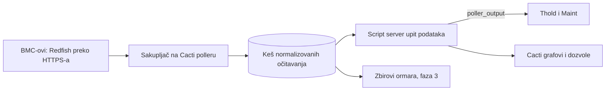

<!-- Source: README.md; SHA256: 7b4e83a58a1adc844cb0615ef30e95476cba2851f96bb454d2a816fb2774724d -->

<!-- translations:start -->
[English](../../../README.md) | [简体中文](../zh-CN/README.md) | [हिन्दी](../hi-IN/README.md) | [Español (España)](../es-ES/README.md) | [Español (Latinoamérica)](../es-419/README.md) | [العربية (السعودية)](../ar-SA/README.md) | [Afrikaans](../af-ZA/README.md) | [አማርኛ](../am-ET/README.md) | [العربية (مصر)](../ar-EG/README.md) | [العربية (المغرب)](../ar-MA/README.md) | [বাংলা](../bn-BD/README.md) | [Bosanski](README.md) | [Deutsch](../de-DE/README.md) | [فارسی](../fa-IR/README.md) | [Filipino](../fil-PH/README.md) | [Français](../fr-FR/README.md) | [Français (Maroc)](../fr-MA/README.md) | [Français (Sénégal)](../fr-SN/README.md) | [Hausa](../ha-NG/README.md) | [עברית](../he-IL/README.md) | [Hrvatski](../hr-HR/README.md) | [Bahasa Indonesia](../id-ID/README.md) | [Igbo](../ig-NG/README.md) | [Italiano](../it-IT/README.md) | [日本語](../ja-JP/README.md) | [한국어](../ko-KR/README.md) | [Malagasy](../mg-MG/README.md) | [मराठी](../mr-IN/README.md) | [Bahasa Melayu](../ms-MY/README.md) | [Nederlands](../nl-NL/README.md) | [Polski](../pl-PL/README.md) | [Português (Brasil)](../pt-BR/README.md) | [Русский](../ru-RU/README.md) | [Kinyarwanda](../rw-RW/README.md) | [Soomaali](../so-SO/README.md) | [Српски](../sr-RS/README.md) | [Svenska](../sv-SE/README.md) | [Kiswahili](../sw-KE/README.md) | [தமிழ்](../ta-IN/README.md) | [తెలుగు](../te-IN/README.md) | [ไทย](../th-TH/README.md) | [Türkçe](../tr-TR/README.md) | [Українська](../uk-UA/README.md) | [اردو](../ur-PK/README.md) | [Tiếng Việt](../vi-VN/README.md) | [isiXhosa](../xh-ZA/README.md) | [Yorùbá](../yo-NG/README.md) | [繁體中文](../zh-TW/README.md) | [isiZulu](../zu-ZA/README.md)
<!-- translations:end -->

# plugin_redfish

Cacti 1.2 dodatak koji donosi potrošnju električne energije servera, ulaznu temperaturu, stanje ventilatora i ispravnost napajanja sa kontrolera za upravljanje matičnom pločom (BMC) u Cacti kao obične uređaje, izvore podataka i grafove, koristeći Redfish uz opcionalnu IPMI rezervu. Thold i Maint zatim šalju upozorenja i potiskuju ih, a kasnija faza dodaje ukupnu potrošnju električne energije na nivou ormara (rack).

> **Status: u razvoju, još bez objavljenog izdanja (0.1.0-dev).** Prekretnice 2 (osnova) i 3 (Cacti objekti i alarmiranje) spojene su u granu `main`. Ovaj dodatak nije povezan sa Cacti projektom. Instalira se na Cacti 1.2.31 pod PHP-om 8.2 ili novijim, registruje BMC-ove i akreditive, čita potrošnju energije, temperature, ventilatore i stanje napajanja sa svakog BMC-a putem Redfish-a u vlastiti keš i prikazuje stanje prikupljanja. Dodaje Cacti uređaje, grafove po članovima i zbirne grafove, te podršku za Thold i Maint preko običnih izvora podataka. CI je testirao lažni BMC izrađen iz ručno napisanih testnih podataka i DMTF Redfish mockup server; nijedan stvarni BMC niti pilot-flota još nisu kvalifikovani. Dizajn i istraživanje nalaze se u [docs/PLAN.md](../../PLAN.md), [docs/research/](../../research) i [docs/decisions/](../../decisions).

### Šta donosi prekretnica 2

- Instalacija, nadogradnja, onemogućavanje i deinstalacija putem Cacti API-ja za dodatke, pri čemu se tabele čuvaju pri deinstalaciji osim ako postavka nije isključena. Na PHP-u starijem od 8.2 dodatak odbija instalaciju ili uključivanje i navodi razlog.
- Područja ovlaštenja (Realms) "Redfish View" (stranica stanja), "Redfish Operator" (stranica operacija) i "Redfish Admin" (stranice za BMC-ove i akreditive), kao i postavke pod Configuration > Settings > Redfish.
- Registar BMC-ova sa CSV uvozom i JSON izvozom. Datoteke za uvoz ne smiju sadržavati lozinke; akreditivi se navode po nazivu.
- Akreditivi sačuvani šifrovano pomoću AES-256-GCM. Ključ je datoteka izvan baze podataka, podrazumijevano `/etc/cacti/redfish-vault.key`, koja sadrži 64 heksadecimalna znaka (`openssl rand -hex 32`) ili tačno 32 nasumična bajta, u vlasništvu korisnika pollera, nečitljiva drugim korisnicima, u direktoriju u koji mogu pisati samo korisnik pollera ili root. Ključ od 32 štampana znaka odbija se kao pristupna fraza. **Napravite sigurnosnu kopiju datoteke ključa zajedno sa bazom podataka**; bez nje svaka sačuvana lozinka mora biti ponovo unesena.
- TLS provjera uključena podrazumijevano, uz CA paket ili SPKI SHA-256 prikvačeni ključ po BMC-u. Zabilježeno isključenje provjere po pojedinom BMC-u ostaje prikazano kao upozorenje na stranici stanja.
- Redfish klijent samo za čitanje: isključivo `GET` te prijava i odjava sesije, provjereno prema spisku dopuštenih radnji prije slanja svakog zahtjeva.
- Sakupljač pokrenut iz `poller_bottom` za BMC-ove na glavnom polleru, sa zakupima i rokovima po BMC-u, odgađanjem te čišćenjem jedine sesije koju je dodatak zabilježio nakon pada. Udaljeni sakupljači još nisu podržani; zahtijevaju eksplicitan izbor načina na koji sakupljač pristupa bazi podataka i ključu (faza 4).
- Zapisi BMC-ova i akreditivi prate Cacti dozvole za uređaje: Redfish Admin vidi, mijenja i povezuje samo BMC-ove na uređajima koje smije vidjeti, te samo akreditive koje ne koristi nijedan BMC na skrivenom uređaju.

### Šta dodaje prekretnica 3

- Šabloni isporučeni kao Cacti XML šabloni u `templates/` i uvezeni pomoću vlastitog Cacti uvoznika pri instalaciji i nadogradnji, usklađeni po sažetku (hash), tako da uvoz ažurira objekte dodatka i ništa ne dodaje dvaput. Tri datoteke upita podataka kopiraju se u `<cacti>/resource/script_server/` uz zabilježeni sažetak; dodatak tamo nikada ne zamjenjuje datoteku koju sam nije zapisao, a stranica stanja upozorava administratore kada šabloni ili datoteka upita nedostaju. Opcija **Reinstall the Redfish Templates** na stranici BMC-ova ponovo ih uvozi; za nju je potrebna Cacti dozvola Import Templates.
- **Create Device** ili **Add Graphs** na svakom BMC-u ([ADR 0015](../../decisions/0015-attach-to-the-server-device-or-create-one-per-bmc.md)). BMC mapiran na postojeći uređaj servera dobija svoje upite podataka i grafove na tom uređaju. Nemapirani BMC dobija novi uređaj iz šablona uređaja "Redfish BMC", sa isključenim provjerama dostupnosti i imenom hosta pod `.invalid`, tako da Cacti nikada ne kontaktira BMC niti prikazuje njegovu adresu. U oba slučaja administrator najprije potvrđuje plan koji navodi šta će biti dodano. Obje radnje zahtijevaju Cacti dozvolu za upravljanje uređajima uz Redfish Admin; novi uređaj koji kreator ne bi mogao vidjeti ponovo se uklanja.
- Tri script server upita podataka, "Redfish Fans", "Redfish Temperatures" i "Redfish Power Supplies", indeksirana ključem člana BMC-a, sa po jednim grafom po članu: brzina ventilatora u procentima ili RPM-u (koju god jedinicu BMC prijavi), temperatura te ulazna i izlazna snaga napajanja u vatima, svaki sa svojim kodom stanja ispravnosti.
- Ulaz "Redfish Node Summary" sa snagom, ulaznom temperaturom, najvišom temperaturom, neispravnim ventilatorima i napajanjima, stanjem čvora i starošću posljednjeg dobrog očitavanja, prikazan na četiri grafa: snaga, temperature, ispravnost komponenti i starost podataka. Thold pragovi na ovim izvorima podataka šalju upozorenja, a Maint ih potiskuje, bez ikakvih izmjena u bilo kojem od ta dva dodatka.
- Script server odgovara isključivo iz keša dodatka i nikada ne kontaktira BMC. Vrijednost koja nedostaje, zastarjela je, ima drugu jedinicu ili potiče od uklonjenog člana iznosi `U`, tako da grafovi prikazuju prekid, nikada nulu; `age` uvijek ima vrijednost, pa prag na njoj otkriva BMC koji je prestao odgovarati.
- Link sa svakog Redfish grafa prema Redfish grafovima tog uređaja, prikazan samo korisnicima kojima Cacti dopušta pregled uređaja.

**Kada se članovi BMC-a promijene** (zamijenjen ventilator, ažuriranje firmvera koje preimenuje senzore), ponovo odaberite **Add Graphs**. Ventilator ili napajanje koje je bilo prisutno, a sada nedostaje ili je uklonjeno, broji se u `fans_bad` ili `psus_bad` dok to ne uradite, pa izvađeni ventilator aktivira alarm; ležište koje nikada nije bilo popunjeno ne broji se. Add Graphs prihvata članove koje BMC trenutno prijavljuje, a Cacti ponovo indeksira upite; uklonjeni član zadržava svoj izvor podataka i graf koji od tada očitavaju `U`, dok novi član dobija graf. Ručno obrišite grafove uklonjenih članova kada njihova historija više ne bude potrebna.

Brisanje uređaja uklanja mapiranje njegovog BMC-a i čuva BMC zajedno sa njegovim kešom. Brisanje BMC-a ili deinstalacija dodatka čuva njegov uređaj i grafove.

## Uloge pristupa

| Područje (Realm) | Pristup |
| --- | --- |
| Redfish View | Postojeće stranice za nadzor. |
| Redfish Operator | Nadzor plus stranica operacija i lične potvrde prijema za trijažu. |
| Redfish Admin | Pristup operatera plus postojeće konfiguracijske i administrativne radnje. |

Nakon kopiranja datoteka nadogradnje otvorite stranicu Plugins kao administrator da registrujete novo područje ovlaštenja. Eksplicitno dodijelite područje Operator pod **Configuration > Users** ili korisničkim grupama. Nadogradnje zadržavaju postojeće ID-ove područja View i Admin te njihove dodjele. Pristup Admin pri svakom zahtjevu nasljeđuje pristup Operator, a pristup Operator nasljeđuje pristup View; ovo ne dodaje sačuvane dodjele korisnicima ni grupama. Postavke dodatka zahtijevaju i Redfish Admin pristup pored Cacti dozvole za postavke.

Cacti dozvole za uređaje i dalje ograničavaju redove i radnje dostupne svakom korisniku; nemapirani objekti zahtijevaju administratora. Operateri mogu ukloniti blokadu prikupljanja na dopuštenom BMC-u za sljedeće zakazano pokretanje. Akreditivi, konfiguracija, mapiranje, brisanje i ostale administrativne izmjene ostaju na administrativnim stranicama. Potvrde prijema važe samo u trenutnoj korisničkoj sesiji, najviše jedan sat i samo dok isto zapažanje ostane svježe. Nova ili izmijenjena zapažanja ih poništavaju. One nikada ne označavaju neuspjelo mjerenje ispravnim niti potiskuju alarme.

## Zašto

Svaki server ima BMC koji prijavljuje energetsko i termalno stanje nezavisno od operativnog sistema, pa nastavlja odgovarati i kada operativni sistem padne. Podaci služe za praćenje kapaciteta i troškova, rano upozorenje o otkazu ventilatora ili napajanja te, u računarstvu visokih performansi (HPC), za odluke o ograničavanju potrošnje energije. Dodatak nije ograničen na HPC.

Cacti danas pokriva dio toga:

- **Proizvođački SNMP paketi.** Grana 1.2.x isporučuje šablone za Dell iDRAC i HPE iLO koji zahtijevaju SNMP agent i specifični su za proizvođača; istraživanje u prekretnici 1 pokazalo je da nijedan ne prijavljuje potrošnju energije u vatima ([docs/research/overlap.md](../../research/overlap.md)).
- **Tip akreditiva bez sakupljača.** plugin_credentials definiše akreditiv "IPMI / Redfish (BMC)", ali ne očitava nijedan BMC.
- **Bez prikaza na nivou ormara.** Jezgro Cacti-ja nema objekat ormara (rack); uređaj ima samo polje slobodnog teksta `location`.

Dodatak očitava BMC-ove izvan osnovnog Cacti ciklusa ispitivanja, kešira normalizovana očitavanja i izlaže ih kroz script server upit podataka i zbirne izvore podataka. Ponovo koristi Cacti grafove, dozvole, Thold i Maint, i ne mijenja stanje BMC-a. Podrška za udaljene sakupljače podataka planirana je za fazu 4; trenutno prikupljanje radi samo na glavnom polleru.

## Planirani obim

| Faza | Obim | Prekretnice |
|---|---|---|
| 0, istraživanje | Matrica proizvođača, potvrda ponašanja na živim BMC-ovima, cijena ispitivanja, prototip upita podataka | [M1](https://github.com/somethingwithproof/plugin_redfish/milestone/1) |
| 1, posmatranje | Registar BMC-ova, akreditivi, TLS, Redfish sakupljač, normalizovana očitavanja, uređaji, grafovi po indeksu, Thold alarmiranje, Maint potiskivanje, stranica stanja | [M2](https://github.com/somethingwithproof/plugin_redfish/milestone/2), [M3](https://github.com/somethingwithproof/plugin_redfish/milestone/3), [M4](https://github.com/somethingwithproof/plugin_redfish/milestone/4) |
| 2, ipmi | IPMI rezerva za BMC-ove bez upotrebljivog Redfish-a, podrazumijevano isključena | [M5](https://github.com/somethingwithproof/plugin_redfish/milestone/5) |
| 3, ormari | Registar ormara, ukupna potrošnja energije ormara sa pokrivenošću, raspoloživa rezerva budžeta | [M6](https://github.com/somethingwithproof/plugin_redfish/milestone/6) |
| 4, udaljeni | Cacti udaljeni sakupljači podataka za izolovane BMC mreže | [M7](https://github.com/somethingwithproof/plugin_redfish/milestone/7) |

Izvan obima: postavljanje ograničenja snage ili bilo kakva druga konfiguracija BMC-a, upravljanje napajanjem, ažuriranje firmvera, pristup konzoli, vlastiti sistem za alarmiranje u dodatku i integracija sa raspoređivačem.

## Ciljevi kompatibilnosti

| Komponenta | Cilj |
|---|---|
| Cacti | 1.2.31 ili noviji, bez izmjena jezgra |
| Baza podataka | MariaDB 10.2 ili MySQL 5.7 ili noviji: jedan BMC po uređaju osiguran je jedinstvenim ključem na generisanoj koloni |
| PHP | 8.2 ili noviji; `setup.php` ostaje ispravan za parsiranje na 8.0 tako da nepodržano okruženje dobije odbijanje umjesto pokvarenog Cacti interfejsa |
| BMC-ovi | Dell iDRAC, HPE iLO, Lenovo XCC i OpenBMC, prema opsegu firmvera; pogledajte [matricu proizvođača](../../research/vendor-matrix.md) |
| Redfish | Prvo novi podsistemski i senzorski resursi, zastarjeli `Power` i `Thermal` kao rezerva |
| Thold, Maint | Nisu potrebne izmjene |

## Dizajn

- [docs/PLAN.md](../../PLAN.md) je potpuni plan: arhitektura, uzvodne činjenice na koje se oslanja (sa izvorima i pretpostavkama koje još treba potvrditi), model mjerenja, sigurnosne granice, proračun performansi, testiranje i rizici.
- [docs/decisions/](../../decisions) sadrži zapise arhitektonskih odluka za već donesene izbore.
- [docs/REQUIREMENTS.md](../../REQUIREMENTS.md) povezuje svaki ID zahtjeva sa njegovim zadatkom (issue).

## Sigurnost

BMC akreditivi kontrolišu izvanpojasno upravljanje serverima. Dizajn ih drži izvan komandnih linija, zapisnika i stranica, podrazumijevano provjerava TLS, izvršava svaku vanjsku komandu iz niza argumenata sa dozvoljenim potkomandama i koristi BMC naloge samo za čitanje. Pogledajte [docs/PLAN.md](../../PLAN.md#security) i [SECURITY.md](../../../SECURITY.md).

## Vodič za operatere

Pogledajte [docs/operator-guide.md](../../operator-guide.md) za preduslove instalacije, podešavanje trezora i TLS-a, registraciju BMC-ova, kreiranje grafova, intervale upozorenja, sigurnosno kopiranje i postupanje pri greškama. Vodič ne proglašava nijednu stvarnu liniju firmvera proizvođača podržanom dok redigovani snimak tog firmvera ne prođe skup testova.

## Kako se prati rad

- **Prekretnice (Milestones)** prate prekretnice plana. Svaka ima krovni zadatak (epic issue) sa spiskom podzadataka i dokaza o završetku.
- **Zadaci (Issues)** razvrstani su oznakama: `type: requirement`, `type: research`, `type: decision`, `type: epic`. Zadaci zahtjeva navode numerisane, testabilne zahtjeve (`REQ-AREA-NNN`) i kriterije prihvatanja.
- **Oznake (Labels)** također nose `area:`, `phase:`, `priority:` i `status:`. Pogledajte [CONTRIBUTING.md](../../../CONTRIBUTING.md#labels).
- [Tabla projekta](https://github.com/users/somethingwithproof/projects/12) prikazuje sve zadatke kroz prekretnice.

## Doprinošenje

Pročitajte [CONTRIBUTING.md](../../../CONTRIBUTING.md). Komitovi zahtijevaju DCO potpis (sign-off). Rasprave o dizajnu vode se u zadacima; otvorene odluke nose oznaku `type: decision`. Dokazi sa stvarnih BMC-ova trenutno su najkorisniji doprinos; uklonite adrese, serijske brojeve i akreditive prije objave bilo kakvog snimka.

## Licenca

GNU General Public License v2.0, ista licenca kao Cacti i njegovi dodaci. Pogledajte [LICENSE](../../../LICENSE).
