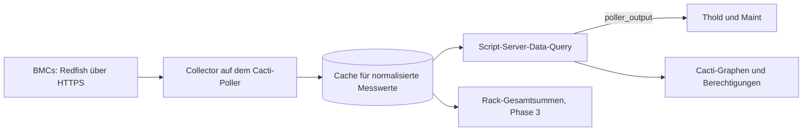

<!-- Source: README.md; SHA256: 7b4e83a58a1adc844cb0615ef30e95476cba2851f96bb454d2a816fb2774724d -->

<!-- translations:start -->
[English](../../../README.md) | [简体中文](../zh-CN/README.md) | [हिन्दी](../hi-IN/README.md) | [Español (España)](../es-ES/README.md) | [Español (Latinoamérica)](../es-419/README.md) | [العربية (السعودية)](../ar-SA/README.md) | [Afrikaans](../af-ZA/README.md) | [አማርኛ](../am-ET/README.md) | [العربية (مصر)](../ar-EG/README.md) | [العربية (المغرب)](../ar-MA/README.md) | [বাংলা](../bn-BD/README.md) | [Deutsch](README.md) | [فارسی](../fa-IR/README.md) | [Filipino](../fil-PH/README.md) | [Français](../fr-FR/README.md) | [Français (Maroc)](../fr-MA/README.md) | [Français (Sénégal)](../fr-SN/README.md) | [Hausa](../ha-NG/README.md) | [עברית](../he-IL/README.md) | [Bahasa Indonesia](../id-ID/README.md) | [Igbo](../ig-NG/README.md) | [Italiano](../it-IT/README.md) | [日本語](../ja-JP/README.md) | [한국어](../ko-KR/README.md) | [Malagasy](../mg-MG/README.md) | [मराठी](../mr-IN/README.md) | [Bahasa Melayu](../ms-MY/README.md) | [Nederlands](../nl-NL/README.md) | [Polski](../pl-PL/README.md) | [Português (Brasil)](../pt-BR/README.md) | [Русский](../ru-RU/README.md) | [Kinyarwanda](../rw-RW/README.md) | [Soomaali](../so-SO/README.md) | [Svenska](../sv-SE/README.md) | [Kiswahili](../sw-KE/README.md) | [தமிழ்](../ta-IN/README.md) | [తెలుగు](../te-IN/README.md) | [ไทย](../th-TH/README.md) | [Türkçe](../tr-TR/README.md) | [Українська](../uk-UA/README.md) | [اردو](../ur-PK/README.md) | [Tiếng Việt](../vi-VN/README.md) | [isiXhosa](../xh-ZA/README.md) | [Yorùbá](../yo-NG/README.md) | [繁體中文](../zh-TW/README.md) | [isiZulu](../zu-ZA/README.md)
<!-- translations:end -->

# plugin_redfish

Ein Cacti-1.2-Plugin, das Server-Leistungsaufnahme, Einlasstemperatur, Lüfterstatus und Netzteilzustand von Baseboard Management Controllern (BMCs) als reguläre Geräte, Datenquellen und Graphen in Cacti einbindet – über Redfish mit optionalem IPMI-Fallback. Thold und Maint lösen daraufhin Alarme aus und unterdrücken diese, und eine spätere Phase ergänzt Leistungsgesamtsummen auf Rack-Ebene.

> **Status: in Entwicklung, noch keine Veröffentlichung (0.1.0-dev).** Die Meilensteine 2 (Grundlage) und 3 (Cacti-Objekte und Alarmierung) sind in `main` zusammengeführt. Dieses Plugin steht in keiner Verbindung zum Cacti-Projekt. Es lässt sich unter Cacti 1.2.31 mit PHP 8.2 oder neuer installieren, registriert BMCs und Zugangsdaten, liest Leistung, Temperaturen, Lüfter und Netzteilzustand über Redfish von jedem BMC in einen eigenen Cache und zeigt den Erfassungszustand an. Es legt Cacti-Geräte, Einzelkomponenten- und Übersichtsgraphen sowie Thold- und Maint-Unterstützung über reguläre Datenquellen an. Die CI hat einen simulierten BMC auf Basis handgeschriebener Fixtures sowie den DMTF-Redfish-Mockup-Server getestet; ein realer BMC oder eine Pilotflotte wurde noch nicht qualifiziert. Entwurf und Recherche befinden sich in [docs/PLAN.md](../../PLAN.md), [docs/research/](../../research) und [docs/decisions/](../../decisions).

### Was Meilenstein 2 ausliefert

- Installation, Upgrade, Deaktivierung und Deinstallation über die Plugin-API von Cacti, wobei Tabellen bei der Deinstallation erhalten bleiben, sofern die entsprechende Einstellung nicht deaktiviert wird. Unter PHP älter als 8.2 verweigert das Plugin die Installation oder Aktivierung mit Angabe des Grundes.
- Die Berechtigungsbereiche (Realms) „Redfish View“ (Zustandsseite), „Redfish Operator“ (Betriebsseite) und „Redfish Admin“ (Seiten für BMCs und Zugangsdaten) sowie Einstellungen unter Configuration > Settings > Redfish.
- Eine BMC-Registrierung mit CSV-Import und JSON-Export. Importdateien dürfen keine Passwörter enthalten; Zugangsdaten werden über ihren Namen referenziert.
- Verschlüsselte Speicherung von Zugangsdaten mit AES-256-GCM. Der Schlüssel ist eine Datei außerhalb der Datenbank, standardmäßig `/etc/cacti/redfish-vault.key`, die 64 hexadezimale Zeichen (`openssl rand -hex 32`) oder genau 32 zufällige Bytes enthält, dem Poller-Benutzer gehört, für andere Benutzer nicht lesbar ist und in einem Verzeichnis liegt, in das nur der Poller-Benutzer oder root schreiben darf. Ein Schlüssel aus 32 druckbaren Zeichen wird als Passphrase abgelehnt. **Sichern Sie die Schlüsseldatei zusammen mit der Datenbank**; ohne sie muss jedes gespeicherte Passwort erneut eingegeben werden.
- Standardmäßig aktivierte TLS-Überprüfung mit einem CA-Bundle oder SPKI-SHA-256-Pin pro BMC. Ein protokolliertes, pro BMC konfiguriertes Opt-out ohne Verifizierung bleibt auf der Zustandsseite als Warnung sichtbar.
- Ein schreibgeschützter Redfish-Client: ausschließlich `GET` sowie Session-Login und -Logout, vor dem Versand jeder Anfrage gegen eine Allowlist geprüft.
- Ein über `poller_bottom` gestarteter Collector für BMCs auf dem Haupt-Poller mit Leases und Deadlines pro BMC, Backoff sowie Bereinigung nach einem Absturz der einen vom Plugin aufgezeichneten Session. Remote-Collectoren werden noch nicht unterstützt; sie erfordern eine explizite Entscheidung darüber, wie der Collector die Datenbank und den Schlüssel erreicht (Phase 4).
- BMC-Datensätze und Zugangsdaten folgen den Cacti-Geräteberechtigungen: Ein Redfish Admin sieht, ändert und verknüpft nur BMCs auf Geräten, die er sehen darf, und nur Zugangsdaten, die von keinem BMC auf einem verborgenen Gerät verwendet werden.

### Was Meilenstein 3 hinzufügt

- Vorlagen, die als Cacti-Template-XML in `templates/` mitgeliefert und bei Installation und Upgrade mit dem Cacti-eigenen Importer importiert sowie per Hash abgeglichen werden, sodass ein Import die Objekte des Plugins aktualisiert und nichts doppelt anlegt. Die drei Data-Query-Dateien werden mit einem gespeicherten Hash nach `<cacti>/resource/script_server/` kopiert; das Plugin ersetzt dort niemals eine Datei, die es nicht selbst geschrieben hat, und die Zustandsseite warnt Administratoren, wenn die Vorlagen oder eine Query-Datei fehlen. **Reinstall the Redfish Templates** auf der BMCs-Seite importiert sie erneut; hierfür ist die Cacti-Berechtigung zum Importieren von Templates erforderlich.
- **Create Device** oder **Add Graphs** für jeden BMC ([ADR 0015](../../decisions/0015-attach-to-the-server-device-or-create-one-per-bmc.md)). Ein BMC, der einem bestehenden Gerät eines Servers zugeordnet ist, erhält seine Data Queries und Graphen auf diesem Gerät. Ein nicht zugeordneter BMC erhält ein neues Gerät aus der Gerätevorlage „Redfish BMC“ mit deaktivierten Verfügbarkeitsprüfungen und einem Hostnamen unter `.invalid`, sodass Cacti den BMC niemals kontaktiert und niemals dessen Adresse anzeigt. In beiden Fällen bestätigt ein Administrator zunächst einen Plan, der aufführt, was hinzugefügt wird. Beides erfordert neben Redfish Admin auch die Cacti-Berechtigung zur Geräteverwaltung; ein neues Gerät, das der Ersteller nicht sehen könnte, wird wieder entfernt.
- Drei Script-Server-Data-Queries – „Redfish Fans“, „Redfish Temperatures“ und „Redfish Power Supplies“ – indiziert nach dem Member-Key des BMC mit je einem Graphen pro Komponente: Lüfterdrehzahl in Prozent oder RPM (je nachdem, welche Einheit der BMC meldet), Temperatur sowie Eingangs- und Ausgangsleistung des Netzteils in Watt, jeweils mit zugehörigem Zustandscode.
- Ein „Redfish Node Summary“-Input mit Leistung, Einlasstemperatur, höchster Temperatur, nicht ordnungsgemäß funktionierenden Lüftern und Netzteilen, Node-Zustand sowie dem Alter des letzten gültigen Lesevorgangs, dargestellt in vier Graphen: Leistung, Temperaturen, Komponentenzustand und Datenalter. Thold-Schwellenwerte auf diesen Datenquellen lösen Alarme aus, und Maint unterdrückt sie – ohne Änderungen an einem der beiden Plugins.
- Der Script-Server antwortet ausschließlich aus dem Cache des Plugins und kontaktiert niemals einen BMC. Ein fehlender, veralteter, in einer anderen Einheit vorliegender oder von einer nicht mehr vorhandenen Komponente stammender Wert ist `U`, sodass Graphen eine Lücke statt Null anzeigen; `age` hat immer einen Wert, sodass ein Schwellenwert darauf einen BMC erkennt, der nicht mehr antwortet.
- Ein Graph-Link von jedem Redfish-Graphen zu den Redfish-Graphen des Geräts, der nur Benutzern angezeigt wird, denen Cacti die Ansicht des Geräts erlaubt.

**Wenn sich die Komponenten eines BMC ändern** (ein Lüfter wurde ersetzt, ein Firmware-Update benennt Sensoren um), wählen Sie erneut **Add Graphs**. Ein Lüfter oder Netzteil, das zuvor vorhanden war und nun fehlt oder entfernt wurde, zählt bis dahin in `fans_bad` oder `psus_bad`, sodass ein gezogener Lüfter einen Alarm auslöst; ein Steckplatz, der nie belegt war, zählt nicht mit. Add Graphs übernimmt die Komponenten, die der BMC aktuell meldet, und Cacti indiziert die Queries erneut; eine entfernte Komponente behält ihre Datenquelle und ihren Graphen, die ab diesem Zeitpunkt `U` lesen, und eine neue Komponente erhält einen Graphen. Löschen Sie die Graphen entfernter Komponenten manuell, sobald deren Historie nicht mehr benötigt wird.

Das Löschen eines Geräts hebt die Zuordnung seines BMC auf und behält den BMC sowie dessen Cache. Das Löschen eines BMC oder die Deinstallation des Plugins behält das zugehörige Gerät und seine Graphen.

## Zugriffsrollen

| Berechtigungsbereich | Zugriff |
| --- | --- |
| Redfish View | Bestehende Monitoring-Seiten. |
| Redfish Operator | Monitoring sowie die Operations-Seite und persönliche Triage-Bestätigungen. |
| Redfish Admin | Operator-Zugriff sowie die bestehenden Konfigurations- und Verwaltungsaktionen. |

Öffnen Sie nach dem Kopieren der Upgrade-Dateien als Administrator die Plugins-Seite, um den neuen Berechtigungsbereich zu registrieren. Weisen Sie den Bereich Operator explizit unter **Configuration > Users** oder über Benutzergruppen zu. Upgrades behalten die bestehenden Realm-IDs und Berechtigungen für View und Admin bei. Der Admin-Zugriff erbt bei jeder Anfrage den Operator-Zugriff, und der Operator-Zugriff erbt den View-Zugriff; dadurch werden Benutzern oder Gruppen keine gespeicherten Berechtigungen hinzugefügt. Plugin-Einstellungen erfordern neben der Cacti-Einstellungsberechtigung zusätzlich den Zugriff als Redfish Admin.

Die Cacti-Geräteberechtigungen schränken weiterhin die für jeden Benutzer verfügbaren Zeilen und Aktionen ein; nicht zugeordnete Objekte erfordern einen Administrator. Operatoren können eine Erfassungssperre für einen zulässigen BMC für den nächsten geplanten Lauf aufheben. Zugangsdaten, Konfiguration, Zuordnung, Löschung und weitere administrative Änderungen verbleiben auf den Verwaltungsseiten. Bestätigungen gelten nur in der aktuellen Sitzung des Benutzers, höchstens eine Stunde lang und nur solange dieselbe Beobachtung aktuell bleibt. Neue oder geänderte Beobachtungen machen sie ungültig. Sie markieren niemals eine fehlgeschlagene Messung als gesund und unterdrücken keine Alarme.

## Warum

Jeder Server verfügt über einen BMC, der Leistungs- und Temperaturzustand unabhängig vom Betriebssystem meldet und somit auch dann weiter antwortet, wenn das Betriebssystem ausgefallen ist. Die Daten dienen der Kapazitäts- und Kostenverfolgung, der Frühwarnung bei einem ausgefallenen Lüfter oder Netzteil sowie – im High-Performance-Computing – Entscheidungen zur Leistungsbegrenzung (Power Capping). Das Plugin ist nicht auf HPC beschränkt.

Cacti deckt heute einen Teil davon ab:

- **Hersteller-SNMP-Pakete.** Der 1.2.x-Zweig liefert Vorlagen für Dell iDRAC und HPE iLO aus, die einen SNMP-Agenten erfordern und herstellerspezifisch sind; die Recherche in Meilenstein 1 ergab, dass keines von beiden die Leistungsaufnahme in Watt meldet ([docs/research/overlap.md](../../research/overlap.md)).
- **Ein Zugangsdatentyp ohne Collector.** plugin_credentials definiert den Zugangsdatentyp „IPMI / Redfish (BMC)“, liest jedoch keinen BMC aus.
- **Keine Rack-Ebene.** Der Cacti-Kern kennt kein Rack-Objekt; ein Gerät besitzt lediglich ein Freitextfeld `location`.

Das Plugin fragt BMCs außerhalb des Bandes vom Cacti-Abfragezyklus ab, speichert normalisierte Messwerte im Cache und stellt sie über eine Script-Server-Data-Query und Übersichtsdatenquellen bereit. Es nutzt die Graphen, Berechtigungen, Thold und Maint von Cacti weiter und verändert keinen BMC-Zustand. Die Unterstützung für Remote-Data-Collectoren ist für Phase 4 geplant; die aktuelle Erfassung läuft ausschließlich auf dem Haupt-Poller.

## Geplanter Funktionsumfang

| Phase | Umfang | Meilensteine |
|---|---|---|
| 0, Recherche | Herstellermatrix, Bestätigung des Upstream-Verhaltens auf Live-BMCs, Abfragekosten, Data-Query-Spike | [M1](https://github.com/somethingwithproof/plugin_redfish/milestone/1) |
| 1, Beobachten | BMC-Registrierung, Zugangsdaten, TLS, Redfish-Collector, normalisierte Messwerte, Geräte, Einzelindex-Graphen, Thold-Alarmierung, Maint-Unterdrückung, Zustandsseite | [M2](https://github.com/somethingwithproof/plugin_redfish/milestone/2), [M3](https://github.com/somethingwithproof/plugin_redfish/milestone/3), [M4](https://github.com/somethingwithproof/plugin_redfish/milestone/4) |
| 2, IPMI | IPMI-Fallback für BMCs ohne nutzbares Redfish, standardmäßig deaktiviert | [M5](https://github.com/somethingwithproof/plugin_redfish/milestone/5) |
| 3, Racks | Rack-Registrierung, Rack-Leistungsgesamtsummen mit Abdeckung, Budget-Spielraum | [M6](https://github.com/somethingwithproof/plugin_redfish/milestone/6) |
| 4, Remote | Cacti-Remote-Data-Collectoren für isolierte BMC-Netze | [M7](https://github.com/somethingwithproof/plugin_redfish/milestone/7) |

Außerhalb des Umfangs liegen: das Setzen von Power Caps oder jede andere BMC-Konfiguration, Stromsteuerung, Firmware-Updates, Konsolenzugriff, eine plugin-eigene Alarmierungs-Engine sowie Scheduler-Integration.

## Kompatibilitätsziele

| Komponente | Ziel |
|---|---|
| Cacti | 1.2.31 oder neuer, keine Core-Patches |
| Datenbank | MariaDB 10.2 oder MySQL 5.7 oder neuer: ein BMC pro Gerät wird über einen eindeutigen Schlüssel auf einer generierten Spalte erzwungen |
| PHP | 8.2 oder neuer; `setup.php` bleibt unter 8.0 parsbar, sodass eine nicht unterstützte Laufzeitumgebung eine Ablehnung statt einer defekten Cacti-Oberfläche erhält |
| BMCs | Dell iDRAC, HPE iLO, Lenovo XCC und OpenBMC, je nach Firmware-Bereich; siehe [die Herstellermatrix](../../research/vendor-matrix.md) |
| Redfish | Zuerst neue Subsystem- und Sensor-Ressourcen, veraltete Ressourcen `Power` und `Thermal` als Fallback |
| Thold, Maint | Keine Änderungen erforderlich |

## Entwurf

- [docs/PLAN.md](../../PLAN.md) ist der vollständige Plan: Architektur, Upstream-Fakten, auf denen er aufbaut (mit Quellen und noch zu bestätigenden Annahmen), Messmodell, Sicherheitsgrenzen, Leistungsarithmetik, Tests und Risiken.
- [docs/decisions/](../../decisions) enthält Architecture Decision Records für bereits getroffene Entscheidungen.
- [docs/REQUIREMENTS.md](../../REQUIREMENTS.md) ordnet jede Anforderungs-ID ihrem Issue zu.

## Sicherheit

BMC-Zugangsdaten steuern das Out-of-Band-Management von Servern. Das Design hält sie aus Befehlszeilen, Protokollen und Seiten heraus, überprüft TLS standardmäßig, führt jeden externen Befehl über ein Argument-Array mit per Allowlist zugelassenen Unterbefehlen aus und verwendet schreibgeschützte BMC-Konten. Siehe [docs/PLAN.md](../../PLAN.md#security) und [SECURITY.md](../../../SECURITY.md).

## Betriebshandbuch

Siehe [docs/operator-guide.md](../../operator-guide.md) für Installationsvoraussetzungen, Vault- und TLS-Einrichtung, BMC-Registrierung, Graphenerstellung, Alarmintervalle, Datensicherung und Fehlerbehandlung. Das Handbuch erklärt keine reale Hersteller-Firmware-Linie als unterstützt, bevor nicht eine geschwärzte Aufzeichnung dieser Firmware die Testsuite bestanden hat.

## Wie die Arbeit verfolgt wird

- **Meilensteine** folgen den Meilensteinen des Plans. Jeder hat ein Epic-Issue, das seine Unter-Issues und Abschlussnachweise auflistet.
- **Issues** sind nach Labels typisiert: `type: requirement`, `type: research`, `type: decision`, `type: epic`. Anforderungs-Issues formulieren nummerierte, testbare Anforderungen (`REQ-AREA-NNN`) und Akzeptanzkriterien.
- **Labels** tragen außerdem `area:`, `phase:`, `priority:` und `status:`. Siehe [CONTRIBUTING.md](../../../CONTRIBUTING.md#labels).
- Das [Projekt-Board](https://github.com/users/somethingwithproof/projects/12) zeigt alle Issues über die Meilensteine hinweg.

## Mitwirken

Lesen Sie [CONTRIBUTING.md](../../../CONTRIBUTING.md). Commits erfordern ein DCO-Sign-off. Entwurfsdiskussionen finden in Issues statt; offene Entscheidungen tragen das Label `type: decision`. Nachweise von realen BMCs sind derzeit der hilfreichste Beitrag; schwärzen Sie Adressen, Seriennummern und Zugangsdaten, bevor Sie eine Aufzeichnung veröffentlichen.

## Lizenz

GNU General Public License v2.0, dieselbe Lizenz wie Cacti und seine Plugins. Siehe [LICENSE](../../../LICENSE).
