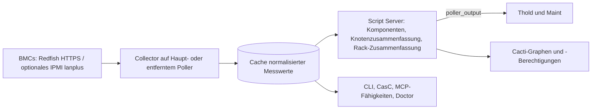

<!-- Source: README.md; SHA256: 6972a6c9ac754cd60e63c5caf971451ea8fe6e279eef757d886e1a168d3eef01 -->

<!-- translations:start -->
[English](../../../README.md) | [简体中文](../zh-CN/README.md) | [हिन्दी](../hi-IN/README.md) | [Español (España)](../es-ES/README.md) | [Español (Latinoamérica)](../es-419/README.md) | [العربية (السعودية)](../ar-SA/README.md) | [Afrikaans](../af-ZA/README.md) | [አማርኛ](../am-ET/README.md) | [العربية (مصر)](../ar-EG/README.md) | [العربية (المغرب)](../ar-MA/README.md) | [বাংলা](../bn-BD/README.md) | [Bosanski](../bs-BA/README.md) | [Deutsch](README.md) | [فارسی](../fa-IR/README.md) | [Filipino](../fil-PH/README.md) | [Français](../fr-FR/README.md) | [Français (Maroc)](../fr-MA/README.md) | [Français (Sénégal)](../fr-SN/README.md) | [Hausa](../ha-NG/README.md) | [עברית](../he-IL/README.md) | [Hrvatski](../hr-HR/README.md) | [Bahasa Indonesia](../id-ID/README.md) | [Igbo](../ig-NG/README.md) | [Italiano](../it-IT/README.md) | [日本語](../ja-JP/README.md) | [한국어](../ko-KR/README.md) | [Malagasy](../mg-MG/README.md) | [मराठी](../mr-IN/README.md) | [Bahasa Melayu](../ms-MY/README.md) | [Nederlands](../nl-NL/README.md) | [Polski](../pl-PL/README.md) | [Português (Brasil)](../pt-BR/README.md) | [Русский](../ru-RU/README.md) | [Kinyarwanda](../rw-RW/README.md) | [Soomaali](../so-SO/README.md) | [Српски](../sr-RS/README.md) | [Svenska](../sv-SE/README.md) | [Kiswahili](../sw-KE/README.md) | [தமிழ்](../ta-IN/README.md) | [తెలుగు](../te-IN/README.md) | [ไทย](../th-TH/README.md) | [Türkçe](../tr-TR/README.md) | [Українська](../uk-UA/README.md) | [اردو](../ur-PK/README.md) | [Tiếng Việt](../vi-VN/README.md) | [isiXhosa](../xh-ZA/README.md) | [Yorùbá](../yo-NG/README.md) | [繁體中文](../zh-TW/README.md) | [isiZulu](../zu-ZA/README.md)
<!-- translations:end -->

# plugin_redfish

Ein Cacti-1.2-Plugin, das Server-Leistungsaufnahme, Einlasstemperatur, Lüfterstatus und Netzteilzustand von Baseboard Management Controllern (BMCs) als reguläre Geräte, Datenquellen und Graphen in Cacti einbindet, über Redfish mit einem optionalen Nur-Lese-IPMI-Fallback und Leistungsaggregation auf Rack-Ebene. Thold und Maint alarmieren darüber und unterdrücken Alarme über reguläre Cacti-Datenquellen.

> **Status: in Entwicklung, noch keine Veröffentlichung (`0.1.0-dev`).** Dieses Plugin steht in keiner Verbindung zum Cacti-Projekt. Es lässt sich auf Cacti 1.2.31 oder neuer unter PHP 8.2 oder neuer installieren und implementiert den Redfish-Collector, den verschlüsselten Zugangsdatentresor, die Bereitstellung von Cacti-Geräten und -Graphen, den optionalen Nur-Lese-IPMI-Fallback, die Rack-Leistungsaggregation, die Anzeige von Cacti-Maint-Fenstern, die Replikation entfernter Datensammler und Agent-Endpunkte, den CasC-Provider samt Operator-CLI, MCP-Fähigkeiten sowie Doctor-Diagnoseprüfungen. Die CI testet Fixtures, den DMTF Redfish Mockup Server (Subsystem-, Legacy-only- und HPE-iLO-Gen11-Mockups) sowie Thold v1.8.2 mit Maint v1.3; ein realer physischer BMC oder eine Pilotflotte wurde noch nicht qualifiziert. Entwurf und Recherche befinden sich in [docs/PLAN.md](../../PLAN.md), [docs/research/](../../research/) und [docs/decisions/](../../decisions/).

## Implementierte Fähigkeiten

### Kern-Collector, Tresor und Cacti-Objekte

- **Lebenszyklus und Schema.** Installation, Aktualisierung, Deaktivierung und Deinstallation erfolgen über die Plugin-API von Cacti (`Schema::VERSION = 3`, 12 Tabellen). Tabellen bleiben bei der Deinstallation erhalten, sofern *Keep Plugin Tables on Uninstall* nicht abgewählt wird. Einstiegspunkte bleiben unter PHP 8.0 parsebar und lehnen PHP unter 8.2 oder ein fehlendes `ext-openssl` mit einer eindeutigen Fehlermeldung ab.
- **Verzeichnis und Berechtigungen.** Berechtigungsbereiche *Redfish View* (`redfish_health.php`), *Redfish Operator* (`redfish_operator.php`) und *Redfish Admin* (`redfish_bmcs.php`, `redfish_credentials.php`) sowie Einstellungen unter **Configuration > Settings > Redfish**. Das BMC-Verzeichnis unterstützt CSV-Import (Zugangsdaten werden namentlich referenziert; Passwörter in Importdateien werden abgelehnt) und JSON-Export. BMC-Einträge und Zugangsdaten folgen den Cacti-Geräteberechtigungen.
- **Verschlüsselter Zugangsdatentresor.** Passwörter werden mit AES-256-GCM verschlüsselt in `plugin_redfish_secret` gespeichert. Der Schlüssel liegt außerhalb der Datenbank (standardmäßig `/etc/cacti/redfish-vault.key`) als 64 Hexadezimalzeichen (`openssl rand -hex 32`) oder 32 Rohbytes, gehört dem Poller-Benutzer, ist für andere Benutzer nicht lesbar und liegt in einem Verzeichnis, in das nur root oder dieser Benutzer schreiben darf. Eine druckbare 32-Zeichen-Passphrase wird abgelehnt. **Sichern Sie die Schlüsseldatei zusammen mit der Datenbank**; ohne sie müssen gespeicherte Passwörter erneut eingegeben werden.
- **TLS und schreibgeschützter Redfish-Client.** Die TLS-Prüfung ist standardmäßig über den System-CA-Speicher, ein CA-Bündel pro BMC oder ein SPKI-SHA-256-Pinning aktiviert; eine Deaktivierung pro BMC bleibt als Gesundheitswarnung und Doctor-Prüfwarnung sichtbar. Der Client erlaubt ausschließlich `GET` sowie Redfish-Sitzungsanmeldung (`POST`) und -Abmeldung (`DELETE`), mit optionalem Basic-Fallback pro BMC, wenn keine Sitzungen verfügbar sind. Die Erkennung bevorzugt neue Redfish-Subsystem- und Sensor-Ressourcen und fällt auf veraltete `Power`- und `Thermal`-Ressourcen zurück.
- **Collector-Ausführung.** `poller_redfish.php` startet über `poller_bottom`, führt einen Master-Prozess pro Poller über Cactis Prozessregister mit konfigurierbaren Worker-Prozessen (`redfish_workers`) aus, erwirbt Leases pro BMC, erzwingt ein Zeitbudget (`redfish_collector_budget`), wendet exponentielles Backoff an und bereinigt die eigene vorherige Sitzung des Plugins nach einem Absturz.
- **Vorlagen, Geräte und Graphen.** Importiert `templates/redfish-templates.xml` per Hash und kopiert drei XML-Dateien für Script-Server-Datenabfragen (`redfish_fans.xml`, `redfish_temperatures.xml`, `redfish_psus.xml`) nach `<cacti>/resource/script_server/`, ohne vom Benutzer geänderte Dateien zu überschreiben. **Create Device** und **Add Graphs** erfordern die Bestätigung eines Bereitstellungsplans, hängen Abfragen an ein zugeordnetes Servergerät an oder legen ein Gerät "Redfish BMC" unter `.invalid` mit deaktivierten Verfügbarkeitsprüfungen an und verlinken jeden Redfish-Graphen über `graph_buttons` zurück zu den Redfish-Graphen des Geräts.
- **Reine Cache-Eingaben für den Script Server.** `scripts/ss_redfish_members.php` liefert Lüfter-, Temperatur- und Netzteilmesswerte pro Komponente, und `scripts/ss_redfish_summary.php` liefert Metriken für "Redfish Node Summary" (Leistung, Einlass- und Maximaltemperatur, Anzahl fehlerhafter Lüfter und Netzteile, Knotenzustand sowie Alter der letzten gültigen Messung). Script-Server-Aufrufe lesen ausschließlich den lokalen Cache und kontaktieren niemals einen BMC. Fehlende, veraltete oder Messwerte entfernter Komponenten liefern `U` (niemals `0`), während `age` immer einen Wert meldet, sodass Schwellenwerte stumme BMCs erkennen.

**Wenn sich die Komponenten eines BMC ändern** (z. B. ein getauschter Lüfter oder ein Firmware-Update, das Sensoren umbenennt), führen Sie **Add Graphs** erneut aus. Ein zuvor vorhandener Lüfter oder ein zuvor vorhandenes Netzteil, das abwesend wird, zählt bis zur Bestätigung in `fans_bad` bzw. `psus_bad`; ein Steckplatz, der nie bestückt war, zählt nicht. Entfallene Komponenten behalten ihre vorhandenen Datenquellen und Graphen, die ab diesem Zeitpunkt `U` liefern, bis sie manuell gelöscht werden. Das Löschen eines Cacti-Geräts hebt die Zuordnung seines BMC auf und entfernt seine Rack-Zuweisung, während BMC und Cache erhalten bleiben; das Löschen eines BMC oder die Deinstallation des Plugins behält Cacti-Geräte und -Graphen bei.

### Optionaler IPMI-Fallback

- **Opt-in pro BMC.** Standardmäßig deaktiviert (`protocols` ist standardmäßig `redfish`; das Aktivieren des IPMI-Fallbacks setzt `redfish,ipmi`).
- **Eingegrenzter Fallback-Auslöser.** Läuft nur, wenn die Redfish-Erfassung mit einer zulässigen Fehlerklasse fehlschlägt; wird niemals bei `AuthRejected`, `CredentialUnavailable`, `AddressRefused`, `OperationRefused` oder `Deadline` ausgelöst.
- **Sichere Ausführung.** Ruft `ipmitool` über `-I lanplus` mittels Array-Form von `proc_open()` ohne Shell, mit begrenzter Echtzeit-Zeitüberschreitung und einer Ausgabegrenze von 256 KiB auf. Passwörter werden über `IPMITOOL_PASSWORD` (`-E`) oder eine temporäre Datei mit Modus 0600 (`-f`) übergeben, die in `finally` gelöscht wird, niemals über CLI-Argumente.
- **Zulassungsliste für schreibgeschützte Befehle.** Nur fünf schreibgeschützte Unterbefehle sind erlaubt: `dcmi power reading`, `sdr type Temperature`, `sdr type Fan`, `sdr type Power Supply` und `chassis status`. Verändernde Befehle werden abgelehnt.
- **Normalisierte Ausgabe und Sicherheitswarnung.** `IpmiNormalizer` bildet Messwerte in dasselbe `Observation`/`Member`/`Reading`-Modell ab und gibt für fehlende oder nicht auswertbare Sensoren `U` aus. Das Aktivieren des IPMI-Fallbacks löst eine Warnung auf der Gesundheitsseite und in der Doctor-Prüfung `redfish.bmc_security` aus, die Betreiber daran erinnert, UDP 623 auf ein Management-VLAN zu beschränken.

### Rack-Leistungsaggregation

- **Rack-Verzeichnis.** Schema-Version 3 ergänzt `plugin_redfish_rack` (eindeutiges `(site_id, name)`, optionales `power_budget_watts`, `min_coverage_pct` mit Standardwert `80` und Notizen) sowie `plugin_redfish_rack_member` (höchstens eine Rack-Zuweisung pro `host_id`, optionales `bmc_id` und `unit_position`, wird beim Löschen eines Cacti-Geräts automatisch entfernt).
- **Durch Abdeckung geschützte Gesamtsummen.** `RackPowerSummary` summiert aktuelle `power_watts`-Messwerte der Mitglieder aus dem lokalen Cache und berechnet Budgetauslastung und Reserve. Fällt die Abdeckung meldender Mitglieder unter `min_coverage_pct`, geben `power_watts`, `utilization_pct` und `headroom_watts` `U` zurück, sodass Collector-Ausfälle niemals als Rückgang der Rack-Leistung erscheinen.
- **Thold-fertige Script-Server-Eingabe.** `scripts/ss_redfish_rack.php` (`ss_redfish_rack(<rack_id>)`) liefert `power_watts`, `power_budget_watts`, `utilization_pct`, `headroom_watts`, `members_total`, `members_reporting` und `coverage_pct` ausschließlich aus dem lokalen Cache.

### Cacti-Maint-Integration

- Thold-Schwellenwerte auf Redfish-Datenquellen lösen Alarme aus und Cacti Maint unterdrückt sie ohne Änderungen an einem der beiden Plugins.
- `MaintWindow` prüft aktive Maint-Zeitpläne für jeden zugeordneten Cacti-Host (einmalige `mtype=1`- und wiederkehrende `mtype=2`-Zeitpläne sowie `plugin_maint_check_cacti_host()`, sofern geladen) und kennzeichnet aktive Wartung auf der Redfish-Gesundheitsseite (`[MAINT]`), in der Ausgabe von `cli/redfish.php health` sowie in der Fähigkeit `redfish-get-health`.

### Entfernte Datensammler

- `INFO` deklariert `remote_collect:1`. BMCs akzeptieren jede `poller_id >= 1`, und `poller_redfish.php --poller=N` erfasst ausschließlich aktivierte BMCs, die diesem Poller zugewiesen sind.
- **`replicate_out`-Hook.** Repliziert über `replicate_out_table()` nur nicht-geheime Konfigurationstabellen, die auf den jeweiligen entfernten Ziel-Poller beschränkt sind: `plugin_redfish_bmc`, Metadaten von `plugin_redfish_credential` (kein Geheimtext), `plugin_redfish_rack` und `plugin_redfish_rack_member`. `plugin_redfish_secret` wird nicht repliziert, und Tresorschlüsseldateien bleiben strikt lokal auf jedem Poller.
- **`remote_agent`-Hook.** Stellt die schreibgeschützten Aktionen `redfish_health` und `redfish_discovery` bereit, die nur numerische Parameter `poller_id` und `bmc_id` akzeptieren. Unerwartete Parameter werden abgelehnt, und es werden keinerlei Zugangsdaten oder Geheimnisse zurückgegeben.

### Ökosystem-Hooks (CasC, MCP-Fähigkeiten und Doctor)

- **CasC-Provider (`casc_register_providers`).** Registriert den Provider `redfish` (Schemaversion `1`) mit reinem PHP-YAML- und XML-Export, Parsing (mit Ablehnung von XXE), Validierung, Diff-Planung und Anwendung. Zugangsdaten erscheinen nur als Tresorreferenzen (`vault:redfish:<name>`); rohe Geheimnisschlüssel (`pass`, `secret`, `token`, `private_key`, `vault_key`, `auth_token`) werden zurückgewiesen. Die Anwendung erfordert einen exakten SHA-256-`PLAN_HASH`.
- **MCP / Abilities API (`abilities_register`).** Registriert drei schreibgeschützte Fähigkeiten, die durch den Bereich Redfish View (`redfish_health.php`) und Cacti-Geräteberechtigungen geschützt sind und keinerlei Zugangsdaten zurückgeben:
  - `redfish-list-bmcs` (optional `poller_id`)
  - `redfish-get-rack-power` (optional `rack_id`)
  - `redfish-get-health` (optional `bmc_id`)
- **Doctor-Prüfungen (`doctor_register_checks`).** Registriert fünf lokale, schreibgeschützte Diagnoseprüfungen, die niemals einen BMC kontaktieren oder Schlüsselmaterial zurückgeben:
  - `redfish.schema`: Aktualität der Schemaversion
  - `redfish.vault_key`: Lesbarkeit und Berechtigungen des Tresorschlüssels
  - `redfish.collector_runs`: Budget und Aktualität der Poller-Collector-Läufe
  - `redfish.bmc_security`: aktivierte BMCs mit ungeprüftem TLS oder IPMI-Fallback
  - `redfish.rack_power`: Einhaltung des Rack-Leistungsbudgets und Abdeckungsuntergrenze

## CLI

Aus dem Cacti-Wurzelverzeichnis mit PHP 8.2 oder neuer ausführen:

```sh
# Operator and CasC CLI (reads --file=PATH or stdin for validate, plan, and apply)
php plugins/redfish/cli/redfish.php export --format=yaml|xml
php plugins/redfish/cli/redfish.php validate [--file=PATH] [--format=yaml|xml]
php plugins/redfish/cli/redfish.php plan [--file=PATH] [--format=yaml|xml]
php plugins/redfish/cli/redfish.php apply [--file=PATH] [--format=yaml|xml] --confirm=<PLAN_HASH>
php plugins/redfish/cli/redfish.php health --format=text|json

# Collector entry point (normally started by poller_bottom)
php plugins/redfish/poller_redfish.php [--poller=N] [--force] [--debug]

# Rack power summary script server entry point
php plugins/redfish/scripts/ss_redfish_rack.php <rack_id>
```

## Zugriffsrollen

| Bereich | Zugriff |
| --- | --- |
| Redfish View | Vorhandene Überwachungsseiten. |
| Redfish Operator | Überwachung plus Operations-Seite und persönliche Triage-Bestätigungen. |
| Redfish Admin | Operator-Zugriff plus vorhandene Konfiguration und administrative Aktionen. |

Öffnen Sie nach dem Kopieren der Aktualisierungsdateien die Plugins-Seite als Administrator, um die Bereiche zu registrieren. Weisen Sie den Bereich Operator explizit unter **Configuration > Users** oder Benutzergruppen zu. Aktualisierungen behalten bestehende IDs und Zuweisungen der Bereiche View und Admin bei. Der Admin-Zugriff erbt bei jeder Anfrage den Operator-Zugriff, und der Operator-Zugriff erbt den View-Zugriff; dadurch werden Benutzern oder Gruppen keine dauerhaft gespeicherten Rechte hinzugefügt. Plugin-Einstellungen erfordern zusätzlich zur Cacti-Berechtigung Settings den Zugriff Redfish Admin.

Cacti-Geräteberechtigungen begrenzen die für jeden Benutzer verfügbaren Zeilen und Aktionen; nicht zugeordnete Objekte erfordern einen Administrator. Operatoren können eine Erfassungssperre auf einem zulässigen BMC für den nächsten geplanten Lauf aufheben. Zugangsdaten, Konfiguration, Zuordnung, Löschung und weitere administrative Änderungen verbleiben auf den administrativen Seiten. Bestätigungen gelten nur in der aktuellen Benutzersitzung, höchstens eine Stunde lang und nur solange dieselbe Beobachtung aktuell bleibt. Neue oder geänderte Beobachtungen machen sie ungültig. Sie markieren niemals eine fehlgeschlagene Messung als gesund und unterdrücken keine Alarme.

## Warum

Jeder Server besitzt einen BMC, der Leistungs- und Temperaturwerte unabhängig vom Betriebssystem meldet, sodass er auch bei ausgefallenem OS weiter antwortet. Die Daten dienen der Kapazitäts- und Kostenverfolgung, der Frühwarnung bei einem ausgefallenen Lüfter oder Netzteil sowie im High-Performance-Computing für Power-Capping-Entscheidungen. Das Plugin ist nicht HPC-spezifisch.

Cacti deckt heute einen Teil davon ab:

- **SNMP-Pakete der Hersteller.** Der 1.2.x-Zweig liefert Vorlagen für Dell iDRAC und HPE iLO, die einen SNMP-Agenten benötigen und herstellerspezifisch sind; die Recherche in Meilenstein 1 ergab, dass keine davon die Leistungsaufnahme in Watt meldet ([docs/research/overlap.md](../../research/overlap.md)).
- **Ein Zugangsdatentyp ohne Collector.** plugin_credentials definiert den Zugangsdatentyp "IPMI / Redfish (BMC)", liest aber keinen BMC aus.
- **Keine Ansicht auf Rack-Ebene.** Der Cacti-Kern kennt kein Rack-Objekt; ein Gerät besitzt lediglich ein Freitextfeld `location`.

Das Plugin fragt BMCs außerhalb des regulären Cacti-Abfragezyklus auf dem Haupt-Poller oder auf entfernten Datensammlern ab, speichert normalisierte Messwerte im Cache und stellt sie über Script-Server-Datenabfragen, Knotenzusammenfassungen und Rack-Leistungszusammenfassungen bereit. Es nutzt Cactis Graphen, Berechtigungen, Thold und Maint weiter und verändert den Zustand des BMC nicht.

## Umfang und Status

| Phase | Umfang | Meilensteine | Status |
|---|---|---|---|
| 0, Recherche | Herstellermatrix, Bestätigung des Upstream-Verhaltens auf realen BMCs, Abfragekosten, Datenabfrage-Spike | [M1](https://github.com/somethingwithproof/plugin_redfish/milestone/1) | Erledigt, echte BMC-Firmware-Mitschnitte ausstehend |
| 1, Beobachten | BMC-Verzeichnis, Zugangsdaten, TLS, Redfish-Collector, normalisierte Messwerte, Geräte, Graphen pro Index, Thold-Alarmierung, Maint-Integration, Gesundheitsseite | [M2](https://github.com/somethingwithproof/plugin_redfish/milestone/2), [M3](https://github.com/somethingwithproof/plugin_redfish/milestone/3), [M4](https://github.com/somethingwithproof/plugin_redfish/milestone/4) | Implementiert; Qualifizierung der M4-Pilotflotte ausstehend |
| 2, ipmi | Schreibgeschützter IPMI-(`lanplus`)-Fallback über `ipmitool`, standardmäßig deaktiviert | [M5](https://github.com/somethingwithproof/plugin_redfish/milestone/5) | Implementiert |
| 3, Racks | Rack-Verzeichnis, Rack-Leistungssummen mit Abdeckungsuntergrenze, Budgetreserve, `ss_redfish_rack.php` | [M6](https://github.com/somethingwithproof/plugin_redfish/milestone/6) | Implementiert |
| 4, Remote und Ökosystem | Entfernte Datensammler (`replicate_out`, `remote_agent`), CasC-Provider und CLI, MCP-Fähigkeiten, Doctor-Prüfungen | [M7](https://github.com/somethingwithproof/plugin_redfish/milestone/7) | Implementiert |

Außerhalb des Umfangs: Setzen von Leistungsgrenzen oder anderen BMC-Konfigurationen, Leistungssteuerung, Firmware-Updates, Konsolenzugriff, eine plugin-eigene Alarmierungs-Engine und Scheduler-Integration.

## Kompatibilitätsziele

| Komponente | Ziel |
|---|---|
| Cacti | 1.2.31 oder neuer, ohne Änderungen am Kern |
| Datenbank | MariaDB 10.2 oder MySQL 5.7 oder neuer: Ein BMC pro Gerät wird über einen eindeutigen Schlüssel auf einer generierten Spalte sichergestellt |
| PHP | 8.2 oder neuer; Einstiegspunkte bleiben unter 8.0 parsebar, sodass eine nicht unterstützte Laufzeitumgebung eine Ablehnung statt einer defekten Cacti-Oberfläche erhält |
| PHP-Erweiterungen | `ext-openssl` (von Cacti 1.2.31 vorausgesetzt); kein `ext-curl` und keine Composer-Laufzeitabhängigkeiten |
| Optionale Werkzeuge | `ipmitool` auf Pollern, die BMCs mit aktiviertem IPMI-Fallback erfassen |
| BMCs | Dell iDRAC, HPE iLO, Lenovo XCC und OpenBMC nach Firmware-Bereich; siehe [die Herstellermatrix](../../research/vendor-matrix.md) |
| Redfish | Zuerst neue Subsystem- und Sensor-Ressourcen, veraltete `Power` und `Thermal` als Fallback |
| Thold, Maint | Keine Änderungen erforderlich (CI testet Thold v1.8.2 und Maint v1.3) |

## Entwurf

- [docs/PLAN.md](../../PLAN.md) ist der vollständige Entwurfsplan: Architektur, zugrunde liegende Upstream-Fakten, Messmodell, Sicherheitsgrenzen, Leistungsberechnung, Tests und Risiken.
- [docs/decisions/](../../decisions/) enthält Architekturentscheidungsdatensätze (ADRs) für bereits getroffene Entscheidungen.
- [docs/REQUIREMENTS.md](../../REQUIREMENTS.md) ordnet jede Anforderungs-ID ihrem Issue zu.



## Sicherheit

BMC-Zugangsdaten steuern die Out-of-Band-Verwaltung von Servern. Das Design hält Geheimnisse aus Befehlszeilen, Protokollen, CasC-Exporten, Remote-Agent-Payloads, MCP-Antworten und Webseiten fern; verschlüsselt gespeicherte Passwörter mit AES-256-GCM unter Verwendung einer lokalen Tresorschlüsseldatei pro Poller; prüft TLS standardmäßig; führt `ipmitool` über ein explizites Argument-Array mit freigegebenen schreibgeschützten Unterbefehlen aus; und nutzt schreibgeschützte BMC-Konten. Siehe [docs/PLAN.md](../../PLAN.md#security) und [SECURITY.md](../../../SECURITY.md).

## Betriebshandbuch

Siehe [docs/operator-guide.md](../../operator-guide.md) für Installationsvoraussetzungen, Tresor- und TLS-Einrichtung, BMC-Registrierung, Graphenerstellung, Alarmintervalle, Datensicherung und Fehlerbehandlung. Das Handbuch erklärt keine reale Firmware-Linie eines Herstellers für unterstützt, bevor nicht ein bereinigter Mitschnitt dieser Firmware die Testsuite besteht.

## Entwicklung und Tests

Die CI ([.github/workflows/plugin-ci-workflow.yml](../../../.github/workflows/plugin-ci-workflow.yml)) prüft Einstiegspunkte unter PHP 8.0 auf Syntaxfehler, führt Pest-Unit- (`phpunit.xml`) und Lebenszyklus-Integrationssuiten (`phpunit-integration.xml`) sowie PHPStan Level 9 über PHP 8.2 bis 8.5 gegen Cacti `release/1.2.31` und `1.2.x` aus, verifiziert die Ablehnung unter PHP 8.1, testet den DMTF Redfish Mockup Server (Subsystem-, Legacy-only- und HPE-iLO-Gen11-Mockups) sowie Thold v1.8.2 / Maint v1.3 Ende-zu-Ende und prüft gettext-Kataloge, Workflows sowie REUSE-Lizenzierung.

Lokale Prüfungen vor dem Push:

```sh
sh tests/lint-workflows.sh
sh locales/build_gettext.sh --check
CACTI_PATH=/path/to/cacti phpstan analyse -c phpstan.neon --no-progress
```

Führen Sie Pest mit `--configuration=phpunit.xml` für Unit- und Quellregeltests aus oder mit `--configuration=phpunit-integration.xml` samt `CACTI_PATH` und `REDFISH_TEST_DATABASE=disposable` gegen eine Wegwerf-Cacti-Datenbank für Lebenszyklus-Integrationstests.

## Wie Arbeit verfolgt wird

- **Meilensteine** folgen den Meilensteinen des Plans. Jeder hat ein Epic-Issue, das seine Unter-Issues und Abschlussnachweise auflistet.
- **Issues** sind nach Labels typisiert: `type: requirement`, `type: research`, `type: decision`, `type: epic`. Anforderungs-Issues nennen nummerierte, testbare Anforderungen (`REQ-AREA-NNN`) und Akzeptanzkriterien.
- **Labels** tragen außerdem `area:`, `phase:`, `priority:` und `status:`. Siehe [CONTRIBUTING.md](../../../CONTRIBUTING.md#labels).
- Das [Projektboard](https://github.com/users/somethingwithproof/projects/12) zeigt alle Issues über alle Meilensteine hinweg.

## Mitwirken

Lesen Sie [CONTRIBUTING.md](../../../CONTRIBUTING.md). Commits benötigen eine DCO-Abzeichnung (sign-off). Design-Diskussionen finden in Issues statt; offene Entscheidungen tragen das Label `type: decision`. Nachweise von realen BMCs sind derzeit der nützlichste Beitrag; schwärzen Sie Adressen, Seriennummern und Zugangsdaten, bevor Sie einen Mitschnitt veröffentlichen.

## Lizenz

GNU General Public License v2.0, dieselbe Lizenz wie Cacti und seine Plugins. Siehe [LICENSE](../../../LICENSE).
