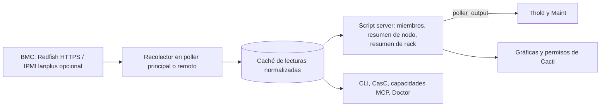

<!-- Source: README.md; SHA256: 6972a6c9ac754cd60e63c5caf971451ea8fe6e279eef757d886e1a168d3eef01 -->

<!-- translations:start -->
[English](../../../README.md) | [简体中文](../zh-CN/README.md) | [हिन्दी](../hi-IN/README.md) | [Español (España)](../es-ES/README.md) | [Español (Latinoamérica)](README.md) | [العربية (السعودية)](../ar-SA/README.md) | [Afrikaans](../af-ZA/README.md) | [አማርኛ](../am-ET/README.md) | [العربية (مصر)](../ar-EG/README.md) | [العربية (المغرب)](../ar-MA/README.md) | [বাংলা](../bn-BD/README.md) | [Bosanski](../bs-BA/README.md) | [Deutsch](../de-DE/README.md) | [فارسی](../fa-IR/README.md) | [Filipino](../fil-PH/README.md) | [Français](../fr-FR/README.md) | [Français (Maroc)](../fr-MA/README.md) | [Français (Sénégal)](../fr-SN/README.md) | [Hausa](../ha-NG/README.md) | [עברית](../he-IL/README.md) | [Hrvatski](../hr-HR/README.md) | [Bahasa Indonesia](../id-ID/README.md) | [Igbo](../ig-NG/README.md) | [Italiano](../it-IT/README.md) | [日本語](../ja-JP/README.md) | [한국어](../ko-KR/README.md) | [Malagasy](../mg-MG/README.md) | [मराठी](../mr-IN/README.md) | [Bahasa Melayu](../ms-MY/README.md) | [Nederlands](../nl-NL/README.md) | [Polski](../pl-PL/README.md) | [Português (Brasil)](../pt-BR/README.md) | [Русский](../ru-RU/README.md) | [Kinyarwanda](../rw-RW/README.md) | [Soomaali](../so-SO/README.md) | [Српски](../sr-RS/README.md) | [Svenska](../sv-SE/README.md) | [Kiswahili](../sw-KE/README.md) | [தமிழ்](../ta-IN/README.md) | [తెలుగు](../te-IN/README.md) | [ไทย](../th-TH/README.md) | [Türkçe](../tr-TR/README.md) | [Українська](../uk-UA/README.md) | [اردو](../ur-PK/README.md) | [Tiếng Việt](../vi-VN/README.md) | [isiXhosa](../xh-ZA/README.md) | [Yorùbá](../yo-NG/README.md) | [繁體中文](../zh-TW/README.md) | [isiZulu](../zu-ZA/README.md)
<!-- translations:end -->

# plugin_redfish

Un plugin de Cacti 1.2 que lleva el consumo eléctrico de servidores, la temperatura de entrada, el estado de los ventiladores y el estado de salud de las fuentes de alimentación desde controladores de administración de placa base (BMC) hacia Cacti como dispositivos, fuentes de datos y gráficas comunes, utilizando Redfish con un respaldo opcional de IPMI de solo lectura y resúmenes de potencia a nivel de rack. Thold y Maint generan alertas y las suprimen a través de las fuentes de datos estándar de Cacti.

> **Estado: en desarrollo, aún sin lanzamiento (`0.1.0-dev`).** Este plugin no está afiliado al proyecto Cacti. Se instala en Cacti 1.2.31 o posterior bajo PHP 8.2 o posterior e implementa el recolector Redfish, la bóveda cifrada de credenciales, el aprovisionamiento de dispositivos y gráficas de Cacti, el respaldo opcional de IPMI de solo lectura, el resumen de potencia de rack, la visualización de ventanas de Maint de Cacti, la replicación de recolectores de datos remotos y endpoints de agente, el proveedor CasC y la CLI de operador, las capacidades MCP y las verificaciones de diagnóstico Doctor. La CI prueba fixtures, el servidor DMTF Redfish Mockup Server (maquetas de subsistema, solo legado y HPE iLO Gen11) y Thold v1.8.2 con Maint v1.3; aún no se ha calificado ningún BMC físico real ni flota piloto. El diseño y la investigación están en [docs/PLAN.md](../../PLAN.md), [docs/research/](../../research/) y [docs/decisions/](../../decisions/).

## Capacidades implementadas

### Recolector principal, bóveda y objetos de Cacti

- **Ciclo de vida y esquema.** Se instala, actualiza, deshabilita y desinstala a través de la API de plugins de Cacti (`Schema::VERSION = 3`, 12 tablas). Las tablas se conservan al desinstalar a menos que se desmarque *Keep Plugin Tables on Uninstall*. Los puntos de entrada se analizan en PHP 8.0 y rechazan PHP inferior a 8.2 o la falta de `ext-openssl` con un mensaje de error explícito.
- **Registro y permisos.** Reinos *Redfish View* (`redfish_health.php`), *Redfish Operator* (`redfish_operator.php`) y *Redfish Admin* (`redfish_bmcs.php`, `redfish_credentials.php`), además de ajustes en **Configuration > Settings > Redfish**. El registro de BMC admite importación CSV (credenciales referenciadas por nombre; se rechazan contraseñas en archivos de importación) y exportación JSON. Los registros de BMC y las credenciales siguen los permisos de dispositivos de Cacti.
- **Bóveda cifrada de credenciales.** Las contraseñas se almacenan cifradas con AES-256-GCM en `plugin_redfish_secret`. La clave reside fuera de la base de datos (`/etc/cacti/redfish-vault.key` de manera predeterminada) como 64 caracteres hexadecimales (`openssl rand -hex 32`) o 32 bytes sin formato, propiedad del usuario del poller, ilegible por otros usuarios, en un directorio donde solo root o ese usuario pueden escribir. Se rechaza una frase de contraseña imprimible de 32 caracteres. **Respalde el archivo de clave junto con la base de datos**; sin él, las contraseñas almacenadas deberán ingresarse nuevamente.
- **TLS y cliente Redfish de solo lectura.** La verificación TLS está habilitada de forma predeterminada usando el almacén de CA del sistema, un paquete de CA por BMC o un pin SPKI SHA-256; la exclusión voluntaria sin verificar por BMC permanece visible como una advertencia de salud y una advertencia de verificación de Doctor. El cliente solo permite `GET` más inicio (`POST`) y cierre (`DELETE`) de sesión Redfish, con respaldo opcional Basic por BMC cuando las sesiones no están disponibles. El descubrimiento prioriza los nuevos recursos de subsistema y sensores de Redfish y recurre a los recursos obsoletos `Power` y `Thermal`.
- **Ejecución del recolector.** `poller_redfish.php` se inicia desde `poller_bottom`, ejecuta un proceso maestro por poller a través del registro de procesos de Cacti con procesos de trabajo configurables (`redfish_workers`), adquiere concesiones por BMC, aplica un presupuesto de tiempo (`redfish_collector_budget`), aplica retroceso exponencial y limpia la sesión previa del propio plugin después de una caída.
- **Plantillas, dispositivos y gráficas.** Importa `templates/redfish-templates.xml` por hash y copia tres archivos XML de consultas de datos del script server (`redfish_fans.xml`, `redfish_temperatures.xml`, `redfish_psus.xml`) en `<cacti>/resource/script_server/` sin sobrescribir archivos modificados por el usuario. **Create Device** y **Add Graphs** requieren confirmación de un plan de aprovisionamiento, adjuntan consultas a un dispositivo servidor mapeado o crean un dispositivo "Redfish BMC" bajo `.invalid` con verificaciones de disponibilidad deshabilitadas, y enlazan cada gráfica de Redfish de vuelta a las gráficas de Redfish del dispositivo mediante `graph_buttons`.
- **Entradas de script server solo desde caché.** `scripts/ss_redfish_members.php` entrega lecturas por miembro de ventiladores, temperaturas y PSU, y `scripts/ss_redfish_summary.php` entrega métricas de "Redfish Node Summary" (potencia, temperatura de entrada y máxima, conteos de ventiladores y PSU con falla, salud del nodo y antigüedad de la última lectura válida). Las llamadas al script server leen únicamente la caché local y nunca contactan a un BMC. Las lecturas faltantes, obsoletas o de miembros desaparecidos devuelven `U` (nunca `0`), mientras que `age` siempre reporta un valor para que los umbrales detecten BMC silenciosos.

**Cuando cambien los miembros de un BMC** (como un ventilador reemplazado o una actualización de firmware que renombre sensores), ejecute **Add Graphs** nuevamente. Un ventilador o fuente de alimentación previamente presente que pase a estar ausente cuenta en `fans_bad` o `psus_bad` hasta que sea aceptado; una ranura que nunca estuvo ocupada no cuenta. Los miembros desaparecidos mantienen sus fuentes de datos y gráficas existentes, las cuales leen `U` en adelante hasta que se eliminen manualmente. Eliminar un dispositivo de Cacti desmapea su BMC y elimina su asignación de rack manteniendo el BMC y la caché; eliminar un BMC o desinstalar el plugin conserva los dispositivos y gráficas de Cacti.

### Respaldo opcional de IPMI

- **Habilitación opcional por BMC.** Desactivado de forma predeterminada (`protocols` tiene como valor predeterminado `redfish`; habilitar el respaldo IPMI establece `redfish,ipmi`).
- **Disparador de respaldo acotado.** Se ejecuta solo cuando la recolección Redfish falla con una clase de falla elegible; nunca se dispara ante `AuthRejected`, `CredentialUnavailable`, `AddressRefused`, `OperationRefused` o `Deadline`.
- **Ejecución segura.** Invoca `ipmitool` sobre `-I lanplus` mediante `proc_open()` en forma de arreglo sin shell, con tiempo de espera acotado de reloj real y un límite de salida de 256 KiB. Las contraseñas se suministran mediante `IPMITOOL_PASSWORD` (`-E`) o un archivo temporal con modo 0600 (`-f`) eliminado en `finally`, nunca en los argumentos argv de la CLI.
- **Lista blanca de comandos de solo lectura.** Solo se permiten cinco subcomandos de solo lectura: `dcmi power reading`, `sdr type Temperature`, `sdr type Fan`, `sdr type Power Supply` y `chassis status`. Se rechazan los comandos que realizan cambios.
- **Salida normalizada y advertencia de postura.** `IpmiNormalizer` mapea las lecturas al mismo modelo `Observation`/`Member`/`Reading`, emitiendo `U` para sensores faltantes o no analizables. Habilitar el respaldo IPMI genera una advertencia en la página de salud y en la verificación Doctor `redfish.bmc_security` recordando a los operadores restringir UDP 623 a una VLAN de administración.

### Resumen de potencia de rack

- **Registro de racks.** La versión 3 del esquema agrega `plugin_redfish_rack` (`(site_id, name)` único, `power_budget_watts` opcional, `min_coverage_pct` con valor predeterminado `80` y notas) y `plugin_redfish_rack_member` (como máximo una asignación de rack por `host_id`, `bmc_id` y `unit_position` opcionales, eliminada automáticamente cuando se borra un dispositivo de Cacti).
- **Totales protegidos por cobertura.** `RackPowerSummary` suma las lecturas recientes de `power_watts` de los miembros desde la caché local y calcula la utilización del presupuesto y el margen disponible. Cuando la cobertura de miembros que reportan cae por debajo de `min_coverage_pct`, `power_watts`, `utilization_pct` y `headroom_watts` devuelven `U` para que las fallas del recolector nunca aparezcan como una caída en la potencia del rack.
- **Entrada de script server lista para Thold.** `scripts/ss_redfish_rack.php` (`ss_redfish_rack(<rack_id>)`) devuelve `power_watts`, `power_budget_watts`, `utilization_pct`, `headroom_watts`, `members_total`, `members_reporting` y `coverage_pct` únicamente desde la caché local.

### Integración con Cacti Maint

- Los umbrales de Thold sobre fuentes de datos de Redfish generan alertas y Cacti Maint las suprime sin cambios en ninguno de los dos plugins.
- `MaintWindow` verifica las programaciones activas de Maint para cada host de Cacti mapeado (programaciones únicas `mtype=1` y recurrentes `mtype=2`, además de `plugin_maint_check_cacti_host()` cuando está cargado) y marca el mantenimiento activo en la página de salud de Redfish (`[MAINT]`), en la salida de `cli/redfish.php health` y en la capacidad `redfish-get-health`.

### Recolectores de datos remotos

- `INFO` declara `remote_collect:1`. Los BMC aceptan cualquier `poller_id >= 1`, y `poller_redfish.php --poller=N` recolecta solo los BMC habilitados asignados a ese poller.
- **Hook `replicate_out`.** Replica solo tablas de configuración no secretas limitadas al poller remoto de destino mediante `replicate_out_table()`: `plugin_redfish_bmc`, metadatos de `plugin_redfish_credential` (sin texto cifrado), `plugin_redfish_rack` y `plugin_redfish_rack_member`. `plugin_redfish_secret` no se replica, y los archivos de clave de la bóveda permanecen estrictamente locales en cada poller.
- **Hook `remote_agent`.** Expone acciones de solo lectura `redfish_health` y `redfish_discovery` que aceptan únicamente parámetros numéricos `poller_id` y `bmc_id`. Los parámetros inesperados se rechazan y no se devuelve ninguna credencial ni secreto.

### Hooks del ecosistema (CasC, capacidades MCP y Doctor)

- **Proveedor CasC (`casc_register_providers`).** Registra el proveedor `redfish` (versión de esquema `1`) con exportación, análisis (rechazando XXE), validación, planificación de diferencias y aplicación en YAML y XML en PHP puro. Las credenciales aparecen solo como referencias de bóveda (`vault:redfish:<name>`); se rechazan claves de secretos en texto claro (`pass`, `secret`, `token`, `private_key`, `vault_key`, `auth_token`). Aplicar requiere un `PLAN_HASH` SHA-256 exacto.
- **API de MCP / Abilities (`abilities_register`).** Registra tres capacidades de solo lectura controladas por el reino Redfish View (`redfish_health.php`) y los permisos de dispositivos de Cacti, devolviendo cero credenciales:
  - `redfish-list-bmcs` (`poller_id` opcional)
  - `redfish-get-rack-power` (`rack_id` opcional)
  - `redfish-get-health` (`bmc_id` opcional)
- **Verificaciones de Doctor (`doctor_register_checks`).** Registra cinco verificaciones de diagnóstico locales de solo lectura que nunca contactan un BMC ni devuelven material de clave:
  - `redfish.schema`: vigencia de la versión del esquema
  - `redfish.vault_key`: legibilidad y permisos de la clave de la bóveda
  - `redfish.collector_runs`: presupuesto y vigencia de las ejecuciones del recolector del poller
  - `redfish.bmc_security`: BMC habilitados con TLS sin verificar o respaldo IPMI
  - `redfish.rack_power`: cumplimiento del presupuesto de potencia del rack y piso de cobertura

## CLI

Ejecute desde el directorio raíz de Cacti con PHP 8.2 o posterior:

```sh
# Operator and CasC CLI (reads --file=PATH or stdin for validate, plan, and apply)
php plugins/redfish/cli/redfish.php export --format=yaml|xml
php plugins/redfish/cli/redfish.php validate [--file=PATH] [--format=yaml|xml]
php plugins/redfish/cli/redfish.php plan [--file=PATH] [--format=yaml|xml]
php plugins/redfish/cli/redfish.php apply [--file=PATH] [--format=yaml|xml] --confirm=<PLAN_HASH>
php plugins/redfish/cli/redfish.php health --format=text|json

# Collector entry point (normally started by poller_bottom)
php plugins/redfish/poller_redfish.php [--poller=N] [--force] [--debug]

# Rack power summary script server entry point
php plugins/redfish/scripts/ss_redfish_rack.php <rack_id>
```

## Roles de acceso

| Reino | Acceso |
| --- | --- |
| Redfish View | Páginas de monitoreo existentes. |
| Redfish Operator | Monitoreo más la página de Operaciones y confirmaciones personales de triaje. |
| Redfish Admin | Acceso de Operador más la configuración existente y las acciones administrativas. |

Después de copiar los archivos de actualización, abra la página Plugins como administrador para registrar los reinos. Asigne el reino Operator explícitamente en **Configuration > Users** o grupos de usuarios. Las actualizaciones conservan los ID y permisos existentes de los reinos View y Admin. El acceso Admin hereda el acceso Operator, y el acceso Operator hereda el acceso View en cada solicitud; esto no agrega concesiones almacenadas a usuarios ni grupos. Los ajustes del plugin también requieren acceso Redfish Admin además del permiso Settings de Cacti.

Los permisos de dispositivos de Cacti limitan las filas y acciones disponibles para cada usuario; los objetos sin mapear requieren un administrador. Los operadores pueden liberar una retención de recolección en un BMC permitido para la siguiente ejecución programada. Las credenciales, configuración, mapeo, eliminación y otros cambios administrativos permanecen en las páginas administrativas. Las confirmaciones duran solo en la sesión actual del usuario, como máximo una hora y únicamente mientras la misma observación siga vigente. Las observaciones nuevas o modificadas las invalidan. Nunca marcan una medición fallida como saludable ni suprimen alertas.

## Por qué

Cada servidor tiene un BMC que reporta el estado eléctrico y térmico independientemente del sistema operativo, por lo que sigue respondiendo cuando el SO está caído. Los datos sirven para el seguimiento de capacidad y costos, alerta temprana ante la falla de un ventilador o fuente de alimentación y, en cómputo de alto rendimiento, decisiones de límite de potencia. El plugin no es exclusivo de HPC.

Cacti cubre hoy parte de esto:

- **Paquetes SNMP de fabricantes.** La rama 1.2.x incluye plantillas de Dell iDRAC y HPE iLO que requieren un agente SNMP y son específicas de cada fabricante; la investigación del hito 1 encontró que ninguna reporta el consumo eléctrico en watts ([docs/research/overlap.md](../../research/overlap.md)).
- **Un tipo de credencial sin recolector.** plugin_credentials define una credencial "IPMI / Redfish (BMC)" pero no lee ningún BMC.
- **Sin vista a nivel de rack.** El núcleo de Cacti no tiene un objeto rack; un dispositivo tiene un campo `location` de texto libre.

El plugin sondea los BMC fuera de banda respecto al ciclo de sondeo de Cacti en el poller principal o en recolectores de datos remotos, guarda en caché lecturas normalizadas y las expone mediante consultas de datos del script server, resúmenes de nodo y resúmenes de potencia de rack. Reutiliza las gráficas, permisos, Thold y Maint de Cacti, y no cambia el estado del BMC.

## Alcance y estado

| Fase | Alcance | Hitos | Estado |
|---|---|---|---|
| 0, investigación | Matriz de fabricantes, confirmación del comportamiento previo en BMC reales, costo de sondeo, prueba de consultas de datos | [M1](https://github.com/somethingwithproof/plugin_redfish/milestone/1) | Realizado, pendiente de capturas de firmware de BMC reales |
| 1, observación | Registro de BMC, credenciales, TLS, recolector Redfish, lecturas normalizadas, dispositivos, gráficas por índice, alertas Thold, integración Maint, página de salud | [M2](https://github.com/somethingwithproof/plugin_redfish/milestone/2), [M3](https://github.com/somethingwithproof/plugin_redfish/milestone/3), [M4](https://github.com/somethingwithproof/plugin_redfish/milestone/4) | Implementado; calificación de flota piloto de M4 pendiente |
| 2, ipmi | Respaldo IPMI (`lanplus`) de solo lectura mediante `ipmitool`, desactivado por defecto | [M5](https://github.com/somethingwithproof/plugin_redfish/milestone/5) | Implementado |
| 3, racks | Registro de racks, totales de potencia de rack con piso de cobertura, margen de presupuesto, `ss_redfish_rack.php` | [M6](https://github.com/somethingwithproof/plugin_redfish/milestone/6) | Implementado |
| 4, remoto y ecosistema | Recolectores de datos remotos (`replicate_out`, `remote_agent`), proveedor CasC y CLI, capacidades MCP, verificaciones Doctor | [M7](https://github.com/somethingwithproof/plugin_redfish/milestone/7) | Implementado |

Fuera de alcance: configurar límites de potencia o cualquier otra configuración de BMC, control de energía, actualización de firmware, acceso a consola, un motor de alertas propio del plugin e integración con el programador.

## Objetivos de compatibilidad

| Componente | Objetivo |
|---|---|
| Cacti | 1.2.31 o posterior, sin parches al núcleo |
| Base de datos | MariaDB 10.2 o MySQL 5.7 o posterior: una clave única en una columna generada garantiza un BMC por dispositivo |
| PHP | 8.2 o posterior; los puntos de entrada siguen siendo analizables en 8.0 para que un entorno no compatible reciba un rechazo en lugar de una interfaz de Cacti rota |
| Extensiones PHP | `ext-openssl` (requerida por Cacti 1.2.31); sin `ext-curl` y sin dependencias de ejecución de Composer |
| Herramientas opcionales | `ipmitool` en pollers que recolectan BMC con el respaldo IPMI habilitado |
| BMC | Dell iDRAC, HPE iLO, Lenovo XCC y OpenBMC, por rango de firmware; consulte [la matriz de fabricantes](../../research/vendor-matrix.md) |
| Redfish | Primero los nuevos recursos de subsistema y sensores, `Power` y `Thermal` obsoletos como respaldo |
| Thold, Maint | No requieren cambios (la CI ejercita Thold v1.8.2 y Maint v1.3) |

## Diseño

- [docs/PLAN.md](../../PLAN.md) es el plan completo: arquitectura, hechos previos de los que depende, modelo de medición, límites de seguridad, aritmética de rendimiento, pruebas y riesgos.
- [docs/decisions/](../../decisions/) contiene registros de decisiones de arquitectura para elecciones ya tomadas.
- [docs/REQUIREMENTS.md](../../REQUIREMENTS.md) mapea cada ID de requisito a su issue.



## Seguridad

Las credenciales de BMC controlan la administración fuera de banda de servidores. El diseño mantiene los secretos fuera de líneas de comandos, registros, exportaciones CasC, cargas útiles de agente remoto, respuestas MCP y páginas web; cifra las contraseñas almacenadas con AES-256-GCM usando un archivo de clave de bóveda local por poller; verifica TLS por defecto; ejecuta `ipmitool` desde un arreglo explícito de argumentos con subcomandos de solo lectura en lista blanca; y utiliza cuentas de BMC de solo lectura. Consulte [docs/PLAN.md](../../PLAN.md#security) y [SECURITY.md](../../../SECURITY.md).

## Guía del operador

Consulte [docs/operator-guide.md](../../operator-guide.md) para ver prerrequisitos de instalación, configuración de bóveda y TLS, registro de BMC, creación de gráficas, intervalos de alerta, respaldos y manejo de fallas. La guía no declara compatible ninguna línea de firmware de fabricante real hasta que una captura anonimizada de ese firmware pase la suite de pruebas.

## Desarrollo y pruebas

La CI ([.github/workflows/plugin-ci-workflow.yml](../../../.github/workflows/plugin-ci-workflow.yml)) valida la sintaxis de los puntos de entrada en PHP 8.0, ejecuta las suites Pest unitaria (`phpunit.xml`) y de integración de ciclo de vida (`phpunit-integration.xml`) junto con PHPStan nivel 9 en PHP 8.2 a 8.5 contra Cacti `release/1.2.31` y `1.2.x`, verifica el rechazo en PHP 8.1, ejercita de extremo a extremo el DMTF Redfish Mockup Server (maquetas de subsistema, solo legado y HPE iLO Gen11) y Thold v1.8.2 / Maint v1.3, y verifica catálogos gettext, flujos de trabajo y licenciamiento REUSE.

Verificaciones locales antes de hacer push:

```sh
sh tests/lint-workflows.sh
sh locales/build_gettext.sh --check
CACTI_PATH=/path/to/cacti phpstan analyse -c phpstan.neon --no-progress
```

Ejecute Pest con `--configuration=phpunit.xml` para pruebas unitarias y de reglas de código fuente, o `--configuration=phpunit-integration.xml` con `CACTI_PATH` y `REDFISH_TEST_DATABASE=disposable` contra una base de datos de Cacti desechable para pruebas de integración del ciclo de vida.

## Cómo se da seguimiento al trabajo

- Los **hitos** siguen los hitos del plan. Cada uno tiene un issue épico que lista sus sub-issues y evidencia de salida.
- Los **issues** se clasifican por etiqueta: `type: requirement`, `type: research`, `type: decision`, `type: epic`. Los issues de requisito establecen requisitos numerados y comprobables (`REQ-AREA-NNN`) y criterios de aceptación.
- Las **etiquetas** también llevan `area:`, `phase:`, `priority:` y `status:`. Consulte [CONTRIBUTING.md](../../../CONTRIBUTING.md#labels).
- El [tablero del proyecto](https://github.com/users/somethingwithproof/projects/12) muestra todos los issues a través de los hitos.

## Contribución

Lea [CONTRIBUTING.md](../../../CONTRIBUTING.md). Los commits requieren firma DCO (sign-off). La discusión de diseño ocurre en los issues; las decisiones abiertas llevan la etiqueta `type: decision`. La evidencia de BMC reales es la contribución más útil ahora; oculte direcciones, números de serie y credenciales antes de publicar cualquier captura.

## Licencia

GNU General Public License v2.0, la misma licencia que Cacti y sus plugins. Consulte [LICENSE](../../../LICENSE).
