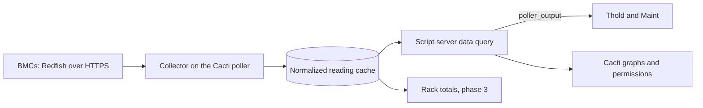

<!-- Source: README.md; SHA256: 7b4e83a58a1adc844cb0615ef30e95476cba2851f96bb454d2a816fb2774724d -->

<!-- translations:start -->
[English](../../../README.md) | [简体中文](../zh-CN/README.md) | [हिन्दी](../hi-IN/README.md) | [Español (España)](README.md) | [Español (Latinoamérica)](../es-419/README.md) | [العربية (السعودية)](../ar-SA/README.md) | [Afrikaans](../af-ZA/README.md) | [አማርኛ](../am-ET/README.md) | [العربية (مصر)](../ar-EG/README.md) | [العربية (المغرب)](../ar-MA/README.md) | [বাংলা](../bn-BD/README.md) | [Deutsch](../de-DE/README.md) | [فارسی](../fa-IR/README.md) | [Filipino](../fil-PH/README.md) | [Français](../fr-FR/README.md) | [Français (Maroc)](../fr-MA/README.md) | [Français (Sénégal)](../fr-SN/README.md) | [Hausa](../ha-NG/README.md) | [עברית](../he-IL/README.md) | [Bahasa Indonesia](../id-ID/README.md) | [Igbo](../ig-NG/README.md) | [Italiano](../it-IT/README.md) | [日本語](../ja-JP/README.md) | [한국어](../ko-KR/README.md) | [Malagasy](../mg-MG/README.md) | [मराठी](../mr-IN/README.md) | [Bahasa Melayu](../ms-MY/README.md) | [Nederlands](../nl-NL/README.md) | [Polski](../pl-PL/README.md) | [Português (Brasil)](../pt-BR/README.md) | [Русский](../ru-RU/README.md) | [Kinyarwanda](../rw-RW/README.md) | [Soomaali](../so-SO/README.md) | [Svenska](../sv-SE/README.md) | [Kiswahili](../sw-KE/README.md) | [தமிழ்](../ta-IN/README.md) | [తెలుగు](../te-IN/README.md) | [ไทย](../th-TH/README.md) | [Türkçe](../tr-TR/README.md) | [Українська](../uk-UA/README.md) | [اردو](../ur-PK/README.md) | [Tiếng Việt](../vi-VN/README.md) | [isiXhosa](../xh-ZA/README.md) | [Yorùbá](../yo-NG/README.md) | [繁體中文](../zh-TW/README.md) | [isiZulu](../zu-ZA/README.md)
<!-- translations:end -->

# plugin_redfish

Un complemento para Cacti 1.2 que incorpora el consumo eléctrico, la temperatura de entrada, el estado de los ventiladores y la salud de las fuentes de alimentación de los controladores de gestión de placa base (BMC) como dispositivos, fuentes de datos y gráficos normales de Cacti, mediante Redfish y con una alternativa IPMI opcional prevista. Thold y Maint permiten alertar y suprimir notificaciones; una fase posterior añadirá totales de potencia por rack.

> **Estado: en desarrollo, aún sin versión publicada (0.1.0-dev).** Los hitos 2 (base) y 3 (objetos Cacti y alertas) están integrados en `main`. Este complemento no está afiliado al proyecto Cacti. Se instala en Cacti 1.2.31 con PHP 8.2 o posterior, registra BMC y credenciales, lee por Redfish la potencia, temperaturas, ventiladores y salud de las fuentes en su propia caché, y muestra el estado de la recopilación. Añade dispositivos Cacti, gráficos por miembro y de resumen, y compatibilidad con Thold y Maint mediante fuentes de datos normales. CI ha probado un BMC simulado con datos escritos a mano y el servidor de simulación Redfish de DMTF; no se ha validado ningún BMC real ni despliegue piloto. El diseño y la investigación están en [docs/PLAN.md](../../PLAN.md), [docs/research/](../../research) y [docs/decisions/](../../decisions).

### Qué incluye el hito 2

- Instalación, actualización, desactivación y desinstalación mediante la API de complementos de Cacti. Las tablas se conservan al desinstalar salvo que se desmarque la opción. En PHP anterior a 8.2 el complemento rechaza instalarse o activarse e indica el motivo.
- Permisos «Redfish View» (página de estado), «Redfish Operator» (operaciones) y «Redfish Admin» (BMC y credenciales), y ajustes en Configuration > Settings > Redfish.
- Registro de BMC con importación CSV y exportación JSON. Los archivos de importación no deben contener contraseñas; las credenciales se referencian por nombre.
- Credenciales cifradas con AES-256-GCM. La clave reside en un archivo fuera de la base de datos, por defecto `/etc/cacti/redfish-vault.key`, con 64 caracteres hexadecimales (`openssl rand -hex 32`) o exactamente 32 bytes aleatorios. Debe pertenecer al usuario del sondeador, no ser legible por otros usuarios y estar en un directorio donde solo ese usuario o root puedan escribir. Una clave de 32 caracteres imprimibles se rechaza por considerarse una frase de contraseña. **Respalde el archivo de clave junto con la base de datos**; sin él deberá volver a introducir todas las contraseñas.
- Verificación TLS activada por defecto, con un paquete de certificados CA o una huella SPKI SHA-256 por BMC. La desactivación por BMC se registra y permanece como advertencia en la página de estado.
- Cliente Redfish de solo lectura: únicamente `GET`, inicio y cierre de sesión, comprobados contra una lista de operaciones permitidas antes de enviar cada solicitud.
- Recopilador iniciado desde `poller_bottom` para los BMC del sondeador principal, con arrendamientos y plazos por BMC, espera progresiva y limpieza tras un fallo de la única sesión registrada por el complemento. Aún no se admiten recopiladores remotos; requieren decidir expresamente cómo accederán a la base de datos y la clave (fase 4).
- Los registros y credenciales respetan los permisos de dispositivos Cacti: un Redfish Admin solo ve, modifica y vincula BMC de dispositivos visibles, y solo credenciales que ningún BMC de un dispositivo oculto utilice.

### Qué añade el hito 3

- Plantillas XML de Cacti en `templates/`, importadas con el importador de Cacti durante la instalación y actualización, identificadas por hash para actualizar los objetos sin duplicarlos. Los tres archivos de consulta se copian a `<cacti>/resource/script_server/` y se registra su hash; nunca se sustituye allí un archivo que el complemento no haya escrito. La página de estado avisa cuando faltan plantillas o archivos de consulta. **Reinstall the Redfish Templates**, en la página BMC, vuelve a importarlos y requiere el permiso Import Templates de Cacti.
- **Create Device** o **Add Graphs** en cada BMC ([ADR 0015](../../decisions/0015-attach-to-the-server-device-or-create-one-per-bmc.md)). Un BMC asignado a un dispositivo existente añade allí sus consultas y gráficos. Un BMC sin asignar obtiene un dispositivo de la plantilla «Redfish BMC», con comprobaciones de disponibilidad desactivadas y un nombre bajo `.invalid`, para que Cacti nunca contacte con el BMC ni muestre su dirección. En ambos casos, un administrador confirma antes un plan de elementos que se añadirán. Se requieren Redfish Admin y el permiso de gestión de dispositivos; si el creador no puede ver el dispositivo nuevo, se elimina de nuevo.
- Tres consultas del servidor de scripts: «Redfish Fans», «Redfish Temperatures» y «Redfish Power Supplies», indexadas por la clave de miembro del BMC y con un gráfico por miembro: velocidad de ventilador en porcentaje o RPM, según la unidad notificada; temperatura; y vatios de entrada y salida de las fuentes, junto con sus códigos de salud.
- Entrada «Redfish Node Summary» con potencia, temperatura de entrada, temperatura máxima, ventiladores y fuentes en estado incorrecto, salud del nodo y antigüedad de la última lectura correcta. Se representa en cuatro gráficos: potencia, temperaturas, salud de componentes y antigüedad de datos. Thold alerta sobre estas fuentes y Maint suprime notificaciones sin modificar ninguno de los dos complementos.
- El servidor de scripts responde exclusivamente desde la caché y nunca contacta con un BMC. Un valor ausente, obsoleto, con otra unidad o perteneciente a un miembro desaparecido es `U`: el gráfico muestra un hueco, nunca cero. `age` siempre tiene valor, de modo que un umbral detecta un BMC que deja de responder.
- Enlace desde cada gráfico Redfish a los gráficos Redfish de su dispositivo, visible solo para los usuarios a quienes Cacti permite ver el dispositivo.

**Cuando cambien los miembros de un BMC** (sustitución de un ventilador o firmware que renombra sensores), seleccione de nuevo **Add Graphs**. Un ventilador o fuente antes presente que ahora falta cuenta en `fans_bad` o `psus_bad` hasta hacerlo, de modo que retirar un ventilador provoca una alerta; una ranura nunca ocupada no cuenta. Add Graphs acepta los miembros notificados actualmente y Cacti reindexa las consultas. Un miembro desaparecido conserva su fuente y gráfico, que desde entonces leen `U`, y los miembros nuevos reciben gráficos. Elimine manualmente los gráficos obsoletos solo cuando ya no necesite su historial.

Eliminar un dispositivo desasigna su BMC y conserva el BMC y su caché. Eliminar un BMC o desinstalar el complemento conserva el dispositivo y los gráficos.

## Roles de acceso

| Permiso | Acceso |
| --- | --- |
| Redfish View | Páginas de supervisión existentes. |
| Redfish Operator | Supervisión, página de operaciones y acuses personales de investigación. |
| Redfish Admin | Acceso de operador más configuración y acciones administrativas existentes. |

Después de copiar los archivos de actualización, abra Plugins como administrador para registrar el nuevo permiso. Asigne expresamente Operator en **Configuration > Users** o en los grupos. Las actualizaciones conservan los identificadores y concesiones existentes de View y Admin. En cada solicitud, Admin hereda Operator y Operator hereda View; no se añaden concesiones persistentes a usuarios o grupos. Los ajustes del complemento requieren Redfish Admin además del permiso Settings de Cacti.

Los permisos de dispositivos Cacti siguen limitando las filas y acciones disponibles para cada usuario; los objetos sin asignar requieren un administrador. Los operadores pueden liberar una retención de recopilación de un BMC permitido para la siguiente ejecución programada. Las credenciales, configuración, asignación, eliminación y demás cambios administrativos permanecen en las páginas de administración. Los acuses solo duran en la sesión actual, como máximo una hora y mientras la misma observación siga vigente. Las observaciones nuevas o modificadas los invalidan. Nunca convierten una medición fallida en saludable ni suprimen alertas.

## Motivo

Cada servidor tiene un BMC que informa de potencia y estado térmico con independencia del sistema operativo, por lo que sigue respondiendo cuando este falla. Los datos permiten seguir capacidad y costes, detectar pronto fallos de ventiladores o fuentes y, en computación de alto rendimiento, decidir límites de potencia. El complemento no es exclusivo de HPC.

Cacti ya cubre parte de estas necesidades:

- **Paquetes SNMP de fabricantes.** La rama 1.2.x incluye plantillas Dell iDRAC y HPE iLO que requieren un agente SNMP y son específicas del fabricante. La investigación del hito 1 encontró que ninguna informa del consumo en vatios ([docs/research/overlap.md](../../research/overlap.md)).
- **Un tipo de credencial sin recopilador.** plugin_credentials define una credencial «IPMI / Redfish (BMC)», pero no lee ningún BMC.
- **Sin vista por rack.** El núcleo de Cacti no tiene un objeto rack; los dispositivos tienen un campo libre `location`.

El complemento sondea los BMC fuera del ciclo de sondeo de Cacti, guarda lecturas normalizadas y las expone mediante consultas del servidor de scripts y fuentes de resumen. Reutiliza gráficos, permisos, Thold y Maint de Cacti, sin cambiar el estado de los BMC. La compatibilidad con recopiladores remotos está prevista para la fase 4; actualmente la recopilación se ejecuta solo en el sondeador principal.

## Alcance previsto

| Fase | Alcance | Hitos |
|---|---|---|
| 0, investigación | Matriz de fabricantes, confirmación del comportamiento upstream en BMC reales, coste del sondeo y prueba de consulta de datos | [M1](https://github.com/somethingwithproof/plugin_redfish/milestone/1) |
| 1, observación | Registro BMC, credenciales, TLS, recopilador Redfish, lecturas normalizadas, dispositivos, gráficos por índice, alertas Thold, supresión Maint y página de estado | [M2](https://github.com/somethingwithproof/plugin_redfish/milestone/2), [M3](https://github.com/somethingwithproof/plugin_redfish/milestone/3), [M4](https://github.com/somethingwithproof/plugin_redfish/milestone/4) |
| 2, IPMI | Alternativa IPMI para BMC sin Redfish utilizable, desactivada por defecto | [M5](https://github.com/somethingwithproof/plugin_redfish/milestone/5) |
| 3, racks | Registro de racks, totales de potencia con cobertura y margen presupuestado | [M6](https://github.com/somethingwithproof/plugin_redfish/milestone/6) |
| 4, remoto | Recopiladores remotos Cacti para redes BMC aisladas | [M7](https://github.com/somethingwithproof/plugin_redfish/milestone/7) |

Fuera de alcance: fijar límites de potencia u otra configuración BMC, control de encendido, actualización de firmware, acceso a consola, motor propio de alertas e integración con planificadores.

## Objetivos de compatibilidad

| Componente | Objetivo |
|---|---|
| Cacti | 1.2.31 o posterior, sin parches del núcleo |
| Base de datos | MariaDB 10.2 o MySQL 5.7 o posterior: una clave única sobre una columna generada garantiza un BMC por dispositivo |
| PHP | 8.2 o posterior; `setup.php` sigue siendo interpretable en 8.0 para rechazar una versión no compatible sin romper la interfaz |
| BMC | Dell iDRAC, HPE iLO, Lenovo XCC y OpenBMC, por intervalo de firmware; consulte la [matriz de fabricantes](../../research/vendor-matrix.md) |
| Redfish | Primero los recursos nuevos de subsistemas y sensores; `Power` y `Thermal`, obsoletos, como alternativa |
| Thold, Maint | Sin cambios necesarios |

## Diseño

- [docs/PLAN.md](../../PLAN.md) contiene el plan completo: arquitectura, hechos upstream de los que depende, fuentes y supuestos pendientes, modelo de medición, límites de seguridad, cálculos de rendimiento, pruebas y riesgos.
- [docs/decisions/](../../decisions) contiene los registros de decisiones de arquitectura ya tomadas.
- [docs/REQUIREMENTS.md](../../REQUIREMENTS.md) relaciona cada identificador de requisito con su incidencia.

## Seguridad

Las credenciales BMC controlan la gestión fuera de banda de los servidores. El diseño las mantiene fuera de comandos, registros y páginas, verifica TLS por defecto, ejecuta comandos externos mediante matrices de argumentos con subcomandos permitidos y usa cuentas BMC de solo lectura. Consulte [docs/PLAN.md](../../PLAN.md#security) y [SECURITY.md](../../../SECURITY.md).

## Guía del operador

Consulte [docs/operator-guide.md](docs/operator-guide.md) para requisitos de instalación, bóveda y TLS, registro BMC, gráficos, intervalos de alerta, copias de seguridad y fallos. La guía no declara compatible una línea real de firmware hasta que una captura anonimizada de esa versión supera la batería de pruebas.

## Seguimiento del trabajo

- Los **hitos** siguen el plan. Cada uno tiene una incidencia principal con subincidencias y pruebas de cumplimiento.
- Las **incidencias** se clasifican con `type: requirement`, `type: research`, `type: decision` y `type: epic`. Las de requisitos incluyen requisitos numerados y comprobables (`REQ-AREA-NNN`) y criterios de aceptación.
- Las **etiquetas** también incluyen `area:`, `phase:`, `priority:` y `status:`. Consulte [CONTRIBUTING.md](../../../CONTRIBUTING.md#labels).
- El [tablero del proyecto](https://github.com/users/somethingwithproof/projects/12) muestra todas las incidencias de los hitos.

## Contribuciones

Lea [CONTRIBUTING.md](../../../CONTRIBUTING.md). Los commits necesitan firma DCO. El diseño se debate en incidencias y las decisiones abiertas llevan `type: decision`. Las pruebas de BMC reales son ahora la contribución más útil; oculte direcciones, números de serie y credenciales antes de publicar capturas.

## Licencia

Licencia Pública General GNU v2.0, la misma que Cacti y sus complementos. Consulte [LICENSE](../../../LICENSE).
