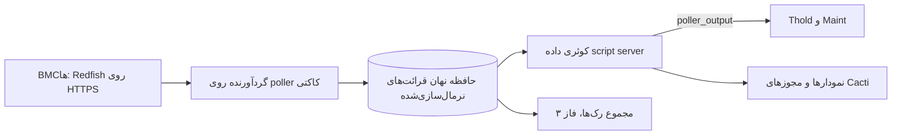

<!-- Source: README.md; SHA256: 7b4e83a58a1adc844cb0615ef30e95476cba2851f96bb454d2a816fb2774724d -->

<!-- translations:start -->
[English](../../../README.md) | [简体中文](../zh-CN/README.md) | [हिन्दी](../hi-IN/README.md) | [Español (España)](../es-ES/README.md) | [Español (Latinoamérica)](../es-419/README.md) | [العربية (السعودية)](../ar-SA/README.md) | [Afrikaans](../af-ZA/README.md) | [አማርኛ](../am-ET/README.md) | [العربية (مصر)](../ar-EG/README.md) | [العربية (المغرب)](../ar-MA/README.md) | [বাংলা](../bn-BD/README.md) | [Bosanski](../bs-BA/README.md) | [Deutsch](../de-DE/README.md) | [فارسی](README.md) | [Filipino](../fil-PH/README.md) | [Français](../fr-FR/README.md) | [Français (Maroc)](../fr-MA/README.md) | [Français (Sénégal)](../fr-SN/README.md) | [Hausa](../ha-NG/README.md) | [עברית](../he-IL/README.md) | [Hrvatski](../hr-HR/README.md) | [Bahasa Indonesia](../id-ID/README.md) | [Igbo](../ig-NG/README.md) | [Italiano](../it-IT/README.md) | [日本語](../ja-JP/README.md) | [한국어](../ko-KR/README.md) | [Malagasy](../mg-MG/README.md) | [मराठी](../mr-IN/README.md) | [Bahasa Melayu](../ms-MY/README.md) | [Nederlands](../nl-NL/README.md) | [Polski](../pl-PL/README.md) | [Português (Brasil)](../pt-BR/README.md) | [Русский](../ru-RU/README.md) | [Kinyarwanda](../rw-RW/README.md) | [Soomaali](../so-SO/README.md) | [Српски](../sr-RS/README.md) | [Svenska](../sv-SE/README.md) | [Kiswahili](../sw-KE/README.md) | [தமிழ்](../ta-IN/README.md) | [తెలుగు](../te-IN/README.md) | [ไทย](../th-TH/README.md) | [Türkçe](../tr-TR/README.md) | [Українська](../uk-UA/README.md) | [اردو](../ur-PK/README.md) | [Tiếng Việt](../vi-VN/README.md) | [isiXhosa](../xh-ZA/README.md) | [Yorùbá](../yo-NG/README.md) | [繁體中文](../zh-TW/README.md) | [isiZulu](../zu-ZA/README.md)
<!-- translations:end -->

# plugin_redfish

یک افزونه برای Cacti 1.2 که توان مصرفی سرور، دمای ورودی، وضعیت فن‌ها و سلامت منابع تغذیه را از کنترلرهای مدیریت برد اصلی (BMCها) به صورت دستگاه‌ها، منابع داده و نمودارهای عادی با استفاده از Redfish و با قابلیت پشتیبان اختیاری IPMI وارد Cacti می‌کند. سپس Thold و Maint روی آن‌ها هشدار می‌دهند و سرکوب هشدار انجام می‌دهند، و در فازی بعدی مجموع توان در سطح رک نیز اضافه می‌شود.

> **وضعیت: در حال توسعه، هنوز نسخه‌ای منتشر نشده است (0.1.0-dev).** نقاط عطف ۲ (زیرساخت پایه) و ۳ (اشیای Cacti و هشداردهی) در شاخه `main` ادغام شده‌اند. این افزونه به پروژه Cacti وابسته نیست. این افزونه روی Cacti 1.2.31 تحت PHP 8.2 یا جدیدتر نصب می‌شود، BMCها و اطلاعات احراز هویت را ثبت می‌کند، توان، دماها، فن‌ها و سلامت منبع تغذیه را از هر BMC از طریق Redfish به حافظه نهان اختصاصی خود می‌خواند و سلامت جمع‌آوری داده را نمایش می‌دهد. همچنین دستگاه‌های Cacti، نمودارهای به ازای هر عضو و نمودارهای خلاصه، و پشتیبانی از Thold و Maint را از طریق منابع داده عادی اضافه می‌کند. در CI یک BMC شبیه‌سازی‌شده ساخته‌شده از داده‌های آزمایشی دست‌نویس و سرور نمونه DMTF Redfish آزمایش شده است؛ هنوز هیچ BMC واقعی یا ناوگان پایلوتی ارزیابی نهایی نشده است. طراحی و پژوهش‌ها در [docs/PLAN.md](../../PLAN.md)، [docs/research/](../../research) و [docs/decisions/](../../decisions) قرار دارند.

### آنچه نقطه عطف ۲ ارائه می‌دهد

- نصب، ارتقا، غیرفعال‌سازی و حذف از طریق API افزونه Cacti، با حفظ جداول هنگام حذف مگر اینکه تنظیم مربوطه پاک شود. در PHP قدیمی‌تر از 8.2، افزونه از نصب یا فعال‌سازی خودداری کرده و علت را اعلام می‌کند.
- قلمروهای دسترسی (Realms) شامل «Redfish View» (صفحه سلامت)، «Redfish Operator» (صفحه عملیات) و «Redfish Admin» (صفحات BMCها و اطلاعات احراز هویت)، و تنظیمات در مسیر Configuration > Settings > Redfish.
- رجیستری BMC با قابلیت درون‌ریزی CSV و برون‌ریزی JSON. فایل‌های درون‌ریزی نباید حاوی رمز عبور باشند؛ اطلاعات احراز هویت با نام ارجاع داده می‌شوند.
- ذخیره اطلاعات احراز هویت به صورت رمزنگاری‌شده با AES-256-GCM. کلید در فایلی خارج از پایگاه داده و به صورت پیش‌فرض در `/etc/cacti/redfish-vault.key` نگهداری می‌شود که شامل ۶۴ نویسه هگزادسیمال (`openssl rand -hex 32`) یا دقیقاً ۳۲ بایت تصادفی است، مالکیت آن با کاربر poller است، برای سایر کاربران قابل خواندن نیست و در دایرکتوری‌ای قرار دارد که فقط کاربر poller یا root امکان نوشتن در آن را دارند. کلیدی متشکل از ۳۲ نویسه قابل چاپ به عنوان عبارت عبور رد می‌شود. **از فایل کلید همراه با پایگاه داده نسخه پشتیبان تهیه کنید**؛ بدون آن، تمام رمزهای عبور ذخیره‌شده باید دوباره وارد شوند.
- تایید هویت TLS به صورت پیش‌فرض فعال است، همراه با بسته CA یا پین SPKI SHA-256 برای هر BMC. غیرفعال کردن اختیاری و ثبت‌شده تایید هویت برای هر BMC، به عنوان هشدار در صفحه سلامت باقی می‌ماند.
- کلاینت Redfish فقط‌خواندنی: فقط `GET` به علاوه ورود و خروج نشست، که پیش از ارسال هر درخواست در برابر فهرست مجاز بررسی می‌شود.
- گردآورنده‌ای که از `poller_bottom` برای BMCهای روی poller اصلی آغاز می‌شود، همراه با اجاره‌ها (leases) و مهلت‌های زمانی به ازای هر BMC، عقب‌نشینی نمایی (backoff)، و پاک‌سازی تنها نشستی که افزونه ثبت کرده پس از بروز خرابی. گردآورنده‌های راه دور هنوز پشتیبانی نمی‌شوند؛ آن‌ها نیازمند انتخاب صریح نحوه دسترسی گردآورنده به پایگاه داده و کلید هستند (فاز ۴).
- رکوردهای BMC و اطلاعات احراز هویت از مجوزهای دستگاه Cacti پیروی می‌کنند: یک Redfish Admin تنها BMCهایی را روی دستگاه‌هایی می‌بیند، تغییر می‌دهد و متصل می‌کند که اجازه دیدن آن‌ها را دارد، و تنها اطلاعات احراز هویتی را می‌بیند که هیچ BMCای روی دستگاه‌های پنهان از آن استفاده نکند.

### آنچه نقطه عطف ۳ اضافه می‌کند

- الگوهایی که به صورت XML الگوی Cacti در `templates/` عرضه شده و هنگام نصب و ارتقا با درون‌ریز خود Cacti و با تطبیق هش درون‌ریزی می‌شوند؛ بنابراین درون‌ریزی اشیای افزونه را به‌روزرسانی کرده و چیزی را دوبار اضافه نمی‌کند. سه فایل کوئری داده با هش ثبت‌شده در `<cacti>/resource/script_server/` کپی می‌شوند؛ افزونه هرگز فایلی را در آنجا که خودش ننوشته جایگزین نمی‌کند، و صفحه سلامت در صورت نبودن الگوها یا فایل کوئری به مدیران هشدار می‌دهد. گزینه **Reinstall the Redfish Templates** در صفحه BMCها آن‌ها را دوباره درون‌ریزی می‌کند؛ این کار نیازمند مجوز Import Templates در Cacti است.
- **Create Device** یا **Add Graphs** برای هر BMC ([ADR 0015](../../decisions/0015-attach-to-the-server-device-or-create-one-per-bmc.md)). یک BMC نگاشت‌شده به دستگاه موجود سرور، کوئری‌های داده و نمودارهای خود را روی همان دستگاه دریافت می‌کند. یک BMC نگاشت‌نشده یک دستگاه جدید از الگوی دستگاه «Redfish BMC» می‌گیرد، با بررسی‌های در دسترس بودن خاموش و نام میزبان زیر دامنه `.invalid`، تا Cacti هرگز با BMC تماس نگیرد و نشانی آن را نمایش ندهد. در هر دو حالت، مدیر ابتدا طرحی شامل مواردی که اضافه خواهد شد را تایید می‌کند. هر دو مورد نیازمند مجوز مدیریت دستگاه Cacti و همچنین Redfish Admin هستند؛ دستگاه جدیدی که ایجادکننده نتواند آن را ببیند دوباره حذف می‌شود.
- سه کوئری داده script server با نام‌های «Redfish Fans»، «Redfish Temperatures» و «Redfish Power Supplies» که با کلید عضو BMC نمایه‌سازی شده‌اند، همراه با یک نمودار به ازای هر عضو: سرعت فن بر حسب درصد یا RPM (هر واحدی که BMC گزارش دهد)، دما، و توان ورودی و خروجی منبع تغذیه، هر کدام همراه با کد سلامت خود.
- ورودی «Redfish Node Summary» شامل توان، دمای ورودی، بالاترین دما، فن‌ها و منابع تغذیه غیرسالم (not OK)، سلامت گره، و عمر آخرین قرائت موفق، که در چهار نمودار رسم می‌شوند: توان، دماها، سلامت اجزا و عمر داده. آستانه‌های Thold روی این منابع داده هشدار می‌دهند و Maint آن‌ها را سرکوب می‌کند، بدون نیاز به هیچ تغییری در هیچ‌یک از دو افزونه.
- script server فقط از حافظه نهان افزونه پاسخ می‌دهد و هرگز با BMC تماس نمی‌گیرد. مقداری که موجود نباشد، منقضی باشد، واحد دیگری داشته باشد، یا متعلق به عضوی باشد که حذف شده، برابر `U` برگردانده می‌شود تا نمودارها به جای صفر، شکاف نشان دهند؛ `age` همیشه دارای مقدار است، بنابراین آستانه روی آن متوجه BMCای می‌شود که پاسخ‌گویی را متوقف کرده است.
- پیوندی در نمودار از هر نمودار Redfish به نمودارهای Redfish دستگاه، که فقط به کاربرانی نمایش داده می‌شود که Cacti اجازه دیدن دستگاه را به آن‌ها بدهد.

**هنگامی که اعضای یک BMC تغییر می‌کنند** (تعویض فن، به‌روزرسانی میان‌افزار که نام حسگرها را تغییر دهد)، دوباره **Add Graphs** را انتخاب کنید. فن یا منبع تغذیه‌ای که قبلاً وجود داشته و اکنون غایب یا حذف شده است، تا زمانی که این کار را انجام ندهید در `fans_bad` یا `psus_bad` شمارش می‌شود، بنابراین بیرون کشیدن یک فن هشدار ایجاد می‌کند؛ اما اسلاتی که هرگز پر نبوده شمارش نمی‌شود. Add Graphs اعضایی را که BMC اکنون گزارش می‌دهد می‌پذیرد و Cacti کوئری‌ها را دوباره نمایه‌سازی می‌کند؛ عضوی که از بین رفته منبع داده و نمودار خود را نگه می‌دارد که از آن پس `U` می‌خوانند، و عضو جدید یک نمودار می‌گیرد. نمودارهای اعضای حذف‌شده را پس از اینکه دیگر به تاریخچه آن‌ها نیازی نبود، به صورت دستی حذف کنید.

حذف یک دستگاه، نگاشت BMC آن را برمی‌دارد و خود BMC و حافظه نهان آن را نگه می‌دارد. حذف یک BMC یا حذف نصب افزونه، دستگاه و نمودارهای آن را حفظ می‌کند.

## نقش‌های دسترسی

| قلمرو (Realm) | دسترسی |
| --- | --- |
| Redfish View | صفحات پایش موجود. |
| Redfish Operator | پایش به علاوه صفحه عملیات (Operations) و تاییدیه‌های تریاژ شخصی. |
| Redfish Admin | دسترسی Operator به علاوه پیکربندی موجود و اقدامات مدیریتی. |

پس از کپی کردن فایل‌های ارتقا، به عنوان مدیر صفحه Plugins را باز کنید تا قلمرو جدید ثبت شود. قلمرو Operator را به صراحت در **Configuration > Users** یا گروه‌های کاربری تخصیص دهید.
ارتقاها شناسه‌ها و مجوزهای موجود قلمروهای View و Admin را حفظ می‌کنند. دسترسی Admin در هر درخواست دسترسی Operator را به ارث می‌برد، و دسترسی Operator دسترسی View را به ارث می‌برد؛ این امر مجوز ذخیره‌شده‌ای به کاربران یا گروه‌ها اضافه نمی‌کند. تنظیمات افزونه علاوه بر مجوز Settings در Cacti، به دسترسی Redfish Admin نیز نیاز دارد.

مجوزهای دستگاه Cacti همچنان سطرها و اقدامات در دسترس هر کاربر را محدود می‌کنند؛ اشیای نگاشت‌نشده نیازمند مدیر هستند. اپراتورها می‌توانند تعلیق جمع‌آوری (collection hold) روی یک BMC مجاز را برای اجرای زمان‌بندی‌شده بعدی آزاد کنند.
اطلاعات احراز هویت، پیکربندی، نگاشت، حذف و سایر تغییرات مدیریتی همچنان در صفحات مدیریتی باقی می‌مانند. تاییدیه‌ها فقط در نشست فعلی کاربر، حداکثر به مدت یک ساعت و تنها تا زمانی که همان مشاهده تازه باقی بماند دوام دارند. مشاهدات جدید یا تغییریافته آن‌ها را نامعتبر می‌کنند. آن‌ها هرگز یک اندازه‌گیری ناموفق را سالم علامت‌گذاری نمی‌کنند و هشدارها را سرکوب نمی‌کنند.

## چرا

هر سرور یک BMC دارد که وضعیت توان و دما را مستقل از سیستم‌عامل گزارش می‌دهد، بنابراین وقتی سیستم‌عامل از کار بیفتد هم به پاسخ‌گویی ادامه می‌دهد. این داده‌ها برای پایش ظرفیت و هزینه، هشدار زودهنگام خرابی فن یا منبع تغذیه، و در محاسبات با کارایی بالا (HPC)، برای تصمیم‌گیری‌های محدودسازی توان (power-capping) به کار می‌روند. این افزونه مختص HPC نیست.

امروزه Cacti بخشی از این نیاز را پوشش می‌دهد:

- **بسته‌های SNMP فروشندگان.** شاخه 1.2.x الگوهای Dell iDRAC و HPE iLO را ارائه می‌دهد که به عامل SNMP نیاز دارند و وابسته به فروشنده هستند؛ پژوهش نقطه عطف ۱ نشان داد که هیچ‌یک توان مصرفی بر حسب وات را گزارش نمی‌دهند ([docs/research/overlap.md](../../research/overlap.md)).
- **یک نوع اطلاعات احراز هویت بدون گردآورنده.** plugin_credentials یک نوع اطلاعات احراز هویت «IPMI / Redfish (BMC)» تعریف می‌کند اما هیچ BMCای را نمی‌خواند.
- **نبود نمای سطح رک.** هسته Cacti شیء رک ندارد؛ هر دستگاه تنها یک فیلد متنی آزاد `location` دارد.

این افزونه BMCها را خارج از باند از چرخه poll کاکتی استعلام می‌کند، قرائت‌های نرمال‌سازی‌شده را در حافظه نهان ذخیره می‌کند و آن‌ها را از طریق کوئری داده script server و منابع داده خلاصه در دسترس قرار می‌دهد. این افزونه از نمودارکشی، مجوزها، Thold و Maint در Cacti استفاده مجدد می‌کند و وضعیت BMC را تغییر نمی‌دهد. پشتیبانی از گردآورنده داده راه دور برای فاز ۴ برنامه‌ریزی شده است؛ جمع‌آوری فعلی فقط روی poller اصلی اجرا می‌شود.

## محدوده برنامه‌ریزی‌شده

| فاز | محدوده | نقاط عطف |
|---|---|---|
| 0، پژوهش | ماتریس فروشندگان، تایید رفتار بالادستی روی BMCهای زنده، هزینه استعلام، آزمایش اولیه کوئری داده | [M1](https://github.com/somethingwithproof/plugin_redfish/milestone/1) |
| 1، مشاهده | رجیستری BMC، اطلاعات احراز هویت، TLS، گردآورنده Redfish، قرائت‌های نرمال‌سازی‌شده، دستگاه‌ها، نمودارهای به ازای نمایه، هشداردهی Thold، سرکوب Maint، صفحه سلامت | [M2](https://github.com/somethingwithproof/plugin_redfish/milestone/2)، [M3](https://github.com/somethingwithproof/plugin_redfish/milestone/3)، [M4](https://github.com/somethingwithproof/plugin_redfish/milestone/4) |
| 2، ipmi | پشتیبان IPMI برای BMCهای فاقد Redfish قابل استفاده، خاموش به صورت پیش‌فرض | [M5](https://github.com/somethingwithproof/plugin_redfish/milestone/5) |
| 3، رک‌ها | رجیستری رک، مجموع توان رک با میزان پوشش، فضای باقی‌مانده بودجه توان | [M6](https://github.com/somethingwithproof/plugin_redfish/milestone/6) |
| 4، راه دور | گردآورنده‌های داده راه دور Cacti برای شبکه‌های ایزوله BMC | [M7](https://github.com/somethingwithproof/plugin_redfish/milestone/7) |

خارج از محدوده: تنظیم سقف توان یا هر پیکربندی دیگری در BMC، کنترل تغذیه، به‌روزرسانی میان‌افزار، دسترسی کنسول، موتور هشداردهی اختصاصی افزونه، و یکپارچه‌سازی با زمان‌بند (scheduler).

## اهداف سازگاری

| جزء | هدف |
|---|---|
| Cacti | 1.2.31 یا جدیدتر، بدون وصله هسته |
| پایگاه داده | MariaDB 10.2 یا MySQL 5.7 یا جدیدتر: وجود یک BMC به ازای هر دستگاه با یک کلید یکتا روی ستون تولیدشده (generated column) تضمین می‌شود |
| PHP | 8.2 یا جدیدتر؛ `setup.php` روی 8.0 قابل تجزیه باقی می‌ماند تا محیط اجرای پشتیبانی‌نشده به جای خراب کردن رابط کاربری Cacti، پیغام امتناع دریافت کند |
| BMCها | Dell iDRAC، HPE iLO، Lenovo XCC و OpenBMC، بر اساس محدوده نسخه میان‌افزار؛ ببینید: [ماتریس فروشندگان](../../research/vendor-matrix.md) |
| Redfish | ابتدا منابع جدید زیرسیستم و حسگر، و منابع منسوخ‌شده `Power` و `Thermal` به عنوان پشتیبان |
| Thold، Maint | بدون نیاز به تغییر |

## طراحی

- [docs/PLAN.md](../../PLAN.md) طرح کامل است: معماری، حقایق بالادستی که به آن‌ها متکی است (همراه با منابع و فرضیاتی که هنوز باید تایید شوند)، مدل اندازه‌گیری، مرزهای امنیتی، محاسبات کارایی، آزمایش و ریسک‌ها.
- [docs/decisions/](../../decisions) شامل سوابق تصمیمات معماری (ADR) برای انتخاب‌های انجام‌شده است.
- [docs/REQUIREMENTS.md](../../REQUIREMENTS.md) هر شناسه نیازمندی را به issue مربوط به آن نگاشت می‌کند.

## امنیت

اطلاعات احراز هویت BMC مدیریت خارج از باند سرورها را کنترل می‌کنند. طراحی این اطلاعات را از خطوط فرمان، لاگ‌ها و صفحات دور نگه می‌دارد، TLS را به صورت پیش‌فرض تایید می‌کند، هر دستور خارجی را از طریق آرایه آرگومان با زیرفرمان‌های مجاز اجرا می‌کند و از حساب‌های BMC فقط‌خواندنی استفاده می‌کند. ببینید: [docs/PLAN.md](../../PLAN.md#security) و [SECURITY.md](../../../SECURITY.md).

## راهنمای اپراتور

برای پیش‌نیازهای نصب، راه‌اندازی خزانه کلید (vault) و TLS، ثبت BMC، ایجاد نمودار، بازه‌های هشدار، پشتیبان‌گیری و مدیریت خطا، [docs/operator-guide.md](../../operator-guide.md) را ببینید. این راهنما تا زمانی که یک کپچر ویرایش‌شده (redacted) از یک خط میان‌افزار فروشنده واقعی مجموعه آزمون‌ها را نگذراند، آن خط میان‌افزار را به عنوان پشتیبانی‌شده اعلام نمی‌کند.

## نحوه پیگیری کارها

- **نقاط عطف (Milestones)** از نقاط عطف طرح پیروی می‌کنند. هر کدام یک issue حماسی (epic) دارد که زیرمسائل و شواهد خروج آن را فهرست می‌کند.
- **مسائل (Issues)** با برچسب دسته‌بندی می‌شوند: `type: requirement`، `type: research`، `type: decision`، `type: epic`. مسائل نیازمندی، نیازمندی‌های شماره‌گذاری‌شده و آزمون‌پذیر (`REQ-AREA-NNN`) و معیارهای پذیرش را بیان می‌کنند.
- **برچسب‌ها (Labels)** همچنین شامل `area:`، `phase:`، `priority:` و `status:` هستند. ببینید: [CONTRIBUTING.md](../../../CONTRIBUTING.md#labels).
- [تابلوی پروژه](https://github.com/users/somethingwithproof/projects/12) تمام مسائل را در سراسر نقاط عطف نمایش می‌دهد.

## مشارکت

[CONTRIBUTING.md](../../../CONTRIBUTING.md) را بخوانید. کامیت‌ها نیاز به امضای DCO دارند. بحث‌های طراحی در issues انجام می‌شوند؛ تصمیمات باز دارای برچسب `type: decision` هستند. شواهد از BMCهای واقعی در حال حاضر مفیدترین مشارکت است؛ پیش از ارسال هر کپچر، نشانی‌ها، شماره سریال‌ها و اطلاعات احراز هویت را حذف/ویرایش کنید.

## مجوز

GNU General Public License v2.0، همان مجوز Cacti و افزونه‌های آن. ببینید: [LICENSE](../../../LICENSE).
