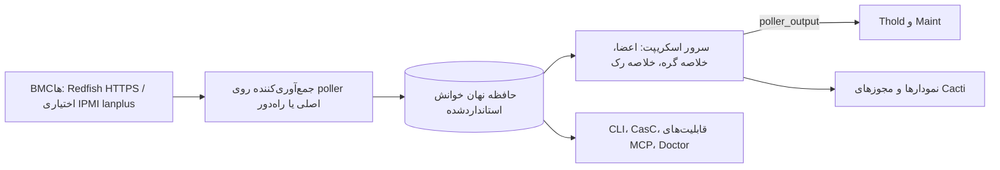

<!-- Source: README.md; SHA256: 6972a6c9ac754cd60e63c5caf971451ea8fe6e279eef757d886e1a168d3eef01 -->

<!-- translations:start -->
[English](../../../README.md) | [简体中文](../zh-CN/README.md) | [हिन्दी](../hi-IN/README.md) | [Español (España)](../es-ES/README.md) | [Español (Latinoamérica)](../es-419/README.md) | [العربية (السعودية)](../ar-SA/README.md) | [Afrikaans](../af-ZA/README.md) | [አማርኛ](../am-ET/README.md) | [العربية (مصر)](../ar-EG/README.md) | [العربية (المغرب)](../ar-MA/README.md) | [বাংলা](../bn-BD/README.md) | [Bosanski](../bs-BA/README.md) | [Deutsch](../de-DE/README.md) | [فارسی](README.md) | [Filipino](../fil-PH/README.md) | [Français](../fr-FR/README.md) | [Français (Maroc)](../fr-MA/README.md) | [Français (Sénégal)](../fr-SN/README.md) | [Hausa](../ha-NG/README.md) | [עברית](../he-IL/README.md) | [Hrvatski](../hr-HR/README.md) | [Bahasa Indonesia](../id-ID/README.md) | [Igbo](../ig-NG/README.md) | [Italiano](../it-IT/README.md) | [日本語](../ja-JP/README.md) | [한국어](../ko-KR/README.md) | [Malagasy](../mg-MG/README.md) | [मराठी](../mr-IN/README.md) | [Bahasa Melayu](../ms-MY/README.md) | [Nederlands](../nl-NL/README.md) | [Polski](../pl-PL/README.md) | [Português (Brasil)](../pt-BR/README.md) | [Русский](../ru-RU/README.md) | [Kinyarwanda](../rw-RW/README.md) | [Soomaali](../so-SO/README.md) | [Српски](../sr-RS/README.md) | [Svenska](../sv-SE/README.md) | [Kiswahili](../sw-KE/README.md) | [தமிழ்](../ta-IN/README.md) | [తెలుగు](../te-IN/README.md) | [ไทย](../th-TH/README.md) | [Türkçe](../tr-TR/README.md) | [Українська](../uk-UA/README.md) | [اردو](../ur-PK/README.md) | [Tiếng Việt](../vi-VN/README.md) | [isiXhosa](../xh-ZA/README.md) | [Yorùbá](../yo-NG/README.md) | [繁體中文](../zh-TW/README.md) | [isiZulu](../zu-ZA/README.md)
<!-- translations:end -->

# plugin_redfish

یک افزونه برای Cacti 1.2 که توان مصرفی سرور، دمای ورودی، وضعیت فن‌ها و سلامت منابع تغذیه را از کنترلرهای مدیریت برد اصلی (BMCها) به صورت دستگاه‌ها، منابع داده و نمودارهای عادی با استفاده از Redfish، به همراه قابلیت پشتیبان اختیاری و فقط خواندنی IPMI و تجمیع توان در سطح رک، وارد Cacti می‌کند. Thold و Maint از طریق منابع داده استاندارد Cacti روی آن‌ها هشدار می‌دهند و هشدارها را سرکوب می‌کنند.

> **وضعیت: در حال توسعه، هنوز نسخه‌ای منتشر نشده است (`0.1.0-dev`).** این افزونه به پروژه Cacti وابسته نیست. روی Cacti نسخه 1.2.31 یا جدیدتر تحت PHP 8.2 یا جدیدتر نصب می‌شود و جمع‌آوری‌کننده Redfish، مخزن رمزگذاری‌شده اطلاعات احراز هویت، ایجاد دستگاه و نمودار در Cacti، پشتیبان اختیاری و فقط خواندنی IPMI، تجمیع توان رک، نمایش بازه Maint در Cacti، همگام‌سازی و نقاط پایانی عامل جمع‌آوری داده از راه دور، ارائه‌دهنده CasC و ابزار خط فرمان اپراتور، قابلیت‌های MCP و بررسی‌های تشخیصی Doctor را پیاده‌سازی می‌کند. در CI داده‌های آزمایشی، سرور نمونه DMTF Redfish (شبیه‌سازهای زیرسیستم، فقط قدیمی و HPE iLO Gen11) و Thold نسخه v1.8.2 همراه با Maint نسخه v1.3 آزمایش می‌شوند؛ هنوز هیچ BMC فیزیکی واقعی یا ناوگان پایلوتی ارزیابی نهایی نشده است. طراحی و پژوهش‌ها در [docs/PLAN.md](../../PLAN.md)، [docs/research/](../../research/) و [docs/decisions/](../../decisions/) قرار دارند.

## قابلیت‌های پیاده‌سازی‌شده

### جمع‌آوری‌کننده هسته، مخزن و اشیای Cacti

- **چرخه عمر و طرح‌واره (Schema).** نصب، ارتقا، غیرفعال‌سازی و حذف از طریق API افزونه Cacti (`Schema::VERSION = 3`، ۱۲ جدول) انجام می‌شود. هنگام حذف، جداول نگه داشته می‌شوند مگر اینکه گزینه *Keep Plugin Tables on Uninstall* پاک شده باشد. نقاط ورود در PHP 8.0 تجزیه می‌شوند و در صورت پایین‌تر بودن نسخه PHP از 8.2 یا نبود `ext-openssl` با پیام خطای صریح از اجرا خودداری می‌کنند.
- **فهرست ثبت و دسترسی‌ها.** حوزه‌های دسترسی *Redfish View* (`redfish_health.php`)، *Redfish Operator* (`redfish_operator.php`) و *Redfish Admin* (`redfish_bmcs.php`، `redfish_credentials.php`) به همراه تنظیمات در مسیر **Configuration > Settings > Redfish**. فهرست ثبت BMC از واردکردن CSV (ارجاع به اطلاعات احراز هویت با نام؛ گذرواژه‌ها در فایل‌های ورودی رد می‌شوند) و خروجی JSON پشتیبانی می‌کند. رکوردهای BMC و اطلاعات احراز هویت از مجوزهای دستگاه Cacti پیروی می‌کنند.
- **مخزن رمزگذاری‌شده اطلاعات احراز هویت.** گذرواژه‌ها با AES-256-GCM در `plugin_redfish_secret` به صورت رمزگذاری‌شده ذخیره می‌شوند. کلید خارج از پایگاه داده (به طور پیش‌فرض `/etc/cacti/redfish-vault.key`) به صورت ۶۴ نویسه شانزده‌شانزدهی (`openssl rand -hex 32`) یا ۳۲ بایت خام، با مالکیت کاربر poller، غیرقابل خواندن برای سایر کاربران و در پوشه‌ای که فقط برای root یا آن کاربر قابل نوشتن است نگهداری می‌شود. عبارت عبور ۳۲ نویسه‌ای قابل چاپ رد می‌شود. **از فایل کلید همراه با پایگاه داده نسخه پشتیبان تهیه کنید**؛ بدون آن، گذرواژه‌های ذخیره‌شده باید دوباره وارد شوند.
- **TLS و کلاینت فقط خواندنی Redfish.** بررسی TLS به صورت پیش‌فرض با استفاده از مخزن CA سیستم، بسته CA اختصاصی هر BMC یا پین SPKI SHA-256 فعال است؛ غیرفعال‌سازی بررسی برای هر BMC به عنوان هشدار سلامت و هشدار بررسی Doctor قابل مشاهده باقی می‌ماند. کلاینت فقط `GET` به همراه ورود نشست Redfish (`POST`) و خروج (`DELETE`) را مجاز می‌داند و در صورت در دسترس نبودن نشست، امکان بازگشت اختیاری به Basic برای هر BMC را دارد. کشف منابع، زیرسیستم و حسگرهای جدید Redfish را ترجیح می‌دهد و در صورت نبود به منابع منسوخ‌شده `Power` و `Thermal` برمی‌گردد.
- **اجرای جمع‌آوری‌کننده.** `poller_redfish.php` از `poller_bottom` آغاز می‌شود، یک فرایند اصلی به ازای هر poller از طریق رجیستری فرایندهای Cacti با تعداد قابل تنظیم فرایندهای کارگر (`redfish_workers`) اجرا می‌کند، اجاره‌های به ازای هر BMC می‌گیرد، بودجه زمانی (`redfish_collector_budget`) را اعمال می‌کند، پس‌روی نمایی را به کار می‌برد و نشست قبلی خود افزونه را پس از خرابی پاک‌سازی می‌کند.
- **الگوها، دستگاه‌ها و نمودارها.** فایل `templates/redfish-templates.xml` را بر اساس هش وارد می‌کند و سه فایل XML پرس‌وجوی داده سرور اسکریپت (`redfish_fans.xml`، `redfish_temperatures.xml`، `redfish_psus.xml`) را بدون بازنویسی فایل‌های تغییریافته توسط کاربر در `<cacti>/resource/script_server/` کپی می‌کند. گزینه‌های **Create Device** و **Add Graphs** نیازمند تایید طرح تدارک هستند، پرس‌وجوها را به یک دستگاه سرور نگاشت‌شده متصل می‌کنند یا یک دستگاه «Redfish BMC» زیر `.invalid` با بررسی‌های دسترس‌پذیری غیرفعال ایجاد می‌کنند و هر نمودار Redfish را از طریق `graph_buttons` به نمودارهای Redfish دستگاه پیوند می‌دهند.
- **ورودی‌های سرور اسکریپت فقط مبتنی بر حافظه نهان.** `scripts/ss_redfish_members.php` مقادیر فن، دما و PSU به ازای هر عضو را ارائه می‌دهد و `scripts/ss_redfish_summary.php` معیارهای «Redfish Node Summary» (توان، دمای ورودی و بیشینه دما، تعداد فن‌ها و PSUهای خراب، سلامت گره و عمر آخرین خوانش معتبر) را فراهم می‌کند. فراخوانی‌های سرور اسکریپت فقط از حافظه نهان محلی می‌خوانند و هرگز با BMC تماس نمی‌گیرند. مقادیر گمشده، منقضی یا اعضای ازدست‌رفته مقدار `U` (هرگز `0`) برمی‌گردانند، در حالی که `age` همیشه مقداری گزارش می‌دهد تا آستانه‌ها بتوانند BMCهای خاموش را شناسایی کنند.

**هنگامی که اعضای یک BMC تغییر می‌کنند** (مانند تعویض یک فن یا به‌روزرسانی میان‌افزار که نام حسگرها را تغییر می‌دهد)، دوباره **Add Graphs** را اجرا کنید. فن یا منبع تغذیه‌ای که قبلا وجود داشته و ناپدید می‌شود تا زمان تایید در `fans_bad` یا `psus_bad` شمرده می‌شود؛ شکافی که هرگز پر نشده باشد شمرده نمی‌شود. اعضای حذف‌شده منابع داده و نمودارهای فعلی خود را حفظ می‌کنند که پس از آن تا زمان حذف دستی مقدار `U` می‌خوانند. حذف یک دستگاه Cacti نگاشت BMC آن را برمی‌دارد و انتساب رک آن را حذف می‌کند در حالی که BMC و حافظه نهان را نگه می‌دارد؛ حذف یک BMC یا حذف افزونه، دستگاه‌ها و نمودارهای Cacti را نگه می‌دارد.

### پشتیبان اختیاری IPMI

- **فعال‌سازی اختیاری به ازای هر BMC.** به صورت پیش‌فرض خاموش است (`protocols` به طور پیش‌فرض `redfish` است؛ فعال‌سازی پشتیبان IPMI مقدار را به `redfish,ipmi` تغییر می‌دهد).
- **تریگر بازگشت محدودشده.** فقط زمانی اجرا می‌شود که جمع‌آوری Redfish با یک کلاس خطای واجد شرایط شکست بخورد؛ هرگز در خطاهای `AuthRejected`، `CredentialUnavailable`، `AddressRefused`، `OperationRefused` یا `Deadline` اجرا نمی‌شود.
- **اجرای ایمن.** `ipmitool` را روی `-I lanplus` از طریق شکل آرایه‌ای `proc_open()` بدون پوسته، با محدودیت زمانی دیوارساعتی و سقف خروجی ۲۵۶ کیلوبایت اجرا می‌کند. گذرواژه‌ها از طریق `IPMITOOL_PASSWORD` (`-E`) یا فایل موقت با سطح دسترسی 0600 (`-f`) که در `finally` حذف می‌شود ارسال می‌شوند و هرگز در آرگومان‌های خط فرمان قرار نمی‌گیرند.
- **فهرست مجاز دستورات فقط خواندنی.** تنها پنج زیرفرمان فقط خواندنی مجاز هستند: `dcmi power reading`، `sdr type Temperature`، `sdr type Fan`، `sdr type Power Supply` و `chassis status`. دستورات تغییردهنده رد می‌شوند.
- **خروجی استانداردشده و هشدار وضعیت امنیتی.** `IpmiNormalizer` خوانش‌ها را به همان مدل `Observation`/`Member`/`Reading` نگاشت می‌کند و برای حسگرهای مفقود یا غیرقابل تجزیه `U` برمی‌گرداند. فعال کردن پشتیبان IPMI هشداری را در صفحه سلامت و در بررسی `redfish.bmc_security` ابزار Doctor نمایش می‌دهد که به اپراتورها یادآوری می‌کند UDP 623 را به یک VLAN مدیریتی محدود کنند.

### تجمیع توان رک

- **فهرست ثبت رک.** نسخه ۳ طرح‌واره جدول‌های `plugin_redfish_rack` (مقدار یکتای `(site_id, name)`، فیلدهای اختیاری `power_budget_watts`، `min_coverage_pct` با پیش‌فرض `80` و یادداشت‌ها) و `plugin_redfish_rack_member` (حداکثر یک انتساب رک به ازای هر `host_id`، مقادیر اختیاری `bmc_id` و `unit_position` که هنگام حذف دستگاه Cacti به طور خودکار حذف می‌شود) را اضافه می‌کند.
- **مجموع‌های محافظت‌شده با پوشش.** `RackPowerSummary` خوانش‌های تازه `power_watts` اعضا را از حافظه نهان محلی جمع می‌زند و میزان بهره‌وری بودجه و ظرفیت باقیمانده را محاسبه می‌کند. وقتی پوشش اعضای گزارش‌دهنده به کمتر از `min_coverage_pct` برسد، `power_watts`، `utilization_pct` و `headroom_watts` مقدار `U` برمی‌گردانند تا خرابی‌های جمع‌آوری‌کننده هرگز به صورت افت توان رک نمایش داده نشوند.
- **ورودی سرور اسکریپت آماده برای Thold.** `scripts/ss_redfish_rack.php` (`ss_redfish_rack(<rack_id>)`) مقادیر `power_watts`، `power_budget_watts`، `utilization_pct`، `headroom_watts`، `members_total`، `members_reporting` و `coverage_pct` را فقط از حافظه نهان محلی برمی‌گرداند.

### یکپارچه‌سازی Cacti Maint

- آستانه‌های Thold روی منابع داده Redfish هشدار می‌دهند و Cacti Maint بدون نیاز به تغییر در هیچ‌یک از دو افزونه آن‌ها را سرکوب می‌کند.
- `MaintWindow` زمان‌بندی‌های فعال Maint را برای هر میزبان نگاشت‌شده Cacti بررسی می‌کند (زمان‌بندی‌های یک‌باره `mtype=1` و تکرارشونده `mtype=2`، به علاوه `plugin_maint_check_cacti_host()` در صورت بارگذاری) و نگهداری فعال را در صفحه سلامت Redfish (`[MAINT]`)، در خروجی `cli/redfish.php health` و در قابلیت `redfish-get-health` علامت‌گذاری می‌کند.

### جمع‌آوری‌کننده‌های داده از راه دور

- `INFO` مقدار `remote_collect:1` را اعلام می‌کند. BMCها هر `poller_id >= 1` را می‌پذیرند و `poller_redfish.php --poller=N` فقط BMCهای فعال تخصیص‌یافته به آن poller را جمع‌آوری می‌کند.
- **قلاب `replicate_out`.** فقط جدول‌های پیکربندی غیرمحرمانه محدود به poller هدف از راه دور را از طریق `replicate_out_table()` همگام‌سازی می‌کند: `plugin_redfish_bmc`، فراداده `plugin_redfish_credential` (بدون متن رمزگذاری‌شده)، `plugin_redfish_rack` و `plugin_redfish_rack_member`. جدول `plugin_redfish_secret` همگام‌سازی نمی‌شود و فایل‌های کلید مخزن اکیدا به صورت محلی روی هر poller باقی می‌مانند.
- **قلاب `remote_agent`.** اکشن‌های فقط خواندنی `redfish_health` و `redfish_discovery` را ارائه می‌دهد که فقط پارامترهای عددی `poller_id` و `bmc_id` را می‌پذیرند. پارامترهای غیرمنتظره رد می‌شوند و هیچ‌گونه اطلاعات احراز هویت یا رازی برگردانده نمی‌شود.

### قلاب‌های اکوسیستم (CasC، قابلیت‌های MCP و Doctor)

- **ارائه‌دهنده CasC (`casc_register_providers`).** ارائه‌دهنده `redfish` (طرح‌واره نسخه `1`) را با خروجی YAML و XML به صورت PHP خالص، تجزیه (با رد XXE)، اعتبارسنجی، برنامه‌ریزی تفاوت و اعمال ثبت می‌کند. اطلاعات احراز هویت فقط به عنوان ارجاعات مخزن (`vault:redfish:<name>`) ظاهر می‌شوند؛ کلیدهای محرمانه خام (`pass`، `secret`، `token`، `private_key`، `vault_key`، `auth_token`) رد می‌شوند. اعمال تغییرات نیازمند `PLAN_HASH` دقیق SHA-256 است.
- **API مربوط به MCP / Abilities (`abilities_register`).** سه قابلیت فقط خواندنی را با شرط حوزه Redfish View (`redfish_health.php`) و مجوزهای دستگاه Cacti ثبت می‌کند و هیچ اطلاعات احراز هویتی برنمی‌گرداند:
  - `redfish-list-bmcs` (`poller_id` اختیاری)
  - `redfish-get-rack-power` (`rack_id` اختیاری)
  - `redfish-get-health` (`bmc_id` اختیاری)
- **بررسی‌های Doctor (`doctor_register_checks`).** پنج بررسی تشخیصی محلی و فقط خواندنی ثبت می‌کند که هرگز با BMC تماس نمی‌گیرند و داده کلید برنمی‌گردانند:
  - `redfish.schema`: به‌روز بودن نسخه طرح‌واره
  - `redfish.vault_key`: خوانایی و مجوزهای کلید مخزن
  - `redfish.collector_runs`: بودجه و تازگی جمع‌آوری‌کننده poller
  - `redfish.bmc_security`: BMCهای فعال دارای TLS تاییدنشده یا پشتیبان IPMI
  - `redfish.rack_power`: انطباق بودجه توان رک و کف پوشش

## خط فرمان (CLI)

از پوشه ریشه Cacti با PHP 8.2 یا جدیدتر اجرا کنید:

```sh
# Operator and CasC CLI (reads --file=PATH or stdin for validate, plan, and apply)
php plugins/redfish/cli/redfish.php export --format=yaml|xml
php plugins/redfish/cli/redfish.php validate [--file=PATH] [--format=yaml|xml]
php plugins/redfish/cli/redfish.php plan [--file=PATH] [--format=yaml|xml]
php plugins/redfish/cli/redfish.php apply [--file=PATH] [--format=yaml|xml] --confirm=<PLAN_HASH>
php plugins/redfish/cli/redfish.php health --format=text|json

# Collector entry point (normally started by poller_bottom)
php plugins/redfish/poller_redfish.php [--poller=N] [--force] [--debug]

# Rack power summary script server entry point
php plugins/redfish/scripts/ss_redfish_rack.php <rack_id>
```

## نقش‌های دسترسی

| حوزه (Realm) | دسترسی |
| --- | --- |
| Redfish View | صفحات پایش موجود. |
| Redfish Operator | پایش به علاوه صفحه عملیات و تاییدیه‌های شخصی تریاژ. |
| Redfish Admin | دسترسی Operator به علاوه پیکربندی موجود و اقدامات مدیریتی. |

پس از کپی فایل‌های ارتقا، به عنوان مدیر صفحه Plugins را باز کنید تا حوزه‌ها ثبت شوند. حوزه Operator را به صورت صریح در بخش **Configuration > Users** یا گروه‌های کاربری اختصاص دهید. ارتقاها شناسه‌ها و مجوزهای فعلی حوزه‌های View و Admin را حفظ می‌کنند. دسترسی Admin دسترسی Operator را به ارث می‌برد و دسترسی Operator در هر درخواست دسترسی View را به ارث می‌برد؛ این کار مجوز ذخیره‌شده‌ای به کاربران یا گروه‌ها اضافه نمی‌کند. تنظیمات افزونه نیز علاوه بر مجوز Settings در Cacti به دسترسی Redfish Admin نیاز دارد.

مجوزهای دستگاه Cacti ردیف‌ها و اقدامات در دسترس هر کاربر را محدود می‌کنند؛ اشیای نگاشت‌نشده نیازمند مدیر هستند. اپراتورها می‌توانند توقف جمع‌آوری روی یک BMC مجاز را برای اجرای زمان‌بندی‌شده بعدی آزاد کنند. اطلاعات احراز هویت، پیکربندی، نگاشت، حذف و سایر تغییرات مدیریتی در صفحات مدیریتی باقی می‌مانند. تاییدیه‌ها فقط در نشست فعلی کاربر، حداکثر به مدت یک ساعت و تنها تا زمانی که همان مشاهده تازه باشد دوام دارند. مشاهدات جدید یا تغییریافته آن‌ها را باطل می‌کنند. آن‌ها هرگز یک اندازه‌گیری ناموفق را سالم علامت‌گذاری نمی‌کنند و هشدارها را سرکوب نمی‌کنند.

## چرا

هر سرور یک BMC دارد که وضعیت توان و حرارت را مستقل از سیستم‌عامل گزارش می‌دهد، بنابراین وقتی سیستم‌عامل از کار بیفتد نیز به پاسخ‌گویی ادامه می‌دهد. این داده‌ها برای ردیابی ظرفیت و هزینه، هشدار زودهنگام خرابی فن یا منبع تغذیه و در رایانش با کارایی بالا برای تصمیم‌گیری‌های سقف توان به کار می‌روند. این افزونه مخصوص HPC نیست.

Cacti امروز بخشی از این نیاز را پوشش می‌دهد:

- **بسته‌های SNMP فروشندگان.** شاخه 1.2.x الگوهای Dell iDRAC و HPE iLO را ارائه می‌دهد که نیازمند عامل SNMP و وابسته به فروشنده هستند؛ پژوهش نقطه عطف ۱ نشان داد که هیچ‌یک توان مصرفی را بر حسب وات گزارش نمی‌دهند ([docs/research/overlap.md](../../research/overlap.md)).
- **یک نوع اطلاعات احراز هویت بدون جمع‌آوری‌کننده.** plugin_credentials نوع اعتبار «IPMI / Redfish (BMC)» را تعریف می‌کند اما هیچ BMCای را نمی‌خواند.
- **نبود نمای سطح رک.** هسته Cacti شیء رک ندارد؛ هر دستگاه یک فیلد متنی آزاد `location` دارد.

این افزونه BMCها را خارج از باند از چرخه نظرسنجی Cacti روی poller اصلی یا جمع‌آوری‌کننده‌های داده از راه دور نظرسنجی می‌کند، خوانش‌های استانداردشده را در حافظه نهان نگه می‌دارد و آن‌ها را از طریق پرس‌وجوهای داده سرور اسکریپت، خلاصه گره و خلاصه توان رک ارائه می‌دهد. از نمودارگیری، مجوزها، Thold و Maint خود Cacti استفاده مجدد می‌کند و وضعیت BMC را تغییر نمی‌دهد.

## محدوده و وضعیت

| فاز | محدوده | نقاط عطف | وضعیت |
|---|---|---|---|
| 0، پژوهش | ماتریس فروشندگان، تایید رفتار بالادستی روی BMCهای زنده، هزینه نظرسنجی، آزمایش فنی پرس‌وجوی داده | [M1](https://github.com/somethingwithproof/plugin_redfish/milestone/1) | انجام‌شده، در انتظار ثبت داده‌های میان‌افزار BMC واقعی |
| 1، مشاهده | فهرست ثبت BMC، اطلاعات احراز هویت، TLS، جمع‌آوری‌کننده Redfish، خوانش‌های استانداردشده، دستگاه‌ها، نمودارهای به ازای هر شاخص، هشداردهی Thold، یکپارچه‌سازی Maint، صفحه سلامت | [M2](https://github.com/somethingwithproof/plugin_redfish/milestone/2)، [M3](https://github.com/somethingwithproof/plugin_redfish/milestone/3)، [M4](https://github.com/somethingwithproof/plugin_redfish/milestone/4) | پیاده‌سازی‌شده؛ ارزیابی ناوگان پایلوت M4 در انتظار |
| 2، ipmi | پشتیبان فقط خواندنی IPMI (`lanplus`) از طریق `ipmitool`، خاموش به صورت پیش‌فرض | [M5](https://github.com/somethingwithproof/plugin_redfish/milestone/5) | پیاده‌سازی‌شده |
| 3، رک‌ها | فهرست ثبت رک، مجموع توان رک با کف پوشش، ظرفیت باقیمانده بودجه، `ss_redfish_rack.php` | [M6](https://github.com/somethingwithproof/plugin_redfish/milestone/6) | پیاده‌سازی‌شده |
| 4، راه‌دور و اکوسیستم | جمع‌آوری‌کننده‌های داده از راه دور (`replicate_out`، `remote_agent`)، ارائه‌دهنده CasC و خط فرمان، قابلیت‌های MCP، بررسی‌های Doctor | [M7](https://github.com/somethingwithproof/plugin_redfish/milestone/7) | پیاده‌سازی‌شده |

خارج از محدوده: تنظیم سقف توان یا هر پیکربندی دیگر BMC، کنترل برق، به‌روزرسانی میان‌افزار، دسترسی کنسول، موتور هشداردهی اختصاصی افزونه و یکپارچه‌سازی زمان‌بند.

## اهداف سازگاری

| مؤلفه | هدف |
|---|---|
| Cacti | نسخه 1.2.31 یا جدیدتر، بدون وصله هسته |
| پایگاه داده | MariaDB 10.2 یا MySQL 5.7 یا جدیدتر: یک BMC به ازای هر دستگاه توسط کلید یکتا روی یک ستون تولیدشده نگه داشته می‌شود |
| PHP | نسخه 8.2 یا جدیدتر؛ نقاط ورود روی 8.0 قابل تجزیه می‌مانند تا زمان اجرای پشتیبانی‌نشده به جای خراب شدن رابط کاربری Cacti، پاسخ رد دریافت کند |
| افزونه‌های PHP | `ext-openssl` (الزامی توسط Cacti 1.2.31)؛ بدون `ext-curl` و بدون وابستگی‌های زمان اجرای Composer |
| ابزارهای اختیاری | `ipmitool` روی pollerهایی که BMCهای دارای پشتیبان IPMI فعال را جمع‌آوری می‌کنند |
| BMCها | Dell iDRAC، HPE iLO، Lenovo XCC و OpenBMC بر اساس بازه میان‌افزار؛ [ماتریس فروشندگان](../../research/vendor-matrix.md) را ببینید |
| Redfish | ابتدا منابع زیرسیستم و حسگر جدید، منابع منسوخ‌شده `Power` و `Thermal` به عنوان پشتیبان |
| Thold و Maint | بدون نیاز به تغییر (CI نسخه‌های Thold v1.8.2 و Maint v1.3 را آزمایش می‌کند) |

## طراحی

- [docs/PLAN.md](../../PLAN.md) طرح کامل است: معماری، حقایق بالادستی که به آن وابسته است، مدل اندازه‌گیری، مرزهای امنیتی، محاسبات کارایی، آزمایش و ریسک‌ها.
- [docs/decisions/](../../decisions/) سوابق تصمیم‌های معماری را برای انتخاب‌های انجام‌شده نگه می‌دارد.
- [docs/REQUIREMENTS.md](../../REQUIREMENTS.md) هر شناسه نیازمندی را به ایشو مربوطه نگاشت می‌کند.



## امنیت

اطلاعات احراز هویت BMC مدیریت خارج از باند سرورها را کنترل می‌کنند. طراحی، رازها را از خطوط فرمان، گزارش‌ها، خروجی‌های CasC، بارهای عامل راه‌دور، پاسخ‌های MCP و صفحات وب دور نگه می‌دارد؛ گذرواژه‌های ذخیره‌شده را با AES-256-GCM با استفاده از فایل کلید مخزن محلی به ازای هر poller رمزگذاری می‌کند؛ TLS را به صورت پیش‌فرض بررسی می‌کند؛ `ipmitool` را از آرایه آرگومان صریح با زیرفرمان‌های فقط خواندنی فهرست مجاز اجرا می‌کند؛ و از حساب‌های فقط خواندنی BMC استفاده می‌کند. [docs/PLAN.md](../../PLAN.md#security) و [SECURITY.md](../../../SECURITY.md) را ببینید.

## راهنمای اپراتور

برای پیش‌نیازهای نصب، راه‌اندازی مخزن و TLS، ثبت BMC، ایجاد نمودار، بازه‌های هشدار، پشتیبان‌گیری و مدیریت خطا [docs/operator-guide.md](../../operator-guide.md) را ببینید. این راهنما هیچ خط میان‌افزار فروشنده واقعی را تا زمانی که یک خروجی سانسورشده از آن میان‌افزار مجموعه آزمایش‌ها را نگذراند پشتیبانی‌شده اعلام نمی‌کند.

## توسعه و آزمایش

CI ([.github/workflows/plugin-ci-workflow.yml](../../../.github/workflows/plugin-ci-workflow.yml)) نقاط ورود را روی PHP 8.0 بررسی نحوی می‌کند، مجموعه‌های آزمون واحد Pest (`phpunit.xml`) و یکپارچه‌سازی چرخه عمر (`phpunit-integration.xml`) و PHPStan سطح ۹ را در PHP 8.2 تا 8.5 در برابر Cacti شاخه‌های `release/1.2.31` و `1.2.x` اجرا می‌کند، رد اجرا در PHP 8.1 را تایید می‌کند، سرور نمونه DMTF Redfish (شبیه‌سازهای زیرسیستم، فقط قدیمی و HPE iLO Gen11) و Thold v1.8.2 / Maint v1.3 را سرتاسری آزمایش می‌کند و کاتالوگ‌های gettext، گردش‌کارها و مجوزدهی REUSE را بررسی می‌کند.

بررسی‌های محلی پیش از پوش:

```sh
sh tests/lint-workflows.sh
sh locales/build_gettext.sh --check
CACTI_PATH=/path/to/cacti phpstan analyse -c phpstan.neon --no-progress
```

Pest را با `--configuration=phpunit.xml` برای آزمون‌های واحد و قوانین کد منبع، یا با `--configuration=phpunit-integration.xml` همراه با `CACTI_PATH` و `REDFISH_TEST_DATABASE=disposable` در برابر یک پایگاه داده یک‌بارمصرف Cacti برای آزمون‌های یکپارچه‌سازی چرخه عمر اجرا کنید.

## نحوه پیگیری کار

- **نقاط عطف (Milestones)** از نقاط عطف طرح پیروی می‌کنند. هر یک دارای یک ایشو اپیک است که زیر-ایشوها و شواهد خروج آن را فهرست می‌کند.
- **ایشوها** بر اساس برچسب دسته‌بندی می‌شوند: `type: requirement`، `type: research`، `type: decision`، `type: epic`. ایشوهای نیازمندی، نیازمندی‌های شماره‌گذاری‌شده و قابل آزمایش (`REQ-AREA-NNN`) و معیارهای پذیرش را بیان می‌کنند.
- **برچسب‌ها** همچنین شامل `area:`، `phase:`، `priority:` و `status:` هستند. [CONTRIBUTING.md](../../../CONTRIBUTING.md#labels) را ببینید.
- [تابلوی پروژه](https://github.com/users/somethingwithproof/projects/12) تمام ایشوها را در نقاط عطف نشان می‌دهد.

## مشارکت

[CONTRIBUTING.md](../../../CONTRIBUTING.md) را بخوانید. کامیت‌ها نیاز به تاییدیه DCO دارند. بحث‌های طراحی در ایشوها انجام می‌شود؛ تصمیم‌های باز برچسب `type: decision` دارند. شواهد از BMCهای واقعی اکنون مفیدترین مشارکت است؛ پیش از ارسال هر خروجی، نشانی‌ها، شماره‌های سریال و اطلاعات احراز هویت را سانسور کنید.

## مجوز

مجوز عمومی همگانی گنو نسخه 2.0 (GNU General Public License v2.0)، همان مجوز Cacti و افزونه‌های آن. [LICENSE](../../../LICENSE) را ببینید.
