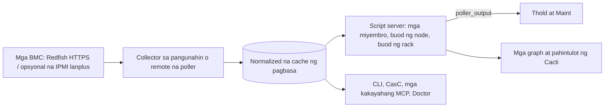

<!-- Source: README.md; SHA256: cf31b9f80d6c00020bbe08e80951d4de1c910793911d040ae7a66b54e8a2eaf0 -->

<!-- translations:start -->
[English](../../../README.md) | [简体中文](../zh-CN/README.md) | [हिन्दी](../hi-IN/README.md) | [Español (España)](../es-ES/README.md) | [Español (Latinoamérica)](../es-419/README.md) | [العربية (السعودية)](../ar-SA/README.md) | [Afrikaans](../af-ZA/README.md) | [አማርኛ](../am-ET/README.md) | [العربية (مصر)](../ar-EG/README.md) | [العربية (المغرب)](../ar-MA/README.md) | [বাংলা](../bn-BD/README.md) | [Bosanski](../bs-BA/README.md) | [Deutsch](../de-DE/README.md) | [فارسی](../fa-IR/README.md) | [Filipino](README.md) | [Français](../fr-FR/README.md) | [Français (Maroc)](../fr-MA/README.md) | [Français (Sénégal)](../fr-SN/README.md) | [Hausa](../ha-NG/README.md) | [עברית](../he-IL/README.md) | [Hrvatski](../hr-HR/README.md) | [Bahasa Indonesia](../id-ID/README.md) | [Igbo](../ig-NG/README.md) | [Italiano](../it-IT/README.md) | [日本語](../ja-JP/README.md) | [한국어](../ko-KR/README.md) | [Malagasy](../mg-MG/README.md) | [मराठी](../mr-IN/README.md) | [Bahasa Melayu](../ms-MY/README.md) | [Nederlands](../nl-NL/README.md) | [Polski](../pl-PL/README.md) | [Português (Brasil)](../pt-BR/README.md) | [Русский](../ru-RU/README.md) | [Kinyarwanda](../rw-RW/README.md) | [Soomaali](../so-SO/README.md) | [Српски](../sr-RS/README.md) | [Svenska](../sv-SE/README.md) | [Kiswahili](../sw-KE/README.md) | [தமிழ்](../ta-IN/README.md) | [తెలుగు](../te-IN/README.md) | [ไทย](../th-TH/README.md) | [Türkçe](../tr-TR/README.md) | [Українська](../uk-UA/README.md) | [اردو](../ur-PK/README.md) | [Tiếng Việt](../vi-VN/README.md) | [isiXhosa](../xh-ZA/README.md) | [Yorùbá](../yo-NG/README.md) | [繁體中文](../zh-TW/README.md) | [isiZulu](../zu-ZA/README.md)
<!-- translations:end -->

# plugin_redfish

Isang plugin ng Cacti 1.2 na nagdadala ng power draw ng server, inlet temperature, estado ng fan, at kalusugan ng power supply mula sa mga baseboard management controller (BMC) patungo sa Cacti bilang mga karaniwang device, data source, at graph, gamit ang Redfish na may opsyonal na read-only na IPMI fallback at mga pagtitipon ng kuryente sa antas ng rack. Nag-aalerto at pinipigilan ng Thold at Maint ang mga ito sa pamamagitan ng mga karaniwang data source ng Cacti.

> **Katayuan: nasa pagbuo pa, wala pang release (`0.1.0-dev`).** Hindi kaakibat ang plugin na ito sa proyektong Cacti. Ini-install ito sa Cacti 1.2.31 o mas bago sa ilalim ng PHP 8.2 o mas bago at ipinapatupad nito ang Redfish collector, naka-encrypt na credential vault, paglalaan ng device at graph sa Cacti, opsyonal na read-only na IPMI fallback, pagtitipon ng kuryente ng rack, pagpapakita ng Cacti Maint window, replikasyon ng remote data collector at mga agent endpoint, CasC provider at operator CLI, mga kakayahang MCP, at mga diagnostic check ng Doctor. Sinusubukan ng CI ang mga fixture, ang DMTF Redfish Mockup Server (subsystem, legacy-only, at mga HPE iLO Gen11 mockup), at Thold v1.8.2 kasama ang Maint v1.3; wala pang aktwal na pisikal na BMC o pilot fleet ang na-qualify. Ang disenyo at pananaliksik ay nasa [docs/PLAN.md](../../PLAN.md), [docs/research/](../../research/), at [docs/decisions/](../../decisions/).

## Mga ipinatupad na kakayahan

### Pangunahing collector, vault, at mga Cacti object

- **Siklo ng buhay at schema.** Nag-i-install, nag-a-upgrade, nagdi-disable, at nag-a-uninstall sa pamamagitan ng plugin API ng Cacti (`Schema::VERSION = 3`, 12 table). Pinananatili ang mga table sa pag-uninstall maliban kung na-clear ang *Keep Plugin Tables on Uninstall*. Ang mga entry point ay napa-parse sa PHP 8.0 at tumatanggi sa PHP na mas mababa sa 8.2 o kulang ng `ext-openssl` na may malinaw na mensahe ng error.
- **Registry at mga pahintulot.** Mga realm na *Redfish View* (`redfish_health.php`), *Redfish Operator* (`redfish_operator.php`), at *Redfish Admin* (`redfish_bmcs.php`, `redfish_credentials.php`), pati na rin ang mga setting sa ilalim ng **Configuration > Settings > Redfish**. Sinusuportahan ng BMC registry ang pag-import ng CSV (tinutukoy ang mga kredensyal ayon sa pangalan; tinatanggihan ang mga password sa mga import file) at pag-export ng JSON. Sinusunod ng mga tala ng BMC at kredensyal ang mga pahintulot ng device sa Cacti.
- **Naka-encrypt na credential vault.** Naka-encrypt na iniimbak ang mga password gamit ang AES-256-GCM sa `plugin_redfish_secret`. Nakalagay ang key sa labas ng database (`/etc/cacti/redfish-vault.key` bilang default) bilang 64 na hexadecimal character (`openssl rand -hex 32`) o 32 raw byte, na pagmamay-ari ng poller user, hindi nababasa ng ibang user, at nasa direktoryong root o ang user na iyon lamang ang nakakapagsulat. Tinatanggihan ang 32-character na printable passphrase. **I-back up ang key file kasama ng database**; kung wala ito, kakailanganing ilagay muli ang mga nakaimbak na password.
- **TLS at read-only na Redfish client.** Naka-enable bilang default ang pag-verify ng TLS gamit ang system CA store, per-BMC na CA bundle, o SPKI SHA-256 pin; nananatiling nakikita bilang health warning at Doctor check warning ang per-BMC na pag-opt-out sa pag-verify. Pinapayagan lamang ng client ang `GET` pati ang Redfish session login (`POST`) at logout (`DELETE`), na may opsyonal na per-BMC na Basic fallback kapag hindi magagamit ang mga session. Mas pinipili ng pagtuklas ang mga bagong Redfish subsystem at sensor resource at bumabalik sa mga deprecated na `Power` at `Thermal` resource.
- **Pagpapatakbo ng collector.** Nagsisimula ang `poller_redfish.php` mula sa `poller_bottom`, nagpapatakbo ng isang master process bawat poller sa pamamagitan ng process registry ng Cacti na may nako-configure na mga worker process (`redfish_workers`), kumukuha ng mga per-BMC lease, nagpapatupad ng time budget (`redfish_collector_budget`), naglalapat ng exponential backoff, at naglilinis ng sariling naunang session ng plugin pagkatapos ng crash.
- **Mga template, device, at graph.** Ini-import ang `templates/redfish-templates.xml` ayon sa hash at kinokopya ang tatlong script server data query XML file (`redfish_fans.xml`, `redfish_temperatures.xml`, `redfish_psus.xml`) sa `<cacti>/resource/script_server/` nang hindi sinasapawan ang mga file na binago ng user. Nangangailangan ang **Create Device** at **Add Graphs** ng kumpirmasyon ng isang provisioning plan, nagkakabit ng mga query sa isang naka-map na server device o gumagawa ng device na "Redfish BMC" sa ilalim ng `.invalid` na naka-disable ang mga availability check, at iniuugnay pabalik ang bawat Redfish graph sa mga Redfish graph ng device sa pamamagitan ng `graph_buttons`.
- **Mga script server input na cache-only.** Naghahatid ang `scripts/ss_redfish_members.php` ng mga pagbasa ng fan, temperatura, at PSU bawat miyembro, at naghahatid ang `scripts/ss_redfish_summary.php` ng mga sukatan ng "Redfish Node Summary" (kuryente, inlet at pinakamataas na temperatura, bilang ng sirang fan at PSU, kalusugan ng node, at tagal ng huling maayos na pagbasa). Nagbabasa lamang ang mga script server call mula sa lokal na cache at hindi kailanman nakikipag-ugnayan sa isang BMC. Nagbabalik ng `U` (hindi kailanman `0`) ang mga nawawala, luma, o nawalang miyembro na pagbasa, habang palaging nag-uulat ng halaga ang `age` upang matukoy ng mga threshold ang mga tahimik na BMC.

**Kapag nagbago ang mga miyembro ng isang BMC** (tulad ng napalitang fan o firmware update na nagpapalit ng pangalan ng mga sensor), patakbuhin muli ang **Add Graphs**. Ang dating naroroon na fan o power supply na nawala ay binibilang sa `fans_bad` o `psus_bad` hanggang sa tanggapin; ang isang slot na hindi kailanman nilagyan ay hindi binibilang. Pinananatili ng mga nawalang miyembro ang kanilang mga kasalukuyang data source at graph, na nagbabasa ng `U` pagkatapos hanggang sa mano-manong burahin. Ang pagbura ng Cacti device ay nag-aalis ng pagkakamap ng BMC nito at nagtatanggal ng pagkakatalaga ng rack habang pinananatili ang BMC at cache; ang pagbura ng BMC o pag-uninstall ng plugin ay nagpapanatili sa mga Cacti device at graph.

### Opsyonal na IPMI fallback

- **Opt-in bawat BMC.** Naka-off bilang default (`protocols` ay naka-default sa `redfish`; ang pag-enable ng IPMI fallback ay nagtatakda ng `redfish,ipmi`).
- **Saklaw na fallback trigger.** Tumatakbo lamang kapag nabigo ang koleksyon ng Redfish dahil sa isang kwalipikadong failure class; hindi kailanman nagti-trigger sa `AuthRejected`, `CredentialUnavailable`, `AddressRefused`, `OperationRefused`, o `Deadline`.
- **Ligtas na pagpapatakbo.** Tinatawag ang `ipmitool` sa `-I lanplus` sa pamamagitan ng array-form na `proc_open()` nang walang shell, may nakatakdang wall-clock timeout, at limitasyon sa output na 256 KiB. Ibinibigay ang mga password sa pamamagitan ng `IPMITOOL_PASSWORD` (`-E`) o isang mode-0600 na temporary file (`-f`) na binubura sa `finally`, hindi kailanman sa CLI argv.
- **Allowlist ng mga read-only na command.** Limang read-only na subcommand lamang ang pinapayagan: `dcmi power reading`, `sdr type Temperature`, `sdr type Fan`, `sdr type Power Supply`, at `chassis status`. Tinatanggihan ang mga command na nagbabago ng estado.
- **Normalized na output at babala sa postura.** Imina-map ng `IpmiNormalizer` ang mga pagbasa sa parehong modelong `Observation`/`Member`/`Reading`, na naglalabas ng `U` para sa mga nawawala o hindi ma-parse na sensor. Ang pag-enable ng IPMI fallback ay nagpapakita ng babala sa pahina ng kalusugan at sa `redfish.bmc_security` na check ng Doctor na nagpapaalala sa mga operator na limitahan ang UDP 623 sa isang management VLAN.

### Pagtitipon ng kuryente ng rack

- **Rack registry.** Nagdaragdag ang schema version 3 ng `plugin_redfish_rack` (natatanging `(site_id, name)`, opsyonal na `power_budget_watts`, `min_coverage_pct` na naka-default sa `80`, at mga tala) at `plugin_redfish_rack_member` (hindi hihigit sa isang pagtatalaga ng rack bawat `host_id`, opsyonal na `bmc_id` at `unit_position`, na awtomatikong inaalis kapag binura ang isang Cacti device).
- **Mga kabuuang may proteksyon ng saklaw.** Pinagsasama-sama ng `RackPowerSummary` ang mga sariwang pagbasa ng `power_watts` ng miyembro mula sa lokal na cache at kinakalkula ang paggamit ng badyet at headroom. Kapag bumaba sa ilalim ng `min_coverage_pct` ang saklaw ng nag-uulat na miyembro, nagbabalik ng `U` ang `power_watts`, `utilization_pct`, at `headroom_watts` upang hindi kailanman lumitaw ang mga pagkabigo ng collector bilang pagbaba sa kuryente ng rack.
- **Script server input na handa para sa Thold.** Nagbabalik ang `scripts/ss_redfish_rack.php` (`ss_redfish_rack(<rack_id>)`) ng `power_watts`, `power_budget_watts`, `utilization_pct`, `headroom_watts`, `members_total`, `members_reporting`, at `coverage_pct` mula sa lokal na cache lamang.

### Integrasyon sa Cacti Maint

- Nag-aalerto ang mga threshold ng Thold sa mga data source ng Redfish at pinipigilan ng Cacti Maint ang mga ito nang walang pagbabago sa alinmang plugin.
- Sinusuri ng `MaintWindow` ang mga aktibong iskedyul ng Maint para sa bawat naka-map na Cacti host (isang beses na `mtype=1` at umuulit na `mtype=2` na mga iskedyul, kasama ang `plugin_maint_check_cacti_host()` kapag na-load) at minamarkahan ang aktibong maintenance sa pahina ng Kalusugan ng Redfish (`[MAINT]`), sa output ng `cli/redfish.php health`, at sa kakayahang `redfish-get-health`.

### Mga remote data collector

- Nagdedeklara ang `INFO` ng `remote_collect:1`. Tumatanggap ang mga BMC ng anumang `poller_id >= 1`, at kinokolekta lamang ng `poller_redfish.php --poller=N` ang mga naka-enable na BMC na nakatalaga sa poller na iyon.
- **`replicate_out` hook.** Nire-replicate lamang ang mga non-secret configuration table na nakasaklaw sa target na remote poller sa pamamagitan ng `replicate_out_table()`: `plugin_redfish_bmc`, metadata ng `plugin_redfish_credential` (walang ciphertext), `plugin_redfish_rack`, at `plugin_redfish_rack_member`. Hindi nire-replicate ang `plugin_redfish_secret`, at nananatiling mahigpit na lokal sa bawat poller ang mga vault key file.
- **`remote_agent` hook.** Naglalantad ng mga read-only na aksyong `redfish_health` at `redfish_discovery` na tumatanggap lamang ng mga numerikong parameter na `poller_id` at `bmc_id`. Tinatanggihan ang mga hindi inaasahang parameter at walang ibinabalik na mga kredensyal o lihim.

### Mga ecosystem hook (CasC, mga kakayahang MCP, at Doctor)

- **CasC provider (`casc_register_providers`).** Nagrerehistro ng provider na `redfish` (schema version `1`) na may purong PHP na pag-export ng YAML at XML, pag-parse (tinatanggihan ang XXE), pag-validate, pagpaplano ng diff, at paglalapat. Lumilitaw lamang ang mga kredensyal bilang mga sanggunian ng vault (`vault:redfish:<name>`); tinatanggihan ang mga hilaw na secret key (`pass`, `secret`, `token`, `private_key`, `vault_key`, `auth_token`). Nangangailangan ng eksaktong SHA-256 `PLAN_HASH` ang paglalapat.
- **MCP / Abilities API (`abilities_register`).** Nagrerehistro ng tatlong read-only na kakayahan na protektado ng realm na Redfish View (`redfish_health.php`) at mga pahintulot ng device sa Cacti, na walang ibinabalik na mga kredensyal:
  - `redfish-list-bmcs` (opsyonal na `poller_id`)
  - `redfish-get-rack-power` (opsyonal na `rack_id`)
  - `redfish-get-health` (opsyonal na `bmc_id`)
- **Mga Doctor check (`doctor_register_checks`).** Nagrerehistro ng limang lokal at read-only na diagnostic check na hindi kailanman nakikipag-ugnayan sa isang BMC o nagbabalik ng key material:
  - `redfish.schema`: pagiging napapanahon ng bersyon ng schema
  - `redfish.vault_key`: pagiging nababasa at mga pahintulot ng vault key
  - `redfish.collector_runs`: badyet at kasariwaan ng collector ng poller
  - `redfish.bmc_security`: mga naka-enable na BMC na may hindi na-verify na TLS o IPMI fallback
  - `redfish.rack_power`: pagsunod sa badyet ng kuryente ng rack at pinakamababang saklaw

## CLI

Patakbuhin mula sa root directory ng Cacti gamit ang PHP 8.2 o mas bago:

```sh
# Operator and CasC CLI (reads --file=PATH or stdin for validate, plan, and apply)
php plugins/redfish/cli/redfish.php export --format=yaml|xml
php plugins/redfish/cli/redfish.php validate [--file=PATH] [--format=yaml|xml]
php plugins/redfish/cli/redfish.php plan [--file=PATH] [--format=yaml|xml]
php plugins/redfish/cli/redfish.php apply [--file=PATH] [--format=yaml|xml] --confirm=<PLAN_HASH>
php plugins/redfish/cli/redfish.php health --format=text|json

# Collector entry point (normally started by poller_bottom)
php plugins/redfish/poller_redfish.php [--poller=N] [--force] [--debug]

# Rack power summary script server entry point
php plugins/redfish/scripts/ss_redfish_rack.php <rack_id>
```

## Mga tungkulin sa pag-access

| Realm | Pag-access |
| --- | --- |
| Redfish View | Mga kasalukuyang pahina ng pagsubaybay. |
| Redfish Operator | Pagsubaybay kasama ang pahina ng Operations at mga personal na pagkilala sa triage. |
| Redfish Admin | Pag-access ng Operator kasama ang kasalukuyang konfigurasyon at mga administratibong aksyon. |

Pagkatapos kopyahin ang mga upgrade file, buksan ang pahina ng Plugins bilang administrator upang mairehistro ang mga realm. Malinaw na italaga ang realm na Operator sa ilalim ng **Configuration > Users** o mga user group. Pinananatili ng mga pag-upgrade ang mga kasalukuyang realm ID at pahintulot ng View at Admin. Minamana ng pag-access ng Admin ang pag-access ng Operator, at minamana ng pag-access ng Operator ang pag-access ng View sa bawat kahilingan; hindi ito nagdaragdag ng mga nakaimbak na pahintulot sa mga user o grupo. Nangangailangan din ng pag-access na Redfish Admin ang mga setting ng plugin bukod pa sa pahintulot sa Settings ng Cacti.

Nililimitahan ng mga pahintulot ng device sa Cacti ang mga row at aksyon na magagamit ng bawat user; nangangailangan ng administrator ang mga hindi naka-map na object. Maaaring alisin ng mga operator ang collection hold sa isang pinapayagang BMC para sa susunod na nakaiskedyul na pagtakbo. Nananatili sa mga administratibong pahina ang mga kredensyal, konfigurasyon, pagmamapa, pagbura, at iba pang administratibong pagbabago. Tumatagal lamang ang mga pagkilala sa kasalukuyang session ng user, nang hindi hihigit sa isang oras at habang nananatiling sariwa ang parehong obserbasyon. Pinapawalang-bisa ng mga bago o nabagong obserbasyon ang mga ito. Hindi kailanman minamarkahan ng mga ito bilang malusog ang isang nabigong pagsukat o pinipigilan ang mga alerto.

## Bakit

Ang bawat server ay may BMC na nag-uulat ng estado ng kuryente at init nang hiwalay sa operating system, kaya patuloy itong sumasagot kapag nakababa ang OS. Nagsisilbi ang data para sa pagsubaybay ng kapasidad at gastos, maagang babala sa sirang fan o power supply, at, sa high-performance computing, mga desisyon sa power-capping. Hindi partikular sa HPC ang plugin na ito.

Sinasaklaw ng Cacti ang bahagi nito ngayon:

- **Mga vendor SNMP package.** Ang sangay na 1.2.x ay nagpapadala ng mga template ng Dell iDRAC at HPE iLO na nangangailangan ng SNMP agent at partikular sa vendor; natuklasan ng pananaliksik sa milestone 1 na wala sa alinman ang nag-uulat ng power draw sa watts ([docs/research/overlap.md](../../research/overlap.md)).
- **Isang uri ng kredensyal na walang collector.** Nagtatakda ang plugin_credentials ng kredensyal na "IPMI / Redfish (BMC)" ngunit walang binabasang BMC.
- **Walang rack-level view.** Walang rack object ang core ng Cacti; ang isang device ay may free-text na `location` field.

Sinusuri ng plugin ang mga BMC nang out of band mula sa poll cycle ng Cacti sa pangunahing poller o mga remote data collector, iniimbak sa cache ang mga normalized na pagbasa, at inilalantad ang mga ito sa pamamagitan ng mga script server data query, buod ng node, at buod ng kuryente ng rack. Muli nitong ginagamit ang pag-graph, mga pahintulot, Thold, at Maint ng Cacti, at hindi binabago ang estado ng BMC.

## Saklaw at katayuan

| Yugto | Saklaw | Mga Milestone | Katayuan |
|---|---|---|---|
| 0, pananaliksik | Matrix ng mga vendor, pagkumpirma ng upstream na gawi sa mga aktwal na BMC, gastos sa pag-poll, data query spike | [M1](https://github.com/somethingwithproof/plugin_redfish/milestone/1) | Tapos na, naghihintay ng mga aktuwal na pagkuha ng firmware ng BMC |
| 1, pagmamasid | BMC registry, mga kredensyal, TLS, Redfish collector, mga normalized na pagbasa, mga device, mga per-index graph, pag-alerto ng Thold, integrasyon sa Maint, pahina ng kalusugan | [M2](https://github.com/somethingwithproof/plugin_redfish/milestone/2), [M3](https://github.com/somethingwithproof/plugin_redfish/milestone/3), [M4](https://github.com/somethingwithproof/plugin_redfish/milestone/4) | Ipinatupad; nakabinbin ang kwalipikasyon ng M4 pilot fleet |
| 2, ipmi | Read-only na IPMI (`lanplus`) fallback sa pamamagitan ng `ipmitool`, naka-off bilang default | [M5](https://github.com/somethingwithproof/plugin_redfish/milestone/5) | Ipinatupad |
| 3, mga rack | Rack registry, kabuuang kuryente ng rack na may saklaw na sahig, headroom ng badyet, `ss_redfish_rack.php` | [M6](https://github.com/somethingwithproof/plugin_redfish/milestone/6) | Ipinatupad |
| 4, remote at ecosystem | Mga remote data collector (`replicate_out`, `remote_agent`), CasC provider at CLI, mga kakayahang MCP, mga Doctor check | [M7](https://github.com/somethingwithproof/plugin_redfish/milestone/7) | Ipinatupad |

Wala sa saklaw: pagtatakda ng mga power cap o anumang iba pang konfigurasyon ng BMC, kontrol sa kuryente, pag-update ng firmware, pag-access sa console, sariling alerting engine ng plugin, at integrasyon sa scheduler.

## Mga target na tugma

| Bahagi | Target |
|---|---|
| Cacti | 1.2.31 o mas bago, walang core patch |
| Database | MariaDB 10.2 o MySQL 5.7 o mas bago: isang BMC bawat device ang pinananatili ng unique key sa isang generated column |
| PHP | 8.2 o mas bago; nananatiling napa-parse ang mga entry point sa 8.0 upang makatanggap ng pagtanggi ang hindi suportadong runtime sa halip na sirang UI ng Cacti |
| Mga extension ng PHP | `ext-openssl` (kinakailangan ng Cacti 1.2.31); walang `ext-curl` at walang mga Composer runtime dependency |
| Mga opsyonal na tool | `ipmitool` sa mga poller na nangongolekta ng mga BMC na naka-enable ang IPMI fallback |
| Mga BMC | Dell iDRAC, HPE iLO, Lenovo XCC, at OpenBMC, ayon sa saklaw ng firmware; tingnan ang [matrix ng mga vendor](../../research/vendor-matrix.md) |
| Redfish | Mga bagong subsystem at sensor resource muna, mga deprecated na `Power` at `Thermal` bilang fallback |
| Thold, Maint | Walang kinakailangang pagbabago (sinusubukan ng CI ang Thold v1.8.2 at Maint v1.3) |

## Disenyo

- Ang [docs/PLAN.md](../../PLAN.md) ang kumpletong plano: arkitektura, mga katotohanang upstream na pinagbabatayan nito, modelo ng pagsukat, mga hangganan ng seguridad, kalkulasyon ng pagganap, pagsubok, at mga panganib.
- Naglalaman ang [docs/decisions/](../../decisions/) ng mga tala ng desisyon sa arkitektura para sa mga pagpiling nagawa na.
- Imina-map ng [docs/REQUIREMENTS.md](../../REQUIREMENTS.md) ang bawat requirement ID sa issue nito.



## Seguridad

Kinokontrol ng mga kredensyal ng BMC ang out-of-band na pamamahala ng mga server. Inilalayo ng disenyo ang mga lihim mula sa mga command line, log, pag-export ng CasC, mga payload ng remote agent, mga tugon ng MCP, at mga web page; ine-encrypt ang mga nakaimbak na password gamit ang AES-256-GCM sa pamamagitan ng isang lokal na vault key file bawat poller; bini-verify ang TLS bilang default; pinapatakbo ang `ipmitool` mula sa isang malinaw na argument array na may mga naka-allowlist na read-only na subcommand; at gumagamit ng mga read-only na BMC account. Tingnan ang [docs/PLAN.md](../../PLAN.md#security) at [SECURITY.md](../../../SECURITY.md).

## Gabay ng operator

Tingnan ang [docs/operator-guide.md](../../operator-guide.md) para sa mga kinakailangan sa pag-install, pag-setup ng vault at TLS, pagpaparehistro ng BMC, paggawa ng graph, mga pagitan ng alerto, pag-back up, at paghawak ng pagkabigo. Hindi nagdedeklara ang gabay ng suportadong aktwal na linya ng firmware ng vendor hangga't hindi pumapasa sa suite ang isang na-redact na capture mula sa firmware na iyon.

## Pagbuo at pagsubok

Ang CI (`.github/workflows/plugin-ci-workflow.yml`) ay nagli-lint ng mga entry point sa PHP 8.0, nagpapatakbo ng mga suite ng Pest unit (`phpunit.xml`) at lifecycle integration (`phpunit-integration.xml`) at PHPStan level 9 sa PHP 8.2 hanggang 8.5 laban sa Cacti `release/1.2.31` at `1.2.x`, bini-verify ang pagtanggi sa PHP 8.1, sinusubukan ang DMTF Redfish Mockup Server (subsystem, legacy-only, at mga HPE iLO Gen11 mockup) at Thold v1.8.2 / Maint v1.3 nang end to end, at sinusuri ang mga gettext catalog, mga workflow, at paglilisensya ng REUSE.

Mga lokal na pagsusuri bago mag-push:

```sh
sh tests/lint-workflows.sh
sh locales/build_gettext.sh --check
CACTI_PATH=/path/to/cacti phpstan analyse -c phpstan.neon --no-progress
```

Patakbuhin ang Pest na may `--configuration=phpunit.xml` para sa mga unit at source-rule test, o `--configuration=phpunit-integration.xml` na may `CACTI_PATH` at `REDFISH_TEST_DATABASE=disposable` laban sa isang disposable na Cacti database para sa mga lifecycle integration test.

## Paano sinusubaybayan ang trabaho

- **Mga Milestone** ay sumusunod sa mga milestone ng plano. Ang bawat isa ay may epic issue na naglilista ng mga sub-issue nito at exit evidence.
- **Mga Issue** ay may uri ayon sa label: `type: requirement`, `type: research`, `type: decision`, `type: epic`. Nakasaad sa mga requirement issue ang may numerong, nasusubok na mga kinakailangan (`REQ-AREA-NNN`) at mga pamantayan sa pagtanggap.
- **Mga Label** ay nagdadala rin ng `area:`, `phase:`, `priority:`, at `status:`. Tingnan ang [CONTRIBUTING.md](../../../CONTRIBUTING.md#labels).
- Ipinapakita ng [project board](https://github.com/users/somethingwithproof/projects/12) ang lahat ng issue sa mga milestone.

## Pag-aambag

Basahin ang [CONTRIBUTING.md](../../../CONTRIBUTING.md). Kailangan ng DCO sign-off ng mga commit. Nangyayari sa mga issue ang talakayan sa disenyo; may label na `type: decision` ang mga bukas na desisyon. Ang ebidensya mula sa mga aktwal na BMC ang pinakakapaki-pakinabang na ambag ngayon; i-redact ang mga address, serial number, at kredensyal bago mag-post ng anumang capture.

## Lisensya

GNU General Public License v2.0, ang parehong lisensya ng Cacti at mga plugin nito. Tingnan ang [LICENSE](../../../LICENSE).
