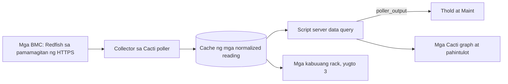

<!-- Source: README.md; SHA256: 7b4e83a58a1adc844cb0615ef30e95476cba2851f96bb454d2a816fb2774724d -->

<!-- translations:start -->
[English](../../../README.md) | [简体中文](../zh-CN/README.md) | [हिन्दी](../hi-IN/README.md) | [Español (España)](../es-ES/README.md) | [Español (Latinoamérica)](../es-419/README.md) | [العربية (السعودية)](../ar-SA/README.md) | [Afrikaans](../af-ZA/README.md) | [አማርኛ](../am-ET/README.md) | [العربية (مصر)](../ar-EG/README.md) | [العربية (المغرب)](../ar-MA/README.md) | [বাংলা](../bn-BD/README.md) | [Bosanski](../bs-BA/README.md) | [Deutsch](../de-DE/README.md) | [فارسی](../fa-IR/README.md) | [Filipino](README.md) | [Français](../fr-FR/README.md) | [Français (Maroc)](../fr-MA/README.md) | [Français (Sénégal)](../fr-SN/README.md) | [Hausa](../ha-NG/README.md) | [עברית](../he-IL/README.md) | [Hrvatski](../hr-HR/README.md) | [Bahasa Indonesia](../id-ID/README.md) | [Igbo](../ig-NG/README.md) | [Italiano](../it-IT/README.md) | [日本語](../ja-JP/README.md) | [한국어](../ko-KR/README.md) | [Malagasy](../mg-MG/README.md) | [मराठी](../mr-IN/README.md) | [Bahasa Melayu](../ms-MY/README.md) | [Nederlands](../nl-NL/README.md) | [Polski](../pl-PL/README.md) | [Português (Brasil)](../pt-BR/README.md) | [Русский](../ru-RU/README.md) | [Kinyarwanda](../rw-RW/README.md) | [Soomaali](../so-SO/README.md) | [Српски](../sr-RS/README.md) | [Svenska](../sv-SE/README.md) | [Kiswahili](../sw-KE/README.md) | [தமிழ்](../ta-IN/README.md) | [తెలుగు](../te-IN/README.md) | [ไทย](../th-TH/README.md) | [Türkçe](../tr-TR/README.md) | [Українська](../uk-UA/README.md) | [اردو](../ur-PK/README.md) | [Tiếng Việt](../vi-VN/README.md) | [isiXhosa](../xh-ZA/README.md) | [Yorùbá](../yo-NG/README.md) | [繁體中文](../zh-TW/README.md) | [isiZulu](../zu-ZA/README.md)
<!-- translations:end -->

# plugin_redfish

Isang plugin ng Cacti 1.2 na nagdadala ng power draw ng server, inlet temperature, estado ng fan, at kalusugan ng power supply mula sa mga baseboard management controller (BMC) patungo sa Cacti bilang mga karaniwang device, data source, at graph, gamit ang Redfish na may opsyonal na IPMI fallback. Pagkatapos ay nag-aalerto ang Thold at pinipigilan ito ng Maint, at ang isang susunod na yugto ay nagdaragdag ng mga kabuuang power sa antas ng rack.

> **Katayuan: nasa pagbuo pa, wala pang release (0.1.0-dev).** Ang mga Milestone 2 (pundasyon) at 3 (mga Cacti object at pag-alerto) ay naisama na sa `main`. Hindi kaakibat ang plugin na ito sa proyektong Cacti. Ini-install ito sa Cacti 1.2.31 sa ilalim ng PHP 8.2 o mas bago, nagrerehistro ng mga BMC at kredensyal, nagbabasa ng power, mga temperatura, mga fan, at kalusugan ng power supply mula sa bawat BMC sa pamamagitan ng Redfish patungo sa sarili nitong cache, at ipinapakita ang kalusugan ng pangongolekta. Nagdaragdag ito ng mga Cacti device, mga per-member at summary graph, at suporta sa Thold at Maint sa pamamagitan ng mga karaniwang data source. Sinubukan ng CI ang isang pekeng BMC na binuo mula sa mga hand-written fixture at ang DMTF Redfish mockup server; wala pang totoong BMC o pilot fleet ang na-qualify. Ang disenyo at pananaliksik ay nasa [docs/PLAN.md](../../PLAN.md), [docs/research/](../../research), at [docs/decisions/](../../decisions).

### Kung ano ang inihahatid ng milestone 2

- Pag-install, pag-upgrade, pag-disable, at pag-uninstall sa pamamagitan ng plugin API ng Cacti, kung saan pinapanatili ang mga table sa pag-uninstall maliban kung na-clear ang setting. Sa PHP na mas luma sa 8.2, tumatangging mag-install o mag-enable ang plugin at sinasabi ang dahilan.
- Mga realm na "Redfish View" (pahina ng kalusugan), "Redfish Operator" (pahina ng mga operasyon), at "Redfish Admin" (mga pahina ng mga BMC at kredensyal), at mga setting sa ilalim ng Configuration > Settings > Redfish.
- Isang BMC registry na may CSV import at JSON export. Hindi dapat maglaman ng mga password ang mga import file; tinutukoy ang mga kredensyal sa pamamagitan ng pangalan.
- Mga kredensyal na naka-imbak nang naka-encrypt gamit ang AES-256-GCM. Ang key ay isang file sa labas ng database, `/etc/cacti/redfish-vault.key` bilang default, na naglalaman ng 64 hexadecimal character (`openssl rand -hex 32`) o eksaktong 32 random byte, pagmamay-ari ng poller user, hindi nababasa ng ibang user, sa isang direktoryo na ang poller user o root lamang ang makakapagsulat. Ang key na may 32 printable character ay tinatanggihan bilang isang passphrase. **I-back up ang key file kasama ng database**; kung wala ito, kakailanganing ilagay muli ang bawat naka-imbak na password.
- Naka-on ang TLS verification bilang default, na may per-BMC CA bundle o SPKI SHA-256 pin. Ang isang naka-log na per-BMC unverified opt-out ay nananatili sa pahina ng kalusugan bilang babala.
- Isang read-only na Redfish client: `GET` kasama lamang ang session login at logout, na sinusuri laban sa isang allowlist bago ipadala ang anumang request.
- Isang collector na sinisimulan mula sa `poller_bottom` para sa mga BMC sa pangunahing poller, na may mga per-BMC lease at deadline, backoff, at paglilinis pagkatapos ng pag-crash ng iisang session na itinala ng plugin. Hindi pa suportado ang mga remote collector; nangangailangan ang mga ito ng malinaw na pagpili kung paano maaabot ng collector ang database at ang key (yugto 4).
- Sinusunod ng mga tala ng BMC at mga kredensyal ang mga pahintulot ng Cacti device: ang isang Redfish Admin ay nakikita, binabago, at ibinubuklod lamang ang mga BMC sa mga device na maaari niyang makita, at ang mga kredensyal lamang na hindi ginagamit ng anumang BMC sa isang nakatagong device.

### Kung ano ang idinaragdag ng milestone 3

- Mga template na ipinapadala bilang Cacti template XML sa `templates/` at ini-import gamit ang sariling importer ng Cacti sa pag-install at pag-upgrade, na itinutugma ayon sa hash, kaya ina-update ng pag-import ang mga object ng plugin at walang idinaragdag nang dalawang beses. Ang tatlong data query file ay kinokopya sa `<cacti>/resource/script_server/` na may nakatalang hash; hindi kailanman pinapalitan ng plugin ang isang file doon na hindi nito isinulat, at binabalaan ng pahina ng kalusugan ang mga administrator kapag wala sa lugar ang mga template o ang isang query file. Ang **Reinstall the Redfish Templates** sa pahina ng mga BMC ay ini-import muli ang mga ito; nangangailangan ito ng pahintulot na Import Templates ng Cacti.
- **Create Device** o **Add Graphs** sa bawat BMC ([ADR 0015](../../decisions/0015-attach-to-the-server-device-or-create-one-per-bmc.md)). Ang isang BMC na nakamapa sa umiiral na device ng isang server ay nakukuha ang mga data query at graph nito sa device na iyon. Ang isang hindi nakamapang BMC ay nakakakuha ng bagong device mula sa template ng device na "Redfish BMC", na naka-off ang mga availability check at may host name sa ilalim ng `.invalid`, kaya hindi kailanman nakikipag-ugnayan ang Cacti sa BMC at hindi kailanman ipinapakita ang address nito. Alinman sa dalawa, kinukumpirma muna ng isang administrator ang isang planong naglilista ng kung ano ang idaragdag. Parehong nangangailangan ng pahintulot sa pamamahala ng device ng Cacti pati na rin ng Redfish Admin; ang isang bagong device na hindi makikita ng gumawa ay tinatanggal muli.
- Tatlong script server data query, "Redfish Fans", "Redfish Temperatures", at "Redfish Power Supplies", na naka-index ayon sa member key ng BMC, na may graph sa bawat member: bilis ng fan sa porsyento o RPM (alinmang unit ang iulat ng BMC), temperatura, at input at output watts ng power supply, bawat isa ay may health code nito.
- Isang "Redfish Node Summary" input na may power, inlet temperature, pinakamataas na temperatura, mga fan at supply na hindi OK, kalusugan ng node, at ang edad ng huling maayos na pagbasa, na iginuhit sa apat na graph: power, mga temperatura, kalusugan ng component, at edad ng data. Ang mga threshold ng Thold sa mga data source na ito ay nag-aalerto, at pinipigilan ng Maint ang mga ito, nang walang pagbabago sa alinmang plugin.
- Sumasagot lamang ang script server mula sa cache ng plugin at hindi kailanman nakikipag-ugnayan sa isang BMC. Ang halagang nawawala, luma na, may ibang unit, o mula sa isang member na nawala na ay `U`, kaya nagpapakita ng puwang ang mga graph, hindi kailanman zero; ang `age` ay palaging may halaga, kaya nahuhuli ng threshold dito ang isang BMC na tumigil sa pagsagot.
- Isang graph link mula sa bawat Redfish graph patungo sa mga Redfish graph ng device, na ipinapakita lamang sa mga user na pinapayagan ng Cacti na makita ang device.

**Kapag nagbago ang mga member ng isang BMC** (isang napalitang fan, isang firmware update na nagpapalit ng pangalan ng mga sensor), piliin muli ang **Add Graphs**. Ang isang fan o power supply na naroroon dati at ngayon ay wala o nawala na ay binibilang sa `fans_bad` o `psus_bad` hanggang sa gawin mo ito, kaya nag-aalerto ang isang hinugot na fan; ang isang slot na hindi kailanman napunan ay hindi binibilang. Tinatanggap ng Add Graphs ang mga member na iniuulat ngayon ng BMC, at ini-index muli ng Cacti ang mga query; ang isang member na nawala na ay pinapanatili ang data source at graph nito, na bumabasa ng `U` mula noon, at ang isang bagong member ay nakakakuha ng graph. Tanggalin nang manu-mano ang mga graph ng mga member na nawala na kapag hindi na kailangan ang kasaysayan ng mga ito.

Ang pagtanggal ng isang device ay nag-aalis ng pagkakamapa sa BMC nito at pinapanatili ang BMC at ang cache nito. Ang pagtanggal ng isang BMC, o pag-uninstall ng plugin, ay pinapanatili ang device at mga graph nito.

## Mga tungkulin sa pag-access

| Realm | Pag-access |
| --- | --- |
| Redfish View | Mga umiiral na pahina ng pagsubaybay. |
| Redfish Operator | Pagsubaybay kasama ang pahina ng Mga Operasyon at mga personal na triage acknowledgment. |
| Redfish Admin | Pag-access ng Operator kasama ang umiiral na pagsasaayos at mga aksyong pang-administratibo. |

Pagkatapos kopyahin ang mga upgrade file, buksan ang pahina ng Mga Plugin bilang administrator upang irehistro
ang bagong realm. Italaga nang malinaw ang Operator realm sa ilalim ng **Configuration > Users** o mga user group.
Pinapanatili ng mga upgrade ang umiiral na mga View at Admin realm ID at mga grant. Minamana ng Admin access
ang Operator access, at minamana ng Operator access ang View access sa bawat request;
hindi ito nagdaragdag ng mga naka-imbak na grant sa mga user o group. Nangangailangan din ang mga setting ng plugin ng
Redfish Admin access bilang karagdagan sa pahintulot na Settings ng Cacti.

Nililimitahan pa rin ng mga pahintulot ng Cacti device ang mga row at aksyon na magagamit ng bawat user; nangangailangan ng administrator ang mga hindi nakamapang object. Maaaring maglabas ang mga Operator ng collection hold sa isang pinahihintulutang BMC para sa susunod na nakaiskedyul na pagtakbo.
Ang mga kredensyal, pagsasaayos, pagmamapa, pagtanggal at iba pang mga pagbabagong pang-administratibo
ay nananatili sa mga pahinang pang-administratibo. Tumatagal lamang ang mga acknowledgment sa kasalukuyang
session ng user, nang hindi hihigit sa isang oras at habang nananatiling sariwa ang parehong obserbasyon.
Pinawawalang-bisa ang mga ito ng mga bago o nabagong obserbasyon. Hindi nila kailanman minamarkahan ang isang nabigong
pagsukat bilang malusog o pinipigilan ang mga alerto.

## Bakit

Ang bawat server ay may BMC na nag-uulat ng estado ng power at thermal nang hiwalay sa operating system, kaya patuloy itong sumasagot kapag down ang OS. Nagsisilbi ang data para sa pagsubaybay sa kapasidad at gastos, maagang babala ng sirang fan o power supply, at, sa high-performance computing, mga desisyon sa power-capping. Hindi partikular sa HPC ang plugin.

Sinasaklaw ng Cacti ang bahagi nito ngayon:

- **Mga vendor SNMP package.** Ang 1.2.x branch ay nagpapadala ng mga template ng Dell iDRAC at HPE iLO na nangangailangan ng SNMP agent at partikular sa vendor; natuklasan sa pananaliksik ng milestone 1 na wala sa mga ito ang nag-uulat ng power draw sa watts ([docs/research/overlap.md](../../research/overlap.md)).
- **Isang uri ng kredensyal na walang collector.** Tinutukoy ng plugin_credentials ang isang kredensyal na "IPMI / Redfish (BMC)" ngunit walang binabasang BMC.
- **Walang rack-level view.** Walang rack object ang Cacti core; ang isang device ay may free-text na `location` field.

Nagpo-poll ang plugin ng mga BMC nang out of band mula sa poll cycle ng Cacti, nagka-cache ng mga normalized reading, at inilalantad ang mga ito sa pamamagitan ng isang script server data query at mga summary data source. Ginagamit nitong muli ang pag-graph, mga pahintulot, Thold, at Maint ng Cacti, at hindi binabago ang estado ng BMC. Nakaplano ang suporta para sa remote data collector para sa yugto 4; tumatakbo lamang ang kasalukuyang pangongolekta sa pangunahing poller.

## Nakaplanong saklaw

| Yugto | Saklaw | Mga Milestone |
|---|---|---|
| 0, pananaliksik | Vendor matrix, pagkumpirma ng upstream behavior sa mga live na BMC, gastos sa pag-poll, data query spike | [M1](https://github.com/somethingwithproof/plugin_redfish/milestone/1) |
| 1, pagmamasid | BMC registry, mga kredensyal, TLS, Redfish collector, mga normalized reading, mga device, mga per-index graph, pag-alerto ng Thold, pagpigil ng Maint, pahina ng kalusugan | [M2](https://github.com/somethingwithproof/plugin_redfish/milestone/2), [M3](https://github.com/somethingwithproof/plugin_redfish/milestone/3), [M4](https://github.com/somethingwithproof/plugin_redfish/milestone/4) |
| 2, ipmi | IPMI fallback para sa mga BMC na walang magamit na Redfish, naka-off bilang default | [M5](https://github.com/somethingwithproof/plugin_redfish/milestone/5) |
| 3, mga rack | Rack registry, mga kabuuang power ng rack na may saklaw, budget headroom | [M6](https://github.com/somethingwithproof/plugin_redfish/milestone/6) |
| 4, remote | Mga remote data collector ng Cacti para sa mga nakahiwalay na BMC network | [M7](https://github.com/somethingwithproof/plugin_redfish/milestone/7) |

Wala sa saklaw: pagtatakda ng mga power cap o anumang iba pang pagsasaayos ng BMC, kontrol sa power, pag-update ng firmware, access sa console, isang alerting engine na pagmamay-ari ng plugin, at integrasyon sa scheduler.

## Mga target ng pagkakatugma

| Bahagi | Target |
|---|---|
| Cacti | 1.2.31 o mas bago, walang core patches |
| Database | MariaDB 10.2 o MySQL 5.7 o mas bago: isang BMC bawat device ang pinananatili ng isang unique key sa isang generated column |
| PHP | 8.2 o mas bago; nananatiling parseable ang `setup.php` sa 8.0 upang ang hindi suportadong runtime ay makatanggap ng pagtanggi sa halip na sirang Cacti UI |
| Mga BMC | Dell iDRAC, HPE iLO, Lenovo XCC, at OpenBMC, ayon sa hanay ng firmware; tingnan ang [vendor matrix](../../research/vendor-matrix.md) |
| Redfish | Mga bagong subsystem at sensor resource muna, lumang `Power` at `Thermal` bilang fallback |
| Thold, Maint | Walang kinakailangang pagbabago |

## Disenyo

- [docs/PLAN.md](../../PLAN.md) ang buong plano: arkitektura, mga upstream fact na pinagbabatayan nito (na may mga pinagmulan at palagay na kailangan pang kumpirmahin), modelo ng pagsukat, mga hangganan ng seguridad, kalkulasyon ng pagganap, pagsubok, at mga panganib.
- [docs/decisions/](../../decisions) ay naglalaman ng mga architecture decision record para sa mga napili nang desisyon.
- [docs/REQUIREMENTS.md](../../REQUIREMENTS.md) ay nagmamapa ng bawat requirement ID sa issue nito.

## Seguridad

Kinokontrol ng mga kredensyal ng BMC ang out-of-band na pamamahala ng mga server. Pinapanatili ng disenyo na wala ang mga ito sa mga command line, log, at pahina, nagbe-verify ng TLS bilang default, nagpapatakbo ng anumang panlabas na command mula sa isang argument array na may mga pinahihintulutang subcommand, at gumagamit ng mga read-only na BMC account. Tingnan ang [docs/PLAN.md](../../PLAN.md#security) at [SECURITY.md](../../../SECURITY.md).

## Gabay ng operator

Tingnan ang [docs/operator-guide.md](../../operator-guide.md) para sa mga kinakailangan sa pag-install, pag-setup ng vault at TLS, pagpaparehistro ng BMC, paggawa ng graph, mga agwat ng alerto, backup, at paghawak ng pagkabigo. Hindi idinedeklara ng gabay na suportado ang isang totoong linya ng firmware ng vendor hanggang sa makapasa sa suite ang isang na-redact na capture mula sa firmware na iyon.

## Paano sinusubaybayan ang trabaho

- **Mga Milestone** ay sumusunod sa mga milestone ng plano. Ang bawat isa ay may epic issue na naglilista ng mga sub-issue at exit evidence nito.
- **Mga Issue** ay inuuri ayon sa label: `type: requirement`, `type: research`, `type: decision`, `type: epic`. Ang mga requirement issue ay nagsasaad ng may numerong, nasusubok na mga kinakailangan (`REQ-AREA-NNN`) at pamantayan sa pagtanggap.
- **Mga Label** ay nagdadala rin ng `area:`, `phase:`, `priority:`, at `status:`. Tingnan ang [CONTRIBUTING.md](../../../CONTRIBUTING.md#labels).
- Ipinapakita ng [project board](https://github.com/users/somethingwithproof/projects/12) ang lahat ng issue sa mga milestone.

## Pag-ambag

Basahin ang [CONTRIBUTING.md](../../../CONTRIBUTING.md). Kailangan ng mga commit ng DCO sign-off. Nagaganap ang talakayan sa disenyo sa mga issue; ang mga bukas na desisyon ay may label na `type: decision`. Ang ebidensya mula sa mga totoong BMC ang pinakakapaki-pakinabang na ambag ngayon; i-redact ang mga address, serial number, at kredensyal bago mag-post ng anumang capture.

## Lisensya

GNU General Public License v2.0, ang parehong lisensya gaya ng Cacti at ng mga plugin nito. Tingnan ang [LICENSE](../../../LICENSE).
