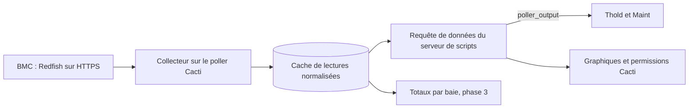

<!-- Source: README.md; SHA256: 7b4e83a58a1adc844cb0615ef30e95476cba2851f96bb454d2a816fb2774724d -->

<!-- translations:start -->
[English](../../../README.md) | [简体中文](../zh-CN/README.md) | [हिन्दी](../hi-IN/README.md) | [Español (España)](../es-ES/README.md) | [Español (Latinoamérica)](../es-419/README.md) | [العربية (السعودية)](../ar-SA/README.md) | [Afrikaans](../af-ZA/README.md) | [አማርኛ](../am-ET/README.md) | [العربية (مصر)](../ar-EG/README.md) | [العربية (المغرب)](../ar-MA/README.md) | [বাংলা](../bn-BD/README.md) | [Bosanski](../bs-BA/README.md) | [Deutsch](../de-DE/README.md) | [فارسی](../fa-IR/README.md) | [Filipino](../fil-PH/README.md) | [Français](../fr-FR/README.md) | [Français (Maroc)](README.md) | [Français (Sénégal)](../fr-SN/README.md) | [Hausa](../ha-NG/README.md) | [עברית](../he-IL/README.md) | [Hrvatski](../hr-HR/README.md) | [Bahasa Indonesia](../id-ID/README.md) | [Igbo](../ig-NG/README.md) | [Italiano](../it-IT/README.md) | [日本語](../ja-JP/README.md) | [한국어](../ko-KR/README.md) | [Malagasy](../mg-MG/README.md) | [मराठी](../mr-IN/README.md) | [Bahasa Melayu](../ms-MY/README.md) | [Nederlands](../nl-NL/README.md) | [Polski](../pl-PL/README.md) | [Português (Brasil)](../pt-BR/README.md) | [Русский](../ru-RU/README.md) | [Kinyarwanda](../rw-RW/README.md) | [Soomaali](../so-SO/README.md) | [Српски](../sr-RS/README.md) | [Svenska](../sv-SE/README.md) | [Kiswahili](../sw-KE/README.md) | [தமிழ்](../ta-IN/README.md) | [తెలుగు](../te-IN/README.md) | [ไทย](../th-TH/README.md) | [Türkçe](../tr-TR/README.md) | [Українська](../uk-UA/README.md) | [اردو](../ur-PK/README.md) | [Tiếng Việt](../vi-VN/README.md) | [isiXhosa](../xh-ZA/README.md) | [Yorùbá](../yo-NG/README.md) | [繁體中文](../zh-TW/README.md) | [isiZulu](../zu-ZA/README.md)
<!-- translations:end -->

# plugin_redfish

Un plugin Cacti 1.2 qui intègre la consommation électrique des serveurs, la température d'entrée d'air, l'état des ventilateurs et l'état de santé des alimentations depuis les contrôleurs de gestion de carte mère (BMC) dans Cacti sous forme d'équipements, de sources de données et de graphiques standards, via Redfish avec un basculement optionnel vers IPMI. Thold et Maint assurent ensuite le déclenchement des alertes et leur suppression, et une phase ultérieure ajoutera les totaux électriques par baie.

> **Statut : en cours de développement, aucune version publiée pour le moment (0.1.0-dev).** Les jalons 2 (socle technique) et 3 (objets Cacti et alertes) sont fusionnés sur `main`. Ce plugin n'est pas affilié au projet Cacti. Il s'installe sur Cacti 1.2.31 sous PHP 8.2 ou version ultérieure, enregistre les BMC et les identifiants, lit la consommation électrique, les températures, les ventilateurs et l'état de santé des alimentations depuis chaque BMC via Redfish dans son propre cache, et affiche l'état de santé de la collecte. Il ajoute des équipements Cacti, des graphiques par composant et de synthèse, ainsi que la prise en charge de Thold et Maint via des sources de données standards. L'intégration continue (CI) a testé un BMC simulé construit à partir de jeux de données rédigés manuellement et du serveur de simulation Redfish du DMTF ; aucun BMC réel ni parc pilote n'a encore été qualifié. La conception et la recherche figurent dans [docs/PLAN.md](../../PLAN.md), [docs/research/](../../research) et [docs/decisions/](../../decisions).

### Ce que livre le jalon 2

- Installation, mise à niveau, désactivation et désinstallation via l'API des plugins de Cacti, avec conservation des tables lors de la désinstallation sauf si le paramètre correspondant est désactivé. Sur une version de PHP antérieure à 8.2, le plugin refuse de s'installer ou de s'activer et indique la raison.
- Domaines d'accès « Redfish View » (page d'état de santé), « Redfish Operator » (page d'opérations) et « Redfish Admin » (pages des BMC et des identifiants), ainsi que les paramètres sous Configuration > Settings > Redfish.
- Un registre des BMC avec import CSV et export JSON. Les fichiers d'importation ne doivent pas contenir de mots de passe ; les identifiants sont référencés par leur nom.
- Identifiants stockés sous forme chiffrée avec AES-256-GCM. La clé est un fichier situé hors de la base de données, `/etc/cacti/redfish-vault.key` par défaut, contenant 64 caractères hexadécimaux (`openssl rand -hex 32`) ou exactement 32 octets aléatoires, appartenant à l'utilisateur du poller, non lisible par d'autres utilisateurs, dans un répertoire où seul l'utilisateur du poller ou root dispose des droits d'écriture. Une clé de 32 caractères imprimables est refusée en tant que phrase secrète. **Sauvegardez le fichier de clé avec la base de données** ; sans lui, chaque mot de passe enregistré devra être saisi à nouveau.
- Vérification TLS activée par défaut, avec un bundle d'autorités de certification (CA) par BMC ou une empreinte SPKI SHA-256. Une dérogation journalisée par BMC sans vérification reste affichée en avertissement sur la page d'état de santé.
- Un client Redfish en lecture seule : uniquement `GET` ainsi que l'ouverture et la fermeture de session, vérifiés par rapport à une liste d'autorisation avant l'envoi de toute requête.
- Un collecteur démarré depuis `poller_bottom` pour les BMC rattachés au poller principal, avec baux et échéances par BMC, temporisation exponentielle (backoff) et nettoyage après incident de l'unique session enregistrée par le plugin. Les collecteurs distants ne sont pas encore pris en charge ; ils nécessitent un choix explicite quant à la manière dont le collecteur accède à la base de données et à la clé (phase 4).
- Les enregistrements de BMC et les identifiants respectent les permissions d'équipements de Cacti : un utilisateur Redfish Admin ne voit, ne modifie et n'associe que les BMC des équipements qu'il est autorisé à consulter, et uniquement les identifiants qui ne sont utilisés par aucun BMC d'un équipement masqué.

### Ce qu'ajoute le jalon 3

- Modèles fournis sous forme de fichiers XML de modèles Cacti dans `templates/` et importés avec l'importateur natif de Cacti lors de l'installation et de la mise à niveau, appariés par empreinte de hachage afin qu'une importation mette à jour les objets du plugin sans rien dupliquer. Les trois fichiers de requêtes de données sont copiés dans `<cacti>/resource/script_server/` avec une empreinte enregistrée ; le plugin ne remplace jamais un fichier à cet emplacement qu'il n'a pas lui-même écrit, et la page d'état de santé avertit les administrateurs lorsque les modèles ou un fichier de requête ne sont pas en place. **Reinstall the Redfish Templates** sur la page des BMC permet de les importer à nouveau ; cette action nécessite la permission Import Templates de Cacti.
- **Create Device** ou **Add Graphs** sur chaque BMC ([ADR 0015](../../decisions/0015-attach-to-the-server-device-or-create-one-per-bmc.md)). Un BMC associé à un équipement serveur existant reçoit ses requêtes de données et ses graphiques sur cet équipement. Un BMC non associé reçoit un nouvel équipement créé à partir du modèle d'équipement « Redfish BMC », avec les vérifications de disponibilité désactivées et un nom d'hôte sous `.invalid`, afin que Cacti ne contacte jamais le BMC et n'affiche jamais son adresse. Dans les deux cas, un administrateur confirme d'abord un plan listant ce qui sera ajouté. Les deux actions nécessitent la permission de gestion des équipements de Cacti ainsi que le rôle Redfish Admin ; tout nouvel équipement que son créateur ne pourrait pas voir est immédiatement supprimé.
- Trois requêtes de données du serveur de scripts, « Redfish Fans », « Redfish Temperatures » et « Redfish Power Supplies », indexées par la clé de composant du BMC, avec un graphique par composant : vitesse de ventilateur en pourcentage ou en tr/min (selon l'unité signalée par le BMC), température, et puissance d'entrée et de sortie de l'alimentation en watts, chacun accompagné de son code d'état de santé.
- Une entrée « Redfish Node Summary » comprenant la puissance, la température d'entrée d'air, la température maximale, le nombre de ventilateurs et d'alimentations en anomalie, l'état de santé du nœud et l'ancienneté de la dernière lecture valide, représentée sur quatre graphiques : puissance, températures, état de santé des composants et ancienneté des données. Les seuils Thold sur ces sources de données déclenchent des alertes et Maint les supprime, sans aucune modification de l'un ou l'autre plugin.
- Le serveur de scripts répond uniquement depuis le cache du plugin et ne contacte jamais un BMC. Une valeur manquante, obsolète, exprimée dans une autre unité ou provenant d'un composant disparu vaut `U`, de sorte que les graphiques affichent une interruption et jamais zéro ; `age` possède toujours une valeur, ce qui permet à un seuil sur celle-ci de détecter un BMC qui a cessé de répondre.
- Un lien graphique depuis chaque graphique Redfish vers les graphiques Redfish de l'équipement, affiché uniquement aux utilisateurs autorisés par Cacti à consulter cet équipement.

**Lorsque les composants d'un BMC changent** (remplacement d'un ventilateur, mise à jour de micrologiciel renommant des capteurs), sélectionnez à nouveau **Add Graphs**. Un ventilateur ou une alimentation qui était présent et qui est désormais absent ou retiré est comptabilisé dans `fans_bad` ou `psus_bad` jusqu'à ce que vous effectuiez cette opération, afin qu'un ventilateur retiré déclenche une alerte ; un emplacement qui n'a jamais été occupé ne l'est pas. Add Graphs accepte les composants que le BMC signale désormais et Cacti réindexe les requêtes ; un composant disparu conserve sa source de données et son graphique, qui affichent `U` à partir de ce moment, et un nouveau composant reçoit un graphique. Supprimez manuellement les graphiques des composants disparus une fois que leur historique n'est plus nécessaire.

La suppression d'un équipement dissocie son BMC tout en conservant le BMC et son cache. La suppression d'un BMC, ou la désinstallation du plugin, conserve son équipement et ses graphiques.

## Rôles d'accès

| Domaine | Accès |
| --- | --- |
| Redfish View | Pages de supervision existantes. |
| Redfish Operator | Supervision, plus la page Opérations et les acquittements personnels de triage. |
| Redfish Admin | Accès Operator, plus la configuration existante et les actions d'administration. |

Après avoir copié les fichiers de mise à niveau, ouvrez la page Plugins en tant qu'administrateur pour enregistrer le nouveau domaine d'accès. Attribuez explicitement le domaine Operator sous **Configuration > Users** ou dans les groupes d'utilisateurs. Les mises à niveau conservent les identifiants et les droits existants des domaines View et Admin. L'accès Admin hérite de l'accès Operator, et l'accès Operator hérite de l'accès View à chaque requête ; cela n'ajoute pas d'autorisations enregistrées aux utilisateurs ou aux groupes. Les paramètres du plugin requièrent également l'accès Redfish Admin en plus de la permission Settings de Cacti.

Les permissions d'équipements de Cacti continuent de limiter les lignes et les actions disponibles pour chaque utilisateur ; les objets non associés requièrent un administrateur. Les opérateurs peuvent lever une suspension de collecte sur un BMC autorisé pour la prochaine exécution planifiée. Les identifiants, la configuration, l'association, la suppression et les autres modifications administratives restent dans les pages d'administration. Les acquittements ne durent que le temps de la session en cours de l'utilisateur, pendant une heure au maximum et tant que la même observation reste fraîche. Toute observation nouvelle ou modifiée les invalide. Ils ne marquent jamais une mesure en échec comme saine et ne suppriment jamais les alertes.

## Pourquoi

Chaque serveur dispose d'un BMC qui remonte l'état électrique et thermique indépendamment du système d'exploitation, ce qui lui permet de continuer à répondre lorsque l'OS est arrêté. Ces données servent au suivi des capacités et des coûts, à la détection précoce d'une panne de ventilateur ou d'alimentation et, en calcul haute performance (HPC), aux décisions de plafonnement électrique. Le plugin n'est toutefois pas spécifique au HPC.

Cacti couvre aujourd'hui une partie de ce besoin :

- **Paquets SNMP constructeurs.** La branche 1.2.x fournit des modèles Dell iDRAC et HPE iLO qui nécessitent un agent SNMP et sont spécifiques à chaque constructeur ; les travaux de recherche du jalon 1 ont montré qu'aucun des deux ne remonte la consommation électrique en watts ([docs/research/overlap.md](../../research/overlap.md)).
- **Un type d'identifiant sans collecteur.** plugin_credentials définit un identifiant « IPMI / Redfish (BMC) », mais n'interroge aucun BMC.
- **Aucune vue au niveau de la baie.** Le cœur de Cacti ne comporte pas d'objet baie ; un équipement dispose uniquement d'un champ texte libre `location`.

Le plugin interroge les BMC hors bande par rapport au cycle d'interrogation de Cacti, met en cache les lectures normalisées et les expose via une requête de données du serveur de scripts et des sources de données de synthèse. Il réutilise le moteur graphique, les permissions, Thold et Maint de Cacti, et ne modifie pas l'état des BMC. La prise en charge des collecteurs de données distants est prévue pour la phase 4 ; la collecte actuelle s'exécute uniquement sur le poller principal.

## Périmètre prévu

| Phase | Périmètre | Jalons |
|---|---|---|
| 0, recherche | Matrice des fournisseurs, confirmation du comportement en amont sur des BMC réels, coût d'interrogation, prototype de requête de données | [M1](https://github.com/somethingwithproof/plugin_redfish/milestone/1) |
| 1, observation | Registre des BMC, identifiants, TLS, collecteur Redfish, lectures normalisées, équipements, graphiques par index, alertes Thold, suppression Maint, page d'état de santé | [M2](https://github.com/somethingwithproof/plugin_redfish/milestone/2), [M3](https://github.com/somethingwithproof/plugin_redfish/milestone/3), [M4](https://github.com/somethingwithproof/plugin_redfish/milestone/4) |
| 2, ipmi | Basculement IPMI pour les BMC sans interface Redfish exploitable, désactivé par défaut | [M5](https://github.com/somethingwithproof/plugin_redfish/milestone/5) |
| 3, baies | Registre des baies, totaux électriques par baie avec couverture, marge budgétaire | [M6](https://github.com/somethingwithproof/plugin_redfish/milestone/6) |
| 4, distant | Collecteurs de données distants Cacti pour les réseaux BMC isolés | [M7](https://github.com/somethingwithproof/plugin_redfish/milestone/7) |

Hors périmètre : définition des plafonds électriques ou toute autre configuration BMC, contrôle d'alimentation, mise à jour de micrologiciel, accès console, moteur d'alerte propre au plugin et intégration d'ordonnanceur.

## Cibles de compatibilité

| Composant | Cible |
|---|---|
| Cacti | 1.2.31 ou version ultérieure, sans correctif du cœur |
| Base de données | MariaDB 10.2 ou MySQL 5.7 ou version ultérieure : l'unicité d'un BMC par équipement est assurée par une clé unique sur une colonne générée |
| PHP | 8.2 ou version ultérieure ; `setup.php` reste analysable sous 8.0 afin qu'un environnement non pris en charge reçoive un refus explicite au lieu de casser l'interface Cacti |
| BMC | Dell iDRAC, HPE iLO, Lenovo XCC et OpenBMC, selon la plage de micrologiciel ; voir [la matrice des fournisseurs](../../research/vendor-matrix.md) |
| Redfish | Nouvelles ressources de sous-systèmes et de capteurs en priorité, ressources dépréciées `Power` et `Thermal` en repli |
| Thold, Maint | Aucune modification requise |

## Conception

- [docs/PLAN.md](../../PLAN.md) constitue le plan complet : architecture, faits techniques en amont sur lesquels elle repose (avec sources et hypothèses restant à confirmer), modèle de mesure, frontières de sécurité, calculs de performance, tests et risques.
- [docs/decisions/](../../decisions) contient les comptes rendus de décisions d'architecture (ADR) pour les choix déjà arrêtés.
- [docs/REQUIREMENTS.md](../../REQUIREMENTS.md) associe chaque identifiant d'exigence à son ticket.

## Sécurité

Les identifiants des BMC contrôlent la gestion hors bande des serveurs. La conception les maintient hors des lignes de commande, des journaux et des pages, vérifie TLS par défaut, exécute toute commande externe via un tableau d'arguments avec une liste d'autorisation de sous-commandes et utilise des comptes BMC en lecture seule. Voir [docs/PLAN.md](../../PLAN.md#security) et [SECURITY.md](../../../SECURITY.md).

## Guide de l'opérateur

Consultez [docs/operator-guide.md](../../operator-guide.md) pour les prérequis d'installation, la configuration du coffre-fort de clés et de TLS, l'enregistrement des BMC, la création des graphiques, les intervalles d'alerte, la sauvegarde et la gestion des pannes. Le guide ne déclare aucune gamme réelle de micrologiciel constructeur comme prise en charge tant qu'une capture anonymisée de ce micrologiciel n'a pas passé la suite de tests.

## Suivi des travaux

- **Jalons** : suivent les jalons du plan. Chacun dispose d'un ticket épique listant ses sous-tickets et ses preuves de sortie.
- **Tickets** : classés par étiquette : `type: requirement`, `type: research`, `type: decision`, `type: epic`. Les tickets d'exigence énoncent des exigences numérotées et testables (`REQ-AREA-NNN`) ainsi que leurs critères d'acceptation.
- **Étiquettes** : portent également `area:`, `phase:`, `priority:` et `status:`. Voir [CONTRIBUTING.md](../../../CONTRIBUTING.md#labels).
- Le [tableau de projet](https://github.com/users/somethingwithproof/projects/12) présente l'ensemble des tickets à travers les différents jalons.

## Contribution

Lisez [CONTRIBUTING.md](../../../CONTRIBUTING.md). Les commits nécessitent une signature DCO (sign-off). Les discussions de conception ont lieu dans les tickets ; les décisions ouvertes portent l'étiquette `type: decision`. Les relevés provenant de BMC réels constituent actuellement la contribution la plus utile ; veillez à masquer les adresses, numéros de série et identifiants avant de publier toute capture.

## Licence

GNU General Public License v2.0, la même licence que Cacti et ses plugins. Voir [LICENSE](../../../LICENSE).
