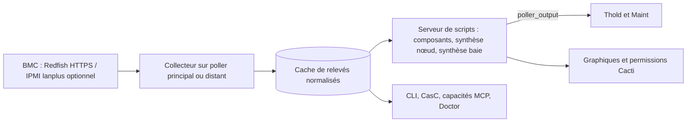

<!-- Source: README.md; SHA256: cf31b9f80d6c00020bbe08e80951d4de1c910793911d040ae7a66b54e8a2eaf0 -->

<!-- translations:start -->
[English](../../../README.md) | [简体中文](../zh-CN/README.md) | [हिन्दी](../hi-IN/README.md) | [Español (España)](../es-ES/README.md) | [Español (Latinoamérica)](../es-419/README.md) | [العربية (السعودية)](../ar-SA/README.md) | [Afrikaans](../af-ZA/README.md) | [አማርኛ](../am-ET/README.md) | [العربية (مصر)](../ar-EG/README.md) | [العربية (المغرب)](../ar-MA/README.md) | [বাংলা](../bn-BD/README.md) | [Bosanski](../bs-BA/README.md) | [Deutsch](../de-DE/README.md) | [فارسی](../fa-IR/README.md) | [Filipino](../fil-PH/README.md) | [Français](../fr-FR/README.md) | [Français (Maroc)](README.md) | [Français (Sénégal)](../fr-SN/README.md) | [Hausa](../ha-NG/README.md) | [עברית](../he-IL/README.md) | [Hrvatski](../hr-HR/README.md) | [Bahasa Indonesia](../id-ID/README.md) | [Igbo](../ig-NG/README.md) | [Italiano](../it-IT/README.md) | [日本語](../ja-JP/README.md) | [한국어](../ko-KR/README.md) | [Malagasy](../mg-MG/README.md) | [मराठी](../mr-IN/README.md) | [Bahasa Melayu](../ms-MY/README.md) | [Nederlands](../nl-NL/README.md) | [Polski](../pl-PL/README.md) | [Português (Brasil)](../pt-BR/README.md) | [Русский](../ru-RU/README.md) | [Kinyarwanda](../rw-RW/README.md) | [Soomaali](../so-SO/README.md) | [Српски](../sr-RS/README.md) | [Svenska](../sv-SE/README.md) | [Kiswahili](../sw-KE/README.md) | [தமிழ்](../ta-IN/README.md) | [తెలుగు](../te-IN/README.md) | [ไทย](../th-TH/README.md) | [Türkçe](../tr-TR/README.md) | [Українська](../uk-UA/README.md) | [اردو](../ur-PK/README.md) | [Tiếng Việt](../vi-VN/README.md) | [isiXhosa](../xh-ZA/README.md) | [Yorùbá](../yo-NG/README.md) | [繁體中文](../zh-TW/README.md) | [isiZulu](../zu-ZA/README.md)
<!-- translations:end -->

# plugin_redfish

Un plugin Cacti 1.2 qui intègre la consommation électrique des serveurs, la température d'entrée d'air, l'état des ventilateurs et l'état de santé des alimentations depuis les contrôleurs de gestion de carte mère (BMC) dans Cacti sous forme d'équipements, de sources de données et de graphiques standards, via Redfish avec un basculement optionnel en lecture seule vers IPMI et des cumuls de puissance à l'échelle de la baie. Thold et Maint déclenchent des alertes et les suppriment à travers les sources de données standards de Cacti.

> **Statut : en cours de développement, aucune version publiée pour le moment (`0.1.0-dev`).** Ce plugin n'est pas affilié au projet Cacti. Il s'installe sur Cacti 1.2.31 ou version ultérieure sous PHP 8.2 ou version ultérieure et implémente le collecteur Redfish, le coffre-fort chiffré d'identifiants, le provisionnement d'équipements et de graphiques Cacti, le basculement optionnel en lecture seule vers IPMI, le cumul de puissance par baie, l'affichage des fenêtres Cacti Maint, la réplication et les points d'accès d'agent pour les collecteurs de données distants, le fournisseur CasC et l'interface CLI opérateur, les capacités MCP ainsi que les contrôles de diagnostic Doctor. L'intégration continue (CI) teste des jeux de données de test, le serveur de simulation DMTF Redfish (maquettes de sous-système, héritées uniquement et HPE iLO Gen11) et Thold v1.8.2 avec Maint v1.3 ; aucun BMC physique réel ni parc pilote n'a encore été qualifié. La conception et la recherche figurent dans [docs/PLAN.md](../../PLAN.md), [docs/research/](../../research/) et [docs/decisions/](../../decisions/).

## Fonctionnalités implémentées

### Collecteur principal, coffre-fort et objets Cacti

- **Cycle de vie et schéma.** Installation, mise à niveau, désactivation et désinstallation via l'API des plugins de Cacti (`Schema::VERSION = 3`, 12 tables). Les tables sont conservées lors de la désinstallation sauf si l'option *Keep Plugin Tables on Uninstall* est décochée. Les points d'entrée restent analysables sous PHP 8.0 et refusent toute version PHP inférieure à 8.2 ou l'absence de `ext-openssl` avec un message d'erreur explicite.
- **Registre et permissions.** Domaines *Redfish View* (`redfish_health.php`), *Redfish Operator* (`redfish_operator.php`) et *Redfish Admin* (`redfish_bmcs.php`, `redfish_credentials.php`), ainsi que les paramètres dans **Configuration > Settings > Redfish**. Le registre des BMC prend en charge l'importation CSV (identifiants référencés par nom ; les mots de passe dans les fichiers d'importation sont refusés) et l'exportation JSON. Les fiches BMC et les identifiants suivent les droits d'accès aux équipements de Cacti.
- **Coffre-fort chiffré d'identifiants.** Les mots de passe sont stockés chiffrés avec AES-256-GCM dans `plugin_redfish_secret`. La clé se trouve en dehors de la base de données (`/etc/cacti/redfish-vault.key` par défaut) sous forme de 64 caractères hexadécimaux (`openssl rand -hex 32`) ou de 32 octets bruts, détenue par l'utilisateur du poller, illisible par les autres utilisateurs et placée dans un répertoire accessible en écriture uniquement par root ou cet utilisateur. Une phrase secrète imprimable de 32 caractères est refusée. **Sauvegardez le fichier de clé avec la base de données** ; sans ce fichier, les mots de passe stockés devront être saisis de nouveau.
- **TLS et client Redfish en lecture seule.** La vérification TLS est activée par défaut via le magasin d'autorités de certification du système, un bundle CA par BMC ou une empreinte SPKI SHA-256 ; la désactivation par BMC reste visible comme alerte de santé et avertissement de contrôle Doctor. Le client n'autorise que `GET` ainsi que l'ouverture (`POST`) et la fermeture (`DELETE`) de session Redfish, avec un basculement optionnel vers l'authentification Basic par BMC lorsque les sessions sont indisponibles. La découverte privilégie les nouvelles ressources Redfish de sous-système et de capteur et se rabat sur les ressources dépréciées `Power` et `Thermal`.
- **Exécution du collecteur.** `poller_redfish.php` est lancé depuis `poller_bottom`, exécute un processus maître par poller via le registre de processus de Cacti avec un nombre configurable de processus workers (`redfish_workers`), acquiert des baux par BMC, applique un budget de temps (`redfish_collector_budget`), applique un délai d'attente exponentiel (backoff) et nettoie la session précédente du plugin lui-même après un arrêt brutal.
- **Modèles, équipements et graphiques.** Importe `templates/redfish-templates.xml` par hachage et copie trois fichiers XML de requête de données du serveur de scripts (`redfish_fans.xml`, `redfish_temperatures.xml`, `redfish_psus.xml`) dans `<cacti>/resource/script_server/` sans écraser les fichiers modifiés par l'utilisateur. **Create Device** et **Add Graphs** exigent la confirmation d'un plan de provisionnement, attachent les requêtes à un équipement serveur associé ou créent un équipement « Redfish BMC » sous `.invalid` avec les contrôles de disponibilité désactivés, et relient chaque graphique Redfish aux graphiques Redfish de l'équipement via `graph_buttons`.
- **Entrées du serveur de scripts uniquement depuis le cache.** `scripts/ss_redfish_members.php` fournit les relevés par composant (ventilateur, température et alimentation), et `scripts/ss_redfish_summary.php` fournit les métriques « Redfish Node Summary » (puissance, température d'entrée et maximale, nombre de ventilateurs et d'alimentations en défaut, santé du nœud et ancienneté de la dernière lecture valide). Les appels au serveur de scripts lisent exclusivement le cache local et ne contactent jamais un BMC. Les relevés manquants, périmés ou de composants disparus retournent `U` (jamais `0`), tandis que `age` renvoie toujours une valeur afin que les seuils détectent les BMC silencieux.

**Lorsque les composants d'un BMC évoluent** (par exemple un ventilateur remplacé ou une mise à jour de firmware qui renomme des capteurs), relancez **Add Graphs**. Un ventilateur ou bloc d'alimentation précédemment présent qui disparaît est comptabilisé dans `fans_bad` ou `psus_bad` jusqu'à validation ; un emplacement qui n'a jamais été occupé n'est pas comptabilisé. Les composants disparus conservent leurs sources de données et graphiques existants, qui affichent `U` par la suite jusqu'à leur suppression manuelle. La suppression d'un équipement Cacti dissocie son BMC et retire son affectation à une baie tout en conservant le BMC et le cache ; la suppression d'un BMC ou la désinstallation du plugin conserve les équipements et les graphiques Cacti.

### Basculement optionnel vers IPMI

- **Activation explicite par BMC.** Désactivé par défaut (`protocols` vaut `redfish` par défaut ; l'activation du basculement IPMI définit `redfish,ipmi`).
- **Déclenchement ciblé du basculement.** Ne s'exécute que lorsque la collecte Redfish échoue avec une classe d'erreur éligible ; ne se déclenche jamais sur `AuthRejected`, `CredentialUnavailable`, `AddressRefused`, `OperationRefused` ou `Deadline`.
- **Exécution sécurisée.** Appelle `ipmitool` sur `-I lanplus` via `proc_open()` sous forme de tableau sans shell, avec un délai d'exécution horloge borné et une limite de sortie de 256 Kio. Les mots de passe sont fournis via `IPMITOOL_PASSWORD` (`-E`) ou un fichier temporaire en mode 0600 (`-f`) supprimé dans `finally`, jamais en argument de ligne de commande.
- **Liste blanche de commandes en lecture seule.** Seules cinq sous-commandes en lecture seule sont autorisées : `dcmi power reading`, `sdr type Temperature`, `sdr type Fan`, `sdr type Power Supply` et `chassis status`. Les commandes de modification sont refusées.
- **Sortie normalisée et alerte de posture.** `IpmiNormalizer` convertit les relevés dans le même modèle `Observation`/`Member`/`Reading`, en émettant `U` pour les capteurs absents ou impossibles à analyser. L'activation du basculement IPMI lève un avertissement sur la page de santé et dans le contrôle Doctor `redfish.bmc_security`, rappelant aux opérateurs de restreindre le port UDP 623 à un VLAN d'administration.

### Cumul de puissance par baie

- **Registre des baies.** La version 3 du schéma ajoute `plugin_redfish_rack` (couple unique `(site_id, name)`, champs optionnels `power_budget_watts`, `min_coverage_pct` égal à `80` par défaut et notes) ainsi que `plugin_redfish_rack_member` (au plus une affectation de baie par `host_id`, champs optionnels `bmc_id` et `unit_position`, automatiquement supprimée lors de la suppression d'un équipement Cacti).
- **Totaux protégés par la couverture.** `RackPowerSummary` additionne les relevés récents `power_watts` des membres depuis le cache local et calcule le taux d'utilisation du budget ainsi que la marge disponible. Lorsque le taux de couverture des membres qui remontent des données descend sous `min_coverage_pct`, `power_watts`, `utilization_pct` et `headroom_watts` renvoient `U` afin qu'une panne du collecteur ne soit jamais interprétée comme une baisse de consommation de la baie.
- **Entrée serveur de scripts prête pour Thold.** `scripts/ss_redfish_rack.php` (`ss_redfish_rack(<rack_id>)`) renvoie `power_watts`, `power_budget_watts`, `utilization_pct`, `headroom_watts`, `members_total`, `members_reporting` et `coverage_pct` uniquement depuis le cache local.

### Intégration Cacti Maint

- Les seuils Thold sur les sources de données Redfish déclenchent des alertes et Cacti Maint les inhibe sans aucune modification de l'un ou l'autre plugin.
- `MaintWindow` vérifie les plages Maint actives pour chaque hôte Cacti associé (plages ponctuelles `mtype=1` et récurrentes `mtype=2`, ainsi que `plugin_maint_check_cacti_host()` lorsqu'elle est chargée) et indique la maintenance active sur la page de santé Redfish (`[MAINT]`), dans la sortie de `cli/redfish.php health` et dans la capacité `redfish-get-health`.

### Collecteurs de données distants

- `INFO` déclare `remote_collect:1`. Les BMC acceptent tout `poller_id >= 1`, et `poller_redfish.php --poller=N` ne collecte que les BMC activés affectés à ce poller.
- **Hook `replicate_out`.** Ne réplique que les tables de configuration non secrètes destinées au poller distant cible via `replicate_out_table()` : `plugin_redfish_bmc`, les métadonnées de `plugin_redfish_credential` (sans texte chiffré), `plugin_redfish_rack` et `plugin_redfish_rack_member`. `plugin_redfish_secret` n'est pas répliquée et les fichiers de clé du coffre-fort demeurent strictement locaux sur chaque poller.
- **Hook `remote_agent`.** Expose les actions en lecture seule `redfish_health` et `redfish_discovery` n'acceptant que les paramètres numériques `poller_id` et `bmc_id`. Les paramètres inattendus sont refusés et aucun identifiant ni secret n'est retourné.

### Hooks d'écosystème (CasC, capacités MCP et Doctor)

- **Fournisseur CasC (`casc_register_providers`).** Enregistre le fournisseur `redfish` (version de schéma `1`) avec exportation YAML et XML en PHP pur, analyse syntaxique (avec rejet XXE), validation, planification des différences et application. Les identifiants n'apparaissent qu'en tant que références de coffre-fort (`vault:redfish:<name>`) ; les clés secrètes brutes (`pass`, `secret`, `token`, `private_key`, `vault_key`, `auth_token`) sont rejetées. L'application nécessite un `PLAN_HASH` SHA-256 exact.
- **API MCP / Abilities (`abilities_register`).** Enregistre trois capacités en lecture seule restreintes par le domaine Redfish View (`redfish_health.php`) et les droits sur les équipements Cacti, sans retourner aucun identifiant :
  - `redfish-list-bmcs` (`poller_id` optionnel)
  - `redfish-get-rack-power` (`rack_id` optionnel)
  - `redfish-get-health` (`bmc_id` optionnel)
- **Contrôles Doctor (`doctor_register_checks`).** Enregistre cinq contrôles de diagnostic locaux en lecture seule qui ne contactent jamais un BMC et ne retournent aucun élément de clé :
  - `redfish.schema` : conformité de la version du schéma
  - `redfish.vault_key` : lisibilité et permissions de la clé du coffre-fort
  - `redfish.collector_runs` : budget et fraîcheur du collecteur du poller
  - `redfish.bmc_security` : BMC activés avec TLS non vérifié ou basculement IPMI
  - `redfish.rack_power` : respect du budget électrique de la baie et du seuil minimal de couverture

## Interface CLI

À exécuter depuis le répertoire racine de Cacti avec PHP 8.2 ou version ultérieure :

```sh
# Operator and CasC CLI (reads --file=PATH or stdin for validate, plan, and apply)
php plugins/redfish/cli/redfish.php export --format=yaml|xml
php plugins/redfish/cli/redfish.php validate [--file=PATH] [--format=yaml|xml]
php plugins/redfish/cli/redfish.php plan [--file=PATH] [--format=yaml|xml]
php plugins/redfish/cli/redfish.php apply [--file=PATH] [--format=yaml|xml] --confirm=<PLAN_HASH>
php plugins/redfish/cli/redfish.php health --format=text|json

# Collector entry point (normally started by poller_bottom)
php plugins/redfish/poller_redfish.php [--poller=N] [--force] [--debug]

# Rack power summary script server entry point
php plugins/redfish/scripts/ss_redfish_rack.php <rack_id>
```

## Rôles d'accès

| Domaine | Accès |
| --- | --- |
| Redfish View | Pages de supervision existantes. |
| Redfish Operator | Supervision ainsi que la page Operations et les acquittements personnels de triage. |
| Redfish Admin | Accès Operator plus la configuration existante et les actions d'administration. |

Après avoir copié les fichiers de mise à niveau, ouvrez la page Plugins en tant qu'administrateur pour enregistrer les domaines. Attribuez explicitement le domaine Operator dans **Configuration > Users** ou aux groupes d'utilisateurs. Les mises à niveau conservent les identifiants de domaine et les droits existants pour View et Admin. L'accès Admin hérite de l'accès Operator, et l'accès Operator hérite de l'accès View à chaque requête ; cela n'ajoute pas de droits enregistrés aux utilisateurs ou aux groupes. Les paramètres du plugin requièrent également l'accès Redfish Admin en plus du droit Settings de Cacti.

Les permissions d'équipements Cacti limitent les lignes et actions disponibles pour chaque utilisateur ; les objets non associés nécessitent un administrateur. Les opérateurs peuvent lever une suspension de collecte sur un BMC autorisé pour la prochaine exécution planifiée. Les identifiants, la configuration, l'association, la suppression et les autres modifications d'administration restent dans les pages d'administration. Les acquittements ne sont valables que durant la session utilisateur en cours, pendant une heure au maximum et tant que la même observation reste fraîche. Toute observation nouvelle ou modifiée les invalide. Ils ne marquent jamais une mesure en échec comme saine et ne suppriment pas les alertes.

## Pourquoi

Chaque serveur dispose d'un BMC qui rapporte son état électrique et thermique indépendamment du système d'exploitation, continuant ainsi à répondre même lorsque l'OS est hors service. Ces données servent au suivi de la capacité et des coûts, à l'alerte précoce en cas de panne de ventilateur ou d'alimentation et, dans le calcul haute performance (HPC), aux décisions de plafonnement électrique. Le plugin n'est pas limité au HPC.

Cacti couvre aujourd'hui une partie de ce besoin :

- **Paquets SNMP constructeurs.** La branche 1.2.x fournit des modèles Dell iDRAC et HPE iLO qui nécessitent un agent SNMP et dépendent du constructeur ; l'étude du jalon 1 a montré qu'aucun des deux ne remonte la consommation en watts ([docs/research/overlap.md](../../research/overlap.md)).
- **Un type d'identifiant sans collecteur.** plugin_credentials définit un identifiant « IPMI / Redfish (BMC) » mais n'interroge aucun BMC.
- **Aucune vue par baie.** Le cœur de Cacti ne possède pas d'objet baie ; un équipement ne dispose que d'un champ texte libre `location`.

Le plugin interroge les BMC hors bande par rapport au cycle de collecte de Cacti sur le poller principal ou des collecteurs distants, met en cache les relevés normalisés et les expose via des requêtes de données du serveur de scripts, des synthèses de nœud et des synthèses de puissance de baie. Il réutilise les graphiques, permissions, Thold et Maint de Cacti sans modifier l'état des BMC.

## Périmètre et statut

| Phase | Périmètre | Jalons | Statut |
|---|---|---|---|
| 0, recherche | Matrice constructeurs, confirmation du comportement amont sur des BMC réels, coût de collecte, test de faisabilité des requêtes de données | [M1](https://github.com/somethingwithproof/plugin_redfish/milestone/1) | Terminé, en attente de captures de firmware sur de vrais BMC |
| 1, observation | Registre BMC, identifiants, TLS, collecteur Redfish, relevés normalisés, équipements, graphiques par index, alertes Thold, intégration Maint, page de santé | [M2](https://github.com/somethingwithproof/plugin_redfish/milestone/2), [M3](https://github.com/somethingwithproof/plugin_redfish/milestone/3), [M4](https://github.com/somethingwithproof/plugin_redfish/milestone/4) | Implémenté ; qualification du parc pilote M4 en attente |
| 2, ipmi | Basculement IPMI en lecture seule (`lanplus`) via `ipmitool`, désactivé par défaut | [M5](https://github.com/somethingwithproof/plugin_redfish/milestone/5) | Implémenté |
| 3, baies | Registre des baies, totaux de puissance par baie avec seuil minimal de couverture, marge budgétaire, `ss_redfish_rack.php` | [M6](https://github.com/somethingwithproof/plugin_redfish/milestone/6) | Implémenté |
| 4, distant et écosystème | Collecteurs de données distants (`replicate_out`, `remote_agent`), fournisseur CasC et CLI, capacités MCP, contrôles Doctor | [M7](https://github.com/somethingwithproof/plugin_redfish/milestone/7) | Implémenté |

Hors périmètre : définition de plafonds de puissance ou toute autre configuration de BMC, contrôle de l'alimentation, mise à jour de firmware, accès console, moteur d'alertes propre au plugin et intégration à un ordonnanceur.

## Cibles de compatibilité

| Composant | Cible |
|---|---|
| Cacti | 1.2.31 ou version ultérieure, sans correctif du noyau |
| Base de données | MariaDB 10.2 ou MySQL 5.7 ou version ultérieure : l'unicité d'un BMC par équipement est garantie par une clé unique sur une colonne générée |
| PHP | 8.2 ou version ultérieure ; les points d'entrée restent analysables sous 8.0 afin qu'un environnement non pris en charge reçoive un refus plutôt qu'une interface Cacti cassée |
| Extensions PHP | `ext-openssl` (requise par Cacti 1.2.31) ; sans `ext-curl` et sans dépendance d'exécution Composer |
| Outils optionnels | `ipmitool` sur les pollers qui collectent des BMC avec le basculement IPMI activé |
| BMC | Dell iDRAC, HPE iLO, Lenovo XCC et OpenBMC, selon la plage de firmware ; voir [la matrice constructeurs](../../research/vendor-matrix.md) |
| Redfish | Nouvelles ressources de sous-système et de capteur en priorité, ressources dépréciées `Power` et `Thermal` en repli |
| Thold, Maint | Aucune modification requise (la CI exécute Thold v1.8.2 et Maint v1.3) |

## Conception

- [docs/PLAN.md](../../PLAN.md) constitue le plan complet : architecture, faits amont sur lesquels elle s'appuie, modèle de mesure, limites de sécurité, calculs de performance, tests et risques.
- [docs/decisions/](../../decisions/) regroupe les enregistrements de décisions d'architecture pour les choix déjà arrêtés.
- [docs/REQUIREMENTS.md](../../REQUIREMENTS.md) associe chaque identifiant d'exigence à son ticket.



## Sécurité

Les identifiants BMC contrôlent l'administration hors bande des serveurs. La conception maintient les secrets hors des lignes de commande, journaux, exportations CasC, charges utiles d'agent distant, réponses MCP et pages web ; chiffre les mots de passe stockés avec AES-256-GCM à l'aide d'un fichier de clé de coffre-fort local par poller ; vérifie TLS par défaut ; exécute `ipmitool` depuis un tableau d'arguments explicite avec des sous-commandes en lecture seule autorisées ; et utilise des comptes BMC en lecture seule. Voir [docs/PLAN.md](../../PLAN.md#security) et [SECURITY.md](../../../SECURITY.md).

## Guide d'exploitation

Consultez [docs/operator-guide.md](../../operator-guide.md) pour les prérequis d'installation, la mise en place du coffre-fort et de TLS, l'enregistrement des BMC, la création des graphiques, les intervalles d'alerte, la sauvegarde et la gestion des incidents. Ce guide ne déclare aucune gamme réelle de firmware constructeur comme prise en charge tant qu'une capture expurgée issue de ce firmware n'a pas réussi la suite de tests.

## Développement et tests

La CI (`.github/workflows/plugin-ci-workflow.yml`) contrôle la syntaxe des points d'entrée sous PHP 8.0, exécute les suites Pest unitaires (`phpunit.xml`) et d'intégration de cycle de vie (`phpunit-integration.xml`) ainsi que PHPStan niveau 9 de PHP 8.2 à 8.5 sur Cacti `release/1.2.31` et `1.2.x`, vérifie le refus sous PHP 8.1, teste le serveur de simulation DMTF Redfish (maquettes de sous-système, héritées uniquement et HPE iLO Gen11) et Thold v1.8.2 / Maint v1.3 de bout en bout, et vérifie les catalogues gettext, les workflows et les licences REUSE.

Vérifications locales avant tout envoi (push) :

```sh
sh tests/lint-workflows.sh
sh locales/build_gettext.sh --check
CACTI_PATH=/path/to/cacti phpstan analyse -c phpstan.neon --no-progress
```

Exécutez Pest avec `--configuration=phpunit.xml` pour les tests unitaires et de règles sur les sources, ou avec `--configuration=phpunit-integration.xml` avec `CACTI_PATH` et `REDFISH_TEST_DATABASE=disposable` sur une base de données Cacti jetable pour les tests d'intégration de cycle de vie.

## Suivi des travaux

- **Les jalons (Milestones)** suivent les jalons du plan. Chacun dispose d'un ticket épique recensant ses sous-tickets et ses preuves de clôture.
- **Les tickets (Issues)** sont catégorisés par étiquette : `type: requirement`, `type: research`, `type: decision`, `type: epic`. Les tickets d'exigence formulent des exigences numérotées et testables (`REQ-AREA-NNN`) ainsi que les critères d'acceptation.
- **Les étiquettes** indiquent également `area:`, `phase:`, `priority:` et `status:`. Voir [CONTRIBUTING.md](../../../CONTRIBUTING.md#labels).
- Le [tableau de projet](https://github.com/users/somethingwithproof/projects/12) affiche l'ensemble des tickets à travers les jalons.

## Contribution

Lisez [CONTRIBUTING.md](../../../CONTRIBUTING.md). Les commits nécessitent un sign-off DCO. Les discussions de conception se déroulent sur les tickets ; les décisions ouvertes portent l'étiquette `type: decision`. Les données probantes issues de BMC réels constituent la contribution la plus utile actuellement ; masquez les adresses, numéros de série et identifiants avant de publier toute capture.

## Licence

GNU General Public License v2.0, la même licence que Cacti et ses plugins. Voir [LICENSE](../../../LICENSE).
