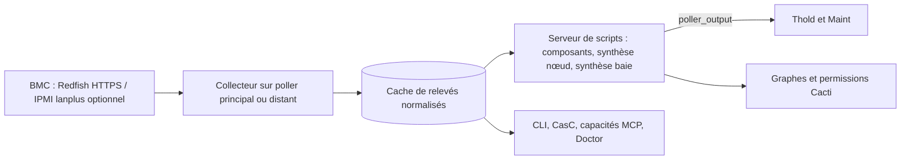

<!-- Source: README.md; SHA256: 6972a6c9ac754cd60e63c5caf971451ea8fe6e279eef757d886e1a168d3eef01 -->

<!-- translations:start -->
[English](../../../README.md) | [简体中文](../zh-CN/README.md) | [हिन्दी](../hi-IN/README.md) | [Español (España)](../es-ES/README.md) | [Español (Latinoamérica)](../es-419/README.md) | [العربية (السعودية)](../ar-SA/README.md) | [Afrikaans](../af-ZA/README.md) | [አማርኛ](../am-ET/README.md) | [العربية (مصر)](../ar-EG/README.md) | [العربية (المغرب)](../ar-MA/README.md) | [বাংলা](../bn-BD/README.md) | [Bosanski](../bs-BA/README.md) | [Deutsch](../de-DE/README.md) | [فارسی](../fa-IR/README.md) | [Filipino](../fil-PH/README.md) | [Français](../fr-FR/README.md) | [Français (Maroc)](../fr-MA/README.md) | [Français (Sénégal)](README.md) | [Hausa](../ha-NG/README.md) | [עברית](../he-IL/README.md) | [Hrvatski](../hr-HR/README.md) | [Bahasa Indonesia](../id-ID/README.md) | [Igbo](../ig-NG/README.md) | [Italiano](../it-IT/README.md) | [日本語](../ja-JP/README.md) | [한국어](../ko-KR/README.md) | [Malagasy](../mg-MG/README.md) | [मराठी](../mr-IN/README.md) | [Bahasa Melayu](../ms-MY/README.md) | [Nederlands](../nl-NL/README.md) | [Polski](../pl-PL/README.md) | [Português (Brasil)](../pt-BR/README.md) | [Русский](../ru-RU/README.md) | [Kinyarwanda](../rw-RW/README.md) | [Soomaali](../so-SO/README.md) | [Српски](../sr-RS/README.md) | [Svenska](../sv-SE/README.md) | [Kiswahili](../sw-KE/README.md) | [தமிழ்](../ta-IN/README.md) | [తెలుగు](../te-IN/README.md) | [ไทย](../th-TH/README.md) | [Türkçe](../tr-TR/README.md) | [Українська](../uk-UA/README.md) | [اردو](../ur-PK/README.md) | [Tiếng Việt](../vi-VN/README.md) | [isiXhosa](../xh-ZA/README.md) | [Yorùbá](../yo-NG/README.md) | [繁體中文](../zh-TW/README.md) | [isiZulu](../zu-ZA/README.md)
<!-- translations:end -->

# plugin_redfish

Un plugin Cacti 1.2 qui intègre la consommation électrique des serveurs, la température d'entrée, l'état des ventilateurs et l'état de santé des alimentations depuis les contrôleurs de gestion de carte mère (BMC) dans Cacti en tant qu'équipements, sources de données et graphes ordinaires, via Redfish avec un repli optionnel en lecture seule vers IPMI et des cumuls de puissance à l'échelle de la baie. Thold et Maint assurent les alertes et leur inhibition via les sources de données ordinaires de Cacti.

> **Statut : en développement, aucune version publiée pour le moment (`0.1.0-dev`).** Ce plugin n'est pas affilié au projet Cacti. Il s'installe sur Cacti 1.2.31 ou version ultérieure sous PHP 8.2 ou version ultérieure et implémente le collecteur Redfish, le coffre chiffré d'identifiants, le provisionnement d'équipements et de graphes Cacti, le repli optionnel en lecture seule vers IPMI, le cumul de puissance de baie, l'affichage des fenêtres Cacti Maint, la réplication et les points d'entrée d'agent pour collecteurs de données distants, le fournisseur CasC et l'outil CLI opérateur, les capacités MCP ainsi que les contrôles de diagnostic Doctor. L'intégration continue (CI) teste des jeux de données de test, le serveur de simulation DMTF Redfish (maquettes de sous-système, héritées uniquement et HPE iLO Gen11) et Thold v1.8.2 avec Maint v1.3 ; aucun BMC réel ni parc pilote n'a encore été qualifié. La conception et les travaux de recherche se trouvent dans [docs/PLAN.md](../../PLAN.md), [docs/research/](../../research/) et [docs/decisions/](../../decisions/).

## Capacités implémentées

### Collecteur principal, coffre et objets Cacti

- **Cycle de vie et schéma.** Installation, mise à niveau, désactivation et désinstallation via l'API des plugins de Cacti (`Schema::VERSION = 3`, 12 tables). Les tables sont conservées lors de la désinstallation sauf si l'option *Keep Plugin Tables on Uninstall* est décochée. Les points d'entrée restent analysables sous PHP 8.0 et refusent toute version PHP inférieure à 8.2 ou l'absence de `ext-openssl` avec un message d'erreur explicite.
- **Registre et permissions.** Domaines *Redfish View* (`redfish_health.php`), *Redfish Operator* (`redfish_operator.php`) et *Redfish Admin* (`redfish_bmcs.php`, `redfish_credentials.php`), ainsi que les paramètres dans **Configuration > Settings > Redfish**. Le registre des BMC gère l'importation CSV (identifiants référencés par nom ; les mots de passe dans les fichiers importés sont refusés) et l'exportation JSON. Les enregistrements BMC et les identifiants suivent les permissions d'équipements Cacti.
- **Coffre chiffré d'identifiants.** Les mots de passe sont stockés chiffrés avec AES-256-GCM dans `plugin_redfish_secret`. La clé est placée hors de la base de données (`/etc/cacti/redfish-vault.key` par défaut) sous forme de 64 caractères hexadécimaux (`openssl rand -hex 32`) ou 32 octets bruts, détenue par l'utilisateur du poller, illisible par les autres utilisateurs et stockée dans un répertoire accessible en écriture uniquement par root ou cet utilisateur. Une phrase secrète imprimable de 32 caractères est refusée. **Sauvegardez le fichier de clé avec la base de données** ; sans ce fichier, les mots de passe stockés doivent être saisis à nouveau.
- **TLS et client Redfish en lecture seule.** La vérification TLS est activée par défaut via le magasin d'autorités de certification système, un bundle CA par BMC ou une empreinte SPKI SHA-256 ; la désactivation par BMC demeure visible en tant qu'avertissement de santé et avertissement de contrôle Doctor. Le client autorise uniquement `GET` ainsi que la connexion (`POST`) et la déconnexion (`DELETE`) de session Redfish, avec un repli optionnel vers Basic par BMC lorsque les sessions ne sont pas disponibles. La découverte privilégie les nouvelles ressources Redfish de sous-système et de capteur et se rabat sur les ressources dépréciées `Power` et `Thermal`.
- **Exécution du collecteur.** `poller_redfish.php` démarre depuis `poller_bottom`, lance un processus maître par poller via le registre des processus Cacti avec un nombre configurable de processus travailleurs (`redfish_workers`), acquiert des baux par BMC, applique un budget de temps (`redfish_collector_budget`), applique un recul exponentiel et nettoie la session précédente du plugin lui-même après un plantage.
- **Modèles, équipements et graphes.** Importe `templates/redfish-templates.xml` par empreinte et copie trois fichiers XML de requête de données du serveur de scripts (`redfish_fans.xml`, `redfish_temperatures.xml`, `redfish_psus.xml`) dans `<cacti>/resource/script_server/` sans écraser les fichiers modifiés par l'utilisateur. **Create Device** et **Add Graphs** demandent la confirmation d'un plan de provisionnement, attachent les requêtes à un équipement serveur mappé ou créent un équipement « Redfish BMC » sous `.invalid` avec les contrôles de disponibilité désactivés, et relient chaque graphe Redfish aux graphes Redfish de l'équipement via `graph_buttons`.
- **Entrées du serveur de scripts uniquement sur cache.** `scripts/ss_redfish_members.php` fournit les relevés par composant (ventilateur, température et alimentation), et `scripts/ss_redfish_summary.php` fournit les métriques « Redfish Node Summary » (puissance, température d'entrée et maximale, nombre de ventilateurs et d'alimentations en défaut, état de santé du nœud et âge de la dernière lecture valide). Les appels du serveur de scripts lisent uniquement le cache local et ne contactent jamais un BMC. Les relevés manquants, périmés ou de composants disparus renvoient `U` (jamais `0`), tandis que `age` signale toujours une valeur afin que les seuils détectent les BMC silencieux.

**Lorsque les composants d'un BMC changent** (par exemple un ventilateur remplacé ou une mise à jour de micrologiciel qui renomme des capteurs), relancez **Add Graphs**. Un ventilateur ou une alimentation qui était présent auparavant et devient absent est compté dans `fans_bad` ou `psus_bad` jusqu'à acceptation ; un emplacement qui n'a jamais été occupé ne l'est pas. Les composants disparus gardent leurs sources de données et graphes existants, qui lisent `U` ensuite jusqu'à suppression manuelle. La suppression d'un équipement Cacti supprime le mappage de son BMC et retire son affectation à une baie tout en conservant le BMC et le cache ; la suppression d'un BMC ou la désinstallation du plugin conserve les équipements et graphes Cacti.

### Repli optionnel vers IPMI

- **Activation explicite par BMC.** Désactivé par défaut (`protocols` vaut `redfish` par défaut ; l'activation du repli IPMI configure `redfish,ipmi`).
- **Déclenchement encadré du repli.** S'exécute uniquement lorsque la collecte Redfish échoue avec une classe d'erreur éligible ; ne se déclenche jamais sur `AuthRejected`, `CredentialUnavailable`, `AddressRefused`, `OperationRefused` ou `Deadline`.
- **Exécution sécurisée.** Appelle `ipmitool` sur `-I lanplus` via `proc_open()` sous forme de tableau sans shell, avec un délai d'attente horloge borné et une limite de sortie de 256 Kio. Les mots de passe sont fournis via `IPMITOOL_PASSWORD` (`-E`) ou un fichier temporaire en mode 0600 (`-f`) supprimé dans `finally`, jamais en argument CLI.
- **Liste blanche de commandes en lecture seule.** Seules cinq sous-commandes en lecture seule sont autorisées : `dcmi power reading`, `sdr type Temperature`, `sdr type Fan`, `sdr type Power Supply` et `chassis status`. Les commandes de modification sont refusées.
- **Sortie normalisée et alerte de posture.** `IpmiNormalizer` associe les relevés au même modèle `Observation`/`Member`/`Reading`, en émettant `U` pour les capteurs manquants ou non analysables. L'activation du repli IPMI affiche un avertissement sur la page de santé et dans le contrôle Doctor `redfish.bmc_security`, rappelant aux opérateurs de restreindre UDP 623 à un VLAN d'administration.

### Cumul de puissance de baie

- **Registre des baies.** La version 3 du schéma ajoute `plugin_redfish_rack` (couple unique `(site_id, name)`, `power_budget_watts` optionnel, `min_coverage_pct` égal à `80` par défaut et notes) et `plugin_redfish_rack_member` (au plus une affectation de baie par `host_id`, `bmc_id` et `unit_position` optionnels, automatiquement supprimée lors de la suppression d'un équipement Cacti).
- **Totaux protégés par la couverture.** `RackPowerSummary` additionne les relevés récents `power_watts` des membres depuis le cache local et calcule l'utilisation du budget et la marge disponible. Lorsque la couverture des membres qui répondent passe sous `min_coverage_pct`, `power_watts`, `utilization_pct` et `headroom_watts` renvoient `U` afin que les pannes du collecteur ne ressemblent jamais à une baisse de puissance de la baie.
- **Entrée serveur de scripts prête pour Thold.** `scripts/ss_redfish_rack.php` (`ss_redfish_rack(<rack_id>)`) renvoie `power_watts`, `power_budget_watts`, `utilization_pct`, `headroom_watts`, `members_total`, `members_reporting` et `coverage_pct` uniquement depuis le cache local.

### Intégration Cacti Maint

- Les seuils Thold sur les sources de données Redfish déclenchent des alertes et Cacti Maint les inhibe sans aucune modification de l'un ou l'autre plugin.
- `MaintWindow` vérifie les plages Maint actives pour chaque hôte Cacti mappé (plages ponctuelles `mtype=1` et récurrentes `mtype=2`, ainsi que `plugin_maint_check_cacti_host()` lorsqu'elle est chargée) et signale la maintenance active sur la page de santé Redfish (`[MAINT]`), dans la sortie de `cli/redfish.php health` et dans la capacité `redfish-get-health`.

### Collecteurs de données distants

- `INFO` déclare `remote_collect:1`. Les BMC acceptent tout `poller_id >= 1`, et `poller_redfish.php --poller=N` collecte uniquement les BMC activés affectés à ce poller.
- **Hook `replicate_out`.** Réplique uniquement les tables de configuration non secrètes destinées au poller distant cible via `replicate_out_table()` : `plugin_redfish_bmc`, les métadonnées de `plugin_redfish_credential` (sans texte chiffré), `plugin_redfish_rack` et `plugin_redfish_rack_member`. `plugin_redfish_secret` n'est pas répliquée et les fichiers de clé du coffre restent strictement locaux sur chaque poller.
- **Hook `remote_agent`.** Expose les actions en lecture seule `redfish_health` et `redfish_discovery` n'acceptant que les paramètres numériques `poller_id` et `bmc_id`. Les paramètres inattendus sont refusés et aucun identifiant ni secret n'est renvoyé.

### Hooks d'écosystème (CasC, capacités MCP et Doctor)

- **Fournisseur CasC (`casc_register_providers`).** Enregistre le fournisseur `redfish` (version de schéma `1`) avec exportation YAML et XML en PHP pur, analyse (avec refus XXE), validation, planification des différences et application. Les identifiants n'apparaissent qu'en tant que références de coffre (`vault:redfish:<name>`) ; les clés secrètes brutes (`pass`, `secret`, `token`, `private_key`, `vault_key`, `auth_token`) sont rejetées. L'application nécessite un `PLAN_HASH` SHA-256 exact.
- **API MCP / Abilities (`abilities_register`).** Enregistre trois capacités en lecture seule restreintes par le domaine Redfish View (`redfish_health.php`) et les permissions d'équipements Cacti, ne renvoyant aucun identifiant :
  - `redfish-list-bmcs` (`poller_id` optionnel)
  - `redfish-get-rack-power` (`rack_id` optionnel)
  - `redfish-get-health` (`bmc_id` optionnel)
- **Contrôles Doctor (`doctor_register_checks`).** Enregistre cinq contrôles diagnostiques locaux en lecture seule qui ne contactent jamais un BMC et ne renvoient aucun matériel de clé :
  - `redfish.schema` : actualité de la version du schéma
  - `redfish.vault_key` : lisibilité et permissions de la clé du coffre
  - `redfish.collector_runs` : budget et fraîcheur du collecteur du poller
  - `redfish.bmc_security` : BMC activés avec TLS non vérifié ou repli IPMI
  - `redfish.rack_power` : respect du budget électrique de la baie et du plancher de couverture

## CLI

À exécuter depuis le répertoire racine de Cacti avec PHP 8.2 ou version ultérieure :

```sh
# Operator and CasC CLI (reads --file=PATH or stdin for validate, plan, and apply)
php plugins/redfish/cli/redfish.php export --format=yaml|xml
php plugins/redfish/cli/redfish.php validate [--file=PATH] [--format=yaml|xml]
php plugins/redfish/cli/redfish.php plan [--file=PATH] [--format=yaml|xml]
php plugins/redfish/cli/redfish.php apply [--file=PATH] [--format=yaml|xml] --confirm=<PLAN_HASH>
php plugins/redfish/cli/redfish.php health --format=text|json

# Collector entry point (normally started by poller_bottom)
php plugins/redfish/poller_redfish.php [--poller=N] [--force] [--debug]

# Rack power summary script server entry point
php plugins/redfish/scripts/ss_redfish_rack.php <rack_id>
```

## Rôles d'accès

| Domaine | Accès |
| --- | --- |
| Redfish View | Pages de surveillance existantes. |
| Redfish Operator | Surveillance plus la page Operations et les acquittements personnels de triage. |
| Redfish Admin | Accès Operator plus la configuration existante et les actions d'administration. |

Après avoir copié les fichiers de mise à niveau, ouvrez la page Plugins en tant qu'administrateur pour enregistrer les domaines. Attribuez explicitement le domaine Operator dans **Configuration > Users** ou aux groupes d'utilisateurs. Les mises à niveau conservent les identifiants de domaine et les droits existants pour View et Admin. L'accès Admin hérite de l'accès Operator, et l'accès Operator hérite de l'accès View à chaque requête ; cela n'ajoute pas de droits enregistrés aux utilisateurs ni aux groupes. Les paramètres du plugin requièrent également l'accès Redfish Admin en plus de la permission Settings de Cacti.

Les permissions d'équipements Cacti limitent les lignes et actions disponibles pour chaque utilisateur ; les objets non mappés requièrent un administrateur. Les opérateurs peuvent lever une mise en attente de collecte sur un BMC autorisé pour la prochaine exécution planifiée. Les identifiants, la configuration, le mappage, la suppression et les autres changements administratifs restent dans les pages d'administration. Les acquittements ne durent que pendant la session en cours de l'utilisateur, pendant au plus une heure et uniquement tant que la même observation reste fraîche. Les observations nouvelles ou modifiées les invalident. Ils ne marquent jamais une mesure en échec comme saine ni n'inhibent les alertes.

## Pourquoi

Chaque serveur dispose d'un BMC qui rapporte l'état électrique et thermique indépendamment du système d'exploitation, de sorte qu'il continue de répondre quand l'OS est hors service. Ces données servent au suivi de capacité et de coûts, à l'alerte précoce d'une panne de ventilateur ou d'alimentation et, dans le calcul haute performance, aux décisions de plafonnement électrique. Le plugin n'est pas limité au HPC.

Cacti couvre une partie de ce besoin aujourd'hui :

- **Paquets SNMP constructeurs.** La branche 1.2.x fournit des modèles Dell iDRAC et HPE iLO qui demandent un agent SNMP et dépendent du constructeur ; les recherches du jalon 1 ont montré qu'aucun des deux ne rapporte la consommation en watts ([docs/research/overlap.md](../../research/overlap.md)).
- **Un type d'identifiant sans collecteur.** plugin_credentials définit un identifiant « IPMI / Redfish (BMC) » mais ne lit aucun BMC.
- **Aucune vue au niveau de la baie.** Le cœur de Cacti n'a pas d'objet baie ; un équipement dispose seulement d'un champ texte libre `location`.

Le plugin interroge les BMC hors bande par rapport au cycle de collecte de Cacti sur le poller principal ou des collecteurs de données distants, met en cache les relevés normalisés et les expose via des requêtes de données du serveur de scripts, des synthèses de nœud et des synthèses de puissance de baie. Il réutilise les graphes, permissions, Thold et Maint de Cacti et ne modifie pas l'état du BMC.

## Périmètre et statut

| Phase | Périmètre | Jalons | Statut |
|---|---|---|---|
| 0, recherche | Matrice constructeurs, confirmation du comportement amont sur des BMC réels, coût de collecte, test exploratoire de requête de données | [M1](https://github.com/somethingwithproof/plugin_redfish/milestone/1) | Terminé, en attente de captures de micrologiciels sur de vrais BMC |
| 1, observation | Registre BMC, identifiants, TLS, collecteur Redfish, relevés normalisés, équipements, graphes par index, alertes Thold, intégration Maint, page de santé | [M2](https://github.com/somethingwithproof/plugin_redfish/milestone/2), [M3](https://github.com/somethingwithproof/plugin_redfish/milestone/3), [M4](https://github.com/somethingwithproof/plugin_redfish/milestone/4) | Implémenté ; qualification du parc pilote M4 en attente |
| 2, ipmi | Repli IPMI en lecture seule (`lanplus`) via `ipmitool`, désactivé par défaut | [M5](https://github.com/somethingwithproof/plugin_redfish/milestone/5) | Implémenté |
| 3, baies | Registre des baies, totaux de puissance de baie avec plancher de couverture, marge budgétaire, `ss_redfish_rack.php` | [M6](https://github.com/somethingwithproof/plugin_redfish/milestone/6) | Implémenté |
| 4, distant et écosystème | Collecteurs de données distants (`replicate_out`, `remote_agent`), fournisseur CasC et CLI, capacités MCP, contrôles Doctor | [M7](https://github.com/somethingwithproof/plugin_redfish/milestone/7) | Implémenté |

Hors périmètre : réglage de plafonds de puissance ou toute autre configuration de BMC, contrôle électrique, mise à jour de micrologiciel, accès console, moteur d'alertes propre au plugin et intégration à un ordonnanceur.

## Cibles de compatibilité

| Composant | Cible |
|---|---|
| Cacti | 1.2.31 ou version ultérieure, sans correctif du cœur |
| Base de données | MariaDB 10.2 ou MySQL 5.7 ou version ultérieure : un seul BMC par équipement est garanti par une clé unique sur une colonne générée |
| PHP | 8.2 ou version ultérieure ; les points d'entrée restent analysables sous 8.0 afin qu'un moteur non pris en charge reçoive un refus plutôt qu'une interface Cacti cassée |
| Extensions PHP | `ext-openssl` (requise par Cacti 1.2.31) ; pas d'`ext-curl` et aucune dépendance d'exécution Composer |
| Outils optionnels | `ipmitool` sur les pollers qui collectent des BMC avec le repli IPMI activé |
| BMC | Dell iDRAC, HPE iLO, Lenovo XCC et OpenBMC, selon la plage de micrologiciel ; voir [la matrice constructeurs](../../research/vendor-matrix.md) |
| Redfish | Nouvelles ressources de sous-système et de capteur d'abord, ressources dépréciées `Power` et `Thermal` en repli |
| Thold, Maint | Aucune modification requise (la CI teste Thold v1.8.2 et Maint v1.3) |

## Conception

- [docs/PLAN.md](../../PLAN.md) est le plan complet : architecture, faits amont sur lesquels elle repose, modèle de mesure, limites de sécurité, calculs de performance, tests et risques.
- [docs/decisions/](../../decisions/) contient les enregistrements de décisions d'architecture pour les choix déjà faits.
- [docs/REQUIREMENTS.md](../../REQUIREMENTS.md) associe chaque identifiant d'exigence à son ticket.



## Sécurité

Les identifiants BMC contrôlent la gestion hors bande des serveurs. La conception garde les secrets hors des lignes de commande, journaux, exportations CasC, charges utiles d'agent distant, réponses MCP et pages web ; chiffre les mots de passe stockés avec AES-256-GCM à l'aide d'un fichier de clé de coffre local par poller ; vérifie TLS par défaut ; exécute `ipmitool` depuis un tableau d'arguments explicite avec des sous-commandes en lecture seule autorisées ; et utilise des comptes BMC en lecture seule. Voir [docs/PLAN.md](../../PLAN.md#security) et [SECURITY.md](../../../SECURITY.md).

## Guide d'opérateur

Consultez [docs/operator-guide.md](../../operator-guide.md) pour les prérequis d'installation, la configuration du coffre et de TLS, l'enregistrement des BMC, la création de graphes, les intervalles d'alerte, la sauvegarde et la gestion des pannes. Le guide ne déclare aucune ligne réelle de micrologiciel constructeur comme prise en charge tant qu'une capture expurgée de ce micrologiciel n'a pas réussi la suite de tests.

## Développement et tests

L'intégration continue ([.github/workflows/plugin-ci-workflow.yml](../../../.github/workflows/plugin-ci-workflow.yml)) contrôle les points d'entrée sous PHP 8.0, exécute les suites Pest unitaires (`phpunit.xml`) et d'intégration de cycle de vie (`phpunit-integration.xml`) ainsi que PHPStan niveau 9 de PHP 8.2 à 8.5 sur Cacti `release/1.2.31` et `1.2.x`, vérifie le refus sous PHP 8.1, teste le serveur de simulation DMTF Redfish (maquettes de sous-système, héritées uniquement et HPE iLO Gen11) et Thold v1.8.2 / Maint v1.3 de bout en bout, et contrôle les catalogues gettext, les workflows et les licences REUSE.

Vérifications locales avant de pousser :

```sh
sh tests/lint-workflows.sh
sh locales/build_gettext.sh --check
CACTI_PATH=/path/to/cacti phpstan analyse -c phpstan.neon --no-progress
```

Exécutez Pest avec `--configuration=phpunit.xml` pour les tests unitaires et de règles de source, ou avec `--configuration=phpunit-integration.xml` avec `CACTI_PATH` et `REDFISH_TEST_DATABASE=disposable` sur une base Cacti jetable pour les tests d'intégration de cycle de vie.

## Suivi du travail

- **Les jalons (Milestones)** suivent les jalons du plan. Chacun possède un ticket épique listant ses sous-tickets et ses preuves de sortie.
- **Les tickets (Issues)** sont typés par étiquette : `type: requirement`, `type: research`, `type: decision`, `type: epic`. Les tickets d'exigence formulent des exigences numérotées et testables (`REQ-AREA-NNN`) ainsi que les critères d'acceptation.
- **Les étiquettes** portent aussi `area:`, `phase:`, `priority:` et `status:`. Voir [CONTRIBUTING.md](../../../CONTRIBUTING.md#labels).
- Le [tableau de projet](https://github.com/users/somethingwithproof/projects/12) montre tous les tickets à travers les jalons.

## Contribution

Lisez [CONTRIBUTING.md](../../../CONTRIBUTING.md). Les commits nécessitent une validation DCO. Les discussions de conception se font dans les tickets ; les décisions ouvertes portent l'étiquette `type: decision`. Les preuves provenant de véritables BMC sont la contribution la plus utile actuellement ; masquez les adresses, numéros de série et identifiants avant de publier toute capture.

## Licence

GNU General Public License v2.0, la même licence que Cacti et ses plugins. Voir [LICENSE](../../../LICENSE).
