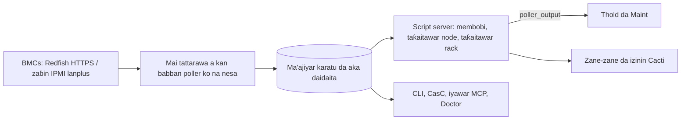

<!-- Source: README.md; SHA256: 6972a6c9ac754cd60e63c5caf971451ea8fe6e279eef757d886e1a168d3eef01 -->

<!-- translations:start -->
[English](../../../README.md) | [简体中文](../zh-CN/README.md) | [हिन्दी](../hi-IN/README.md) | [Español (España)](../es-ES/README.md) | [Español (Latinoamérica)](../es-419/README.md) | [العربية (السعودية)](../ar-SA/README.md) | [Afrikaans](../af-ZA/README.md) | [አማርኛ](../am-ET/README.md) | [العربية (مصر)](../ar-EG/README.md) | [العربية (المغرب)](../ar-MA/README.md) | [বাংলা](../bn-BD/README.md) | [Bosanski](../bs-BA/README.md) | [Deutsch](../de-DE/README.md) | [فارسی](../fa-IR/README.md) | [Filipino](../fil-PH/README.md) | [Français](../fr-FR/README.md) | [Français (Maroc)](../fr-MA/README.md) | [Français (Sénégal)](../fr-SN/README.md) | [Hausa](README.md) | [עברית](../he-IL/README.md) | [Hrvatski](../hr-HR/README.md) | [Bahasa Indonesia](../id-ID/README.md) | [Igbo](../ig-NG/README.md) | [Italiano](../it-IT/README.md) | [日本語](../ja-JP/README.md) | [한국어](../ko-KR/README.md) | [Malagasy](../mg-MG/README.md) | [मराठी](../mr-IN/README.md) | [Bahasa Melayu](../ms-MY/README.md) | [Nederlands](../nl-NL/README.md) | [Polski](../pl-PL/README.md) | [Português (Brasil)](../pt-BR/README.md) | [Русский](../ru-RU/README.md) | [Kinyarwanda](../rw-RW/README.md) | [Soomaali](../so-SO/README.md) | [Српски](../sr-RS/README.md) | [Svenska](../sv-SE/README.md) | [Kiswahili](../sw-KE/README.md) | [தமிழ்](../ta-IN/README.md) | [తెలుగు](../te-IN/README.md) | [ไทย](../th-TH/README.md) | [Türkçe](../tr-TR/README.md) | [Українська](../uk-UA/README.md) | [اردو](../ur-PK/README.md) | [Tiếng Việt](../vi-VN/README.md) | [isiXhosa](../xh-ZA/README.md) | [Yorùbá](../yo-NG/README.md) | [繁體中文](../zh-TW/README.md) | [isiZulu](../zu-ZA/README.md)
<!-- translations:end -->

# plugin_redfish

Ƙarin Cacti 1.2 (plugin) da ke kawo amfanin wutar lantarki na uwar garke, zafin shigowa, yanayin fanka, da lafiyar na'urar samar da wuta daga masu sarrafa gudanarwa na asali (BMCs) zuwa Cacti a matsayin na'urori na yau da kullun, tushen bayanai, da zane-zane, ta hanyar amfani da Redfish tare da zaɓin komawa kan IPMI mai karatu kaɗai da jimillar wutar lantarki na matakin rack. Thold da Maint suna faɗakarwa kuma suna dakatar da su ta hanyar tushen bayanai na yau da kullun na Cacti.

> **Matsayi: ana kan haɓakawa, babu fitarwa tukuna (`0.1.0-dev`).** Wannan ƙarin ba shi da alaƙa da aikin Cacti. Ana shigar da shi a kan Cacti 1.2.31 ko sama da haka ƙarƙashin PHP 8.2 ko sama da haka kuma yana aiwatar da mai tattara bayanan Redfish, ma'ajiyar sirri mai ɓoye bayanan shiga, samar da na'urori da zane-zane na Cacti, zaɓin komawa kan IPMI mai karatu kaɗai, jimillar wutar rack, nunin lokacin Cacti Maint, kwafin bayanai da wuraren shigar wakilai na masu tattara bayanai na nesa, mai samar da CasC da CLI na mai gudanarwa, iyawar MCP, da binciken ganewar matsala na Doctor. CI tana gwada kayan gwaji, DMTF Redfish Mockup Server (kwaikwayon subsystem, tsohon tsari kaɗai, da HPE iLO Gen11), da Thold v1.8.2 tare da Maint v1.3; ba a tantance wani BMC na zahiri ko rukunin gwaji ba tukuna. Tsarin da binciken suna cikin [docs/PLAN.md](../../PLAN.md), [docs/research/](../../research/), da [docs/decisions/](../../decisions/).

## Abubuwan da aka aiwatar

### Mai tattarawa na asali, ma'ajiyar sirri, da abubuwan Cacti

- **Zagayowar rayuwa da tsarin bayanai (Schema).** Yana shigarwa, haɓakawa, kashewa, da cirewa ta hanyar API na ƙarin Cacti (`Schema::VERSION = 3`, teburori 12). Ana ajiye teburori lokacin cirewa sai dai idan an cire zaɓin *Keep Plugin Tables on Uninstall*. Wuraren shiga suna tantancewa a PHP 8.0 kuma suna ƙin PHP ƙasa da 8.2 ko rashin `ext-openssl` tare da bayyanannen saƙon kuskure.
- **Rijista da izini.** Fannonin izini na *Redfish View* (`redfish_health.php`), *Redfish Operator* (`redfish_operator.php`), da *Redfish Admin* (`redfish_bmcs.php`, `redfish_credentials.php`), tare da saituna ƙarƙashin **Configuration > Settings > Redfish**. Rijistar BMC tana goyon bayan shigar da CSV (ana nuni ga bayanan shiga da suna; ana ƙin kalmomin sirri a cikin fayilolin shigarwa) da fitar da JSON. Bayanan BMC da bayanan shiga suna bin izinin na'urorin Cacti.
- **Ma'ajiyar sirri mai ɓoyayyen bayanan shiga.** Ana adana kalmomin sirri a ɓoye da AES-256-GCM cikin `plugin_redfish_secret`. Maɓallin yana zaune a wajen rumbun bayanai (`/etc/cacti/redfish-vault.key` ta tsohuwa) a matsayin haruffan hexadecimal 64 (`openssl rand -hex 32`) ko bytes 32 kai tsaye, mallakar mai amfani da poller, wanda sauran masu amfani ba za su iya karantawa ba, a cikin babban fayil da root ko wannan mai amfani kaɗai ke iya rubutawa a ciki. Ana ƙin kalmar sirri mai haruffa 32 da za a iya bugawa. **Ajiye fayil ɗin maɓalli tare da rumbun bayanai**; idan babu shi, dole ne a sake shigar da kalmomin sirri da aka adana.
- **TLS da abokin ciniki na Redfish mai karatu kaɗai.** An kunna tantancewar TLS ta tsohuwa ta amfani da ma'ajiyar CA ta tsarin, kunshin CA na kowane BMC, ko SPKI SHA-256 pin; zaɓin rashin tantancewa na kowane BMC yana kasancewa a bayyane a matsayin gargaɗin lafiya da gargaɗin binciken Doctor. Abokin ciniki yana ba da izinin `GET` kawai tare da shiga zaman Redfish (`POST`) da fita (`DELETE`), tare da zaɓin komawa kan Basic ga kowane BMC lokacin da zama ba ya samuwa. Bincike yana fifita sabbin albarkatun subsystem da na'urori masu auna sigina na Redfish kuma yana komawa kan tsofaffin albarkatun `Power` da `Thermal`.
- **Gudanar da mai tattarawa.** `poller_redfish.php` yana farawa daga `poller_bottom`, yana gudanar da babban tsari guda ɗaya a kowane poller ta hanyar rijistar tsari ta Cacti tare da yawan masu aiki da za a iya daidaitawa (`redfish_workers`), yana samun hayar kowane BMC, yana aiwatar da ƙayyadadden lokaci (`redfish_collector_budget`), yana amfani da jinkiri mai ƙaruwa, kuma yana share zaman plugin ɗin da ya gabata bayan faɗuwa.
- **Samfura, na'urori, da zane-zane.** Yana shigar da `templates/redfish-templates.xml` ta hanyar hash kuma yana kwafin fayilolin XML uku na tambayar bayanai na script server (`redfish_fans.xml`, `redfish_temperatures.xml`, `redfish_psus.xml`) zuwa `<cacti>/resource/script_server/` ba tare da goge fayilolin da mai amfani ya gyara ba. **Create Device** da **Add Graphs** suna buƙatar tabbatar da tsarin samarwa, suna haɗa tambayoyi zuwa na'urar uwar garke da aka haɗa ko ƙirƙirar na'urar "Redfish BMC" ƙarƙashin `.invalid` tare da kashe duba samuwa, kuma suna haɗa kowane zanen Redfish zuwa zane-zanen Redfish na na'urar ta hanyar `graph_buttons`.
- **Shigarwar script server daga ma'ajiyar wucin gadi kaɗai.** `scripts/ss_redfish_members.php` yana ba da karatun fanka, zafi, da PSU na kowane memba, kuma `scripts/ss_redfish_summary.php` yana ba da ma'aunin "Redfish Node Summary" (wuta, zafin shigowa da mafi girma, yawan fankoki da PSUs marasa lafiya, lafiyar node, da tsawon lokacin karatu mai kyau na ƙarshe). Kiran script server suna karantawa daga ma'ajiyar wucin gadi ta gida kaɗai kuma ba sa tuntuɓar BMC. Karatun da suka ɓace, suka tsufa, ko na membobin da suka tafi suna dawo da `U` (ba `0` ba), yayin da `age` ke ba da ƙima koyaushe don iyakoki su gano BMCs masu shiru.

**Lokacin da membobin BMC suka canza** (kamar fanka da aka sauya ko sabunta firmware da ke canza sunayen na'urori masu auna sigina), sake gudanar da **Add Graphs**. Fanka ko na'urar samar da wuta da ta kasance a baya wadda ta ɓace ana ƙidaya ta cikin `fans_bad` ko `psus_bad` har sai an amince da ita; ramin da ba a taɓa sanya abu a ciki ba ba a ƙidaya shi. Membobin da suka tafi suna riƙe tushen bayanai da zane-zanensu na yanzu, waɗanda za su riƙa karanta `U` daga baya har sai an goge su da hannu. Goge na'urar Cacti yana cire haɗin BMC ɗinta kuma yana cire rabon rack ɗinta yayin adana BMC da ma'ajiyar wucin gadi; goge BMC ko cire plugin ɗin yana adana na'urori da zane-zanen Cacti.

### Zaɓin komawa kan IPMI

- **Zaɓi na kowane BMC.** A kashe yake ta tsohuwa (`protocols` yana tsohuwa akan `redfish`; kunna komawa kan IPMI yana saita `redfish,ipmi`).
- **Ƙayyadadden abin da ke kunna komawa.** Yana aiki ne kawai lokacin da tattarawar Redfish ta gaza da nau'in kuskuren da ya cancanta; ba ya tashi a kan `AuthRejected`, `CredentialUnavailable`, `AddressRefused`, `OperationRefused`, ko `Deadline`.
- **Amintaccen aiwatarwa.** Yana kiran `ipmitool` akan `-I lanplus` ta hanyar `proc_open()` mai tsarin jeri ba tare da shell ba, da ƙayyadadden lokacin agogo, da iyakar fitarwa na 256 KiB. Ana bayar da kalmomin sirri ta `IPMITOOL_PASSWORD` (`-E`) ko fayil na wucin gadi mai yanayin 0600 (`-f`) da ake gogewa a `finally`, ba a kan CLI argv ba.
- **Jerin umarnin karatu kaɗai da aka yarda da su.** Umarnin karatu kaɗai guda biyar ne kawai aka halatta: `dcmi power reading`, `sdr type Temperature`, `sdr type Fan`, `sdr type Power Supply`, da `chassis status`. Ana ƙin umarnin da ke canza yanayi.
- **Fitowar da aka daidaita da gargaɗin matsayi.** `IpmiNormalizer` yana daidaita karatu zuwa tsarin `Observation`/`Member`/`Reading` iri ɗaya, yana fitar da `U` ga na'urori masu auna sigina da suka ɓace ko ba sa fassaruwa. Kunna komawa kan IPMI yana tayar da gargaɗi a shafin lafiya da kuma cikin binciken Doctor `redfish.bmc_security` don tunatar da masu gudanarwa su takaita UDP 623 zuwa VLAN na gudanarwa.

### Jimillar wutar lantarki na rack

- **Rijistar rack.** Sigar schema ta 3 tana ƙara `plugin_redfish_rack` (`(site_id, name)` na musamman, `power_budget_watts` na zaɓi, `min_coverage_pct` mai tsohuwar ƙima `80`, da bayanan kula) da `plugin_redfish_rack_member` (mafi yawa rabon rack guda ɗaya a kowane `host_id`, `bmc_id` da `unit_position` na zaɓi, waɗanda ake cirewa ta atomatik idan an goge na'urar Cacti).
- **Jimillar da aka kare da rufin bayani.** `RackPowerSummary` yana haɗa sabbin karatun `power_watts` na membobi daga ma'ajiyar wucin gadi ta gida kuma yana lissafin amfanin kasafin kuɗi da sauran ƙarfi. Lokacin da yawan membobin da ke ba da rahoto ya faɗi ƙasa da `min_coverage_pct`, `power_watts`, `utilization_pct`, da `headroom_watts` suna dawo da `U` don gazawar mai tattarawa kada ta taɓa bayyana a matsayin faɗuwar wutar rack.
- **Shigarwar script server a shirye don Thold.** `scripts/ss_redfish_rack.php` (`ss_redfish_rack(<rack_id>)`) yana dawo da `power_watts`, `power_budget_watts`, `utilization_pct`, `headroom_watts`, `members_total`, `members_reporting`, da `coverage_pct` daga ma'ajiyar wucin gadi ta gida kaɗai.

### Haɗin kai da Cacti Maint

- Iyakokin Thold a kan tushen bayanai na Redfish suna ba da faɗakarwa kuma Cacti Maint yana dakatar da su ba tare da wani canji ga kowane plugin ba.
- `MaintWindow` yana duba jadawalin Maint masu aiki ga kowane uwar garken Cacti da aka haɗa (jadawalin sau ɗaya `mtype=1` da mai maimaitawa `mtype=2`, tare da `plugin_maint_check_cacti_host()` idan an ɗora) kuma yana nuna kulawa mai aiki a shafin Redfish Health (`[MAINT]`), a cikin fitowar `cli/redfish.php health`, da cikin iyawar `redfish-get-health`.

### Masu tattara bayanai na nesa

- `INFO` yana bayyana `remote_collect:1`. BMCs suna karɓar kowane `poller_id >= 1`, kuma `poller_redfish.php --poller=N` yana tattara BMCs masu kunnawa da aka sanya wa wannan poller ɗin kaɗai.
- **`replicate_out` hook.** Yana kwafin teburorin saituna marasa sirri kaɗai waɗanda aka keɓance don poller na nesa da aka nufa ta hanyar `replicate_out_table()`: `plugin_redfish_bmc`, bayanan `plugin_redfish_credential` (babu rubutu mai ɓoye), `plugin_redfish_rack`, da `plugin_redfish_rack_member`. Ba a kwafin `plugin_redfish_secret`, kuma fayilolin maɓallin ma'ajiyar sirri suna kasancewa a gida kawai a kowane poller.
- **`remote_agent` hook.** Yana bayyana ayyukan karatu kaɗai na `redfish_health` da `redfish_discovery` waɗanda ke karɓar sigogin lambobi `poller_id` da `bmc_id` kaɗai. Ana ƙin sigogin da ba a zata ba kuma ba a dawo da wani bayanan shiga ko sirri.

### Ƙugiyoyin yanayin aiki (CasC, iyawar MCP, da Doctor)

- **Mai samar da CasC (`casc_register_providers`).** Yana yin rajistar mai samar da `redfish` (sigar schema `1`) tare da fitar da YAML da XML cikin PHP zalla, fassara (tare da ƙin XXE), tantancewa, tsara bambanci, da aiwatarwa. Bayanan shiga suna bayyana ne kawai a matsayin nuni na ma'ajiyar sirri (`vault:redfish:<name>`); ana ƙin maɓallan sirri kai tsaye (`pass`, `secret`, `token`, `private_key`, `vault_key`, `auth_token`). Aiwatarwa yana buƙatar ainihin SHA-256 `PLAN_HASH`.
- **MCP / Abilities API (`abilities_register`).** Yana yin rajistar iyawa uku na karatu kaɗai da aka kulle a fannin Redfish View (`redfish_health.php`) da izinin na'urorin Cacti, ba tare da dawo da wani bayanan shiga ba:
  - `redfish-list-bmcs` (`poller_id` na zaɓi)
  - `redfish-get-rack-power` (`rack_id` na zaɓi)
  - `redfish-get-health` (`bmc_id` na zaɓi)
- **Binciken Doctor (`doctor_register_checks`).** Yana yin rajistar binciken ganewar matsala guda biyar na gida kuma na karatu kaɗai waɗanda ba sa tuntuɓar BMC ko dawo da kayan maɓalli:
  - `redfish.schema`: sabuntawar sigar schema
  - `redfish.vault_key`: karantawa da izinin maɓallin ma'ajiyar sirri
  - `redfish.collector_runs`: kasafin kuɗi da sabuntawar mai tattarawa na poller
  - `redfish.bmc_security`: BMCs masu kunnawa tare da TLS mara tantancewa ko komawa kan IPMI
  - `redfish.rack_power`: bin kasafin kuɗin wutar rack da mafi ƙarancin rufi

## CLI

Gudanar daga babban kundin adireshi na Cacti tare da PHP 8.2 ko sama da haka:

```sh
# Operator and CasC CLI (reads --file=PATH or stdin for validate, plan, and apply)
php plugins/redfish/cli/redfish.php export --format=yaml|xml
php plugins/redfish/cli/redfish.php validate [--file=PATH] [--format=yaml|xml]
php plugins/redfish/cli/redfish.php plan [--file=PATH] [--format=yaml|xml]
php plugins/redfish/cli/redfish.php apply [--file=PATH] [--format=yaml|xml] --confirm=<PLAN_HASH>
php plugins/redfish/cli/redfish.php health --format=text|json

# Collector entry point (normally started by poller_bottom)
php plugins/redfish/poller_redfish.php [--poller=N] [--force] [--debug]

# Rack power summary script server entry point
php plugins/redfish/scripts/ss_redfish_rack.php <rack_id>
```

## Matsayin samun dama

| Fanni (Realm) | Samun dama |
| --- | --- |
| Redfish View | Shafukan sa ido da ke akwai. |
| Redfish Operator | Sa ido tare da shafin Operations da amincewar rarraba matsala na mutum ɗaya. |
| Redfish Admin | Samun damar Operator tare da saitunan da ke akwai da ayyukan gudanarwa. |

Bayan kwafin fayilolin haɓakawa, buɗe shafin Plugins a matsayin mai gudanarwa don yin rajistar fannonin izini. Sanya fannin Operator a sarari ƙarƙashin **Configuration > Users** ko ƙungiyoyin masu amfani. Haɓakawa suna adana lambobin fanni da izini na View da Admin da ke akwai. Samun damar Admin yana gadon samun damar Operator, kuma samun damar Operator yana gadon samun damar View a kowace buƙata; wannan ba ya ƙara izini da aka adana ga masu amfani ko ƙungiyoyi. Saitunan plugin suma suna buƙatar samun damar Redfish Admin baya ga izinin Settings na Cacti.

Izinin na'urorin Cacti suna iyakance layuka da ayyukan da ke samuwa ga kowane mai amfani; abubuwan da ba a haɗa ba suna buƙatar mai gudanarwa. Masu aiki za su iya sakin riƙewar tattara bayanai a kan BMC da aka yarda don gudanarwa mai zuwa da aka tsara. Bayanan shiga, saiti, haɗawa, gogewa, da sauran canje-canjen gudanarwa suna kasancewa a shafukan gudanarwa. Amincewa tana dawwama ne kawai a zaman mai amfani na yanzu, na tsawon awa ɗaya a mafi yawa kuma yayin da wannan kallon ya kasance sabo. Sabbin kallon ko waɗanda suka canza suna soke su. Ba sa taɓa yi wa ma'aunin da ya gaza alamar lafiya ko dakatar da faɗakarwa.

## Dalili

Kowace uwar garke tana da BMC da ke ba da rahoton yanayin wuta da zafi ba tare da dogaro da tsarin aiki ba, don haka tana ci gaba da amsawa lokacin da OS ya sauka. Bayanan suna taimakawa wajen bin diddigin ƙarfi da farashi, gargaɗi da wuri game da fanka ko na'urar wuta da ta gaza, kuma, a cikin kwamfuta mai ƙarfi (HPC), yanke shawara kan iyakance wuta. Wannan ƙarin ba na HPC kaɗai ba ne.

Cacti yana rufe wani ɓangare na wannan a yau:

- **Kunshe-kunshen SNMP na masu siyarwa.** Reshen 1.2.x yana zuwa da samfuran Dell iDRAC da HPE iLO waɗanda ke buƙatar wakilin SNMP kuma sun keɓanta ga mai siyarwa; binciken mataki na 1 ya gano cewa babu ko ɗaya da ke ba da rahoton amfanin wuta a watts ([docs/research/overlap.md](../../research/overlap.md)).
- **Nau'in bayanan shiga ba tare da mai tattarawa ba.** plugin_credentials yana bayyana bayanan shiga na "IPMI / Redfish (BMC)" amma ba ya karanta wani BMC.
- **Babu kallo a matakin rack.** Tushen Cacti ba shi da abin rack; na'ura tana da filin rubutu kyauta na `location` kawai.

Ƙarin yana binciken BMCs a wajen zagayowar binciken Cacti a kan babban poller ko masu tattara bayanai na nesa, yana adana karatu da aka daidaita a ma'ajiyar wucin gadi, kuma yana bayyana su ta hanyar tambayoyin bayanai na script server, taƙaitawar node, da taƙaitawar wutar rack. Yana sake amfani da zane-zane, izini, Thold, da Maint na Cacti, kuma ba ya canza yanayin BMC.

## Iyaka da matsayi

| Mataki | Iyaka | Matakan ci gaba | Matsayi |
|---|---|---|---|
| 0, bincike | Jadawalin masu siyarwa, tabbatar da halayen asali a kan BMCs na zahiri, farashin bincike, gwajin tambayar bayanai | [M1](https://github.com/somethingwithproof/plugin_redfish/milestone/1) | An kammala, ana jiran bayanan firmware na BMC na gaske |
| 1, lura | Rijistar BMC, bayanan shiga, TLS, mai tattara Redfish, karatu da aka daidaita, na'urori, zane-zanen kowane ma'auni, faɗakarwar Thold, haɗin Maint, shafin lafiya | [M2](https://github.com/somethingwithproof/plugin_redfish/milestone/2), [M3](https://github.com/somethingwithproof/plugin_redfish/milestone/3), [M4](https://github.com/somethingwithproof/plugin_redfish/milestone/4) | An aiwatar; tantancewar rukunin gwaji na M4 tana jiran aiki |
| 2, ipmi | Komawa kan IPMI (`lanplus`) mai karatu kaɗai ta hanyar `ipmitool`, a kashe ta tsohuwa | [M5](https://github.com/somethingwithproof/plugin_redfish/milestone/5) | An aiwatar |
| 3, racks | Rijistar rack, jimillar wutar rack tare da mafi ƙarancin rufi, sauran ƙarfin kasafin kuɗi, `ss_redfish_rack.php` | [M6](https://github.com/somethingwithproof/plugin_redfish/milestone/6) | An aiwatar |
| 4, nesa da yanayin aiki | Masu tattara bayanai na nesa (`replicate_out`, `remote_agent`), mai samar da CasC da CLI, iyawar MCP, binciken Doctor | [M7](https://github.com/somethingwithproof/plugin_redfish/milestone/7) | An aiwatar |

Abubuwan da ba sa ciki: saita iyakokin wuta ko wani saitin BMC daban, sarrafa wuta, sabunta firmware, samun damar console, injin faɗakarwa mallakar plugin, da haɗin mai tsara jadawali.

## Manufofin dacewa

| Sashi | Manufa |
|---|---|
| Cacti | 1.2.31 ko sama da haka, babu gyare-gyaren tushe |
| Rumbun bayanai | MariaDB 10.2 ko MySQL 5.7 ko sama da haka: maɓalli na musamman a kan ginshiƙi da aka samar yana riƙe BMC ɗaya a kowace na'ura |
| PHP | 8.2 ko sama da haka; wuraren shiga suna ci gaba da tantancewa a kan 8.0 don tsarin da ba a tallafawa ya sami ƙi maimakon karyewar UI na Cacti |
| Ƙarin PHP | `ext-openssl` (wanda Cacti 1.2.31 ke buƙata); babu `ext-curl` kuma babu dogaro na lokacin gudu na Composer |
| Kayan aiki na zaɓi | `ipmitool` a kan pollers da ke tattara BMCs waɗanda aka kunna masu komawa kan IPMI |
| BMCs | Dell iDRAC, HPE iLO, Lenovo XCC, da OpenBMC, bisa kewayon firmware; duba [jadawalin masu siyarwa](../../research/vendor-matrix.md) |
| Redfish | Sabbin albarkatun subsystem da na'urori masu auna sigina da farko, tsofaffin `Power` da `Thermal` a matsayin abin komawa |
| Thold, Maint | Babu canje-canjen da ake buƙata (CI tana gwada Thold v1.8.2 da Maint v1.3) |

## Tsari

- [docs/PLAN.md](../../PLAN.md) shine cikakken tsarin: gine-gine, gaskiyar asali da ya dogara da ita, tsarin aunawa, iyakokin tsaro, lissafin aiki, gwaji, da haɗari.
- [docs/decisions/](../../decisions/) yana riƙe da bayanan shawarwarin gine-gine don zaɓukan da aka riga aka yanke.
- [docs/REQUIREMENTS.md](../../REQUIREMENTS.md) yana haɗa kowace lambar buƙata zuwa batunta.



## Tsaro

Bayanan shiga na BMC suna sarrafa gudanarwar uwar garke daga waje. Tsarin yana kiyaye sirri daga layukan umarni, rajistar bayanai, fitar da CasC, kayan aikin wakilin nesa, amsoshin MCP, da shafukan yanar gizo; yana ɓoye kalmomin sirri da aka adana da AES-256-GCM ta amfani da fayil ɗin maɓallin ma'ajiyar sirri na gida a kowane poller; yana tantance TLS ta tsohuwa; yana gudanar da `ipmitool` daga takamaiman tsarin jeri na hujjoji tare da ƙananan umarnin karatu kaɗai da aka halatta; kuma yana amfani da asusun BMC masu karatu kaɗai. Duba [docs/PLAN.md](../../PLAN.md#security) da [SECURITY.md](../../../SECURITY.md).

## Jagorar mai aiki

Duba [docs/operator-guide.md](../../operator-guide.md) don buƙatun shigarwa, saita ma'ajiyar sirri da TLS, rijistar BMC, ƙirƙirar zane, tazarar faɗakarwa, ajiyar bayanai, da sarrafa gazawa. Jagorar ba ta ayyana wani layin firmware na mai siyarwa na zahiri a matsayin wanda aka tallafa ba har sai bayanin da aka tace daga wannan firmware ɗin ya ci gwajin.

## Haɓakawa da gwaji

CI ([.github/workflows/plugin-ci-workflow.yml](../../../.github/workflows/plugin-ci-workflow.yml)) tana duba wuraren shiga a PHP 8.0, tana gudanar da gwaje-gwajen Pest unit (`phpunit.xml`) da na haɗin zagayowar rayuwa (`phpunit-integration.xml`) da PHPStan mataki na 9 a kan PHP 8.2 zuwa 8.5 akan Cacti `release/1.2.31` da `1.2.x`, tana tabbatar da ƙin PHP 8.1, tana gwada DMTF Redfish Mockup Server (kwaikwayon subsystem, tsohon tsari kaɗai, da HPE iLO Gen11) da Thold v1.8.2 / Maint v1.3 gaba ɗaya, kuma tana duba kundin gettext, ayyukan workflow, da lasisin REUSE.

Binciken gida kafin turawa (push):

```sh
sh tests/lint-workflows.sh
sh locales/build_gettext.sh --check
CACTI_PATH=/path/to/cacti phpstan analyse -c phpstan.neon --no-progress
```

Gudanar da Pest tare da `--configuration=phpunit.xml` don gwaje-gwajen unit da ƙa'idodin tushe, ko `--configuration=phpunit-integration.xml` tare da `CACTI_PATH` da `REDFISH_TEST_DATABASE=disposable` akan rumbun bayanai na Cacti mai jefarwa don gwaje-gwajen haɗin zagayowar rayuwa.

## Yadda ake bin diddigin aiki

- **Matakan ci gaba (Milestones)** suna bin matakan ci gaba na tsarin. Kowanne yana da batun epic da ke jera ƙananan batutuwa da shaidar fita.
- **Batutuwa (Issues)** an rarraba su ta lakabi: `type: requirement`, `type: research`, `type: decision`, `type: epic`. Batutuwan buƙatu suna bayyana buƙatu masu lamba da za a iya gwadawa (`REQ-AREA-NNN`) da ƙa'idodin karɓa.
- **Lakabi** kuma suna ɗauke da `area:`, `phase:`, `priority:`, da `status:`. Duba [CONTRIBUTING.md](../../../CONTRIBUTING.md#labels).
- [Allon aiki](https://github.com/users/somethingwithproof/projects/12) yana nuna duk batutuwa a cikin matakan ci gaba.

## Gudunmawa

Karanta [CONTRIBUTING.md](../../../CONTRIBUTING.md). Ayyukan commit suna buƙatar sa hannun DCO. Tattaunawar tsari tana faruwa a cikin batutuwa; buɗaɗɗun shawarwari suna ɗauke da lakabin `type: decision`. Shaida daga BMCs na zahiri ita ce gudunmawa mafi amfani a yanzu; cire adireshi, lambobin serial, da bayanan shiga kafin saka kowane bayani.

## Lasisi

GNU General Public License v2.0, lasisi iri ɗaya da na Cacti da ƙarin abubuwan sa. Duba [LICENSE](../../../LICENSE).
