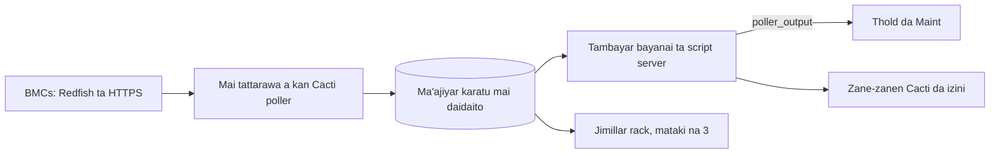

<!-- Source: README.md; SHA256: 7b4e83a58a1adc844cb0615ef30e95476cba2851f96bb454d2a816fb2774724d -->

<!-- translations:start -->
[English](../../../README.md) | [简体中文](../zh-CN/README.md) | [हिन्दी](../hi-IN/README.md) | [Español (España)](../es-ES/README.md) | [Español (Latinoamérica)](../es-419/README.md) | [العربية (السعودية)](../ar-SA/README.md) | [Afrikaans](../af-ZA/README.md) | [አማርኛ](../am-ET/README.md) | [العربية (مصر)](../ar-EG/README.md) | [العربية (المغرب)](../ar-MA/README.md) | [বাংলা](../bn-BD/README.md) | [Bosanski](../bs-BA/README.md) | [Deutsch](../de-DE/README.md) | [فارسی](../fa-IR/README.md) | [Filipino](../fil-PH/README.md) | [Français](../fr-FR/README.md) | [Français (Maroc)](../fr-MA/README.md) | [Français (Sénégal)](../fr-SN/README.md) | [Hausa](README.md) | [עברית](../he-IL/README.md) | [Hrvatski](../hr-HR/README.md) | [Bahasa Indonesia](../id-ID/README.md) | [Igbo](../ig-NG/README.md) | [Italiano](../it-IT/README.md) | [日本語](../ja-JP/README.md) | [한국어](../ko-KR/README.md) | [Malagasy](../mg-MG/README.md) | [मराठी](../mr-IN/README.md) | [Bahasa Melayu](../ms-MY/README.md) | [Nederlands](../nl-NL/README.md) | [Polski](../pl-PL/README.md) | [Português (Brasil)](../pt-BR/README.md) | [Русский](../ru-RU/README.md) | [Kinyarwanda](../rw-RW/README.md) | [Soomaali](../so-SO/README.md) | [Српски](../sr-RS/README.md) | [Svenska](../sv-SE/README.md) | [Kiswahili](../sw-KE/README.md) | [தமிழ்](../ta-IN/README.md) | [తెలుగు](../te-IN/README.md) | [ไทย](../th-TH/README.md) | [Türkçe](../tr-TR/README.md) | [Українська](../uk-UA/README.md) | [اردو](../ur-PK/README.md) | [Tiếng Việt](../vi-VN/README.md) | [isiXhosa](../xh-ZA/README.md) | [Yorùbá](../yo-NG/README.md) | [繁體中文](../zh-TW/README.md) | [isiZulu](../zu-ZA/README.md)
<!-- translations:end -->

# plugin_redfish

Ƙarin Cacti 1.2 (plugin) da ke kawo amfanin wutar lantarki na uwar garke, zafin shigowa, yanayin fanka, da lafiyar na'urar samar da wuta daga masu sarrafa gudanarwa na asali (BMCs) zuwa Cacti a matsayin na'urori na yau da kullun, tushen bayanai, da zane-zane, ta hanyar amfani da Redfish tare da zaɓin komawa kan IPMI. Daga nan Thold da Maint suna ba da faɗakarwa da dakatar da su, kuma mataki na gaba yana ƙara jimillar wutar lantarki na matakin rack.

> **Matsayi: ana kan haɓakawa, babu fitarwa tukuna (0.1.0-dev).** An haɗa matakan ci gaba na 2 (tushe) da na 3 (abubuwan Cacti da faɗakarwa) a kan `main`. Wannan ƙarin ba shi da alaƙa da aikin Cacti. Ana shigar da shi a kan Cacti 1.2.31 ƙarƙashin PHP 8.2 ko sama da haka, yana yin rajistar BMCs da bayanan sirri na shiga, yana karanta wuta, yanayin zafi, fankoki, da lafiyar na'urar samar da wuta daga kowane BMC ta Redfish zuwa cikin ma'ajiyarsa ta wucin gadi, kuma yana nuna lafiyar tattara bayanai. Yana ƙara na'urorin Cacti, zane-zane na kowane memba da na taƙaitawa, da goyon bayan Thold da Maint ta hanyar tushen bayanai na yau da kullun. CI ya gwada wani BMC na bogi da aka gina daga kayan gwaji da aka rubuta da hannu da uwar garken kwaikwayo na DMTF Redfish; ba a tantance wani BMC na gaske ko rukunin gwaji ba tukuna. Tsarin da binciken suna cikin [docs/PLAN.md](../../PLAN.md), [docs/research/](../../research), da [docs/decisions/](../../decisions).

### Abin da matakin ci gaba na 2 ya ƙunsa

- Shigarwa, haɓakawa, kashewa, da cirewa ta hanyar API na ƙarin Cacti, tare da ajiye teburori lokacin cirewa sai dai idan an goge saitin. A kan PHP ƙasa da 8.2 ƙarin yana ƙin shigarwa ko kunnawa kuma ya bayyana dalili.
- Yankunan izini "Redfish View" (shafin lafiya), "Redfish Operator" (shafin ayyuka), da "Redfish Admin" (shafukan BMCs da bayanan sirri na shiga), da saituna ƙarƙashin Configuration > Settings > Redfish.
- Rajistar BMC tare da shigo da CSV da fitar da JSON. Dole ne fayilolin shigowa su guji ƙunsar kalmomin sirri; ana nuni da bayanan sirri ta suna.
- Ana adana bayanan sirri a ɓoye tare da AES-256-GCM. Mabuɗin wani fayil ne a wajen rumbun adana bayanai, `/etc/cacti/redfish-vault.key` ta tsohuwa, mai ɗauke da haruffan hexadecimal guda 64 (`openssl rand -hex 32`) ko baiti na bazuwar guda 32 daidai, mallakar mai amfani na poller, ba a iya karanta shi ga sauran masu amfani, a cikin babban fayil da mai amfani na poller ko root kaɗai za su iya rubutawa. Ana ƙin mabuɗi mai haruffa masu iya bugawa guda 32 a matsayin kalmar wucewa. **Ajiye madadin fayil ɗin mabuɗin tare da rumbun adana bayanai**; ba tare da shi ba dole ne a sake shigar da kowace kalmar sirri da aka adana.
- Tabbatar da TLS yana kunne ta tsohuwa, tare da tarin CA na kowane BMC ko pin na SPKI SHA-256. Zaɓin fita ba tare da tabbatarwa ba na kowane BMC da aka rubuta a rajista yana kasancewa a shafin lafiya a matsayin gargaɗi.
- Abokin ciniki na Redfish na karatu kaɗai: `GET` tare da shiga da fita na zama kaɗai, ana dubawa da jerin izini kafin a aika kowace buƙata.
- Mai tattarawa da aka fara daga `poller_bottom` don BMCs a kan babban poller, tare da hayar lokaci da wa'adin kammalawa na kowane BMC, jinkirin sake gwadawa, da tsaftacewa bayan faɗuwar zama ɗaya da ƙarin ya rubuta. Ba a goyi bayan masu tattarawa na nesa ba tukuna; suna buƙatar zaɓi bayyananne na yadda mai tattarawa zai isa rumbun adana bayanai da mabuɗin (mataki na 4).
- Bayanan BMC da bayanan sirri suna bin izinin na'urar Cacti: Redfish Admin yana gani, yana canzawa, kuma yana haɗa BMCs kaɗai a kan na'urorin da aka ba su damar gani, da bayanan sirri kaɗai waɗanda babu wani BMC a kan ɓoyayyar na'ura ke amfani da su.

### Abin da matakin ci gaba na 3 ya ƙara

- Samfura da aka haɗa a matsayin XML na samfurin Cacti a cikin `templates/` kuma aka shigo da su ta mai shigo da bayanai na Cacti da kansa lokacin shigarwa da haɓakawa, ana daidaita su ta hash, ta yadda shigowa ke sabunta abubuwan ƙarin ba tare da ƙara wani abu sau biyu ba. Ana kwafin fayilolin tambayar bayanai guda uku zuwa `<cacti>/resource/script_server/` tare da hash da aka rubuta; ƙarin ba ya taɓa maye gurbin fayil a wurin da ba shi ya rubuta ba, kuma shafin lafiya yana gargaɗar masu gudanarwa lokacin da samfuran ko fayil ɗin tambaya ba sa wurin. **Reinstall the Redfish Templates** a shafin BMCs yana sake shigo da su; yana buƙatar izinin Import Templates na Cacti.
- **Create Device** ko **Add Graphs** a kan kowane BMC ([ADR 0015](../../decisions/0015-attach-to-the-server-device-or-create-one-per-bmc.md)). BMC da aka haɗa da na'urar uwar garke da ke akwai yana samun tambayoyin bayanai da zane-zane a kan wannan na'urar. BMC da ba a haɗa ba yana samun sabuwar na'ura daga samfurin na'urar "Redfish BMC", tare da kashe duban samuwa da sunan uwar garke ƙarƙashin `.invalid`, ta yadda Cacti ba ya taɓa tuntuɓar BMC ɗin kuma ba ya taɓa nuna adireshinsa. Ta kowace hanya mai gudanarwa yana fara tabbatar da shirin da ke lissafa abin da za a ƙara. Dukansu suna buƙatar izinin gudanar da na'urar Cacti da kuma Redfish Admin; ana sake cire sabuwar na'urar da mai ƙirƙirar ba zai iya gani ba.
- Tambayoyin bayanai na script server guda uku, "Redfish Fans", "Redfish Temperatures", da "Redfish Power Supplies", waɗanda aka jera su ta maɓallin memba na BMC, tare da zane ga kowane memba: saurin fanka a cikin kashi ko RPM (duk naúrar da BMC ya bayar), zafin jiki, da watts na shigowa da fitarwa na na'urar samar da wuta, kowanne da lambar lafiyarsa.
- Shigarwa na "Redfish Node Summary" tare da wuta, zafin shigowa, zafi mafi girma, fankoki da na'urorin wuta da ba su da kyau, lafiyar node, da shekarun kyakkyawan karatu na ƙarshe, da aka zana a kan zane-zane guda huɗu: wuta, yanayin zafi, lafiyar sassa, da shekarun bayanai. Iyakan Thold a kan waɗannan tushen bayanai suna faɗakarwa, kuma Maint yana dakatar da su, ba tare da wani sauyi ga kowane ƙarin ba.
- Script server yana amsawa ne kawai daga ma'ajiyar wucin gadi ta ƙarin kuma ba ya taɓa tuntuɓar BMC. Ƙimar da ta ɓace, ta tsufa, ta wata naúrar daban, ko ta memba da ya ɓace tana zama `U`, ta yadda zane-zane ke nuna gibi, ba sifili ba; `age` koyaushe yana da ƙima, ta yadda iyaka a kansa ke kama BMC da ya daina amsawa.
- Hanyar haɗin zane daga kowane zanen Redfish zuwa zane-zanen Redfish na na'urar, ana nuna ta ne kawai ga masu amfani da Cacti ya ba su damar ganin na'urar.

**Lokacin da membobin BMC suka canza** (an maye gurbin fanka, sabunta firmware ya sake suna wa na'urorin auna), zaɓi **Add Graphs** kuma. Fanka ko na'urar samar da wuta da ke akwai a baya kuma yanzu ba ta nan ko ta ɓace tana ƙidaya a cikin `fans_bad` ko `psus_bad` har sai ka yi hakan, don haka fanka da aka cire tana faɗakarwa; ramin da ba a taɓa cikawa ba ba ya ƙidaya. Add Graphs yana karɓar membobin da BMC ke bayarwa yanzu, kuma Cacti yana sake jera tambayoyin; memban da ya ɓace yana riƙe tushen bayanansa da zanensa, waɗanda ke karanta `U` daga nan gaba, kuma sabon memba yana samun zane. Share zane-zanen membobin da suka ɓace da hannu da zarar ba a ƙara buƙatar tarihinsu ba.

Share na'ura yana cire haɗin BMC ɗinta kuma yana riƙe BMC ɗin da ma'ajiyarta ta wucin gadi. Share BMC, ko cire ƙarin, yana riƙe na'urarsa da zane-zanensa.

## Matsayin shiga

| Yanki | Izini |
| --- | --- |
| Redfish View | Shafukan sa ido na yanzu. |
| Redfish Operator | Sa ido tare da shafin Ayyuka (Operations) da tabbatarwar tantancewa ta sirri. |
| Redfish Admin | Izinin Operator tare da saitunan yanzu da ayyukan gudanarwa. |

Bayan kwafin fayilolin haɓakawa, buɗe shafin Plugins a matsayin mai gudanarwa don yin rajistar
sabon yankin. Sanya yankin Operator a bayyane ƙarƙashin **Configuration > Users** ko ƙungiyoyin masu amfani.
Haɓakawa yana riƙe ID na yankin View da Admin da ke akwai da izini. Izinin Admin yana
gādar izinin Operator, kuma izinin Operator yana gādar izinin View a kan kowace buƙata;
wannan ba ya ƙara izinin da aka adana ga masu amfani ko ƙungiyoyi. Saitunan ƙarin kuma suna buƙatar
izinin Redfish Admin baya ga izinin Settings na Cacti.

Izinin na'urar Cacti har yanzu yana iyakance layuka da ayyukan da ke akwai ga kowane mai amfani; abubuwan da ba a haɗa su ba suna buƙatar mai gudanarwa. Masu aiki za su iya sakin riƙon tattarawa a kan BMC da aka ba da izini don gudanarwar da aka tsara ta gaba.
Bayanan sirri na shiga, saiti, haɗawa, sharewa da sauran sauye-sauyen gudanarwa
suna kasancewa a cikin shafukan gudanarwa. Tabbatarwa tana wanzuwa ne kawai a cikin zaman
mai amfani na yanzu, na tsawon awa ɗaya a mafi yawa kuma kawai yayin da wannan abin lura ya kasance
sabo. Sabbin abubuwan lura ko waɗanda suka canza suna soke su. Ba sa taɓa nuna ma'aunin
da ya gaza a matsayin mai lafiya ko dakatar da faɗakarwa.

## Dalili

Kowane uwar garke yana da BMC da ke ba da rahoton yanayin wuta da zafi ba tare da dogaro da tsarin aiki ba, don haka yana ci gaba da amsawa lokacin da OS ya sauka. Bayanan suna amfani don bin diddigin ƙarfi da farashi, gargaɗin farko na fanka ko na'urar samar da wuta da ta lalace, kuma, a cikin ƙididdiga mai ƙarfi, yanke shawarar iyakance wuta. Ƙarin ba na HPC kaɗai ba ne.

Cacti yana rufe wani ɓangare na wannan a yau:

- **Kunshe-kunshen SNMP na masu samarwa.** Reshen 1.2.x yana jigilar samfuran Dell iDRAC da HPE iLO waɗanda ke buƙatar wakilin SNMP kuma sun keɓanta ga mai samarwa; binciken matakin ci gaba na 1 ya gano cewa babu ɗayansu da ke ba da rahoton amfanin wutar lantarki a watts ([docs/research/overlap.md](../../research/overlap.md)).
- **Nau'in bayanan sirri ba tare da mai tattarawa ba.** plugin_credentials yana ayyana bayanan sirri na "IPMI / Redfish (BMC)" amma ba ya karanta wani BMC.
- **Babu kallon matakin rack.** Babban Cacti ba shi da abin rack; na'ura tana da filin `location` na rubutu kyauta.

Ƙarin yana tambayar BMCs a wajen zagayowar tambaya ta Cacti, yana adana karatu mai daidaito a ma'ajiyar wucin gadi, kuma yana nuna su ta hanyar tambayar bayanai ta script server da tushen bayanai na taƙaitawa. Yana sake amfani da zane-zane, izini, Thold, da Maint na Cacti, kuma ba ya canza yanayin BMC. An shirya goyon bayan mai tattara bayanai na nesa don mataki na 4; tattarawar yanzu tana gudana ne a kan babban poller kaɗai.

## Iyakar da aka tsara

| Mataki | Iyaka | Matakan ci gaba |
|---|---|---|
| 0, bincike | Jadawalin masu samarwa, tabbatar da halayyar asali a kan BMCs masu aiki, farashin tambaya, gwajin tambayar bayanai | [M1](https://github.com/somethingwithproof/plugin_redfish/milestone/1) |
| 1, lura | Rajistar BMC, bayanan sirri, TLS, mai tattarawa na Redfish, karatu mai daidaito, na'urori, zane-zane na kowane ma'auni, faɗakarwar Thold, dakatarwar Maint, shafin lafiya | [M2](https://github.com/somethingwithproof/plugin_redfish/milestone/2), [M3](https://github.com/somethingwithproof/plugin_redfish/milestone/3), [M4](https://github.com/somethingwithproof/plugin_redfish/milestone/4) |
| 2, ipmi | Komawa kan IPMI don BMCs ba tare da Redfish mai amfani ba, a kashe ta tsohuwa | [M5](https://github.com/somethingwithproof/plugin_redfish/milestone/5) |
| 3, racks | Rajistar rack, jimillar wutar rack tare da rufewa, sararin kasafin kuɗi | [M6](https://github.com/somethingwithproof/plugin_redfish/milestone/6) |
| 4, nesa | Masu tattara bayanai na nesa na Cacti don keɓaɓɓun hanyoyin sadarwa na BMC | [M7](https://github.com/somethingwithproof/plugin_redfish/milestone/7) |

A wajen iyaka: saita iyakokin wuta ko duk wani saitin BMC, sarrafa wuta, sabunta firmware, samun damar console, injin faɗakarwa mallakar ƙarin, da haɗin mai tsarawa.

## Manufofin dacewa

| Sashi | Manufa |
|---|---|
| Cacti | 1.2.31 ko sama da haka, babu gyare-gyare a ainihin tsari |
| Rumbun adana bayanai | MariaDB 10.2 ko MySQL 5.7 ko sama da haka: ana riƙe BMC guda ɗaya ga kowace na'ura ta maɓalli na musamman a kan shafi da aka ƙirƙira |
| PHP | 8.2 ko sama da haka; `setup.php` yana ci gaba da kasancewa mai karantuwa a kan 8.0 don haka tsarin da ba a goyi bayansa ba yana samun ƙi maimakon UI na Cacti da ya lalace |
| BMCs | Dell iDRAC, HPE iLO, Lenovo XCC, da OpenBMC, ta kewayon firmware; duba [jadawalin masu samarwa](../../research/vendor-matrix.md) |
| Redfish | Sabbin albarkatun sashi da na'urar auna da farko, tsoffin `Power` da `Thermal` a matsayin madadin komawa |
| Thold, Maint | Ba a buƙatar wani sauyi ba |

## Tsari

- [docs/PLAN.md](../../PLAN.md) shi ne cikakken shirin: tsarin gine-gine, gaskiyar asali da ya dogara da ita (tare da tushe da zato da har yanzu za a tabbatar), tsarin auna, iyakokin tsaro, lissafin aiki, gwaji, da haɗari.
- [docs/decisions/](../../decisions) yana riƙe bayanan yanke shawara na tsarin gine-gine don zaɓuɓɓukan da aka riga aka yi.
- [docs/REQUIREMENTS.md](../../REQUIREMENTS.md) yana haɗa kowane ID na buƙata zuwa batunsa.

## Tsaro

Bayanan sirri na BMC suna sarrafa gudanarwar uwar garke a wajen tsarin aiki. Tsarin yana hana su shiga layin umarni, rajista, da shafuka, yana tabbatar da TLS ta tsohuwa, yana gudanar da kowane umarni na waje daga jeri na muhawara tare da ƙananan umarni da ke cikin jerin izini, kuma yana amfani da asusun BMC na karatu kaɗai. Duba [docs/PLAN.md](../../PLAN.md#security) da [SECURITY.md](../../../SECURITY.md).

## Jagorar mai aiki

Duba [docs/operator-guide.md](../../operator-guide.md) don buƙatun shigarwa, saitin vault da TLS, rajistar BMC, ƙirƙirar zane-zane, tazarar faɗakarwa, adana madadi, da magance matsala. Jagorar ba ta ayyana cewa ana goyi bayan wani layin firmware na mai samarwa na gaske ba har sai wani rikodin da aka tace daga wannan firmware ɗin ya ci gwajin.

## Yadda ake bin diddigin aiki

- **Matakan ci gaba** suna bin matakan ci gaba na shirin. Kowanne yana da babban batu da ke lissafa ƙananan batutuwa da shaidar kammalawa.
- **Batutuwa** an rarraba su ta alamar lakabi: `type: requirement`, `type: research`, `type: decision`, `type: epic`. Batutuwan buƙatu suna bayyana buƙatu masu lamba, masu gwaji (`REQ-AREA-NNN`) da sharuɗɗan karɓa.
- **Lakabi** kuma suna ɗauke da `area:`, `phase:`, `priority:`, da `status:`. Duba [CONTRIBUTING.md](../../../CONTRIBUTING.md#labels).
- [Allon aikin](https://github.com/users/somethingwithproof/projects/12) yana nuna duk batutuwa a cikin matakan ci gaba.

## Bayar da gudummawa

Karanta [CONTRIBUTING.md](../../../CONTRIBUTING.md). Ayyukan commit suna buƙatar sa hannu na DCO. Tattaunawar tsari tana faruwa a kan batutuwa; buɗaɗɗun shawarwari suna ɗauke da lakabin `type: decision`. Shaida daga BMCs na gaske ita ce gudummawa mafi amfani a yanzu; goge adireshi, lambobin serial, da bayanan sirri kafin a wallafa kowane rikodi.

## Lasisi

GNU General Public License v2.0, lasisi iri ɗaya da na Cacti da ƙarinsa. Duba [LICENSE](../../../LICENSE).
