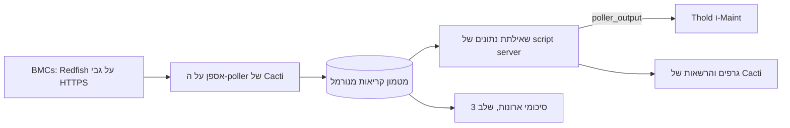

<!-- Source: README.md; SHA256: 7b4e83a58a1adc844cb0615ef30e95476cba2851f96bb454d2a816fb2774724d -->

<!-- translations:start -->
[English](../../../README.md) | [简体中文](../zh-CN/README.md) | [हिन्दी](../hi-IN/README.md) | [Español (España)](../es-ES/README.md) | [Español (Latinoamérica)](../es-419/README.md) | [العربية (السعودية)](../ar-SA/README.md) | [Afrikaans](../af-ZA/README.md) | [አማርኛ](../am-ET/README.md) | [العربية (مصر)](../ar-EG/README.md) | [العربية (المغرب)](../ar-MA/README.md) | [বাংলা](../bn-BD/README.md) | [Deutsch](../de-DE/README.md) | [فارسی](../fa-IR/README.md) | [Filipino](../fil-PH/README.md) | [Français](../fr-FR/README.md) | [Français (Maroc)](../fr-MA/README.md) | [Français (Sénégal)](../fr-SN/README.md) | [Hausa](../ha-NG/README.md) | [עברית](README.md) | [Bahasa Indonesia](../id-ID/README.md) | [Igbo](../ig-NG/README.md) | [Italiano](../it-IT/README.md) | [日本語](../ja-JP/README.md) | [한국어](../ko-KR/README.md) | [Malagasy](../mg-MG/README.md) | [मराठी](../mr-IN/README.md) | [Bahasa Melayu](../ms-MY/README.md) | [Nederlands](../nl-NL/README.md) | [Polski](../pl-PL/README.md) | [Português (Brasil)](../pt-BR/README.md) | [Русский](../ru-RU/README.md) | [Kinyarwanda](../rw-RW/README.md) | [Soomaali](../so-SO/README.md) | [Svenska](../sv-SE/README.md) | [Kiswahili](../sw-KE/README.md) | [தமிழ்](../ta-IN/README.md) | [తెలుగు](../te-IN/README.md) | [ไทย](../th-TH/README.md) | [Türkçe](../tr-TR/README.md) | [Українська](../uk-UA/README.md) | [اردو](../ur-PK/README.md) | [Tiếng Việt](../vi-VN/README.md) | [isiXhosa](../xh-ZA/README.md) | [Yorùbá](../yo-NG/README.md) | [繁體中文](../zh-TW/README.md) | [isiZulu](../zu-ZA/README.md)
<!-- translations:end -->

# plugin_redfish

תוסף עבור Cacti 1.2 המייבא נתוני צריכת חשמל של שרתים, טמפרטורת כניסה, מצב מאווררים ותקינות ספקי כוח מבקרי ניהול לוח אם (BMCs) אל תוך Cacti כהתקנים, מקורות נתונים וגרפים רגילים, באמצעות Redfish עם אפשרות לנסיגה (fallback) ל-IPMI. לאחר מכן, Thold ו-Maint מתריעים עליהם ומשתיקים אותם בהתאמה, ושלב מאוחר יותר מוסיף סיכומי הספק ברמת הארון (rack).

> **סטטוס: בפיתוח, טרם שוחררה גרסה (0.1.0-dev).** אבני דרך 2 (תשתית) ו-3 (אובייקטי Cacti והתרעות) ממוזגות ב-`main`. תוסף זה אינו משויך לפרויקט Cacti. הוא מותקן על גבי Cacti 1.2.31 תחת PHP 8.2 ומעלה, רושם בקרי BMC ופרטי גישה (credentials), קורא נתוני הספק, טמפרטורות, מאווררים ותקינות ספקי כוח מכל BMC באמצעות Redfish אל תוך המטמון שלו, ומציג את תקינות האיסוף. הוא מוסיף התקני Cacti, גרפים לכל רכיב וגרפי סיכום, וכן תמיכה ב-Thold וב-Maint דרך מקורות נתונים רגילים. מערך ה-CI בדק BMC מדומה שנבנה מתבניות בדיקה (fixtures) ידניות ומול שרת ההדמיה DMTF Redfish; אף BMC אמיתי או צי ניסוי טרם הוסמכו. התכנון והמחקר נמצאים ב-[docs/PLAN.md](../../PLAN.md), ב-[docs/research/](../../research) וב-[docs/decisions/](../../decisions).

### מה כוללת אבן דרך 2

- התקנה, שדרוג, השבתה והסרה דרך ה-API של תוספי Cacti, תוך שמירת הטבלאות בהסרה אלא אם ההגדרה נוקתה. בגרסאות PHP הישנות מ-8.2 התוסף מסרב להתקין או לפעול ומסביר מדוע.
- תחומי הרשאה (Realms): "Redfish View" (דף תקינות), "Redfish Operator" (דף תפעול) ו-"Redfish Admin" (דפי BMCs ופרטי גישה), והגדרות תחת Configuration > Settings > Redfish.
- רישום (registry) של בקרי BMC עם ייבוא CSV וייצוא JSON. קובצי הייבוא אינם רשאים להכיל סיסמאות; ההפניה לפרטי הגישה נעשית לפי שם.
- פרטי גישה נשמרים מוצפנים באמצעות AES-256-GCM. המפתח הוא קובץ מחוץ למסד הנתונים, `/etc/cacti/redfish-vault.key` כברירת מחדל, המכיל 64 תווים הקסדצימליים (`openssl rand -hex 32`) או 32 בתים אקראיים בדיוק, בבעלות משתמש ה-poller, ללא הרשאת קריאה למשתמשים אחרים, ובתיקייה שרק משתמש ה-poller או root יכולים לכתוב אליה. מפתח של 32 תווים הניתנים להדפסה נדחה כביטוי סיסמה (passphrase). **גבו את קובץ המפתח יחד עם מסד הנתונים**; בלעדיו יש להזין מחדש כל סיסמה שמורה.
- אימות TLS מופעל כברירת מחדל, עם חבילת CA או הצמדת (pin) SPKI SHA-256 לכל BMC. החרגה מתועדת של אי-אימות עבור BMC מסוים נשארת מוצגת כאזהרה בדף התקינות.
- לקוח Redfish לקריאה בלבד: `GET` וכן התחברות ויציאה מסשן (session) בלבד, הנבדקים מול רשימת היתרים (allowlist) לפני שליחת כל בקשה.
- אספן (collector) המופעל מתוך `poller_bottom` עבור בקרי BMC ב-poller הראשי, עם חכירות (leases) וזמני יעד לכל BMC, מנגנון השהיה הדרגתית (backoff) וניקוי לאחר קריסה של הסשן היחיד שהתוסף תיעד. אספנים מרוחקים אינם נתמכים עדיין; הם דורשים בחירה מפורשת של האופן שבו האספן ניגש למסד הנתונים ולמפתח (שלב 4).
- רשומות BMC ופרטי גישה כפופים להרשאות ההתקנים של Cacti: משתמש עם הרשאת Redfish Admin רואה, משנה ומקשר אך ורק בקרי BMC בהתקנים שמותר לו לראות, ואך ורק פרטי גישה שאינם בשימוש של אף BMC בהתקן מוסתר.

### מה מוסיפה אבן דרך 3

- תבניות המסופקות כ-XML של תבניות Cacti בתיקייה `templates/` ומיובאות באמצעות מנגנון הייבוא המובנה של Cacti בהתקנה ובשדרוג, בהתאמה לפי גיבוב (hash), כך שייבוא מעדכן את אובייקטי התוסף ואינו מוסיף דבר פעמיים. שלושת קובצי שאילתות הנתונים מועתקים אל `<cacti>/resource/script_server/` עם גיבוב מתועד; התוסף לעולם אינו מחליף שם קובץ שלא הוא כתב, ודף התקינות מתריע בפני מנהלי המערכת כאשר התבניות או אחד מקובצי השאילתה חסרים. הפעולה **Reinstall the Redfish Templates** בדף ה-BMCs מייבאת אותן מחדש; היא דורשת הרשאת Import Templates של Cacti.
- **Create Device** או **Add Graphs** עבור כל BMC ([ADR 0015](../../decisions/0015-attach-to-the-server-device-or-create-one-per-bmc.md)). בקר BMC הממופה להתקן קיים של שרת מקבל את שאילתות הנתונים והגרפים שלו על גבי אותו התקן. בקר BMC שאינו ממופה מקבל התקן חדש מתבנית ההתקן "Redfish BMC", עם בדיקות זמינות כבויות ושם מארח תחת `.invalid`, כך ש-Cacti לעולם אינו יוצר קשר עם ה-BMC ואינו מציג את כתובתו. בשני המקרים מנהל המערכת מאשר תחילה תוכנית המפרטת את מה שיתווסף. שתי הפעולות דורשות הן את הרשאת ניהול ההתקנים של Cacti והן את Redfish Admin; התקן חדש שהיוצר אינו יכול לראות מוסר שוב.
- שלוש שאילתות נתונים מסוג script server: "Redfish Fans", "Redfish Temperatures" ו-"Redfish Power Supplies", הממופתחות לפי מפתח הרכיב (member key) של ה-BMC, עם גרף לכל רכיב: מהירות מאוורר באחוזים או ב-RPM (לפי היחידה שה-BMC מדווח), טמפרטורה, והספק כניסה ויציאה בוואט של ספק הכוח, כל אחד בצירוף קוד התקינות שלו.
- קלט "Redfish Node Summary" הכולל הספק, טמפרטורת כניסה, הטמפרטורה הגבוהה ביותר, מספר מאווררים וספקים שאינם תקינים, תקינות הצומת (node) וגיל הקריאה התקינה האחרונה, המוצגים בארבעה גרפים: הספק, טמפרטורות, תקינות רכיבים וגיל הנתונים. ספי Thold על מקורות נתונים אלה מפיקים התראות, ו-Maint משתיק אותן, ללא כל שינוי באף אחד משני התוספים.
- ה-script server עונה אך ורק מתוך המטמון של התוסף ולעולם אינו פונה ל-BMC. ערך שחסר, התיישן, בעל יחידת מידה שונה או שייך לרכיב שהוסר מוחזר כ-`U`, כך שהגרפים מציגים פער ולעולם לא אפס; ל-`age` יש תמיד ערך, כך שסף עליו לוכד BMC שהפסיק להגיב.
- קישור מכל גרף Redfish אל גרפי ה-Redfish של ההתקן, המוצג רק למשתמשים ש-Cacti מתיר להם לראות את ההתקן.

**כאשר רכיבי BMC משתנים** (מאוורר שהוחלף, עדכון קושחה המשנה שמות חיישנים), בחרו שוב ב-**Add Graphs**. מאוורר או ספק כוח שהיה קיים וכעת נעדר או הוסר נספר ב-`fans_bad` או ב-`psus_bad` עד שתעשו זאת, כך ששליפת מאוורר מפעילה התראה; חריץ שמעולם לא היה מאוכלס אינו נספר. Add Graphs מקבל את הרכיבים שה-BMC מדווח כעת, ו-Cacti מאנדקס מחדש את השאילתות; רכיב שהוסר שומר על מקור הנתונים והגרף שלו, שמציגים `U` מכאן ואילך, ורכיב חדש מקבל גרף. מחקו ידנית את הגרפים של רכיבים שהוסרו לאחר שההיסטוריה שלהם אינה נדרשת עוד.

מחיקת התקן מבטלת את מיפוי ה-BMC שלו ומשאירה את ה-BMC ואת המטמון שלו. מחיקת BMC, או הסרת התוסף, משאירה את ההתקן והגרפים שלו.

## תפקידי גישה

| תחום הרשאה (Realm) | גישה |
| --- | --- |
| Redfish View | דפי הניטור הקיימים. |
| Redfish Operator | ניטור בתוספת דף התפעול (Operations) ואישורי מיון (triage) אישיים. |
| Redfish Admin | גישת Operator בתוספת דפי ההגדרות ופעולות הניהול הקיימות. |

לאחר העתקת קובצי השדרוג, פתחו את דף ה-Plugins כמנהל מערכת כדי לרשום
את תחום ההרשאה החדש. הקצו את תחום ה-Operator במפורש תחת **Configuration > Users** או בקבוצות משתמשים.
שדרוגים שומרים על מזהי תחומי ההרשאה וההענקות הקיימים של View ו-Admin. גישת Admin
יורשת גישת Operator, וגישת Operator יורשת גישת View בכל בקשה;
הדבר אינו מוסיף הענקות שמורות למשתמשים או לקבוצות. הגדרות התוסף דורשות גם
גישת Redfish Admin בנוסף להרשאת Settings של Cacti.

הרשאות ההתקנים של Cacti עדיין מגבילות את השורות והפעולות הזמינות לכל משתמש; אובייקטים שאינם ממופים דורשים מנהל מערכת. מפעילים (Operators) יכולים לשחרר השהיית איסוף (collection hold) עבור BMC מורשה לקראת הריצה המתוזמנת הבאה.
פרטי גישה, תצורה, מיפוי, מחיקה ושינויי ניהול אחרים
נשארים בדפי הניהול. אישורים (Acknowledgments) תקפים אך ורק בסשן הנוכחי של
המשתמש, למשך שעה אחת לכל היותר ורק כל עוד אותה תצפית נותרת
עדכנית. תצפיות חדשות או שהשתנו מבטלות את תוקפם. הם לעולם אינם מסמנים מדידה
שנכשלה כתקינה ואינם משתיקים התראות.

## מדוע

לכל שרת יש בקר BMC המדווח על מצב ההספק והטמפרטורה באופן בלתי תלוי במערכת ההפעלה, ולכן הוא ממשיך לענות גם כשמערכת ההפעלה מושבתת. הנתונים משמשים למעקב אחר קיבולת ועלויות, התראה מוקדמת על מאוורר או ספק כוח תקול, ובמחשוב עתיר ביצועים (HPC), לקבלת החלטות על הגבלת הספק (power-capping). התוסף אינו מוגבל ל-HPC בלבד.

Cacti מכסה חלק מכך כיום:

- **חבילות SNMP של יצרנים.** ענף 1.2.x כולל תבניות של Dell iDRAC ו-HPE iLO הדורשות סוכן SNMP והן ייעודיות ליצרן; המחקר באבן דרך 1 מצא שאף אחת מהן אינה מדווחת צריכת חשמל בוואט ([docs/research/overlap.md](../../research/overlap.md)).
- **סוג פרטי גישה ללא אספן.** plugin_credentials מגדיר פרטי גישה מסוג "IPMI / Redfish (BMC)" אך אינו קורא מאף BMC.
- **היעדר תצוגה ברמת ארון.** בליבת Cacti אין אובייקט ארון (rack); להתקן יש שדה טקסט חופשי `location`.

התוסף מתשאל בקרי BMC מחוץ לערוץ הרגיל (out of band) של מחזור הדגימה של Cacti, שומר במטמון קריאות מנורמלות וחושף אותן דרך שאילתת נתונים של script server ומקורות נתוני סיכום. הוא עושה שימוש חוזר ביכולות הגרפים, ההרשאות, Thold ו-Maint של Cacti, ואינו משנה את מצב ה-BMC. תמיכה באספני נתונים מרוחקים מתוכננת לשלב 4; האיסוף הנוכחי פועל על ה-poller הראשי בלבד.

## היקף מתוכנן

| שלב | היקף | אבני דרך |
|---|---|---|
| 0, מחקר | מטריצת יצרנים, אימות התנהגות upstream מול בקרי BMC אמיתיים, עלות תשאול, בדיקת היתכנות (spike) של שאילתת נתונים | [M1](https://github.com/somethingwithproof/plugin_redfish/milestone/1) |
| 1, תצפית | רישום BMC, פרטי גישה, TLS, אספן Redfish, קריאות מנורמלות, התקנים, גרפים לפי אינדקס, התראות Thold, השתקה ב-Maint, דף תקינות | [M2](https://github.com/somethingwithproof/plugin_redfish/milestone/2), [M3](https://github.com/somethingwithproof/plugin_redfish/milestone/3), [M4](https://github.com/somethingwithproof/plugin_redfish/milestone/4) |
| 2, ipmi | נסיגה (fallback) ל-IPMI עבור בקרי BMC ללא Redfish שמיש, כבוי כברירת מחדל | [M5](https://github.com/somethingwithproof/plugin_redfish/milestone/5) |
| 3, ארונות | רישום ארונות (racks), סיכומי הספק לארון עם כיסוי, מרווח תקציב הספק | [M6](https://github.com/somethingwithproof/plugin_redfish/milestone/6) |
| 4, מרוחק | אספני נתונים מרוחקים של Cacti עבור רשתות BMC מבודדות | [M7](https://github.com/somethingwithproof/plugin_redfish/milestone/7) |

מחוץ להיקף: הגדרת מגבלות הספק או כל תצורה אחרת של ה-BMC, בקרת חשמל, עדכון קושחה, גישת קונסול, מנוע התראות בבעלות התוסף ושילוב עם מתזמן (scheduler).

## יעדי תאימות

| רכיב | יעד |
|---|---|
| Cacti | 1.2.31 ומעלה, ללא טלאים (patches) לליבה |
| מסד נתונים | MariaDB 10.2 או MySQL 5.7 ומעלה: בקר BMC אחד לכל התקן נשמר באמצעות מפתח ייחודי על עמודה מחושבת |
| PHP | 8.2 ומעלה; `setup.php` נשאר תקין לניתוח ב-8.0 כך שסביבת ריצה לא נתמכת מקבלת סירוב במקום ממשק Cacti שבור |
| בקרי BMC | Dell iDRAC, HPE iLO, Lenovo XCC ו-OpenBMC, לפי טווח קושחה; ראו [מטריצת היצרנים](../../research/vendor-matrix.md) |
| Redfish | משאבי תת-מערכת וחיישנים חדשים תחילה, ו-`Power` ו-`Thermal` שהוצאו משימוש (deprecated) כחלופת נסיגה |
| Thold, Maint | לא נדרשים שינויים |

## תכנון

- [docs/PLAN.md](../../PLAN.md) היא התוכנית המלאה: ארכיטקטורה, עובדות upstream שעליהן היא מסתמכת (עם מקורות והנחות שעדיין יש לאמת), מודל מדידה, גבולות אבטחה, חישובי ביצועים, בדיקות וסיכונים.
- [docs/decisions/](../../decisions) מכילה רשומות החלטות ארכיטקטורה (ADR) עבור בחירות שכבר התקבלו.
- [docs/REQUIREMENTS.md](../../REQUIREMENTS.md) ממפה כל מזהה דרישה אל ה-issue שלו.

## אבטחה

פרטי הגישה של ה-BMC שולטים בניהול השרתים מחוץ לערוץ הרגיל (out-of-band). התכנון מרחיק אותם משורות פקודה, יומנים ודפים, מאמת TLS כברירת מחדל, מריץ כל פקודה חיצונית מתוך מערך ארגומנטים עם תת-פקודות מרשימת היתרים, ומשתמש בחשבונות BMC לקריאה בלבד. ראו [docs/PLAN.md](../../PLAN.md#security) ו-[SECURITY.md](../../../SECURITY.md).

## מדריך למפעיל

ראו [docs/operator-guide.md](../../operator-guide.md) לדרישות מוקדמות להתקנה, הגדרת הכספת (vault) ו-TLS, רישום BMC, יצירת גרפים, מרווחי התראות, גיבוי וטיפול בתקלות. המדריך אינו מצהיר על תמיכה בסדרת קושחה אמיתית של יצרן עד שלכידת תעבורה מושחרת מאותה קושחה עוברת את חבילת הבדיקות.

## מעקב אחר העבודה

- **אבני דרך (Milestones)** עוקבות אחר אבני הדרך של התוכנית. לכל אחת יש issue אפיק (epic) המפרט את תתי-ה-issues שלה ואת ראיות הסיום.
- **Issues** מסווגים לפי תווית: `type: requirement`, `type: research`, `type: decision`, `type: epic`. ה-issues מסוג דרישה מפרטים דרישות ממוספרות ובדיקות (`REQ-AREA-NNN`) וקריטריוני קבלה.
- **תוויות (Labels)** נושאות גם `area:`, `phase:`, `priority:` ו-`status:`. ראו [CONTRIBUTING.md](../../../CONTRIBUTING.md#labels).
- [לוח הפרויקט](https://github.com/users/somethingwithproof/projects/12) מציג את כל ה-issues על פני אבני הדרך.

## תרומה לפרויקט

קראו את [CONTRIBUTING.md](../../../CONTRIBUTING.md). קומיטים דורשים חתימת DCO (sign-off). דיוני תכנון מתקיימים ב-issues; החלטות פתוחות נושאות את התווית `type: decision`. ראיות מבקרי BMC אמיתיים הן התרומה השימושית ביותר כעת; השחירו כתובות, מספרים סידוריים ופרטי גישה לפני פרסום כל לכידה.

## רישיון

GNU General Public License v2.0, אותו הרישיון של Cacti ושל התוספים שלה. ראו [LICENSE](../../../LICENSE).
