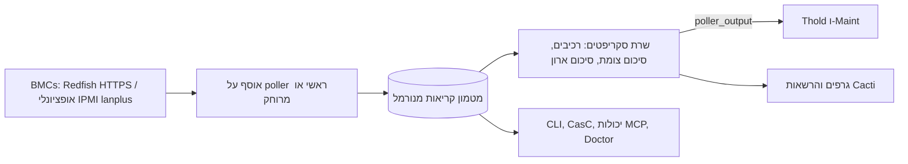

<!-- Source: README.md; SHA256: 6972a6c9ac754cd60e63c5caf971451ea8fe6e279eef757d886e1a168d3eef01 -->

<!-- translations:start -->
[English](../../../README.md) | [简体中文](../zh-CN/README.md) | [हिन्दी](../hi-IN/README.md) | [Español (España)](../es-ES/README.md) | [Español (Latinoamérica)](../es-419/README.md) | [العربية (السعودية)](../ar-SA/README.md) | [Afrikaans](../af-ZA/README.md) | [አማርኛ](../am-ET/README.md) | [العربية (مصر)](../ar-EG/README.md) | [العربية (المغرب)](../ar-MA/README.md) | [বাংলা](../bn-BD/README.md) | [Bosanski](../bs-BA/README.md) | [Deutsch](../de-DE/README.md) | [فارسی](../fa-IR/README.md) | [Filipino](../fil-PH/README.md) | [Français](../fr-FR/README.md) | [Français (Maroc)](../fr-MA/README.md) | [Français (Sénégal)](../fr-SN/README.md) | [Hausa](../ha-NG/README.md) | [עברית](README.md) | [Hrvatski](../hr-HR/README.md) | [Bahasa Indonesia](../id-ID/README.md) | [Igbo](../ig-NG/README.md) | [Italiano](../it-IT/README.md) | [日本語](../ja-JP/README.md) | [한국어](../ko-KR/README.md) | [Malagasy](../mg-MG/README.md) | [मराठी](../mr-IN/README.md) | [Bahasa Melayu](../ms-MY/README.md) | [Nederlands](../nl-NL/README.md) | [Polski](../pl-PL/README.md) | [Português (Brasil)](../pt-BR/README.md) | [Русский](../ru-RU/README.md) | [Kinyarwanda](../rw-RW/README.md) | [Soomaali](../so-SO/README.md) | [Српски](../sr-RS/README.md) | [Svenska](../sv-SE/README.md) | [Kiswahili](../sw-KE/README.md) | [தமிழ்](../ta-IN/README.md) | [తెలుగు](../te-IN/README.md) | [ไทย](../th-TH/README.md) | [Türkçe](../tr-TR/README.md) | [Українська](../uk-UA/README.md) | [اردو](../ur-PK/README.md) | [Tiếng Việt](../vi-VN/README.md) | [isiXhosa](../xh-ZA/README.md) | [Yorùbá](../yo-NG/README.md) | [繁體中文](../zh-TW/README.md) | [isiZulu](../zu-ZA/README.md)
<!-- translations:end -->

# plugin_redfish

תוסף עבור Cacti 1.2 המייבא נתוני צריכת חשמל של שרתים, טמפרטורת כניסה, מצב מאווררים ותקינות ספקי כוח מבקרי ניהול לוח אם (BMCs) אל תוך Cacti כהתקנים, מקורות נתונים וגרפים רגילים, באמצעות Redfish עם אפשרות לנסיגה (fallback) לקריאה בלבד ל-IPMI וסיכומי הספק ברמת הארון (rack). התוספים Thold ו-Maint מתריעים עליהם ומשתיקים אותם באמצעות מקורות נתונים רגילים של Cacti.

> **סטטוס: בפיתוח, טרם שוחררה גרסה (`0.1.0-dev`).** תוסף זה אינו משויך לפרויקט Cacti. הוא מותקן על גבי Cacti 1.2.31 ומעלה תחת PHP 8.2 ומעלה ומממש את אוסף הנתונים של Redfish, כספת פרטי הגישה המוצפנת, הקצאת התקנים וגרפים ב-Cacti, נסיגה אופציונלית לקריאה בלבד ל-IPMI, סיכום הספק ברמת ארון, תצוגת חלונות Cacti Maint, שכפול ונקודות קצה לסוכנים עבור אוספי נתונים מרוחקים, ספק CasC וממשק שורת פקודה למפעיל, יכולות MCP ובדיקות אבחון של Doctor. מערך ה-CI בודק תבניות נתונים (fixtures), את שרת ההדמיה DMTF Redfish (הדמיות subsystem, legacy-only ו-HPE iLO Gen11) ואת Thold v1.8.2 יחד עם Maint v1.3; אף BMC פיזי אמיתי או צי ניסוי טרם הוסמכו. התכנון והמחקר נמצאים ב-[docs/PLAN.md](../../PLAN.md), ב-[docs/research/](../../research/) וב-[docs/decisions/](../../decisions/).

## יכולות שמומשו

### אוסף ליבה, כספת ואובייקטי Cacti

- **מחזור חיים וסכמה.** מתבצעים התקנה, שדרוג, השבתה והסרה דרך ה-API של תוספי Cacti (`Schema::VERSION = 3`, 12 טבלאות). הטבלאות נשמרות בהסרה אלא אם האפשרות *Keep Plugin Tables on Uninstall* בוטלה. נקודות הכניסה ניתנות לפענוח ב-PHP 8.0 ומסרבות לפעול על PHP ישן מ-8.2 או ללא `ext-openssl` עם הודעת שגיאה מפורשת.
- **רישום והרשאות.** תחומי ההרשאה *Redfish View* (`redfish_health.php`), *Redfish Operator* (`redfish_operator.php`) ו-*Redfish Admin* (`redfish_bmcs.php`, `redfish_credentials.php`), וכן הגדרות תחת **Configuration > Settings > Redfish**. רישום ה-BMC תומך בייבוא CSV (פרטי הגישה מצוינים לפי שם; סיסמאות בקובצי ייבוא נדחות) ובייצוא JSON. רשומות BMC ופרטי גישה כפופים להרשאות ההתקנים של Cacti.
- **כספת פרטי גישה מוצפנת.** הסיסמאות נשמרות מוצפנות באמצעות AES-256-GCM בטבלה `plugin_redfish_secret`. המפתח שמור מחוץ למסד הנתונים (`/etc/cacti/redfish-vault.key` כברירת מחדל) כ-64 תווים הקסדצימליים (`openssl rand -hex 32`) או 32 בתים גולמיים, בבעלות משתמש ה-poller, בלתי קריא למשתמשים אחרים, ובתיקייה הניתנת לכתיבה רק על ידי root או אותו משתמש. ביטוי סיסמה קריא בן 32 תווים נדחה. **גבו את קובץ המפתח יחד עם מסד הנתונים**; בלעדיו, יהיה צורך להזין מחדש את הסיסמאות השמורות.
- **TLS ולקוח Redfish לקריאה בלבד.** אימות TLS מופעל כברירת מחדל באמצעות מאגר ה-CA של המערכת, חבילת CA פרטנית לכל BMC או נעיצת SPKI SHA-256; ביטול אימות ברמת BMC יחיד נותר גלוי כאזהרת תקינות וכאזהרה בבדיקת Doctor. הלקוח מתיר רק `GET` בתוספת התחברות (`POST`) והתנתקות (`DELETE`) מהפעלת Redfish, עם נסיגה אופציונלית לאימות Basic לכל BMC כאשר הפעלות (sessions) אינן זמינות. הגילוי מעדיף משאבי subsystem וחיישנים חדשים של Redfish ונסוג למשאבי `Power` ו-`Thermal` המיושנים.
- **הרצת האוסף.** `poller_redfish.php` מופעל מתוך `poller_bottom`, מריץ תהליך ראשי אחד לכל poller דרך רישום התהליכים של Cacti עם מספר ניתן להגדרה של תהליכי עבודה (`redfish_workers`), רוכש חכירות (leases) לכל BMC, אוכף תקציב זמן (`redfish_collector_budget`), מפעיל השהיה מעריכית (exponential backoff) ומנקה את ההפעלה הקודמת של התוסף עצמו לאחר קריסה.
- **תבניות, התקנים וגרפים.** מייבא את `templates/redfish-templates.xml` לפי גיבוב ומעתיק שלושה קובצי XML של שאילתות נתונים לשרת הסקריפטים (`redfish_fans.xml`, `redfish_temperatures.xml`, `redfish_psus.xml`) אל `<cacti>/resource/script_server/` מבלי לדרוס קבצים שנערכו בידי המשתמש. הפעולות **Create Device** ו-**Add Graphs** דורשות אישור של תוכנית הקצאה, מצמידות שאילתות להתקן שרת ממופה או יוצרות התקן "Redfish BMC" תחת `.invalid` עם בדיקות זמינות מושבתות, ומקשרות כל גרף Redfish חזרה לגרפי ה-Redfish של ההתקן דרך `graph_buttons`.
- **קלט שרת סקריפטים ממטמון בלבד.** `scripts/ss_redfish_members.php` מספק קריאות מאוורר, טמפרטורה ו-PSU לפי רכיב, ו-`scripts/ss_redfish_summary.php` מספק מדדי "Redfish Node Summary" (הספק, טמפרטורת כניסה וטמפרטורה מרבית, ספירת מאווררים ו-PSU תקולים, תקינות צומת וגיל הקריאה התקינה האחרונה). קריאות שרת הסקריפטים קוראות מהמטמון המקומי בלבד ולעולם אינן פונות ל-BMC. קריאות חסרות, מיושנות או של רכיבים שנעלמו מחזירות `U` (לעולם לא `0`), בעוד `age` מדווח ערך תמיד כדי שספים יוכלו לזהות בקרי BMC שקטים.

**כאשר רכיבי BMC משתנים** (כגון מאוורר שהוחלף או עדכון קושחה המשנה שמות חיישנים), הריצו שוב **Add Graphs**. מאוורר או ספק כוח שהיה קיים בעבר והפך לנעדר נספר ב-`fans_bad` או `psus_bad` עד לאישורו; חריץ שמעולם לא אוכלס אינו נספר. רכיבים שנעלמו שומרים על מקורות הנתונים והגרפים הקיימים שלהם, שיקראו `U` מאותו רגע עד למחיקה ידנית. מחיקת התקן Cacti מסירה את מיפוי ה-BMC שלו ואת שיוך הארון שלו תוך שמירה על ה-BMC והמטמון; מחיקת BMC או הסרת התוסף משאירה את התקני Cacti והגרפים.

### נסיגה אופציונלית ל-IPMI

- **הפעלה יזומה לכל BMC.** כבוי כברירת מחדל (`protocols` מוגדר כברירת מחדל ל-`redfish`; הפעלת נסיגת IPMI מגדירה `redfish,ipmi`).
- **טריגר נסיגה מתוחם.** פועל רק כאשר איסוף Redfish נכשל עם סיווג כשל מתאים; לעולם אינו מופעל עבור `AuthRejected`, `CredentialUnavailable`, `AddressRefused`, `OperationRefused` או `Deadline`.
- **הרצה מאובטחת.** מפעיל את `ipmitool` מעל `-I lanplus` באמצעות `proc_open()` בתצורת מערך ללא מעטפת (shell), עם מגבלת זמן שעון קיר ומגבלת פלט של 256 KiB. סיסמאות מועברות דרך `IPMITOOL_PASSWORD` (`-E`) או קובץ זמני בהרשאות 0600 (`-f`) שנמחק ב-`finally`, ולעולם לא כארגומנטים בשורת הפקודה.
- **רשימת היתר לפקודות קריאה בלבד.** רק חמש תת-פקודות לקריאה בלבד מותרות: `dcmi power reading`, `sdr type Temperature`, `sdr type Fan`, `sdr type Power Supply` ו-`chassis status`. פקודות משנות מצב נדחות.
- **פלט מנורמל ואזהרת מצב אבטחה.** `IpmiNormalizer` ממפה קריאות לאותו מודל `Observation`/`Member`/`Reading`, ומפיק `U` עבור חיישנים חסרים או בלתי ניתנים לפענוח. הפעלת נסיגת IPMI מעלה אזהרה בדף התקינות ובבדיקת Doctor `redfish.bmc_security`, המזכירה למפעילים להגביל את UDP 623 לרשת VLAN ניהולית.

### סיכום הספק ברמת ארון

- **רישום ארונות.** גרסה 3 של הסכמה מוסיפה את `plugin_redfish_rack` (`(site_id, name)` ייחודי, שדה אופציונלי `power_budget_watts`, `min_coverage_pct` שברירת המחדל שלו `80` והערות) ואת `plugin_redfish_rack_member` (לכל היותר שיוך ארון אחד לכל `host_id`, שדות אופציונליים `bmc_id` ו-`unit_position`, הנמחק אוטומטית בעת מחיקת התקן Cacti).
- **סכומים מוגני כיסוי.** `RackPowerSummary` מסכם קריאות `power_watts` עדכניות של חברים מהמטמון המקומי ומחשב ניצולת תקציב ומרווח פנוי (headroom). כאשר כיסוי החברים המדווחים יורד מתחת ל-`min_coverage_pct`, השדות `power_watts`, `utilization_pct` ו-`headroom_watts` מחזירים `U` כדי שתקלות אוסף לעולם לא ייראו כירידה בהספק הארון.
- **קלט שרת סקריפטים מוכן ל-Thold.** `scripts/ss_redfish_rack.php` (`ss_redfish_rack(<rack_id>)`) מחזיר `power_watts`, `power_budget_watts`, `utilization_pct`, `headroom_watts`, `members_total`, `members_reporting` ו-`coverage_pct` מהמטמון המקומי בלבד.

### אינטגרציה עם Cacti Maint

- ספי Thold על מקורות נתונים של Redfish מתריעים ו-Cacti Maint משתיק אותם ללא שינויים באף אחד מהתוספים.
- `MaintWindow` בודק לוחות זמנים פעילים של Maint עבור כל מארח Cacti ממופה (לוחות זמנים חד-פעמיים `mtype=1` ומחזוריים `mtype=2`, בתוספת `plugin_maint_check_cacti_host()` כשהיא טעונה) ומסמן תחזוקה פעילה בדף התקינות של Redfish (`[MAINT]`), בפלט של `cli/redfish.php health` וביכולת `redfish-get-health`.

### אוספי נתונים מרוחקים

- `INFO` מצהיר על `remote_collect:1`. בקרי BMC מקבלים כל `poller_id >= 1`, ו-`poller_redfish.php --poller=N` אוסף רק בקרי BMC מאופשרים המשויכים לאותו poller.
- **Hook `replicate_out`.** משכפל רק טבלאות תצורה לא-סודיות התחומה ל-poller המרוחק המיועד דרך `replicate_out_table()`: `plugin_redfish_bmc`, מטא-נתונים של `plugin_redfish_credential` (ללא טקסט מוצפן), `plugin_redfish_rack` ו-`plugin_redfish_rack_member`. הטבלה `plugin_redfish_secret` אינה משוכפלת, וקובצי המפתח של הכספת נשארים מקומיים בלבד בכל poller.
- **Hook `remote_agent`.** חושף פעולות לקריאה בלבד `redfish_health` ו-`redfish_discovery` המקבלות אך ורק פרמטרים מספריים `poller_id` ו-`bmc_id`. פרמטרים בלתי צפויים נדחים ואפס פרטי גישה או סודות מוחזרים.

### Hooks למערכת האקולוגית (CasC, יכולות MCP ו-Doctor)

- **ספק CasC (`casc_register_providers`).** רושם את הספק `redfish` (גרסת סכמה `1`) עם ייצוא YAML ו-XML ב-PHP טהור, פענוח (עם דחיית XXE), אימות, תכנון הבדלים והחלה. פרטי גישה מופיעים רק כהפניות לכספת (`vault:redfish:<name>`); מפתחות סוד גולמיים (`pass`, `secret`, `token`, `private_key`, `vault_key`, `auth_token`) נדחים. החלה דורשת `PLAN_HASH` SHA-256 מדויק.
- **ממשק MCP / Abilities (`abilities_register`).** רושם שלוש יכולות לקריאה בלבד המוגבלות לתחום Redfish View (`redfish_health.php`) ולהרשאות התקנים ב-Cacti, ומחזירות אפס פרטי גישה:
  - `redfish-list-bmcs` (`poller_id` אופציונלי)
  - `redfish-get-rack-power` (`rack_id` אופציונלי)
  - `redfish-get-health` (`bmc_id` אופציונלי)
- **בדיקות Doctor (`doctor_register_checks`).** רושם חמש בדיקות אבחון מקומיות לקריאה בלבד שלעולם אינן פונות ל-BMC ואינן מחזירות חומר מפתח:
  - `redfish.schema`: עדכניות גרסת הסכמה
  - `redfish.vault_key`: קריאות והרשאות קובץ המפתח של הכספת
  - `redfish.collector_runs`: תקציב ועדכניות האוסף של ה-poller
  - `redfish.bmc_security`: בקרי BMC מאופשרים עם TLS לא מאומת או נסיגת IPMI
  - `redfish.rack_power`: עמידה בתקציב ההספק של הארון וברצפת הכיסוי

## ממשק שורת הפקודה (CLI)

יש להריץ מתיקיית השורש של Cacti עם PHP 8.2 ומעלה:

```sh
# Operator and CasC CLI (reads --file=PATH or stdin for validate, plan, and apply)
php plugins/redfish/cli/redfish.php export --format=yaml|xml
php plugins/redfish/cli/redfish.php validate [--file=PATH] [--format=yaml|xml]
php plugins/redfish/cli/redfish.php plan [--file=PATH] [--format=yaml|xml]
php plugins/redfish/cli/redfish.php apply [--file=PATH] [--format=yaml|xml] --confirm=<PLAN_HASH>
php plugins/redfish/cli/redfish.php health --format=text|json

# Collector entry point (normally started by poller_bottom)
php plugins/redfish/poller_redfish.php [--poller=N] [--force] [--debug]

# Rack power summary script server entry point
php plugins/redfish/scripts/ss_redfish_rack.php <rack_id>
```

## תפקידי גישה

| תחום (Realm) | גישה |
| --- | --- |
| Redfish View | דפי הניטור הקיימים. |
| Redfish Operator | ניטור בתוספת דף ה-Operations ואישורי תעדוף אישיים. |
| Redfish Admin | גישת Operator בתוספת ההגדרות הקיימות ופעולות הניהול. |

לאחר העתקת קובצי השדרוג, פתחו את דף ה-Plugins כמנהלים כדי לרשום את תחומי ההרשאה. הקצו את תחום ה-Operator במפורש תחת **Configuration > Users** או לקבוצות משתמשים. שדרוגים שומרים על מזהי התחום וההרשאות הקיימים של View ו-Admin. גישת Admin יורשת גישת Operator, וגישת Operator יורשת גישת View בכל בקשה; הדבר אינו מוסיף הרשאות שמורות למשתמשים או לקבוצות. הגדרות התוסף דורשות גם גישת Redfish Admin בנוסף להרשאת Settings של Cacti.

הרשאות ההתקנים של Cacti מגבילות את השורות והפעולות הזמינות לכל משתמש; אובייקטים לא ממופים דורשים מנהל מערכת. מפעילים יכולים לשחרר השהיית איסוף על BMC מורשה לקראת הריצה המתוזמנת הבאה. פרטי גישה, תצורה, מיפוי, מחיקה ושינויים ניהוליים אחרים נותרים בדפי הניהול. אישורי תעדוף תקפים רק בהפעלה הנוכחית של המשתמש, למשך שעה לכל היותר ורק כל עוד אותה תצפית נותרת עדכנית. תצפיות חדשות או שהשתנו פוסלות אותם. הם לעולם אינם מסמנים מדידה כושלת כתקינה ואינם משתיקים התרעות.

## מדוע

לכל שרת יש BMC המדווח על מצב הספק וחום ללא תלות במערכת ההפעלה, כך שהוא ממשיך להשיב גם כשמערכת ההפעלה מושבתת. הנתונים משמשים למעקב קיבולת ועלויות, התראה מוקדמת על מאוורר או ספק כוח תקולים, ובמחשוב עתיר ביצועים להחלטות על הגבלת הספק. התוסף אינו מיועד ל-HPC בלבד.

Cacti מכסה חלק מכך כיום:

- **חבילות SNMP של יצרנים.** ענף 1.2.x כולל תבניות Dell iDRAC ו-HPE iLO הדורשות סוכן SNMP והן תלויות יצרן; מחקר אבן דרך 1 מצא שאף אחת מהן אינה מדווחת צריכת חשמל בוואטים ([docs/research/overlap.md](../../research/overlap.md)).
- **סוג פרטי גישה ללא אוסף.** plugin_credentials מגדיר פרטי גישה מסוג "IPMI / Redfish (BMC)" אך אינו קורא אף BMC.
- **ללא תצוגה ברמת ארון.** לליבת Cacti אין אובייקט ארון; להתקן יש שדה טקסט חופשי `location` בלבד.

התוסף מתשאל בקרי BMC מחוץ לפס (out of band) ממחזור התשאול של Cacti על גבי ה-poller הראשי או אוספי נתונים מרוחקים, שומר במטמון קריאות מנורמלות וחושף אותן דרך שאילתות נתונים של שרת סקריפטים, סיכומי צומת וסיכומי הספק לארון. הוא עושה שימוש חוזר בגרפים, בהרשאות, ב-Thold וב-Maint של Cacti, ואינו משנה את מצב ה-BMC.

## היקף וסטטוס

| שלב | היקף | אבני דרך | סטטוס |
|---|---|---|---|
| 0, מחקר | מטריצת יצרנים, אימות התנהגות upstream על בקרי BMC חיים, עלות תשאול, ניסוי שאילתת נתונים | [M1](https://github.com/somethingwithproof/plugin_redfish/milestone/1) | הושלם, ממתין ללכידות קושחה מ-BMC אמיתי |
| 1, תצפית | רישום BMC, פרטי גישה, TLS, אוסף Redfish, קריאות מנורמלות, התקנים, גרפים לפי אינדקס, התרעות Thold, אינטגרציית Maint, דף תקינות | [M2](https://github.com/somethingwithproof/plugin_redfish/milestone/2), [M3](https://github.com/somethingwithproof/plugin_redfish/milestone/3), [M4](https://github.com/somethingwithproof/plugin_redfish/milestone/4) | מומש; הסמכת צי ניסוי M4 ממתינה |
| 2, ipmi | נסיגת IPMI לקריאה בלבד (`lanplus`) דרך `ipmitool`, כבוי כברירת מחדל | [M5](https://github.com/somethingwithproof/plugin_redfish/milestone/5) | מומש |
| 3, ארונות | רישום ארונות, סכומי הספק לארון עם רצפת כיסוי, מרווח תקציב, `ss_redfish_rack.php` | [M6](https://github.com/somethingwithproof/plugin_redfish/milestone/6) | מומש |
| 4, מרוחק ומערכת אקולוגית | אוספי נתונים מרוחקים (`replicate_out`, `remote_agent`), ספק CasC ו-CLI, יכולות MCP, בדיקות Doctor | [M7](https://github.com/somethingwithproof/plugin_redfish/milestone/7) | מומש |

מחוץ להיקף: הגדרת מגבלות הספק או כל תצורת BMC אחרת, בקרת חשמל, עדכון קושחה, גישת קונסולה, מנוע התרעות בבעלות התוסף ואינטגרציה עם מתזמן.

## יעדי תאימות

| רכיב | יעד |
|---|---|
| Cacti | 1.2.31 ומעלה, ללא טלאים לליבה |
| מסד נתונים | MariaDB 10.2 או MySQL 5.7 ומעלה: BMC אחד לכל התקן נאכף באמצעות מפתח ייחודי על עמודה מחושבת |
| PHP | 8.2 ומעלה; נקודות הכניסה נותרות ניתנות לפענוח ב-8.0 כדי שסביבת ריצה לא נתמכת תקבל סירוב במקום ממשק Cacti שבור |
| הרחבות PHP | `ext-openssl` (נדרש על ידי Cacti 1.2.31); ללא `ext-curl` וללא תלויות זמן ריצה של Composer |
| כלים אופציונליים | `ipmitool` על גבי pollers האוספים בקרי BMC שבהם נסיגת IPMI מופעלת |
| BMCs | Dell iDRAC, HPE iLO, Lenovo XCC ו-OpenBMC, לפי טווח קושחה; ראו את [מטריצת היצרנים](../../research/vendor-matrix.md) |
| Redfish | משאבי subsystem וחיישנים חדשים תחילה, משאבי `Power` ו-`Thermal` המיושנים כנסיגה |
| Thold, Maint | אין צורך בשינויים (ה-CI מריץ Thold v1.8.2 ו-Maint v1.3) |

## תכנון

- [docs/PLAN.md](../../PLAN.md) הוא התוכנית המלאה: ארכיטקטורה, עובדות upstream שעליהן היא נשענת, מודל מדידה, גבולות אבטחה, חישובי ביצועים, בדיקות וסיכונים.
- [docs/decisions/](../../decisions/) שומר רשומות החלטות ארכיטקטוניות עבור בחירות שכבר התקבלו.
- [docs/REQUIREMENTS.md](../../REQUIREMENTS.md) ממפה כל מזהה דרישה אל ה-issue שלו.



## אבטחה

פרטי הגישה של BMC שולטים בניהול מחוץ לפס של שרתים. התכנון מרחיק סודות משורות פקודה, יומנים, ייצואי CasC, מטעני סוכנים מרוחקים, תגובות MCP ודפי אינטרנט; מצפין סיסמאות שמורות באמצעות AES-256-GCM בעזרת קובץ מפתח כספת מקומי לכל poller; מאמת TLS כברירת מחדל; מריץ את `ipmitool` ממערך ארגומנטים מפורש עם תת-פקודות קריאה בלבד ברשימת היתר; ומשתמש בחשבונות BMC לקריאה בלבד. ראו [docs/PLAN.md](../../PLAN.md#security) ו-[SECURITY.md](../../../SECURITY.md).

## מדריך מפעיל

ראו [docs/operator-guide.md](../../operator-guide.md) לדרישות מוקדמות להתקנה, הגדרת כספת ו-TLS, רישום BMC, יצירת גרפים, מרווחי התרעה, גיבוי וטיפול בכשלים. המדריך אינו מצהיר על קו קושחה של יצרן אמיתי כנתמך עד שלכידה מושחרת מאותה קושחה עוברת את חבילת הבדיקות.

## פיתוח ובדיקות

ה-CI ([.github/workflows/plugin-ci-workflow.yml](../../../.github/workflows/plugin-ci-workflow.yml)) בודק תחביר של נקודות כניסה ב-PHP 8.0, מריץ חבילות בדיקות יחידה של Pest (`phpunit.xml`) ואינטגרציית מחזור חיים (`phpunit-integration.xml`) וכן PHPStan ברמה 9 על פני PHP 8.2 עד 8.5 מול Cacti `release/1.2.31` ו-`1.2.x`, מאמת סירוב ב-PHP 8.1, מריץ מקצה לקצה את שרת ההדמיה DMTF Redfish (הדמיות subsystem, legacy-only ו-HPE iLO Gen11) ואת Thold v1.8.2 / Maint v1.3, ובודק קטלוגים של gettext, תהליכי עבודה ורישוי REUSE.

בדיקות מקומיות לפני דחיפה:

```sh
sh tests/lint-workflows.sh
sh locales/build_gettext.sh --check
CACTI_PATH=/path/to/cacti phpstan analyse -c phpstan.neon --no-progress
```

הריצו את Pest עם `--configuration=phpunit.xml` לבדיקות יחידה וכללי מקור, או `--configuration=phpunit-integration.xml` עם `CACTI_PATH` ו-`REDFISH_TEST_DATABASE=disposable` מול מסד נתונים חד-פעמי של Cacti לבדיקות אינטגרציית מחזור חיים.

## כיצד העבודה מנוהלת

- **אבני דרך (Milestones)** עוקבות אחר אבני הדרך של התוכנית. לכל אחת יש epic issue המפרט את תתי-הנושאים שלה ואת ראיות היציאה.
- **נושאים (Issues)** מסווגים לפי תווית: `type: requirement`, `type: research`, `type: decision`, `type: epic`. נושאי דרישות מציגים דרישות ממוספרות וניתנות לבדיקה (`REQ-AREA-NNN`) וקריטריוני קבלה.
- **תוויות** נושאות גם `area:`, `phase:`, `priority:` ו-`status:`. ראו [CONTRIBUTING.md](../../../CONTRIBUTING.md#labels).
- [לוח הפרויקט](https://github.com/users/somethingwithproof/projects/12) מציג את כל הנושאים על פני אבני הדרך.

## תרומה

קראו את [CONTRIBUTING.md](../../../CONTRIBUTING.md). קומיטים דורשים חתימת DCO. דיוני תכנון מתקיימים ב-issues; החלטות פתוחות נושאות את התווית `type: decision`. ראיות מבקרי BMC אמיתיים הן התרומה השימושית ביותר כעת; השחירו כתובות, מספרים סידוריים ופרטי גישה לפני פרסום כל לכידה.

## רישיון

GNU General Public License v2.0, אותו רישיון כמו Cacti והתוספים שלה. ראו [LICENSE](../../../LICENSE).
