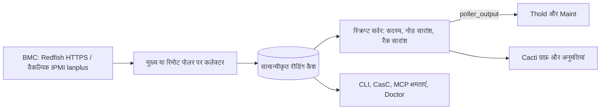

<!-- Source: README.md; SHA256: 6972a6c9ac754cd60e63c5caf971451ea8fe6e279eef757d886e1a168d3eef01 -->

<!-- translations:start -->
[English](../../../README.md) | [简体中文](../zh-CN/README.md) | [हिन्दी](README.md) | [Español (España)](../es-ES/README.md) | [Español (Latinoamérica)](../es-419/README.md) | [العربية (السعودية)](../ar-SA/README.md) | [Afrikaans](../af-ZA/README.md) | [አማርኛ](../am-ET/README.md) | [العربية (مصر)](../ar-EG/README.md) | [العربية (المغرب)](../ar-MA/README.md) | [বাংলা](../bn-BD/README.md) | [Bosanski](../bs-BA/README.md) | [Deutsch](../de-DE/README.md) | [فارسی](../fa-IR/README.md) | [Filipino](../fil-PH/README.md) | [Français](../fr-FR/README.md) | [Français (Maroc)](../fr-MA/README.md) | [Français (Sénégal)](../fr-SN/README.md) | [Hausa](../ha-NG/README.md) | [עברית](../he-IL/README.md) | [Hrvatski](../hr-HR/README.md) | [Bahasa Indonesia](../id-ID/README.md) | [Igbo](../ig-NG/README.md) | [Italiano](../it-IT/README.md) | [日本語](../ja-JP/README.md) | [한국어](../ko-KR/README.md) | [Malagasy](../mg-MG/README.md) | [मराठी](../mr-IN/README.md) | [Bahasa Melayu](../ms-MY/README.md) | [Nederlands](../nl-NL/README.md) | [Polski](../pl-PL/README.md) | [Português (Brasil)](../pt-BR/README.md) | [Русский](../ru-RU/README.md) | [Kinyarwanda](../rw-RW/README.md) | [Soomaali](../so-SO/README.md) | [Српски](../sr-RS/README.md) | [Svenska](../sv-SE/README.md) | [Kiswahili](../sw-KE/README.md) | [தமிழ்](../ta-IN/README.md) | [తెలుగు](../te-IN/README.md) | [ไทย](../th-TH/README.md) | [Türkçe](../tr-TR/README.md) | [Українська](../uk-UA/README.md) | [اردو](../ur-PK/README.md) | [Tiếng Việt](../vi-VN/README.md) | [isiXhosa](../xh-ZA/README.md) | [Yorùbá](../yo-NG/README.md) | [繁體中文](../zh-TW/README.md) | [isiZulu](../zu-ZA/README.md)
<!-- translations:end -->

# plugin_redfish

यह एक Cacti 1.2 प्लगइन है जो बेसबोर्ड मैनेजमेंट कंट्रोलर (BMC) से सर्वर की बिजली खपत, इनलेट तापमान, पंखे की स्थिति और पावर सप्लाई की सेहत को सामान्य डिवाइस, डेटा स्रोत और ग्राफ़ के रूप में Cacti में लाता है। यह Redfish का उपयोग करता है, जिसमें वैकल्पिक रीड-ओनली IPMI फ़ॉलबैक और रैक-स्तरीय पावर रोलअप शामिल हैं। Thold और Maint मानक Cacti डेटा स्रोतों के माध्यम से इन पर अलर्ट करते हैं और इन्हें सप्रेस करते हैं।

> **स्थिति: विकास में है, अभी तक कोई रिलीज़ नहीं (`0.1.0-dev`)।** यह प्लगइन Cacti प्रोजेक्ट से संबद्ध नहीं है। यह PHP 8.2 या बाद के संस्करण पर Cacti 1.2.31 या बाद के संस्करण में इंस्टॉल होता है और Redfish कलेक्टर, एन्क्रिप्टेड क्रेडेंशियल वॉल्ट, Cacti डिवाइस और ग्राफ़ प्रोविज़निंग, वैकल्पिक रीड-ओनली IPMI फ़ॉलबैक, रैक पावर रोलअप, Cacti Maint विंडो डिस्प्ले, रिमोट डेटा कलेक्टर प्रतिकृति और एजेंट एंडपॉइंट, CasC प्रदाता और ऑपरेटर CLI, MCP क्षमताएं तथा Doctor डायग्नोस्टिक जांच लागू करता है। CI में फ़िक्स्चर, DMTF Redfish Mockup Server (सबसिस्टम, लेगेसी-ओनली और HPE iLO Gen11 मॉकअप) तथा Maint v1.3 के साथ Thold v1.8.2 का परीक्षण किया गया है; अभी तक किसी वास्तविक भौतिक BMC या पायलट फ्लीट को प्रमाणित नहीं किया गया है। डिज़ाइन और शोध [docs/PLAN.md](../../PLAN.md), [docs/research/](../../research/) और [docs/decisions/](../../decisions/) में उपलब्ध हैं।

## लागू की गई क्षमताएं

### कोर कलेक्टर, वॉल्ट और Cacti ऑब्जेक्ट

- **जीवनचक्र और स्कीमा।** Cacti के प्लगइन API (`Schema::VERSION = 3`, 12 तालिकाएं) के माध्यम से इंस्टॉल, अपग्रेड, डिसेबल और अनइंस्टॉल होता है। जब तक *Keep Plugin Tables on Uninstall* को अनचेक न किया जाए, अनइंस्टॉल करने पर तालिकाएं सुरक्षित रखी जाती हैं। एंट्री पॉइंट PHP 8.0 पर पार्स होते हैं और PHP 8.2 से कम होने या `ext-openssl` न मिलने पर स्पष्ट त्रुटि संदेश के साथ मना कर देते हैं।
- **रजिस्ट्री और अनुमतियां।** **Configuration > Settings > Redfish** के अंतर्गत सेटिंग्स के साथ *Redfish View* (`redfish_health.php`), *Redfish Operator* (`redfish_operator.php`) और *Redfish Admin* (`redfish_bmcs.php`, `redfish_credentials.php`) रियल्म शामिल हैं। BMC रजिस्ट्री CSV इम्पोर्ट (नाम से संदर्भित क्रेडेंशियल; इम्पोर्ट फ़ाइलों में पासवर्ड अस्वीकार किए जाते हैं) और JSON एक्सपोर्ट का समर्थन करती है। BMC रिकॉर्ड और क्रेडेंशियल Cacti डिवाइस अनुमतियों का पालन करते हैं।
- **एन्क्रिप्टेड क्रेडेंशियल वॉल्ट।** पासवर्ड `plugin_redfish_secret` में AES-256-GCM के साथ एन्क्रिप्ट करके संग्रहीत किए जाते हैं। कुंजी डेटाबेस के बाहर (डिफ़ॉल्ट रूप से `/etc/cacti/redfish-vault.key`) 64 हेक्साडेसिमल वर्णों (`openssl rand -hex 32`) या 32 रॉ बाइट्स के रूप में रहती है, जिसका स्वामित्व पोलर उपयोगकर्ता के पास होता है, जो अन्य उपयोगकर्ताओं द्वारा अपठनीय होती है और ऐसी निर्देशिका में रहती है जिस पर केवल root या वह उपयोगकर्ता लिख सकता है। 32-वर्ण वाले प्रिंटेबल पासफ़्रेज़ को अस्वीकार कर दिया जाता है। **डेटाबेस के साथ कुंजी फ़ाइल का बैकअप अवश्य लें**; इसके बिना, संग्रहीत पासवर्ड फिर से दर्ज करने होंगे।
- **TLS और रीड-ओनली Redfish क्लाइंट।** सिस्टम CA स्टोर, प्रति-BMC CA बंडल या SPKI SHA-256 पिन का उपयोग करके TLS सत्यापन डिफ़ॉल्ट रूप से सक्षम रहता है; प्रति-BMC असत्यापित ऑप्ट-आउट स्वास्थ्य चेतावनी और Doctor जांच चेतावनी के रूप में दिखाई देता रहता है। क्लाइंट केवल `GET` और Redfish सत्र लॉगिन (`POST`) तथा लॉगआउट (`DELETE`) की अनुमति देता है, और सत्र अनुपलब्ध होने पर प्रति-BMC Basic फ़ॉलबैक विकल्प देता है। डिस्कवरी नए Redfish सबसिस्टम और सेंसर संसाधनों को प्राथमिकता देती है और पदावनत `Power` तथा `Thermal` संसाधनों पर फ़ॉलबैक करती है।
- **कलेक्टर निष्पादन।** `poller_redfish.php`, `poller_bottom` से प्रारंभ होता है, Cacti की प्रक्रिया रजिस्ट्री के माध्यम से प्रति पोलर एक मास्टर प्रक्रिया कॉन्फ़िगर करने योग्य वर्कर प्रक्रियाओं (`redfish_workers`) के साथ चलाता है, प्रति-BMC लीज़ प्राप्त करता है, समय बजट (`redfish_collector_budget`) लागू करता है, एक्सपोनेंशियल बैकऑफ़ लागू करता है और क्रैश के बाद प्लगइन के अपने पिछले सत्र को साफ करता है।
- **टेम्पलेट, डिवाइस और ग्राफ़।** हैश द्वारा `templates/redfish-templates.xml` को इम्पोर्ट करता है और उपयोगकर्ता द्वारा संशोधित फ़ाइलों को ओवरराइट किए बिना तीन स्क्रिप्ट सर्वर डेटा क्वेरी XML फ़ाइलें (`redfish_fans.xml`, `redfish_temperatures.xml`, `redfish_psus.xml`) `<cacti>/resource/script_server/` में कॉपी करता है। **Create Device** और **Add Graphs** के लिए प्रोविज़निंग योजना की पुष्टि आवश्यक होती है, वे मैप किए गए सर्वर डिवाइस से क्वेरी जोड़ते हैं या उपलब्धता जांच अक्षम करके `.invalid` के अंतर्गत एक "Redfish BMC" डिवाइस बनाते हैं, और `graph_buttons` के माध्यम से प्रत्येक Redfish ग्राफ़ को वापस डिवाइस के Redfish ग्राफ़ से लिंक करते हैं।
- **केवल-कैश स्क्रिप्ट सर्वर इनपुट।** `scripts/ss_redfish_members.php` प्रति-सदस्य पंखे, तापमान और PSU रीडिंग प्रदान करता है, और `scripts/ss_redfish_summary.php` "Redfish Node Summary" मेट्रिक्स (पावर, इनलेट और अधिकतम तापमान, खराब पंखे और PSU गणना, नोड की सेहत और अंतिम सही रीड की आयु) प्रदान करता है। स्क्रिप्ट सर्वर कॉल केवल स्थानीय कैश पढ़ती हैं और कभी किसी BMC से संपर्क नहीं करतीं। गुम, पुरानी या हटाई जा चुकी सदस्य रीडिंग `U` लौटाती हैं (कभी `0` नहीं), जबकि `age` हमेशा एक मान रिपोर्ट करता है ताकि थ्रेशोल्ड मूक BMC का पता लगा सकें।

**जब किसी BMC के सदस्य बदलते हैं** (जैसे बदला गया पंखा या सेंसर के नाम बदलने वाला फ़र्मवेयर अपडेट), तो **Add Graphs** को फिर से चलाएं। पहले से मौजूद कोई पंखा या पावर सप्लाई जो अनुपस्थित हो जाती है, स्वीकार किए जाने तक `fans_bad` या `psus_bad` में गिनी जाती है; ऐसा स्लॉट जो कभी भरा नहीं गया था, नहीं गिना जाता। हटाए गए सदस्य अपने मौजूदा डेटा स्रोत और ग्राफ़ बनाए रखते हैं, जो तब तक `U` पढ़ते हैं जब तक उन्हें हाथ से हटा न दिया जाए। किसी Cacti डिवाइस को हटाने पर उसका BMC मैपिंग हट जाती है और उसका रैक असाइनमेंट निकल जाता है, जबकि BMC और कैश सुरक्षित रहते हैं; BMC हटाने या प्लगइन अनइंस्टॉल करने पर Cacti डिवाइस और ग्राफ़ बने रहते हैं।

### वैकल्पिक IPMI फ़ॉलबैक

- **प्रति BMC ऑप्ट-इन।** डिफ़ॉल्ट रूप से बंद रहता है (`protocols` डिफ़ॉल्ट रूप से `redfish` होता है; IPMI फ़ॉलबैक सक्षम करने पर यह `redfish,ipmi` हो जाता है)।
- **सीमित फ़ॉलबैक ट्रिगर।** यह केवल तभी चलता है जब Redfish संग्रह किसी पात्र विफलता वर्ग के साथ विफल होता है; `AuthRejected`, `CredentialUnavailable`, `AddressRefused`, `OperationRefused` या `Deadline` पर कभी ट्रिगर नहीं होता।
- **सुरक्षित निष्पादन।** बिना शेल के ऐरे-रूप `proc_open()`, सीमित वॉल-क्लॉक टाइमआउट और 256 KiB आउटपुट सीमा के माध्यम से `-I lanplus` पर `ipmitool` चलाता है। पासवर्ड `IPMITOOL_PASSWORD` (`-E`) या `finally` में हटाई जाने वाली mode-0600 अस्थायी फ़ाइल (`-f`) के माध्यम से दिए जाते हैं, कभी CLI argv पर नहीं।
- **रीड-ओनली कमांड अनुमति-सूची।** केवल पांच रीड-ओनली सबकमांड की अनुमति है: `dcmi power reading`, `sdr type Temperature`, `sdr type Fan`, `sdr type Power Supply` और `chassis status`। बदलाव करने वाले कमांड अस्वीकार कर दिए जाते हैं।
- **सामान्यीकृत आउटपुट और स्थिति चेतावनी।** `IpmiNormalizer` रीडिंग को उसी `Observation`/`Member`/`Reading` मॉडल में मैप करता है और गुम या पार्स न हो सकने वाले सेंसर के लिए `U` उत्सर्जित करता है। IPMI फ़ॉलबैक सक्षम करने से स्वास्थ्य पृष्ठ और `redfish.bmc_security` Doctor जांच में एक चेतावनी उठती है जो ऑपरेटरों को UDP 623 को प्रबंधन VLAN तक सीमित रखने की याद दिलाती है।

### रैक पावर रोलअप

- **रैक रजिस्ट्री।** स्कीमा संस्करण 3 में `plugin_redfish_rack` (अद्वितीय `(site_id, name)`, वैकल्पिक `power_budget_watts`, डिफ़ॉल्ट `80` के साथ `min_coverage_pct` और नोट्स) तथा `plugin_redfish_rack_member` (प्रति `host_id` अधिकतम एक रैक असाइनमेंट, वैकल्पिक `bmc_id` और `unit_position`, Cacti डिवाइस हटाने पर स्वचालित रूप से हटा दिया जाता है) जोड़े गए हैं।
- **कवरेज-संरक्षित कुल योग।** `RackPowerSummary` स्थानीय कैश से ताज़ा सदस्य `power_watts` रीडिंग का योग करता है और बजट उपयोग तथा हेडरूम की गणना करता है। जब रिपोर्ट करने वाले सदस्यों का कवरेज `min_coverage_pct` से नीचे गिरता है, तो `power_watts`, `utilization_pct` और `headroom_watts` `U` लौटाते हैं ताकि कलेक्टर की विफलताएं कभी रैक पावर में गिरावट के रूप में न दिखें।
- **Thold के लिए तैयार स्क्रिप्ट सर्वर इनपुट।** `scripts/ss_redfish_rack.php` (`ss_redfish_rack(<rack_id>)`) केवल स्थानीय कैश से `power_watts`, `power_budget_watts`, `utilization_pct`, `headroom_watts`, `members_total`, `members_reporting` और `coverage_pct` लौटाता है।

### Cacti Maint एकीकरण

- Redfish डेटा स्रोतों पर Thold थ्रेशोल्ड अलर्ट करते हैं और Cacti Maint किसी भी प्लगइन में बदलाव के बिना उन्हें सप्रेस करता है।
- `MaintWindow` प्रत्येक मैप किए गए Cacti होस्ट के लिए सक्रिय Maint शेड्यूल (एक-बारगी `mtype=1` और आवर्ती `mtype=2` शेड्यूल, तथा लोड होने पर `plugin_maint_check_cacti_host()`) की जांच करता है और Redfish स्वास्थ्य पृष्ठ (`[MAINT]`), `cli/redfish.php health` आउटपुट और `redfish-get-health` क्षमता में सक्रिय रखरखाव को चिह्नित करता है।

### रिमोट डेटा कलेक्टर

- `INFO` में `remote_collect:1` घोषित किया गया है। BMC किसी भी `poller_id >= 1` को स्वीकार करते हैं, और `poller_redfish.php --poller=N` केवल उस पोलर को सौंपे गए सक्षम BMC से डेटा एकत्र करता है।
- **`replicate_out` हुक।** `replicate_out_table()` के माध्यम से केवल लक्ष्य रिमोट पोलर के दायरे में आने वाली गैर-गोपनीय कॉन्फ़िगरेशन तालिकाओं की प्रतिकृति बनाता है: `plugin_redfish_bmc`, `plugin_redfish_credential` मेटाडेटा (बिना सिफ़रटेक्स्ट के), `plugin_redfish_rack` और `plugin_redfish_rack_member`। `plugin_redfish_secret` की प्रतिकृति नहीं बनाई जाती है, और वॉल्ट कुंजी फ़ाइलें प्रत्येक पोलर पर सख्ती से स्थानीय रहती हैं।
- **`remote_agent` हुक।** रीड-ओनली `redfish_health` और `redfish_discovery` क्रियाएं उजागर करता है जो केवल संख्यात्मक `poller_id` और `bmc_id` पैरामीटर स्वीकार करती हैं। अनपेक्षित पैरामीटर अस्वीकार कर दिए जाते हैं और शून्य क्रेडेंशियल या गोपनीय डेटा लौटाया जाता है।

### इकोसिस्टम हुक (CasC, MCP क्षमताएं और Doctor)

- **CasC प्रदाता (`casc_register_providers`)।** शुद्ध-PHP YAML और XML एक्सपोर्ट, पार्सिंग (XXE अस्वीकृत), सत्यापन, डिफ़ प्लानिंग और अप्लाई के साथ `redfish` प्रदाता (स्कीमा संस्करण `1`) पंजीकृत करता है। क्रेडेंशियल केवल वॉल्ट संदर्भ (`vault:redfish:<name>`) के रूप में दिखाई देते हैं; कच्ची गोपनीय कुंजियां (`pass`, `secret`, `token`, `private_key`, `vault_key`, `auth_token`) अस्वीकार कर दी जाती हैं। लागू करने के लिए सटीक SHA-256 `PLAN_HASH` आवश्यक है।
- **MCP / Abilities API (`abilities_register`)।** Redfish View रियल्म (`redfish_health.php`) और Cacti डिवाइस अनुमतियों द्वारा नियंत्रित तीन रीड-ओनली क्षमताएं पंजीकृत करता है, जो शून्य क्रेडेंशियल लौटाती हैं:
  - `redfish-list-bmcs` (वैकल्पिक `poller_id`)
  - `redfish-get-rack-power` (वैकल्पिक `rack_id`)
  - `redfish-get-health` (वैकल्पिक `bmc_id`)
- **Doctor जांच (`doctor_register_checks`)।** पांच स्थानीय, रीड-ओनली डायग्नोस्टिक जांच पंजीकृत करता है जो कभी किसी BMC से संपर्क नहीं करतीं और न ही कुंजी सामग्री लौटाती हैं:
  - `redfish.schema`: स्कीमा संस्करण की अद्यतन स्थिति
  - `redfish.vault_key`: वॉल्ट कुंजी की पठनीयता और अनुमतियां
  - `redfish.collector_runs`: पोलर कलेक्टर बजट और ताज़गी
  - `redfish.bmc_security`: असत्यापित TLS या IPMI फ़ॉलबैक वाले सक्षम BMC
  - `redfish.rack_power`: रैक पावर बजट अनुपालन और कवरेज न्यूनतम सीमा

## CLI

PHP 8.2 या बाद के संस्करण के साथ Cacti रूट निर्देशिका से चलाएं:

```sh
# Operator and CasC CLI (reads --file=PATH or stdin for validate, plan, and apply)
php plugins/redfish/cli/redfish.php export --format=yaml|xml
php plugins/redfish/cli/redfish.php validate [--file=PATH] [--format=yaml|xml]
php plugins/redfish/cli/redfish.php plan [--file=PATH] [--format=yaml|xml]
php plugins/redfish/cli/redfish.php apply [--file=PATH] [--format=yaml|xml] --confirm=<PLAN_HASH>
php plugins/redfish/cli/redfish.php health --format=text|json

# Collector entry point (normally started by poller_bottom)
php plugins/redfish/poller_redfish.php [--poller=N] [--force] [--debug]

# Rack power summary script server entry point
php plugins/redfish/scripts/ss_redfish_rack.php <rack_id>
```

## पहुंच भूमिकाएं

| रियल्म | पहुंच |
| --- | --- |
| Redfish View | मौजूदा मॉनिटरिंग पृष्ठ। |
| Redfish Operator | मॉनिटरिंग के साथ ऑपरेशंस पृष्ठ और व्यक्तिगत ट्रायज स्वीकृतियां। |
| Redfish Admin | ऑपरेटर पहुंच के साथ मौजूदा कॉन्फ़िगरेशन और प्रशासनिक क्रियाएं। |

अपग्रेड फ़ाइलें कॉपी करने के बाद, रियल्म पंजीकृत करने के लिए व्यवस्थापक के रूप में Plugins पृष्ठ खोलें। **Configuration > Users** या उपयोगकर्ता समूहों के अंतर्गत Operator रियल्म स्पष्ट रूप से असाइन करें। अपग्रेड मौजूदा View और Admin रियल्म ID तथा अनुमतियों को बनाए रखते हैं। प्रत्येक अनुरोध पर Admin पहुंच को Operator पहुंच विरासत में मिलती है, और Operator पहुंच को View पहुंच विरासत में मिलती है; इससे उपयोगकर्ताओं या समूहों में संग्रहीत अनुदान नहीं जुड़ते। प्लगइन सेटिंग्स के लिए Cacti की Settings अनुमति के अतिरिक्त Redfish Admin पहुंच की भी आवश्यकता होती है।

Cacti डिवाइस अनुमतियां प्रत्येक उपयोगकर्ता के लिए उपलब्ध पंक्तियों और क्रियाओं को सीमित करती हैं; अनमैप्ड ऑब्जेक्ट के लिए व्यवस्थापक की आवश्यकता होती है। ऑपरेटर अगले निर्धारित रन के लिए अनुमत BMC पर संग्रह रोक को हटा सकते हैं। क्रेडेंशियल, कॉन्फ़िगरेशन, मैपिंग, विलोपन और अन्य प्रशासनिक परिवर्तन प्रशासनिक पृष्ठों में ही रहते हैं। स्वीकृतियां केवल वर्तमान उपयोगकर्ता के सत्र में, अधिकतम एक घंटे के लिए और केवल तब तक मान्य रहती हैं जब तक वही अवलोकन ताज़ा रहता है। नए या बदले हुए अवलोकन उन्हें अमान्य कर देते हैं। वे कभी भी विफल माप को स्वस्थ चिह्नित नहीं करतीं और न ही अलर्ट को दबाती हैं।

## क्यों

प्रत्येक सर्वर में एक BMC होता है जो ऑपरेटिंग सिस्टम से स्वतंत्र रूप से पावर और थर्मल स्थिति की रिपोर्ट करता है, इसलिए OS बंद होने पर भी यह उत्तर देता रहता है। यह डेटा क्षमता और लागत ट्रैकिंग, खराब पंखे या पावर सप्लाई की प्रारंभिक चेतावनी और उच्च-प्रदर्शन कंप्यूटिंग में पावर-कैपिंग निर्णयों के काम आता है। यह प्लगइन केवल HPC-विशिष्ट नहीं है।

Cacti आज इसमें से कुछ हिस्से को कवर करता है:

- **विक्रेता SNMP पैकेज।** 1.2.x शाखा Dell iDRAC और HPE iLO टेम्पलेट प्रदान करती है जिन्हें SNMP एजेंट की आवश्यकता होती है और जो विक्रेता-विशिष्ट हैं; माइलस्टोन 1 के शोध में पाया गया कि इनमें से कोई भी वाट में बिजली खपत रिपोर्ट नहीं करता ([docs/research/overlap.md](../../research/overlap.md))।
- **बिना कलेक्टर वाला क्रेडेंशियल प्रकार।** plugin_credentials एक "IPMI / Redfish (BMC)" क्रेडेंशियल परिभाषित करता है लेकिन किसी BMC को नहीं पढ़ता।
- **कोई रैक-स्तरीय दृश्य नहीं।** Cacti कोर में कोई रैक ऑब्जेक्ट नहीं है; डिवाइस में केवल एक फ्री-टेक्स्ट `location` फ़ील्ड होता है।

यह प्लगइन मुख्य पोलर या रिमोट डेटा कलेक्टरों पर Cacti के पोल चक्र से आउट-ऑफ-बैंड होकर BMC को पोल करता है, सामान्यीकृत रीडिंग कैश करता है और उन्हें स्क्रिप्ट सर्वर डेटा क्वेरी, नोड सारांश तथा रैक पावर सारांश के माध्यम से उपलब्ध कराता है। यह Cacti के ग्राफ़िंग, अनुमतियों, Thold और Maint का पुनः उपयोग करता है, और BMC स्थिति को नहीं बदलता।

## दायरा और स्थिति

| चरण | दायरा | माइलस्टोन | स्थिति |
|---|---|---|---|
| 0, शोध | विक्रेता मैट्रिक्स, लाइव BMC पर अपस्ट्रीम व्यवहार की पुष्टि, पोलिंग लागत, डेटा क्वेरी स्पाइक | [M1](https://github.com/somethingwithproof/plugin_redfish/milestone/1) | पूर्ण, वास्तविक BMC फ़र्मवेयर कैप्चर लंबित |
| 1, अवलोकन | BMC रजिस्ट्री, क्रेडेंशियल, TLS, Redfish कलेक्टर, सामान्यीकृत रीडिंग, डिवाइस, प्रति-इंडेक्स ग्राफ़, Thold अलर्टिंग, Maint एकीकरण, स्वास्थ्य पृष्ठ | [M2](https://github.com/somethingwithproof/plugin_redfish/milestone/2), [M3](https://github.com/somethingwithproof/plugin_redfish/milestone/3), [M4](https://github.com/somethingwithproof/plugin_redfish/milestone/4) | लागू; M4 पायलट फ्लीट योग्यता लंबित |
| 2, ipmi | `ipmitool` के माध्यम से रीड-ओनली IPMI (`lanplus`) फ़ॉलबैक, डिफ़ॉल्ट रूप से बंद | [M5](https://github.com/somethingwithproof/plugin_redfish/milestone/5) | लागू |
| 3, रैक | रैक रजिस्ट्री, कवरेज न्यूनतम सीमा के साथ रैक पावर योग, बजट हेडरूम, `ss_redfish_rack.php` | [M6](https://github.com/somethingwithproof/plugin_redfish/milestone/6) | लागू |
| 4, रिमोट और इकोसिस्टम | रिमोट डेटा कलेक्टर (`replicate_out`, `remote_agent`), CasC प्रदाता और CLI, MCP क्षमताएं, Doctor जांच | [M7](https://github.com/somethingwithproof/plugin_redfish/milestone/7) | लागू |

दायरे से बाहर: पावर कैप या कोई अन्य BMC कॉन्फ़िगरेशन सेट करना, पावर नियंत्रण, फ़र्मवेयर अपडेट, कंसोल पहुंच, प्लगइन-स्वामित्व वाला अलर्टिंग इंजन और शेड्यूलर एकीकरण।

## संगतता लक्ष्य

| घटक | लक्ष्य |
|---|---|
| Cacti | 1.2.31 या बाद का संस्करण, कोई कोर पैच नहीं |
| डेटाबेस | MariaDB 10.2 या MySQL 5.7 या बाद का संस्करण: जनरेट किए गए कॉलम पर एक अद्वितीय कुंजी द्वारा प्रति डिवाइस एक BMC सुनिश्चित किया जाता है |
| PHP | 8.2 या बाद का संस्करण; एंट्री पॉइंट 8.0 पर पार्स करने योग्य रहते हैं ताकि असमर्थित रनटाइम को टूटे हुए Cacti UI के बजाय स्पष्ट अस्वीकृति मिले |
| PHP एक्सटेंशन | `ext-openssl` (Cacti 1.2.31 द्वारा आवश्यक); कोई `ext-curl` नहीं और कोई Composer रनटाइम निर्भरता नहीं |
| वैकल्पिक उपकरण | उन पोलर पर `ipmitool` जो IPMI फ़ॉलबैक सक्षम वाले BMC एकत्र करते हैं |
| BMC | फ़र्मवेयर रेंज के अनुसार Dell iDRAC, HPE iLO, Lenovo XCC और OpenBMC; [विक्रेता मैट्रिक्स](../../research/vendor-matrix.md) देखें |
| Redfish | पहले नए सबसिस्टम और सेंसर संसाधन, फ़ॉलबैक के रूप में पदावनत `Power` और `Thermal` |
| Thold, Maint | किसी बदलाव की आवश्यकता नहीं (CI में Thold v1.8.2 और Maint v1.3 का परीक्षण किया जाता है) |

## डिज़ाइन

- [docs/PLAN.md](../../PLAN.md) पूर्ण योजना है: आर्किटेक्चर, वे अपस्ट्रीम तथ्य जिन पर यह निर्भर है, माप मॉडल, सुरक्षा सीमाएं, प्रदर्शन अंकगणित, परीक्षण और जोखिम।
- [docs/decisions/](../../decisions/) में पहले ही लिए गए विकल्पों के लिए आर्किटेक्चर निर्णय रिकॉर्ड हैं।
- [docs/REQUIREMENTS.md](../../REQUIREMENTS.md) प्रत्येक आवश्यकता ID को उसके इश्यु से मैप करता है।



## सुरक्षा

BMC क्रेडेंशियल सर्वरों के आउट-ऑफ-बैंड प्रबंधन को नियंत्रित करते हैं। यह डिज़ाइन कमांड लाइन, लॉग, CasC एक्सपोर्ट, रिमोट एजेंट पेलोड, MCP प्रतिक्रियाओं और वेब पृष्ठों से गोपनीय जानकारी को बाहर रखता है; प्रति पोलर स्थानीय वॉल्ट कुंजी फ़ाइल का उपयोग करके AES-256-GCM के साथ संग्रहीत पासवर्ड एन्क्रिप्ट करता है; डिफ़ॉल्ट रूप से TLS सत्यापित करता है; अनुमति-सूचीबद्ध रीड-ओनली सबकमांड के साथ स्पष्ट तर्क ऐरे से `ipmitool` चलाता है; और रीड-ओनली BMC खातों का उपयोग करता है। [docs/PLAN.md](../../PLAN.md#security) और [SECURITY.md](../../../SECURITY.md) देखें।

## ऑपरेटर मार्गदर्शिका

इंस्टॉलेशन पूर्वपेक्षाओं, वॉल्ट और TLS सेटअप, BMC पंजीकरण, ग्राफ़ निर्माण, अलर्ट अंतराल, बैकअप और विफलता प्रबंधन के लिए [docs/operator-guide.md](../../operator-guide.md) देखें। यह मार्गदर्शिका तब तक किसी वास्तविक विक्रेता फ़र्मवेयर श्रृंखला को समर्थित घोषित नहीं करती जब तक उस फ़र्मवेयर से प्राप्त संपादित कैप्चर परीक्षण सूट में पास न हो जाए।

## विकास और परीक्षण

CI ([.github/workflows/plugin-ci-workflow.yml](../../../.github/workflows/plugin-ci-workflow.yml)) PHP 8.0 पर एंट्री पॉइंट्स की लिंट जांच करता है, Cacti `release/1.2.31` और `1.2.x` के विरुद्ध PHP 8.2 से 8.5 तक Pest यूनिट (`phpunit.xml`) और जीवनचक्र एकीकरण (`phpunit-integration.xml`) सूट तथा PHPStan स्तर 9 चलाता है, PHP 8.1 पर अस्वीकृति को सत्यापित करता है, DMTF Redfish Mockup Server (सबसिस्टम, लेगेसी-ओनली और HPE iLO Gen11 मॉकअप) और Thold v1.8.2 / Maint v1.3 का एंड-टू-एंड परीक्षण करता है, तथा gettext कैटलॉग, वर्कफ़्लो और REUSE लाइसेंसिंग की जांच करता है।

पुश करने से पहले स्थानीय जांच:

```sh
sh tests/lint-workflows.sh
sh locales/build_gettext.sh --check
CACTI_PATH=/path/to/cacti phpstan analyse -c phpstan.neon --no-progress
```

यूनिट और सोर्स-नियम परीक्षणों के लिए `--configuration=phpunit.xml` के साथ Pest चलाएं, या जीवनचक्र एकीकरण परीक्षणों के लिए एक डिस्पोजेबल Cacti डेटाबेस के विरुद्ध `CACTI_PATH` और `REDFISH_TEST_DATABASE=disposable` के साथ `--configuration=phpunit-integration.xml` का उपयोग करें।

## कार्य कैसे ट्रैक किया जाता है

- **माइलस्टोन** योजना के माइलस्टोन का अनुसरण करते हैं। प्रत्येक में एक एपिक इश्यु होता है जो उसके उप-इश्यु और निकास साक्ष्य को सूचीबद्ध करता है।
- **इश्यु** लेबल द्वारा वर्गीकृत हैं: `type: requirement`, `type: research`, `type: decision`, `type: epic`। आवश्यकता इश्यु में क्रमांकित, परीक्षण योग्य आवश्यकताएं (`REQ-AREA-NNN`) और स्वीकृति मानदंड बताए जाते हैं।
- **लेबल** में `area:`, `phase:`, `priority:` और `status:` भी शामिल हैं। [CONTRIBUTING.md](../../../CONTRIBUTING.md#labels) देखें।
- [प्रोजेक्ट बोर्ड](https://github.com/users/somethingwithproof/projects/12) सभी माइलस्टोन के सभी इश्यु दिखाता है।

## योगदान

[CONTRIBUTING.md](../../../CONTRIBUTING.md) पढ़ें। कमिट्स के लिए DCO साइन-ऑफ़ आवश्यक है। डिज़ाइन चर्चा इश्यु पर होती है; खुले निर्णयों पर `type: decision` लेबल लगा होता है। वास्तविक BMC से प्राप्त साक्ष्य अभी सबसे उपयोगी योगदान है; कोई भी कैप्चर पोस्ट करने से पहले पते, सीरियल नंबर और क्रेडेंशियल हटा दें।

## लाइसेंस

GNU General Public License v2.0, वही लाइसेंस जो Cacti और उसके प्लगइन्स का है। [LICENSE](../../../LICENSE) देखें।
