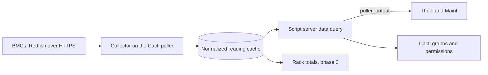

<!-- Source: README.md; SHA256: 7b4e83a58a1adc844cb0615ef30e95476cba2851f96bb454d2a816fb2774724d -->

<!-- translations:start -->
[English](../../../README.md) | [简体中文](../zh-CN/README.md) | [हिन्दी](README.md) | [Español (España)](../es-ES/README.md) | [Español (Latinoamérica)](../es-419/README.md) | [العربية (السعودية)](../ar-SA/README.md) | [Afrikaans](../af-ZA/README.md) | [አማርኛ](../am-ET/README.md) | [العربية (مصر)](../ar-EG/README.md) | [العربية (المغرب)](../ar-MA/README.md) | [বাংলা](../bn-BD/README.md) | [Bosanski](../bs-BA/README.md) | [Deutsch](../de-DE/README.md) | [فارسی](../fa-IR/README.md) | [Filipino](../fil-PH/README.md) | [Français](../fr-FR/README.md) | [Français (Maroc)](../fr-MA/README.md) | [Français (Sénégal)](../fr-SN/README.md) | [Hausa](../ha-NG/README.md) | [עברית](../he-IL/README.md) | [Hrvatski](../hr-HR/README.md) | [Bahasa Indonesia](../id-ID/README.md) | [Igbo](../ig-NG/README.md) | [Italiano](../it-IT/README.md) | [日本語](../ja-JP/README.md) | [한국어](../ko-KR/README.md) | [Malagasy](../mg-MG/README.md) | [मराठी](../mr-IN/README.md) | [Bahasa Melayu](../ms-MY/README.md) | [Nederlands](../nl-NL/README.md) | [Polski](../pl-PL/README.md) | [Português (Brasil)](../pt-BR/README.md) | [Русский](../ru-RU/README.md) | [Kinyarwanda](../rw-RW/README.md) | [Soomaali](../so-SO/README.md) | [Српски](../sr-RS/README.md) | [Svenska](../sv-SE/README.md) | [Kiswahili](../sw-KE/README.md) | [தமிழ்](../ta-IN/README.md) | [తెలుగు](../te-IN/README.md) | [ไทย](../th-TH/README.md) | [Türkçe](../tr-TR/README.md) | [Українська](../uk-UA/README.md) | [اردو](../ur-PK/README.md) | [Tiếng Việt](../vi-VN/README.md) | [isiXhosa](../xh-ZA/README.md) | [Yorùbá](../yo-NG/README.md) | [繁體中文](../zh-TW/README.md) | [isiZulu](../zu-ZA/README.md)
<!-- translations:end -->

# plugin_redfish

यह Cacti 1.2 प्लगइन बेसबोर्ड मैनेजमेंट कंट्रोलर (BMC) से सर्वर की बिजली खपत, इनलेट तापमान, पंखों की स्थिति और बिजली आपूर्तियों का स्वास्थ्य लेकर सामान्य Cacti डिवाइस, डेटा स्रोत और ग्राफ़ बनाता है। यह Redfish उपयोग करता है और योजना में वैकल्पिक IPMI फ़ॉलबैक भी है। Thold और Maint इन पर अलर्ट तथा सूचना दमन लागू कर सकते हैं; बाद का चरण रैक-स्तरीय बिजली योग जोड़ेगा।

> **स्थिति: विकास में, अभी जारी नहीं हुआ (0.1.0-dev)।** माइलस्टोन 2 (आधार) और 3 (Cacti ऑब्जेक्ट तथा अलर्ट) `main` में मिल चुके हैं। यह प्लगइन Cacti परियोजना से संबद्ध नहीं है। यह PHP 8.2 या बाद के संस्करण पर Cacti 1.2.31 में स्थापित होता है, BMC और क्रेडेंशियल पंजीकृत करता है, हर BMC से Redfish द्वारा बिजली, तापमान, पंखे और बिजली आपूर्ति का स्वास्थ्य अपने कैश में पढ़ता है तथा संग्रह स्वास्थ्य दिखाता है। यह सामान्य डेटा स्रोतों से Cacti डिवाइस, सदस्य-वार और सारांश ग्राफ़, तथा Thold और Maint समर्थन जोड़ता है। CI ने हाथ से लिखे फ़िक्स्चर वाले नकली BMC और DMTF Redfish मॉकअप सर्वर का परीक्षण किया है; किसी वास्तविक BMC या पायलट समूह का सत्यापन नहीं हुआ। डिज़ाइन और शोध [docs/PLAN.md](../../PLAN.md), [docs/research/](../../research) और [docs/decisions/](../../decisions) में हैं।

### माइलस्टोन 2 में क्या मिलता है

- Cacti प्लगइन API से इंस्टॉल, अपग्रेड, अक्षम और अनइंस्टॉल करना। सेटिंग हटाए बिना अनइंस्टॉल पर तालिकाएँ रहती हैं। PHP 8.2 से पुराने संस्करण पर प्लगइन इंस्टॉल या सक्षम होने से मना करता है और कारण बताता है।
- "Redfish View" (स्वास्थ्य पृष्ठ), "Redfish Operator" (संचालन पृष्ठ) और "Redfish Admin" (BMC तथा क्रेडेंशियल पृष्ठ) अनुमति क्षेत्र, और Configuration > Settings > Redfish में सेटिंग।
- CSV आयात और JSON निर्यात वाली BMC रजिस्ट्री। आयात फ़ाइलों में पासवर्ड नहीं होने चाहिए; क्रेडेंशियल नाम से संदर्भित होते हैं।
- क्रेडेंशियल AES-256-GCM से एन्क्रिप्ट करके संग्रहीत होते हैं। कुंजी डेटाबेस के बाहर फ़ाइल है, डिफ़ॉल्ट `/etc/cacti/redfish-vault.key`, जिसमें 64 हेक्साडेसिमल वर्ण (`openssl rand -hex 32`) या ठीक 32 यादृच्छिक बाइट होते हैं। उसका मालिक पोलर उपयोगकर्ता हो, अन्य उपयोगकर्ता पढ़ न सकें और निर्देशिका में केवल पोलर उपयोगकर्ता या root लिख सकें। 32 मुद्रण योग्य वर्णों की कुंजी पासफ़्रेज़ मानकर अस्वीकार होती है। **कुंजी फ़ाइल का डेटाबेस के साथ बैकअप लें**; उसके बिना हर संग्रहीत पासवर्ड फिर दर्ज करना होगा।
- TLS सत्यापन डिफ़ॉल्ट रूप से चालू है, हर BMC के लिए CA बंडल या SPKI SHA-256 पिन उपलब्ध है। किसी BMC पर सत्यापन बंद करने का निर्णय लॉग होता है और स्वास्थ्य पृष्ठ पर चेतावनी बना रहता है।
- केवल-पठन Redfish क्लाइंट: सिर्फ़ `GET` और सत्र लॉगिन/लॉगआउट, हर अनुरोध से पहले अनुमति सूची के विरुद्ध जाँचे जाते हैं।
- मुख्य पोलर के BMC के लिए `poller_bottom` से शुरू होने वाला कलेक्टर, जिसमें प्रति-BMC लीज़, समय सीमाएँ, बैकऑफ़ और क्रैश के बाद प्लगइन के दर्ज एक सत्र की सफ़ाई है। दूरस्थ कलेक्टर अभी समर्थित नहीं हैं; डेटाबेस और कुंजी तक उनकी पहुँच का स्पष्ट निर्णय आवश्यक है (चरण 4)।
- BMC रिकॉर्ड और क्रेडेंशियल Cacti डिवाइस अनुमति मानते हैं: Redfish Admin केवल दिखाई देने वाले डिवाइसों के BMC देख, बदल और बाँध सकता है तथा केवल ऐसे क्रेडेंशियल उपयोग कर सकता है जिन्हें किसी छिपे डिवाइस का BMC उपयोग न करता हो।

### माइलस्टोन 3 क्या जोड़ता है

- `templates/` में Cacti टेम्पलेट XML, जो इंस्टॉल और अपग्रेड पर Cacti के आयातक से हैश के आधार पर आयात होते हैं; इसलिए ऑब्जेक्ट अद्यतन होते हैं, दो बार नहीं जुड़ते। तीन डेटा क्वेरी फ़ाइलें दर्ज हैश के साथ `<cacti>/resource/script_server/` में कॉपी होती हैं। प्लगइन वहाँ कभी वह फ़ाइल नहीं बदलता जिसे उसने नहीं लिखा। टेम्पलेट या क्वेरी फ़ाइल गायब होने पर स्वास्थ्य पृष्ठ प्रशासक को चेतावनी देता है। BMC पृष्ठ का **Reinstall the Redfish Templates** उन्हें फिर आयात करता है और Cacti की Import Templates अनुमति चाहता है।
- हर BMC पर **Create Device** या **Add Graphs** ([ADR 0015](../../decisions/0015-attach-to-the-server-device-or-create-one-per-bmc.md))। सर्वर के मौजूदा डिवाइस से मैप BMC को उसी डिवाइस पर क्वेरी और ग्राफ़ मिलते हैं। बिना मैपिंग वाला BMC "Redfish BMC" टेम्पलेट से नया डिवाइस पाता है, उपलब्धता जाँच बंद रहती है और होस्टनाम `.invalid` के अंतर्गत होता है, इसलिए Cacti BMC से संपर्क नहीं करता और पता नहीं दिखाता। दोनों मामलों में प्रशासक पहले जोड़े जाने वाले ऑब्जेक्ट की योजना की पुष्टि करता है। Redfish Admin तथा Cacti डिवाइस प्रबंधन, दोनों अनुमतियाँ चाहिए; निर्माता को न दिखने वाला नया डिवाइस हटा दिया जाता है।
- तीन स्क्रिप्ट सर्वर डेटा क्वेरी: "Redfish Fans", "Redfish Temperatures" और "Redfish Power Supplies", जो BMC सदस्य कुंजी से अनुक्रमित हैं। हर सदस्य का ग्राफ़ होता है: प्रतिशत या RPM में पंखे की गति, जैसा BMC रिपोर्ट करे; तापमान; और बिजली आपूर्ति के इनपुट/आउटपुट वाट, प्रत्येक के स्वास्थ्य कोड सहित।
- "Redfish Node Summary" इनपुट में बिजली, इनलेट तापमान, उच्चतम तापमान, खराब पंखे और आपूर्तियाँ, नोड स्वास्थ्य तथा अंतिम अच्छी रीडिंग की आयु होती है। चार ग्राफ़ बनते हैं: बिजली, तापमान, घटक स्वास्थ्य और डेटा आयु। इन डेटा स्रोतों पर Thold थ्रेशोल्ड अलर्ट और Maint दमन देते हैं, दोनों प्लगइन बदले बिना।
- स्क्रिप्ट सर्वर केवल प्लगइन कैश से उत्तर देता है, BMC से कभी संपर्क नहीं करता। गायब, पुराने, दूसरी इकाई वाले या गायब सदस्य से आए मान `U` होते हैं; ग्राफ़ अंतराल दिखाता है, शून्य नहीं। `age` का मान हमेशा रहता है, इसलिए उसका थ्रेशोल्ड उत्तर देना बंद कर चुके BMC को पकड़ता है।
- हर Redfish ग्राफ़ से डिवाइस के Redfish ग्राफ़ का लिंक, केवल उस डिवाइस को देखने की Cacti अनुमति वाले उपयोगकर्ताओं को दिखाई देता है।

**BMC के सदस्य बदलने पर**, जैसे पंखा बदलना या फ़र्मवेयर अपडेट से सेंसर का नाम बदलना, फिर **Add Graphs** चुनें। पहले मौजूद लेकिन अब अनुपस्थित पंखा या बिजली आपूर्ति तब तक `fans_bad` या `psus_bad` में गिनी जाती है, ताकि निकला पंखा अलर्ट दे; कभी न भरा स्लॉट नहीं गिना जाता। Add Graphs वर्तमान BMC सदस्यों को स्वीकार करता है और Cacti क्वेरी फिर अनुक्रमित करता है। गायब सदस्य का डेटा स्रोत और ग्राफ़ रहता है और आगे `U` पढ़ता है; नए सदस्य को ग्राफ़ मिलता है। गायब सदस्यों के ग्राफ़ तभी हाथ से मिटाएँ जब उनका इतिहास आवश्यक न रहे।

डिवाइस मिटाने से BMC की मैपिंग हटती है, BMC और कैश रहते हैं। BMC मिटाने या प्लगइन अनइंस्टॉल करने पर डिवाइस और ग्राफ़ रहते हैं।

## पहुँच भूमिकाएँ

| अनुमति क्षेत्र | पहुँच |
| --- | --- |
| Redfish View | मौजूदा निगरानी पृष्ठ। |
| Redfish Operator | निगरानी, संचालन पृष्ठ और व्यक्तिगत जाँच-स्वीकृतियाँ। |
| Redfish Admin | ऑपरेटर पहुँच तथा मौजूदा कॉन्फ़िगरेशन और प्रशासनिक कार्रवाइयाँ। |

अपग्रेड फ़ाइलें कॉपी करने के बाद प्रशासक के रूप में Plugins पृष्ठ खोलकर नया अनुमति क्षेत्र पंजीकृत करें। **Configuration > Users** या उपयोगकर्ता समूहों में Operator स्पष्ट रूप से दें। अपग्रेड मौजूदा View और Admin क्षेत्र ID तथा अनुमतियाँ रखते हैं। हर अनुरोध में Admin को Operator और Operator को View पहुँच मिलती है; इससे उपयोगकर्ताओं या समूहों में संग्रहीत अनुमतियाँ नहीं जुड़तीं। प्लगइन सेटिंग के लिए Cacti Settings अनुमति के अतिरिक्त Redfish Admin भी चाहिए।

Cacti डिवाइस अनुमतियाँ अब भी हर उपयोगकर्ता की उपलब्ध पंक्तियाँ और कार्रवाइयाँ सीमित करती हैं; बिना मैपिंग ऑब्जेक्ट के लिए प्रशासक चाहिए। ऑपरेटर अनुमति वाले BMC पर अगले निर्धारित रन के लिए संग्रह रोक हटा सकते हैं। क्रेडेंशियल, कॉन्फ़िगरेशन, मैपिंग, मिटाना और अन्य प्रशासनिक बदलाव प्रशासन पृष्ठों में ही हैं। स्वीकृतियाँ केवल वर्तमान सत्र में, अधिकतम एक घंटे और उसी अवलोकन के ताज़ा रहने तक प्रभावी हैं। नए या बदले अवलोकन उन्हें अमान्य करते हैं। वे विफल मापन को स्वस्थ नहीं बतातीं और अलर्ट नहीं दबातीं।

## आवश्यकता

हर सर्वर का BMC ऑपरेटिंग सिस्टम से स्वतंत्र बिजली और तापीय स्थिति बताता है, इसलिए OS बंद होने पर भी उत्तर देता है। डेटा क्षमता और लागत का हिसाब, खराब पंखे या बिजली आपूर्ति की शुरुआती चेतावनी तथा उच्च प्रदर्शन कंप्यूटिंग में बिजली सीमा के निर्णयों में उपयोगी है। यह प्लगइन केवल HPC के लिए नहीं है।

Cacti आज इसका कुछ भाग उपलब्ध कराता है:

- **विक्रेता SNMP पैकेज।** 1.2.x शाखा में Dell iDRAC और HPE iLO टेम्पलेट हैं, जिन्हें SNMP एजेंट चाहिए और जो विक्रेता-विशिष्ट हैं। माइलस्टोन 1 के शोध में दोनों में वाट में बिजली खपत न मिलने की पुष्टि हुई ([docs/research/overlap.md](../../research/overlap.md))।
- **कलेक्टर के बिना क्रेडेंशियल प्रकार।** plugin_credentials "IPMI / Redfish (BMC)" क्रेडेंशियल परिभाषित करता है, पर BMC नहीं पढ़ता।
- **रैक-स्तरीय दृश्य नहीं।** Cacti कोर में रैक ऑब्जेक्ट नहीं है; डिवाइस का `location` मुक्त पाठ फ़ील्ड है।

प्लगइन Cacti पोल चक्र से बाहर BMC पढ़ता है, मानकीकृत रीडिंग कैश करता है और स्क्रिप्ट सर्वर क्वेरी तथा सारांश डेटा स्रोतों से देता है। यह Cacti ग्राफ़, अनुमतियाँ, Thold और Maint पुनः उपयोग करता है तथा BMC स्थिति नहीं बदलता। दूरस्थ डेटा कलेक्टर समर्थन चरण 4 के लिए नियोजित है; अभी संग्रह केवल मुख्य पोलर पर चलता है।

## नियोजित दायरा

| चरण | दायरा | माइलस्टोन |
|---|---|---|
| 0, शोध | विक्रेता मैट्रिक्स, वास्तविक BMC पर upstream व्यवहार की पुष्टि, पोलिंग लागत और डेटा क्वेरी प्रयोग | [M1](https://github.com/somethingwithproof/plugin_redfish/milestone/1) |
| 1, अवलोकन | BMC रजिस्ट्री, क्रेडेंशियल, TLS, Redfish कलेक्टर, मानकीकृत रीडिंग, डिवाइस, प्रति-इंडेक्स ग्राफ़, Thold अलर्ट, Maint दमन, स्वास्थ्य पृष्ठ | [M2](https://github.com/somethingwithproof/plugin_redfish/milestone/2), [M3](https://github.com/somethingwithproof/plugin_redfish/milestone/3), [M4](https://github.com/somethingwithproof/plugin_redfish/milestone/4) |
| 2, IPMI | उपयोगी Redfish न देने वाले BMC के लिए IPMI फ़ॉलबैक, डिफ़ॉल्ट रूप से बंद | [M5](https://github.com/somethingwithproof/plugin_redfish/milestone/5) |
| 3, रैक | रैक रजिस्ट्री, कवरेज सहित रैक बिजली योग और बजट में बची गुंजाइश | [M6](https://github.com/somethingwithproof/plugin_redfish/milestone/6) |
| 4, दूरस्थ | अलग BMC नेटवर्क के लिए Cacti दूरस्थ डेटा कलेक्टर | [M7](https://github.com/somethingwithproof/plugin_redfish/milestone/7) |

दायरे से बाहर: बिजली सीमा या अन्य BMC कॉन्फ़िगरेशन बदलना, पावर नियंत्रण, फ़र्मवेयर अपडेट, कंसोल पहुँच, प्लगइन का अपना अलर्ट इंजन और शेड्यूलर एकीकरण।

## अनुकूलता लक्ष्य

| घटक | लक्ष्य |
|---|---|
| Cacti | 1.2.31 या बाद का संस्करण, कोर पैच के बिना |
| डेटाबेस | MariaDB 10.2 या MySQL 5.7 या बाद का संस्करण; जनरेटेड कॉलम की अद्वितीय कुंजी प्रति डिवाइस एक BMC सुनिश्चित करती है |
| PHP | 8.2 या बाद का संस्करण; `setup.php` 8.0 पर पार्स हो सकता है, ताकि असमर्थित रनटाइम Cacti UI तोड़ने के बजाय अस्वीकृति दे |
| BMC | फ़र्मवेयर सीमा के अनुसार Dell iDRAC, HPE iLO, Lenovo XCC और OpenBMC; [विक्रेता मैट्रिक्स](../../research/vendor-matrix.md) देखें |
| Redfish | नए सबसिस्टम और सेंसर संसाधन पहले; अप्रचलित `Power` और `Thermal` फ़ॉलबैक हैं |
| Thold, Maint | बदलाव आवश्यक नहीं |

## डिज़ाइन

- [docs/PLAN.md](../../PLAN.md) पूरी योजना है: आर्किटेक्चर, निर्भर upstream तथ्य, उनके स्रोत और अपुष्ट धारणाएँ, मापन मॉडल, सुरक्षा सीमाएँ, प्रदर्शन गणना, परीक्षण और जोखिम।
- [docs/decisions/](../../decisions) में लिए गए आर्किटेक्चर निर्णयों के रिकॉर्ड हैं।
- [docs/REQUIREMENTS.md](../../REQUIREMENTS.md) हर आवश्यकता ID को उसके इश्यू से जोड़ता है।

## सुरक्षा

BMC क्रेडेंशियल सर्वर के आउट-ऑफ़-बैंड प्रबंधन को नियंत्रित करते हैं। डिज़ाइन उन्हें कमांड लाइन, लॉग और पृष्ठों से बाहर रखता है, TLS डिफ़ॉल्ट रूप से सत्यापित करता है, बाहरी कमांड को अनुमति-प्राप्त उपकमांड वाली आर्ग्युमेंट ऐरे से चलाता है और केवल-पठन BMC खाते उपयोग करता है। [docs/PLAN.md](../../PLAN.md#security) और [SECURITY.md](../../../SECURITY.md) देखें।

## ऑपरेटर मार्गदर्शिका

इंस्टॉल की पूर्वापेक्षाएँ, वॉल्ट और TLS सेटअप, BMC पंजीकरण, ग्राफ़ निर्माण, अलर्ट अंतराल, बैकअप और विफलता प्रबंधन के लिए [docs/operator-guide.md](docs/operator-guide.md) देखें। किसी वास्तविक विक्रेता फ़र्मवेयर से गोपनीयता हटाकर लिया कैप्चर टेस्ट सूट पार करने तक मार्गदर्शिका उसे समर्थित घोषित नहीं करती।

## काम कैसे ट्रैक होता है

- **माइलस्टोन** योजना के अनुसार हैं। हर एक में उप-इश्यू और पूर्णता प्रमाण वाला एपिक इश्यू है।
- **इश्यू** के प्रकार लेबल हैं: `type: requirement`, `type: research`, `type: decision`, `type: epic`। आवश्यकता इश्यू क्रमांकित, जाँच योग्य माँगें (`REQ-AREA-NNN`) और स्वीकृति मानदंड देते हैं।
- **लेबल** में `area:`, `phase:`, `priority:` और `status:` भी हैं। [CONTRIBUTING.md](../../../CONTRIBUTING.md#labels) देखें।
- [परियोजना बोर्ड](https://github.com/users/somethingwithproof/projects/12) सभी माइलस्टोन के इश्यू दिखाता है।

## योगदान

[CONTRIBUTING.md](../../../CONTRIBUTING.md) पढ़ें। कमिट के लिए DCO साइन-ऑफ़ चाहिए। डिज़ाइन चर्चा इश्यू में होती है; खुले निर्णयों पर `type: decision` लेबल है। अभी वास्तविक BMC के प्रमाण सबसे उपयोगी हैं; कैप्चर पोस्ट करने से पहले पते, सीरियल नंबर और क्रेडेंशियल छिपाएँ।

## लाइसेंस

GNU General Public License v2.0, वही लाइसेंस जो Cacti और उसके प्लगइन का है। [LICENSE](../../../LICENSE) देखें।
