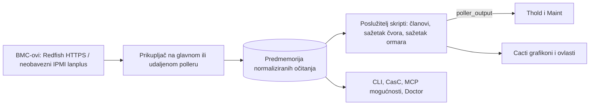

<!-- Source: README.md; SHA256: cf31b9f80d6c00020bbe08e80951d4de1c910793911d040ae7a66b54e8a2eaf0 -->

<!-- translations:start -->
[English](../../../README.md) | [简体中文](../zh-CN/README.md) | [हिन्दी](../hi-IN/README.md) | [Español (España)](../es-ES/README.md) | [Español (Latinoamérica)](../es-419/README.md) | [العربية (السعودية)](../ar-SA/README.md) | [Afrikaans](../af-ZA/README.md) | [አማርኛ](../am-ET/README.md) | [العربية (مصر)](../ar-EG/README.md) | [العربية (المغرب)](../ar-MA/README.md) | [বাংলা](../bn-BD/README.md) | [Bosanski](../bs-BA/README.md) | [Deutsch](../de-DE/README.md) | [فارسی](../fa-IR/README.md) | [Filipino](../fil-PH/README.md) | [Français](../fr-FR/README.md) | [Français (Maroc)](../fr-MA/README.md) | [Français (Sénégal)](../fr-SN/README.md) | [Hausa](../ha-NG/README.md) | [עברית](../he-IL/README.md) | [Hrvatski](README.md) | [Bahasa Indonesia](../id-ID/README.md) | [Igbo](../ig-NG/README.md) | [Italiano](../it-IT/README.md) | [日本語](../ja-JP/README.md) | [한국어](../ko-KR/README.md) | [Malagasy](../mg-MG/README.md) | [मराठी](../mr-IN/README.md) | [Bahasa Melayu](../ms-MY/README.md) | [Nederlands](../nl-NL/README.md) | [Polski](../pl-PL/README.md) | [Português (Brasil)](../pt-BR/README.md) | [Русский](../ru-RU/README.md) | [Kinyarwanda](../rw-RW/README.md) | [Soomaali](../so-SO/README.md) | [Српски](../sr-RS/README.md) | [Svenska](../sv-SE/README.md) | [Kiswahili](../sw-KE/README.md) | [தமிழ்](../ta-IN/README.md) | [తెలుగు](../te-IN/README.md) | [ไทย](../th-TH/README.md) | [Türkçe](../tr-TR/README.md) | [Українська](../uk-UA/README.md) | [اردو](../ur-PK/README.md) | [Tiếng Việt](../vi-VN/README.md) | [isiXhosa](../xh-ZA/README.md) | [Yorùbá](../yo-NG/README.md) | [繁體中文](../zh-TW/README.md) | [isiZulu](../zu-ZA/README.md)
<!-- translations:end -->

# plugin_redfish

Priključak za Cacti 1.2 koji potrošnju električne energije poslužitelja, ulaznu temperaturu, stanje ventilatora i ispravnost napajanja iz kontrolera za upravljanje matičnom pločom (BMC) prenosi u Cacti kao uobičajene uređaje, izvore podataka i grafikone, koristeći Redfish uz neobaveznu pričuvnu IPMI podršku samo za čitanje i zbrojeve potrošnje na razini ormara. Thold i Maint podižu i potiskuju uzbune putem standardnih Cacti izvora podataka.

> **Status: u razvoju, bez objavljenog izdanja (`0.1.0-dev`).** Ovaj priključak nije povezan s projektom Cacti. Instalira se na Cacti 1.2.31 ili noviji uz PHP 8.2 ili noviji te ostvaruje Redfish prikupljač, šifrirani trezor vjerodajnica, dodjelu Cacti uređaja i grafikona, neobaveznu pričuvnu IPMI podršku samo za čitanje, zbroj snage ormara, prikaz prozora Cacti Maint, replikaciju i krajnje točke agenta za udaljene prikupljače podataka, CasC davatelja i operatorski CLI, MCP mogućnosti i dijagnostičke provjere Doctor. CI ispituje testne skupove, DMTF Redfish Mockup Server (podsustav, samo zastarjelo i HPE iLO Gen11 simulacije) te Thold v1.8.2 uz Maint v1.3; nijedan stvarni fizički BMC niti probna flota još nisu potvrđeni. Oblikovanje i istraživanje dostupni su u [docs/PLAN.md](../../PLAN.md), [docs/research/](../../research/) i [docs/decisions/](../../decisions/).

## Ostvarene mogućnosti

### Osnovni prikupljač, trezor i Cacti objekti

- **Životni ciklus i shema.** Instalacija, nadogradnja, onemogućavanje i deinstalacija putem Cacti API-ja za priključke (`Schema::VERSION = 3`, 12 tablica). Tablice se zadržavaju pri deinstalaciji osim ako opcija *Keep Plugin Tables on Uninstall* nije poništena. Ulazne točke raščlanjuju se na PHP-u 8.0 i odbijaju PHP stariji od 8.2 ili nedostatak `ext-openssl` uz izričitu poruku o pogrešci.
- **Registar i ovlasti.** Područja ovlasti *Redfish View* (`redfish_health.php`), *Redfish Operator* (`redfish_operator.php`) i *Redfish Admin* (`redfish_bmcs.php`, `redfish_credentials.php`), uz postavke pod **Configuration > Settings > Redfish**. Registar BMC-ova podržava uvoz CSV-a (vjerodajnice se navode po nazivu; lozinke u datotekama za uvoz se odbijaju) i izvoz JSON-a. Zapisi BMC-ova i vjerodajnice prate ovlasti Cacti uređaja.
- **Šifrirani trezor vjerodajnica.** Lozinke se pohranjuju šifrirane pomoću AES-256-GCM u `plugin_redfish_secret`. Ključ se nalazi izvan baze podataka (zadano `/etc/cacti/redfish-vault.key`) kao 64 heksadecimalna znaka (`openssl rand -hex 32`) ili 32 sirova bajta, u vlasništvu korisnika pollera, nečitljiv drugim korisnicima, u direktoriju u koji smije pisati samo root ili taj korisnik. Ispisiva zaporka od 32 znaka se odbija. **Sigurnosno kopirajte datoteku ključa zajedno s bazom podataka**; bez nje se pohranjene lozinke moraju ponovo unijeti.
- **TLS i Redfish klijent samo za čitanje.** Provjera TLS-a omogućena je zadano pomoću sustavnog spremišta CA certifikata, paketa CA certifikata po BMC-u ili SPKI SHA-256 pribadače; isključenje provjere po pojedinom BMC-u ostaje vidljivo kao upozorenje o zdravlju i upozorenje provjere Doctor. Klijent dopušta samo `GET` uz prijavu (`POST`) i odjavu (`DELETE`) Redfish sesije, uz neobavezni prelazak na Basic po BMC-u kada sesije nisu dostupne. Otkrivanje daje prednost novim Redfish resursima podsustava i senzora te se vraća na zastarjele resurse `Power` i `Thermal`.
- **Izvršavanje prikupljača.** `poller_redfish.php` pokreće se iz `poller_bottom`, izvršava jedan glavni proces po polleru putem Cacti registra procesa s podesivim brojem radnih procesa (`redfish_workers`), pribavlja zakupe po BMC-u, provodi vremenski proračun (`redfish_collector_budget`), primjenjuje eksponencijalno odgađanje i čisti vlastitu prethodnu sesiju priključka nakon pada.
- **Predlošci, uređaji i grafikoni.** Uvozi `templates/redfish-templates.xml` prema sažetku i kopira tri XML datoteke upita podataka poslužitelja skripti (`redfish_fans.xml`, `redfish_temperatures.xml`, `redfish_psus.xml`) u `<cacti>/resource/script_server/` bez prepisivanja datoteka koje je izmijenio korisnik. **Create Device** i **Add Graphs** zahtijevaju potvrdu plana dodjele, povezuju upite s mapiranim poslužiteljskim uređajem ili stvaraju uređaj "Redfish BMC" pod `.invalid` s onemogućenim provjerama dostupnosti te povezuju svaki Redfish grafikon natrag na Redfish grafikone uređaja putem `graph_buttons`.
- **Ulazi poslužitelja skripti isključivo iz predmemorije.** `scripts/ss_redfish_members.php` poslužuje očitanja ventilatora, temperature i napajanja po članu, a `scripts/ss_redfish_summary.php` poslužuje metrike "Redfish Node Summary" (snaga, ulazna i maksimalna temperatura, broj neispravnih ventilatora i napajanja, zdravlje čvora i starost posljednjeg dobrog očitanja). Pozivi poslužitelja skripti čitaju samo lokalnu predmemoriju i nikada ne kontaktiraju BMC. Nedostajuća, zastarjela očitanja ili očitanja nestalih članova vraćaju `U` (nikada `0`), dok `age` uvijek izvješćuje vrijednost kako bi pragovi otkrili tihe BMC jedinice.

**Kada se članovi BMC-a promijene** (primjerice zamijenjeni ventilator ili nadogradnja ugrađenog softvera koja preimenuje senzore), ponovno pokrenite **Add Graphs**. Prethodno prisutan ventilator ili napajanje koje nestane broji se u `fans_bad` ili `psus_bad` dok se ne prihvati; utor koji nikada nije bio popunjen ne broji se. Nestali članovi zadržavaju postojeće izvore podataka i grafikone, koji nakon toga očitavaju `U` sve do ručnog brisanja. Brisanje Cacti uređaja uklanja mapiranje njegova BMC-a i uklanja njegovu dodjelu ormaru uz zadržavanje BMC-a i predmemorije; brisanje BMC-a ili deinstalacija priključka zadržava Cacti uređaje i grafikone.

### Neobavezna pričuvna IPMI podrška

- **Uključivanje po izboru za svaki BMC.** Zadano isključeno (`protocols` je zadano `redfish`; uključivanje pričuvnog IPMI-ja postavlja `redfish,ipmi`).
- **Ograničeni okidač pričuvne podrške.** Pokreće se samo kada Redfish prikupljanje ne uspije s prihvatljivom klasom pogreške; nikada se ne pokreće kod `AuthRejected`, `CredentialUnavailable`, `AddressRefused`, `OperationRefused` ili `Deadline`.
- **Sigurno izvršavanje.** Poziva `ipmitool` preko `-I lanplus` putem polja argumenata u `proc_open()` bez ljuske, s ograničenim stvarnim vremenom čekanja i ograničenjem izlaza od 256 KiB. Lozinke se predaju putem `IPMITOOL_PASSWORD` (`-E`) ili privremene datoteke s dozvolama 0600 (`-f`) koja se briše u `finally`, nikada na CLI argv.
- **Popis dopuštenih naredbi samo za čitanje.** Dopušteno je samo pet podnaredbi samo za čitanje: `dcmi power reading`, `sdr type Temperature`, `sdr type Fan`, `sdr type Power Supply` i `chassis status`. Naredbe koje mijenjaju stanje se odbijaju.
- **Normalizirani izlaz i upozorenje o stanju sigurnosti.** `IpmiNormalizer` preslikava očitanja u isti model `Observation`/`Member`/`Reading`, dajući `U` za nedostajuće ili neraščlanjive senzore. Uključivanje pričuvnog IPMI-ja podiže upozorenje na stranici zdravlja i u provjeri Doctor `redfish.bmc_security`, podsjećajući operatore da ograniče UDP 623 na upravljački VLAN.

### Zbroj snage ormara

- **Registar ormara.** Inačica sheme 3 dodaje `plugin_redfish_rack` (jedinstveno `(site_id, name)`, neobavezno `power_budget_watts`, `min_coverage_pct` zadano `80` i bilješke) te `plugin_redfish_rack_member` (najviše jedna dodjela ormara po `host_id`, neobavezno `bmc_id` i `unit_position`, automatski uklonjena kad se Cacti uređaj obriše).
- **Zbrojevi zaštićeni pokrivenošću.** `RackPowerSummary` zbraja svježa očitanja `power_watts` članova iz lokalne predmemorije te izračunava iskorištenost proračuna i raspoloživu zalihu. Kada pokrivenost članova koji javljaju padne ispod `min_coverage_pct`, `power_watts`, `utilization_pct` i `headroom_watts` vraćaju `U` kako se kvarovi prikupljača nikada ne bi prikazali kao pad snage ormara.
- **Ulaz poslužitelja skripti spreman za Thold.** `scripts/ss_redfish_rack.php` (`ss_redfish_rack(<rack_id>)`) vraća `power_watts`, `power_budget_watts`, `utilization_pct`, `headroom_watts`, `members_total`, `members_reporting` i `coverage_pct` isključivo iz lokalne predmemorije.

### Integracija sa sustavom Cacti Maint

- Pragovi Thold na Redfish izvorima podataka podižu uzbune, a Cacti Maint ih potiskuje bez ikakvih izmjena u bilo kojem od priključaka.
- `MaintWindow` provjerava aktivne Maint rasporede za svako mapirano Cacti računalo (jednokratni `mtype=1` i ponavljajući `mtype=2` rasporedi, uz `plugin_maint_check_cacti_host()` kad je učitan) i označava aktivno održavanje na stranici zdravlja Redfish (`[MAINT]`), u izlazu `cli/redfish.php health` i u mogućnosti `redfish-get-health`.

### Udaljeni prikupljači podataka

- `INFO` deklarira `remote_collect:1`. BMC jedinice prihvaćaju bilo koji `poller_id >= 1`, a `poller_redfish.php --poller=N` prikuplja samo omogućene BMC jedinice dodijeljene tom polleru.
- **Kuka `replicate_out`.** Replicira samo tajno neosjetljive konfiguracijske tablice ograničene na ciljani udaljeni poller putem `replicate_out_table()`: `plugin_redfish_bmc`, metapodatke `plugin_redfish_credential` (bez šifriranog teksta), `plugin_redfish_rack` i `plugin_redfish_rack_member`. `plugin_redfish_secret` se ne replicira, a datoteke ključa trezora ostaju strogo lokalne na svakom polleru.
- **Kuka `remote_agent`.** Izlaže radnje samo za čitanje `redfish_health` i `redfish_discovery` koje prihvaćaju samo numeričke parametre `poller_id` i `bmc_id`. Neočekivani parametri se odbijaju i ne vraćaju se nikakve vjerodajnice niti tajne.

### Kuke ekosustava (CasC, MCP mogućnosti i Doctor)

- **Davatelj CasC (`casc_register_providers`).** Registrira davatelja `redfish` (inačica sheme `1`) s izvozom u YAML i XML u čistom PHP-u, raščlanjivanjem (uz odbijanje XXE), provjerom valjanosti, planiranjem razlika i primjenom. Vjerodajnice se pojavljuju samo kao reference trezora (`vault:redfish:<name>`); sirovi tajni ključevi (`pass`, `secret`, `token`, `private_key`, `vault_key`, `auth_token`) se odbijaju. Primjena zahtijeva točan SHA-256 `PLAN_HASH`.
- **MCP / Abilities API (`abilities_register`).** Registrira tri mogućnosti samo za čitanje ograničene na područje ovlasti Redfish View (`redfish_health.php`) i ovlasti Cacti uređaja, ne vraćajući nikakve vjerodajnice:
  - `redfish-list-bmcs` (neobavezni `poller_id`)
  - `redfish-get-rack-power` (neobavezni `rack_id`)
  - `redfish-get-health` (neobavezni `bmc_id`)
- **Provjere Doctor (`doctor_register_checks`).** Registrira pet lokalnih dijagnostičkih provjera samo za čitanje koje nikada ne kontaktiraju BMC niti vraćaju materijal ključa:
  - `redfish.schema`: aktualnost inačice sheme
  - `redfish.vault_key`: čitljivost i dozvole ključa trezora
  - `redfish.collector_runs`: vremenski proračun i svježina prikupljača pollera
  - `redfish.bmc_security`: omogućene BMC jedinice s neprovjerenim TLS-om ili pričuvnim IPMI-jem
  - `redfish.rack_power`: usklađenost s proračunom snage ormara i donjom granicom pokrivenosti

## CLI

Pokreće se iz korijenskog direktorija Cacti uz PHP 8.2 ili noviji:

```sh
# Operator and CasC CLI (reads --file=PATH or stdin for validate, plan, and apply)
php plugins/redfish/cli/redfish.php export --format=yaml|xml
php plugins/redfish/cli/redfish.php validate [--file=PATH] [--format=yaml|xml]
php plugins/redfish/cli/redfish.php plan [--file=PATH] [--format=yaml|xml]
php plugins/redfish/cli/redfish.php apply [--file=PATH] [--format=yaml|xml] --confirm=<PLAN_HASH>
php plugins/redfish/cli/redfish.php health --format=text|json

# Collector entry point (normally started by poller_bottom)
php plugins/redfish/poller_redfish.php [--poller=N] [--force] [--debug]

# Rack power summary script server entry point
php plugins/redfish/scripts/ss_redfish_rack.php <rack_id>
```

## Uloge pristupa

| Područje (Realm) | Pristup |
| --- | --- |
| Redfish View | Postojeće stranice za nadzor. |
| Redfish Operator | Nadzor plus stranica Operations i osobne potvrde trijaže. |
| Redfish Admin | Pristup Operator plus postojeća konfiguracija i administrativne radnje. |

Nakon kopiranja datoteka za nadogradnju otvorite stranicu Plugins kao administrator da biste registrirali područja ovlasti. Izričito dodijelite područje Operator pod **Configuration > Users** ili korisničkim skupinama. Nadogradnje zadržavaju postojeće ID-ove područja i dodijeljena prava za View i Admin. Pristup Admin nasljeđuje pristup Operator, a pristup Operator nasljeđuje pristup View pri svakom zahtjevu; time se korisnicima ili skupinama ne dodaju pohranjene ovlasti. Postavke priključka također zahtijevaju pristup Redfish Admin uz ovlast Settings u sustavu Cacti.

Ovlasti Cacti uređaja ograničavaju retke i radnje dostupne svakom korisniku; nemapirani objekti zahtijevaju administratora. Operatori mogu otpustiti zadržavanje prikupljanja na dopuštenom BMC-u za sljedeće zakazano pokretanje. Vjerodajnice, konfiguracija, mapiranje, brisanje i ostale administrativne promjene ostaju na administrativnim stranicama. Potvrde traju samo u trenutačnoj sesiji korisnika, najviše sat vremena i samo dok isto opažanje ostaje svježe. Nova ili promijenjena opažanja ih poništavaju. Nikada ne označavaju neuspjelo mjerenje kao ispravno niti potiskuju uzbune.

## Zašto

Svaki poslužitelj ima BMC koji izvješćuje o stanju napajanja i topline neovisno o operacijskom sustavu, pa nastavlja odgovarati i kada OS ne radi. Podaci služe za praćenje kapaciteta i troškova, rano upozorenje na kvar ventilatora ili napajanja te, u računalstvu visokih performansi, za odluke o ograničavanju snage. Priključak nije specifičan za HPC.

Cacti danas pokriva dio ovoga:

- **SNMP paketi proizvođača.** Grana 1.2.x isporučuje predloške Dell iDRAC i HPE iLO koji zahtijevaju SNMP agenta i ovise o proizvođaču; istraživanje u prvoj prekretnici utvrdilo je da nijedan ne izvješćuje potrošnju snage u vatima ([docs/research/overlap.md](../../research/overlap.md)).
- **Vrsta vjerodajnice bez prikupljača.** plugin_credentials definira vjerodajnicu "IPMI / Redfish (BMC)", ali ne čita nijedan BMC.
- **Bez prikaza na razini ormara.** Jezgra Cacti nema objekt ormara; uređaj ima samo polje slobodnog teksta `location`.

Priključak ispituje BMC jedinice izvan pojasa u odnosu na Cacti ciklus ispitivanja na glavnom polleru ili udaljenim prikupljačima podataka, predmemorira normalizirana očitanja i izlaže ih putem upita podataka poslužitelja skripti, sažetaka čvora i sažetaka snage ormara. Ponovno koristi Cacti grafikone, ovlasti, Thold i Maint te ne mijenja stanje BMC-a.

## Opseg i status

| Faza | Opseg | Prekretnice | Status |
|---|---|---|---|
| 0, istraživanje | Matrica proizvođača, potvrda ponašanja uzvodnog koda na stvarnim BMC-ovima, trošak ispitivanja, probna izvedba upita podataka | [M1](https://github.com/somethingwithproof/plugin_redfish/milestone/1) | Dovršeno, čekaju se snimke ugrađenog softvera sa stvarnih BMC-ova |
| 1, promatranje | Registar BMC-ova, vjerodajnice, TLS, Redfish prikupljač, normalizirana očitanja, uređaji, grafikoni po indeksu, Thold uzbunjivanje, Maint integracija, stranica zdravlja | [M2](https://github.com/somethingwithproof/plugin_redfish/milestone/2), [M3](https://github.com/somethingwithproof/plugin_redfish/milestone/3), [M4](https://github.com/somethingwithproof/plugin_redfish/milestone/4) | Ostvareno; potvrda probne flote M4 na čekanju |
| 2, ipmi | Pričuvna IPMI (`lanplus`) podrška samo za čitanje putem `ipmitool`, zadano isključena | [M5](https://github.com/somethingwithproof/plugin_redfish/milestone/5) | Ostvareno |
| 3, ormari | Registar ormara, zbrojevi snage ormara s donjom granicom pokrivenosti, zaliha proračuna, `ss_redfish_rack.php` | [M6](https://github.com/somethingwithproof/plugin_redfish/milestone/6) | Ostvareno |
| 4, udaljeno i ekosustav | Udaljeni prikupljači podataka (`replicate_out`, `remote_agent`), CasC davatelj i CLI, MCP mogućnosti, provjere Doctor | [M7](https://github.com/somethingwithproof/plugin_redfish/milestone/7) | Ostvareno |

Izvan opsega: postavljanje ograničenja snage ili bilo koje druge konfiguracije BMC-a, upravljanje napajanjem, ažuriranje ugrađenog softvera, pristup konzoli, vlastiti sustav uzbunjivanja priključka i integracija s planerom.

## Ciljevi kompatibilnosti

| Komponenta | Cilj |
|---|---|
| Cacti | 1.2.31 ili noviji, bez zakrpa jezgre |
| Baza podataka | MariaDB 10.2 ili MySQL 5.7 ili noviji: jedan BMC po uređaju osiguran je jedinstvenim ključem na generiranom stupcu |
| PHP | 8.2 ili noviji; ulazne točke ostaju raščlanjive na 8.0 kako bi nepodržana okolina dobila odbijanje umjesto pokvarenog Cacti sučelja |
| PHP proširenja | `ext-openssl` (zahtijeva Cacti 1.2.31); bez `ext-curl` i bez ovisnosti izvođenja za Composer |
| Neobavezni alati | `ipmitool` na pollerima koji prikupljaju BMC jedinice s uključenom pričuvnom IPMI podrškom |
| BMC jedinice | Dell iDRAC, HPE iLO, Lenovo XCC i OpenBMC, prema rasponu inačica ugrađenog softvera; pogledajte [matricu proizvođača](../../research/vendor-matrix.md) |
| Redfish | Novi resursi podsustava i senzora najprije, zastarjeli `Power` i `Thermal` kao pričuva |
| Thold, Maint | Nisu potrebne izmjene (CI ispituje Thold v1.8.2 i Maint v1.3) |

## Oblikovanje

- [docs/PLAN.md](../../PLAN.md) jest cjeloviti plan: arhitektura, uzvodne činjenice o kojima ovisi, model mjerenja, sigurnosne granice, proračun performansi, testiranje i rizici.
- [docs/decisions/](../../decisions/) sadrži zapise arhitektonskih odluka za već donesene izbore.
- [docs/REQUIREMENTS.md](../../REQUIREMENTS.md) preslikava svaki ID zahtjeva na pripadajući issue.



## Sigurnost

Vjerodajnice BMC-a upravljaju izvanpojasnim nadzorom i upravljanjem poslužitelja. Oblikovanje drži tajne izvan naredbenih redaka, zapisa, CasC izvoza, sadržaja udaljenog agenta, MCP odgovora i web stranica; šifrira pohranjene lozinke pomoću AES-256-GCM uz lokalnu datoteku ključa trezora po polleru; zadano provjerava TLS; pokreće `ipmitool` iz izričitog polja argumenata s dopuštenim podnaredbama samo za čitanje; te upotrebljava BMC račune samo za čitanje. Pogledajte [docs/PLAN.md](../../PLAN.md#security) i [SECURITY.md](../../../SECURITY.md).

## Vodič za operatore

Pogledajte [docs/operator-guide.md](../../operator-guide.md) za preduvjete instalacije, postavljanje trezora i TLS-a, registraciju BMC-a, izradu grafikona, intervale uzbunjivanja, sigurnosno kopiranje i postupanje kod kvarova. Vodič ne proglašava nijednu stvarnu liniju ugrađenog softvera proizvođača podržanom sve dok redigirana snimka s tog softvera ne prođe skup testova.

## Razvoj i testiranje

CI (`.github/workflows/plugin-ci-workflow.yml`) provjerava sintaksu ulaznih točaka na PHP-u 8.0, pokreće Pest jedinične (`phpunit.xml`) i integracijske testove životnog ciklusa (`phpunit-integration.xml`) te PHPStan razine 9 na PHP-u 8.2 do 8.5 prema Cacti granama `release/1.2.31` i `1.2.x`, potvrđuje odbijanje na PHP-u 8.1, cjelovito ispituje DMTF Redfish Mockup Server (podsustav, samo zastarjelo i HPE iLO Gen11 simulacije) te Thold v1.8.2 / Maint v1.3, i provjerava gettext kataloge, radne tijekove i REUSE licenciranje.

Lokalne provjere prije slanja:

```sh
sh tests/lint-workflows.sh
sh locales/build_gettext.sh --check
CACTI_PATH=/path/to/cacti phpstan analyse -c phpstan.neon --no-progress
```

Pokrenite Pest s `--configuration=phpunit.xml` za jedinične i testove pravila izvornog koda, ili `--configuration=phpunit-integration.xml` s `CACTI_PATH` i `REDFISH_TEST_DATABASE=disposable` na jednokratnoj Cacti bazi podataka za integracijske testove životnog ciklusa.

## Kako se prati rad

- **Prekretnice (Milestones)** prate prekretnice plana. Svaka ima epic issue koji navodi njezine podređene issue-e i izlazne dokaze.
- **Issue-i** su označeni vrstom: `type: requirement`, `type: research`, `type: decision`, `type: epic`. Issue-i zahtjeva navode numerirane, provjerljive zahtjeve (`REQ-AREA-NNN`) i kriterije prihvaćanja.
- **Oznake** također nose `area:`, `phase:`, `priority:` i `status:`. Pogledajte [CONTRIBUTING.md](../../../CONTRIBUTING.md#labels).
- [Ploča projekta](https://github.com/users/somethingwithproof/projects/12) prikazuje sve issue-e kroz prekretnice.

## Doprinos

Pročitajte [CONTRIBUTING.md](../../../CONTRIBUTING.md). Commitovi zahtijevaju DCO potpis. Rasprave o oblikovanju odvijaju se na issue-ima; otvorene odluke nose oznaku `type: decision`. Dokazi sa stvarnih BMC-ova trenutačno su najkorisniji doprinos; uklonite adrese, serijske brojeve i vjerodajnice prije objave bilo kakve snimke.

## Licenca

GNU General Public License v2.0, ista licenca kao Cacti i njegovi priključci. Pogledajte [LICENSE](../../../LICENSE).
