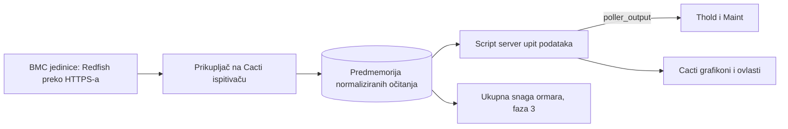

<!-- Source: README.md; SHA256: 7b4e83a58a1adc844cb0615ef30e95476cba2851f96bb454d2a816fb2774724d -->

<!-- translations:start -->
[English](../../../README.md) | [简体中文](../zh-CN/README.md) | [हिन्दी](../hi-IN/README.md) | [Español (España)](../es-ES/README.md) | [Español (Latinoamérica)](../es-419/README.md) | [العربية (السعودية)](../ar-SA/README.md) | [Afrikaans](../af-ZA/README.md) | [አማርኛ](../am-ET/README.md) | [العربية (مصر)](../ar-EG/README.md) | [العربية (المغرب)](../ar-MA/README.md) | [বাংলা](../bn-BD/README.md) | [Bosanski](../bs-BA/README.md) | [Deutsch](../de-DE/README.md) | [فارسی](../fa-IR/README.md) | [Filipino](../fil-PH/README.md) | [Français](../fr-FR/README.md) | [Français (Maroc)](../fr-MA/README.md) | [Français (Sénégal)](../fr-SN/README.md) | [Hausa](../ha-NG/README.md) | [עברית](../he-IL/README.md) | [Hrvatski](README.md) | [Bahasa Indonesia](../id-ID/README.md) | [Igbo](../ig-NG/README.md) | [Italiano](../it-IT/README.md) | [日本語](../ja-JP/README.md) | [한국어](../ko-KR/README.md) | [Malagasy](../mg-MG/README.md) | [मराठी](../mr-IN/README.md) | [Bahasa Melayu](../ms-MY/README.md) | [Nederlands](../nl-NL/README.md) | [Polski](../pl-PL/README.md) | [Português (Brasil)](../pt-BR/README.md) | [Русский](../ru-RU/README.md) | [Kinyarwanda](../rw-RW/README.md) | [Soomaali](../so-SO/README.md) | [Српски](../sr-RS/README.md) | [Svenska](../sv-SE/README.md) | [Kiswahili](../sw-KE/README.md) | [தமிழ்](../ta-IN/README.md) | [తెలుగు](../te-IN/README.md) | [ไทย](../th-TH/README.md) | [Türkçe](../tr-TR/README.md) | [Українська](../uk-UA/README.md) | [اردو](../ur-PK/README.md) | [Tiếng Việt](../vi-VN/README.md) | [isiXhosa](../xh-ZA/README.md) | [Yorùbá](../yo-NG/README.md) | [繁體中文](../zh-TW/README.md) | [isiZulu](../zu-ZA/README.md)
<!-- translations:end -->

# plugin_redfish

Priključak za Cacti 1.2 koji potrošnju električne energije poslužitelja, ulaznu temperaturu, stanje ventilatora i ispravnost napajanja iz kontrolera za upravljanje matičnom pločom (BMC) prenosi u Cacti kao uobičajene uređaje, izvore podataka i grafikone, koristeći Redfish uz neobaveznu pričuvnu IPMI podršku. Thold i Maint zatim podižu i potiskuju uzbune, a kasnija faza dodaje ukupnu potrošnju energije na razini ormara.

> **Status: u razvoju, bez objavljenog izdanja (0.1.0-dev).** Prekretnice 2 (temelj) i 3 (Cacti objekti i uzbunjivanje) spojene su na granu `main`. Ovaj priključak nije povezan s projektom Cacti. Instalira se na Cacti 1.2.31 uz PHP 8.2 ili noviji, registrira BMC jedinice i vjerodajnice, čita snagu, temperature, ventilatore i stanje napajanja sa svake BMC jedinice putem protokola Redfish u vlastitu predmemoriju te prikazuje zdravlje prikupljanja. Stvara Cacti uređaje, grafikone po pojedinim članovima i sažete grafikone te pruža podršku za Thold i Maint preko standardnih izvora podataka. CI je ispitao simulirani BMC izrađen iz ručno pisanih testnih skupova i DMTF Redfish poslužitelj za simulaciju; nijedan stvarni BMC niti probna flota još nisu potvrđeni. Oblikovanje i istraživanje dostupni su u [docs/PLAN.md](../../PLAN.md), [docs/research/](../../research) i [docs/decisions/](../../decisions).

### Što isporučuje prekretnica 2

- Instalacija, nadogradnja, onemogućavanje i deinstalacija putem Cacti API-ja za priključke, pri čemu se tablice zadržavaju pri deinstalaciji osim ako postavka nije poništena. Na PHP-u starijem od 8.2 priključak odbija instalaciju ili uključivanje uz objašnjenje razloga.
- Ovlasna područja (Realms) "Redfish View" (stranica zdravlja), "Redfish Operator" (stranica operacija) i "Redfish Admin" (stranice za BMC jedinice i vjerodajnice), kao i postavke pod Configuration > Settings > Redfish.
- Popis BMC jedinica s CSV uvozom i JSON izvozom. Datoteke za uvoz ne smiju sadržavati zaporke; vjerodajnice se navode nazivom.
- Vjerodajnice pohranjene šifrirano algoritmom AES-256-GCM. Ključ je datoteka izvan baze podataka, zadano `/etc/cacti/redfish-vault.key`, koja sadrži 64 heksadecimalna znaka (`openssl rand -hex 32`) ili točno 32 nasumična bajta, u vlasništvu korisnika ispitivača (pollera), nečitljiva drugim korisnicima, u mapi u koju smiju pisati samo korisnik ispitivača ili root. Ključ od 32 ispisiva znaka odbija se kao zaporka. **Izradite sigurnosnu kopiju datoteke ključa zajedno s bazom podataka**; bez nje svaku pohranjenu zaporku potrebno je ponovno unijeti.
- Provjera TLS-a uključena je zadano, uz paket CA certifikata ili SPKI SHA-256 prikvačivanje po BMC jedinici. Zapisano isključivanje provjere za pojedini BMC ostaje prikazano na stranici zdravlja kao upozorenje.
- Redfish klijent isključivo za čitanje: samo `GET` te prijava i odjava sjednice, provjereno prema popisu dopuštenih radnji prije slanja svakog zahtjeva.
- Prikupljač pokrenut iz `poller_bottom` za BMC jedinice na glavnom ispitivaču, uz zakupe i rokove po BMC-u, odgodu te čišćenje jedine sjednice koju je priključak zabilježio nakon pada. Udaljeni prikupljači još nisu podržani; traže izričit odabir načina pristupa prikupljača bazi podataka i ključu (faza 4).
- Zapisi BMC jedinica i vjerodajnice poštuju Cacti ovlasti za uređaje: Redfish Admin vidi, mijenja i povezuje samo BMC jedinice na uređajima koje smije vidjeti te samo vjerodajnice koje ne upotrebljava nijedan BMC na skrivenom uređaju.

### Što dodaje prekretnica 3

- Predlošci isporučeni kao Cacti XML predlošci u mapi `templates/` i uvezeni vlastitim Cacti uvoznikom pri instalaciji i nadogradnji, usklađeni po otisku (hash), tako da uvoz ažurira objekte priključka bez udvostručavanja. Tri datoteke upita podataka kopiraju se u `<cacti>/resource/script_server/` sa spremljenim otiskom; priključak ondje nikada ne zamjenjuje datoteku koju sam nije zapisao, a stranica zdravlja upozorava administratore kad predlošci ili datoteka upita nedostaju. Radnja **Reinstall the Redfish Templates** na stranici BMC jedinica ponovno ih uvozi i zahtijeva Cacti ovlast Import Templates.
- **Create Device** ili **Add Graphs** za svaki BMC ([ADR 0015](../../decisions/0015-attach-to-the-server-device-or-create-one-per-bmc.md)). BMC pridružen postojećem uređaju poslužitelja dobiva svoje upite podataka i grafikone na tom uređaju. Nepridruženi BMC dobiva novi uređaj iz predloška uređaja "Redfish BMC", s isključenim provjerama dostupnosti i nazivom poslužitelja pod `.invalid`, pa Cacti nikada ne kontaktira BMC i nikada ne prikazuje njegovu adresu. U oba slučaja administrator najprije potvrđuje plan s popisom stavki koje će biti dodane. Oba postupka zahtijevaju Cacti ovlast upravljanja uređajima uz Redfish Admin; novi uređaj koji autor ne bi mogao vidjeti odmah se uklanja.
- Tri script server upita podataka, "Redfish Fans", "Redfish Temperatures" i "Redfish Power Supplies", indeksirana ključem člana BMC-a, s po jednim grafikonom po članu: brzina ventilatora u postocima ili okretajima u minuti (ovisno o jedinici koju BMC prijavi), temperatura te ulazna i izlazna snaga napajanja u vatima, svaki s pripadajućim kodom zdravlja.
- Ulaz "Redfish Node Summary" sa snagom, ulaznom temperaturom, najvišom temperaturom, brojem neispravnih ventilatora i napajanja, zdravljem čvora i starošću zadnjeg valjanog očitanja, prikazan na četiri grafikona: snaga, temperature, zdravlje komponenti i starost podataka. Thold pragovi na tim izvorima podataka šalju uzbune, a Maint ih potiskuje bez izmjena na bilo kojem od tih dvaju priključaka.
- Script server odgovara isključivo iz predmemorije priključka i nikada ne kontaktira BMC. Vrijednost koja nedostaje, zastarjela je, ima drugu mjernu jedinicu ili pripada uklonjenom članu vraća `U`, pa grafikoni prikazuju prekid, a nikada nulu; `age` uvijek ima vrijednost, stoga prag na njemu prepoznaje BMC koji je prestao odgovarati.
- Poveznica sa svakog Redfish grafikona na sve Redfish grafikone tog uređaja, vidljiva samo korisnicima kojima Cacti dopušta pregled uređaja.

**Kada se članovi BMC-a promijene** (zamijenjen ventilator, nadogradnja ugrađenog softvera koja preimenuje osjetnike), ponovno odaberite **Add Graphs**. Ventilator ili napajanje koje je bilo prisutno, a sada nedostaje ili je uklonjeno, ubraja se u `fans_bad` ili `psus_bad` sve dok to ne učinite, pa izvađeni ventilator pokreće uzbunu; prazan utor koji nikada nije bio popunjen ne ubraja se. Add Graphs prihvaća članove koje BMC trenutačno prijavljuje, a Cacti ponovno indeksira upite; uklonjeni član zadržava svoj izvor podataka i grafikon koji nadalje očitavaju `U`, dok novi član dobiva novi grafikon. Grafikone uklonjenih članova ručno izbrišite kad njihova povijest više nije potrebna.

Brisanje uređaja ukida pridruživanje njegovog BMC-a te zadržava BMC i njegovu predmemoriju. Brisanje BMC-a ili deinstalacija priključka zadržava uređaj i njegove grafikone.

## Uloge pristupa

| Područje (Realm) | Pristup |
| --- | --- |
| Redfish View | Postojeće stranice nadzora. |
| Redfish Operator | Nadzor te stranica operacija i osobne potvrde uvida za trijažu. |
| Redfish Admin | Pristup operatera te postojeće konfiguracijske i administrativne radnje. |

Nakon kopiranja datoteka za nadogradnju otvorite stranicu Plugins kao administrator kako biste registrirali novo ovlasno područje. Izričito dodijelite područje Operator pod **Configuration > Users** ili korisničkim skupinama. Nadogradnje čuvaju postojeće oznake ID i dodjele za područja View i Admin. Pristup Admin pri svakom zahtjevu nasljeđuje pristup Operator, a pristup Operator nasljeđuje pristup View; time se korisnicima ni skupinama ne dodaju pohranjene ovlasti. Postavke priključka zahtijevaju i pristup Redfish Admin uz Cacti ovlast za postavke.

Cacti ovlasti za uređaje i dalje ograničavaju retke i postupke dostupne pojedinom korisniku; nepridruženi objekti zahtijevaju administratora. Operateri mogu osloboditi zadržavanje prikupljanja za dopušteni BMC za sljedeće zakazano izvođenje. Vjerodajnice, konfiguracija, pridruživanje, brisanje i ostale administrativne promjene ostaju na administrativnim stranicama. Potvrde uvida vrijede samo u trenutačnoj korisničkoj sjednici, najdulje jedan sat i samo dok isto opažanje ostaje svježe. Nova ili promijenjena opažanja poništavaju ih. Nikada ne proglašavaju neuspjelo mjerenje ispravnim niti potiskuju uzbune.

## Zašto

Svako poslužiteljsko računalo ima BMC koji izvješćuje o energetskom i toplinskom stanju neovisno o operacijskom sustavu pa nastavlja odgovarati i kad je operacijski sustav u zastoju. Podaci služe za praćenje kapaciteta i troškova, rano upozorenje na kvar ventilatora ili napajanja te, u računalstvu visokih performansi (HPC), za odluke o ograničavanju potrošnje energije. Priključak nije ograničen samo na HPC.

Cacti danas pokriva dio toga:

- **Proizvođački SNMP paketi.** Grana 1.2.x sadrži predloške za Dell iDRAC i HPE iLO koji zahtijevaju SNMP agenta i vezani su uz proizvođača; istraživanje u prekretnici 1 utvrdilo je da nijedan ne izvješćuje o potrošnji energije u vatima ([docs/research/overlap.md](../../research/overlap.md)).
- **Vrsta vjerodajnice bez prikupljača.** plugin_credentials definira vjerodajnicu "IPMI / Redfish (BMC)", ali ne čita nijedan BMC.
- **Bez pregleda na razini ormara.** Jezgra Cactija nema objekt ormara; uređaj posjeduje samo tekstualno polje slobodnog oblika `location`.

Priključak ispituje BMC jedinice izvan osnovnog Cacti ciklusa, pohranjuje normalizirana očitanja u predmemoriju te ih izlaže putem script server upita podataka i sažetih izvora podataka. Iskorištava Cacti grafikone, ovlasti, Thold i Maint bez ikakvog mijenjanja stanja BMC-a. Podrška za udaljene prikupljače podataka planirana je za fazu 4; trenutačno prikupljanje izvodi se samo na glavnom ispitivaču.

## Planirani opseg

| Faza | Opseg | Prekretnice |
|---|---|---|
| 0, istraživanje | Matrica proizvođača, potvrda izvornog ponašanja na živim BMC jedinicama, cijena ispitivanja, probni upit podataka | [M1](https://github.com/somethingwithproof/plugin_redfish/milestone/1) |
| 1, promatranje | Popis BMC jedinica, vjerodajnice, TLS, Redfish prikupljač, normalizirana očitanja, uređaji, grafikoni po indeksu, Thold uzbunjivanje, Maint potiskivanje, stranica zdravlja | [M2](https://github.com/somethingwithproof/plugin_redfish/milestone/2), [M3](https://github.com/somethingwithproof/plugin_redfish/milestone/3), [M4](https://github.com/somethingwithproof/plugin_redfish/milestone/4) |
| 2, ipmi | Pričuvni IPMI za BMC jedinice bez upotrebljivog Redfish sučelja, zadano isključen | [M5](https://github.com/somethingwithproof/plugin_redfish/milestone/5) |
| 3, ormari | Popis ormara, ukupna snaga ormara s pokrivenošću, raspoloživa rezerva proračuna | [M6](https://github.com/somethingwithproof/plugin_redfish/milestone/6) |
| 4, udaljeno | Udaljeni Cacti prikupljači podataka za izolirane BMC mreže | [M7](https://github.com/somethingwithproof/plugin_redfish/milestone/7) |

Izvan opsega: postavljanje ograničenja snage ili bilo kakva druga konfiguracija BMC-a, upravljanje napajanjem, nadogradnja ugrađenog softvera, pristup konzoli, vlastiti sustav uzbunjivanja u priključku i integracija s raspoređivačem poslova.

## Ciljevi kompatibilnosti

| Komponenta | Cilj |
|---|---|
| Cacti | 1.2.31 ili noviji, bez zakrpa jezgre |
| Baza podataka | MariaDB 10.2 ili MySQL 5.7 ili noviji: jedan BMC po uređaju osigurava jedinstveni ključ na generiranom stupcu |
| PHP | 8.2 ili noviji; `setup.php` ostaje ispravan za raščlanjivanje na inačici 8.0 kako bi nepodržano izvodno okruženje dobilo odbijanje umjesto neispravnog Cacti sučelja |
| BMC jedinice | Dell iDRAC, HPE iLO, Lenovo XCC i OpenBMC, prema rasponu ugrađenog softvera; pogledajte [matricu proizvođača](../../research/vendor-matrix.md) |
| Redfish | Prvo novi podsustavni i osjetnički resursi, zastarjeli `Power` i `Thermal` kao pričuva |
| Thold, Maint | Nisu potrebne izmjene |

## Oblikovanje

- [docs/PLAN.md](../../PLAN.md) predstavlja cjeloviti plan: arhitekturu, izvorne činjenice na koje se oslanja (s izvorima i pretpostavkama koje još treba potvrditi), model mjerenja, sigurnosne granice, izračun performansi, ispitivanje i rizike.
- [docs/decisions/](../../decisions) pohranjuje zapise arhitektonskih odluka za već donesene izbore.
- [docs/REQUIREMENTS.md](../../REQUIREMENTS.md) povezuje svaku oznaku zahtjeva s pripadajućim predmetom (issue).

## Sigurnost

BMC vjerodajnice upravljaju izvanpojasnim nadzorom poslužitelja. Rješenje ih drži izvan naredbenih redaka, dnevnika i web-stranica, zadano provjerava TLS, pokreće svaku vanjsku naredbu iz polja argumenata s dopuštenim podnaredbama i koristi BMC račune samo za čitanje. Pogledajte [docs/PLAN.md](../../PLAN.md#security) i [SECURITY.md](../../../SECURITY.md).

## Vodič za operatere

Pogledajte [docs/operator-guide.md](../../operator-guide.md) za preduvjete instalacije, postavljanje trezora i TLS-a, registraciju BMC jedinica, izradu grafikona, razmake uzbuna, sigurnosnu pohranu i obradu pogrešaka. Vodič ne proglašava nijednu stvarnu liniju proizvođačkog ugrađenog softvera podržanom dok pročišćeni zapis s tog softvera ne prođe skup ispitivanja.

## Kako se prati rad

- **Prekretnice (Milestones)** prate prekretnice plana. Svaka sadrži krovni predmet (epic issue) s popisom podpredmeta i dokaza dovršetka.
- **Predmeti (Issues)** razvrstani su oznakama: `type: requirement`, `type: research`, `type: decision`, `type: epic`. Predmeti zahtjeva navode brojčano označene, ispitive zahtjeve (`REQ-AREA-NNN`) i uvjete prihvaćanja.
- **Oznake (Labels)** nose i prefikse `area:`, `phase:`, `priority:` te `status:`. Pogledajte [CONTRIBUTING.md](../../../CONTRIBUTING.md#labels).
- [Ploča projekta](https://github.com/users/somethingwithproof/projects/12) prikazuje sve predmete kroz prekretnice.

## Doprinošenje

Pročitajte [CONTRIBUTING.md](../../../CONTRIBUTING.md). Promjene (commitovi) zahtijevaju DCO potpis. Rasprave o oblikovanju vode se u predmetima; otvorene odluke nose oznaku `type: decision`. Zapisani dokazi sa stvarnih BMC jedinica trenutačno su najkorisniji doprinos; prije objave uklonite adrese, serijske brojeve i vjerodajnice iz svakog zapisa.

## Licencija

GNU General Public License v2.0, ista licencija kao Cacti i njegovi priključci. Pogledajte [LICENSE](../../../LICENSE).
