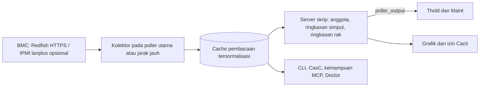

<!-- Source: README.md; SHA256: 6972a6c9ac754cd60e63c5caf971451ea8fe6e279eef757d886e1a168d3eef01 -->

<!-- translations:start -->
[English](../../../README.md) | [简体中文](../zh-CN/README.md) | [हिन्दी](../hi-IN/README.md) | [Español (España)](../es-ES/README.md) | [Español (Latinoamérica)](../es-419/README.md) | [العربية (السعودية)](../ar-SA/README.md) | [Afrikaans](../af-ZA/README.md) | [አማርኛ](../am-ET/README.md) | [العربية (مصر)](../ar-EG/README.md) | [العربية (المغرب)](../ar-MA/README.md) | [বাংলা](../bn-BD/README.md) | [Bosanski](../bs-BA/README.md) | [Deutsch](../de-DE/README.md) | [فارسی](../fa-IR/README.md) | [Filipino](../fil-PH/README.md) | [Français](../fr-FR/README.md) | [Français (Maroc)](../fr-MA/README.md) | [Français (Sénégal)](../fr-SN/README.md) | [Hausa](../ha-NG/README.md) | [עברית](../he-IL/README.md) | [Hrvatski](../hr-HR/README.md) | [Bahasa Indonesia](README.md) | [Igbo](../ig-NG/README.md) | [Italiano](../it-IT/README.md) | [日本語](../ja-JP/README.md) | [한국어](../ko-KR/README.md) | [Malagasy](../mg-MG/README.md) | [मराठी](../mr-IN/README.md) | [Bahasa Melayu](../ms-MY/README.md) | [Nederlands](../nl-NL/README.md) | [Polski](../pl-PL/README.md) | [Português (Brasil)](../pt-BR/README.md) | [Русский](../ru-RU/README.md) | [Kinyarwanda](../rw-RW/README.md) | [Soomaali](../so-SO/README.md) | [Српски](../sr-RS/README.md) | [Svenska](../sv-SE/README.md) | [Kiswahili](../sw-KE/README.md) | [தமிழ்](../ta-IN/README.md) | [తెలుగు](../te-IN/README.md) | [ไทย](../th-TH/README.md) | [Türkçe](../tr-TR/README.md) | [Українська](../uk-UA/README.md) | [اردو](../ur-PK/README.md) | [Tiếng Việt](../vi-VN/README.md) | [isiXhosa](../xh-ZA/README.md) | [Yorùbá](../yo-NG/README.md) | [繁體中文](../zh-TW/README.md) | [isiZulu](../zu-ZA/README.md)
<!-- translations:end -->

# plugin_redfish

Plugin Cacti 1.2 yang membawa konsumsi daya server, suhu *inlet*, status kipas, dan kesehatan catu daya dari *baseboard management controller* (BMC) ke dalam Cacti sebagai perangkat, sumber data, dan grafik biasa, menggunakan Redfish dengan cadangan IPMI *read-only* opsional serta akumulasi daya tingkat rak. Thold dan Maint memicu serta menekan peringatan melalui sumber data standar Cacti.

> **Status: dalam pengembangan, belum ada rilis (`0.1.0-dev`).** Plugin ini tidak berafiliasi dengan proyek Cacti. Plugin ini terpasang pada Cacti 1.2.31 atau lebih baru di bawah PHP 8.2 atau lebih baru dan mengimplementasikan kolektor Redfish, brankas kredensial terenkripsi, provisi perangkat dan grafik Cacti, cadangan IPMI *read-only* opsional, akumulasi daya rak, tampilan jendela Cacti Maint, replikasi dan *endpoint* agen kolektor data jarak jauh, penyedia CasC dan CLI operator, kemampuan MCP, serta pemeriksaan diagnostik Doctor. CI menguji *fixture*, DMTF Redfish Mockup Server (tiruan subsistem, *legacy-only*, dan HPE iLO Gen11), serta Thold v1.8.2 dengan Maint v1.3; belum ada BMC fisik nyata maupun armada uji coba yang terkualifikasi. Desain dan riset berada di [docs/PLAN.md](../../PLAN.md), [docs/research/](../../research/), dan [docs/decisions/](../../decisions/).

## Kemampuan yang diimplementasikan

### Kolektor inti, brankas, dan objek Cacti

- **Siklus hidup dan skema.** Pemasangan, pemutakhiran, penonaktifan, dan penghapusan melalui API plugin Cacti (`Schema::VERSION = 3`, 12 tabel). Tabel tetap dipertahankan saat penghapusan kecuali *Keep Plugin Tables on Uninstall* dikosongkan. Titik masuk dapat di-parse pada PHP 8.0 dan menolak PHP di bawah 8.2 atau ketiadaan `ext-openssl` dengan pesan galat yang jelas.
- **Registri dan izin.** Ranah *Redfish View* (`redfish_health.php`), *Redfish Operator* (`redfish_operator.php`), dan *Redfish Admin* (`redfish_bmcs.php`, `redfish_credentials.php`), beserta pengaturan di bawah **Configuration > Settings > Redfish**. Registri BMC mendukung impor CSV (kredensial dirujuk berdasarkan nama; kata sandi dalam berkas impor ditolak) dan ekspor JSON. Catatan BMC dan kredensial mengikuti izin perangkat Cacti.
- **Brankas kredensial terenkripsi.** Kata sandi disimpan terenkripsi dengan AES-256-GCM di `plugin_redfish_secret`. Kunci berada di luar basis data (secara default `/etc/cacti/redfish-vault.key`) sebagai 64 karakter heksadesimal (`openssl rand -hex 32`) atau 32 bita mentah, dimiliki oleh pengguna poller, tidak dapat dibaca oleh pengguna lain, di dalam direktori yang hanya dapat ditulis oleh root atau pengguna tersebut. Frasa sandi 32 karakter yang dapat dicetak ditolak. **Cadangkan berkas kunci bersama basis data**; tanpanya, kata sandi tersimpan harus dimasukkan ulang.
- **TLS dan klien Redfish *read-only*.** Verifikasi TLS aktif secara default menggunakan penyimpanan CA sistem, bundel CA per-BMC, atau pin SPKI SHA-256; penonaktifan verifikasi per-BMC tetap terlihat sebagai peringatan kesehatan dan peringatan pemeriksaan Doctor. Klien hanya mengizinkan `GET` ditambah masuk (`POST`) dan keluar (`DELETE`) sesi Redfish, dengan cadangan Basic per-BMC opsional saat sesi tidak tersedia. Penemuan mengutamakan sumber daya subsistem dan sensor Redfish baru dan beralih ke sumber daya `Power` dan `Thermal` yang sudah usang bila perlu.
- **Eksekusi kolektor.** `poller_redfish.php` dimulai dari `poller_bottom`, menjalankan satu proses utama per poller melalui registri proses Cacti dengan proses pekerja yang dapat dikonfigurasi (`redfish_workers`), memperoleh sewa per-BMC, menegakkan anggaran waktu (`redfish_collector_budget`), menerapkan *exponential backoff*, dan membersihkan sesi plugin sebelumnya sendiri setelah mengalami kegagalan mendadak.
- **Templat, perangkat, dan grafik.** Mengimpor `templates/redfish-templates.xml` berdasarkan hash dan menyalin tiga berkas XML kueri data server skrip (`redfish_fans.xml`, `redfish_temperatures.xml`, `redfish_psus.xml`) ke `<cacti>/resource/script_server/` tanpa menimpa berkas yang diubah pengguna. **Create Device** dan **Add Graphs** memerlukan konfirmasi rencana provisi, menautkan kueri ke perangkat server terpetakan atau membuat perangkat "Redfish BMC" di bawah `.invalid` dengan pemeriksaan ketersediaan dinonaktifkan, serta menautkan setiap grafik Redfish kembali ke grafik Redfish perangkat melalui `graph_buttons`.
- **Masukan server skrip khusus cache.** `scripts/ss_redfish_members.php` menyajikan pembacaan kipas, suhu, dan PSU per anggota, dan `scripts/ss_redfish_summary.php` menyajikan metrik "Redfish Node Summary" (daya, suhu *inlet* dan maksimum, jumlah kipas dan PSU bermasalah, kesehatan simpul, dan usia pembacaan baik terakhir). Panggilan server skrip hanya membaca cache lokal dan tidak pernah menghubungi BMC. Pembacaan yang hilang, kedaluwarsa, atau dari anggota yang hilang mengembalikan `U` (tidak pernah `0`), sedangkan `age` selalu melaporkan nilai agar ambang batas dapat mendeteksi BMC yang diam.

**Ketika anggota BMC berubah** (misalnya kipas yang diganti atau pembaruan firmware yang mengganti nama sensor), jalankan kembali **Add Graphs**. Kipas atau catu daya yang sebelumnya ada lalu menjadi absen dihitung ke dalam `fans_bad` atau `psus_bad` hingga diterima; slot yang tidak pernah terisi tidak dihitung. Anggota yang hilang mempertahankan sumber data dan grafik yang ada, yang selanjutnya membaca `U` hingga dihapus secara manual. Menghapus perangkat Cacti memutus pemetaan BMC-nya dan menghapus penetapan raknya sambil mempertahankan BMC dan cache; menghapus BMC atau menghapus plugin mempertahankan perangkat dan grafik Cacti.

### Cadangan IPMI opsional

- **Opt-in per BMC.** Nonaktif secara default (`protocols` bernilai default `redfish`; mengaktifkan cadangan IPMI menetapkan `redfish,ipmi`).
- **Pemicu cadangan terbatas.** Hanya berjalan ketika pengumpulan Redfish gagal dengan kelas kegagalan yang memenuhi syarat; tidak pernah terpicu pada `AuthRejected`, `CredentialUnavailable`, `AddressRefused`, `OperationRefused`, atau `Deadline`.
- **Eksekusi aman.** Memanggil `ipmitool` melalui `-I lanplus` menggunakan `proc_open()` berbentuk larik tanpa shell, dengan batas waktu jam dinding dan batas keluaran 256 KiB. Kata sandi diberikan melalui `IPMITOOL_PASSWORD` (`-E`) atau berkas sementara bermode 0600 (`-f`) yang dihapus di blok `finally`, tidak pernah pada argv CLI.
- **Daftar perintah *read-only* yang diizinkan.** Hanya lima subperintah *read-only* yang diizinkan: `dcmi power reading`, `sdr type Temperature`, `sdr type Fan`, `sdr type Power Supply`, dan `chassis status`. Perintah yang mengubah status ditolak.
- **Keluaran ternormalisasi dan peringatan postur.** `IpmiNormalizer` memetakan pembacaan ke model `Observation`/`Member`/`Reading` yang sama, menghasilkan `U` untuk sensor yang hilang atau tidak dapat di-parse. Mengaktifkan cadangan IPMI memunculkan peringatan pada halaman kesehatan dan dalam pemeriksaan Doctor `redfish.bmc_security` yang mengingatkan operator untuk membatasi UDP 623 ke VLAN manajemen.

### Akumulasi daya rak

- **Registri rak.** Skema versi 3 menambahkan `plugin_redfish_rack` (`(site_id, name)` unik, `power_budget_watts` opsional, `min_coverage_pct` default `80`, dan catatan) serta `plugin_redfish_rack_member` (maksimal satu penetapan rak per `host_id`, `bmc_id` dan `unit_position` opsional, otomatis dihapus saat perangkat Cacti dihapus).
- **Total yang dilindungi cakupan.** `RackPowerSummary` menjumlahkan pembacaan `power_watts` anggota yang segar dari cache lokal dan menghitung pemanfaatan anggaran serta ruang sisa (*headroom*). Ketika cakupan anggota yang melapor turun di bawah `min_coverage_pct`, `power_watts`, `utilization_pct`, dan `headroom_watts` mengembalikan `U` agar kegagalan kolektor tidak pernah tampak sebagai penurunan daya rak.
- **Masukan server skrip siap Thold.** `scripts/ss_redfish_rack.php` (`ss_redfish_rack(<rack_id>)`) mengembalikan `power_watts`, `power_budget_watts`, `utilization_pct`, `headroom_watts`, `members_total`, `members_reporting`, dan `coverage_pct` hanya dari cache lokal.

### Integrasi Cacti Maint

- Ambang batas Thold pada sumber data Redfish memicu peringatan dan Cacti Maint menekannya tanpa perubahan pada salah satu plugin.
- `MaintWindow` memeriksa jadwal Maint yang aktif untuk setiap host Cacti terpetakan (jadwal satu kali `mtype=1` dan berulang `mtype=2`, ditambah `plugin_maint_check_cacti_host()` saat dimuat) dan menandai pemeliharaan aktif pada halaman Redfish Health (`[MAINT]`), pada keluaran `cli/redfish.php health`, dan pada kemampuan `redfish-get-health`.

### Kolektor data jarak jauh

- `INFO` mendeklarasikan `remote_collect:1`. BMC menerima `poller_id >= 1` mana pun, dan `poller_redfish.php --poller=N` hanya mengumpulkan BMC aktif yang ditugaskan ke poller tersebut.
- **Hook `replicate_out`.** Hanya mereplikasi tabel konfigurasi non-rahasia yang dicakup ke poller jarak jauh target melalui `replicate_out_table()`: `plugin_redfish_bmc`, metadata `plugin_redfish_credential` (tanpa teks tersandi), `plugin_redfish_rack`, dan `plugin_redfish_rack_member`. `plugin_redfish_secret` tidak direplikasi, dan berkas kunci brankas tetap sepenuhnya lokal di setiap poller.
- **Hook `remote_agent`.** Mengekspos tindakan *read-only* `redfish_health` dan `redfish_discovery` yang hanya menerima parameter numerik `poller_id` dan `bmc_id`. Parameter tak terduga ditolak dan nol kredensial atau rahasia yang dikembalikan.

### Hook ekosistem (CasC, kemampuan MCP, dan Doctor)

- **Penyedia CasC (`casc_register_providers`).** Mendaftarkan penyedia `redfish` (skema versi `1`) dengan ekspor YAML dan XML PHP murni, *parsing* (dengan penolakan XXE), validasi, perencanaan *diff*, dan penerapan. Kredensial hanya muncul sebagai referensi brankas (`vault:redfish:<name>`); kunci rahasia mentah (`pass`, `secret`, `token`, `private_key`, `vault_key`, `auth_token`) ditolak. Penerapan memerlukan `PLAN_HASH` SHA-256 yang persis.
- **API MCP / Abilities (`abilities_register`).** Mendaftarkan tiga kemampuan *read-only* yang dibatasi oleh ranah Redfish View (`redfish_health.php`) dan izin perangkat Cacti, tanpa mengembalikan kredensial:
  - `redfish-list-bmcs` (`poller_id` opsional)
  - `redfish-get-rack-power` (`rack_id` opsional)
  - `redfish-get-health` (`bmc_id` opsional)
- **Pemeriksaan Doctor (`doctor_register_checks`).** Mendaftarkan lima pemeriksaan diagnostik lokal *read-only* yang tidak pernah menghubungi BMC atau mengembalikan materi kunci:
  - `redfish.schema`: keterkinian versi skema
  - `redfish.vault_key`: keterbacaan dan izin kunci brankas
  - `redfish.collector_runs`: anggaran dan kesegaran kolektor poller
  - `redfish.bmc_security`: BMC aktif dengan TLS tidak terverifikasi atau cadangan IPMI
  - `redfish.rack_power`: kepatuhan anggaran daya rak dan batas bawah cakupan

## CLI

Jalankan dari direktori root Cacti dengan PHP 8.2 atau lebih baru:

```sh
# Operator and CasC CLI (reads --file=PATH or stdin for validate, plan, and apply)
php plugins/redfish/cli/redfish.php export --format=yaml|xml
php plugins/redfish/cli/redfish.php validate [--file=PATH] [--format=yaml|xml]
php plugins/redfish/cli/redfish.php plan [--file=PATH] [--format=yaml|xml]
php plugins/redfish/cli/redfish.php apply [--file=PATH] [--format=yaml|xml] --confirm=<PLAN_HASH>
php plugins/redfish/cli/redfish.php health --format=text|json

# Collector entry point (normally started by poller_bottom)
php plugins/redfish/poller_redfish.php [--poller=N] [--force] [--debug]

# Rack power summary script server entry point
php plugins/redfish/scripts/ss_redfish_rack.php <rack_id>
```

## Peran akses

| Ranah | Akses |
| --- | --- |
| Redfish View | Halaman pemantauan yang ada. |
| Redfish Operator | Pemantauan ditambah halaman Operations dan pengakuan triase pribadi. |
| Redfish Admin | Akses Operator ditambah konfigurasi yang ada dan tindakan administratif. |

Setelah menyalin berkas pemutakhiran, buka halaman Plugins sebagai administrator untuk mendaftarkan ranah. Tetapkan ranah Operator secara eksplisit di bawah **Configuration > Users** atau grup pengguna. Pemutakhiran mempertahankan ID ranah dan izin View serta Admin yang sudah ada. Akses Admin mewarisi akses Operator, dan akses Operator mewarisi akses View pada setiap permintaan; hal ini tidak menambahkan izin tersimpan ke pengguna atau grup. Pengaturan plugin juga memerlukan akses Redfish Admin di samping izin Settings Cacti.

Izin perangkat Cacti membatasi baris dan tindakan yang tersedia bagi setiap pengguna; objek yang belum dipetakan memerlukan administrator. Operator dapat melepaskan penahanan pengumpulan pada BMC yang diizinkan untuk eksekusi terjadwal berikutnya. Kredensial, konfigurasi, pemetaan, penghapusan, dan perubahan administratif lainnya tetap berada di halaman administratif. Pengakuan hanya bertahan pada sesi pengguna saat ini, paling lama satu jam dan hanya selama pengamatan yang sama tetap segar. Pengamatan baru atau yang berubah membatalkannya. Pengakuan tidak pernah menandai pengukuran yang gagal sebagai sehat atau menekan peringatan.

## Mengapa

Setiap server memiliki BMC yang melaporkan status daya dan termal secara independen dari sistem operasi, sehingga tetap menjawab saat OS mati. Data ini berguna untuk pelacakan kapasitas dan biaya, peringatan dini atas kegagalan kipas atau catu daya, dan, dalam komputasi kinerja tinggi, keputusan pembatasan daya. Plugin ini tidak khusus untuk HPC.

Cacti mencakup sebagian kebutuhan ini saat ini:

- **Paket SNMP vendor.** Cabang 1.2.x menyertakan templat Dell iDRAC dan HPE iLO yang memerlukan agen SNMP dan spesifik vendor; riset tonggak pencapaian 1 menemukan bahwa keduanya tidak melaporkan konsumsi daya dalam watt ([docs/research/overlap.md](../../research/overlap.md)).
- **Jenis kredensial tanpa kolektor.** plugin_credentials mendefinisikan kredensial "IPMI / Redfish (BMC)" tetapi tidak membaca BMC mana pun.
- **Tidak ada tampilan tingkat rak.** Inti Cacti tidak memiliki objek rak; perangkat hanya memiliki kolom teks bebas `location`.

Plugin ini melakukan *polling* BMC secara *out of band* dari siklus *poll* Cacti pada poller utama atau kolektor data jarak jauh, menyimpan pembacaan ternormalisasi ke cache, dan mengeksposnya melalui kueri data server skrip, ringkasan simpul, dan ringkasan daya rak. Plugin ini menggunakan ulang grafik, izin, Thold, dan Maint milik Cacti, dan tidak mengubah status BMC.

## Ruang lingkup dan status

| Fase | Ruang lingkup | Tonggak pencapaian | Status |
|---|---|---|---|
| 0, riset | Matriks vendor, konfirmasi perilaku *upstream* pada BMC nyata, biaya *polling*, uji coba kueri data | [M1](https://github.com/somethingwithproof/plugin_redfish/milestone/1) | Selesai, menunggu tangkapan firmware BMC nyata |
| 1, amati | Registri BMC, kredensial, TLS, kolektor Redfish, pembacaan ternormalisasi, perangkat, grafik per-indeks, peringatan Thold, integrasi Maint, halaman kesehatan | [M2](https://github.com/somethingwithproof/plugin_redfish/milestone/2), [M3](https://github.com/somethingwithproof/plugin_redfish/milestone/3), [M4](https://github.com/somethingwithproof/plugin_redfish/milestone/4) | Diimplementasikan; kualifikasi armada uji coba M4 tertunda |
| 2, ipmi | Cadangan IPMI (`lanplus`) *read-only* melalui `ipmitool`, nonaktif secara default | [M5](https://github.com/somethingwithproof/plugin_redfish/milestone/5) | Diimplementasikan |
| 3, rak | Registri rak, total daya rak dengan batas bawah cakupan, ruang sisa anggaran, `ss_redfish_rack.php` | [M6](https://github.com/somethingwithproof/plugin_redfish/milestone/6) | Diimplementasikan |
| 4, jarak jauh dan ekosistem | Kolektor data jarak jauh (`replicate_out`, `remote_agent`), penyedia CasC dan CLI, kemampuan MCP, pemeriksaan Doctor | [M7](https://github.com/somethingwithproof/plugin_redfish/milestone/7) | Diimplementasikan |

Di luar ruang lingkup: menetapkan batas daya atau konfigurasi BMC lainnya, kontrol daya, pembaruan firmware, akses konsol, mesin peringatan milik plugin sendiri, dan integrasi penjadwal.

## Target kompatibilitas

| Komponen | Target |
|---|---|
| Cacti | 1.2.31 atau lebih baru, tanpa *patch* inti |
| Basis data | MariaDB 10.2 atau MySQL 5.7 atau lebih baru: satu BMC per perangkat dijaga oleh kunci unik pada kolom yang dihasilkan |
| PHP | 8.2 atau lebih baru; titik masuk tetap dapat di-parse pada 8.0 sehingga runtime yang tidak didukung menerima penolakan alih-alih antarmuka Cacti yang rusak |
| Ekstensi PHP | `ext-openssl` (diperlukan oleh Cacti 1.2.31); tanpa `ext-curl` dan tanpa dependensi runtime Composer |
| Alat opsional | `ipmitool` pada poller yang mengumpulkan BMC dengan cadangan IPMI aktif |
| BMC | Dell iDRAC, HPE iLO, Lenovo XCC, dan OpenBMC, berdasarkan rentang firmware; lihat [matriks vendor](../../research/vendor-matrix.md) |
| Redfish | Sumber daya subsistem dan sensor baru terlebih dahulu, `Power` dan `Thermal` usang sebagai cadangan |
| Thold, Maint | Tidak ada perubahan yang diperlukan (CI menguji Thold v1.8.2 dan Maint v1.3) |

## Desain

- [docs/PLAN.md](../../PLAN.md) adalah rencana lengkap: arsitektur, fakta *upstream* yang menjadi tumpuan, model pengukuran, batas keamanan, perhitungan kinerja, pengujian, dan risiko.
- [docs/decisions/](../../decisions/) menyimpan catatan keputusan arsitektur untuk pilihan yang telah dibuat.
- [docs/REQUIREMENTS.md](../../REQUIREMENTS.md) memetakan setiap ID persyaratan ke *issue*-nya.



## Keamanan

Kredensial BMC mengendalikan pengelolaan *out-of-band* server. Desainnya menjaga rahasia keluar dari baris perintah, log, ekspor CasC, muatan agen jarak jauh, respons MCP, dan halaman web; mengenkripsi kata sandi tersimpan dengan AES-256-GCM menggunakan berkas kunci brankas lokal per poller; memverifikasi TLS secara default; menjalankan `ipmitool` dari larik argumen eksplisit dengan subperintah *read-only* yang diizinkan; serta menggunakan akun BMC *read-only*. Lihat [docs/PLAN.md](../../PLAN.md#security) dan [SECURITY.md](../../../SECURITY.md).

## Panduan operator

Lihat [docs/operator-guide.md](../../operator-guide.md) untuk prasyarat pemasangan, penyiapan brankas dan TLS, pendaftaran BMC, pembuatan grafik, interval peringatan, pencadangan, dan penanganan kegagalan. Panduan ini tidak menyatakan lini firmware vendor nyata mana pun didukung hingga tangkapan yang telah disunting dari firmware tersebut lulus rangkaian pengujian.

## Pengembangan dan pengujian

CI ([.github/workflows/plugin-ci-workflow.yml](../../../.github/workflows/plugin-ci-workflow.yml)) melakukan *lint* titik masuk pada PHP 8.0, menjalankan rangkaian unit Pest (`phpunit.xml`) dan integrasi siklus hidup (`phpunit-integration.xml`) serta PHPStan level 9 di seluruh PHP 8.2 hingga 8.5 terhadap Cacti `release/1.2.31` dan `1.2.x`, memverifikasi penolakan pada PHP 8.1, menguji DMTF Redfish Mockup Server (tiruan subsistem, *legacy-only*, dan HPE iLO Gen11) dan Thold v1.8.2 / Maint v1.3 secara menyeluruh, serta memeriksa katalog gettext, alur kerja, dan lisensi REUSE.

Pemeriksaan lokal sebelum *push*:

```sh
sh tests/lint-workflows.sh
sh locales/build_gettext.sh --check
CACTI_PATH=/path/to/cacti phpstan analyse -c phpstan.neon --no-progress
```

Jalankan Pest dengan `--configuration=phpunit.xml` untuk pengujian unit dan aturan sumber, atau `--configuration=phpunit-integration.xml` dengan `CACTI_PATH` dan `REDFISH_TEST_DATABASE=disposable` terhadap basis data Cacti sekali pakai untuk pengujian integrasi siklus hidup.

## Cara kerja dilacak

- **Tonggak pencapaian (Milestones)** mengikuti tonggak pencapaian rencana. Masing-masing memiliki *epic issue* yang mencantumkan sub-issue dan bukti keluaran.
- **Issue** dikelompokkan berdasarkan label: `type: requirement`, `type: research`, `type: decision`, `type: epic`. *Issue* persyaratan menyatakan persyaratan bernomor yang dapat diuji (`REQ-AREA-NNN`) dan kriteria penerimaan.
- **Label** juga menyertakan `area:`, `phase:`, `priority:`, dan `status:`. Lihat [CONTRIBUTING.md](../../../CONTRIBUTING.md#labels).
- [Papan proyek](https://github.com/users/somethingwithproof/projects/12) menampilkan seluruh *issue* lintas tonggak pencapaian.

## Berkontribusi

Baca [CONTRIBUTING.md](../../../CONTRIBUTING.md). Commit memerlukan DCO *sign-off*. Diskusi desain berlangsung di *issue*; keputusan terbuka berlabel `type: decision`. Bukti dari BMC nyata merupakan kontribusi paling berguna saat ini; sunting alamat, nomor seri, dan kredensial sebelum memposting tangkapan apa pun.

## Lisensi

GNU General Public License v2.0, lisensi yang sama dengan Cacti dan plugin-nya. Lihat [LICENSE](../../../LICENSE).
