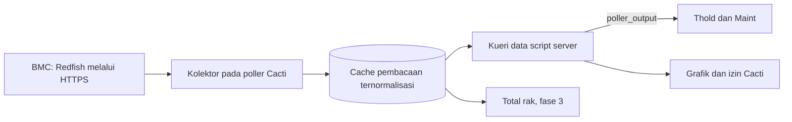

<!-- Source: README.md; SHA256: 7b4e83a58a1adc844cb0615ef30e95476cba2851f96bb454d2a816fb2774724d -->

<!-- translations:start -->
[English](../../../README.md) | [简体中文](../zh-CN/README.md) | [हिन्दी](../hi-IN/README.md) | [Español (España)](../es-ES/README.md) | [Español (Latinoamérica)](../es-419/README.md) | [العربية (السعودية)](../ar-SA/README.md) | [Afrikaans](../af-ZA/README.md) | [አማርኛ](../am-ET/README.md) | [العربية (مصر)](../ar-EG/README.md) | [العربية (المغرب)](../ar-MA/README.md) | [বাংলা](../bn-BD/README.md) | [Bosanski](../bs-BA/README.md) | [Deutsch](../de-DE/README.md) | [فارسی](../fa-IR/README.md) | [Filipino](../fil-PH/README.md) | [Français](../fr-FR/README.md) | [Français (Maroc)](../fr-MA/README.md) | [Français (Sénégal)](../fr-SN/README.md) | [Hausa](../ha-NG/README.md) | [עברית](../he-IL/README.md) | [Hrvatski](../hr-HR/README.md) | [Bahasa Indonesia](README.md) | [Igbo](../ig-NG/README.md) | [Italiano](../it-IT/README.md) | [日本語](../ja-JP/README.md) | [한국어](../ko-KR/README.md) | [Malagasy](../mg-MG/README.md) | [मराठी](../mr-IN/README.md) | [Bahasa Melayu](../ms-MY/README.md) | [Nederlands](../nl-NL/README.md) | [Polski](../pl-PL/README.md) | [Português (Brasil)](../pt-BR/README.md) | [Русский](../ru-RU/README.md) | [Kinyarwanda](../rw-RW/README.md) | [Soomaali](../so-SO/README.md) | [Српски](../sr-RS/README.md) | [Svenska](../sv-SE/README.md) | [Kiswahili](../sw-KE/README.md) | [தமிழ்](../ta-IN/README.md) | [తెలుగు](../te-IN/README.md) | [ไทย](../th-TH/README.md) | [Türkçe](../tr-TR/README.md) | [Українська](../uk-UA/README.md) | [اردو](../ur-PK/README.md) | [Tiếng Việt](../vi-VN/README.md) | [isiXhosa](../xh-ZA/README.md) | [Yorùbá](../yo-NG/README.md) | [繁體中文](../zh-TW/README.md) | [isiZulu](../zu-ZA/README.md)
<!-- translations:end -->

# plugin_redfish

Plugin Cacti 1.2 yang membawa konsumsi daya server, suhu *inlet*, status kipas, dan kesehatan catu daya dari *baseboard management controller* (BMC) ke dalam Cacti sebagai perangkat, sumber data, dan grafik biasa, menggunakan Redfish dengan cadangan IPMI opsional. Thold dan Maint kemudian dapat memicu dan menekan peringatan pada objek tersebut, dan fase berikutnya akan menambahkan total daya tingkat rak.

> **Status: dalam pengembangan, belum ada rilis (0.1.0-dev).** Tonggak pencapaian (*milestone*) 2 (fondasi) dan 3 (objek Cacti dan peringatan) telah digabungkan ke `main`. Plugin ini tidak berafiliasi dengan proyek Cacti. Plugin ini terpasang pada Cacti 1.2.31 di bawah PHP 8.2 atau yang lebih baru, mendaftarkan BMC dan kredensial, membaca daya, suhu, kipas, serta kesehatan catu daya dari setiap BMC melalui Redfish ke dalam cache miliknya sendiri, dan menampilkan kesehatan pengumpulan data. Plugin ini menambahkan perangkat Cacti, grafik per anggota dan ringkasan, serta dukungan Thold dan Maint melalui sumber data biasa. CI telah menguji BMC tiruan yang dibangun dari *fixture* tulisan tangan dan server tiruan (*mockup*) Redfish DMTF; belum ada BMC nyata atau armada uji coba yang terkualifikasi. Desain dan riset berada di [docs/PLAN.md](../../PLAN.md), [docs/research/](../../research), dan [docs/decisions/](../../decisions).

### Apa yang disediakan tonggak pencapaian 2

- Pemasangan, pemutakhiran, penonaktifan, dan penghapusan melalui API plugin Cacti, dengan tabel tetap dipertahankan saat penghapusan kecuali pengaturannya dikosongkan. Pada PHP yang lebih lama dari 8.2, plugin menolak untuk dipasang atau diaktifkan dan menjelaskan alasannya.
- Realm "Redfish View" (halaman kesehatan), "Redfish Operator" (halaman operasi), dan "Redfish Admin" (halaman BMC dan kredensial), serta pengaturan di bawah Configuration > Settings > Redfish.
- Registri BMC dengan impor CSV dan ekspor JSON. Berkas impor tidak boleh berisi kata sandi; kredensial dirujuk berdasarkan nama.
- Kredensial disimpan terenkripsi dengan AES-256-GCM. Kuncinya berupa berkas di luar basis data, secara bawaan `/etc/cacti/redfish-vault.key`, berisi 64 karakter heksadesimal (`openssl rand -hex 32`) atau tepat 32 byte acak, dimiliki oleh pengguna poller, tidak dapat dibaca oleh pengguna lain, di dalam direktori yang hanya dapat ditulisi oleh pengguna poller atau root. Kunci berisi 32 karakter yang dapat dicetak ditolak sebagai frasa sandi. **Cadangkan berkas kunci bersama basis data**; tanpanya setiap kata sandi yang tersimpan harus dimasukkan kembali.
- Verifikasi TLS aktif secara bawaan, dengan bundel CA per BMC atau pin SHA-256 SPKI. Pengecualian tanpa verifikasi per BMC yang tercatat tetap ditampilkan di halaman kesehatan sebagai peringatan.
- Klien Redfish baca-saja: hanya `GET` serta masuk dan keluar sesi, yang diperiksa terhadap daftar izin sebelum permintaan apa pun dikirim.
- Kolektor yang dijalankan dari `poller_bottom` untuk BMC pada poller utama, dengan *lease* dan batas waktu per BMC, *backoff*, serta pembersihan setelah *crash* terhadap satu sesi yang dicatat oleh plugin. Kolektor jarak jauh belum didukung; fitur ini memerlukan pilihan eksplisit mengenai cara kolektor menjangkau basis data dan kunci (fase 4).
- Catatan BMC dan kredensial mengikuti izin perangkat Cacti: seorang Redfish Admin hanya dapat melihat, mengubah, dan mengikat BMC pada perangkat yang boleh dilihatnya, serta hanya kredensial yang tidak digunakan oleh BMC pada perangkat tersembunyi.

### Apa yang ditambahkan tonggak pencapaian 3

- Templat dikirimkan sebagai XML templat Cacti di `templates/` dan diimpor dengan pengimpor bawaan Cacti saat pemasangan dan pemutakhiran, dicocokkan berdasarkan hash, sehingga impor memperbarui objek milik plugin dan tidak menambahkan apa pun dua kali. Ketiga berkas kueri data disalin ke `<cacti>/resource/script_server/` dengan hash yang tercatat; plugin tidak pernah mengganti berkas di sana yang bukan ditulis olehnya, dan halaman kesehatan memperingatkan administrator apabila templat atau berkas kueri belum berada di tempatnya. **Reinstall the Redfish Templates** di halaman BMC mengimpornya kembali; tindakan ini memerlukan izin Import Templates Cacti.
- **Create Device** atau **Add Graphs** pada setiap BMC ([ADR 0015](../../decisions/0015-attach-to-the-server-device-or-create-one-per-bmc.md)). BMC yang dipetakan ke perangkat server yang sudah ada mendapatkan kueri data dan grafiknya pada perangkat tersebut. BMC yang belum dipetakan mendapatkan perangkat baru dari templat perangkat "Redfish BMC", dengan pemeriksaan ketersediaan dinonaktifkan dan nama host di bawah `.invalid`, sehingga Cacti tidak pernah menghubungi BMC dan tidak pernah menampilkan alamatnya. Pada kedua cara tersebut, administrator terlebih dahulu mengonfirmasi rencana yang mencantumkan apa yang akan ditambahkan. Keduanya memerlukan izin manajemen perangkat Cacti serta Redfish Admin; perangkat baru yang tidak dapat dilihat oleh pembuatnya akan dihapus kembali.
- Tiga kueri data script server, "Redfish Fans", "Redfish Temperatures", dan "Redfish Power Supplies", yang diindeks oleh kunci anggota BMC, dengan satu grafik per anggota: kecepatan kipas dalam persen atau RPM (satuan mana pun yang dilaporkan BMC), suhu, serta daya masuk dan keluar catu daya dalam watt, masing-masing beserta kode kesehatannya.
- Masukan "Redfish Node Summary" dengan daya, suhu *inlet*, suhu tertinggi, kipas dan catu daya yang tidak OK, kesehatan simpul, dan usia pembacaan baik terakhir, yang digambar pada empat grafik: daya, suhu, kesehatan komponen, dan usia data. Ambang batas Thold pada sumber data ini memicu peringatan, dan Maint menekannya, tanpa perubahan apa pun pada kedua plugin tersebut.
- Script server hanya menjawab dari cache plugin dan tidak pernah menghubungi BMC. Nilai yang hilang, kedaluwarsa, bersatuan lain, atau berasal dari anggota yang sudah hilang bernilai `U`, sehingga grafik menampilkan celah, tidak pernah nol; `age` selalu memiliki nilai, sehingga ambang batas padanya dapat mendeteksi BMC yang berhenti menjawab.
- Tautan grafik dari setiap grafik Redfish ke grafik Redfish perangkat, hanya ditampilkan kepada pengguna yang diizinkan oleh Cacti untuk melihat perangkat tersebut.

**Saat anggota BMC berubah** (kipas diganti, pembaruan firmware mengganti nama sensor), pilih **Add Graphs** kembali. Kipas atau catu daya yang sebelumnya ada dan kini tidak ada atau hilang dihitung dalam `fans_bad` atau `psus_bad` hingga Anda melakukannya, sehingga kipas yang dicabut memicu peringatan; slot yang tidak pernah terisi tidak dihitung. Add Graphs menerima anggota yang dilaporkan BMC saat ini, dan Cacti mengindeks ulang kueri; anggota yang telah hilang mempertahankan sumber data dan grafiknya, yang sejak saat itu terbaca `U`, sedangkan anggota baru mendapatkan grafik. Hapus grafik anggota yang telah hilang secara manual setelah riwayatnya tidak lagi diperlukan.

Menghapus perangkat akan membatalkan pemetaan BMC-nya dan tetap mempertahankan BMC beserta cache-nya. Menghapus BMC, atau menghapus pemasangan plugin, tetap mempertahankan perangkat dan grafiknya.

## Peran akses

| Realm | Akses |
| --- | --- |
| Redfish View | Halaman pemantauan yang ada. |
| Redfish Operator | Pemantauan ditambah halaman Operasi dan pengakuan triase pribadi. |
| Redfish Admin | Akses Operator ditambah halaman konfigurasi dan tindakan administratif yang ada. |

Setelah menyalin berkas pemutakhiran, buka halaman Plugins sebagai administrator untuk mendaftarkan
realm baru. Tetapkan realm Operator secara eksplisit di bawah **Configuration > Users** atau grup pengguna.
Pemutakhiran tetap mempertahankan ID dan pemberian hak realm View serta Admin yang sudah ada. Akses Admin
mewarisi akses Operator, dan akses Operator mewarisi akses View pada setiap permintaan;
hal ini tidak menambahkan hak akses tersimpan ke pengguna atau grup. Pengaturan plugin juga memerlukan
akses Redfish Admin selain izin Settings Cacti.

Izin perangkat Cacti tetap membatasi baris dan tindakan yang tersedia bagi setiap pengguna; objek yang tidak dipetakan memerlukan administrator. Operator dapat melepaskan penangguhan pengumpulan data pada BMC yang diizinkan untuk jadwal eksekusi berikutnya.
Kredensial, konfigurasi, pemetaan, penghapusan, dan perubahan administratif lainnya
tetap berada di halaman administratif. Pengakuan (*acknowledgment*) hanya bertahan dalam sesi pengguna
saat ini, paling lama satu jam dan hanya selama pengamatan yang sama masih tetap
segar. Pengamatan baru atau yang berubah akan membatalkannya. Pengakuan tidak pernah menandai pengukuran
yang gagal sebagai sehat ataupun menekan peringatan.

## Latar belakang

Setiap server memiliki BMC yang melaporkan status daya dan termal secara independen dari sistem operasi, sehingga tetap menjawab saat OS mati. Data tersebut digunakan untuk pelacakan kapasitas dan biaya, peringatan dini kipas atau catu daya yang gagal, serta, pada komputasi berkinerja tinggi, keputusan pembatasan daya (*power-capping*). Plugin ini tidak dikhususkan untuk HPC.

Cacti saat ini mencakup sebagian dari hal tersebut:

- **Paket SNMP vendor.** Cabang 1.2.x menyertakan templat Dell iDRAC dan HPE iLO yang memerlukan agen SNMP dan bersifat spesifik vendor; riset tonggak pencapaian 1 menemukan bahwa keduanya tidak melaporkan konsumsi daya dalam watt ([docs/research/overlap.md](../../research/overlap.md)).
- **Tipe kredensial tanpa kolektor.** plugin_credentials mendefinisikan kredensial "IPMI / Redfish (BMC)" tetapi tidak membaca BMC apa pun.
- **Tidak ada tampilan tingkat rak.** Inti Cacti tidak memiliki objek rak; perangkat memiliki bidang teks bebas `location`.

Plugin ini melakukan polling BMC secara *out-of-band* dari siklus polling Cacti, menyimpan pembacaan yang dinormalisasi ke dalam cache, dan mengeksposnya melalui kueri data script server serta sumber data ringkasan. Plugin ini menggunakan kembali pembuatan grafik, izin, Thold, dan Maint milik Cacti, serta tidak mengubah status BMC. Dukungan kolektor data jarak jauh direncanakan untuk fase 4; pengumpulan data saat ini hanya berjalan pada poller utama.

## Cakupan yang direncanakan

| Fase | Cakupan | Tonggak pencapaian |
|---|---|---|
| 0, riset | Matriks vendor, konfirmasi perilaku hulu pada BMC langsung, biaya polling, uji coba kueri data | [M1](https://github.com/somethingwithproof/plugin_redfish/milestone/1) |
| 1, observasi | Registri BMC, kredensial, TLS, kolektor Redfish, pembacaan ternormalisasi, perangkat, grafik per indeks, peringatan Thold, penekanan Maint, halaman kesehatan | [M2](https://github.com/somethingwithproof/plugin_redfish/milestone/2), [M3](https://github.com/somethingwithproof/plugin_redfish/milestone/3), [M4](https://github.com/somethingwithproof/plugin_redfish/milestone/4) |
| 2, ipmi | Cadangan IPMI untuk BMC tanpa Redfish yang dapat digunakan, nonaktif secara bawaan | [M5](https://github.com/somethingwithproof/plugin_redfish/milestone/5) |
| 3, rak | Registri rak, total daya rak beserta cakupan, ruang anggaran daya | [M6](https://github.com/somethingwithproof/plugin_redfish/milestone/6) |
| 4, jarak jauh | Kolektor data jarak jauh Cacti untuk jaringan BMC yang terisolasi | [M7](https://github.com/somethingwithproof/plugin_redfish/milestone/7) |

Di luar cakupan: mengatur batas daya atau konfigurasi BMC lainnya, kontrol daya, pembaruan firmware, akses konsol, mesin peringatan milik plugin sendiri, dan integrasi penjadwal.

## Target kompatibilitas

| Komponen | Target |
|---|---|
| Cacti | 1.2.31 atau lebih baru, tanpa tambalan inti |
| Basis data | MariaDB 10.2 atau MySQL 5.7 atau lebih baru: satu BMC per perangkat dijaga oleh kunci unik pada kolom yang dihasilkan (*generated column*) |
| PHP | 8.2 atau lebih baru; `setup.php` tetap dapat diurai pada 8.0 sehingga runtime yang tidak didukung mendapatkan penolakan alih-alih antarmuka Cacti yang rusak |
| BMC | Dell iDRAC, HPE iLO, Lenovo XCC, dan OpenBMC, berdasarkan rentang firmware; lihat [matriks vendor](../../research/vendor-matrix.md) |
| Redfish | Sumber daya subsistem dan sensor baru terlebih dahulu, `Power` dan `Thermal` yang sudah usang sebagai cadangan |
| Thold, Maint | Tidak ada perubahan yang diperlukan |

## Desain

- [docs/PLAN.md](../../PLAN.md) adalah rencana lengkap: arsitektur, fakta hulu yang menjadi ketergantungan (beserta sumber dan asumsi yang masih harus dikonfirmasi), model pengukuran, batas keamanan, perhitungan kinerja, pengujian, dan risiko.
- [docs/decisions/](../../decisions) menyimpan catatan keputusan arsitektur untuk pilihan yang telah dibuat.
- [docs/REQUIREMENTS.md](../../REQUIREMENTS.md) memetakan setiap ID persyaratan ke isunya.

## Keamanan

Kredensial BMC mengendalikan manajemen *out-of-band* server. Desainnya menjauhkan kredensial dari baris perintah, log, dan halaman web, memverifikasi TLS secara bawaan, menjalankan perintah eksternal apa pun dari array argumen dengan subperintah yang diizinkan dalam daftar putih, dan menggunakan akun BMC baca-saja. Lihat [docs/PLAN.md](../../PLAN.md#security) dan [SECURITY.md](../../../SECURITY.md).

## Panduan operator

Lihat [docs/operator-guide.md](../../operator-guide.md) untuk prasyarat pemasangan, penyiapan *vault* dan TLS, pendaftaran BMC, pembuatan grafik, interval peringatan, pencadangan, dan penanganan kegagalan. Panduan tersebut tidak menyatakan lini firmware vendor nyata didukung hingga hasil tangkapan yang telah disunting (*redacted*) dari firmware tersebut lolos rangkaian pengujian.

## Cara kerja pelacakan pekerjaan

- **Tonggak pencapaian (*Milestones*)** mengikuti tonggak pencapaian pada rencana. Masing-masing memiliki isu epik yang mencantumkan sub-isu dan bukti keluarannya.
- **Isu** dikelompokkan berdasarkan label: `type: requirement`, `type: research`, `type: decision`, `type: epic`. Isu persyaratan menyatakan persyaratan bernomor yang dapat diuji (`REQ-AREA-NNN`) dan kriteria penerimaan.
- **Label** juga memuat `area:`, `phase:`, `priority:`, dan `status:`. Lihat [CONTRIBUTING.md](../../../CONTRIBUTING.md#labels).
- [Papan proyek](https://github.com/users/somethingwithproof/projects/12) menampilkan seluruh isu di semua tonggak pencapaian.

## Berkontribusi

Baca [CONTRIBUTING.md](../../../CONTRIBUTING.md). Commit memerlukan tanda tangan DCO (*DCO sign-off*). Diskusi desain berlangsung di isu; keputusan terbuka memakai label `type: decision`. Bukti dari BMC nyata merupakan kontribusi yang paling berguna saat ini; samarkan alamat, nomor seri, dan kredensial sebelum memposting tangkapan apa pun.

## Lisensi

GNU General Public License v2.0, lisensi yang sama dengan Cacti dan plugin-pluginnya. Lihat [LICENSE](../../../LICENSE).
