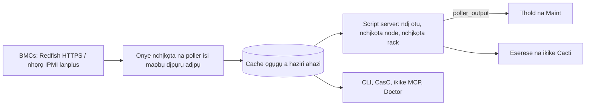

<!-- Source: README.md; SHA256: 6972a6c9ac754cd60e63c5caf971451ea8fe6e279eef757d886e1a168d3eef01 -->

<!-- translations:start -->
[English](../../../README.md) | [简体中文](../zh-CN/README.md) | [हिन्दी](../hi-IN/README.md) | [Español (España)](../es-ES/README.md) | [Español (Latinoamérica)](../es-419/README.md) | [العربية (السعودية)](../ar-SA/README.md) | [Afrikaans](../af-ZA/README.md) | [አማርኛ](../am-ET/README.md) | [العربية (مصر)](../ar-EG/README.md) | [العربية (المغرب)](../ar-MA/README.md) | [বাংলা](../bn-BD/README.md) | [Bosanski](../bs-BA/README.md) | [Deutsch](../de-DE/README.md) | [فارسی](../fa-IR/README.md) | [Filipino](../fil-PH/README.md) | [Français](../fr-FR/README.md) | [Français (Maroc)](../fr-MA/README.md) | [Français (Sénégal)](../fr-SN/README.md) | [Hausa](../ha-NG/README.md) | [עברית](../he-IL/README.md) | [Hrvatski](../hr-HR/README.md) | [Bahasa Indonesia](../id-ID/README.md) | [Igbo](README.md) | [Italiano](../it-IT/README.md) | [日本語](../ja-JP/README.md) | [한국어](../ko-KR/README.md) | [Malagasy](../mg-MG/README.md) | [मराठी](../mr-IN/README.md) | [Bahasa Melayu](../ms-MY/README.md) | [Nederlands](../nl-NL/README.md) | [Polski](../pl-PL/README.md) | [Português (Brasil)](../pt-BR/README.md) | [Русский](../ru-RU/README.md) | [Kinyarwanda](../rw-RW/README.md) | [Soomaali](../so-SO/README.md) | [Српски](../sr-RS/README.md) | [Svenska](../sv-SE/README.md) | [Kiswahili](../sw-KE/README.md) | [தமிழ்](../ta-IN/README.md) | [తెలుగు](../te-IN/README.md) | [ไทย](../th-TH/README.md) | [Türkçe](../tr-TR/README.md) | [Українська](../uk-UA/README.md) | [اردو](../ur-PK/README.md) | [Tiếng Việt](../vi-VN/README.md) | [isiXhosa](../xh-ZA/README.md) | [Yorùbá](../yo-NG/README.md) | [繁體中文](../zh-TW/README.md) | [isiZulu](../zu-ZA/README.md)
<!-- translations:end -->

# plugin_redfish

Plugin Cacti 1.2 nke na-eweta ike ọkụ sava na-eri, okpomọkụ mbata, ọnọdụ fan, na ọdịmma nke ngwaọrụ nnyefe ọkụ site na baseboard management controllers (BMCs) banye na Cacti dị ka ngwaọrụ nkịtị, isi mmalite data, na eserese, na-eji Redfish yana nhọrọ ndabere IPMI nke naanị ọgụgụ na mkpokọta ike ọkụ n'ọkwa rack. Thold na Maint na-ezipụ ịdọ aka ná ntị ma na-egbochi ha site na isi mmalite data nkịtị nke Cacti.

> **Ọnọdụ: ka na-emepe emepe, enwebeghị mwepụta (`0.1.0-dev`).** Plugin a enweghị njikọ na ọrụ Cacti. Ọ na-awụnye na Cacti 1.2.31 maọbụ nke ka ọhụrụ n'okpuru PHP 8.2 maọbụ nke ka ọhụrụ ma na-arụ ọrụ nchịkọta Redfish, ebe nchekwa nzere e zoro ezo, nkwadebe ngwaọrụ na eserese Cacti, nhọrọ ndabere IPMI nke naanị ọgụgụ, mkpokọta ike rack, ngosipụta oge Cacti Maint, mmegharị na ebe njedebe nnọchiteanya nke onye na-anakọta data dịpụrụ adịpụ, onye na-enye CasC na CLI onye ọrụ, ikike MCP, na nyocha nchọpụta nsogbu Doctor. CI na-anwale fixtures, DMTF Redfish Mockup Server (nṅomi subsystem, legacy-only, na HPE iLO Gen11), yana Thold v1.8.2 na Maint v1.3; ọ dịghị ezigbo BMC anụ ahụ maọbụ ụyọkọ nnwale a kwadoro. Nhazi na nchọpụta dị na [docs/PLAN.md](../../PLAN.md), [docs/research/](../../research/), na [docs/decisions/](../../decisions/).

## Ikike ndị e mejuputara

### Isi nchịkọta, ebe nchekwa nzere, na ihe Cacti

- **Usoro ndụ na schema.** Na-awụnye, na-akwalite, na-agbanyụ, ma na-ewepụ site na API plugin nke Cacti (`Schema::VERSION = 3`, tebụl 12). A na-edebe tebụl mgbe ewepụrụ ya ma ọ bụrụ na ewepụghị akara *Keep Plugin Tables on Uninstall*. Ebe nbanye na-atụgharị na PHP 8.0 ma na-ajụ PHP dị n'okpuru 8.2 maọbụ enweghị `ext-openssl` site n'ozi mperi doro anya.
- **Ndebanye aha na ikike.** Mpaghara *Redfish View* (`redfish_health.php`), *Redfish Operator* (`redfish_operator.php`), na *Redfish Admin* (`redfish_bmcs.php`, `redfish_credentials.php`), yana ntọala n'okpuru **Configuration > Settings > Redfish**. Ndebanye aha BMC na-akwado mbubata CSV (a na-akpọ nzere site n'aha; a na-ajụ okwuntughe n'ime faịlụ mbubata) na mbupụ JSON. Ndekọ BMC na nzere na-eso ikike ngwaọrụ Cacti.
- **Ebe nchekwa nzere e zoro ezo.** A na-echekwa okwuntughe e zoro ezo site na AES-256-GCM n'ime `plugin_redfish_secret`. Igodo ahụ dị n'èzí nchekwa data (`/etc/cacti/redfish-vault.key` dị ka ndabere) dị ka mkpụrụedemede hexadecimal 64 (`openssl rand -hex 32`) maọbụ bytes 32 raw, nke onye ọrụ poller nwe, nke ndị ọrụ ndị ọzọ na-apụghị ịgụ, n'ime folda nke naanị root maọbụ onye ọrụ ahụ nwere ike ide ihe n'ime ya. A na-ajụ okwuntughe dị mkpụrụedemede 32 nke a na-ebipụta. **Kwado faịlụ igodo ahụ yana nchekwa data**; na-enweghị ya, a ga-etinyekwa okwuntughe ndị e chekwara ọzọ.
- **TLS na onye ahịa Redfish naanị ọgụgụ.** A na-agbanye nyocha TLS dị ka ndabere site n'iji ụlọ nkwakọba CA nke sistemụ, ngwugwu CA maka BMC ọ bụla, maọbụ ntụtụ SPKI SHA-256; nhọrọ ịhapụ nyocha maka BMC ọ bụla na-anọgide na-apụta dị ka ịdọ aka ná ntị ahụike na ịdọ aka ná ntị nyocha Doctor. Onye ahịa na-enye ohere naanị `GET` yana nbanye oge Redfish (`POST`) na npụ (`DELETE`), yana nhọrọ ndabere Basic maka BMC ọ bụla mgbe oge adịghị. Nchọpụta na-ahọrọ akụrụngwa subsystem na sensọ Redfish ọhụrụ ma na-alaghachi na akụrụngwa `Power` na `Thermal` ochie.
- **Mbibi ọrụ nchịkọta.** `poller_redfish.php` na-amalite site na `poller_bottom`, na-eme otu usoro isi maka poller ọ bụla site na ndebanye aha usoro nke Cacti nwere usoro ndị ọrụ a na-ahazi (`redfish_workers`), na-enweta mgbazinye maka BMC ọ bụla, na-eme mmefu oge (`redfish_collector_budget`), na-etinye nkwụsịtụ mgbasa, ma na-ehichapụ oge mbụ nke plugin ahụ n'onwe ya mgbe ọ dasịrị.
- **Templates, ngwaọrụ, na eserese.** Na-ebubata `templates/redfish-templates.xml` site na hash ma na-edepụtaghachi faịlụ XML ajụjụ data nke script server atọ (`redfish_fans.xml`, `redfish_temperatures.xml`, `redfish_psus.xml`) n'ime `<cacti>/resource/script_server/` na-edeghị n'elu faịlụ ndị onye ọrụ gbanwere. **Create Device** na **Add Graphs** chọrọ nkwenye nke atụmatụ nkwadebe, na-ejikọta ajụjụ na ngwaọrụ sava e kenyere maọbụ mepụta ngwaọrụ "Redfish BMC" n'okpuru `.invalid` ebe a gbanyụrụ nyocha nnweta, ma jikọọ eserese Redfish ọ bụla azụ na eserese Redfish nke ngwaọrụ ahụ site na `graph_buttons`.
- **Ntinye script server site na cache naanị.** `scripts/ss_redfish_members.php` na-enye ọgụgụ fan, okpomọkụ, na PSU maka onye otu ọ bụla, ebe `scripts/ss_redfish_summary.php` na-enye nha "Redfish Node Summary" (ike, okpomọkụ mbata na nke kachasị elu, ọnụọgụ fan na PSU mebiri emebi, ahụike node, na afọ nke ọgụgụ ọma ikpeazụ). Oku script server na-agụ naanị cache mpaghara ma ghara ịkpọtụrụ BMC. Ọgụgụ na-efu, nke ochie, maọbụ nke onye otu lara ala na-eweghachi `U` (ọ dịghị mgbe ọ bụ `0`), ebe `age` na-akọwa uru mgbe niile ka ọnụ ụzọ wee chọpụta BMCs dị jụụ.

**Mgbe ndị otu BMC gbanwere** (dị ka fan a gbanwere maọbụ mmelite firmware nke na-agbanwe aha sensọ), megharịa **Add Graphs** ọzọ. Fan maọbụ ngwaọrụ nnyefe ọkụ dịbu na mbụ nke na-adịghịzi na-agụnye na `fans_bad` maọbụ `psus_bad` ruo mgbe a nabatara ya; oghere a na-etinyeghị ihe ọ bụla na ya anaghị agụnye. Ndị otu lara ala na-edebe isi mmalite data na eserese ha dị ugbu a, nke na-agụ `U` mgbe ahụ ruo mgbe e ji aka hichapụ ha. Ihichapụ ngwaọrụ Cacti na-ewepụ njikọ BMC ya ma na-ewepụ ọkwa rack ya ka ọ na-edebe BMC na cache; ihichapụ BMC maọbụ iwepụ plugin na-edebe ngwaọrụ na eserese Cacti.

### Nhọrọ ndabere IPMI

- **Nhọrọ maka BMC ọ bụla.** Gbanyụrụ dị ka ndabere (`protocols` bụ `redfish` dị ka ndabere; ịgbanye ndabere IPMI na-edozi `redfish,ipmi`).
- **Mkpali ndabere nwere oke.** Na-agba ọsọ naanị mgbe nchịkọta Redfish dara n'ụdị ọdịda ruru eru; anaghị akpali na `AuthRejected`, `CredentialUnavailable`, `AddressRefused`, `OperationRefused`, maọbụ `Deadline`.
- **Mbibi dị nchebe.** Na-akpọ `ipmitool` n'elu `-I lanplus` site na `proc_open()` nke ụdị array na-enweghị shell, nwere oge nkwụsị elekere a kapịrị ọnụ, yana oke mmepụta 256 KiB. A na-enye okwuntughe site na `IPMITOOL_PASSWORD` (`-E`) maọbụ faịlụ nwa oge mode-0600 (`-f`) nke e hichapụrụ na `finally`, ọ dịghị mgbe ọ dị na CLI argv.
- **Ndepụta iwu naanị ọgụgụ e nyere ikike.** Naanị iwu nta ise nke naanị ọgụgụ ka e nyere ikike: `dcmi power reading`, `sdr type Temperature`, `sdr type Fan`, `sdr type Power Supply`, na `chassis status`. A na-ajụ iwu na-agbanwe ọnọdụ.
- **Mmepụta a haziri ahazi na ịdọ aka ná ntị ọnọdụ.** `IpmiNormalizer` na-ejikọta ọgụgụ n'ime otu ụdị `Observation`/`Member`/`Reading`, na-ewepụta `U` maka sensọ na-efu maọbụ nke na-apụghị ịtụgharị. Ịgbanye ndabere IPMI na-ewelite ịdọ aka ná ntị na ibe ahụike na n'ime nyocha Doctor `redfish.bmc_security` na-echetara ndị ọrụ ka ha machibido UDP 623 na management VLAN.

### Mkpokọta ike rack

- **Ndebanye aha rack.** Ụdị schema 3 na-agbakwunye `plugin_redfish_rack` (`(site_id, name)` pụrụ iche, `power_budget_watts` nke nhọrọ, `min_coverage_pct` nke ndabere ya bụ `80`, na ndetu) na `plugin_redfish_rack_member` (ọ kachasị otu ọkwa rack maka `host_id` ọ bụla, `bmc_id` na `unit_position` nke nhọrọ, nke a na-ewepụ na akpaaka mgbe e hichapụrụ ngwaọrụ Cacti).
- **Mkpokọta e chebere site na mkpuchi.** `RackPowerSummary` na-agbakọta ọgụgụ `power_watts` ọhụrụ nke ndị otu site na cache mpaghara ma gbakọọ ojiji mmefu ego na oghere fọdụrụnụ. Mgbe mkpuchi ndị otu na-akọ akụkọ dara n'okpuru `min_coverage_pct`, `power_watts`, `utilization_pct`, na `headroom_watts` na-eweghachi `U` ka ọdịda nchịkọta ghara ịpụta dị ka mbelata nke ike rack.
- **Ntinye script server dị njikere maka Thold.** `scripts/ss_redfish_rack.php` (`ss_redfish_rack(<rack_id>)`) na-eweghachi `power_watts`, `power_budget_watts`, `utilization_pct`, `headroom_watts`, `members_total`, `members_reporting`, na `coverage_pct` site na cache mpaghara naanị.

### Njikọta Cacti Maint

- Ọnụ ụzọ Thold na isi mmalite data Redfish na-ezipụ ịdọ aka ná ntị ma Cacti Maint na-egbochi ha na-enweghị mgbanwe na plugin ọ bụla.
- `MaintWindow` na-enyocha usoro oge Maint na-arụ ọrụ maka onye ọbịa Cacti ọ bụla e kenyere (usoro oge otu ugboro `mtype=1` na nke na-emegharị `mtype=2`, yana `plugin_maint_check_cacti_host()` mgbe e tinyere ya) ma na-akara nlekọta na-arụ ọrụ na ibe Redfish Health (`[MAINT]`), na mmepụta `cli/redfish.php health`, na n'ime ikike `redfish-get-health`.

### Ndị na-anakọta data dịpụrụ adịpụ

- `INFO` na-ekwupụta `remote_collect:1`. BMCs na-anabata `poller_id >= 1` ọ bụla, ma `poller_redfish.php --poller=N` na-anakọta naanị BMCs agbanyere e kenyere poller ahụ.
- **`replicate_out` hook.** Na-emegharị naanị tebụl nhazi na-abụghị nke nzuzo nke e kenyere poller dịpụrụ adịpụ e lekwasịrị anya site na `replicate_out_table()`: `plugin_redfish_bmc`, metadata `plugin_redfish_credential` (enweghị ederede e zoro ezo), `plugin_redfish_rack`, na `plugin_redfish_rack_member`. A naghị emegharị `plugin_redfish_secret`, ma faịlụ igodo ebe nchekwa nzere na-anọgide na mpaghara naanị na poller ọ bụla.
- **`remote_agent` hook.** Na-ekpughe omume naanị ọgụgụ `redfish_health` na `redfish_discovery` nke na-anabata naanị paramita ọnụọgụ `poller_id` na `bmc_id`. A na-ajụ paramita a na-atụghị anya ya ma ọ dịghị nzere maọbụ ihe nzuzo a na-eweghachi.

### Ecosystem hooks (CasC, ikike MCP, na Doctor)

- **Onye na-enye CasC (`casc_register_providers`).** Na-edebanye aha onye na-enye `redfish` (ụdị schema `1`) nwere mbupụ YAML na XML na PHP dị ọcha, ntụgharị (yana ịjụ XXE), nkwenye, atụmatụ dị iche, na itinye n'ọrụ. Nzere na-apụta naanị dị ka ntụaka ebe nchekwa nzere (`vault:redfish:<name>`); a na-ajụ igodo nzuzo raw (`pass`, `secret`, `token`, `private_key`, `vault_key`, `auth_token`). Itinye n'ọrụ chọrọ SHA-256 `PLAN_HASH` ziri ezi.
- **MCP / Abilities API (`abilities_register`).** Na-edebanye aha ikike atọ nke naanị ọgụgụ e kpuchiri na mpaghara Redfish View (`redfish_health.php`) na ikike ngwaọrụ Cacti, na-eweghachighị nzere ọ bụla:
  - `redfish-list-bmcs` (`poller_id` nke nhọrọ)
  - `redfish-get-rack-power` (`rack_id` nke nhọrọ)
  - `redfish-get-health` (`bmc_id` nke nhọrọ)
- **Nyocha Doctor (`doctor_register_checks`).** Na-edebanye aha nyocha nchọpụta nsogbu ise nke mpaghara na nke naanị ọgụgụ nke na-adịghị akpọtụrụ BMC maọbụ weghachi ihe igodo:
  - `redfish.schema`: ịdị ọhụrụ nke ụdị schema
  - `redfish.vault_key`: ịgụ na ikike nke igodo ebe nchekwa nzere
  - `redfish.collector_runs`: mmefu ego na ịdị ọhụrụ nke onye nchịkọta poller
  - `redfish.bmc_security`: BMCs agbanyere nwere TLS a na-enyochaghị maọbụ ndabere IPMI
  - `redfish.rack_power`: nrubeisi mmefu ego ike rack na ala mkpuchi

## CLI

Gbaa site na ndekọ mgbọrọgwụ Cacti na PHP 8.2 maọbụ nke ka ọhụrụ:

```sh
# Operator and CasC CLI (reads --file=PATH or stdin for validate, plan, and apply)
php plugins/redfish/cli/redfish.php export --format=yaml|xml
php plugins/redfish/cli/redfish.php validate [--file=PATH] [--format=yaml|xml]
php plugins/redfish/cli/redfish.php plan [--file=PATH] [--format=yaml|xml]
php plugins/redfish/cli/redfish.php apply [--file=PATH] [--format=yaml|xml] --confirm=<PLAN_HASH>
php plugins/redfish/cli/redfish.php health --format=text|json

# Collector entry point (normally started by poller_bottom)
php plugins/redfish/poller_redfish.php [--poller=N] [--force] [--debug]

# Rack power summary script server entry point
php plugins/redfish/scripts/ss_redfish_rack.php <rack_id>
```

## Ọrụ nnweta

| Mpaghara | Nnweta |
| --- | --- |
| Redfish View | Ibe nlekọta dị ugbu a. |
| Redfish Operator | Nlekọta yana ibe Operations na nkwenye nhazi nke onwe. |
| Redfish Admin | Nnweta Operator yana nhazi dị ugbu a na omume nchịkwa. |

Mgbe e depụtachara faịlụ nkwalite, meghee ibe Plugins dị ka onye nchịkwa iji debanye aha mpaghara ndị ahụ. Kenye mpaghara Operator n'ụzọ doro anya n'okpuru **Configuration > Users** maọbụ otu ndị ọrụ. Nkwalite na-edebe ID mpaghara na onyinye View na Admin dị ugbu a. Nnweta Admin na-eketa nnweta Operator, na nnweta Operator na-eketa nnweta View na arịrịọ ọ bụla; nke a anaghị agbakwunye onyinye e chekwara na ndị ọrụ maọbụ otu. Ntọala plugin chọkwara nnweta Redfish Admin tinyere ikike Settings nke Cacti.

Ikike ngwaọrụ Cacti na-egbochi ahịrị na omume dị maka onye ọrụ ọ bụla; ihe a na-ekenyebeghị chọrọ onye nchịkwa. Ndị ọrụ nwere ike ịtọhapụ njide nchịkọta na BMC e nyere ikike maka ọsọ e haziri na-esote. Nzere, nhazi, njikọta, ihichapụ, na mgbanwe nchịkwa ndị ọzọ na-anọgide na ibe nchịkwa. Nkwenye na-adịgide naanị n'oge onye ọrụ dị ugbu a, maka otu awa kachasị na naanị mgbe otu nlele ahụ ka dị ọhụrụ. Nlele ọhụrụ maọbụ nke gbanwere na-eme ka ha ghara ịdị irè. Ha anaghị akara nha dara ada dị ka ahụike maọbụ gbochie ịdọ aka ná ntị.

## Gịnị kpatara ya

Sava ọ bụla nwere BMC nke na-akọwa ọnọdụ ike na okpomọkụ n'onwe ya na-adabereghị na sistemụ arụmọrụ, ya mere ọ na-aga n'ihu na-aza ajụjụ mgbe OS dara. Data ahụ na-enyere aka na nsochi ikike na ọnụahịa, ịdọ aka ná ntị mbụ maka fan maọbụ ngwaọrụ nnyefe ọkụ dara ada, yana, na kọmpụta arụmọrụ dị elu, mkpebi nkwụsị ike. Plugin a abụghị maka HPC naanị.

Cacti na-ekpuchi akụkụ nke a taa:

- **Ngwugwu SNMP ndị na-ere ahịa.** Alaka 1.2.x na-ebupu templates Dell iDRAC na HPE iLO nke chọrọ onye nnọchi anya SNMP ma dị iche dabere na onye na-ere ahịa; nchọpụta milestone 1 chọpụtara na ọ dịghị nke na-akọwa ike ọkụ na watts ([docs/research/overlap.md](../../research/overlap.md)).
- **Ụdị nzere na-enweghị onye nchịkọta.** plugin_credentials na-akọwa nzere "IPMI / Redfish (BMC)" mana ọ naghị agụ BMC ọ bụla.
- **Enweghị nlele ọkwa rack.** Isi Cacti enweghị ihe rack; ngwaọrụ nwere naanị oghere ederede efu `location`.

Plugin ahụ na-ajụ BMCs n'èzí usoro ntụli aka Cacti na poller isi maọbụ ndị na-anakọta data dịpụrụ adịpụ, na-echekwa ọgụgụ a haziri ahazi na cache, ma na-ekpughe ha site na ajụjụ data script server, nchịkọta node, na nchịkọta ike rack. Ọ na-eji eserese, ikike, Thold, na Maint nke Cacti eme ihe ọzọ, ma ọ naghị agbanwe ọnọdụ BMC.

## Oke na ọnọdụ

| Oge | Oke | Milestones | Ọnọdụ |
|---|---|---|---|
| 0, nchọpụta | Tebụl ndị na-ere ahịa, nkwenye omume upstream na ezigbo BMCs, ọnụahịa ntụli aka, nnwale ajụjụ data | [M1](https://github.com/somethingwithproof/plugin_redfish/milestone/1) | Emechaala, na-eche nchịkọta firmware BMC n'ezie |
| 1, nlele | Ndebanye aha BMC, nzere, TLS, onye nchịkọta Redfish, ọgụgụ a haziri ahazi, ngwaọrụ, eserese maka ndeksi ọ bụla, ịdọ aka ná ntị Thold, njikọta Maint, ibe ahụike | [M2](https://github.com/somethingwithproof/plugin_redfish/milestone/2), [M3](https://github.com/somethingwithproof/plugin_redfish/milestone/3), [M4](https://github.com/somethingwithproof/plugin_redfish/milestone/4) | E mejuputara; nkwado ụyọkọ nnwale M4 na-eche |
| 2, ipmi | Ndabere IPMI naanị ọgụgụ (`lanplus`) site na `ipmitool`, gbanyụrụ dị ka ndabere | [M5](https://github.com/somethingwithproof/plugin_redfish/milestone/5) | E mejuputara |
| 3, racks | Ndebanye aha rack, mkpokọta ike rack nwere ala mkpuchi, oghere mmefu ego, `ss_redfish_rack.php` | [M6](https://github.com/somethingwithproof/plugin_redfish/milestone/6) | E mejuputara |
| 4, dịpụrụ adịpụ na gburugburu | Ndị na-anakọta data dịpụrụ adịpụ (`replicate_out`, `remote_agent`), onye na-enye CasC na CLI, ikike MCP, nyocha Doctor | [M7](https://github.com/somethingwithproof/plugin_redfish/milestone/7) | E mejuputara |

Na-abụghị oke: ịtọ oke ike maọbụ nhazi BMC ọ bụla ọzọ, njikwa ike, mmelite firmware, nnweta console, injin ịdọ aka ná ntị nke plugin nwe, na njikọta nhazi oge.

## Ebumnuche ndakọrịta

| Akụkụ | Ebumnuche |
|---|---|
| Cacti | 1.2.31 maọbụ nke ka ọhụrụ, enweghị patches isi |
| Nchekwa data | MariaDB 10.2 maọbụ MySQL 5.7 maọbụ nke ka ọhụrụ: otu BMC maka ngwaọrụ ọ bụla ka igodo pụrụ iche na kọlụm emepụtara na-ejide |
| PHP | 8.2 maọbụ nke ka ọhụrụ; ebe nbanye na-anọgide na-atụgharị na 8.0 ka runtime a na-akwadoghị wee nata njụ kama imebi UI Cacti |
| Mgbatị PHP | `ext-openssl` (chọrọ site na Cacti 1.2.31); enweghị `ext-curl` na enweghị ndabere oge ọrụ Composer |
| Ngwaọrụ nhọrọ | `ipmitool` na pollers na-anakọta BMCs nwere ndabere IPMI agbanyere |
| BMCs | Dell iDRAC, HPE iLO, Lenovo XCC, na OpenBMC, site na oke firmware; lee [tebụl ndị na-ere ahịa](../../research/vendor-matrix.md) |
| Redfish | Akụrụngwa subsystem na sensọ ọhụrụ mbụ, `Power` na `Thermal` ochie dị ka ndabere |
| Thold, Maint | Enweghị mgbanwe achọrọ (CI na-anwale Thold v1.8.2 na Maint v1.3) |

## Nhazi

- [docs/PLAN.md](../../PLAN.md) bụ atụmatụ zuru ezu: usoro ụlọ, eziokwu upstream ọ dabere na ya, ụdị nha, oke nchekwa, mgbakọ arụmọrụ, nnwale, na ihe egwu.
- [docs/decisions/](../../decisions/) na-edebe ndekọ mkpebi usoro ụlọ maka nhọrọ e meburu.
- [docs/REQUIREMENTS.md](../../REQUIREMENTS.md) na-ejikọta ID ihe achọrọ ọ bụla na okwu ya.



## Nchekwa

Nzere BMC na-achịkwa njikwa sava n'èzí band. Nhazi ahụ na-edebe ihe nzuzo pụọ na ahịrị iwu, ndekọ, mbupụ CasC, ibu onye nnọchiteanya dịpụrụ adịpụ, nzaghachi MCP, na ibe weebụ; na-ezobe okwuntughe e chekwara na AES-256-GCM site n'iji faịlụ igodo ebe nchekwa nzere mpaghara maka poller ọ bụla; na-enyocha TLS dị ka ndabere; na-agba `ipmitool` site na array arụmụka doro anya nwere iwu nta naanị ọgụgụ e nyere ikike; ma na-eji akaụntụ BMC naanị ọgụgụ. Lee [docs/PLAN.md](../../PLAN.md#security) na [SECURITY.md](../../../SECURITY.md).

## Ntuziaka onye ọrụ

Lee [docs/operator-guide.md](../../operator-guide.md) maka ihe ndị achọrọ tupu nwụnye, ntọala ebe nchekwa nzere na TLS, ndebanye aha BMC, imepụta eserese, oge ịdọ aka ná ntị, nkwado ndabere, na njikwa ọdịda. Ntuziaka ahụ anaghị ekwupụta ahịrị firmware onye na-ere ahịa n'ezie dị ka nke a kwadoro ruo mgbe nchịkọta e dezigharịrị site na firmware ahụ gafere ule ahụ.

## Mmepe na nnwale

CI ([.github/workflows/plugin-ci-workflow.yml](../../../.github/workflows/plugin-ci-workflow.yml)) na-enyocha ebe nbanye na PHP 8.0, na-agba Pest unit (`phpunit.xml`) na njikọta usoro ndụ (`phpunit-integration.xml`) yana PHPStan ọkwa 9 gafee PHP 8.2 ruo 8.5 megide Cacti `release/1.2.31` na `1.2.x`, na-akwado njụ na PHP 8.1, na-anwale DMTF Redfish Mockup Server (nṅomi subsystem, legacy-only, na HPE iLO Gen11) na Thold v1.8.2 / Maint v1.3 site na mmalite ruo na njedebe, ma na-enyocha katalọgụ gettext, workflows, na ikike REUSE.

Nyocha mpaghara tupu ịkwanye:

```sh
sh tests/lint-workflows.sh
sh locales/build_gettext.sh --check
CACTI_PATH=/path/to/cacti phpstan analyse -c phpstan.neon --no-progress
```

Gbaa Pest na `--configuration=phpunit.xml` maka nnwale unit na iwu isi mmalite, maọbụ `--configuration=phpunit-integration.xml` na `CACTI_PATH` na `REDFISH_TEST_DATABASE=disposable` megide nchekwa data Cacti a na-atụfu maka nnwale njikọta usoro ndụ.

## Otu esi eso ọrụ

- **Milestones** na-eso milestones nke atụmatụ ahụ. Nke ọ bụla nwere epic issue nke na-edepụta sub-issues ya na akaebe ọpụpụ.
- **Issues** ka e ji akara kewaa: `type: requirement`, `type: research`, `type: decision`, `type: epic`. Requirement issues na-ekwu ihe ndị achọrọ nwere nọmba na nke a pụrụ ịnwale (`REQ-AREA-NNN`) na ụkpụrụ nnabata.
- **Akara** na-ebukwa `area:`, `phase:`, `priority:`, na `status:`. Lee [CONTRIBUTING.md](../../../CONTRIBUTING.md#labels).
- [Bọọdụ ọrụ](https://github.com/users/somethingwithproof/projects/12) na-egosi issues niile gafee milestones.

## Ntinye aka

Gụọ [CONTRIBUTING.md](../../../CONTRIBUTING.md). Commits chọrọ nkwenye DCO. Mkparịta ụka nhazi na-eme na issues; mkpebi mepere emepe na-ebu akara `type: decision`. Akaebe sitere na ezigbo BMCs bụ ntinye aka kacha baa uru ugbu a; hichapụ adreesị, nọmba serial, na nzere tupu izipu nchịkọta ọ bụla.

## Ikikere

GNU General Public License v2.0, otu ikikere ahụ nke Cacti na plugins ya. Lee [LICENSE](../../../LICENSE).
