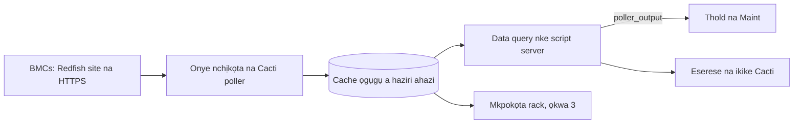

<!-- Source: README.md; SHA256: 7b4e83a58a1adc844cb0615ef30e95476cba2851f96bb454d2a816fb2774724d -->

<!-- translations:start -->
[English](../../../README.md) | [简体中文](../zh-CN/README.md) | [हिन्दी](../hi-IN/README.md) | [Español (España)](../es-ES/README.md) | [Español (Latinoamérica)](../es-419/README.md) | [العربية (السعودية)](../ar-SA/README.md) | [Afrikaans](../af-ZA/README.md) | [አማርኛ](../am-ET/README.md) | [العربية (مصر)](../ar-EG/README.md) | [العربية (المغرب)](../ar-MA/README.md) | [বাংলা](../bn-BD/README.md) | [Bosanski](../bs-BA/README.md) | [Deutsch](../de-DE/README.md) | [فارسی](../fa-IR/README.md) | [Filipino](../fil-PH/README.md) | [Français](../fr-FR/README.md) | [Français (Maroc)](../fr-MA/README.md) | [Français (Sénégal)](../fr-SN/README.md) | [Hausa](../ha-NG/README.md) | [עברית](../he-IL/README.md) | [Hrvatski](../hr-HR/README.md) | [Bahasa Indonesia](../id-ID/README.md) | [Igbo](README.md) | [Italiano](../it-IT/README.md) | [日本語](../ja-JP/README.md) | [한국어](../ko-KR/README.md) | [Malagasy](../mg-MG/README.md) | [मराठी](../mr-IN/README.md) | [Bahasa Melayu](../ms-MY/README.md) | [Nederlands](../nl-NL/README.md) | [Polski](../pl-PL/README.md) | [Português (Brasil)](../pt-BR/README.md) | [Русский](../ru-RU/README.md) | [Kinyarwanda](../rw-RW/README.md) | [Soomaali](../so-SO/README.md) | [Српски](../sr-RS/README.md) | [Svenska](../sv-SE/README.md) | [Kiswahili](../sw-KE/README.md) | [தமிழ்](../ta-IN/README.md) | [తెలుగు](../te-IN/README.md) | [ไทย](../th-TH/README.md) | [Türkçe](../tr-TR/README.md) | [Українська](../uk-UA/README.md) | [اردو](../ur-PK/README.md) | [Tiếng Việt](../vi-VN/README.md) | [isiXhosa](../xh-ZA/README.md) | [Yorùbá](../yo-NG/README.md) | [繁體中文](../zh-TW/README.md) | [isiZulu](../zu-ZA/README.md)
<!-- translations:end -->

# plugin_redfish

Plugin Cacti 1.2 nke na-eweta ike ọkụ sava na-eri, okpomọkụ mbata, ọnọdụ fan, na ọdịmma nke ngwaọrụ nnyefe ọkụ site na baseboard management controllers (BMCs) banye na Cacti dị ka ngwaọrụ nkịtị, isi mmalite data, na eserese, na-eji Redfish yana nhọrọ ndabere IPMI. Mgbe ahụ Thold na Maint na-ezipụ ịdọ aka ná ntị ma na-egbochi ha, na ọkwa ga-abịa n'ihu ga-agbakwunye mkpokọta ike ọkụ n'ọkwa rack.

> **Ọnọdụ: ka na-emepe emepe, enwebeghị mwepụta (0.1.0-dev).** Milestones 2 (ntọala) na 3 (ihe Cacti na izipụ ịdọ aka ná ntị) ejikọtawo na `main`. Plugin a enweghị njikọ na ọrụ Cacti. Ọ na-awụnye na Cacti 1.2.31 n'okpuru PHP 8.2 maọbụ nke ka ọhụrụ, na-edebanye aha BMC na nzere nbanye, na-agụ ike ọkụ, okpomọkụ, fan, na ọdịmma nke ngwaọrụ nnyefe ọkụ site na BMC ọ bụla site na Redfish banye na cache nke ya, ma na-egosi ọdịmma nke nchịkọta data. Ọ na-agbakwunye ngwaọrụ Cacti, eserese maka onye otu ọ bụla na nke nchịkọta, yana nkwado Thold na Maint site na isi mmalite data nkịtị. CI anwaleela BMC adịgboroja e ji fixtures e dere n'aka wuo yana sava nṅomi DMTF Redfish; ọ dịghị ezigbo BMC maọbụ ụyọkọ nnwale a kwadoro. Nhazi na nchọpụta dị na [docs/PLAN.md](../../PLAN.md), [docs/research/](../../research), na [docs/decisions/](../../decisions).

### Ihe milestone 2 na-eweta

- Wụnye, kwalite, kwụsị, ma wepụ site na API plugin nke Cacti, na-edebe tebụl mgbe ewepụrụ ya ma ọ bụrụ na ehichapụghị ntọala ahụ. Na PHP tọrọ 8.2, plugin ahụ na-ajụ ịwụnye maọbụ ịgbanye ma na-akọwa ihe kpatara ya.
- Mpaghara ikike "Redfish View" (peeji ọdịmma), "Redfish Operator" (peeji ọrụ), na "Redfish Admin" (peeji BMC na nzere nbanye), yana ntọala n'okpuru Configuration > Settings > Redfish.
- Ndekọ BMC nwere mbubata CSV na mbupụ JSON. Faịlụ mbubata ekwesịghị inwe okwuntụghe; a na-akpọ nzere nbanye site n'aha.
- Nzere nbanye echekwara na nzuzo site na AES-256-GCM. Igodo ahụ bụ faịlụ dị n'èzí nchekwa data, `/etc/cacti/redfish-vault.key` dị ka ndabere, nke nwere mkpụrụedemede hexadecimal 64 (`openssl rand -hex 32`) maọbụ kpọmkwem byte 32 a họọrọ n'ụzọ na-enweghị usoro, nke onye ọrụ poller nwe, nke ndị ọrụ ọzọ na-apụghị ịgụ, n'ime folda naanị onye ọrụ poller maọbụ root nwere ike ide ihe n'ime ya. A na-ajụ igodo nwere mkpụrụedemede 32 a na-ebipụta ebipụta dị ka passphrase. **Chekwaa faịlụ igodo ahụ yana nchekwa data**; na-enweghị ya, a ga-etinyekwa okwuntụghe niile echekwara ọzọ.
- Nnyocha TLS na-arụ ọrụ dị ka ndabere, nwere ngwugwu CA maka BMC ọ bụla maọbụ SPKI SHA-256 pin. Nhọrọ ịhapụ nnyocha maka BMC ọ bụla e dekọrọ na-anọgide na peeji ọdịmma dị ka ịdọ aka ná ntị.
- Onye ahịa Redfish na-agụ naanị: `GET` tinyere naanị nbanye na ọpụpụ oge ọrụ, nke a na-enyocha megide ndepụta nkwenye tupu e zipụ arịrịọ ọ bụla.
- Onye nchịkọta malitere site na `poller_bottom` maka BMC ndị dị na isi poller, nwere ikike oge na oge ngwụcha maka BMC ọ bụla, nkwụsịtụ nwa oge (backoff), na nhicha mgbe otu oge ọrụ plugin ahụ dekọrọ dara. A kwadobeghị ndị nchịkọta dịpụrụ adịpụ ugbu a; ha chọrọ nhọrọ doro anya nke otu onye nchịkọta si eru nchekwa data na igodo (ọkwa 4).
- Ndekọ BMC na nzere nbanye na-agbaso ikike ngwaọrụ Cacti: Redfish Admin na-ahụ, na-agbanwe, ma na-ejikọ naanị BMC ndị dị na ngwaọrụ ha nwere ike ịhụ, yana naanị nzere nbanye nke na-enweghị BMC dị na ngwaọrụ zoro ezo na-eji.

### Ihe milestone 3 na-agbakwunye

- A na-ebubata ndebiri dị ka Cacti template XML na `templates/` ma jiri ngwa mbubata nke Cacti n'onwe ya bubata ha n'oge nwụnye na nkwalite, na-ejikọ site na hash, ka mbubata wee melite ihe plugin ahụ ma ghara ịgbakwunye ihe ọ bụla ugboro abụọ. A na-eṅomi faịlụ data query atọ ahụ gaa na `<cacti>/resource/script_server/` nwere hash e dekọrọ; plugin ahụ anaghị edozi faịlụ dị n'ebe ahụ nke na-abụghị ya dere, peeji ọdịmma na-adọkwa ndị nchịkwa aka ná ntị mgbe ndebiri maọbụ faịlụ ajụjụ adịghị n'ebe ha kwesịrị ịdị. **Reinstall the Redfish Templates** na peeji BMCs na-ebubata ha ọzọ; ọ chọrọ ikike Import Templates nke Cacti.
- **Create Device** maọbụ **Add Graphs** na BMC ọ bụla ([ADR 0015](../../decisions/0015-attach-to-the-server-device-or-create-one-per-bmc.md)). BMC ejikọtara na ngwaọrụ sava dị adị na-enweta data queries na eserese ya na ngwaọrụ ahụ. BMC na-ejikọghị na ngwaọrụ na-enweta ngwaọrụ ọhụrụ site na ndebiri ngwaọrụ "Redfish BMC", ebe nnyocha ịdị njikere gbanyụrụ na aha host dị n'okpuru `.invalid`, ka Cacti ghara ịkpọtụrụ BMC ma ghara igosi adreesị ya. N'ụzọ ọ bụla, onye nchịkwa ga-ebu ụzọ kwado atụmatụ nke depụtara ihe a ga-agbakwunye. Ha abụọ chọrọ ikike njikwa ngwaọrụ nke Cacti yana Redfish Admin; a na-ewepụ ngwaọrụ ọhụrụ nke onye kere ya na-enweghị ike ịhụ.
- Data queries nke script server atọ, "Redfish Fans", "Redfish Temperatures", na "Redfish Power Supplies", ndị e debere n'usoro site na igodo onye otu BMC, nwere eserese maka onye otu ọ bụla: ọsọ fan na pasentị maọbụ RPM (nkeji ọ bụla BMC na-akọ), okpomọkụ, na watt mbata na ọpụpụ nke ngwaọrụ nnyefe ọkụ, nke ọ bụla nwere koodu ọdịmma ya.
- Ntinye "Redfish Node Summary" nwere ike ọkụ, okpomọkụ mbata, okpomọkụ kachasị elu, fan na ngwaọrụ nnyefe ọkụ na-adịghị mma, ọdịmma node, na afọ nke ọgụgụ ọma ikpeazụ, nke e sere n'eserese anọ: ike ọkụ, okpomọkụ, ọdịmma akụrụngwa, na afọ data. Oke Thold dị na isi mmalite data ndị a na-ezipụ ịdọ aka ná ntị, Maint na-egbochikwa ha, na-enweghị mgbanwe ọ bụla na plugin abụọ ahụ.
- Script server na-aza naanị site na cache nke plugin ahụ ma ọ dịghị mgbe ọ na-akpọtụrụ BMC. Ọnụọgụgụ na-efu efu, nke mere ochie, nke nkeji ọzọ, maọbụ nke sitere n'aka onye otu na-adịkwaghị bụ `U`, yabụ eserese na-egosi oghere, ọ dịghị mgbe ọ na-egosi efu; `age` na-enwekarị ọnụọgụgụ, yabụ oke dị na ya na-ejide BMC kwụsịrị ịza.
- Njikọ eserese site na eserese Redfish ọ bụla gaa na eserese Redfish nke ngwaọrụ ahụ, nke a na-egosi naanị ndị ọrụ Cacti nyere ikike ịhụ ngwaọrụ ahụ.

**Mgbe ndị otu BMC gbanwere** (a gbanwere fan, mmelite firmware gbanwere aha sensọ), họrọ **Add Graphs** ọzọ. Fan maọbụ ngwaọrụ nnyefe ọkụ nke dịbu ma ugbu a ọ dịghịzi maọbụ pụọ na-agụnye na `fans_bad` maọbụ `psus_bad` ruo mgbe i mere nke ahụ, yabụ fan e wepụrụ na-ezipụ ịdọ aka ná ntị; oghere a na-etinyeghị ihe ọ bụla na mbụ anaghị agụnye. Add Graphs na-anabata ndị otu BMC na-akọ ugbu a, Cacti na-edepụtakwa ajụjụ ndị ahụ n'usoro ọzọ; onye otu pụrụ apụ na-edobe isi mmalite data na eserese ya, nke na-agụ `U` site mgbe ahụ gawa, onye otu ọhụrụ na-enwetakwa eserese. Hichapụ eserese nke ndị otu pụrụ apụ n'aka ozugbo akụkọ ha na-adịkwaghị mkpa.

Ihichapụ ngwaọrụ na-ewepụ njikọ BMC ya ma na-edebe BMC ahụ na cache ya. Ihichapụ BMC, maọbụ iwepụ plugin ahụ, na-edebe ngwaọrụ ya na eserese ya.

## Ọrụ nnweta

| Mpaghara ikike | Ikike nnweta |
| --- | --- |
| Redfish View | Peeji nlekọta ndị dị adị. |
| Redfish Operator | Nlekọta tinyere peeji Operations na nkwenye nyocha nkeonwe. |
| Redfish Admin | Ikike Operator tinyere nhazi dị adị na omume nchịkwa. |

Mgbe iṅomichara faịlụ nkwalite, meghee peeji Plugins dị ka onye nchịkwa iji debanye aha
mpaghara ikike ọhụrụ ahụ. Nye mpaghara ikike Operator n'ụzọ doro anya n'okpuru **Configuration > Users** maọbụ otu ndị ọrụ.
Nkwalite na-edobe ID mpaghara ikike View na Admin ndị dị adị na ikike e nyere. Ikike Admin
na-eketa ikike Operator, ikike Operator na-eketekwa ikike View na arịrịọ ọ bụla;
nke a anaghị agbakwunye ikike echekwara na ndị ọrụ maọbụ otu. Ntọala plugin chọkwara
ikike Redfish Admin na mgbakwunye na ikike Settings nke Cacti.

Ikike ngwaọrụ Cacti ka na-amachi ahịrị na omume dịịrị onye ọrụ ọ bụla; ihe na-ejikọghị na ngwaọrụ chọrọ onye nchịkwa. Ndị Operator nwere ike ịhapụ njide nchịkọta na BMC e nyere ikike maka ọsọ a haziri na-esote.
Nzere nbanye, nhazi, njikọ, ihichapụ na mgbanwe nchịkwa ndị ọzọ
na-anọgide na peeji nchịkwa. Nkwenye na-adịgide naanị n'oge ọrụ
onye ọrụ ugbu a, maka otu awa kachasị na naanị mgbe otu nleba anya ahụ ka dị
ọhụrụ. Nleba anya ọhụrụ maọbụ nke gbanwere na-eme ka ha ghara ịdị irè. Ha anaghị eme ka nha
dara ada dị ka ọ dị mma maọbụ gbochie ịdọ aka ná ntị.

## Ihe kpatara ya

Sava ọ bụla nwere BMC nke na-akọ ọnọdụ ike ọkụ na okpomọkụ n'onwe ya n'adabereghị na sistemụ arụmọrụ, yabụ ọ na-anọgide na-aza mgbe OS dara. Data ahụ na-enyere nsochi ike na ego aka, ịdọ aka ná ntị n'oge nke fan maọbụ ngwaọrụ nnyefe ọkụ dara ada, na, na kọmpụta arụmọrụ dị elu, mkpebi nchịkwa oke ike ọkụ. Plugin ahụ abụghị naanị maka HPC.

Cacti na-ekpuchi akụkụ nke a taa:

- **Ngwugwu SNMP nke ndị na-ere ahịa.** Alaka 1.2.x na-eweta ndebiri Dell iDRAC na HPE iLO nke chọrọ onye nnọchi anya SNMP ma bụrụ nke ndị na-ere ahịa kpọmkwem; nchọpụta milestone 1 chọpụtara na ọ dịghị nke na-akọ ike ọkụ a na-eri na watts ([docs/research/overlap.md](../../research/overlap.md)).
- **Ụdị nzere nbanye na-enweghị onye nchịkọta.** plugin_credentials na-akọwa nzere nbanye "IPMI / Redfish (BMC)" mana ọ naghị agụ BMC ọ bụla.
- **Enweghị nlele ọkwa rack.** Isi Cacti enweghị ihe rack; ngwaọrụ nwere oghere ederede efu `location`.

Plugin ahụ na-ajụ BMC n'èzí usoro ajụjụ Cacti, na-echekwa ọgụgụ a haziri ahazi na cache, ma na-egosipụta ha site na data query nke script server na isi mmalite data nchịkọta. Ọ na-eji eserese Cacti, ikike, Thold, na Maint eme ihe ọzọ, ma ọ naghị agbanwe ọnọdụ BMC. A haziri nkwado onye nchịkọta data dịpụrụ adịpụ maka ọkwa 4; nchịkọta ugbu a na-agba naanị na isi poller.

## Oke a haziri

| Ọkwa | Oke | Milestones |
|---|---|---|
| 0, nchọpụta | Tebụl ndị na-ere ahịa, nkwenye nke omume upstream na BMC dị ndụ, ego ajụjụ, nnwale data query | [M1](https://github.com/somethingwithproof/plugin_redfish/milestone/1) |
| 1, nlele | Ndekọ BMC, nzere nbanye, TLS, onye nchịkọta Redfish, ọgụgụ a haziri ahazi, ngwaọrụ, eserese maka ndepụta ọ bụla, ịdọ aka ná ntị Thold, mgbochi Maint, peeji ọdịmma | [M2](https://github.com/somethingwithproof/plugin_redfish/milestone/2), [M3](https://github.com/somethingwithproof/plugin_redfish/milestone/3), [M4](https://github.com/somethingwithproof/plugin_redfish/milestone/4) |
| 2, ipmi | Ndabere IPMI maka BMC ndị na-enweghị Redfish a pụrụ iji rụọ ọrụ, gbanyụrụ dị ka ndabere | [M5](https://github.com/somethingwithproof/plugin_redfish/milestone/5) |
| 3, racks | Ndekọ rack, mkpokọta ike ọkụ rack nwere mkpuchi, ohere mmefu ike | [M6](https://github.com/somethingwithproof/plugin_redfish/milestone/6) |
| 4, dịpụrụ adịpụ | Ndị nchịkọta data dịpụrụ adịpụ nke Cacti maka netwọkụ BMC kewapụrụ | [M7](https://github.com/somethingwithproof/plugin_redfish/milestone/7) |

Ihe na-adịghị n'oke: ịtọ oke ike ọkụ maọbụ nhazi BMC ọ bụla ọzọ, njikwa ike ọkụ, mmelite firmware, nnweta console, ngwa izipụ ịdọ aka ná ntị nke plugin nwe, na njikọta nhazi oge.

## Ebe ndakọrịta na-elekwasị anya

| Akụrụngwa | Ebe e lekwasịrị anya |
|---|---|
| Cacti | 1.2.31 maọbụ nke ka ọhụrụ, enweghị mmezi isi |
| Nchekwa data | MariaDB 10.2 maọbụ MySQL 5.7 maọbụ nke ka ọhụrụ: otu BMC maka ngwaọrụ ọ bụla ka igodo pụrụ iche na kọlụm e mepụtara na-ejide |
| PHP | 8.2 maọbụ nke ka ọhụrụ; `setup.php` na-anọgide na-agụta na 8.0 ka runtime na-enweghị nkwado wee nweta njụ kama UI Cacti gbajiri agbaji |
| BMCs | Dell iDRAC, HPE iLO, Lenovo XCC, na OpenBMC, site n'ogo firmware; lee [tebụl ndị na-ere ahịa](../../research/vendor-matrix.md) |
| Redfish | Akụrụngwa subsystem na sensor ọhụrụ mbụ, `Power` na `Thermal` e wepụrụ n'ọrụ dị ka ndabere |
| Thold, Maint | Enweghị mgbanwe achọrọ |

## Nhazi

- [docs/PLAN.md](../../PLAN.md) bụ atụmatụ zuru ezu: usoro nhazi, eziokwu upstream ọ dabere na ya (nwere isi mmalite na echiche ka a ga-ekwenye), ụdị nha, oke nchekwa, mgbakọ na mwepụ arụmọrụ, nnwale, na ihe egwu.
- [docs/decisions/](../../decisions) nwere ndekọ mkpebi nhazi maka nhọrọ ndị e meelarị.
- [docs/REQUIREMENTS.md](../../REQUIREMENTS.md) na-ejikọ ID ihe achọrọ ọ bụla na nsogbu ya.

## Nchekwa

Nzere nbanye BMC na-achịkwa njikwa sava n'èzí netwọkụ nkịtị. Nhazi ahụ na-edobe ha n'èzí ahịrị iwu, ndekọ, na peeji, na-enyocha TLS dị ka ndabere, na-agba iwu mpụga ọ bụla site na usoro arụmụka nwere subcommands e kwadoro, ma na-eji akaụntụ BMC na-agụ naanị. Lee [docs/PLAN.md](../../PLAN.md#security) na [SECURITY.md](../../../SECURITY.md).

## Nduzi onye ọrụ

Lee [docs/operator-guide.md](../../operator-guide.md) maka ihe ndị dị mkpa tupu nwụnye, nhazi vault na TLS, ndebanye aha BMC, imepụta eserese, oge ịdọ aka ná ntị, nchekwa ndabere, na njikwa ọdịda. Nduzi ahụ anaghị ekwupụta na ahịrị firmware nke ezigbo onye na-ere ahịa nwere nkwado ruo mgbe njide e wepụrụ ihe nzuzo site na firmware ahụ gafere nnwale ahụ.

## Otu e si eso ọrụ

- **Milestones** na-agbaso milestones nke atụmatụ ahụ. Nke ọ bụla nwere epic issue nke depụtara obere nsogbu ya na ihe akaebe mmecha.
- A na-ekewa **Issues** site na akara: `type: requirement`, `type: research`, `type: decision`, `type: epic`. Requirement issues na-ekwu ihe achọrọ nwere nọmba, nke a pụrụ ịnwale (`REQ-AREA-NNN`) na njirisi nnabata.
- **Akara** na-ebukwa `area:`, `phase:`, `priority:`, na `status:`. Lee [CONTRIBUTING.md](../../../CONTRIBUTING.md#labels).
- [Bọọdụ ọrụ](https://github.com/users/somethingwithproof/projects/12) na-egosi nsogbu niile gafee milestones.

## Inye aka

Gụọ [CONTRIBUTING.md](../../../CONTRIBUTING.md). Commits chọrọ DCO sign-off. Mkparịta ụka nhazi na-eme na issues; mkpebi mepere emepe na-ebu akara `type: decision`. Ihe akaebe sitere na ezigbo BMC bụ enyemaka kachasị baa uru ugbu a; wepụ adreesị, nọmba usoro, na nzere nbanye tupu i bipụta njide ọ bụla.

## Ikikere

GNU General Public License v2.0, otu ikikere ahụ dị ka Cacti na plugins ya. Lee [LICENSE](../../../LICENSE).
