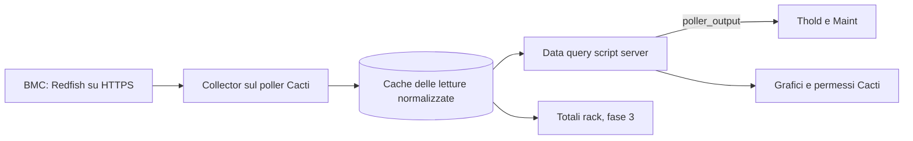

<!-- Source: README.md; SHA256: 7b4e83a58a1adc844cb0615ef30e95476cba2851f96bb454d2a816fb2774724d -->

<!-- translations:start -->
[English](../../../README.md) | [简体中文](../zh-CN/README.md) | [हिन्दी](../hi-IN/README.md) | [Español (España)](../es-ES/README.md) | [Español (Latinoamérica)](../es-419/README.md) | [العربية (السعودية)](../ar-SA/README.md) | [Afrikaans](../af-ZA/README.md) | [አማርኛ](../am-ET/README.md) | [العربية (مصر)](../ar-EG/README.md) | [العربية (المغرب)](../ar-MA/README.md) | [বাংলা](../bn-BD/README.md) | [Deutsch](../de-DE/README.md) | [فارسی](../fa-IR/README.md) | [Filipino](../fil-PH/README.md) | [Français](../fr-FR/README.md) | [Français (Maroc)](../fr-MA/README.md) | [Français (Sénégal)](../fr-SN/README.md) | [Hausa](../ha-NG/README.md) | [עברית](../he-IL/README.md) | [Bahasa Indonesia](../id-ID/README.md) | [Igbo](../ig-NG/README.md) | [Italiano](README.md) | [日本語](../ja-JP/README.md) | [한국어](../ko-KR/README.md) | [Malagasy](../mg-MG/README.md) | [मराठी](../mr-IN/README.md) | [Bahasa Melayu](../ms-MY/README.md) | [Nederlands](../nl-NL/README.md) | [Polski](../pl-PL/README.md) | [Português (Brasil)](../pt-BR/README.md) | [Русский](../ru-RU/README.md) | [Kinyarwanda](../rw-RW/README.md) | [Soomaali](../so-SO/README.md) | [Svenska](../sv-SE/README.md) | [Kiswahili](../sw-KE/README.md) | [தமிழ்](../ta-IN/README.md) | [తెలుగు](../te-IN/README.md) | [ไทย](../th-TH/README.md) | [Türkçe](../tr-TR/README.md) | [Українська](../uk-UA/README.md) | [اردو](../ur-PK/README.md) | [Tiếng Việt](../vi-VN/README.md) | [isiXhosa](../xh-ZA/README.md) | [Yorùbá](../yo-NG/README.md) | [繁體中文](../zh-TW/README.md) | [isiZulu](../zu-ZA/README.md)
<!-- translations:end -->

# plugin_redfish

Un plugin per Cacti 1.2 che integra in Cacti l'assorbimento elettrico dei server, la temperatura di ingresso, lo stato delle ventole e lo stato di salute degli alimentatori provenienti dai Baseboard Management Controller (BMC) come normali dispositivi, origini dati e grafici, utilizzando Redfish con un fallback opzionale su IPMI. Thold e Maint gestiscono quindi gli avvisi e la soppressione, mentre una fase successiva aggiungerà i totali di potenza a livello di rack.

> **Stato: in fase di sviluppo, nessun rilascio ancora disponibile (0.1.0-dev).** Le milestone 2 (fondamenta) e 3 (oggetti Cacti e avvisi) sono state integrate su `main`. Questo plugin non è affiliato al progetto Cacti. Si installa su Cacti 1.2.31 con PHP 8.2 o successivo, registra BMC e credenziali, legge potenza, temperature, ventole e stato degli alimentatori da ciascun BMC tramite Redfish memorizzandoli nella propria cache e mostra lo stato della raccolta dati. Aggiunge dispositivi Cacti, grafici per singolo componente e di riepilogo, nonché il supporto per Thold e Maint tramite normali origini dati. La CI ha testato un BMC simulato costruito da fixture scritte a mano e il server mockup DMTF Redfish; nessun BMC reale o parco macchine pilota è stato ancora qualificato. La progettazione e la ricerca sono disponibili in [docs/PLAN.md](../../PLAN.md), [docs/research/](../../research) e [docs/decisions/](../../decisions).

### Cosa include la milestone 2

- Installazione, aggiornamento, disabilitazione e disinstallazione tramite l'API dei plugin di Cacti, mantenendo le tabelle alla disinstallazione a meno che l'impostazione non venga deselezionata. Su versioni di PHP precedenti alla 8.2 il plugin rifiuta l'installazione o l'abilitazione indicandone il motivo.
- Reami "Redfish View" (pagina dello stato), "Redfish Operator" (pagina delle operazioni) e "Redfish Admin" (pagine dei BMC e delle credenziali), e impostazioni in Configuration > Settings > Redfish.
- Un registro dei BMC con importazione CSV ed esportazione JSON. I file di importazione non devono contenere password; le credenziali sono referenziate per nome.
- Credenziali archiviate in forma cifrata con AES-256-GCM. La chiave è un file esterno al database, per impostazione predefinita `/etc/cacti/redfish-vault.key`, contenente 64 caratteri esadecimali (`openssl rand -hex 32`) oppure esattamente 32 byte casuali, di proprietà dell'utente del poller, non leggibile da altri utenti, in una directory scrivibile solo dall'utente del poller o da root. Una chiave di 32 caratteri stampabili viene rifiutata in quanto passphrase. **Eseguire il backup del file della chiave insieme al database**; senza di esso ogni password archiviata dovrà essere reinserita.
- Verifica TLS attiva per impostazione predefinita, con un bundle CA o un pin SPKI SHA-256 per singolo BMC. Un'eventuale disattivazione della verifica per singolo BMC viene registrata nei log e rimane visibile come avviso nella pagina dello stato.
- Un client Redfish di sola lettura: esclusivamente `GET` più il login e il logout di sessione, verificati rispetto a una allowlist prima dell'invio di qualsiasi richiesta.
- Un collector avviato da `poller_bottom` per i BMC sul poller principale, con lease e scadenze per singolo BMC, backoff e pulizia dopo un arresto anomalo dell'unica sessione registrata dal plugin. I collector remoti non sono ancora supportati; richiedono una scelta esplicita su come il collector raggiunga il database e la chiave (fase 4).
- I record dei BMC e le credenziali seguono i permessi sui dispositivi di Cacti: un Redfish Admin vede, modifica e associa solo i BMC sui dispositivi che è autorizzato a vedere, e solo le credenziali non utilizzate da alcun BMC su un dispositivo nascosto.

### Cosa aggiunge la milestone 3

- Template distribuiti come XML di template Cacti in `templates/` e importati con lo strumento di importazione nativo di Cacti all'installazione e all'aggiornamento, abbinati tramite hash, in modo che un'importazione aggiorni gli oggetti del plugin senza duplicare nulla. I tre file di data query vengono copiati in `<cacti>/resource/script_server/` con un hash registrato; il plugin non sostituisce mai un file presente in quella posizione che non abbia scritto esso stesso, e la pagina dello stato avvisa gli amministratori quando i template o un file di query non sono presenti. **Reinstall the Redfish Templates** nella pagina dei BMC li importa nuovamente; richiede il permesso Import Templates di Cacti.
- **Create Device** o **Add Graphs** su ciascun BMC ([ADR 0015](../../decisions/0015-attach-to-the-server-device-or-create-one-per-bmc.md)). Un BMC mappato sul dispositivo esistente di un server riceve le proprie data query e i propri grafici su quel dispositivo. Un BMC non mappato riceve un nuovo dispositivo dal template di dispositivo "Redfish BMC", con i controlli di disponibilità disattivati e un nome host sotto `.invalid`, in modo che Cacti non contatti mai il BMC e non ne mostri mai l'indirizzo. In entrambi i casi un amministratore conferma prima un piano che elenca ciò che verrà aggiunto. Entrambe le azioni richiedono il permesso di gestione dei dispositivi di Cacti oltre a Redfish Admin; un nuovo dispositivo che il creatore non potrebbe vedere viene nuovamente rimosso.
- Tre data query script server, "Redfish Fans", "Redfish Temperatures" e "Redfish Power Supplies", indicizzate dalla chiave del membro del BMC, con un grafico per membro: velocità della ventola in percentuale o RPM (qualunque sia l'unità segnalata dal BMC), temperatura e potenza in ingresso e in uscita dell'alimentatore in watt, ciascuno con il rispettivo codice di stato.
- Un input "Redfish Node Summary" con potenza, temperatura di ingresso, temperatura massima, ventole e alimentatori non OK, stato del nodo e anzianità dell'ultima lettura valida, rappresentato su quattro grafici: potenza, temperature, stato dei componenti e anzianità dei dati. Le soglie Thold su queste origini dati generano avvisi e Maint li sopprime, senza alcuna modifica a nessuno dei due plugin.
- Lo script server risponde esclusivamente dalla cache del plugin e non contatta mai un BMC. Un valore mancante, obsoleto, espresso in un'altra unità o proveniente da un membro non più presente è `U`, in modo che i grafici mostrino un'interruzione e mai zero; `age` ha sempre un valore, così una soglia su di esso intercetta un BMC che ha smesso di rispondere.
- Un collegamento da ciascun grafico Redfish ai grafici Redfish del dispositivo, mostrato solo agli utenti ai quali Cacti consente di vedere il dispositivo.

**Quando i membri di un BMC cambiano** (una ventola sostituita, un aggiornamento firmware che rinomina i sensori), scegliere nuovamente **Add Graphs**. Una ventola o un alimentatore che era presente e ora è assente o rimosso viene conteggiato in `fans_bad` o `psus_bad` finché non lo si fa, in modo che una ventola estratta generi un avviso; uno slot che non è mai stato popolato non viene conteggiato. Add Graphs accetta i membri che il BMC segnala attualmente e Cacti reindicizza le query; un membro non più presente mantiene la propria origine dati e il proprio grafico, che da quel momento leggono `U`, mentre un nuovo membro riceve un grafico. Eliminare manualmente i grafici dei membri non più presenti quando la loro cronologia non è più necessaria.

L'eliminazione di un dispositivo rimuove la mappatura del relativo BMC mantenendo il BMC e la sua cache. L'eliminazione di un BMC, o la disinstallazione del plugin, mantiene il relativo dispositivo e i relativi grafici.

## Ruoli di accesso

| Reame | Accesso |
| --- | --- |
| Redfish View | Pagine di monitoraggio esistenti. |
| Redfish Operator | Monitoraggio più la pagina Operations e le conferme di triage personali. |
| Redfish Admin | Accesso Operator più la configurazione esistente e le azioni amministrative. |

Dopo aver copiato i file di aggiornamento, aprire la pagina Plugins come amministratore per registrare
il nuovo reame. Assegnare esplicitamente il reame Operator in **Configuration > Users** o nei gruppi di utenti.
Gli aggiornamenti mantengono gli ID e le autorizzazioni esistenti dei reami View e Admin. L'accesso Admin
eredita l'accesso Operator e l'accesso Operator eredita l'accesso View a ogni richiesta;
ciò non aggiunge autorizzazioni salvate agli utenti o ai gruppi. Le impostazioni del plugin richiedono inoltre
l'accesso Redfish Admin in aggiunta al permesso Settings di Cacti.

I permessi sui dispositivi di Cacti continuano a limitare le righe e le azioni disponibili per ciascun utente; gli oggetti non mappati richiedono un amministratore. Gli operatori possono rilasciare una sospensione della raccolta su un BMC consentito per la successiva esecuzione pianificata.
Credenziali, configurazione, mappatura, eliminazione e altre modifiche amministrative
rimangono nelle pagine amministrative. Le conferme durano solo nella sessione dell'utente corrente,
per al massimo un'ora e solo finché la stessa osservazione rimane valida.
Osservazioni nuove o modificate le invalidano. Non contrassegnano mai una misurazione fallita
come sana né sopprimono gli avvisi.

## Motivazione

Ogni server dispone di un BMC che segnala lo stato elettrico e termico indipendentemente dal sistema operativo, continuando quindi a rispondere anche quando il sistema operativo non è attivo. I dati servono per la pianificazione della capacità e il monitoraggio dei costi, il rilevamento precoce di una ventola o di un alimentatore guasti e, nel calcolo ad alte prestazioni, le decisioni di power-capping. Il plugin non è specifico per l'HPC.

Cacti copre già oggi parte di queste esigenze:

- **Pacchetti SNMP dei produttori.** Il ramo 1.2.x distribuisce template Dell iDRAC e HPE iLO che richiedono un agente SNMP e sono specifici del produttore; la ricerca della milestone 1 ha rilevato che nessuno dei due segnala l'assorbimento elettrico in watt ([docs/research/overlap.md](../../research/overlap.md)).
- **Un tipo di credenziale senza collector.** plugin_credentials definisce una credenziale "IPMI / Redfish (BMC)" ma non legge alcun BMC.
- **Nessuna vista a livello di rack.** Il nucleo di Cacti non dispone di un oggetto rack; un dispositivo ha un campo `location` a testo libero.

Il plugin interroga i BMC fuori banda rispetto al ciclo di polling di Cacti, memorizza nella cache le letture normalizzate e le espone tramite una data query script server e origini dati di riepilogo. Riutilizza la generazione di grafici, i permessi, Thold e Maint di Cacti e non modifica lo stato dei BMC. Il supporto per i collector di dati remoti è previsto per la fase 4; attualmente la raccolta viene eseguita solo sul poller principale.

## Ambito pianificato

| Fase | Ambito | Milestone |
|---|---|---|
| 0, ricerca | Matrice dei produttori, conferma del comportamento upstream su BMC reali, costo del polling, prototipo data query | [M1](https://github.com/somethingwithproof/plugin_redfish/milestone/1) |
| 1, osservazione | Registro BMC, credenziali, TLS, collector Redfish, letture normalizzate, dispositivi, grafici per indice, avvisi Thold, soppressione Maint, pagina dello stato | [M2](https://github.com/somethingwithproof/plugin_redfish/milestone/2), [M3](https://github.com/somethingwithproof/plugin_redfish/milestone/3), [M4](https://github.com/somethingwithproof/plugin_redfish/milestone/4) |
| 2, ipmi | Fallback IPMI per BMC privi di Redfish utilizzabile, disattivato per impostazione predefinita | [M5](https://github.com/somethingwithproof/plugin_redfish/milestone/5) |
| 3, rack | Registro dei rack, totali di potenza dei rack con copertura, margine di budget | [M6](https://github.com/somethingwithproof/plugin_redfish/milestone/6) |
| 4, remoto | Collector di dati remoti di Cacti per reti BMC isolate | [M7](https://github.com/somethingwithproof/plugin_redfish/milestone/7) |

Fuori ambito: impostazione dei limiti di potenza o qualsiasi altra configurazione del BMC, controllo dell'alimentazione, aggiornamento del firmware, accesso alla console, un motore di avvisi proprietario del plugin e integrazione con lo scheduler.

## Obiettivi di compatibilità

| Componente | Obiettivo |
|---|---|
| Cacti | 1.2.31 o successivo, nessuna patch al core |
| Database | MariaDB 10.2 o MySQL 5.7 o successivo: il vincolo di un BMC per dispositivo è garantito da una chiave univoca su una colonna generata |
| PHP | 8.2 o successivo; `setup.php` rimane analizzabile su 8.0 in modo che un runtime non supportato riceva un rifiuto anziché compromettere l'interfaccia di Cacti |
| BMC | Dell iDRAC, HPE iLO, Lenovo XCC e OpenBMC, per intervallo di firmware; vedere [la matrice dei produttori](../../research/vendor-matrix.md) |
| Redfish | Prima le nuove risorse di sottosistema e sensori, con `Power` e `Thermal` deprecate come fallback |
| Thold, Maint | Nessuna modifica richiesta |

## Progettazione

- [docs/PLAN.md](../../PLAN.md) è il piano completo: architettura, fatti upstream da cui dipende (con fonti e ipotesi ancora da confermare), modello di misurazione, confini di sicurezza, aritmetica delle prestazioni, test e rischi.
- [docs/decisions/](../../decisions) contiene i record delle decisioni architetturali per le scelte già effettuate.
- [docs/REQUIREMENTS.md](../../REQUIREMENTS.md) mappa ogni ID di requisito alla relativa issue.

## Sicurezza

Le credenziali dei BMC controllano la gestione fuori banda dei server. La progettazione le mantiene fuori dalle righe di comando, dai log e dalle pagine, verifica il TLS per impostazione predefinita, esegue qualsiasi comando esterno tramite un array di argomenti con sottocomandi in allowlist e utilizza account BMC di sola lettura. Vedere [docs/PLAN.md](../../PLAN.md#security) e [SECURITY.md](../../../SECURITY.md).

## Guida per gli operatori

Vedere [docs/operator-guide.md](../../operator-guide.md) per i prerequisiti di installazione, la configurazione del vault e del TLS, la registrazione dei BMC, la creazione dei grafici, gli intervalli di avviso, il backup e la gestione dei guasti. La guida non dichiara supportata una linea firmware reale di un produttore finché un'acquisizione redatta da quel firmware non supera la suite di test.

## Come viene tracciato il lavoro

- **Milestone** seguono le milestone del piano. Ciascuna ha una issue epica che elenca le relative sotto-issue e le evidenze di uscita.
- **Issue** sono tipizzate per etichetta: `type: requirement`, `type: research`, `type: decision`, `type: epic`. Le issue dei requisiti dichiarano requisiti numerati e verificabili (`REQ-AREA-NNN`) e criteri di accettazione.
- **Etichette** includono anche `area:`, `phase:`, `priority:` e `status:`. Vedere [CONTRIBUTING.md](../../../CONTRIBUTING.md#labels).
- La [bacheca del progetto](https://github.com/users/somethingwithproof/projects/12) mostra tutte le issue attraverso le milestone.

## Contributi

Leggere [CONTRIBUTING.md](../../../CONTRIBUTING.md). I commit richiedono un sign-off DCO. La discussione progettuale avviene sulle issue; le decisioni aperte riportano l'etichetta `type: decision`. Le evidenze provenienti da BMC reali rappresentano attualmente il contributo più utile; oscurare indirizzi, numeri di serie e credenziali prima di pubblicare qualsiasi acquisizione.

## Licenza

GNU General Public License v2.0, la stessa licenza di Cacti e dei suoi plugin. Vedere [LICENSE](../../../LICENSE).
