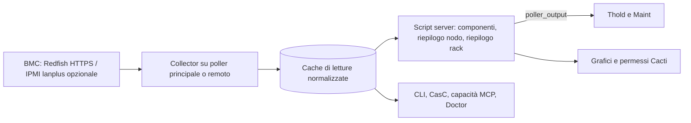

<!-- Source: README.md; SHA256: cf31b9f80d6c00020bbe08e80951d4de1c910793911d040ae7a66b54e8a2eaf0 -->

<!-- translations:start -->
[English](../../../README.md) | [简体中文](../zh-CN/README.md) | [हिन्दी](../hi-IN/README.md) | [Español (España)](../es-ES/README.md) | [Español (Latinoamérica)](../es-419/README.md) | [العربية (السعودية)](../ar-SA/README.md) | [Afrikaans](../af-ZA/README.md) | [አማርኛ](../am-ET/README.md) | [العربية (مصر)](../ar-EG/README.md) | [العربية (المغرب)](../ar-MA/README.md) | [বাংলা](../bn-BD/README.md) | [Bosanski](../bs-BA/README.md) | [Deutsch](../de-DE/README.md) | [فارسی](../fa-IR/README.md) | [Filipino](../fil-PH/README.md) | [Français](../fr-FR/README.md) | [Français (Maroc)](../fr-MA/README.md) | [Français (Sénégal)](../fr-SN/README.md) | [Hausa](../ha-NG/README.md) | [עברית](../he-IL/README.md) | [Hrvatski](../hr-HR/README.md) | [Bahasa Indonesia](../id-ID/README.md) | [Igbo](../ig-NG/README.md) | [Italiano](README.md) | [日本語](../ja-JP/README.md) | [한국어](../ko-KR/README.md) | [Malagasy](../mg-MG/README.md) | [मराठी](../mr-IN/README.md) | [Bahasa Melayu](../ms-MY/README.md) | [Nederlands](../nl-NL/README.md) | [Polski](../pl-PL/README.md) | [Português (Brasil)](../pt-BR/README.md) | [Русский](../ru-RU/README.md) | [Kinyarwanda](../rw-RW/README.md) | [Soomaali](../so-SO/README.md) | [Српски](../sr-RS/README.md) | [Svenska](../sv-SE/README.md) | [Kiswahili](../sw-KE/README.md) | [தமிழ்](../ta-IN/README.md) | [తెలుగు](../te-IN/README.md) | [ไทย](../th-TH/README.md) | [Türkçe](../tr-TR/README.md) | [Українська](../uk-UA/README.md) | [اردو](../ur-PK/README.md) | [Tiếng Việt](../vi-VN/README.md) | [isiXhosa](../xh-ZA/README.md) | [Yorùbá](../yo-NG/README.md) | [繁體中文](../zh-TW/README.md) | [isiZulu](../zu-ZA/README.md)
<!-- translations:end -->

# plugin_redfish

Un plugin per Cacti 1.2 che integra in Cacti l'assorbimento elettrico dei server, la temperatura di ingresso, lo stato delle ventole e lo stato di salute degli alimentatori provenienti dai baseboard management controller (BMC) come normali dispositivi, origini dati e grafici, utilizzando Redfish con un fallback IPMI opzionale di sola lettura e aggregazioni della potenza a livello di rack. Thold e Maint generano e sopprimono gli avvisi attraverso le origini dati standard di Cacti.

> **Stato: in fase di sviluppo, nessun rilascio ancora disponibile (`0.1.0-dev`).** Questo plugin non è affiliato al progetto Cacti. Si installa su Cacti 1.2.31 o successivo con PHP 8.2 o successivo e implementa il collector Redfish, il vault crittografato delle credenziali, il provisioning di dispositivi e grafici Cacti, il fallback IPMI opzionale di sola lettura, l'aggregazione della potenza di rack, la visualizzazione della finestra Cacti Maint, la replica ed endpoint di agente per i data collector remoti, il provider CasC e la CLI operatore, le capacità MCP e i controlli diagnostici Doctor. La CI testa le fixture, il DMTF Redfish Mockup Server (mockup di sottosistema, legacy-only e HPE iLO Gen11) e Thold v1.8.2 con Maint v1.3; nessun BMC fisico reale o parco macchine pilota è stato ancora qualificato. La progettazione e la ricerca sono disponibili in [docs/PLAN.md](../../PLAN.md), [docs/research/](../../research/) e [docs/decisions/](../../decisions/).

## Funzionalità implementate

### Collector principale, vault e oggetti Cacti

- **Ciclo di vita e schema.** Si installa, aggiorna, disabilita e disinstalla tramite l'API dei plugin di Cacti (`Schema::VERSION = 3`, 12 tabelle). Le tabelle vengono mantenute alla disinstallazione a meno che *Keep Plugin Tables on Uninstall* non venga deselezionato. I punti di ingresso vengono analizzati su PHP 8.0 e rifiutano PHP inferiore a 8.2 o la mancanza di `ext-openssl` con un messaggio di errore esplicito.
- **Registro e permessi.** Realm *Redfish View* (`redfish_health.php`), *Redfish Operator* (`redfish_operator.php`) e *Redfish Admin* (`redfish_bmcs.php`, `redfish_credentials.php`), oltre alle impostazioni sotto **Configuration > Settings > Redfish**. Il registro BMC supporta l'importazione CSV (credenziali referenziate per nome; le password nei file di importazione vengono rifiutate) e l'esportazione JSON. I record BMC e le credenziali seguono i permessi dei dispositivi di Cacti.
- **Vault crittografato delle credenziali.** Le password vengono memorizzate crittografate con AES-256-GCM in `plugin_redfish_secret`. La chiave risiede fuori dal database (`/etc/cacti/redfish-vault.key` per impostazione predefinita) come 64 caratteri esadecimali (`openssl rand -hex 32`) o 32 byte grezzi, di proprietà dell'utente del poller, illeggibile agli altri utenti, in una directory scrivibile solo da root o da tale utente. Una passphrase stampabile di 32 caratteri viene rifiutata. **Eseguite il backup del file della chiave insieme al database**; senza di esso, le password memorizzate devono essere reinserite.
- **TLS e client Redfish di sola lettura.** La verifica TLS è abilitata per impostazione predefinita tramite l'archivio CA di sistema, un bundle CA per singolo BMC o un pin SPKI SHA-256; la disattivazione della verifica per singolo BMC rimane visibile come avviso di stato e avviso di controllo Doctor. Il client consente solo `GET` più il login (`POST`) e il logout (`DELETE`) della sessione Redfish, con fallback opzionale a Basic per singolo BMC quando le sessioni non sono disponibili. Il rilevamento preferisce le nuove risorse Redfish di sottosistema e sensore e ripiega sulle risorse deprecate `Power` e `Thermal`.
- **Esecuzione del collector.** `poller_redfish.php` parte da `poller_bottom`, esegue un processo master per poller tramite il registro dei processi di Cacti con processi worker configurabili (`redfish_workers`), acquisisce lease per singolo BMC, applica un budget temporale (`redfish_collector_budget`), applica il backoff esponenziale e ripulisce la precedente sessione del plugin stesso dopo un arresto anomalo.
- **Template, dispositivi e grafici.** Importa `templates/redfish-templates.xml` tramite hash e copia tre file XML di data query per script server (`redfish_fans.xml`, `redfish_temperatures.xml`, `redfish_psus.xml`) in `<cacti>/resource/script_server/` senza sovrascrivere i file modificati dall'utente. **Create Device** e **Add Graphs** richiedono la conferma di un piano di provisioning, associano le query a un dispositivo server mappato o creano un dispositivo "Redfish BMC" sotto `.invalid` con controlli di disponibilità disabilitati e collegano ogni grafico Redfish ai grafici Redfish del dispositivo tramite `graph_buttons`.
- **Input dello script server solo da cache.** `scripts/ss_redfish_members.php` fornisce le letture di ventole, temperature e PSU per singolo componente e `scripts/ss_redfish_summary.php` fornisce le metriche "Redfish Node Summary" (potenza, temperatura di ingresso e massima, conteggio di ventole e PSU guasti, stato del nodo ed età dell'ultima lettura valida). Le chiamate dello script server leggono solo dalla cache locale e non contattano mai un BMC. Le letture mancanti, obsolete o di componenti scomparsi restituiscono `U` (mai `0`), mentre `age` riporta sempre un valore affinché le soglie rilevino i BMC silenziosi.

**Quando i componenti di un BMC cambiano** (ad esempio una ventola sostituita o un aggiornamento firmware che rinomina i sensori), eseguite nuovamente **Add Graphs**. Una ventola o un alimentatore precedentemente presente che diventa assente viene conteggiato in `fans_bad` o `psus_bad` finché non viene accettato; uno slot mai popolato non viene conteggiato. I componenti scomparsi mantengono le origini dati e i grafici esistenti, che da quel momento leggono `U` fino alla cancellazione manuale. L'eliminazione di un dispositivo Cacti rimuove la mappatura del relativo BMC e l'assegnazione al rack mantenendo il BMC e la cache; l'eliminazione di un BMC o la disinstallazione del plugin mantiene i dispositivi e i grafici Cacti.

### Fallback IPMI opzionale

- **Attivazione esplicita per singolo BMC.** Disattivato per impostazione predefinita (`protocols` ha valore predefinito `redfish`; l'attivazione del fallback IPMI imposta `redfish,ipmi`).
- **Trigger del fallback delimitato.** Viene eseguito solo quando la raccolta Redfish fallisce con una classe di errore idonea; non si attiva mai per `AuthRejected`, `CredentialUnavailable`, `AddressRefused`, `OperationRefused` o `Deadline`.
- **Esecuzione sicura.** Invoca `ipmitool` su `-I lanplus` tramite `proc_open()` in forma di array senza shell, con timeout wall-clock limitato e limite di output di 256 KiB. Le password vengono fornite tramite `IPMITOOL_PASSWORD` (`-E`) o un file temporaneo con permessi 0600 (`-f`) eliminato in `finally`, mai su argv della CLI.
- **Allowlist di comandi di sola lettura.** Sono consentiti solo cinque sottocomandi di sola lettura: `dcmi power reading`, `sdr type Temperature`, `sdr type Fan`, `sdr type Power Supply` e `chassis status`. I comandi che modificano lo stato vengono rifiutati.
- **Output normalizzato e avviso di sicurezza.** `IpmiNormalizer` mappa le letture nello stesso modello `Observation`/`Member`/`Reading`, emettendo `U` per i sensori mancanti o non analizzabili. L'attivazione del fallback IPMI genera un avviso nella pagina dello stato e nel controllo Doctor `redfish.bmc_security`, ricordando agli operatori di limitare UDP 623 a una VLAN di gestione.

### Aggregazione della potenza di rack

- **Registro dei rack.** La versione 3 dello schema aggiunge `plugin_redfish_rack` (`(site_id, name)` univoco, `power_budget_watts` opzionale, `min_coverage_pct` con valore predefinito `80` e note) e `plugin_redfish_rack_member` (al massimo un'assegnazione rack per `host_id`, `bmc_id` e `unit_position` opzionali, rimossa automaticamente quando un dispositivo Cacti viene eliminato).
- **Totali protetti dalla copertura.** `RackPowerSummary` somma le letture `power_watts` recenti dei membri dalla cache locale e calcola utilizzo del budget e margine disponibile (headroom). Quando la copertura dei membri che rispondono scende sotto `min_coverage_pct`, `power_watts`, `utilization_pct` e `headroom_watts` restituiscono `U` affinché i guasti del collector non appaiano mai come un calo della potenza del rack.
- **Input dello script server pronto per Thold.** `scripts/ss_redfish_rack.php` (`ss_redfish_rack(<rack_id>)`) restituisce `power_watts`, `power_budget_watts`, `utilization_pct`, `headroom_watts`, `members_total`, `members_reporting` e `coverage_pct` esclusivamente dalla cache locale.

### Integrazione con Cacti Maint

- Le soglie Thold sulle origini dati Redfish generano avvisi e Cacti Maint li sopprime senza modifiche a nessuno dei due plugin.
- `MaintWindow` verifica le pianificazioni Maint attive per ogni host Cacti mappato (pianificazioni singole `mtype=1` e ricorrenti `mtype=2`, oltre a `plugin_maint_check_cacti_host()` quando caricata) e contrassegna la manutenzione attiva nella pagina Redfish Health (`[MAINT]`), nell'output di `cli/redfish.php health` e nella capacità `redfish-get-health`.

### Data collector remoti

- `INFO` dichiara `remote_collect:1`. I BMC accettano qualsiasi `poller_id >= 1`, e `poller_redfish.php --poller=N` raccoglie solo i BMC abilitati assegnati a quel poller.
- **Hook `replicate_out`.** Replica solo le tabelle di configurazione non segrete destinate al poller remoto di destinazione tramite `replicate_out_table()`: `plugin_redfish_bmc`, i metadati di `plugin_redfish_credential` (senza testo cifrato), `plugin_redfish_rack` e `plugin_redfish_rack_member`. `plugin_redfish_secret` non viene replicata e i file delle chiavi del vault restano rigorosamente locali su ciascun poller.
- **Hook `remote_agent`.** Espone le azioni di sola lettura `redfish_health` e `redfish_discovery` accettando solo i parametri numerici `poller_id` e `bmc_id`. I parametri imprevisti vengono rifiutati e non vengono restituite credenziali né segreti.

### Hook di ecosistema (CasC, capacità MCP e Doctor)

- **Provider CasC (`casc_register_providers`).** Registra il provider `redfish` (schema versione `1`) con esportazione YAML e XML in puro PHP, parsing (con rifiuto XXE), validazione, pianificazione delle differenze e applicazione. Le credenziali compaiono solo come riferimenti al vault (`vault:redfish:<name>`); le chiavi segrete grezze (`pass`, `secret`, `token`, `private_key`, `vault_key`, `auth_token`) vengono rifiutate. L'applicazione richiede un `PLAN_HASH` SHA-256 esatto.
- **API MCP / Abilities (`abilities_register`).** Registra tre capacità di sola lettura vincolate al realm Redfish View (`redfish_health.php`) e ai permessi dei dispositivi Cacti, senza restituire credenziali:
  - `redfish-list-bmcs` (`poller_id` opzionale)
  - `redfish-get-rack-power` (`rack_id` opzionale)
  - `redfish-get-health` (`bmc_id` opzionale)
- **Controlli Doctor (`doctor_register_checks`).** Registra cinque controlli diagnostici locali di sola lettura che non contattano mai un BMC né restituiscono materiale delle chiavi:
  - `redfish.schema`: aggiornamento della versione dello schema
  - `redfish.vault_key`: leggibilità e permessi della chiave del vault
  - `redfish.collector_runs`: budget e freschezza del collector del poller
  - `redfish.bmc_security`: BMC abilitati con TLS non verificato o fallback IPMI
  - `redfish.rack_power`: conformità al budget di potenza del rack e soglia minima di copertura

## CLI

Eseguire dalla directory radice di Cacti con PHP 8.2 o successivo:

```sh
# Operator and CasC CLI (reads --file=PATH or stdin for validate, plan, and apply)
php plugins/redfish/cli/redfish.php export --format=yaml|xml
php plugins/redfish/cli/redfish.php validate [--file=PATH] [--format=yaml|xml]
php plugins/redfish/cli/redfish.php plan [--file=PATH] [--format=yaml|xml]
php plugins/redfish/cli/redfish.php apply [--file=PATH] [--format=yaml|xml] --confirm=<PLAN_HASH>
php plugins/redfish/cli/redfish.php health --format=text|json

# Collector entry point (normally started by poller_bottom)
php plugins/redfish/poller_redfish.php [--poller=N] [--force] [--debug]

# Rack power summary script server entry point
php plugins/redfish/scripts/ss_redfish_rack.php <rack_id>
```

## Ruoli di accesso

| Realm | Accesso |
| --- | --- |
| Redfish View | Pagine di monitoraggio esistenti. |
| Redfish Operator | Monitoraggio più pagina Operations e conferme personali di triage. |
| Redfish Admin | Accesso Operator più configurazione esistente e azioni amministrative. |

Dopo aver copiato i file di aggiornamento, aprite la pagina Plugins come amministratore per registrare i realm. Assegnate esplicitamente il realm Operator sotto **Configuration > Users** o ai gruppi di utenti. Gli aggiornamenti mantengono gli ID dei realm e i permessi esistenti per View e Admin. L'accesso Admin eredita l'accesso Operator e l'accesso Operator eredita l'accesso View a ogni richiesta; ciò non aggiunge permessi salvati a utenti o gruppi. Le impostazioni del plugin richiedono inoltre l'accesso Redfish Admin in aggiunta al permesso Settings di Cacti.

I permessi dei dispositivi Cacti limitano le righe e le azioni disponibili per ciascun utente; gli oggetti non mappati richiedono un amministratore. Gli operatori possono sbloccare una sospensione della raccolta su un BMC consentito per l'esecuzione pianificata successiva. Credenziali, configurazione, mappatura, eliminazione e altre modifiche amministrative restano nelle pagine amministrative. Le conferme durano solo nella sessione corrente dell'utente, per al massimo un'ora e solo finché la stessa osservazione rimane recente. Osservazioni nuove o modificate le invalidano. Non contrassegnano mai una misurazione fallita come sana né sopprimono gli avvisi.

## Perché

Ogni server dispone di un BMC che riporta lo stato elettrico e termico indipendentemente dal sistema operativo, quindi continua a rispondere anche quando il sistema operativo è fermo. I dati servono per il monitoraggio di capacità e costi, la segnalazione anticipata di una ventola o di un alimentatore guasti e, nel calcolo ad alte prestazioni, per le decisioni di limitazione della potenza. Il plugin non è specifico per l'HPC.

Cacti copre oggi una parte di questa esigenza:

- **Pacchetti SNMP dei produttori.** Il ramo 1.2.x include template Dell iDRAC e HPE iLO che richiedono un agente SNMP e dipendono dal produttore; la ricerca della milestone 1 ha rilevato che nessuno dei due riporta l'assorbimento elettrico in watt ([docs/research/overlap.md](../../research/overlap.md)).
- **Un tipo di credenziale senza collector.** plugin_credentials definisce una credenziale "IPMI / Redfish (BMC)" ma non legge alcun BMC.
- **Nessuna vista a livello di rack.** Il core di Cacti non dispone di un oggetto rack; un dispositivo ha solo un campo di testo libero `location`.

Il plugin interroga i BMC out-of-band rispetto al ciclo di polling di Cacti sul poller principale o su data collector remoti, memorizza nella cache le letture normalizzate e le espone tramite data query dello script server, riepiloghi di nodo e riepiloghi della potenza di rack. Riutilizza grafici, permessi, Thold e Maint di Cacti e non modifica lo stato del BMC.

## Ambito e stato

| Fase | Ambito | Milestone | Stato |
|---|---|---|---|
| 0, ricerca | Matrice dei produttori, conferma del comportamento upstream su BMC reali, costo di polling, prototipo di data query | [M1](https://github.com/somethingwithproof/plugin_redfish/milestone/1) | Completata, in attesa di catture firmware da BMC reali |
| 1, osservazione | Registro BMC, credenziali, TLS, collector Redfish, letture normalizzate, dispositivi, grafici per indice, avvisi Thold, integrazione Maint, pagina stato | [M2](https://github.com/somethingwithproof/plugin_redfish/milestone/2), [M3](https://github.com/somethingwithproof/plugin_redfish/milestone/3), [M4](https://github.com/somethingwithproof/plugin_redfish/milestone/4) | Implementato; qualificazione del parco pilota M4 in attesa |
| 2, ipmi | Fallback IPMI di sola lettura (`lanplus`) tramite `ipmitool`, disattivato per impostazione predefinita | [M5](https://github.com/somethingwithproof/plugin_redfish/milestone/5) | Implementato |
| 3, rack | Registro rack, totali di potenza rack con soglia minima di copertura, margine di budget, `ss_redfish_rack.php` | [M6](https://github.com/somethingwithproof/plugin_redfish/milestone/6) | Implementato |
| 4, remoto ed ecosistema | Data collector remoti (`replicate_out`, `remote_agent`), provider CasC e CLI, capacità MCP, controlli Doctor | [M7](https://github.com/somethingwithproof/plugin_redfish/milestone/7) | Implementato |

Fuori ambito: impostazione di limiti di potenza o qualsiasi altra configurazione BMC, controllo dell'alimentazione, aggiornamento firmware, accesso console, motore di avvisi proprietario del plugin e integrazione con scheduler.

## Obiettivi di compatibilità

| Componente | Obiettivo |
|---|---|
| Cacti | 1.2.31 o successivo, nessuna patch al core |
| Database | MariaDB 10.2 o MySQL 5.7 o successivo: un solo BMC per dispositivo è garantito da una chiave univoca su una colonna generata |
| PHP | 8.2 o successivo; i punti di ingresso restano analizzabili su 8.0 affinché un runtime non supportato riceva un rifiuto invece di un'interfaccia Cacti compromessa |
| Estensioni PHP | `ext-openssl` (richiesta da Cacti 1.2.31); nessuna `ext-curl` e nessuna dipendenza di runtime Composer |
| Strumenti opzionali | `ipmitool` sui poller che raccolgono BMC con fallback IPMI abilitato |
| BMC | Dell iDRAC, HPE iLO, Lenovo XCC e OpenBMC, per intervallo firmware; vedere [la matrice dei produttori](../../research/vendor-matrix.md) |
| Redfish | Prima le nuove risorse di sottosistema e sensore, risorse deprecate `Power` e `Thermal` come fallback |
| Thold, Maint | Nessuna modifica richiesta (la CI esegue Thold v1.8.2 e Maint v1.3) |

## Progettazione

- [docs/PLAN.md](../../PLAN.md) è il piano completo: architettura, fatti upstream su cui si basa, modello di misurazione, confini di sicurezza, calcolo delle prestazioni, test e rischi.
- [docs/decisions/](../../decisions/) contiene i record delle decisioni architetturali per le scelte già prese.
- [docs/REQUIREMENTS.md](../../REQUIREMENTS.md) mappa ogni ID requisito al relativo issue.



## Sicurezza

Le credenziali BMC controllano la gestione out-of-band dei server. La progettazione mantiene i segreti fuori da righe di comando, log, esportazioni CasC, payload degli agenti remoti, risposte MCP e pagine web; cifra le password memorizzate con AES-256-GCM usando un file chiave del vault locale per ciascun poller; verifica TLS per impostazione predefinita; esegue `ipmitool` da un array esplicito di argomenti con sottocomandi di sola lettura consentiti; e utilizza account BMC di sola lettura. Vedere [docs/PLAN.md](../../PLAN.md#security) e [SECURITY.md](../../../SECURITY.md).

## Guida per l'operatore

Consultate [docs/operator-guide.md](../../operator-guide.md) per prerequisiti di installazione, configurazione di vault e TLS, registrazione dei BMC, creazione dei grafici, intervalli di avviso, backup e gestione dei guasti. La guida non dichiara supportata alcuna linea firmware reale di un produttore finché una cattura oscurata da quel firmware non supera la suite di test.

## Sviluppo e test

La CI (`.github/workflows/plugin-ci-workflow.yml`) esegue il lint dei punti di ingresso su PHP 8.0, esegue le suite Pest unit (`phpunit.xml`) e di integrazione del ciclo di vita (`phpunit-integration.xml`) e PHPStan livello 9 da PHP 8.2 a 8.5 rispetto a Cacti `release/1.2.31` e `1.2.x`, verifica il rifiuto su PHP 8.1, testa end-to-end il DMTF Redfish Mockup Server (mockup di sottosistema, legacy-only e HPE iLO Gen11) e Thold v1.8.2 / Maint v1.3, e verifica i cataloghi gettext, i workflow e le licenze REUSE.

Verifiche locali prima del push:

```sh
sh tests/lint-workflows.sh
sh locales/build_gettext.sh --check
CACTI_PATH=/path/to/cacti phpstan analyse -c phpstan.neon --no-progress
```

Eseguite Pest con `--configuration=phpunit.xml` per i test unitari e delle regole sui sorgenti, oppure `--configuration=phpunit-integration.xml` con `CACTI_PATH` e `REDFISH_TEST_DATABASE=disposable` su un database Cacti temporaneo per i test di integrazione del ciclo di vita.

## Come viene tracciato il lavoro

- **Milestone** seguono le milestone del piano. Ciascuna ha un epic issue che elenca i relativi sotto-issue e le prove di chiusura.
- **Issue** sono classificati per etichetta: `type: requirement`, `type: research`, `type: decision`, `type: epic`. Gli issue dei requisiti definiscono requisiti numerati e testabili (`REQ-AREA-NNN`) e criteri di accettazione.
- **Etichette** riportano anche `area:`, `phase:`, `priority:` e `status:`. Vedere [CONTRIBUTING.md](../../../CONTRIBUTING.md#labels).
- La [bacheca del progetto](https://github.com/users/somethingwithproof/projects/12) mostra tutti gli issue attraverso le milestone.

## Contribuire

Leggete [CONTRIBUTING.md](../../../CONTRIBUTING.md). I commit richiedono un sign-off DCO. Le discussioni di progettazione si svolgono negli issue; le decisioni aperte portano l'etichetta `type: decision`. Le evidenze provenienti da BMC reali sono attualmente il contributo più utile; oscurate indirizzi, numeri di serie e credenziali prima di pubblicare qualsiasi cattura.

## Licenza

GNU General Public License v2.0, la stessa licenza di Cacti e dei suoi plugin. Vedere [LICENSE](../../../LICENSE).
