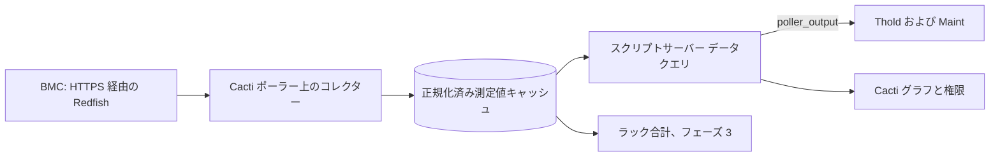

<!-- Source: README.md; SHA256: 7b4e83a58a1adc844cb0615ef30e95476cba2851f96bb454d2a816fb2774724d -->

<!-- translations:start -->
[English](../../../README.md) | [简体中文](../zh-CN/README.md) | [हिन्दी](../hi-IN/README.md) | [Español (España)](../es-ES/README.md) | [Español (Latinoamérica)](../es-419/README.md) | [العربية (السعودية)](../ar-SA/README.md) | [Afrikaans](../af-ZA/README.md) | [አማርኛ](../am-ET/README.md) | [العربية (مصر)](../ar-EG/README.md) | [العربية (المغرب)](../ar-MA/README.md) | [বাংলা](../bn-BD/README.md) | [Bosanski](../bs-BA/README.md) | [Deutsch](../de-DE/README.md) | [فارسی](../fa-IR/README.md) | [Filipino](../fil-PH/README.md) | [Français](../fr-FR/README.md) | [Français (Maroc)](../fr-MA/README.md) | [Français (Sénégal)](../fr-SN/README.md) | [Hausa](../ha-NG/README.md) | [עברית](../he-IL/README.md) | [Hrvatski](../hr-HR/README.md) | [Bahasa Indonesia](../id-ID/README.md) | [Igbo](../ig-NG/README.md) | [Italiano](../it-IT/README.md) | [日本語](README.md) | [한국어](../ko-KR/README.md) | [Malagasy](../mg-MG/README.md) | [मराठी](../mr-IN/README.md) | [Bahasa Melayu](../ms-MY/README.md) | [Nederlands](../nl-NL/README.md) | [Polski](../pl-PL/README.md) | [Português (Brasil)](../pt-BR/README.md) | [Русский](../ru-RU/README.md) | [Kinyarwanda](../rw-RW/README.md) | [Soomaali](../so-SO/README.md) | [Српски](../sr-RS/README.md) | [Svenska](../sv-SE/README.md) | [Kiswahili](../sw-KE/README.md) | [தமிழ்](../ta-IN/README.md) | [తెలుగు](../te-IN/README.md) | [ไทย](../th-TH/README.md) | [Türkçe](../tr-TR/README.md) | [Українська](../uk-UA/README.md) | [اردو](../ur-PK/README.md) | [Tiếng Việt](../vi-VN/README.md) | [isiXhosa](../xh-ZA/README.md) | [Yorùbá](../yo-NG/README.md) | [繁體中文](../zh-TW/README.md) | [isiZulu](../zu-ZA/README.md)
<!-- translations:end -->

# plugin_redfish

ベースボード管理コントローラー（BMC）から取得したサーバーの消費電力、吸気温度、ファン状態、および電源ユニットの正常性を、Redfish（オプションの IPMI フォールバック付き）を使用して通常のデバイス、データソース、グラフとして Cacti に取り込む Cacti 1.2 プラグインです。その後、Thold と Maint によるアラート通知および抑制が可能になり、後のフェーズではラック単位の消費電力合計も追加されます。

> **ステータス: 開発中、リリース未定（0.1.0-dev）。** マイルストーン 2（基盤）および 3（Cacti オブジェクトとアラート）は `main` にマージ済みです。本プラグインは Cacti プロジェクトの公式製品ではありません。PHP 8.2 以降の環境で Cacti 1.2.31 にインストールし、BMC と認証情報を登録して、各 BMC から Redfish 経由で消費電力、温度、ファン、電源ユニットの正常性を独自のキャッシュへ読み取り、収集の健全性を表示します。また、通常のデータソースを通じて Cacti デバイス、メンバー別グラフ、サマリーグラフ、および Thold と Maint のサポートを追加します。CI では手書きのフィクスチャから構築した模擬 BMC と DMTF Redfish モックアップサーバーで検証済みですが、実機の BMC やパイロット環境での検証はまだ実施されていません。設計および調査資料は [docs/PLAN.md](../../PLAN.md)、[docs/research/](../../research)、および [docs/decisions/](../../decisions) にあります。

### マイルストーン 2 の機能

- Cacti のプラグイン API を通じたインストール、アップグレード、無効化、およびアンインストールに対応します。設定を解除しない限り、アンインストール時もテーブルは保持されます。PHP 8.2 未満の環境では、本プラグインは理由を明示してインストールおよび有効化を拒否します。
- レルム「Redfish View」（ヘルスページ）、「Redfish Operator」（操作ページ）、「Redfish Admin」（BMC および認証情報ページ）、および Configuration > Settings > Redfish 配下の設定画面を提供します。
- CSV インポートおよび JSON エクスポートに対応した BMC レジストリを提供します。インポートファイルにパスワードを含めてはならず、認証情報は名前で参照します。
- 認証情報は AES-256-GCM で暗号化して保存します。暗号鍵はデータベース外のファイル（デフォルトは `/etc/cacti/redfish-vault.key`）に格納し、64 文字の 16 進数文字列（`openssl rand -hex 32`）または厳密に 32 バイトのランダムデータとし、ポーラーユーザーが所有し、他のユーザーからは読み取り不可で、ポーラーユーザーまたは root のみが書き込み可能なディレクトリに配置する必要があります。32 文字の印字可能文字で構成された鍵はパスフレーズとみなされ拒否されます。**データベースと併せて鍵ファイルも必ずバックアップしてください。** 鍵ファイルを失うと、保存されているすべてのパスワードを再入力する必要があります。
- TLS 検証はデフォルトで有効になっており、BMC ごとの CA バンドルまたは SPKI SHA-256 ピン留めを指定できます。ログに記録されたうえで BMC ごとに検証を無効化するオプトアウト設定を行った場合、ヘルスページに警告として表示され続けます。
- 読み取り専用の Redfish クライアントを提供します。`GET` とセッションのログインおよびログアウトのみを許可し、リクエスト送信前に許可リスト（allowlist）に対して検証します。
- メインポーラー上の BMC 向けに `poller_bottom` から起動されるコレクターを提供します。BMC ごとのリースとデッドライン、バックオフ制御、およびクラッシュ後にプラグインが記録していた 1 つのセッションをクリーンアップする機能を備えています。リモートコレクターはまだサポートされておらず、コレクターがデータベースと鍵へアクセスする方法を明示的に選択する必要があります（フェーズ 4）。
- BMC レコードおよび認証情報は Cacti のデバイス権限に従います。Redfish Admin は自身が閲覧権限を持つデバイスに紐づく BMC のみを閲覧、変更、および関連付けでき、非表示のデバイス上の BMC が使用していない認証情報のみを操作できます。

### マイルストーン 3 で追加された機能

- テンプレートは Cacti テンプレート XML として `templates/` に同梱され、インストールおよびアップグレード時に Cacti 本体のインポーターを使用してハッシュ一致によりインポートされるため、インポート時はプラグインのオブジェクトが更新され、重複登録されることはありません。3 つのデータクエリファイルは記録されたハッシュとともに `<cacti>/resource/script_server/` へコピーされます。本プラグインは自身が書き込んだのではないファイルを上書きすることは決してなく、テンプレートやクエリファイルが所定の場所にない場合はヘルスページで管理者に警告します。BMCs ページの **Reinstall the Redfish Templates** を実行するとテンプレートを再インポートできます（Cacti の Import Templates 権限が必要です）。
- 各 BMC に対して **Create Device** または **Add Graphs** を実行できます（[ADR 0015](../../decisions/0015-attach-to-the-server-device-or-create-one-per-bmc.md)）。既存のサーバーデバイスにマッピングされた BMC では、そのデバイス上にデータクエリとグラフが作成されます。未マッピングの BMC では、「Redfish BMC」デバイステンプレートから新しいデバイスが作成されます。この際、可用性チェックは無効化され、ホスト名は `.invalid` 配下に設定されるため、Cacti が BMC に直接接続したり、そのアドレスを表示したりすることはありません。いずれの場合も、管理者はまず追加内容の一覧を含むプランを確認します。どちらの操作にも、Redfish Admin に加えて Cacti のデバイス管理権限が必要であり、作成者が閲覧できない新規デバイスが作成された場合は自動的に削除されます。
- 3 つのスクリプトサーバーデータクエリ「Redfish Fans」、「Redfish Temperatures」、「Redfish Power Supplies」を提供します。これらは BMC のメンバーキーでインデックス化され、メンバーごとのグラフとして、ファン回転数（BMC が報告する単位に応じてパーセントまたは RPM）、温度、および電源ユニットの入力・出力ワット数を、それぞれの正常性コードとともに描画します。
- 「Redfish Node Summary」入力では、消費電力、吸気温度、最高温度、異常なファンおよび電源ユニット数、ノード正常性、および最後の正常読み取りからの経過時間を取得し、消費電力、温度、コンポーネント正常性、データ経過時間の 4 つのグラフに描画します。これらのデータソースに設定した Thold しきい値によるアラート発報および Maint による抑制が、いずれのプラグインにも変更を加えることなく動作します。
- スクリプトサーバーはプラグインのキャッシュからのみ応答し、BMC には一切接続しません。欠損値、古い値、異なる単位の値、または削除されたメンバーの値は `U` となるため、グラフにはゼロではなく空白として表示されます。`age` は常に値を持つため、これにしきい値を設定することで応答が停止した BMC を検知できます。
- 各 Redfish グラフからそのデバイスの Redfish グラフ一覧へのグラフリンクを提供し、Cacti がそのデバイスの閲覧を許可しているユーザーにのみ表示します。

**BMC のメンバーが変更された場合**（ファンの交換、ファームウェア更新によるセンサー名の変更など）は、再度 **Add Graphs** を選択してください。以前は存在していたが現在は不在または消失したファンや電源ユニットは、この操作を行うまで `fans_bad` または `psus_bad` にカウントされるため、引き抜かれたファンを検知してアラートを発報できます。一方、最初から空だったスロットはカウントされません。Add Graphs は現在 BMC が報告しているメンバーを受け入れ、Cacti がクエリの再インデックスを実行します。消失したメンバーのデータソースとグラフは保持され、以降は `U` として記録されます。また、新しいメンバーにはグラフが作成されます。消失したメンバーのグラフは、履歴が不要になった時点で手動で削除してください。

デバイスを削除すると、その BMC とのマッピングは解除されますが、BMC とそのキャッシュは保持されます。BMC を削除した場合やプラグインをアンインストールした場合も、デバイスとグラフは保持されます。

## アクセスロール

| レルム | アクセス権限 |
| --- | --- |
| Redfish View | 既存の監視ページ。 |
| Redfish Operator | 監視権限に加えて、Operations ページおよび個人単位のトリアージ確認応答（acknowledgment）操作。 |
| Redfish Admin | Operator 権限に加えて、既存の設定変更および管理操作。 |

アップグレード用ファイルをコピーした後、管理者として Plugins ページを開き、新しいレルムを登録してください。Operator レルムは **Configuration > Users** またはユーザーグループ配下で明示的に割り当ててください。アップグレード時も、既存の View および Admin のレルム ID と権限付与は維持されます。Admin アクセスは Operator アクセスを継承し、Operator アクセスはリクエストごとに View アクセスを継承します。これにより、ユーザーやグループに保存済みの権限付与が追加されることはありません。プラグイン設定画面へのアクセスには、Cacti の Settings 権限に加えて Redfish Admin アクセスが必要です。

各ユーザーが利用できる行や操作は引き続き Cacti のデバイス権限によって制限され、未マッピングのオブジェクトの操作には管理者権限が必要です。Operator は、許可された BMC に対する次回の定期実行に向けた収集保留（collection hold）を解除できます。認証情報、設定、マッピング、削除などの管理変更は引き続き管理ページで行います。確認応答（acknowledgment）は現在のユーザーのセッション内でのみ有効であり、最大 1 時間、かつ同じ観測データが最新（fresh）である間のみ維持されます。観測データが新規取得または更新されると無効になります。確認応答によって、失敗した測定値が正常とみなされたり、アラートが抑制されたりすることは決してありません。

## 開発の背景

すべてのサーバーには、OS とは独立して電力および熱の状態を報告する BMC が搭載されているため、OS がダウンしている間も応答を継続します。このデータは、キャパシティおよびコストの追跡、ファンや電源ユニットの故障の早期検知、さらにハイパフォーマンスコンピューティング環境における電力キャッピングの判断に活用できます。なお、本プラグインは HPC 専用ではありません。

現在、Cacti はこの領域の一部をカバーしていますが、以下の課題があります。

- **ベンダー製 SNMP パッケージ:** 1.2.x ブランチには Dell iDRAC および HPE iLO テンプレートが同梱されていますが、SNMP エージェントが必要かつベンダー固有であり、マイルストーン 1 の調査ではいずれも消費電力をワット単位で報告しないことが判明しました（[docs/research/overlap.md](../../research/overlap.md)）。
- **コレクターのない認証情報タイプ:** plugin_credentials では「IPMI / Redfish (BMC)」認証情報が定義されていますが、BMC からの読み取り処理は実装されていません。
- **ラック単位のビューの欠如:** Cacti コアにはラックオブジェクトが存在せず、デバイスには自由記述の `location` フィールドがあるのみです。

本プラグインは Cacti のポーリングサイクルとは帯域外（out of band）で BMC をポーリングし、正規化した測定値をキャッシュして、スクリプトサーバーデータクエリおよびサマリーデータソースを通じて公開します。Cacti のグラフ描画、権限管理、Thold、Maint をそのまま活用し、BMC の状態は変更しません。リモートデータコレクターのサポートはフェーズ 4 で計画されており、現在の収集はメインポーラー上でのみ実行されます。

## 計画されたスコープ

| フェーズ | スコープ | マイルストーン |
|---|---|---|
| 0, 調査 | ベンダーマトリックス、実機 BMC におけるアップストリーム動作の確認、ポーリングコスト、データクエリのスパイク検証 | [M1](https://github.com/somethingwithproof/plugin_redfish/milestone/1) |
| 1, 監視 | BMC レジストリ、認証情報、TLS、Redfish コレクター、正規化済み測定値、デバイス、インデックス別グラフ、Thold アラート、Maint 抑制、ヘルスページ | [M2](https://github.com/somethingwithproof/plugin_redfish/milestone/2), [M3](https://github.com/somethingwithproof/plugin_redfish/milestone/3), [M4](https://github.com/somethingwithproof/plugin_redfish/milestone/4) |
| 2, ipmi | 利用可能な Redfish を持たない BMC 向けの IPMI フォールバック（デフォルトでは無効） | [M5](https://github.com/somethingwithproof/plugin_redfish/milestone/5) |
| 3, ラック | ラックレジストリ、カバレッジ情報付きのラック消費電力合計、予算ヘッドルーム | [M6](https://github.com/somethingwithproof/plugin_redfish/milestone/6) |
| 4, リモート | 隔離された BMC ネットワーク向けの Cacti リモートデータコレクター | [M7](https://github.com/somethingwithproof/plugin_redfish/milestone/7) |

スコープ外: 電力キャップの設定やその他の BMC 設定変更、電源制御、ファームウェア更新、コンソールアクセス、プラグイン独自のアラートエンジン、およびスケジューラー連携。

## 互換性ターゲット

| コンポーネント | ターゲット |
|---|---|
| Cacti | 1.2.31 以降（コアへのパッチ不要） |
| データベース | MariaDB 10.2 または MySQL 5.7 以降: デバイスあたり 1 つの BMC という制約は生成列（generated column）上のユニークキーによって保持されます |
| PHP | 8.2 以降。`setup.php` は PHP 8.0 でもパース可能に保たれており、非対応ランタイムでは Cacti UI を破損させる代わりに拒否メッセージを表示します |
| BMC | Dell iDRAC、HPE iLO、Lenovo XCC、および OpenBMC（ファームウェア範囲による。詳細は[ベンダーマトリックス](../../research/vendor-matrix.md)を参照） |
| Redfish | 新しいサブシステムおよびセンサーリソースを優先し、非推奨の `Power` および `Thermal` をフォールバックとして使用 |
| Thold, Maint | 変更不要 |

## 設計

- [docs/PLAN.md](../../PLAN.md) は全体計画書であり、アーキテクチャ、前提とするアップストリームの仕様（出典および今後確認すべき仮定を含む）、測定モデル、セキュリティ境界、パフォーマンス試算、テスト、およびリスクを記載しています。
- [docs/decisions/](../../decisions) には、すでに決定された選択に関するアーキテクチャ決定記録（ADR）を格納しています。
- [docs/REQUIREMENTS.md](../../REQUIREMENTS.md) はすべての要件 ID と対応する Issue をマッピングしています。

## セキュリティ

BMC の認証情報はサーバーの帯域外管理を制御する重要な情報です。本設計では、認証情報をコマンドライン、ログ、および Web ページから排除し、デフォルトで TLS を検証し、外部コマンドは許可リストに登録されたサブコマンドのみを引数配列で実行し、読み取り専用の BMC アカウントを使用します。詳細は [docs/PLAN.md](../../PLAN.md#security) および [SECURITY.md](../../../SECURITY.md) を参照してください。

## 運用ガイド

インストールの前提条件、Vault と TLS の設定、BMC の登録、グラフの作成、アラート間隔、バックアップ、および障害対応については、[docs/operator-guide.md](../../operator-guide.md) を参照してください。このガイドでは、特定のベンダー製ファームウェア系統から取得し機密情報をマスク（redact）したキャプチャがテストスイートに合格するまで、そのファームウェア系統をサポート対象として宣言しません。

## 作業の追跡方法

- **マイルストーン（Milestones）** は計画のマイルストーンに対応しています。各マイルストーンには、サブ Issue と完了証跡（exit evidence）をまとめたエピック Issue があります。
- **Issue** はラベルで種別分けされています（`type: requirement`、`type: research`、`type: decision`、`type: epic`）。要件 Issue には番号付きのテスト可能な要件（`REQ-AREA-NNN`）と受け入れ基準が記載されています。
- **ラベル（Labels）** には `area:`、`phase:`、`priority:`、および `status:` も付与されます。詳細は [CONTRIBUTING.md](../../../CONTRIBUTING.md#labels) を参照してください。
- [プロジェクトボード](https://github.com/users/somethingwithproof/projects/12) では、すべてのマイルストーンにわたる Issue 一覧を確認できます。

## コントリビューション

[CONTRIBUTING.md](../../../CONTRIBUTING.md) をお読みください。コミットには DCO サインオフが必要です。設計上の議論は Issue 上で行われ、未決定事項には `type: decision` ラベルが付与されています。現在最も有用な貢献は実機 BMC からの証跡提供です。キャプチャを投稿する前には、アドレス、シリアル番号、および認証情報を必ずマスク（redact）してください。

## ライセンス

Cacti およびそのプラグインと同じく GNU General Public License v2.0 です。詳細は [LICENSE](../../../LICENSE) を参照してください。
