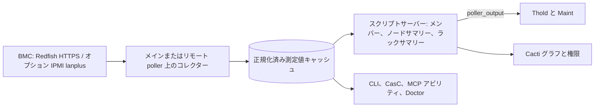

<!-- Source: README.md; SHA256: 6972a6c9ac754cd60e63c5caf971451ea8fe6e279eef757d886e1a168d3eef01 -->

<!-- translations:start -->
[English](../../../README.md) | [简体中文](../zh-CN/README.md) | [हिन्दी](../hi-IN/README.md) | [Español (España)](../es-ES/README.md) | [Español (Latinoamérica)](../es-419/README.md) | [العربية (السعودية)](../ar-SA/README.md) | [Afrikaans](../af-ZA/README.md) | [አማርኛ](../am-ET/README.md) | [العربية (مصر)](../ar-EG/README.md) | [العربية (المغرب)](../ar-MA/README.md) | [বাংলা](../bn-BD/README.md) | [Bosanski](../bs-BA/README.md) | [Deutsch](../de-DE/README.md) | [فارسی](../fa-IR/README.md) | [Filipino](../fil-PH/README.md) | [Français](../fr-FR/README.md) | [Français (Maroc)](../fr-MA/README.md) | [Français (Sénégal)](../fr-SN/README.md) | [Hausa](../ha-NG/README.md) | [עברית](../he-IL/README.md) | [Hrvatski](../hr-HR/README.md) | [Bahasa Indonesia](../id-ID/README.md) | [Igbo](../ig-NG/README.md) | [Italiano](../it-IT/README.md) | [日本語](README.md) | [한국어](../ko-KR/README.md) | [Malagasy](../mg-MG/README.md) | [मराठी](../mr-IN/README.md) | [Bahasa Melayu](../ms-MY/README.md) | [Nederlands](../nl-NL/README.md) | [Polski](../pl-PL/README.md) | [Português (Brasil)](../pt-BR/README.md) | [Русский](../ru-RU/README.md) | [Kinyarwanda](../rw-RW/README.md) | [Soomaali](../so-SO/README.md) | [Српски](../sr-RS/README.md) | [Svenska](../sv-SE/README.md) | [Kiswahili](../sw-KE/README.md) | [தமிழ்](../ta-IN/README.md) | [తెలుగు](../te-IN/README.md) | [ไทย](../th-TH/README.md) | [Türkçe](../tr-TR/README.md) | [Українська](../uk-UA/README.md) | [اردو](../ur-PK/README.md) | [Tiếng Việt](../vi-VN/README.md) | [isiXhosa](../xh-ZA/README.md) | [Yorùbá](../yo-NG/README.md) | [繁體中文](../zh-TW/README.md) | [isiZulu](../zu-ZA/README.md)
<!-- translations:end -->

# plugin_redfish

ベースボード管理コントローラー（BMC）から取得したサーバーの消費電力、吸気温度、ファン状態、および電源ユニットの正常性を、Redfish（オプションの読み取り専用 IPMI フォールバック付き）とラック単位の消費電力集計を使用して、通常のデバイス、データソース、およびグラフとして Cacti に取り込む Cacti 1.2 プラグインです。Thold と Maint は標準の Cacti データソースを通じてアラート通知と抑制を行います。

> **ステータス: 開発中、リリース未定（`0.1.0-dev`）。** 本プラグインは Cacti プロジェクトの公式製品ではありません。PHP 8.2 以降の環境で Cacti 1.2.31 以降にインストールでき、Redfish コレクター、暗号化認証情報ボールト、Cacti デバイスおよびグラフのプロビジョニング、オプションの読み取り専用 IPMI フォールバック、ラック消費電力集計、Cacti Maint メンテナンスウィンドウ表示、リモートデータコレクターのレプリケーションおよびエージェントエンドポイント、CasC プロバイダーとオペレーター CLI、MCP アビリティ、および Doctor 診断チェックを実装しています。CI ではフィクスチャ、DMTF Redfish Mockup Server（サブシステム、レガシーのみ、および HPE iLO Gen11 モックアップ）、および Thold v1.8.2 と Maint v1.3 の組み合わせを検証しています。実機の物理 BMC やパイロット環境での検証はまだ実施されていません。設計および調査資料は [docs/PLAN.md](../../PLAN.md)、[docs/research/](../../research/)、および [docs/decisions/](../../decisions/) にあります。

## 実装済み機能

### コアコレクター、ボールト、および Cacti オブジェクト

- **ライフサイクルとスキーマ。** Cacti のプラグイン API を通じてインストール、アップグレード、無効化、およびアンインストールを行います（`Schema::VERSION = 3`、12 テーブル）。*Keep Plugin Tables on Uninstall* のチェックを外さない限り、アンインストール時もテーブルは保持されます。エントリーポイントは PHP 8.0 で構文解析可能であり、PHP 8.2 未満または `ext-openssl` 不足の場合は明示的なエラーメッセージを表示して処理を拒否します。
- **レジストリと権限。** *Redfish View*（`redfish_health.php`）、*Redfish Operator*（`redfish_operator.php`）、および *Redfish Admin*（`redfish_bmcs.php`、`redfish_credentials.php`）のレルムに加えて、**Configuration > Settings > Redfish** 配下の設定を提供します。BMC レジストリは CSV インポート（認証情報は名前で参照し、インポートファイル内のパスワードは拒否）と JSON エクスポートに対応しています。BMC レコードと認証情報は Cacti のデバイス権限に従います。
- **暗号化認証情報ボールト。** パスワードは AES-256-GCM で暗号化して `plugin_redfish_secret` に保存されます。鍵はデータベース外（デフォルトでは `/etc/cacti/redfish-vault.key`）に 64 文字の 16 進数文字列（`openssl rand -hex 32`）または 32 バイトの生データとして保存され、poller ユーザーが所有し、他ユーザーからは読み取り不可で、root または当該ユーザーのみが書き込み可能なディレクトリに配置します。32 文字の印字可能なパスフレーズは拒否されます。**鍵ファイルはデータベースと一緒にバックアップしてください。** 鍵ファイルがない場合、保存されたパスワードを再入力する必要があります。
- **TLS と読み取り専用 Redfish クライアント。** TLS 検証はシステム CA ストア、BMC ごとの CA バンドル、または SPKI SHA-256 ピンを使用してデフォルトで有効です。BMC 単位で検証を無効にした場合は、ヘルス警告および Doctor チェック警告として表示され続けます。クライアントは `GET` に加えて Redfish セッションのログイン（`POST`）とログアウト（`DELETE`）のみを許可し、セッションが利用できない場合は BMC 単位でオプションの Basic 認証フォールバックを使用できます。ディスカバリは新しい Redfish サブシステムおよびセンサーリソースを優先し、非推奨の `Power` および `Thermal` リソースにフォールバックします。
- **コレクター実行。** `poller_redfish.php` は `poller_bottom` から起動し、設定可能なワーカープロセス数（`redfish_workers`）を用いて Cacti のプロセスレジストリ経由で poller ごとに 1 つのマスタープロセスを実行し、BMC ごとのリースを取得し、時間バジェット（`redfish_collector_budget`）を強制し、指数バックオフを適用し、クラッシュ後にプラグイン自身の前回セッションをクリーンアップします。
- **テンプレート、デバイス、およびグラフ。** ハッシュにより `templates/redfish-templates.xml` をインポートし、3 つのスクリプトサーバーデータクエリ XML ファイル（`redfish_fans.xml`、`redfish_temperatures.xml`、`redfish_psus.xml`）をユーザーが変更したファイルを上書きせずに `<cacti>/resource/script_server/` へコピーします。**Create Device** と **Add Graphs** ではプロビジョニング計画の確認が必要であり、マッピングされたサーバーデバイスへクエリを関連付けるか、可用性チェックを無効にした `.invalid` 配下の「Redfish BMC」デバイスを作成し、`graph_buttons` 経由で各 Redfish グラフからデバイスの Redfish グラフ一覧へリンクします。
- **キャッシュ専用スクリプトサーバー入力。** `scripts/ss_redfish_members.php` はメンバー別のファン、温度、および PSU の測定値を提供し、`scripts/ss_redfish_summary.php` は「Redfish Node Summary」メトリクス（消費電力、吸気温度および最高温度、異常なファンおよび PSU の数、ノードの正常性、最後の正常読み取りからの経過時間）を提供します。スクリプトサーバーの呼び出しはローカルキャッシュのみを参照し、BMC へは一切通信しません。欠損値、古いデータ、または消失したメンバーの測定値は `U`（決して `0` ではない）を返しますが、`age` はしきい値が無応答の BMC を検知できるよう常に値を報告します。

**BMC のメンバーが変更された場合**（ファンの交換やセンサー名を変更するファームウェアアップデートなど）は、**Add Graphs** を再度実行してください。以前存在していたファンまたは電源ユニットが欠落すると、承認されるまで `fans_bad` または `psus_bad` に計上されます。最初から搭載されていなかったスロットは計上されません。消失したメンバーの既存のデータソースとグラフは保持され、手動で削除されるまで以降は `U` を読み取ります。Cacti デバイスを削除すると、BMC とキャッシュを保持したまま BMC のマッピングとラック割り当てが解除されます。BMC の削除やプラグインのアンインストールを行っても、Cacti のデバイスとグラフは保持されます。

### オプションの IPMI フォールバック

- **BMC 単位のオプトイン。** デフォルトでは無効です（`protocols` のデフォルトは `redfish` で、IPMI フォールバックを有効にすると `redfish,ipmi` が設定されます）。
- **限定されたフォールバックトリガー。** Redfish 収集が適格な失敗クラスで失敗した場合のみ実行され、`AuthRejected`、`CredentialUnavailable`、`AddressRefused`、`OperationRefused`、または `Deadline` では決して起動しません。
- **安全な実行。** シェルを介さず配列形式の `proc_open()` を通じて `-I lanplus` で `ipmitool` を呼び出し、制限されたウォールクロックタイムアウトと 256 KiB の出力上限を適用します。パスワードは `IPMITOOL_PASSWORD`（`-E`）または `finally` で削除されるパーミッション 0600 の一時ファイル（`-f`）経由で渡し、CLI 引数には決して含めません。
- **読み取り専用コマンド許可リスト。** 許可される読み取り専用サブコマンドは次の 5 つのみです：`dcmi power reading`、`sdr type Temperature`、`sdr type Fan`、`sdr type Power Supply`、`chassis status`。状態を変更するコマンドは拒否されます。
- **正規化出力とポスチャ警告。** `IpmiNormalizer` は測定値を同一の `Observation`/`Member`/`Reading` モデルへマッピングし、欠損または解析不能なセンサーに対して `U` を出力します。IPMI フォールバックを有効にすると、ヘルスページおよび Doctor の `redfish.bmc_security` チェックに警告が表示され、UDP 623 を管理用 VLAN に制限するようオペレーターに注意を促します。

### ラック消費電力集計

- **ラックレジストリ。** スキーマバージョン 3 で `plugin_redfish_rack`（一意制約 `(site_id, name)`、オプションの `power_budget_watts`、デフォルト `80` の `min_coverage_pct`、およびメモ）と `plugin_redfish_rack_member`（`host_id` ごとに最大 1 つのラック割り当て、オプションの `bmc_id` と `unit_position`、Cacti デバイス削除時に自動削除）が追加されます。
- **カバレッジ保護付き合計値。** `RackPowerSummary` はローカルキャッシュからメンバーの最新の `power_watts` 測定値を合算し、バジェット使用率とヘッドルームを計算します。報告中のメンバーのカバレッジが `min_coverage_pct` を下回ると、`power_watts`、`utilization_pct`、および `headroom_watts` は `U` を返し、コレクター障害がラック消費電力の低下として誤認されないようにします。
- **Thold 対応スクリプトサーバー入力。** `scripts/ss_redfish_rack.php`（`ss_redfish_rack(<rack_id>)`）は、ローカルキャッシュのみから `power_watts`、`power_budget_watts`、`utilization_pct`、`headroom_watts`、`members_total`、`members_reporting`、および `coverage_pct` を返します。

### Cacti Maint 連携

- Redfish データソース上の Thold しきい値によるアラート発報および Cacti Maint による抑制は、いずれのプラグインにも変更を加えずに動作します。
- `MaintWindow` はマッピングされた各 Cacti ホストに対する有効な Maint スケジュール（単発 `mtype=1` および定期 `mtype=2` スケジュール、さらにロードされている場合は `plugin_maint_check_cacti_host()`）を確認し、Redfish ヘルスページ（`[MAINT]`）、`cli/redfish.php health` の出力、および `redfish-get-health` アビリティに有効なメンテナンス状態を表示します。

### リモートデータコレクター

- `INFO` で `remote_collect:1` を宣言します。BMC は任意の `poller_id >= 1` を受け付け、`poller_redfish.php --poller=N` はその poller に割り当てられた有効な BMC のみを収集します。
- **`replicate_out` フック。** `replicate_out_table()` を通じて対象のリモート poller 向けにスコープされた非機密設定テーブルのみを複製します：`plugin_redfish_bmc`、`plugin_redfish_credential` メタデータ（暗号文を除く）、`plugin_redfish_rack`、および `plugin_redfish_rack_member`。`plugin_redfish_secret` は複製されず、ボールト鍵ファイルは各 poller 上で厳格にローカル保持されます。
- **`remote_agent` フック。** 数値パラメータ `poller_id` と `bmc_id` のみを受け付ける読み取り専用の `redfish_health` および `redfish_discovery` アクションを公開します。想定外のパラメータは拒否され、認証情報やシークレットは一切返されません。

### エコシステムフック（CasC、MCP アビリティ、および Doctor）

- **CasC プロバイダー（`casc_register_providers`）。** 純粋な PHP による YAML および XML エクスポート、パース（XXE 拒否）、検証、差分計画、および適用を備えた `redfish` プロバイダー（スキーマバージョン `1`）を登録します。認証情報はボールト参照（`vault:redfish:<name>`）としてのみ出力され、生のシークレットキー（`pass`、`secret`、`token`、`private_key`、`vault_key`、`auth_token`）は拒否されます。適用には正確な SHA-256 `PLAN_HASH` が必要です。
- **MCP / Abilities API（`abilities_register`）。** Redfish View レルム（`redfish_health.php`）および Cacti デバイス権限で制御され、認証情報を一切返さない 3 つの読み取り専用アビリティを登録します：
  - `redfish-list-bmcs`（オプション `poller_id`）
  - `redfish-get-rack-power`（オプション `rack_id`）
  - `redfish-get-health`（オプション `bmc_id`）
- **Doctor チェック（`doctor_register_checks`）。** BMC に一切通信せず鍵素材も返さない 5 つのローカル読み取り専用診断チェックを登録します：
  - `redfish.schema`: スキーマバージョンの最新性
  - `redfish.vault_key`: ボールト鍵の読み取り可否とパーミッション
  - `redfish.collector_runs`: poller コレクターのバジェットと鮮度
  - `redfish.bmc_security`: TLS 未検証または IPMI フォールバックが有効な BMC
  - `redfish.rack_power`: ラック消費電力バジェット準拠とカバレッジ下限

## CLI

PHP 8.2 以降を使用して Cacti のルートディレクトリから実行します：

```sh
# Operator and CasC CLI (reads --file=PATH or stdin for validate, plan, and apply)
php plugins/redfish/cli/redfish.php export --format=yaml|xml
php plugins/redfish/cli/redfish.php validate [--file=PATH] [--format=yaml|xml]
php plugins/redfish/cli/redfish.php plan [--file=PATH] [--format=yaml|xml]
php plugins/redfish/cli/redfish.php apply [--file=PATH] [--format=yaml|xml] --confirm=<PLAN_HASH>
php plugins/redfish/cli/redfish.php health --format=text|json

# Collector entry point (normally started by poller_bottom)
php plugins/redfish/poller_redfish.php [--poller=N] [--force] [--debug]

# Rack power summary script server entry point
php plugins/redfish/scripts/ss_redfish_rack.php <rack_id>
```

## アクセスロール

| レルム | アクセス権 |
| --- | --- |
| Redfish View | 既存の監視ページ。 |
| Redfish Operator | 監視に加えて Operations ページおよび個人単位のトリアージ確認。 |
| Redfish Admin | Operator アクセスに加えて既存の設定および管理操作。 |

アップグレード用ファイルをコピーした後、管理者として Plugins ページを開き、レルムを登録してください。**Configuration > Users** またはユーザーグループで Operator レルムを明示的に割り当てます。アップグレードでは View および Admin の既存のレルム ID と権限付与が保持されます。Admin アクセスは Operator アクセスを継承し、Operator アクセスは各リクエストで View アクセスを継承します。これによりユーザーやグループへ保存済みの権限が追加されることはありません。プラグイン設定には Cacti の Settings 権限に加えて Redfish Admin アクセスも必要です。

Cacti デバイス権限により各ユーザーが利用できる行と操作が制限され、未マッピングのオブジェクトには管理者権限が必要です。オペレーターは、許可された BMC 上の収集保留を次回スケジュール実行向けに解除できます。認証情報、設定、マッピング、削除、およびその他の管理変更は管理ページにとどまります。確認操作は現在のユーザーセッション内でのみ最長 1 時間有効であり、同一の観測値が最新である間だけ保持されます。新しい観測値や変更された観測値により無効化されます。失敗した測定値を正常とマークしたり、アラートを抑制したりすることは決してありません。

## 背景

すべてのサーバーには OS から独立して電源および温度状態を報告する BMC が搭載されているため、OS が停止していても応答し続けます。このデータはキャパシティやコストの追跡、ファンや電源ユニットの障害の早期警告、さらにハイパフォーマンスコンピューティングにおける電力上限設定の判断に役立ちます。本プラグインは HPC 専用ではありません。

現在の Cacti はこの一部のみをカバーしています：

- **ベンダー SNMP パッケージ。** 1.2.x ブランチには SNMP エージェントを必要とするベンダー固有の Dell iDRAC および HPE iLO テンプレートが同梱されていますが、マイルストーン 1 の調査により、いずれもワット単位の消費電力を報告しないことが判明しました（[docs/research/overlap.md](../../research/overlap.md)）。
- **コレクターのない認証情報種別。** plugin_credentials は「IPMI / Redfish (BMC)」認証情報を定義していますが、どの BMC からも読み取りを行いません。
- **ラック単位ビューの欠如。** Cacti コアにはラックオブジェクトがなく、デバイスには自由記述の `location` フィールドしかありません。

本プラグインはメイン poller またはリモートデータコレクター上で Cacti のポーリング周期とは帯域外で BMC をポーリングし、正規化された測定値をキャッシュして、スクリプトサーバーデータクエリ、ノードサマリー、およびラック消費電力サマリーを通じて公開します。Cacti のグラフ機能、権限、Thold、および Maint を再利用し、BMC の状態は変更しません。

## スコープとステータス

| フェーズ | スコープ | マイルストーン | ステータス |
|---|---|---|---|
| 0, 調査 | ベンダーマトリックス、実機 BMC 上での上流挙動確認、ポーリングコスト、データクエリ検証 | [M1](https://github.com/somethingwithproof/plugin_redfish/milestone/1) | 完了、実機 BMC ファームウェアのキャプチャ待ち |
| 1, 監視 | BMC レジストリ、認証情報、TLS、Redfish コレクター、正規化測定値、デバイス、インデックス別グラフ、Thold アラート、Maint 連携、ヘルスページ | [M2](https://github.com/somethingwithproof/plugin_redfish/milestone/2), [M3](https://github.com/somethingwithproof/plugin_redfish/milestone/3), [M4](https://github.com/somethingwithproof/plugin_redfish/milestone/4) | 実装済み。M4 パイロット環境での検証待ち |
| 2, ipmi | `ipmitool` による読み取り専用 IPMI（`lanplus`）フォールバック、デフォルト無効 | [M5](https://github.com/somethingwithproof/plugin_redfish/milestone/5) | 実装済み |
| 3, ラック | ラックレジストリ、カバレッジ下限付きラック消費電力合計、バジェットヘッドルーム、`ss_redfish_rack.php` | [M6](https://github.com/somethingwithproof/plugin_redfish/milestone/6) | 実装済み |
| 4, リモートとエコシステム | リモートデータコレクター（`replicate_out`、`remote_agent`）、CasC プロバイダーと CLI、MCP アビリティ、Doctor チェック | [M7](https://github.com/somethingwithproof/plugin_redfish/milestone/7) | 実装済み |

スコープ外：電力上限やその他の BMC 設定の変更、電源制御、ファームウェア更新、コンソールアクセス、プラグイン独自のアラートエンジン、およびスケジューラー連携。

## 互換性ターゲット

| コンポーネント | ターゲット |
|---|---|
| Cacti | 1.2.31 以降、コアへのパッチ不要 |
| データベース | MariaDB 10.2 または MySQL 5.7 以降：生成列上のユニークキーによりデバイスごとに 1 つの BMC を保証 |
| PHP | 8.2 以降；非対応ランタイムで Cacti UI を壊さず拒否応答を返せるよう、エントリーポイントは 8.0 でも構文解析可能を維持 |
| PHP 拡張 | `ext-openssl`（Cacti 1.2.31 で必須）；`ext-curl` 不要、Composer ランタイム依存なし |
| オプションツール | IPMI フォールバックが有効な BMC を収集する poller 上の `ipmitool` |
| BMC | Dell iDRAC、HPE iLO、Lenovo XCC、および OpenBMC（ファームウェア範囲別）；[ベンダーマトリックス](../../research/vendor-matrix.md)を参照 |
| Redfish | 新しいサブシステムおよびセンサーリソースを優先し、非推奨の `Power` および `Thermal` をフォールバックとして使用 |
| Thold, Maint | 変更不要（CI では Thold v1.8.2 および Maint v1.3 で検証） |

## 設計

- [docs/PLAN.md](../../PLAN.md) が全体の計画書であり、アーキテクチャ、前提とする上流仕様、計測モデル、セキュリティ境界、性能計算、テスト、およびリスクを記載しています。
- [docs/decisions/](../../decisions/) には、決定済みの選択に関するアーキテクチャ決定記録を保管しています。
- [docs/REQUIREMENTS.md](../../REQUIREMENTS.md) は各要件 ID を対応する Issue へマッピングしています。



## セキュリティ

BMC の認証情報はサーバーの帯域外管理を制御します。設計上、機密情報はコマンドライン、ログ、CasC エクスポート、リモートエージェントのペイロード、MCP レスポンス、および Web ページから排除し、保存されたパスワードは poller ごとのローカルボールト鍵ファイルを用いて AES-256-GCM で暗号化し、デフォルトで TLS を検証し、許可リスト化された読み取り専用サブコマンドのみを含む明示的な引数配列から `ipmitool` を実行し、読み取り専用の BMC アカウントを使用します。[docs/PLAN.md](../../PLAN.md#security) および [SECURITY.md](../../../SECURITY.md) を参照してください。

## オペレーターガイド

インストールの前提条件、ボールトと TLS のセットアップ、BMC の登録、グラフ作成、アラート間隔、バックアップ、および障害対応については [docs/operator-guide.md](../../operator-guide.md) を参照してください。このガイドでは、該当ファームウェアから取得した秘匿化済みキャプチャがテストスイートに合格するまで、実際のベンダーファームウェア系列をサポート対象として宣言しません。

## 開発とテスト

CI（[.github/workflows/plugin-ci-workflow.yml](../../../.github/workflows/plugin-ci-workflow.yml)）は PHP 8.0 でのエントリーポイント構文チェック、Cacti `release/1.2.31` および `1.2.x` を対象とした PHP 8.2 から 8.5 上での Pest 単体テスト（`phpunit.xml`）・ライフサイクル結合テスト（`phpunit-integration.xml`）・PHPStan レベル 9 の実行、PHP 8.1 での拒否確認、DMTF Redfish Mockup Server（サブシステム、レガシーのみ、および HPE iLO Gen11 モックアップ）と Thold v1.8.2 / Maint v1.3 のエンドツーエンド検証、さらに gettext カタログ、ワークフロー、および REUSE ライセンスのチェックを実施します。

プッシュ前のローカルチェック：

```sh
sh tests/lint-workflows.sh
sh locales/build_gettext.sh --check
CACTI_PATH=/path/to/cacti phpstan analyse -c phpstan.neon --no-progress
```

単体テストとソースルールテストには `--configuration=phpunit.xml` を、使い捨ての Cacti データベースに対するライフサイクル結合テストには `CACTI_PATH` と `REDFISH_TEST_DATABASE=disposable` を指定して `--configuration=phpunit-integration.xml` を実行してください。

## 作業の追跡方法

- **マイルストーン**は計画書のマイルストーンに従います。各マイルストーンにはサブ Issue と完了エビデンスを一覧化したエピック Issue があります。
- **Issue** はラベルで分類されます：`type: requirement`、`type: research`、`type: decision`、`type: epic`。要件 Issue には番号付きの検証可能な要件（`REQ-AREA-NNN`）と受け入れ基準が記載されています。
- **ラベル**には `area:`、`phase:`、`priority:`、および `status:` も付与されます。[CONTRIBUTING.md](../../../CONTRIBUTING.md#labels) を参照してください。
- [プロジェクトボード](https://github.com/users/somethingwithproof/projects/12)ではマイルストーン全体のすべての Issue を確認できます。

## コントリビュート

[CONTRIBUTING.md](../../../CONTRIBUTING.md) をお読みください。コミットには DCO サインオフが必要です。設計に関する議論は Issue 上で行い、未決定の事項には `type: decision` ラベルを付けます。現在最も有用な貢献は実機 BMC からのエビデンスです。キャプチャを投稿する前に、アドレス、シリアル番号、および認証情報を必ず秘匿化してください。

## ライセンス

GNU General Public License v2.0（Cacti およびそのプラグインと同一のライセンス）。[LICENSE](../../../LICENSE) を参照してください。
