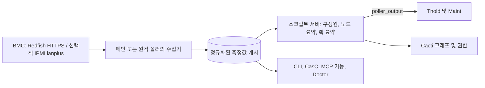

<!-- Source: README.md; SHA256: 6972a6c9ac754cd60e63c5caf971451ea8fe6e279eef757d886e1a168d3eef01 -->

<!-- translations:start -->
[English](../../../README.md) | [简体中文](../zh-CN/README.md) | [हिन्दी](../hi-IN/README.md) | [Español (España)](../es-ES/README.md) | [Español (Latinoamérica)](../es-419/README.md) | [العربية (السعودية)](../ar-SA/README.md) | [Afrikaans](../af-ZA/README.md) | [አማርኛ](../am-ET/README.md) | [العربية (مصر)](../ar-EG/README.md) | [العربية (المغرب)](../ar-MA/README.md) | [বাংলা](../bn-BD/README.md) | [Bosanski](../bs-BA/README.md) | [Deutsch](../de-DE/README.md) | [فارسی](../fa-IR/README.md) | [Filipino](../fil-PH/README.md) | [Français](../fr-FR/README.md) | [Français (Maroc)](../fr-MA/README.md) | [Français (Sénégal)](../fr-SN/README.md) | [Hausa](../ha-NG/README.md) | [עברית](../he-IL/README.md) | [Hrvatski](../hr-HR/README.md) | [Bahasa Indonesia](../id-ID/README.md) | [Igbo](../ig-NG/README.md) | [Italiano](../it-IT/README.md) | [日本語](../ja-JP/README.md) | [한국어](README.md) | [Malagasy](../mg-MG/README.md) | [मराठी](../mr-IN/README.md) | [Bahasa Melayu](../ms-MY/README.md) | [Nederlands](../nl-NL/README.md) | [Polski](../pl-PL/README.md) | [Português (Brasil)](../pt-BR/README.md) | [Русский](../ru-RU/README.md) | [Kinyarwanda](../rw-RW/README.md) | [Soomaali](../so-SO/README.md) | [Српски](../sr-RS/README.md) | [Svenska](../sv-SE/README.md) | [Kiswahili](../sw-KE/README.md) | [தமிழ்](../ta-IN/README.md) | [తెలుగు](../te-IN/README.md) | [ไทย](../th-TH/README.md) | [Türkçe](../tr-TR/README.md) | [Українська](../uk-UA/README.md) | [اردو](../ur-PK/README.md) | [Tiếng Việt](../vi-VN/README.md) | [isiXhosa](../xh-ZA/README.md) | [Yorùbá](../yo-NG/README.md) | [繁體中文](../zh-TW/README.md) | [isiZulu](../zu-ZA/README.md)
<!-- translations:end -->

# plugin_redfish

Redfish(선택적 읽기 전용 IPMI 폴백 포함)와 랙 단위 전력 합산 기능을 사용하여 베이스보드 관리 컨트롤러(BMC)에서 서버의 전력 소비량, 흡입 온도(inlet temperature), 팬 상태 및 전원 공급 장치(PSU) 상태를 Cacti의 일반 장치, 데이터 소스 및 그래프로 가져오는 Cacti 1.2 플러그인입니다. Thold와 Maint는 표준 Cacti 데이터 소스를 통해 경고를 발생시키고 억제합니다.

> **상태: 개발 중, 아직 정식 릴리스 없음 (`0.1.0-dev`).** 이 플러그인은 Cacti 프로젝트와 공식적으로 관련이 없습니다. PHP 8.2 이상 환경의 Cacti 1.2.31 이상에 설치되며, Redfish 수집기, 암호화된 자격 증명 볼트, Cacti 장치 및 그래프 프로비저닝, 선택적 읽기 전용 IPMI 폴백, 랙 전력 합산, Cacti Maint 유지보수 창 표시, 원격 데이터 수집기 복제 및 에이전트 엔드포인트, CasC 공급자 및 운영자 CLI, MCP 기능(abilities), Doctor 진단 검사를 구현합니다. CI는 픽스처, DMTF Redfish Mockup Server(서브시스템, 레거시 전용 및 HPE iLO Gen11 목업), 그리고 Thold v1.8.2 및 Maint v1.3을 테스트합니다. 실제 물리적 BMC나 파일럿 장비군에 대한 검증은 아직 완료되지 않았습니다. 설계 및 연구 자료는 [docs/PLAN.md](../../PLAN.md), [docs/research/](../../research/), [docs/decisions/](../../decisions/)에서 확인할 수 있습니다.

## 구현된 기능

### 핵심 수집기, 볼트 및 Cacti 개체

- **수명 주기 및 스키마.** Cacti의 플러그인 API를 통해 설치, 업그레이드, 비활성화 및 제거됩니다(`Schema::VERSION = 3`, 테이블 12개). *Keep Plugin Tables on Uninstall* 설정을 해제하지 않는 한 제거 시에도 테이블이 유지됩니다. 진입점은 PHP 8.0에서도 구문 분석 가능하며, PHP 8.2 미만이거나 `ext-openssl`이 누락된 경우 명시적인 오류 메시지와 함께 실행을 거부합니다.
- **레지스트리 및 권한.** *Redfish View*(`redfish_health.php`), *Redfish Operator*(`redfish_operator.php`), *Redfish Admin*(`redfish_bmcs.php`, `redfish_credentials.php`) 권한 영역(Realm)과 **Configuration > Settings > Redfish** 하위의 설정을 제공합니다. BMC 레지스트리는 CSV 가져오기(자격 증명은 이름으로 참조하며 가져오기 파일 내 비밀번호는 거부됨)와 JSON 내보내기를 지원합니다. BMC 레코드와 자격 증명은 Cacti 장치 권한을 따릅니다.
- **암호화된 자격 증명 볼트.** 비밀번호는 AES-256-GCM으로 암호화되어 `plugin_redfish_secret`에 저장됩니다. 키는 데이터베이스 외부 파일(기본값 `/etc/cacti/redfish-vault.key`)에 64자 16진수 문자열(`openssl rand -hex 32`) 또는 32바이트 원시 데이터로 보관되며, 폴러(poller) 사용자가 소유하고 다른 사용자가 읽을 수 없어야 하며 root 또는 해당 사용자만 쓸 수 있는 디렉터리에 위치해야 합니다. 32자의 출력 가능한 암호문(passphrase)은 거부됩니다. **데이터베이스와 함께 키 파일도 반드시 백업하세요.** 키 파일이 없으면 저장된 비밀번호를 다시 입력해야 합니다.
- **TLS 및 읽기 전용 Redfish 클라이언트.** 시스템 CA 저장소, BMC별 CA 번들 또는 SPKI SHA-256 핀을 사용한 TLS 검증이 기본적으로 활성화됩니다. BMC별 비검증 예외 설정은 상태 경고 및 Doctor 검사 경고로 계속 표시됩니다. 클라이언트는 `GET`과 Redfish 세션 로그인(`POST`) 및 로그아웃(`DELETE`)만 허용하며, 세션을 사용할 수 없는 경우 BMC별 선택적 Basic 인증 폴백을 지원합니다. 검색(discovery)은 새 Redfish 서브시스템 및 센서 리소스를 우선 사용하고, 더 이상 사용되지 않는 `Power` 및 `Thermal` 리소스를 폴백으로 사용합니다.
- **수집기 실행.** `poller_redfish.php`는 `poller_bottom`에서 시작되며, Cacti의 프로세스 레지스트리를 통해 폴러당 하나의 마스터 프로세스와 구성 가능한 작업자 프로세스(`redfish_workers`)를 실행합니다. 또한 BMC별 임대(lease) 획득, 시간 예산(`redfish_collector_budget`) 적용, 지수 백오프(exponential backoff) 적용, 비정상 종료 후 플러그인 자체 이전 세션 정리를 수행합니다.
- **템플릿, 장치 및 그래프.** `templates/redfish-templates.xml`을 해시 기준으로 가져오고, 사용자가 수정한 파일을 덮어쓰지 않으면서 세 개의 스크립트 서버 데이터 쿼리 XML 파일(`redfish_fans.xml`, `redfish_temperatures.xml`, `redfish_psus.xml`)을 `<cacti>/resource/script_server/`에 복사합니다. **Create Device** 및 **Add Graphs**는 프로비저닝 계획 확인을 요구하며, 매핑된 서버 장치에 쿼리를 연결하거나 가용성 검사가 비활성화된 `.invalid` 하위의 "Redfish BMC" 장치를 생성하고, `graph_buttons`를 통해 각 Redfish 그래프를 해당 장치의 Redfish 그래프 목록으로 연결합니다.
- **캐시 전용 스크립트 서버 입력.** `scripts/ss_redfish_members.php`는 구성원별 팬, 온도 및 PSU 측정값을 제공하고, `scripts/ss_redfish_summary.php`는 "Redfish Node Summary" 메트릭(전력, 흡입 온도 및 최고 온도, 이상 팬 및 PSU 수, 노드 상태, 마지막 정상 읽기 이후 경과 시간)을 제공합니다. 스크립트 서버 호출은 로컬 캐시만 읽으며 BMC에 직접 접속하지 않습니다. 누락되었거나 오래되었거나 사라진 구성원의 측정값은 `U`를 반환하고(절대 `0`을 반환하지 않음), `age`는 항상 값을 보고하므로 임계값으로 응답 없는 BMC를 감지할 수 있습니다.

**BMC의 구성원이 변경된 경우**(예: 팬 교체 또는 센서 이름을 바꾸는 펌웨어 업데이트) **Add Graphs**를 다시 실행하세요. 기존에 존재했던 팬이나 전원 공급 장치가 없어지면 승인(accepted)될 때까지 `fans_bad` 또는 `psus_bad`에 집계되며, 처음부터 비어 있던 슬롯은 집계되지 않습니다. 사라진 구성원은 기존 데이터 소스와 그래프가 유지되며 이후부터 `U`를 기록하므로 필요하지 않을 때 수동으로 삭제할 수 있습니다. Cacti 장치를 삭제하면 BMC와 캐시는 유지된 채 해당 BMC의 매핑이 해제되고 랙 할당이 제거됩니다. BMC를 삭제하거나 플러그인을 제거해도 Cacti 장치와 그래프는 유지됩니다.

### 선택적 IPMI 폴백

- **BMC별 선택적 활성화.** 기본값은 비활성화(`protocols` 기본값은 `redfish`, IPMI 폴백 활성화 시 `redfish,ipmi`로 설정)입니다.
- **범위가 제한된 폴백 트리거.** Redfish 수집이 적격한 실패 클래스로 실패할 때만 실행되며, `AuthRejected`, `CredentialUnavailable`, `AddressRefused`, `OperationRefused` 또는 `Deadline`에서는 절대 트리거되지 않습니다.
- **안전한 실행.** 셸 없이 배열 형식의 `proc_open()`, 제한된 벽시계 시간 제한(wall-clock timeout), 256 KiB 출력 제한으로 `-I lanplus`를 통해 `ipmitool`을 호출합니다. 비밀번호는 CLI 인수(`argv`)가 아닌 `IPMITOOL_PASSWORD`(`-E`) 또는 `finally` 블록에서 삭제되는 모드 0600 임시 파일(`-f`)을 통해 전달됩니다.
- **읽기 전용 명령 허용 목록.** `dcmi power reading`, `sdr type Temperature`, `sdr type Fan`, `sdr type Power Supply`, `chassis status`의 다섯 가지 읽기 전용 하위 명령만 허용됩니다. 상태를 변경하는 명령은 거부됩니다.
- **정규화된 출력 및 보안 태세 경고.** `IpmiNormalizer`는 측정값을 동일한 `Observation`/`Member`/`Reading` 모델로 매핑하며, 누락되었거나 파싱할 수 없는 센서에 대해서는 `U`를 출력합니다. IPMI 폴백을 활성화하면 상태 페이지와 `redfish.bmc_security` Doctor 검사에서 경고가 발생하여 운영자에게 UDP 623을 관리 VLAN으로 제한하도록 안내합니다.

### 랙 전력 합산

- **랙 레지스트리.** 스키마 버전 3에서는 `plugin_redfish_rack`(고유한 `(site_id, name)`, 선택적 `power_budget_watts`, 기본값이 `80`인 `min_coverage_pct` 및 메모)과 `plugin_redfish_rack_member`(`host_id`당 최대 하나의 랙 할당, 선택적 `bmc_id` 및 `unit_position`, Cacti 장치 삭제 시 자동 제거)가 추가되었습니다.
- **커버리지 보호 합계.** `RackPowerSummary`는 로컬 캐시에서 최신 구성원 `power_watts` 측정값을 합산하고 예산 사용률과 여유분(headroom)을 계산합니다. 보고 구성원의 커버리지가 `min_coverage_pct` 미만으로 떨어지면 수집기 오류가 랙 전력 감소로 오인되지 않도록 `power_watts`, `utilization_pct` 및 `headroom_watts`가 `U`를 반환합니다.
- **Thold 지원 스크립트 서버 입력.** `scripts/ss_redfish_rack.php`(`ss_redfish_rack(<rack_id>)`)는 로컬 캐시에서만 `power_watts`, `power_budget_watts`, `utilization_pct`, `headroom_watts`, `members_total`, `members_reporting` 및 `coverage_pct`를 반환합니다.

### Cacti Maint 통합

- Redfish 데이터 소스에 설정된 Thold 임계값은 경고를 발생시키고, Cacti Maint는 두 플러그인 모두 수정 없이 이를 억제합니다.
- `MaintWindow`는 매핑된 각 Cacti 호스트의 활성 Maint 일정을 확인하여(일회성 `mtype=1` 및 반복 `mtype=2` 일정과 로드된 경우 `plugin_maint_check_cacti_host()` 포함) Redfish Health 페이지(`[MAINT]`), `cli/redfish.php health` 출력 및 `redfish-get-health` 기능에서 활성 유지보수 상태를 표시합니다.

### 원격 데이터 수집기

- `INFO`는 `remote_collect:1`을 선언합니다. BMC는 `poller_id >= 1`인 모든 값을 허용하며, `poller_redfish.php --poller=N`은 해당 폴러에 할당된 활성 BMC만 수집합니다.
- **`replicate_out` 훅.** `replicate_out_table()`을 통해 대상 원격 폴러 범위에 해당하는 비비밀 구성 테이블만 복제합니다(`plugin_redfish_bmc`, 암호문이 제외된 `plugin_redfish_credential` 메타데이터, `plugin_redfish_rack`, `plugin_redfish_rack_member`). `plugin_redfish_secret`은 복제되지 않으며 볼트 키 파일은 각 폴러의 로컬에 엄격히 유지됩니다.
- **`remote_agent` 훅.** 숫자형 `poller_id` 및 `bmc_id` 매개변수만 허용하는 읽기 전용 `redfish_health` 및 `redfish_discovery` 작업을 제공합니다. 예상치 못한 매개변수는 거부되며 자격 증명이나 비밀 정보는 전혀 반환되지 않습니다.

### 에코시스템 훅(CasC, MCP 기능 및 Doctor)

- **CasC 공급자(`casc_register_providers`).** 순수 PHP 기반의 YAML 및 XML 내보내기, 파싱(XXE 거부), 유효성 검사, diff 계획 및 적용 기능을 갖춘 `redfish` 공급자(스키마 버전 `1`)를 등록합니다. 자격 증명은 볼트 참조(`vault:redfish:<name>`)로만 표시되며, 원시 비밀 키(`pass`, `secret`, `token`, `private_key`, `vault_key`, `auth_token`)는 거부됩니다. 적용하려면 정확한 SHA-256 `PLAN_HASH`가 필요합니다.
- **MCP / Abilities API(`abilities_register`).** Redfish View 권한 영역(`redfish_health.php`)과 Cacti 장치 권한으로 게이트되며 자격 증명을 반환하지 않는 세 가지 읽기 전용 기능을 등록합니다:
  - `redfish-list-bmcs` (선택적 `poller_id`)
  - `redfish-get-rack-power` (선택적 `rack_id`)
  - `redfish-get-health` (선택적 `bmc_id`)
- **Doctor 검사(`doctor_register_checks`).** BMC에 접속하거나 키 자료를 반환하지 않는 다섯 가지 로컬 읽기 전용 진단 검사를 등록합니다:
  - `redfish.schema`: 스키마 버전 최신 상태
  - `redfish.vault_key`: 볼트 키 읽기 가능 여부 및 권한
  - `redfish.collector_runs`: 폴러 수집기 예산 및 최신 상태
  - `redfish.bmc_security`: 비검증 TLS 또는 IPMI 폴백이 활성화된 BMC
  - `redfish.rack_power`: 랙 전력 예산 준수 여부 및 커버리지 하한선

## CLI

PHP 8.2 이상 환경의 Cacti 루트 디렉터리에서 실행하세요:

```sh
# Operator and CasC CLI (reads --file=PATH or stdin for validate, plan, and apply)
php plugins/redfish/cli/redfish.php export --format=yaml|xml
php plugins/redfish/cli/redfish.php validate [--file=PATH] [--format=yaml|xml]
php plugins/redfish/cli/redfish.php plan [--file=PATH] [--format=yaml|xml]
php plugins/redfish/cli/redfish.php apply [--file=PATH] [--format=yaml|xml] --confirm=<PLAN_HASH>
php plugins/redfish/cli/redfish.php health --format=text|json

# Collector entry point (normally started by poller_bottom)
php plugins/redfish/poller_redfish.php [--poller=N] [--force] [--debug]

# Rack power summary script server entry point
php plugins/redfish/scripts/ss_redfish_rack.php <rack_id>
```

## 접근 역할

| 권한 영역(Realm) | 접근 권한 |
| --- | --- |
| Redfish View | 기존 모니터링 페이지. |
| Redfish Operator | 모니터링 및 운영(Operations) 페이지와 개인별 선별(triage) 확인 응답. |
| Redfish Admin | Operator 접근 권한 및 기존 구성과 관리 작업. |

업그레이드 파일을 복사한 후 관리자로 Plugins 페이지를 열어 권한 영역을 등록하세요. **Configuration > Users** 또는 사용자 그룹에서 Operator 권한 영역을 명시적으로 할당하세요. 업그레이드는 기존의 View 및 Admin 권한 영역 ID와 부여된 권한을 유지합니다. Admin 접근 권한은 Operator 접근 권한을 상속하고, Operator 접근 권한은 각 요청마다 View 접근 권한을 상속합니다. 이는 사용자나 그룹에 저장된 권한을 추가로 기록하지 않습니다. 플러그인 설정에는 Cacti의 Settings 권한 외에 Redfish Admin 접근 권한도 필요합니다.

Cacti 장치 권한은 각 사용자가 사용할 수 있는 행과 작업을 제한하며, 매핑되지 않은 개체는 관리자가 필요합니다. Operator는 허용된 BMC에 대해 다음 예약 실행 시 적용되도록 수집 보류를 해제할 수 있습니다. 자격 증명, 구성, 매핑, 삭제 및 기타 관리 변경 사항은 관리 페이지에 유지됩니다. 확인 응답은 현재 사용자의 세션 동안 최대 1시간 동안만, 그리고 동일한 관측 결과가 최신 상태로 유지되는 동안에만 유효합니다. 새 관측 결과나 변경된 관측 결과가 들어오면 무효화됩니다. 확인 응답은 실패한 측정을 정상으로 표시하거나 경고를 억제하지 않습니다.

## 도입 배경

모든 서버에는 운영 체제와 독립적으로 전력 및 열 상태를 보고하는 BMC가 있으므로 OS가 다운된 상태에서도 계속 응답합니다. 이 데이터는 용량 및 비용 추적, 팬 또는 전원 공급 장치 장애의 조기 경보, 그리고 고성능 컴퓨팅(HPC) 환경에서의 전력 상한(power-capping) 결정에 활용됩니다. 이 플러그인은 HPC 전용이 아닙니다.

현재 Cacti는 이 영역의 일부만 지원합니다:

- **벤더 SNMP 패키지.** 1.2.x 브랜치에는 SNMP 에이전트가 필요하고 벤더에 종속적인 Dell iDRAC 및 HPE iLO 템플릿이 포함되어 있습니다. 마일스톤 1 연구 결과 두 템플릿 모두 와트(W) 단위의 전력 소비량을 보고하지 않는 것으로 확인되었습니다([docs/research/overlap.md](../../research/overlap.md)).
- **수집기가 없는 자격 증명 유형.** plugin_credentials는 "IPMI / Redfish (BMC)" 자격 증명을 정의하지만 BMC를 읽지는 않습니다.
- **랙 단위 보기 부재.** Cacti 코어에는 랙 개체가 없으며, 장치에 자유 형식의 `location` 필드만 있습니다.

이 플러그인은 메인 폴러 또는 원격 데이터 수집기에서 Cacti의 폴링 주기와 별개로 대역 외(out of band) 방식으로 BMC를 폴링하고, 정규화된 측정값을 캐시한 다음, 스크립트 서버 데이터 쿼리, 노드 요약 및 랙 전력 요약을 통해 노출합니다. Cacti의 그래프 작성, 권한, Thold 및 Maint를 그대로 재사용하며 BMC 상태를 변경하지 않습니다.

## 범위 및 상태

| 단계 | 범위 | 마일스톤 | 상태 |
|---|---|---|---|
| 0, 연구 | 벤더 매트릭스, 실제 BMC에서의 업스트림 동작 확인, 폴링 비용, 데이터 쿼리 스파이크(spike) | [M1](https://github.com/somethingwithproof/plugin_redfish/milestone/1) | 완료, 실제 BMC 펌웨어 캡처 대기 중 |
| 1, 관측 | BMC 레지스트리, 자격 증명, TLS, Redfish 수집기, 정규화된 측정값, 장치, 인덱스별 그래프, Thold 경고, Maint 통합, 상태 페이지 | [M2](https://github.com/somethingwithproof/plugin_redfish/milestone/2), [M3](https://github.com/somethingwithproof/plugin_redfish/milestone/3), [M4](https://github.com/somethingwithproof/plugin_redfish/milestone/4) | 구현 완료; M4 파일럿 장비군 검증 대기 중 |
| 2, ipmi | `ipmitool`을 통한 읽기 전용 IPMI(`lanplus`) 폴백, 기본 비활성화 | [M5](https://github.com/somethingwithproof/plugin_redfish/milestone/5) | 구현 완료 |
| 3, 랙 | 랙 레지스트리, 커버리지 하한선을 적용한 랙 전력 합계, 예산 여유분, `ss_redfish_rack.php` | [M6](https://github.com/somethingwithproof/plugin_redfish/milestone/6) | 구현 완료 |
| 4, 원격 및 에코시스템 | 원격 데이터 수집기(`replicate_out`, `remote_agent`), CasC 공급자 및 CLI, MCP 기능, Doctor 검사 | [M7](https://github.com/somethingwithproof/plugin_redfish/milestone/7) | 구현 완료 |

범위 외 항목: 전력 상한 설정이나 기타 BMC 구성 변경, 전원 제어, 펌웨어 업데이트, 콘솔 접근, 플러그인 자체 경고 엔진, 스케줄러 통합.

## 호환성 목표

| 구성 요소 | 대상 |
|---|---|
| Cacti | 1.2.31 이상, 코어 패치 없음 |
| 데이터베이스 | MariaDB 10.2 또는 MySQL 5.7 이상: 장치당 하나의 BMC는 생성된 열(generated column)의 고유 키(unique key)로 보장됨 |
| PHP | 8.2 이상; 진입점은 8.0에서도 구문 분석 가능하도록 유지되어 지원되지 않는 런타임에서는 Cacti UI가 깨지는 대신 거부 메시지를 표시함 |
| PHP 확장 | `ext-openssl`(Cacti 1.2.31 필수 사항); `ext-curl` 없음 및 Composer 런타임 종속성 없음 |
| 선택적 도구 | IPMI 폴백이 활성화된 BMC를 수집하는 폴러의 `ipmitool` |
| BMC | 펌웨어 범위별 Dell iDRAC, HPE iLO, Lenovo XCC 및 OpenBMC; [벤더 매트릭스](../../research/vendor-matrix.md) 참조 |
| Redfish | 새 하위 시스템 및 센서 리소스 우선, 더 이상 사용되지 않는 `Power` 및 `Thermal`은 폴백으로 사용 |
| Thold, Maint | 변경 불필요(CI에서 Thold v1.8.2 및 Maint v1.3 테스트) |

## 설계

- [docs/PLAN.md](../../PLAN.md)는 아키텍처, 의존하는 업스트림 사실, 측정 모델, 보안 경계, 성능 계산, 테스트 및 위험 요소를 담은 전체 계획입니다.
- [docs/decisions/](../../decisions/)에는 이미 내려진 선택에 대한 아키텍처 결정 기록이 있습니다.
- [docs/REQUIREMENTS.md](../../REQUIREMENTS.md)는 모든 요구 사항 ID를 해당 이슈에 매핑합니다.



## 보안

BMC 자격 증명은 서버의 대역 외 관리를 제어합니다. 본 설계는 비밀 정보가 명령줄, 로그, CasC 내보내기, 원격 에이전트 페이로드, MCP 응답 및 웹 페이지에 노출되지 않도록 유지하고, 폴러별 로컬 볼트 키 파일을 사용하여 저장된 비밀번호를 AES-256-GCM으로 암호화하며, 기본적으로 TLS를 검증하고, 허용 목록에 있는 읽기 전용 하위 명령으로 명시적 인수 배열을 통해 `ipmitool`을 실행하며, 읽기 전용 BMC 계정을 사용합니다. [docs/PLAN.md](../../PLAN.md#security) 및 [SECURITY.md](../../../SECURITY.md)를 참조하세요.

## 운영자 가이드

설치 사전 요구 사항, 볼트 및 TLS 설정, BMC 등록, 그래프 생성, 경고 간격, 백업 및 장애 처리에 대해서는 [docs/operator-guide.md](../../operator-guide.md)를 참조하세요. 이 가이드는 실제 벤더 펌웨어에서 민감 정보가 제거된 캡처가 테스트 스위트를 통과할 때까지 해당 펌웨어 라인의 지원을 공식 선언하지 않습니다.

## 개발 및 테스트

CI([.github/workflows/plugin-ci-workflow.yml](../../../.github/workflows/plugin-ci-workflow.yml))는 PHP 8.0에서 진입점 린트 검사를 수행하고, Cacti `release/1.2.31` 및 `1.2.x`를 대상으로 PHP 8.2~8.5에서 Pest 단위 테스트(`phpunit.xml`)와 수명 주기 통합 테스트(`phpunit-integration.xml`) 스위트 및 PHPStan 레벨 9를 실행하며, PHP 8.1에서의 거부를 확인하고, DMTF Redfish Mockup Server(서브시스템, 레거시 전용 및 HPE iLO Gen11 목업)와 Thold v1.8.2 / Maint v1.3을 종단 간으로 테스트하며, gettext 카탈로그, 워크플로 및 REUSE 라이선스를 검사합니다.

푸시 전 로컬 검사:

```sh
sh tests/lint-workflows.sh
sh locales/build_gettext.sh --check
CACTI_PATH=/path/to/cacti phpstan analyse -c phpstan.neon --no-progress
```

단위 및 소스 규칙 테스트에는 `--configuration=phpunit.xml`로 Pest를 실행하고, 일회용 Cacti 데이터베이스를 대상으로 수명 주기 통합 테스트를 실행하려면 `CACTI_PATH` 및 `REDFISH_TEST_DATABASE=disposable`과 함께 `--configuration=phpunit-integration.xml`로 실행하세요.

## 작업 추적 방식

- **마일스톤(Milestones)**은 계획의 마일스톤을 따릅니다. 각 마일스톤에는 하위 이슈와 종료 증빙을 나열하는 에픽 이슈가 있습니다.
- **이슈(Issues)**는 레이블(`type: requirement`, `type: research`, `type: decision`, `type: epic`)로 유형이 구분됩니다. 요구 사항 이슈에는 번호가 매겨진 테스트 가능한 요구 사항(`REQ-AREA-NNN`)과 인수 기준이 명시됩니다.
- **레이블(Labels)**에는 `area:`, `phase:`, `priority:`, `status:`도 포함됩니다. [CONTRIBUTING.md](../../../CONTRIBUTING.md#labels)를 참조하세요.
- [프로젝트 보드](https://github.com/users/somethingwithproof/projects/12)에서 모든 마일스톤의 전체 이슈를 확인할 수 있습니다.

## 기여

[CONTRIBUTING.md](../../../CONTRIBUTING.md)를 읽어주세요. 커밋에는 DCO sign-off가 필요합니다. 설계 논의는 이슈에서 진행되며, 미결 결정에는 `type: decision` 레이블이 붙습니다. 현재 가장 유용한 기여는 실제 BMC의 증빙 자료입니다. 캡처를 게시하기 전에 주소, 일련 번호 및 자격 증명을 반드시 가리세요.

## 라이선스

Cacti 및 해당 플러그인과 동일한 GNU General Public License v2.0입니다. [LICENSE](../../../LICENSE)를 참조하세요.
