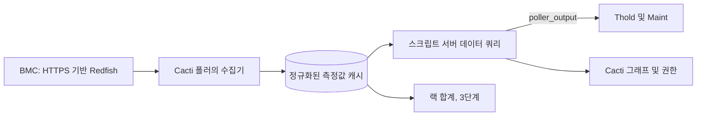

<!-- Source: README.md; SHA256: 7b4e83a58a1adc844cb0615ef30e95476cba2851f96bb454d2a816fb2774724d -->

<!-- translations:start -->
[English](../../../README.md) | [简体中文](../zh-CN/README.md) | [हिन्दी](../hi-IN/README.md) | [Español (España)](../es-ES/README.md) | [Español (Latinoamérica)](../es-419/README.md) | [العربية (السعودية)](../ar-SA/README.md) | [Afrikaans](../af-ZA/README.md) | [አማርኛ](../am-ET/README.md) | [العربية (مصر)](../ar-EG/README.md) | [العربية (المغرب)](../ar-MA/README.md) | [বাংলা](../bn-BD/README.md) | [Deutsch](../de-DE/README.md) | [فارسی](../fa-IR/README.md) | [Filipino](../fil-PH/README.md) | [Français](../fr-FR/README.md) | [Français (Maroc)](../fr-MA/README.md) | [Français (Sénégal)](../fr-SN/README.md) | [Hausa](../ha-NG/README.md) | [עברית](../he-IL/README.md) | [Bahasa Indonesia](../id-ID/README.md) | [Igbo](../ig-NG/README.md) | [Italiano](../it-IT/README.md) | [日本語](../ja-JP/README.md) | [한국어](README.md) | [Malagasy](../mg-MG/README.md) | [मराठी](../mr-IN/README.md) | [Bahasa Melayu](../ms-MY/README.md) | [Nederlands](../nl-NL/README.md) | [Polski](../pl-PL/README.md) | [Português (Brasil)](../pt-BR/README.md) | [Русский](../ru-RU/README.md) | [Kinyarwanda](../rw-RW/README.md) | [Soomaali](../so-SO/README.md) | [Svenska](../sv-SE/README.md) | [Kiswahili](../sw-KE/README.md) | [தமிழ்](../ta-IN/README.md) | [తెలుగు](../te-IN/README.md) | [ไทย](../th-TH/README.md) | [Türkçe](../tr-TR/README.md) | [Українська](../uk-UA/README.md) | [اردو](../ur-PK/README.md) | [Tiếng Việt](../vi-VN/README.md) | [isiXhosa](../xh-ZA/README.md) | [Yorùbá](../yo-NG/README.md) | [繁體中文](../zh-TW/README.md) | [isiZulu](../zu-ZA/README.md)
<!-- translations:end -->

# plugin_redfish

서버의 전력 소비량, 흡입 온도(inlet temperature), 팬 상태 및 전원 공급 장치(PSU) 상태를 Redfish(선택적 IPMI 폴백 지원)를 사용하여 베이스보드 관리 컨트롤러(BMC)에서 Cacti로 가져와 일반 장치, 데이터 소스 및 그래프로 제공하는 Cacti 1.2 플러그인입니다. 이후 Thold와 Maint가 이를 기반으로 경고를 생성하고 억제하며, 추후 단계에서 랙 단위 전력 합계가 추가됩니다.

> **상태: 개발 중, 아직 정식 릴리스 없음 (0.1.0-dev).** 마일스톤 2(기반 구조)와 마일스톤 3(Cacti 개체 및 경고)이 `main`에 병합되었습니다. 이 플러그인은 Cacti 프로젝트와 공식적으로 관련이 없습니다. PHP 8.2 이상 환경의 Cacti 1.2.31에 설치되며, BMC와 자격 증명을 등록하고 각 BMC에서 Redfish를 통해 전력, 온도, 팬 및 전원 공급 장치 상태를 자체 캐시로 읽어 들여 수집 상태를 표시합니다. 또한 일반 데이터 소스를 통해 Cacti 장치, 구성원별 및 요약 그래프, Thold 및 Maint 지원을 추가합니다. CI에서는 직접 작성한 픽스처로 구축한 가상 BMC와 DMTF Redfish 목업 서버를 검증했으나, 실제 BMC나 파일럿 장비군에 대한 검증은 아직 완료되지 않았습니다. 설계 및 연구 자료는 [docs/PLAN.md](../../PLAN.md), [docs/research/](../../research), [docs/decisions/](../../decisions)에서 확인할 수 있습니다.

### 마일스톤 2에 포함된 기능

- Cacti의 플러그인 API를 통해 설치, 업그레이드, 비활성화 및 제거할 수 있으며, 설정을 해제하지 않는 한 제거 시에도 테이블이 유지됩니다. PHP 8.2 미만 버전에서는 플러그인 설치 또는 활성화가 거부되고 그 이유가 표시됩니다.
- "Redfish View"(상태 페이지), "Redfish Operator"(운영 페이지), "Redfish Admin"(BMC 및 자격 증명 페이지) 권한 영역(Realm)과 Configuration > Settings > Redfish 하위의 설정을 제공합니다.
- CSV 가져오기 및 JSON 내보내기를 지원하는 BMC 레지스트리를 제공합니다. 가져오기 파일에는 비밀번호가 포함되지 않아야 하며, 자격 증명은 이름으로 참조됩니다.
- 자격 증명은 AES-256-GCM으로 암호화되어 저장됩니다. 키는 데이터베이스 외부 파일(기본값 `/etc/cacti/redfish-vault.key`)에 보관되며, 64자 16진수 문자열(`openssl rand -hex 32`) 또는 정확히 32바이트의 난수로 구성됩니다. 이 파일은 폴러(poller) 사용자가 소유하고 다른 사용자가 읽을 수 없어야 하며, 폴러 사용자 또는 root만 쓸 수 있는 디렉터리에 위치해야 합니다. 32자의 출력 가능한 문자로 된 키는 암호문(passphrase)으로 간주되어 거부됩니다. **데이터베이스와 함께 키 파일도 반드시 백업하세요.** 키 파일이 없으면 저장된 모든 비밀번호를 다시 입력해야 합니다.
- 기본적으로 TLS 검증이 활성화되며, BMC별 CA 번들 또는 SPKI SHA-256 핀을 지정할 수 있습니다. 로그에 기록되는 BMC별 검증 제외 설정은 상태 페이지에 경고로 계속 표시됩니다.
- 읽기 전용 Redfish 클라이언트: `GET` 요청과 세션 로그인 및 로그아웃만 허용하며, 요청 전송 전에 허용 목록(allowlist)을 기준으로 검사합니다.
- 메인 폴러의 BMC를 대상으로 `poller_bottom`에서 시작되는 수집기로, BMC별 임대(lease) 및 제한 시간(deadline), 백오프(backoff), 그리고 비정상 종료 후 플러그인이 기록한 단일 세션의 정리 기능을 갖추고 있습니다. 원격 수집기(Remote collector)는 아직 지원되지 않으며, 수집기가 데이터베이스와 키에 접근하는 방식에 대한 명시적인 설계 선택이 필요합니다(4단계).
- BMC 레코드와 자격 증명은 Cacti 장치 권한을 따릅니다. Redfish Admin은 자신이 볼 수 있는 장치의 BMC만 조회, 변경 및 바인딩할 수 있으며, 숨겨진 장치의 BMC가 사용하지 않는 자격 증명만 볼 수 있습니다.

### 마일스톤 3에 추가된 기능

- `templates/`에 Cacti 템플릿 XML로 포함된 템플릿은 설치 및 업그레이드 시 Cacti 자체 가져오기 도구(importer)로 해시 매칭을 통해 가져오므로, 가져오기를 수행할 때 플러그인 개체를 업데이트하며 중복 추가하지 않습니다. 3개의 데이터 쿼리 파일은 해시가 기록된 상태로 `<cacti>/resource/script_server/`에 복사됩니다. 플러그인은 자신이 작성하지 않은 기존 파일을 덮어쓰지 않으며, 템플릿이나 쿼리 파일이 제자리에 없으면 상태 페이지에서 관리자에게 경고를 표시합니다. BMCs 페이지의 **Reinstall the Redfish Templates**를 실행하면 템플릿을 다시 가져오며, 이를 위해서는 Cacti의 Import Templates 권한이 필요합니다.
- 각 BMC에서 **Create Device** 또는 **Add Graphs**를 실행할 수 있습니다([ADR 0015](../../decisions/0015-attach-to-the-server-device-or-create-one-per-bmc.md)). 서버의 기존 장치에 매핑된 BMC는 해당 장치에 데이터 쿼리와 그래프가 추가됩니다. 매핑되지 않은 BMC는 "Redfish BMC" 장치 템플릿을 사용하여 가용성 검사가 꺼져 있고 호스트 이름이 `.invalid` 하위인 새 장치를 생성하므로, Cacti가 BMC에 직접 접속하거나 주소를 노출하지 않습니다. 두 경우 모두 관리자가 추가될 항목 목록을 확인한 후 진행합니다. 두 작업 모두 Redfish Admin 권한과 함께 Cacti의 장치 관리 권한이 필요하며, 생성자가 볼 수 없는 새 장치는 다시 제거됩니다.
- BMC의 구성원 키로 인덱싱되는 세 가지 스크립트 서버 데이터 쿼리("Redfish Fans", "Redfish Temperatures", "Redfish Power Supplies")와 구성원별 그래프를 제공합니다. 그래프는 팬 속도(BMC가 보고하는 단위에 따라 백분율 또는 RPM), 온도, 전원 공급 장치의 입력 및 출력 와트(W)를 각각의 상태 코드와 함께 표시합니다.
- 전력, 흡입 온도, 최고 온도, 정상이 아닌(not OK) 팬 및 전원 공급 장치 수, 노드 상태, 마지막 정상 읽기 이후 경과 시간(age)을 포함하는 "Redfish Node Summary" 입력을 제공하며, 전력, 온도, 구성 요소 상태, 데이터 경과 시간의 네 가지 그래프로 그려집니다. 이 데이터 소스에 설정된 Thold 임계값은 경고를 발생시키고 Maint는 이를 억제하며, 두 플러그인 모두 수정할 필요가 없습니다.
- 스크립트 서버는 플러그인의 캐시에서만 응답하며 BMC에 직접 접속하지 않습니다. 누락되었거나, 오래되었거나(stale), 다른 단위이거나, 사라진 구성원의 값은 `U`로 반환되므로 그래프에 0이 아닌 빈 구간으로 표시됩니다. 반면 `age`는 항상 값을 가지므로, 이에 대한 임계값을 설정하면 응답이 중단된 BMC를 감지할 수 있습니다.
- 각 Redfish 그래프에서 해당 장치의 Redfish 그래프 목록으로 이동하는 그래프 링크를 제공하며, 이는 Cacti에서 해당 장치의 조회가 허용된 사용자에게만 표시됩니다.

**BMC의 구성원이 변경된 경우**(팬 교체, 펌웨어 업데이트로 인한 센서 이름 변경 등) **Add Graphs**를 다시 선택하세요. 기존에 존재했던 팬이나 전원 공급 장치가 현재 없거나(absent) 사라진(gone) 경우, 이를 다시 실행하기 전까지는 `fans_bad` 또는 `psus_bad`에 집계되므로 제거된 팬에 대해 경고가 발생합니다. 반면 처음부터 비어 있던 슬롯은 집계되지 않습니다. Add Graphs는 BMC가 현재 보고하는 구성원을 수락하고 Cacti가 쿼리를 다시 인덱싱하도록 합니다. 사라진 구성원은 데이터 소스와 그래프가 그대로 유지되며 이후부터 `U`로 기록되고, 새 구성원에는 새 그래프가 생성됩니다. 사라진 구성원의 그래프는 기록이 더 이상 필요하지 않을 때 수동으로 삭제하세요.

장치를 삭제하면 해당 BMC의 매핑만 해제되며 BMC와 캐시는 유지됩니다. BMC를 삭제하거나 플러그인을 제거해도 해당 장치와 그래프는 유지됩니다.

## 접근 역할

| 권한 영역(Realm) | 접근 권한 |
| --- | --- |
| Redfish View | 기존 모니터링 페이지. |
| Redfish Operator | 모니터링 및 운영(Operations) 페이지, 개인별 선별(triage) 확인 응답(acknowledgment). |
| Redfish Admin | Operator 접근 권한 및 기존 구성과 관리 작업. |

업그레이드 파일을 복사한 후 관리자로 Plugins 페이지를 열어 새 권한 영역을 등록하세요. **Configuration > Users** 또는 사용자 그룹에서 Operator 권한 영역을 명시적으로 할당하세요.
업그레이드는 기존의 View 및 Admin 권한 영역 ID와 부여된 권한을 유지합니다. Admin 접근 권한은 Operator 접근 권한을 상속하고, Operator 접근 권한은 각 요청마다 View 접근 권한을 상속합니다. 이는 사용자나 그룹에 저장된 권한을 추가로 기록하지 않습니다. 플러그인 설정에는 Cacti의 Settings 권한 외에 Redfish Admin 접근 권한도 필요합니다.

Cacti 장치 권한은 각 사용자가 사용할 수 있는 행과 작업을 여전히 제한하며, 매핑되지 않은 개체는 관리자가 필요합니다. Operator는 허용된 BMC에 대해 다음 예약 실행 시 적용되도록 수집 보류(collection hold)를 해제할 수 있습니다.
자격 증명, 구성, 매핑, 삭제 및 기타 관리 변경 사항은 관리 페이지에 유지됩니다. 확인 응답(acknowledgment)은 현재 사용자의 세션 동안 최대 1시간 동안만, 그리고 동일한 관측 결과가 최신 상태로 유지되는 동안에만 유효합니다. 새 관측 결과나 변경된 관측 결과가 들어오면 무효화됩니다. 확인 응답은 실패한 측정을 정상으로 표시하거나 경고를 억제하지 않습니다.

## 도입 배경

모든 서버에는 운영 체제와 독립적으로 전력 및 열 상태를 보고하는 BMC가 있으므로 OS가 다운된 상태에서도 계속 응답합니다. 이 데이터는 용량 및 비용 추적, 팬 또는 전원 공급 장치 장애의 조기 경보, 그리고 고성능 컴퓨팅(HPC) 환경에서의 전력 상한(power-capping) 결정에 활용됩니다. 이 플러그인은 HPC 전용이 아닙니다.

현재 Cacti는 이 영역의 일부만 지원합니다:

- **벤더 SNMP 패키지.** 1.2.x 브랜치에는 SNMP 에이전트가 필요하고 벤더에 종속적인 Dell iDRAC 및 HPE iLO 템플릿이 포함되어 있습니다. 마일스톤 1 연구 결과 두 템플릿 모두 와트(W) 단위의 전력 소비량을 보고하지 않는 것으로 확인되었습니다([docs/research/overlap.md](../../research/overlap.md)).
- **수집기가 없는 자격 증명 유형.** plugin_credentials는 "IPMI / Redfish (BMC)" 자격 증명을 정의하지만 실제로 BMC를 읽지는 않습니다.
- **랙 단위 보기 부재.** Cacti 코어에는 랙 개체가 없으며, 장치에 자유 형식의 `location` 필드만 있습니다.

이 플러그인은 Cacti의 폴링 주기와 별개로 대역 외(out of band) 방식으로 BMC를 폴링하고, 정규화된 측정값을 캐시한 다음, 스크립트 서버 데이터 쿼리와 요약 데이터 소스를 통해 노출합니다. Cacti의 그래프 작성, 권한, Thold 및 Maint를 그대로 재사용하며 BMC 상태를 변경하지 않습니다. 원격 데이터 수집기 지원은 4단계에서 계획되어 있으며, 현재 수집은 메인 폴러에서만 실행됩니다.

## 계획된 범위

| 단계 | 범위 | 마일스톤 |
|---|---|---|
| 0, 연구 | 벤더 매트릭스, 실제 BMC에서의 업스트림 동작 확인, 폴링 비용, 데이터 쿼리 스파이크(spike) | [M1](https://github.com/somethingwithproof/plugin_redfish/milestone/1) |
| 1, 관측 | BMC 레지스트리, 자격 증명, TLS, Redfish 수집기, 정규화된 측정값, 장치, 인덱스별 그래프, Thold 경고, Maint 억제, 상태 페이지 | [M2](https://github.com/somethingwithproof/plugin_redfish/milestone/2), [M3](https://github.com/somethingwithproof/plugin_redfish/milestone/3), [M4](https://github.com/somethingwithproof/plugin_redfish/milestone/4) |
| 2, ipmi | 사용 가능한 Redfish가 없는 BMC를 위한 IPMI 폴백(기본 비활성화) | [M5](https://github.com/somethingwithproof/plugin_redfish/milestone/5) |
| 3, 랙 | 랙 레지스트리, 커버리지를 포함한 랙 전력 합계, 예산 여유분(budget headroom) | [M6](https://github.com/somethingwithproof/plugin_redfish/milestone/6) |
| 4, 원격 | 격리된 BMC 네트워크를 위한 Cacti 원격 데이터 수집기 | [M7](https://github.com/somethingwithproof/plugin_redfish/milestone/7) |

범위 외 항목: 전력 상한 설정이나 기타 BMC 구성 변경, 전원 제어, 펌웨어 업데이트, 콘솔 접근, 플러그인 자체 경고 엔진, 스케줄러 통합.

## 호환성 목표

| 구성 요소 | 대상 |
|---|---|
| Cacti | 1.2.31 이상, 코어 패치 없음 |
| 데이터베이스 | MariaDB 10.2 또는 MySQL 5.7 이상: 장치당 하나의 BMC는 생성된 열(generated column)의 고유 키(unique key)로 보장됨 |
| PHP | 8.2 이상; `setup.php`는 8.0에서도 구문 분석 가능하도록 유지되어 지원되지 않는 런타임에서는 Cacti UI가 깨지는 대신 거부 메시지를 표시함 |
| BMC | 펌웨어 범위별 Dell iDRAC, HPE iLO, Lenovo XCC 및 OpenBMC; [벤더 매트릭스](../../research/vendor-matrix.md) 참조 |
| Redfish | 새 하위 시스템 및 센서 리소스 우선, 더 이상 사용되지 않는 `Power` 및 `Thermal`은 폴백으로 사용 |
| Thold, Maint | 변경 불필요 |

## 설계

- [docs/PLAN.md](../../PLAN.md)는 아키텍처, 의존하는 업스트림 사실(출처 및 아직 확인이 필요한 가정 포함), 측정 모델, 보안 경계, 성능 계산, 테스트 및 위험 요소를 담은 전체 계획입니다.
- [docs/decisions/](../../decisions)에는 이미 내려진 선택에 대한 아키텍처 결정 기록(ADR)이 있습니다.
- [docs/REQUIREMENTS.md](../../REQUIREMENTS.md)는 모든 요구 사항 ID를 해당 이슈에 매핑합니다.

## 보안

BMC 자격 증명은 서버의 대역 외 관리를 제어합니다. 본 설계는 자격 증명이 명령줄, 로그 및 페이지에 노출되지 않도록 유지하고, 기본적으로 TLS를 검증하며, 허용 목록에 있는 하위 명령만 인수 배열(argument array)을 통해 외부 명령으로 실행하고, 읽기 전용 BMC 계정을 사용합니다. 자세한 내용은 [docs/PLAN.md](../../PLAN.md#security) 및 [SECURITY.md](../../../SECURITY.md)를 참조하세요.

## 운영자 가이드

설치 사전 요구 사항, 볼트(vault) 및 TLS 설정, BMC 등록, 그래프 생성, 경고 간격, 백업 및 장애 처리에 대해서는 [docs/operator-guide.md](../../operator-guide.md)를 참조하세요. 이 가이드는 실제 벤더 펌웨어에서 민감 정보가 제거된(redacted) 캡처가 테스트 스위트를 통과할 때까지 해당 펌웨어 라인의 지원을 공식 선언하지 않습니다.

## 작업 추적 방식

- **마일스톤(Milestones)**은 계획의 마일스톤을 따릅니다. 각 마일스톤에는 하위 이슈와 종료 증빙을 나열하는 에픽 이슈가 있습니다.
- **이슈(Issues)**는 레이블(`type: requirement`, `type: research`, `type: decision`, `type: epic`)로 유형이 구분됩니다. 요구 사항 이슈에는 번호가 매겨진 테스트 가능한 요구 사항(`REQ-AREA-NNN`)과 인수 기준이 명시됩니다.
- **레이블(Labels)**에는 `area:`, `phase:`, `priority:`, `status:`도 포함됩니다. 자세한 내용은 [CONTRIBUTING.md](../../../CONTRIBUTING.md#labels)를 참조하세요.
- [프로젝트 보드](https://github.com/users/somethingwithproof/projects/12)에서 모든 마일스톤의 전체 이슈를 확인할 수 있습니다.

## 기여

[CONTRIBUTING.md](../../../CONTRIBUTING.md)를 읽어주세요. 커밋에는 DCO sign-off가 필요합니다. 설계 논의는 이슈에서 진행되며, 미결 결정에는 `type: decision` 레이블이 붙습니다. 현재 가장 유용한 기여는 실제 BMC의 증빙 자료입니다. 캡처를 게시하기 전에 주소, 일련 번호 및 자격 증명을 반드시 가리세요(redact).

## 라이선스

Cacti 및 해당 플러그인과 동일한 GNU General Public License v2.0입니다. 자세한 내용은 [LICENSE](../../../LICENSE)를 참조하세요.
