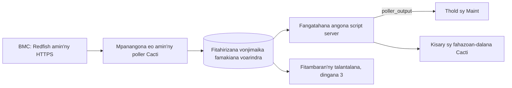

<!-- Source: README.md; SHA256: 7b4e83a58a1adc844cb0615ef30e95476cba2851f96bb454d2a816fb2774724d -->

<!-- translations:start -->
[English](../../../README.md) | [简体中文](../zh-CN/README.md) | [हिन्दी](../hi-IN/README.md) | [Español (España)](../es-ES/README.md) | [Español (Latinoamérica)](../es-419/README.md) | [العربية (السعودية)](../ar-SA/README.md) | [Afrikaans](../af-ZA/README.md) | [አማርኛ](../am-ET/README.md) | [العربية (مصر)](../ar-EG/README.md) | [العربية (المغرب)](../ar-MA/README.md) | [বাংলা](../bn-BD/README.md) | [Deutsch](../de-DE/README.md) | [فارسی](../fa-IR/README.md) | [Filipino](../fil-PH/README.md) | [Français](../fr-FR/README.md) | [Français (Maroc)](../fr-MA/README.md) | [Français (Sénégal)](../fr-SN/README.md) | [Hausa](../ha-NG/README.md) | [עברית](../he-IL/README.md) | [Bahasa Indonesia](../id-ID/README.md) | [Igbo](../ig-NG/README.md) | [Italiano](../it-IT/README.md) | [日本語](../ja-JP/README.md) | [한국어](../ko-KR/README.md) | [Malagasy](README.md) | [मराठी](../mr-IN/README.md) | [Bahasa Melayu](../ms-MY/README.md) | [Nederlands](../nl-NL/README.md) | [Polski](../pl-PL/README.md) | [Português (Brasil)](../pt-BR/README.md) | [Русский](../ru-RU/README.md) | [Kinyarwanda](../rw-RW/README.md) | [Soomaali](../so-SO/README.md) | [Svenska](../sv-SE/README.md) | [Kiswahili](../sw-KE/README.md) | [தமிழ்](../ta-IN/README.md) | [తెలుగు](../te-IN/README.md) | [ไทย](../th-TH/README.md) | [Türkçe](../tr-TR/README.md) | [Українська](../uk-UA/README.md) | [اردو](../ur-PK/README.md) | [Tiếng Việt](../vi-VN/README.md) | [isiXhosa](../xh-ZA/README.md) | [Yorùbá](../yo-NG/README.md) | [繁體中文](../zh-TW/README.md) | [isiZulu](../zu-ZA/README.md)
<!-- translations:end -->

# plugin_redfish

Fanampiny (plugin) ho an'ny Cacti 1.2 izay mitondra ny fanjifana herinaratra amin'ny lohamilina, ny mari-pana fidirana, ny toetry ny mpankafy rivotra (fan), ary ny fahasalaman'ny famatsiana herinaratra avy amin'ny mpanara-maso fitantanana fototra (BMC) ho ao amin'ny Cacti toy ny fitaovana, loharanon-tahiry, ary kisary tsotra, amin'ny fampiasana ny Redfish miaraka amin'ny safidy IPMI raha ilaina. Ny Thold sy ny Maint avy eo no mandefa fampitandremana sy mampiato azy ireo, ary ny dingana manaraka dia manampy ny fitambaran'ny herinaratra isaky ny talantalana (rack).

> **Toetra: eo am-panamboarana, mbola tsy misy famoahana (0.1.0-dev).** Ny dingana (milestones) 2 (fototra) sy 3 (zavatra Cacti sy fampitandremana) dia efa natambatra ao amin'ny `main`. Tsy misy fifandraisana amin'ny tetikasa Cacti ity fanampiny ity. Apetraka amin'ny Cacti 1.2.31 eo ambany PHP 8.2 na vaovao kokoa izy io, manoratra ny BMC sy ny fanamarinam-pidirana, mamaky ny herinaratra, mari-pana, mpankafy rivotra, ary ny fahasalaman'ny famatsiana herinaratra avy amin'ny BMC tsirairay amin'ny alalan'ny Redfish ho ao amin'ny fitahirizana vonjimaika (cache) manokana, ary mampiseho ny fahasalaman'ny fanangonana angona. Manampy fitaovana Cacti, kisary isaky ny singa sy famintinana, ary fanohanana ny Thold sy ny Maint amin'ny alalan'ny loharanon-tahiry tsotra izy. Ny CI dia nanandrana BMC sandoka namboarina tamin'ny angona santionany nosoratana tanana sy ny lohamilina môdely DMTF Redfish; tsy mbola nisy BMC tena izy na andian-milina fitsapana voamarina. Ny famolavolana sy ny fikarohana dia hita ao amin'ny [docs/PLAN.md](../../PLAN.md), [docs/research/](../../research), ary [docs/decisions/](../../decisions).

### Ny atolotry ny dingana faha-2

- Fametrahana, fanavaozana, fanakatonana, ary fanesorana amin'ny alalan'ny API fanampiny an'ny Cacti, ka voatahiry ny tabilao rehefa esorina raha tsy hoe nofafana ny toe-javatra. Amin'ny PHP tranainy noho ny 8.2 dia mandà tsy hapetraka na halefa ilay fanampiny ary manazava ny antony.
- Faritra fidirana (Realms) "Redfish View" (pejy fahasalamana), "Redfish Operator" (pejy fikarakarana), ary "Redfish Admin" (pejy momba ny BMC sy fanamarinam-pidirana), ary koa ny fikirakirana ao amin'ny Configuration > Settings > Redfish.
- Rejistra BMC miaraka amin'ny fampidirana CSV sy famoahana JSON. Tsy mahazo ahitana tenimiafina ny rakitra ampidirina; antsoina amin'ny anarany ny fanamarinam-pidirana.
- Fanamarinam-pidirana voatahiry voasoritra miafina amin'ny AES-256-GCM. Rakitra ivelan'ny tahiry angona (database) ny fanalahidy, `/etc/cacti/redfish-vault.key` amin'ny mahazatra, ahitana tarehintsoratra hexadecimal 64 (`openssl rand -hex 32`) na bytes kisendrasendra 32 katroka, an'ny mpampiasa poller, tsy azon'ny mpampiasa hafa vakiana, ary ao anaty lahatahiry izay ny mpampiasa poller na root ihany no mahazo manoratra ao. Ny fanalahidy misy tarehintsoratra azo atao pirinty 32 dia lavina ho toy ny fehezanteny miafina. **Ataovy tahiry (backup) miaraka amin'ny tahiry angona ny rakitra fanalahidy**; raha tsy eo izy dia tsy maintsy ampidirina indray ny tenimiafina rehetra voatahiry.
- Fanamarinana TLS mandeha hatrany amin'ny mahazatra, miaraka amin'ny amboara CA isaky ny BMC na SPKI SHA-256 pin. Ny safidy fialana tsy misy fanamarinana isaky ny BMC izay voasoratra an-tsoratra dia mitoetra eo amin'ny pejy fahasalamana ho fampitandremana.
- Mpanjifa Redfish natao hamaky fotsiny: `GET` miampy ny fidirana sy fivoahana amin'ny fotoam-pivoriana (session) ihany, hamarinina amin'ny lisitra nahazoana alalana alohan'ny handefasana fangatahana.
- Mpanangona angona natomboka avy amin'ny `poller_bottom` ho an'ny BMC eo amin'ny poller fototra, miaraka amin'ny fanomezan-dalana vonjimaika sy fe-potoana isaky ny BMC, fiatoana miandalana (backoff), ary fanadiovana aorian'ny fianjeran'ilay session tokana voarakitr'ilay fanampiny. Mbola tsy voaohana ny mpanangona lavitra (remote collectors); mila safidy mazava momba ny fomba ifandraisan'ny mpanangona amin'ny tahiry angona sy ny fanalahidy izy ireo (dingana faha-4).
- Manaraka ny fahazoan-dalan'ny fitaovana Cacti ny firaketana BMC sy ny fanamarinam-pidirana: ny Redfish Admin dia mahita, manova, ary mampifamatotra ihany ireo BMC amin'ny fitaovana azony jerena, ary ireo fanamarinam-pidirana tsy ampiasain'ny BMC amin'ny fitaovana miafina ihany.

### Ny ampian'ny dingana faha-3

- Môdely (Templates) alefa ho XML môdely Cacti ao amin'ny `templates/` ary ampidirina amin'ny fampidirana manokan'ny Cacti mandritra ny fametrahana sy fanavaozana, ampitahaina amin'ny alalan'ny hash, ka manavao ny zavatr'ilay fanampiny ny fampidirana ary tsy manampy zavatra indroa. Ny rakitra fangatahana angona (data query) telo dia adika ao amin'ny `<cacti>/resource/script_server/` miaraka amin'ny hash voarakitra; tsy manolo rakitra tsy nosoratany ao mihitsy ilay fanampiny, ary mampitandrina ny mpitantana ny pejy fahasalamana rehefa tsy eo amin'ny toerany ny môdely na ny rakitra fangatahana. **Reinstall the Redfish Templates** ao amin'ny pejy BMC dia mampiditra azy ireo indray; mila ny fahazoan-dalana Import Templates an'ny Cacti izany.
- **Create Device** na **Add Graphs** isaky ny BMC ([ADR 0015](../../decisions/0015-attach-to-the-server-device-or-create-one-per-bmc.md)). Ny BMC iray ampifandraisina amin'ny fitaovana efa misy an'ny lohamilina dia mahazo ny fangatahana angona sy ny kisariny eo amin'io fitaovana io. Ny BMC tsy mifamatotra dia mahazo fitaovana vaovao avy amin'ny môdely fitaovana "Redfish BMC", miaraka amin'ny fanamarinana ny fisiany mihidy sy anaran'ny mpampiantrano (host name) eo ambany `.invalid`, ka tsy mifandray amin'ny BMC mihitsy ny Cacti ary tsy mampiseho ny adiresiny. Na amin'ny fomba ahoana na amin'ny fomba ahoana, manamarina drafitra mitanisa izay hampiana aloha ny mpitantana. Samy mila ny fahazoan-dalana mitantana fitaovana an'ny Cacti miampy ny Redfish Admin izy roa; esorina indray ny fitaovana vaovao tsy hitan'ny mpamorona azy.
- Fangatahana angona script server telo, "Redfish Fans", "Redfish Temperatures", ary "Redfish Power Supplies", nasiana fanondroana (index) araka ny fanalahidin'ny singan'ny BMC, miaraka amin'ny kisary isaky ny singa: hafainganam-pandehan'ny mpankafy rivotra amin'ny isan-jato na RPM (araka ny refy ambaran'ny BMC), mari-pana, ary ny watts miditra sy mivoaka amin'ny famatsiana herinaratra, samy miaraka amin'ny kaody fahasalamany.
- Fampidirana "Redfish Node Summary" misy ny herinaratra, mari-pana fidirana, ny mari-pana ambony indrindra, ny mpankafy rivotra sy famatsiana herinaratra tsy OK, ny fahasalaman'ny node, ary ny halavan'ny fotoana hatramin'ny famakiana tsara farany, aseho amin'ny kisary efatra: herinaratra, mari-pana, fahasalaman'ny singa, ary faharetan'ny angona. Mandefa fampitandremana ny fetran'ny Thold amin'ireo loharanon-tahiry ireo, ary mampiato azy ireo ny Maint, tsy misy fanovana ilaina amin'ireo fanampiny roa ireo.
- Mamaly avy amin'ny fitahirizana vonjimaikan'ilay fanampiny ihany ny script server ary tsy mifandray amin'ny BMC mihitsy. Ny sanda tsy hita, lany andro, amin'ny refy hafa, na avy amin'ny singa tsy eo intsony dia `U`, ka mampiseho banga ny kisary fa tsy aotra mihitsy; manana sanda foana ny `age`, ka ny fetra napetraka aminy dia mahatratra BMC nitsahatra tsy namaly.
- Rohy kisary avy amin'ny kisary Redfish tsirairay mankany amin'ny kisary Redfish an'ilay fitaovana, aseho ihany ho an'ireo mpampiasa avelan'ny Cacti hahita ilay fitaovana.

**Rehefa miova ny singan'ny BMC** (mpankafy rivotra nosoloina, fanavaozana firmware nanova anarana sensor), safidio indray ny **Add Graphs**. Ny mpankafy rivotra na famatsiana herinaratra izay teo aloha nefa tsy eo intsony na lasa dia isaina ao amin'ny `fans_bad` na `psus_bad` mandra-panaonao izany, mba handefa fampitandremana ny mpankafy rivotra nesorina; ny toerana (slot) izay tsy mbola nisy na inona na inona kosa dia tsy isaina. Ny Add Graphs dia manaiky ireo singa ambaran'ny BMC ankehitriny, ary manondro (index) ny fangatahana indray ny Cacti; mitazona ny loharanon-tahiry sy ny kisariny ny singa lasa, izay hamaky `U` manomboka eo, ary mahazo kisary ny singa vaovao. Fafao tanana ny kisarin'ireo singa lasa rehefa tsy ilaina intsony ny tantarany.

Ny famafana fitaovana dia manapaka ny fifandraisany amin'ny BMC-ny ary mitazona ny BMC sy ny fitahirizany vonjimaika. Ny famafana BMC, na fanesorana ilay fanampiny, dia mitazona ny fitaovana sy ny kisariny.

## Andraikitra fidirana

| Faritra fidirana | Fahazoan-dalana |
| --- | --- |
| Redfish View | Ny pejy fanaraha-maso efa misy. |
| Redfish Operator | Fanaraha-maso miampy ny pejy Fikarakarana (Operations) sy fanekena fanavahana olana manokana. |
| Redfish Admin | Fahazoan-dalan'ny Operator miampy ny fikirakirana efa misy sy ny hetsika fitantanana. |

Aorian'ny fandikana ny rakitra fanavaozana, sokafy ny pejy Plugins amin'ny maha-mpitantana mba hanoratana
ny faritra fidirana vaovao. Omeo mazava ny faritra fidirana Operator eo ambany **Configuration > Users** na vondrona mpampiasa.
Mitazona ny ID sy ny fahazoan-dalan'ny faritra fidirana View sy Admin efa misy ny fanavaozana. Ny fahazoan-dalana Admin
dia mandova ny fahazoan-dalana Operator, ary ny Operator dia mandova ny View amin'ny fangatahana tsirairay;
tsy manampy fahazoan-dalana voatahiry ho an'ny mpampiasa na vondrona izany. Mitaky fahazoan-dalana
Redfish Admin miampy ny fahazoan-dalana Settings an'ny Cacti ihany koa ny toe-javatra ao amin'ny fanampiny.

Ny fahazoan-dalan'ny fitaovana Cacti dia mbola mametra ny andalana sy hetsika azon'ny mpampiasa tsirairay atao; mila mpitantana ny zavatra tsy mifamatotra. Afaka manala ny fanakanana fanangonana angona amin'ny BMC nahazoana alalana ny Operators ho an'ny fandehanana voalahatra manaraka.
Ny fanamarinam-pidirana, fikirakirana, fampifandraisana, famafana ary fanovana fitantanana hafa
dia mijanona ao amin'ny pejy fitantanana. Maharitra mandritra ny session an'ny mpampiasa
ankehitriny ihany ny fanekena, mandritra ny adiny iray raha be indrindra ary raha mbola vaovao
ilay zavatra hita. Manafoana azy ireo ny zavatra hita vaovao na niova. Tsy manamarika fandrefesana tsy nahomby
ho salama na mampiato fampitandremana mihitsy izy ireo.

## Nahoana

Ny lohamilina rehetra dia manana BMC izay mitatitra ny toetry ny herinaratra sy ny hafanana tsy miankina amin'ny rafitra fandidiana (OS), ka manohy mamaly izy na dia maty aza ny OS. Ny angona dia ilaina amin'ny fanaraha-maso ny fahafaha-miasa sy ny fandaniana, fampitandremana mialoha ny fahasimban'ny mpankafy rivotra na ny famatsiana herinaratra, ary ao amin'ny kajy avo lenta (HPC), ho an'ny fanapahan-kevitra famerana herinaratra. Tsy natao ho an'ny HPC irery ihany ity fanampiny ity.

Mandrakotra ny ampahany amin'izany ny Cacti ankehitriny:

- **Fonosana SNMP an'ny mpamokatra.** Ny sampana 1.2.x dia mitondra môdely Dell iDRAC sy HPE iLO izay mila mpiasa SNMP ary miankina amin'ny mpamokatra; nahita ny fikarohana tamin'ny dingana voalohany fa samy tsy mitatitra ny fanjifana herinaratra amin'ny watts izy ireo ([docs/research/overlap.md](../../research/overlap.md)).
- **Karazana fanamarinam-pidirana tsy misy mpanangona.** Ny plugin_credentials dia mamaritra fanamarinam-pidirana "IPMI / Redfish (BMC)" saingy tsy mamaky BMC.
- **Tsy misy fijerena amin'ny ambaratongan'ny talantalana (rack).** Ny fototry ny Cacti dia tsy manana zavatra talantalana; manana saha lahatsoratra malalaka `location` ny fitaovana iray.

Manontany ny BMC ivelan'ny tsingerin'ny fanontaniana mahazatra an'ny Cacti ilay fanampiny, mitahiry vonjimaika ny famakiana voarindra, ary mamoaka azy ireo amin'ny alalan'ny fangatahana angona script server sy loharanon-tahiry famintinana. Mampiasa indray ny kisarin'ny Cacti, ny fahazoan-dalana, ny Thold, ary ny Maint izy io, ary tsy manova ny toetry ny BMC. Voalahatra ho amin'ny dingana faha-4 ny fanohanana ny mpanangona angona lavitra; amin'ny poller fototra ihany no mandeha ny fanangonana ankehitriny.

## Sahan'asa voalahatra

| Dingana | Sahan'asa | Dingana lehibe |
|---|---|---|
| 0, fikarohana | Tabilao mpamokatra, fanamarinana ny fihetsiky ny loharano fototra amin'ny BMC velona, saram-panontaniana, fitsapana fangatahana angona | [M1](https://github.com/somethingwithproof/plugin_redfish/milestone/1) |
| 1, fanaraha-maso | Rejistra BMC, fanamarinam-pidirana, TLS, mpanangona Redfish, famakiana voarindra, fitaovana, kisary isaky ny fanondroana, fampitandremana Thold, fampiatoana Maint, pejy fahasalamana | [M2](https://github.com/somethingwithproof/plugin_redfish/milestone/2), [M3](https://github.com/somethingwithproof/plugin_redfish/milestone/3), [M4](https://github.com/somethingwithproof/plugin_redfish/milestone/4) |
| 2, ipmi | Safidy IPMI ho an'ny BMC tsy manana Redfish azo ampiasaina, mihidy amin'ny mahazatra | [M5](https://github.com/somethingwithproof/plugin_redfish/milestone/5) |
| 3, talantalana | Rejistra talantalana (rack), fitambaran'ny herinaratry ny talantalana miaraka amin'ny fandrakofana, elanelana tetibola | [M6](https://github.com/somethingwithproof/plugin_redfish/milestone/6) |
| 4, lavitra | Mpanangona angona lavitra Cacti ho an'ny tambajotra BMC mitokana | [M7](https://github.com/somethingwithproof/plugin_redfish/milestone/7) |

Ivelan'ny sahan'asa: fametrahana fetran-kerinaratra na fikirakirana BMC hafa, fanaraha-maso famelomana/famonoana, fanavaozana firmware, fidirana amin'ny console, motera fampitandremana an'ny fanampiny manokana, ary fampidirana amin'ny mpandahatra fotoana.

## Tanjona mifanaraka

| Singa | Tanjona |
|---|---|
| Cacti | 1.2.31 na vaovao kokoa, tsy misy fanovana ny fototra |
| Tahiry angona | MariaDB 10.2 na MySQL 5.7 na vaovao kokoa: BMC iray isaky ny fitaovana dia tazomin'ny fanalahidy tokana eo amin'ny tsanganana novokarina |
| PHP | 8.2 na vaovao kokoa; ny `setup.php` dia mijanona ho azo vakiana amin'ny 8.0 mba hahazoana fandavana ny tontolo tsy voaohana fa tsy fahasimban'ny endriky ny Cacti |
| BMC | Dell iDRAC, HPE iLO, Lenovo XCC, ary OpenBMC, arakaraka ny andian-drafi-pandaharana (firmware); jereo [ny tabilao mpamokatra](../../research/vendor-matrix.md) |
| Redfish | Loharanom-pahafahana vaovao amin'ny rafitra ambany sy sensor aloha, `Power` sy `Thermal` efa lany andro ho safidy faharoa |
| Thold, Maint | Tsy misy fanovana ilaina |

## Famolavolana

- [docs/PLAN.md](../../PLAN.md) no drafitra feno: maritrano, zava-misy fototra iankinany (miaraka amin'ny loharano sy petra-kevitra mbola hohamarinina), môdely fandrefesana, fetran'ny fiarovana, kajy fampisehoana, fitsapana, ary loza mety hitranga.
- [docs/decisions/](../../decisions) dia mitahiry ny firaketana fanapahan-kevitra momba ny maritrano ho an'ny safidy efa natao.
- [docs/REQUIREMENTS.md](../../REQUIREMENTS.md) dia mampifandray ny ID-n'ny fepetra tsirairay amin'ny olana mifandraika aminy.

## Fiarovana

Mifehy ny fitantanana ivelan'ny tambajotra mahazatra ny lohamilina ny fanamarinam-pidirana BMC. Ny famolavolana dia mitazona azy ireo ivelan'ny andalana baiko, firaketana (logs), ary pejy, manamarina ny TLS amin'ny mahazatra, mandefa izay baiko ivelany avy amin'ny lisitra tohanana miaraka amin'ny baiko ambany nahazoana alalana, ary mampiasa kaonty BMC hamaky fotsiny. Jereo [docs/PLAN.md](../../PLAN.md#security) sy [SECURITY.md](../../../SECURITY.md).

## Torolalana ho an'ny mpandraharaha

Jereo [docs/operator-guide.md](../../operator-guide.md) raha hijery ny fepetra mialoha ny fametrahana, ny fanamboarana ny vault sy TLS, ny fisoratana anarana BMC, ny famoronana kisary, ny elanelam-potoanan'ny fampitandremana, ny fitahirizana (backup), ary ny fitantanana tsy fahombiazana. Tsy manambara ho voaohana ny andian-drafi-pandaharana (firmware) tena izy an'ny mpamokatra iray ny torolalana raha tsy efa nandalo ny andiana fitsapana ny angona nalaina avy amin'io firmware io izay nesorina ireo mombamomba miafina.

## Fomba fanaraha-maso ny asa

- **Dingana lehibe (Milestones)** dia manaraka ny dingan'ny drafitra. Manana olana lehibe (epic issue) mitanisa ny olana madinika sy ny porofo fiafarana ny tsirairay.
- **Olana (Issues)** dia voasokajy amin'ny marika: `type: requirement`, `type: research`, `type: decision`, `type: epic`. Ny olana momba ny fepetra dia milaza fepetra misy laharana azo tsapaina (`REQ-AREA-NNN`) sy fepetra fanekena.
- **Marika (Labels)** dia mitondra koa ny `area:`, `phase:`, `priority:`, ary `status:`. Jereo [CONTRIBUTING.md](../../../CONTRIBUTING.md#labels).
- Ny [tabilaon'ny tetikasa](https://github.com/users/somethingwithproof/projects/12) dia mampiseho ny olana rehetra manerana ny dingana lehibe.

## Fandraisana anjara

Vakio ny [CONTRIBUTING.md](../../../CONTRIBUTING.md). Mila sonia fanamarinana DCO (DCO sign-off) ny commits. Ao amin'ny olana (issues) no atao ny fifanakalozan-kevitra momba ny famolavolana; mitondra ny marika `type: decision` ny fanapahan-kevitra misokatra. Ny porofo avy amin'ny BMC tena izy no fandraisana anjara ilaina indrindra ankehitriny; esory ny adiresy, laharana famantarana (serial numbers), ary fanamarinam-pidirana alohan'ny handefasana izay angona nalaina.

## Fahazoan-dalana

GNU General Public License v2.0, fahazoan-dalana mitovy amin'ny an'ny Cacti sy ny fanampiny. Jereo [LICENSE](../../../LICENSE).
