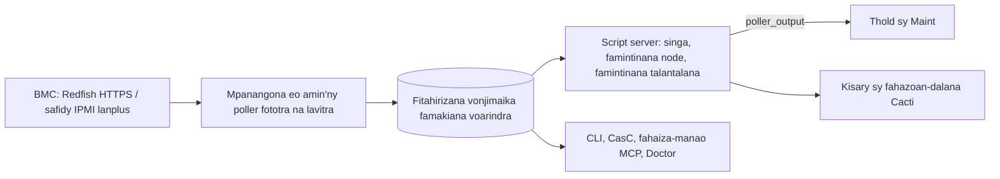

<!-- Source: README.md; SHA256: cf31b9f80d6c00020bbe08e80951d4de1c910793911d040ae7a66b54e8a2eaf0 -->

<!-- translations:start -->
[English](../../../README.md) | [简体中文](../zh-CN/README.md) | [हिन्दी](../hi-IN/README.md) | [Español (España)](../es-ES/README.md) | [Español (Latinoamérica)](../es-419/README.md) | [العربية (السعودية)](../ar-SA/README.md) | [Afrikaans](../af-ZA/README.md) | [አማርኛ](../am-ET/README.md) | [العربية (مصر)](../ar-EG/README.md) | [العربية (المغرب)](../ar-MA/README.md) | [বাংলা](../bn-BD/README.md) | [Bosanski](../bs-BA/README.md) | [Deutsch](../de-DE/README.md) | [فارسی](../fa-IR/README.md) | [Filipino](../fil-PH/README.md) | [Français](../fr-FR/README.md) | [Français (Maroc)](../fr-MA/README.md) | [Français (Sénégal)](../fr-SN/README.md) | [Hausa](../ha-NG/README.md) | [עברית](../he-IL/README.md) | [Hrvatski](../hr-HR/README.md) | [Bahasa Indonesia](../id-ID/README.md) | [Igbo](../ig-NG/README.md) | [Italiano](../it-IT/README.md) | [日本語](../ja-JP/README.md) | [한국어](../ko-KR/README.md) | [Malagasy](README.md) | [मराठी](../mr-IN/README.md) | [Bahasa Melayu](../ms-MY/README.md) | [Nederlands](../nl-NL/README.md) | [Polski](../pl-PL/README.md) | [Português (Brasil)](../pt-BR/README.md) | [Русский](../ru-RU/README.md) | [Kinyarwanda](../rw-RW/README.md) | [Soomaali](../so-SO/README.md) | [Српски](../sr-RS/README.md) | [Svenska](../sv-SE/README.md) | [Kiswahili](../sw-KE/README.md) | [தமிழ்](../ta-IN/README.md) | [తెలుగు](../te-IN/README.md) | [ไทย](../th-TH/README.md) | [Türkçe](../tr-TR/README.md) | [Українська](../uk-UA/README.md) | [اردو](../ur-PK/README.md) | [Tiếng Việt](../vi-VN/README.md) | [isiXhosa](../xh-ZA/README.md) | [Yorùbá](../yo-NG/README.md) | [繁體中文](../zh-TW/README.md) | [isiZulu](../zu-ZA/README.md)
<!-- translations:end -->

# plugin_redfish

Fanampiny (plugin) ho an'ny Cacti 1.2 izay mitondra ny fanjifana herinaratra amin'ny lohamilina, ny mari-pana fidirana, ny toetry ny mpankafy rivotra (fan), ary ny fahasalaman'ny famatsiana herinaratra avy amin'ny mpanara-maso fitantanana fototra (BMC) ho ao amin'ny Cacti toy ny fitaovana, loharanon-tahiry, ary kisary tsotra, amin'ny fampiasana ny Redfish miaraka amin'ny safidy IPMI mamaky fotsiny raha ilaina sy ny fitambaran'ny herinaratra isaky ny talantalana (rack). Ny Thold sy ny Maint dia mandefa fampitandremana sy mampiato azy ireo amin'ny alalan'ny loharanon-tahiry mahazatra an'ny Cacti.

> **Toetra: eo am-panamboarana, mbola tsy misy famoahana (`0.1.0-dev`).** Tsy misy fifandraisana amin'ny tetikasa Cacti ity fanampiny ity. Apetraka amin'ny Cacti 1.2.31 na vaovao kokoa eo ambany PHP 8.2 na vaovao kokoa izy io, ary manatanteraka ny mpanangona angona Redfish, ny tahiry miafina ho an'ny fanamarinam-pidirana, ny fanomanana fitaovana sy kisary Cacti, ny safidy IPMI mamaky fotsiny, ny fitambaran'ny herinaratra amin'ny talantalana, ny fampisehoana fotoana fikojakojana Cacti Maint, ny fandikana sy ny teboka fidirana ho an'ny mpanangona angona lavitra, ny mpamatsy CasC sy ny CLI ho an'ny mpandraharaha, ny fahaiza-manao MCP, ary ny fanamarinana diagnostika Doctor. Ny CI dia manandrana santionany, ny DMTF Redfish Mockup Server (môdely subsystem, legacy-only, ary HPE iLO Gen11), ary ny Thold v1.8.2 miaraka amin'ny Maint v1.3; mbola tsy nisy BMC ara-batana tena izy na andian-milina fitsapana voamarina. Ny famolavolana sy ny fikarohana dia hita ao amin'ny [docs/PLAN.md](../../PLAN.md), [docs/research/](../../research/), ary [docs/decisions/](../../decisions/).

## Fahaiza-manao efa tafapetraka

### Mpanangona fototra, tahiry miafina, ary zavatra Cacti

- **Tsingerim-piainana sy rafitra (schema).** Apetraka, havaozina, akatona, ary esorina amin'ny alalan'ny API fanampiny an'ny Cacti (`Schema::VERSION = 3`, tabilao 12). Voatahiry ny tabilao rehefa esorina raha tsy hoe nofafana ny *Keep Plugin Tables on Uninstall*. Ny teboka fidirana dia azo vakiana amin'ny PHP 8.0 ary mandà PHP ambanin'ny 8.2 na tsy fahampian'ny `ext-openssl` miaraka amin'ny hafatra diso mazava.
- **Rejistra sy fahazoan-dalana.** Faritra fidirana *Redfish View* (`redfish_health.php`), *Redfish Operator* (`redfish_operator.php`), ary *Redfish Admin* (`redfish_bmcs.php`, `redfish_credentials.php`), miampy ny fikirakirana ao amin'ny **Configuration > Settings > Redfish**. Ny rejistra BMC dia manohana fampidirana CSV (antsoina amin'ny anarany ny fanamarinam-pidirana; lavina ny tenimiafina ao anatin'ny rakitra ampidirina) sy famoahana JSON. Manaraka ny fahazoan-dalan'ny fitaovana Cacti ny firaketana BMC sy ny fanamarinam-pidirana.
- **Tahiry miafina voasoritra ho an'ny fanamarinam-pidirana.** Voatahiry voasoritra miafina amin'ny AES-256-GCM ao amin'ny `plugin_redfish_secret` ny tenimiafina. Mipetraka ivelan'ny tahiry angona (`/etc/cacti/redfish-vault.key` amin'ny mahazatra) ny fanalahidy, ahitana tarehintsoratra hexadecimal 64 (`openssl rand -hex 32`) na bytes manta 32, an'ny mpampiasa poller, tsy azon'ny mpampiasa hafa vakiana, ao anaty lahatahiry izay ny root na io mpampiasa io ihany no mahazo manoratra ao. Lavina ny fehezanteny miafina misy tarehintsoratra azo atao pirinty 32. **Ataovy tahiry (backup) miaraka amin'ny tahiry angona ny rakitra fanalahidy**; raha tsy eo izy dia tsy maintsy ampidirina indray ny tenimiafina voatahiry.
- **TLS sy mpanjifa Redfish mamaky fotsiny.** Mandeha hatrany amin'ny mahazatra ny fanamarinana TLS amin'ny fampiasana ny tahiry CA an'ny rafitra, amboara CA isaky ny BMC, na SPKI SHA-256 pin; mitoetra eo amin'ny pejy fahasalamana ho fampitandremana sy fampitandremana amin'ny fanamarinana Doctor ny safidy fialana tsy misy fanamarinana isaky ny BMC. Ny mpanjifa dia manome alalana ny `GET` miampy ny fidirana (`POST`) sy fivoahana (`DELETE`) amin'ny fotoam-pivoriana Redfish ihany, miaraka amin'ny safidy Basic isaky ny BMC rehefa tsy misy ny fotoam-pivoriana. Ny fikarohana dia misafidy aloha ny loharanom-pahafahana vaovao amin'ny subsystem sy sensor Redfish ary miverina amin'ny loharano efa lany andro `Power` sy `Thermal` raha ilaina.
- **Fandehan'ny mpanangona.** Ny `poller_redfish.php` dia manomboka avy amin'ny `poller_bottom`, mampandeha dingana fototra iray isaky ny poller amin'ny alalan'ny rejistran'ny dingana Cacti miaraka amin'ny dingana mpiasa azo kirakiraina (`redfish_workers`), maka fanomezan-dalana vonjimaika isaky ny BMC, mampihatra tetibola fotoana (`redfish_collector_budget`), mampihatra fiatoana miandalana (exponential backoff), ary manadio ny fotoam-pivorian'ilay fanampiny teo aloha taorian'ny fianjerana.
- **Môdely, fitaovana, ary kisary.** Mampiditra ny `templates/redfish-templates.xml` araka ny hash ary mandika rakitra XML fangatahana angona script server telo (`redfish_fans.xml`, `redfish_temperatures.xml`, `redfish_psus.xml`) ao amin'ny `<cacti>/resource/script_server/` nefa tsy manolo rakitra novan'ny mpampiasa. **Create Device** sy **Add Graphs** dia mitaky fanamafisana drafitra fanomanana, mampifamatotra fangatahana amin'ny fitaovana lohamilina voatondro na mamorona fitaovana "Redfish BMC" eo ambany `.invalid` miaraka amin'ny fanamarinana ny fisiany mihidy, ary mampifandray ny kisary Redfish tsirairay amin'ny kisary Redfish an'ilay fitaovana amin'ny alalan'ny `graph_buttons`.
- **Fampidirana script server amin'ny cache ihany.** Ny `scripts/ss_redfish_members.php` dia manome ny famakiana mpankafy rivotra, mari-pana, ary PSU isaky ny singa, ary ny `scripts/ss_redfish_summary.php` dia manome ny mari-pandrefesana "Redfish Node Summary" (herinaratra, mari-pana fidirana sy ambony indrindra, isan'ny mpankafy rivotra sy PSU simba, fahasalaman'ny node, ary halavan'ny fotoana hatramin'ny famakiana tsara farany). Ny antso script server dia mamaky ny cache eo an-toerana ihany ary tsy mifandray amin'ny BMC mihitsy. Ny famakiana tsy hita, lany andro, na avy amin'ny singa lasa dia mamerina `U` (tsy mbola `0`), raha mitatitra sanda foana kosa ny `age` mba hahafahan'ny fetra mahatsikaritra ny BMC tsy mamaly.

**Rehefa miova ny singan'ny BMC** (toy ny mpankafy rivotra nosoloina na fanavaozana firmware manova anarana sensor), alefaso indray ny **Add Graphs**. Ny mpankafy rivotra na famatsiana herinaratra teo aloha izay lasa tsy eo intsony dia isaina ao amin'ny `fans_bad` na `psus_bad` mandra-panekena izany; ny toerana (slot) tsy mbola nisy na inona na inona kosa dia tsy isaina. Mitazona ny loharanon-tahiry sy ny kisariny efa misy ireo singa lasa, izay mamaky `U` manomboka eo mandra-pamafa azy tanana. Ny famafana fitaovana Cacti dia manapaka ny fifandraisany amin'ny BMC-ny sy manala ny fanomezana talantalana nefa mitazona ny BMC sy ny cache; ny famafana BMC na fanesorana ilay fanampiny dia mitazona ny fitaovana sy ny kisary Cacti.

### Safidy IPMI mamaky fotsiny

- **Safidy isaky ny BMC.** Mihidy amin'ny mahazatra (`protocols` dia `redfish` amin'ny mahazatra; ny fampandehanana ny safidy IPMI dia mametraka `redfish,ipmi`).
- **Famelomana voafetra ho an'ny safidy.** Mandeha ihany rehefa tsy mahomby ny fanangonana Redfish amin'ny karazana tsy fahombiazana mendrika izany; tsy mandeha mihitsy amin'ny `AuthRejected`, `CredentialUnavailable`, `AddressRefused`, `OperationRefused`, na `Deadline`.
- **Fampandehanana azo antoka.** Miantso `ipmitool` amin'ny `-I lanplus` amin'ny alalan'ny `proc_open()` endrika tabilaon'ny teny tsy misy shell, miaraka amin'ny fe-potoana famataranandro voafetra sy fetra famoahana 256 KiB. Omena amin'ny alalan'ny `IPMITOOL_PASSWORD` (`-E`) na rakitra vonjimaika mode-0600 (`-f`) voafafa ao amin'ny `finally` ny tenimiafina, fa tsy amin'ny CLI argv mihitsy.
- **Lisitry ny baiko mamaky fotsiny.** Baiko zana-tsipika dimy mamaky fotsiny no azo ekena: `dcmi power reading`, `sdr type Temperature`, `sdr type Fan`, `sdr type Power Supply`, ary `chassis status`. Lavina ny baiko manova zavatra.
- **Famoahana voarindra sy fampitandremana momba ny fiarovana.** Ny `IpmiNormalizer` dia mandamina ny famakiana ao amin'ny môdely mitovy `Observation`/`Member`/`Reading`, mamoaka `U` ho an'ny sensor tsy hita na tsy azo vakiana. Ny fampandehanana ny safidy IPMI dia miteraka fampitandremana eo amin'ny pejy fahasalamana sy ao amin'ny fanamarinana Doctor `redfish.bmc_security` izay mampahatsiahy ny mpandraharaha hametra ny UDP 623 ho amin'ny VLAN fitantanana.

### Fitambaran'ny herinaratra amin'ny talantalana

- **Rejistra talantalana.** Ny rafitra andiany faha-3 dia manampy `plugin_redfish_rack` (`(site_id, name)` tokana, `power_budget_watts` azo atao safidy, `min_coverage_pct` izay `80` amin'ny mahazatra, ary fanamarihana) ary `plugin_redfish_rack_member` (fanomezana talantalana iray raha be indrindra isaky ny `host_id`, `bmc_id` sy `unit_position` azo atao safidy, esorina ho azy rehefa voafafa ny fitaovana Cacti).
- **Fitambarana voaaro amin'ny fandrakofana.** Ny `RackPowerSummary` dia manambatra ny famakiana `power_watts` vaovao avy amin'ireo singa ao amin'ny cache eo an-toerana ary manisa ny tahan'ny fampiasana ny tetibola sy ny elanelana tavela. Rehefa midina ambanin'ny `min_coverage_pct` ny fandrakofana ireo singa mitatitra, dia mamerina `U` ny `power_watts`, `utilization_pct`, ary `headroom_watts` mba tsy hiseho toy ny fihenan'ny herinaratry ny talantalana mihitsy ny tsy fahombiazan'ny mpanangona.
- **Fampidirana script server vonona ho an'ny Thold.** Ny `scripts/ss_redfish_rack.php` (`ss_redfish_rack(<rack_id>)`) dia mamerina ny `power_watts`, `power_budget_watts`, `utilization_pct`, `headroom_watts`, `members_total`, `members_reporting`, ary `coverage_pct` avy amin'ny cache eo an-toerana ihany.

### Fampidirana amin'ny Cacti Maint

- Ny fetran'ny Thold amin'ny loharanon-tahiry Redfish dia mandefa fampitandremana ary ny Cacti Maint dia mampiato azy ireo tsy misy fanovana amin'ny iray amin'ireo fanampiny roa ireo.
- Ny `MaintWindow` dia manamarina ny fandaharam-potoana Maint mavitrika ho an'ny mpampiantrano Cacti voatondro tsirairay (fandaharam-potoana indray mandeha `mtype=1` sy miverimberina `mtype=2`, miampy ny `plugin_maint_check_cacti_host()` rehefa voasokatra) ary manamarika ny fikojakojana mavitrika ao amin'ny pejy Redfish Health (`[MAINT]`), ao amin'ny vokatra `cli/redfish.php health`, ary ao amin'ny fahaiza-manao `redfish-get-health`.

### Mpanangona angona lavitra

- Ny `INFO` dia manambara `remote_collect:1`. Manaiky `poller_id >= 1` rehetra ny BMC, ary ny `poller_redfish.php --poller=N` dia manangona ny BMC alefa voatondro ho an'io poller io ihany.
- **Fihantonana `replicate_out`.** Mandika amin'ny alalan'ny `replicate_out_table()` ny tabilao fikirakirana tsy miafina voatokana ho an'ilay poller lavitra ihany: `plugin_redfish_bmc`, metadata `plugin_redfish_credential` (tsy misy soratra miafina), `plugin_redfish_rack`, ary `plugin_redfish_rack_member`. Tsy adika ny `plugin_redfish_secret`, ary mijanona ho eo an-toerana hentitra amin'ny poller tsirairay ny rakitra fanalahidin'ny tahiry miafina.
- **Fihantonana `remote_agent`.** Mamoaka hetsika mamaky fotsiny `redfish_health` sy `redfish_discovery` izay tsy manaiky afa-tsy mari-pamantarana isa `poller_id` sy `bmc_id`. Lavina ny mari-pamantarana tsy nampoizina ary tsy misy fanamarinam-pidirana na tsiambaratelo averina mihitsy.

### Fihantonana tontolo iainana (CasC, fahaiza-manao MCP, ary Doctor)

- **Mpamatsy CasC (`casc_register_providers`).** Manoratra ny mpamatsy `redfish` (andiany rafitra `1`) miaraka amin'ny famoahana YAML sy XML PHP madio, fanadihadiana (mandà XXE), fanamarinana, fanomanana diff, ary fampiharana. Ny fanamarinam-pidirana dia miseho toy ny fanondroana tahiry miafina ihany (`vault:redfish:<name>`); lavina ny fanalahidy miafina manta (`pass`, `secret`, `token`, `private_key`, `vault_key`, `auth_token`). Mitaky `PLAN_HASH` SHA-256 marina ny fampiharana.
- **MCP / Abilities API (`abilities_register`).** Manoratra fahaiza-manao telo mamaky fotsiny voafehin'ny faritra fidirana Redfish View (`redfish_health.php`) sy ny fahazoan-dalan'ny fitaovana Cacti, tsy mamerina fanamarinam-pidirana mihitsy:
  - `redfish-list-bmcs` (`poller_id` azo atao safidy)
  - `redfish-get-rack-power` (`rack_id` azo atao safidy)
  - `redfish-get-health` (`bmc_id` azo atao safidy)
- **Fanamarinana Doctor (`doctor_register_checks`).** Manoratra fanamarinana diagnostika dimy eo an-toerana sy mamaky fotsiny izay tsy mifandray amin'ny BMC na mamerina akora fanalahidy mihitsy:
  - `redfish.schema`: fanavaozana ny andiany rafitra
  - `redfish.vault_key`: fahazoana mamaky sy fahazoan-dalan'ny fanalahidin'ny tahiry miafina
  - `redfish.collector_runs`: tetibola sy fahatsaran'ny fotoana ho an'ny mpanangona poller
  - `redfish.bmc_security`: BMC alefa miaraka amin'ny TLS tsy voamarina na safidy IPMI
  - `redfish.rack_power`: fanarahana ny tetibola herinaratry ny talantalana sy ny fetra ambany indrindra amin'ny fandrakofana

## CLI

Alefaso avy ao amin'ny lahatahiry fototry ny Cacti miaraka amin'ny PHP 8.2 na vaovao kokoa:

```sh
# Operator and CasC CLI (reads --file=PATH or stdin for validate, plan, and apply)
php plugins/redfish/cli/redfish.php export --format=yaml|xml
php plugins/redfish/cli/redfish.php validate [--file=PATH] [--format=yaml|xml]
php plugins/redfish/cli/redfish.php plan [--file=PATH] [--format=yaml|xml]
php plugins/redfish/cli/redfish.php apply [--file=PATH] [--format=yaml|xml] --confirm=<PLAN_HASH>
php plugins/redfish/cli/redfish.php health --format=text|json

# Collector entry point (normally started by poller_bottom)
php plugins/redfish/poller_redfish.php [--poller=N] [--force] [--debug]

# Rack power summary script server entry point
php plugins/redfish/scripts/ss_redfish_rack.php <rack_id>
```

## Andraikitra fidirana

| Faritra fidirana | Fahazoan-dalana |
| --- | --- |
| Redfish View | Ny pejy fanaraha-maso efa misy. |
| Redfish Operator | Fanaraha-maso miampy ny pejy Fikarakarana (Operations) sy fanekena fanavahana olana manokana. |
| Redfish Admin | Fahazoan-dalan'ny Operator miampy ny fikirakirana efa misy sy ny hetsika fitantanana. |

Aorian'ny fandikana ny rakitra fanavaozana, sokafy ny pejy Plugins amin'ny maha-mpitantana mba hanoratana ny faritra fidirana. Omeo mazava ny faritra fidirana Operator eo ambany **Configuration > Users** na vondrona mpampiasa. Mitazona ny ID sy ny fahazoan-dalan'ny faritra fidirana View sy Admin efa misy ny fanavaozana. Ny fahazoan-dalana Admin dia mandova ny fahazoan-dalana Operator, ary ny Operator dia mandova ny View amin'ny fangatahana tsirairay; tsy manampy fahazoan-dalana voatahiry ho an'ny mpampiasa na vondrona izany. Mitaky fahazoan-dalana Redfish Admin miampy ny fahazoan-dalana Settings an'ny Cacti ihany koa ny toe-javatra ao amin'ny fanampiny.

Ny fahazoan-dalan'ny fitaovana Cacti dia mametra ny andalana sy hetsika azon'ny mpampiasa tsirairay atao; mila mpitantana ny zavatra tsy mifamatotra. Afaka manala ny fanakanana fanangonana angona amin'ny BMC nahazoana alalana ny Operators ho an'ny fandehanana voalahatra manaraka. Ny fanamarinam-pidirana, fikirakirana, fampifandraisana, famafana ary fanovana fitantanana hafa dia mijanona ao amin'ny pejy fitantanana. Maharitra mandritra ny session an'ny mpampiasa ankehitriny ihany ny fanekena, mandritra ny adiny iray raha be indrindra ary raha mbola vaovao ilay zavatra hita. Manafoana azy ireo ny zavatra hita vaovao na niova. Tsy manamarika fandrefesana tsy nahomby ho salama na mampiato fampitandremana mihitsy izy ireo.

## Nahoana

Ny lohamilina rehetra dia manana BMC izay mitatitra ny toetry ny herinaratra sy ny hafanana tsy miankina amin'ny rafitra fandidiana (OS), ka manohy mamaly izy na dia maty aza ny OS. Ny angona dia ilaina amin'ny fanaraha-maso ny fahafaha-miasa sy ny fandaniana, fampitandremana mialoha ny fahasimban'ny mpankafy rivotra na ny famatsiana herinaratra, ary ao amin'ny kajy avo lenta (HPC), ho an'ny fanapahan-kevitra famerana herinaratra. Tsy natao ho an'ny HPC irery ihany ity fanampiny ity.

Mandrakotra ny ampahany amin'izany ny Cacti ankehitriny:

- **Fonosana SNMP an'ny mpamokatra.** Ny sampana 1.2.x dia mitondra môdely Dell iDRAC sy HPE iLO izay mila mpiasa SNMP ary miankina amin'ny mpamokatra; nahita ny fikarohana tamin'ny dingana voalohany fa samy tsy mitatitra ny fanjifana herinaratra amin'ny watts izy ireo ([docs/research/overlap.md](../../research/overlap.md)).
- **Karazana fanamarinam-pidirana tsy misy mpanangona.** Ny plugin_credentials dia mamaritra fanamarinam-pidirana "IPMI / Redfish (BMC)" saingy tsy mamaky BMC.
- **Tsy misy fijerena amin'ny ambaratongan'ny talantalana (rack).** Ny fototry ny Cacti dia tsy manana zavatra talantalana; manana saha lahatsoratra malalaka `location` ny fitaovana iray.

Manontany ny BMC ivelan'ny tsingerin'ny fanontaniana mahazatra an'ny Cacti eo amin'ny poller fototra na mpanangona angona lavitra ilay fanampiny, mitahiry vonjimaika ny famakiana voarindra, ary mamoaka azy ireo amin'ny alalan'ny fangatahana angona script server, famintinana node, ary famintinana herinaratry ny talantalana. Mampiasa indray ny kisarin'ny Cacti, ny fahazoan-dalana, ny Thold, ary ny Maint izy io, ary tsy manova ny toetry ny BMC.

## Sahan'asa sy toe-javatra

| Dingana | Sahan'asa | Dingana lehibe | Toe-javatra |
|---|---|---|---|
| 0, fikarohana | Tabilao mpamokatra, fanamarinana ny fihetsiky ny loharano fototra amin'ny BMC velona, saram-panontaniana, fitsapana fangatahana angona | [M1](https://github.com/somethingwithproof/plugin_redfish/milestone/1) | Vita, miandry fakana angona firmware BMC tena izy |
| 1, fanaraha-maso | Rejistra BMC, fanamarinam-pidirana, TLS, mpanangona Redfish, famakiana voarindra, fitaovana, kisary isaky ny fanondroana, fampitandremana Thold, fampidirana Maint, pejy fahasalamana | [M2](https://github.com/somethingwithproof/plugin_redfish/milestone/2), [M3](https://github.com/somethingwithproof/plugin_redfish/milestone/3), [M4](https://github.com/somethingwithproof/plugin_redfish/milestone/4) | Efa tafapetraka; miandry fanamarinana andian-milina fitsapana M4 |
| 2, ipmi | Safidy IPMI mamaky fotsiny (`lanplus`) amin'ny alalan'ny `ipmitool`, mihidy amin'ny mahazatra | [M5](https://github.com/somethingwithproof/plugin_redfish/milestone/5) | Efa tafapetraka |
| 3, talantalana | Rejistra talantalana, fitambaran'ny herinaratry ny talantalana miaraka amin'ny fetra ambany indrindra amin'ny fandrakofana, elanelana tetibola, `ss_redfish_rack.php` | [M6](https://github.com/somethingwithproof/plugin_redfish/milestone/6) | Efa tafapetraka |
| 4, lavitra sy tontolo iainana | Mpanangona angona lavitra (`replicate_out`, `remote_agent`), mpamatsy CasC sy CLI, fahaiza-manao MCP, fanamarinana Doctor | [M7](https://github.com/somethingwithproof/plugin_redfish/milestone/7) | Efa tafapetraka |

Ivelan'ny sahan'asa: fametrahana fetran-kerinaratra na fikirakirana BMC hafa, fanaraha-maso famelomana/famonoana, fanavaozana firmware, fidirana amin'ny console, motera fampitandremana an'ny fanampiny manokana, ary fampidirana amin'ny mpandahatra fotoana.

## Tanjona mifanaraka

| Singa | Tanjona |
|---|---|
| Cacti | 1.2.31 na vaovao kokoa, tsy misy fanovana ny fototra |
| Tahiry angona | MariaDB 10.2 na MySQL 5.7 na vaovao kokoa: BMC iray isaky ny fitaovana dia tazomin'ny fanalahidy tokana eo amin'ny tsanganana novokarina |
| PHP | 8.2 na vaovao kokoa; ny teboka fidirana dia mijanona ho azo vakiana amin'ny 8.0 mba hahazoana fandavana ny tontolo tsy voaohana fa tsy fahasimban'ny endriky ny Cacti |
| Fanitarana PHP | `ext-openssl` (takian'ny Cacti 1.2.31); tsy misy `ext-curl` ary tsy misy fiankinan-doha Composer mandritra ny fandehanana |
| Fitaovana azo atao safidy | `ipmitool` amin'ny pollers manangona BMC izay mandeha ny safidy IPMI |
| BMC | Dell iDRAC, HPE iLO, Lenovo XCC, ary OpenBMC, arakaraka ny andian-drafi-pandaharana (firmware); jereo [ny tabilao mpamokatra](../../research/vendor-matrix.md) |
| Redfish | Loharanom-pahafahana vaovao amin'ny rafitra ambany sy sensor aloha, `Power` sy `Thermal` efa lany andro ho safidy faharoa |
| Thold, Maint | Tsy misy fanovana ilaina (ny CI dia manandrana Thold v1.8.2 sy Maint v1.3) |

## Famolavolana

- [docs/PLAN.md](../../PLAN.md) no drafitra feno: maritrano, zava-misy fototra iankinany, môdely fandrefesana, fetran'ny fiarovana, kajy fampisehoana, fitsapana, ary loza mety hitranga.
- [docs/decisions/](../../decisions/) dia mitahiry ny firaketana fanapahan-kevitra momba ny maritrano ho an'ny safidy efa natao.
- [docs/REQUIREMENTS.md](../../REQUIREMENTS.md) dia mampifandray ny ID-n'ny fepetra tsirairay amin'ny olana mifandraika aminy.



## Fiarovana

Mifehy ny fitantanana ivelan'ny tambajotra mahazatra ny lohamilina ny fanamarinam-pidirana BMC. Ny famolavolana dia mitazona ny tsiambaratelo ivelan'ny andalana baiko, firaketana (logs), famoahana CasC, valin'ny remote agent, valin'ny MCP, ary pejy web; manoritra miafina ny tenimiafina voatahiry amin'ny AES-256-GCM amin'ny fampiasana rakitra fanalahidin'ny tahiry miafina eo an-toerana isaky ny poller; manamarina ny TLS amin'ny mahazatra; mandefa ny `ipmitool` avy amin'ny tabilao mazava amin'ny zana-baiko mamaky fotsiny nahazoana alalana; ary mampiasa kaonty BMC mamaky fotsiny. Jereo [docs/PLAN.md](../../PLAN.md#security) sy [SECURITY.md](../../../SECURITY.md).

## Torolalana ho an'ny mpandraharaha

Jereo [docs/operator-guide.md](../../operator-guide.md) raha hijery ny fepetra mialoha ny fametrahana, ny fanamboarana ny vault sy TLS, ny fisoratana anarana BMC, ny famoronana kisary, ny elanelam-potoanan'ny fampitandremana, ny fitahirizana (backup), ary ny fitantanana tsy fahombiazana. Tsy manambara ho voaohana ny andian-drafi-pandaharana (firmware) tena izy an'ny mpamokatra iray ny torolalana raha tsy efa nandalo ny andiana fitsapana ny angona nalaina avy amin'io firmware io izay nesorina ireo mombamomba miafina.

## Fampandrosoana sy fitsapana

Ny CI (`.github/workflows/plugin-ci-workflow.yml`) dia manamarina ny teboka fidirana amin'ny PHP 8.0, mandefa ny andiana fitsapana singa Pest (`phpunit.xml`) sy fampidirana tsingerim-piainana (`phpunit-integration.xml`) ary PHPStan ambaratonga faha-9 amin'ny PHP 8.2 hatramin'ny 8.5 manoloana ny Cacti `release/1.2.31` sy `1.2.x`, manamarina ny fandavana amin'ny PHP 8.1, manandrana hatramin'ny farany ny DMTF Redfish Mockup Server (môdely subsystem, legacy-only, ary HPE iLO Gen11) sy ny Thold v1.8.2 / Maint v1.3, ary manamarina ny katalaogy gettext, workflows, ary fahazoan-dalana REUSE.

Fanamarinana eo an-toerana alohan'ny fandefasana (push):

```sh
sh tests/lint-workflows.sh
sh locales/build_gettext.sh --check
CACTI_PATH=/path/to/cacti phpstan analyse -c phpstan.neon --no-progress
```

Alefaso ny Pest miaraka amin'ny `--configuration=phpunit.xml` ho an'ny fitsapana singa sy fitsipika loharano, na `--configuration=phpunit-integration.xml` miaraka amin'ny `CACTI_PATH` sy `REDFISH_TEST_DATABASE=disposable` amin'ny tahiry angona Cacti azo ariana ho an'ny fitsapana fampidirana tsingerim-piainana.

## Fomba fanaraha-maso ny asa

- **Dingana lehibe (Milestones)** dia manaraka ny dingan'ny drafitra. Manana olana lehibe (epic issue) mitanisa ny olana madinika sy ny porofo fiafarana ny tsirairay.
- **Olana (Issues)** dia voasokajy amin'ny marika: `type: requirement`, `type: research`, `type: decision`, `type: epic`. Ny olana momba ny fepetra dia milaza fepetra misy laharana azo tsapaina (`REQ-AREA-NNN`) sy fepetra fanekena.
- **Marika (Labels)** dia mitondra koa ny `area:`, `phase:`, `priority:`, ary `status:`. Jereo [CONTRIBUTING.md](../../../CONTRIBUTING.md#labels).
- Ny [tabilaon'ny tetikasa](https://github.com/users/somethingwithproof/projects/12) dia mampiseho ny olana rehetra manerana ny dingana lehibe.

## Fandraisana anjara

Vakio ny [CONTRIBUTING.md](../../../CONTRIBUTING.md). Mila sonia fanamarinana DCO (DCO sign-off) ny commits. Ao amin'ny olana (issues) no atao ny fifanakalozan-kevitra momba ny famolavolana; mitondra ny marika `type: decision` ny fanapahan-kevitra misokatra. Ny porofo avy amin'ny BMC tena izy no fandraisana anjara ilaina indrindra ankehitriny; esory ny adiresy, laharana famantarana (serial numbers), ary fanamarinam-pidirana alohan'ny handefasana izay angona nalaina.

## Fahazoan-dalana

GNU General Public License v2.0, fahazoan-dalana mitovy amin'ny an'ny Cacti sy ny fanampiny. Jereo [LICENSE](../../../LICENSE).
