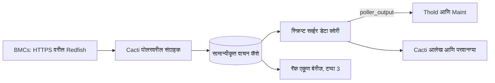

<!-- Source: README.md; SHA256: 7b4e83a58a1adc844cb0615ef30e95476cba2851f96bb454d2a816fb2774724d -->

<!-- translations:start -->
[English](../../../README.md) | [简体中文](../zh-CN/README.md) | [हिन्दी](../hi-IN/README.md) | [Español (España)](../es-ES/README.md) | [Español (Latinoamérica)](../es-419/README.md) | [العربية (السعودية)](../ar-SA/README.md) | [Afrikaans](../af-ZA/README.md) | [አማርኛ](../am-ET/README.md) | [العربية (مصر)](../ar-EG/README.md) | [العربية (المغرب)](../ar-MA/README.md) | [বাংলা](../bn-BD/README.md) | [Bosanski](../bs-BA/README.md) | [Deutsch](../de-DE/README.md) | [فارسی](../fa-IR/README.md) | [Filipino](../fil-PH/README.md) | [Français](../fr-FR/README.md) | [Français (Maroc)](../fr-MA/README.md) | [Français (Sénégal)](../fr-SN/README.md) | [Hausa](../ha-NG/README.md) | [עברית](../he-IL/README.md) | [Hrvatski](../hr-HR/README.md) | [Bahasa Indonesia](../id-ID/README.md) | [Igbo](../ig-NG/README.md) | [Italiano](../it-IT/README.md) | [日本語](../ja-JP/README.md) | [한국어](../ko-KR/README.md) | [Malagasy](../mg-MG/README.md) | [मराठी](README.md) | [Bahasa Melayu](../ms-MY/README.md) | [Nederlands](../nl-NL/README.md) | [Polski](../pl-PL/README.md) | [Português (Brasil)](../pt-BR/README.md) | [Русский](../ru-RU/README.md) | [Kinyarwanda](../rw-RW/README.md) | [Soomaali](../so-SO/README.md) | [Српски](../sr-RS/README.md) | [Svenska](../sv-SE/README.md) | [Kiswahili](../sw-KE/README.md) | [தமிழ்](../ta-IN/README.md) | [తెలుగు](../te-IN/README.md) | [ไทย](../th-TH/README.md) | [Türkçe](../tr-TR/README.md) | [Українська](../uk-UA/README.md) | [اردو](../ur-PK/README.md) | [Tiếng Việt](../vi-VN/README.md) | [isiXhosa](../xh-ZA/README.md) | [Yorùbá](../yo-NG/README.md) | [繁體中文](../zh-TW/README.md) | [isiZulu](../zu-ZA/README.md)
<!-- translations:end -->

# plugin_redfish

एक Cacti 1.2 प्लगइन जे Redfish वापरून आणि वैकल्पिक IPMI फॉलबॅकसह बेसबोर्ड मॅनेजमेंट कंट्रोलर्स (BMCs) मधून सर्व्हर पॉवर ड्रॉ, इनलेट तापमान, फॅन स्थिती आणि पॉवर सप्लाय आरोग्य सामान्य डिव्हाइसेस, डेटा सोर्सेस आणि आलेख म्हणून Cacti मध्ये आणते. त्यानंतर Thold आणि Maint त्यावर अलर्ट देतात आणि ते दडपतात, आणि पुढील टप्प्यात रॅक-स्तरीय पॉवर एकूण बेरीज जोडली जाते.

> **स्थिती: विकासाधीन, अद्याप कोणतेही प्रकाशन नाही (0.1.0-dev).** टप्पा 2 (पाया) आणि टप्पा 3 (Cacti ऑब्जेक्ट्स आणि अलर्टिंग) `main` वर विलीन केले आहेत. हे प्लगइन Cacti प्रकल्पाशी संलग्न नाही. हे PHP 8.2 किंवा नंतरच्या आवृत्तीखाली Cacti 1.2.31 वर स्थापित होते, BMCs आणि क्रेडेन्शियल्स नोंदवते, प्रत्येक BMC कडून Redfish द्वारे पॉवर, तापमान, फॅन्स आणि पॉवर सप्लाय आरोग्य स्वतःच्या कॅशेमध्ये वाचते आणि संकलन आरोग्य दर्शवते. हे सामान्य डेटा सोर्सेसद्वारे Cacti डिव्हाइसेस, प्रति-सदस्य आणि सारांश आलेख आणि Thold व Maint समर्थन जोडते. CI ने हाताने लिहिलेल्या फिक्स्चर्सपासून बनवलेला बनावट BMC आणि DMTF Redfish मॉकअप सर्व्हर वापरून चाचणी केली आहे; कोणताही प्रत्यक्ष BMC किंवा पायलट फ्लीट प्रमाणित केलेला नाही. डिझाइन आणि संशोधन [docs/PLAN.md](../../PLAN.md), [docs/research/](../../research), आणि [docs/decisions/](../../decisions) मध्ये आहेत.

### टप्पा 2 मध्ये काय समाविष्ट आहे

- Cacti च्या प्लगइन API द्वारे स्थापित करा, अपग्रेड करा, अक्षम करा आणि अनइंस्टॉल करा; सेटिंग साफ करेपर्यंत अनइंस्टॉल करताना टेबल्स जतन केले जातात. 8.2 पेक्षा जुन्या PHP वर प्लगइन स्थापित किंवा सक्षम होण्यास नकार देते आणि कारण सांगते.
- "Redfish View" (आरोग्य पृष्ठ), "Redfish Operator" (ऑपरेशन्स पृष्ठ), आणि "Redfish Admin" (BMCs आणि क्रेडेन्शियल्स पृष्ठे) हे रेल्म्स, तसेच Configuration > Settings > Redfish अंतर्गत सेटिंग्ज.
- CSV आयात आणि JSON निर्यातीसह BMC नोंदणी. आयात फाइल्समध्ये पासवर्ड नसावेत; क्रेडेन्शियल्सचा संदर्भ नावाने दिला जातो.
- AES-256-GCM सह कूटबद्ध करून साठवलेली क्रेडेन्शियल्स. की ही डेटाबेसच्या बाहेरील एक फाइल असते, डीफॉल्टनुसार `/etc/cacti/redfish-vault.key`, ज्यामध्ये 64 हेक्झाडेसिमल अक्षरे (`openssl rand -hex 32`) किंवा तंतोतंत 32 यादृच्छिक बाइट्स असतात, जी पोलर वापरकर्त्याच्या मालकीची असते, इतर वापरकर्त्यांना वाचता येत नाही आणि अशा निर्देशिकेत असते जिथे फक्त पोलर वापरकर्ता किंवा root लिहू शकतो. 32 प्रिंट करण्यायोग्य अक्षरांची की पासफ्रेज म्हणून नाकारली जाते. **डेटाबेससह की फाइलचा बॅकअप घ्या**; त्याशिवाय प्रत्येक साठवलेला पासवर्ड पुन्हा प्रविष्ट करावा लागेल.
- प्रति-BMC CA बंडल किंवा SPKI SHA-256 पिनसह डीफॉल्टनुसार TLS पडताळणी चालू असते. लॉग केलेले, प्रति-BMC अप्रमाणित ऑप्ट-आउट आरोग्य पृष्ठावर चेतावणी म्हणून राहते.
- केवळ-वाचनीय Redfish क्लायंट: फक्त `GET` आणि सत्र लॉगिन व लॉगआउट, कोणतीही विनंती पाठवण्यापूर्वी अनुमती यादीशी तपासलेले.
- मुख्य पोलरवरील BMCs साठी `poller_bottom` मधून सुरू केलेला संग्राहक, प्रति-BMC भाडेपट्टे आणि अंतिम मुदती, बॅकऑफ आणि प्लगइनने नोंदवलेल्या एका सत्राच्या क्रॅश नंतरच्या स्वच्छतेसह. रिमोट संग्राहक अद्याप समर्थित नाहीत; संग्राहक डेटाबेस आणि की पर्यंत कसा पोहोचतो याच्या स्पष्ट निवडीची त्यांना आवश्यकता आहे (टप्पा 4).
- BMC नोंदी आणि क्रेडेन्शियल्स Cacti डिव्हाइस परवानग्यांचे पालन करतात: Redfish Admin केवळ त्यांना पाहता येणाऱ्या डिव्हाइसेसवरील BMCs पाहू, बदलू आणि जोडू शकतो, आणि फक्त अशीच क्रेडेन्शियल्स ज्यांचा वापर लपलेल्या डिव्हाइसवरील कोणताही BMC करत नाही.

### टप्पा 3 मध्ये काय जोडले आहे

- `templates/` मध्ये Cacti टेम्पलेट XML म्हणून पाठवलेले टेम्पलेट्स आणि स्थापना व अपग्रेडच्या वेळी Cacti च्या स्वतःच्या इंपोर्टरद्वारे हॅश जुळवून आयात केलेले, त्यामुळे आयात प्लगइनचे ऑब्जेक्ट्स अद्यतनित करते आणि काहीही दोनदा जोडत नाही. तीन डेटा क्वेरी फाइल्स नोंदवलेल्या हॅशसह `<cacti>/resource/script_server/` मध्ये कॉपी केल्या जातात; प्लगइनने स्वतः न लिहिलेली तेथील कोणतीही फाइल ते कधीही बदलत नाही, आणि जेव्हा टेम्पलेट्स किंवा क्वेरी फाइल जागेवर नसतात तेव्हा आरोग्य पृष्ठ प्रशासकांना चेतावणी देते. BMCs पृष्ठावरील **Reinstall the Redfish Templates** त्यांना पुन्हा आयात करते; त्यासाठी Cacti ची Import Templates परवानगी आवश्यक आहे.
- प्रत्येक BMC वर **Create Device** किंवा **Add Graphs** ([ADR 0015](../../decisions/0015-attach-to-the-server-device-or-create-one-per-bmc.md)). सर्व्हरच्या विद्यमान डिव्हाइसशी मॅप केलेल्या BMC ला त्या डिव्हाइसवर त्याच्या डेटा क्वेरी आणि आलेख मिळतात. अनमॅप केलेल्या BMC ला "Redfish BMC" डिव्हाइस टेम्पलेटवरून एक नवीन डिव्हाइस मिळते, ज्यामध्ये उपलब्धता तपासणी बंद असते आणि `.invalid` अंतर्गत होस्ट नाव असते, त्यामुळे Cacti कधीही BMC शी संपर्क साधत नाही आणि त्याचा पत्ता दाखवत नाही. दोन्ही प्रकारे प्रशासक प्रथम काय जोडले जाईल याची यादी देणाऱ्या योजनेची पुष्टी करतो. दोन्हीसाठी Redfish Admin सोबतच Cacti च्या डिव्हाइस व्यवस्थापन परवानगीची आवश्यकता असते; निर्मात्याला न दिसणारे नवीन डिव्हाइस पुन्हा काढून टाकले जाते.
- तीन स्क्रिप्ट सर्व्हर डेटा क्वेरी, "Redfish Fans", "Redfish Temperatures", आणि "Redfish Power Supplies", ज्या BMC च्या सदस्य की द्वारे अनुक्रमित आहेत, प्रति सदस्य एका आलेखासह: टक्केवारी किंवा RPM मध्ये फॅन गती (BMC जे एकक नोंदवेल ते), तापमान, आणि पॉवर सप्लाय इनपुट व आउटपुट वॅट्स, प्रत्येक त्याच्या आरोग्य कोडसह.
- पॉवर, इनलेट तापमान, सर्वाधिक तापमान, OK नसलेले फॅन्स आणि सप्लाय, नोड आरोग्य, आणि शेवटच्या चांगल्या वाचनाचे वय असलेले "Redfish Node Summary" इनपुट, चार आलेखांवर काढलेले: पॉवर, तापमान, घटक आरोग्य, आणि डेटा वय. या डेटा सोर्सेसवरील Thold थ्रेशोल्ड्स अलर्ट देतात, आणि Maint त्यांना दडपते, दोन्ही प्लगइनमध्ये कोणताही बदल न करता.
- स्क्रिप्ट सर्व्हर फक्त प्लगइनच्या कॅशेमधूनच उत्तर देतो आणि कधीही BMC शी संपर्क साधत नाही. गहाळ, शिळे, दुसऱ्या एककाचे, किंवा निघून गेलेल्या सदस्याचे मूल्य `U` असते, त्यामुळे आलेख शून्य नव्हे तर अंतर दर्शवतात; `age` ला नेहमीच मूल्य असते, त्यामुळे त्यावरील थ्रेशोल्ड उत्तर देणे थांबलेल्या BMC ला पकडतो.
- प्रत्येक Redfish आलेखापासून डिव्हाइसच्या Redfish आलेखांकडे जाणारी आलेख लिंक, जी फक्त Cacti ज्या वापरकर्त्यांना डिव्हाइस पाहू देते त्यांनाच दाखवली जाते.

**जेव्हा BMC चे सदस्य बदलतात** (फॅन बदलला जातो, फर्मवेअर अद्यतनामुळे सेन्सर्सची नावे बदलतात), तेव्हा पुन्हा **Add Graphs** निवडा. जो फॅन किंवा पॉवर सप्लाय आधी उपस्थित होता आणि आता अनुपस्थित आहे किंवा निघून गेला आहे, तो तुम्ही असे करेपर्यंत `fans_bad` किंवा `psus_bad` मध्ये मोजला जातो, त्यामुळे काढलेला फॅन अलर्ट देतो; कधीही न भरलेला स्लॉट मोजला जात नाही. Add Graphs सध्या BMC नोंदवत असलेले सदस्य स्वीकारते आणि Cacti पुन्हा क्वेरी अनुक्रमित करते; निघून गेलेला सदस्य त्याचा डेटा सोर्स आणि आलेख कायम ठेवतो, जे तेव्हापासून `U` वाचतात, आणि नवीन सदस्याला नवीन आलेख मिळतो. निघून गेलेल्या सदस्यांच्या इतिहासाची आवश्यकता नसल्यास त्यांचे आलेख हाताने हटवा.

डिव्हाइस हटवल्याने त्याचा BMC अनमॅप होतो आणि BMC व त्याचा कॅशे कायम राहतात. BMC हटवल्याने किंवा प्लगइन अनइंस्टॉल केल्याने त्याचे डिव्हाइस आणि आलेख कायम राहतात.

## प्रवेश भूमिका

| रेल्म | प्रवेश |
| --- | --- |
| Redfish View | विद्यमान देखरेख पृष्ठे. |
| Redfish Operator | देखरेख तसेच ऑपरेशन्स पृष्ठ आणि वैयक्तिक ट्रायज पोचपावत्या. |
| Redfish Admin | Operator प्रवेश तसेच विद्यमान कॉन्फिगरेशन आणि प्रशासकीय क्रिया. |

अपग्रेड फाइल्स कॉपी केल्यानंतर, नवीन रेल्म नोंदणीकृत करण्यासाठी प्रशासक म्हणून Plugins पृष्ठ उघडा.
**Configuration > Users** किंवा वापरकर्ता गटांतर्गत Operator रेल्म स्पष्टपणे नियुक्त करा.
अपग्रेड्स विद्यमान View आणि Admin रेल्म आयडी आणि अनुदाने कायम ठेवतात. Admin प्रवेशाला
प्रत्येक विनंतीवर Operator प्रवेश वारसा हक्काने मिळतो, आणि Operator प्रवेशाला View प्रवेश वारसा हक्काने मिळतो;
यामुळे वापरकर्त्यांना किंवा गटांना साठवलेले अनुदान जोडले जात नाही. प्लगइन सेटिंग्जसाठी Cacti च्या
Settings परवानगीव्यतिरिक्त Redfish Admin प्रवेश देखील आवश्यक आहे.

Cacti डिव्हाइस परवानग्या अजूनही प्रत्येक वापरकर्त्यासाठी उपलब्ध ओळी आणि क्रिया मर्यादित ठेवतात; अनमॅप केलेल्या ऑब्जेक्ट्ससाठी प्रशासकाची आवश्यकता असते. Operators पुढील नियोजित रनसाठी परवानगी असलेल्या BMC वरील संकलन होल्ड सोडू शकतात.
क्रेडेन्शियल्स, कॉन्फिगरेशन, मॅपिंग, हटवणे आणि इतर प्रशासकीय बदल
प्रशासकीय पृष्ठांवरच राहतात. पोचपावत्या केवळ वर्तमान वापरकर्त्याच्या सत्रात,
जास्तीत जास्त एक तासासाठी आणि केवळ तेच निरीक्षण ताजे असेपर्यंतच टिकतात.
नवीन किंवा बदललेली निरीक्षणे त्यांना अवैध ठरवतात. त्या कधीही अयशस्वी मोजमाप
निरोगी म्हणून चिन्हांकित करत नाहीत किंवा अलर्ट्स दडपत नाहीत.

## का

प्रत्येक सर्व्हरमध्ये एक BMC असतो जो ऑपरेटिंग सिस्टमपासून स्वतंत्रपणे पॉवर आणि थर्मल स्थिती नोंदवतो, त्यामुळे OS बंद असतानाही तो उत्तर देत राहतो. हा डेटा क्षमता आणि खर्च ट्रॅकिंग, अयशस्वी फॅन किंवा पॉवर सप्लायची पूर्वसूचना आणि उच्च-कार्यक्षमता संगणनामध्ये पॉवर-कॅपिंग निर्णयांसाठी उपयुक्त ठरतो. हे प्लगइन केवळ HPC-विशिष्ट नाही.

Cacti आज यातील काही भाग समाविष्ट करते:

- **विक्रेता SNMP पॅकेजेस.** 1.2.x शाखा Dell iDRAC आणि HPE iLO टेम्पलेट्स पुरवते ज्यांना SNMP एजंटची आवश्यकता असते आणि ते विक्रेता-विशिष्ट असतात; टप्पा 1 संशोधनात असे आढळले की यापैकी कोणीही वॅट्समध्ये पॉवर ड्रॉ नोंदवत नाही ([docs/research/overlap.md](../../research/overlap.md)).
- **संग्राहकाशिवाय क्रेडेन्शियल प्रकार.** plugin_credentials "IPMI / Redfish (BMC)" क्रेडेन्शियल परिभाषित करते परंतु कोणताही BMC वाचत नाही.
- **रॅक-स्तरीय दृश्य नाही.** Cacti कोरमध्ये रॅक ऑब्जेक्ट नाही; डिव्हाइसमध्ये मुक्त-मजकूर `location` फील्ड असते.

हे प्लगइन Cacti च्या पोल चक्रापासून वेगळे (आउट ऑफ बँड) BMCs पोल करते, सामान्यीकृत वाचन कॅशे करते आणि स्क्रिप्ट सर्व्हर डेटा क्वेरी आणि सारांश डेटा सोर्सेसद्वारे ते उपलब्ध करून देते. हे Cacti चे आलेखन, परवानग्या, Thold आणि Maint पुन्हा वापरते आणि BMC स्थितीत बदल करत नाही. रिमोट डेटा संग्राहक समर्थन टप्पा 4 साठी नियोजित आहे; सध्याचे संकलन फक्त मुख्य पोलरवर चालते.

## नियोजित व्याप्ती

| टप्पा | व्याप्ती | मैलाचे दगड |
|---|---|---|
| 0, संशोधन | विक्रेता मॅट्रिक्स, लाइव्ह BMCs वर अपस्ट्रीम वर्तनाची पुष्टी, पोलिंग खर्च, डेटा क्वेरी स्पाइक | [M1](https://github.com/somethingwithproof/plugin_redfish/milestone/1) |
| 1, निरीक्षण | BMC नोंदणी, क्रेडेन्शियल्स, TLS, Redfish संग्राहक, सामान्यीकृत वाचन, डिव्हाइसेस, प्रति-अनुक्रम आलेख, Thold अलर्टिंग, Maint दडपण, आरोग्य पृष्ठ | [M2](https://github.com/somethingwithproof/plugin_redfish/milestone/2), [M3](https://github.com/somethingwithproof/plugin_redfish/milestone/3), [M4](https://github.com/somethingwithproof/plugin_redfish/milestone/4) |
| 2, ipmi | वापरण्यायोग्य Redfish नसलेल्या BMCs साठी IPMI फॉलबॅक, डीफॉल्टनुसार बंद | [M5](https://github.com/somethingwithproof/plugin_redfish/milestone/5) |
| 3, रॅक्स | रॅक नोंदणी, कव्हरेजसह रॅक पॉवर एकूण बेरीज, बजेट हेडरूम | [M6](https://github.com/somethingwithproof/plugin_redfish/milestone/6) |
| 4, रिमोट | वेगळ्या BMC नेटवर्कसाठी Cacti रिमोट डेटा संग्राहक | [M7](https://github.com/somethingwithproof/plugin_redfish/milestone/7) |

व्याप्तीबाहेर: पॉवर कॅप्स किंवा इतर कोणतेही BMC कॉन्फिगरेशन सेट करणे, पॉवर नियंत्रण, फर्मवेअर अद्यतन, कन्सोल प्रवेश, प्लगइन-मालकीचे अलर्टिंग इंजिन आणि शेड्युलर एकत्रीकरण.

## सुसंगतता उद्दिष्टे

| घटक | उद्दिष्ट |
|---|---|
| Cacti | 1.2.31 किंवा नंतरची आवृत्ती, कोणतेही कोर पॅचेस नाहीत |
| डेटाबेस | MariaDB 10.2 किंवा MySQL 5.7 किंवा नंतरची आवृत्ती: व्युत्पन्न केलेल्या स्तंभावरील युनिक की द्वारे प्रति डिव्हाइस एक BMC ठेवला जातो |
| PHP | 8.2 किंवा नंतरची आवृत्ती; `setup.php` 8.0 वर पार्स करण्यायोग्य राहते जेणेकरून असमर्थित रनटाइमला तुटलेल्या Cacti UI ऐवजी नकार मिळेल |
| BMCs | फर्मवेअर श्रेणीनुसार Dell iDRAC, HPE iLO, Lenovo XCC, आणि OpenBMC; [विक्रेता मॅट्रिक्स](../../research/vendor-matrix.md) पहा |
| Redfish | नवीन उपप्रणाली आणि सेन्सर संसाधने प्रथम, नापसंत केलेले `Power` आणि `Thermal` फॉलबॅक म्हणून |
| Thold, Maint | कोणत्याही बदलांची आवश्यकता नाही |

## डिझाइन

- [docs/PLAN.md](../../PLAN.md) ही संपूर्ण योजना आहे: आर्किटेक्चर, ते ज्या अपस्ट्रीम तथ्यांवर अवलंबून आहे (स्रोत आणि अद्याप पुष्टी करायच्या गृहीतकांसह), मोजमाप मॉडेल, सुरक्षा सीमा, कार्यप्रदर्शन गणित, चाचणी आणि जोखीम.
- [docs/decisions/](../../decisions) मध्ये आधीच घेतलेल्या निवडींच्या आर्किटेक्चर निर्णय नोंदी आहेत.
- [docs/REQUIREMENTS.md](../../REQUIREMENTS.md) प्रत्येक आवश्यकता आयडीला त्याच्या समस्येशी जोडते.

## सुरक्षा

BMC क्रेडेन्शियल्स सर्व्हरचे आउट-ऑफ-बँड व्यवस्थापन नियंत्रित करतात. डिझाइन त्यांना कमांड लाइन्स, लॉग्स आणि पृष्ठांपासून दूर ठेवते, डीफॉल्टनुसार TLS पडताळते, अनुमती यादीतील सबकमांड्ससह युक्तिवाद अॅरेमधून कोणतीही बाह्य कमांड चालवते आणि केवळ-वाचनीय BMC खाती वापरते. [docs/PLAN.md](../../PLAN.md#security) आणि [SECURITY.md](../../../SECURITY.md) पहा.

## ऑपरेटर मार्गदर्शक

स्थापना पूर्वअटी, व्हॉल्ट आणि TLS सेटअप, BMC नोंदणी, आलेख निर्मिती, अलर्ट मध्यांतरे, बॅकअप आणि अयशस्वीता हाताळणीसाठी [docs/operator-guide.md](../../operator-guide.md) पहा. जोपर्यंत त्या फर्मवेअरमधील संपादित केलेला कॅप्चर चाचणी संचात उत्तीर्ण होत नाही, तोपर्यंत मार्गदर्शक कोणतीही वास्तविक विक्रेता फर्मवेअर ओळ समर्थित म्हणून घोषित करत नाही.

## कामाचा मागोवा कसा ठेवला जातो

- **मैलाचे दगड** योजनेच्या मैलाच्या दगडांचे अनुसरण करतात. प्रत्येकाकडे एक महाकाव्य समस्या असते ज्यामध्ये त्याच्या उप-समस्या आणि निर्गमन पुरावे सूचीबद्ध असतात.
- **समस्या** लेबलनुसार प्रकारित केल्या आहेत: `type: requirement`, `type: research`, `type: decision`, `type: epic`. आवश्यकता समस्या क्रमांकित, चाचणी करण्यायोग्य आवश्यकता (`REQ-AREA-NNN`) आणि स्वीकृती निकष नमूद करतात.
- **लेबल्स** मध्ये `area:`, `phase:`, `priority:`, आणि `status:` देखील असतात. [CONTRIBUTING.md](../../../CONTRIBUTING.md#labels) पहा.
- [प्रकल्प बोर्ड](https://github.com/users/somethingwithproof/projects/12) मैलाच्या दगडांमधील सर्व समस्या दर्शवतो.

## योगदान

[CONTRIBUTING.md](../../../CONTRIBUTING.md) वाचा. कमिट्सना DCO साइन-ऑफ आवश्यक आहे. डिझाइन चर्चा समस्यांवर होते; खुल्या निर्णयांवर `type: decision` लेबल असते. वास्तविक BMCs कडून मिळालेला पुरावा हे आता सर्वात उपयुक्त योगदान आहे; कोणताही कॅप्चर पोस्ट करण्यापूर्वी पत्ते, अनुक्रमांक आणि क्रेडेन्शियल्स संपादित करा (लपवा).

## परवाना

GNU General Public License v2.0, Cacti आणि त्याच्या प्लगइनचा तोच परवाना. [LICENSE](../../../LICENSE) पहा.
