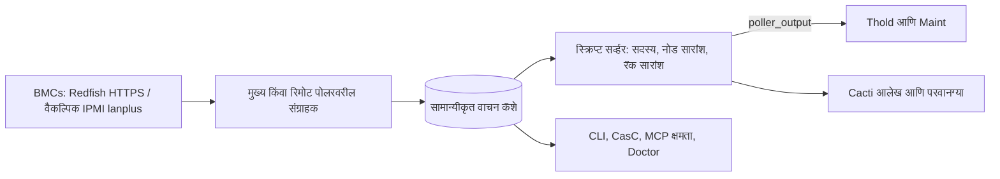

<!-- Source: README.md; SHA256: 6972a6c9ac754cd60e63c5caf971451ea8fe6e279eef757d886e1a168d3eef01 -->

<!-- translations:start -->
[English](../../../README.md) | [简体中文](../zh-CN/README.md) | [हिन्दी](../hi-IN/README.md) | [Español (España)](../es-ES/README.md) | [Español (Latinoamérica)](../es-419/README.md) | [العربية (السعودية)](../ar-SA/README.md) | [Afrikaans](../af-ZA/README.md) | [አማርኛ](../am-ET/README.md) | [العربية (مصر)](../ar-EG/README.md) | [العربية (المغرب)](../ar-MA/README.md) | [বাংলা](../bn-BD/README.md) | [Bosanski](../bs-BA/README.md) | [Deutsch](../de-DE/README.md) | [فارسی](../fa-IR/README.md) | [Filipino](../fil-PH/README.md) | [Français](../fr-FR/README.md) | [Français (Maroc)](../fr-MA/README.md) | [Français (Sénégal)](../fr-SN/README.md) | [Hausa](../ha-NG/README.md) | [עברית](../he-IL/README.md) | [Hrvatski](../hr-HR/README.md) | [Bahasa Indonesia](../id-ID/README.md) | [Igbo](../ig-NG/README.md) | [Italiano](../it-IT/README.md) | [日本語](../ja-JP/README.md) | [한국어](../ko-KR/README.md) | [Malagasy](../mg-MG/README.md) | [मराठी](README.md) | [Bahasa Melayu](../ms-MY/README.md) | [Nederlands](../nl-NL/README.md) | [Polski](../pl-PL/README.md) | [Português (Brasil)](../pt-BR/README.md) | [Русский](../ru-RU/README.md) | [Kinyarwanda](../rw-RW/README.md) | [Soomaali](../so-SO/README.md) | [Српски](../sr-RS/README.md) | [Svenska](../sv-SE/README.md) | [Kiswahili](../sw-KE/README.md) | [தமிழ்](../ta-IN/README.md) | [తెలుగు](../te-IN/README.md) | [ไทย](../th-TH/README.md) | [Türkçe](../tr-TR/README.md) | [Українська](../uk-UA/README.md) | [اردو](../ur-PK/README.md) | [Tiếng Việt](../vi-VN/README.md) | [isiXhosa](../xh-ZA/README.md) | [Yorùbá](../yo-NG/README.md) | [繁體中文](../zh-TW/README.md) | [isiZulu](../zu-ZA/README.md)
<!-- translations:end -->

# plugin_redfish

एक Cacti 1.2 प्लगइन जे Redfish वापरून, वैकल्पिक केवळ-वाचनीय IPMI फॉलबॅक आणि रॅक-स्तरीय पॉवर रोलअपसह, बेसबोर्ड मॅनेजमेंट कंट्रोलर्स (BMCs) मधून सर्व्हर पॉवर ड्रॉ, इनलेट तापमान, फॅन स्थिती आणि पॉवर सप्लाय आरोग्य सामान्य डिव्हाइसेस, डेटा सोर्सेस आणि आलेख म्हणून Cacti मध्ये आणते. Thold आणि Maint मानक Cacti डेटा सोर्सेसद्वारे त्यावर अलर्ट देतात आणि ते दडपतात.

> **स्थिती: विकासाधीन, अद्याप कोणतेही प्रकाशन नाही (`0.1.0-dev`).** हे प्लगइन Cacti प्रकल्पाशी संलग्न नाही. हे PHP 8.2 किंवा नंतरच्या आवृत्तीखाली Cacti 1.2.31 किंवा नंतरच्या आवृत्तीवर स्थापित होते आणि Redfish संग्राहक, कूटबद्ध क्रेडेन्शियल व्हॉल्ट, Cacti डिव्हाइस आणि आलेख तरतूद, वैकल्पिक केवळ-वाचनीय IPMI फॉलबॅक, रॅक पॉवर रोलअप, Cacti Maint विंडो प्रदर्शन, रिमोट डेटा संग्राहक प्रतिकृती आणि एजंट एंडपॉइंट्स, CasC प्रदाता आणि ऑपरेटर CLI, MCP क्षमता (abilities), तसेच Doctor निदान तपासण्या कार्यान्वित करते. CI फिक्स्चर्स, DMTF Redfish Mockup Server (सबसिस्टम, लेगसी-ओन्ली आणि HPE iLO Gen11 मॉकअप्स), आणि Maint v1.3 सह Thold v1.8.2 यांची चाचणी करते; अद्याप कोणताही प्रत्यक्ष भौतिक BMC किंवा पायलट फ्लीट प्रमाणित केलेला नाही. डिझाइन आणि संशोधन [docs/PLAN.md](../../PLAN.md), [docs/research/](../../research/), आणि [docs/decisions/](../../decisions/) मध्ये आहेत.

## कार्यान्वित क्षमता

### मुख्य संग्राहक, व्हॉल्ट आणि Cacti ऑब्जेक्ट्स

- **जीवनचक्र आणि स्कीमा.** Cacti च्या प्लगइन API द्वारे स्थापित, अपग्रेड, अक्षम आणि अनइंस्टॉल होते (`Schema::VERSION = 3`, 12 टेबल्स). *Keep Plugin Tables on Uninstall* साफ करेपर्यंत अनइंस्टॉल करताना टेबल्स जतन केले जातात. एंट्री पॉइंट्स PHP 8.0 वर पार्स होतात आणि PHP 8.2 पेक्षा कमी आवृत्ती किंवा `ext-openssl` गहाळ असल्यास स्पष्ट त्रुटी संदेशासह नाकारतात.
- **नोंदणी आणि परवानग्या.** *Redfish View* (`redfish_health.php`), *Redfish Operator* (`redfish_operator.php`), आणि *Redfish Admin* (`redfish_bmcs.php`, `redfish_credentials.php`) रेल्म्स, तसेच **Configuration > Settings > Redfish** अंतर्गत सेटिंग्ज. BMC नोंदणी CSV आयात (क्रेडेन्शियल्सचा संदर्भ नावाने दिला जातो; आयात फाइल्समधील पासवर्ड नाकारले जातात) आणि JSON निर्यातीस समर्थन देते. BMC नोंदी आणि क्रेडेन्शियल्स Cacti डिव्हाइस परवानग्यांचे पालन करतात.
- **कूटबद्ध क्रेडेन्शियल व्हॉल्ट.** पासवर्ड AES-256-GCM सह कूटबद्ध करून `plugin_redfish_secret` मध्ये साठवले जातात. की ही डेटाबेसच्या बाहेरील फाइल असते (डीफॉल्टनुसार `/etc/cacti/redfish-vault.key`), ज्यामध्ये 64 हेक्झाडेसिमल अक्षरे (`openssl rand -hex 32`) किंवा 32 कच्चे बाइट्स असतात, जी पोलर वापरकर्त्याच्या मालकीची असते, इतर वापरकर्त्यांना वाचता येत नाही आणि अशा निर्देशिकेत असते जिथे फक्त root किंवा तो वापरकर्ता लिहू शकतो. 32 प्रिंट करण्यायोग्य अक्षरांचा पासफ्रेज नाकारला जातो. **डेटाबेससह की फाइलचा बॅकअप घ्या**; त्याशिवाय साठवलेले पासवर्ड पुन्हा प्रविष्ट करावे लागतील.
- **TLS आणि केवळ-वाचनीय Redfish क्लायंट.** सिस्टम CA स्टोअर, प्रति-BMC CA बंडल, किंवा SPKI SHA-256 पिन वापरून डीफॉल्टनुसार TLS पडताळणी सक्षम असते; प्रति-BMC अप्रमाणित ऑप्ट-आउट आरोग्य चेतावणी आणि Doctor तपासणी चेतावणी म्हणून दृश्यमान राहते. क्लायंट फक्त `GET` आणि Redfish सत्र लॉगिन (`POST`) व लॉगआउट (`DELETE`) यांना अनुमती देतो, तसेच सत्रे अनुपलब्ध असताना वैकल्पिक प्रति-BMC Basic फॉलबॅक प्रदान करतो. शोध प्रक्रियेत नवीन Redfish उपप्रणाली आणि सेन्सर संसाधनांना प्राधान्य दिले जाते आणि नापसंत केलेल्या `Power` व `Thermal` संसाधनांचा फॉलबॅक म्हणून वापर केला जातो.
- **संग्राहक अंमलबजावणी.** `poller_redfish.php` हे `poller_bottom` मधून सुरू होते, कॉन्फिगर करण्यायोग्य वर्कर प्रक्रियांसह (`redfish_workers`) Cacti च्या प्रोसेस रजिस्ट्रीद्वारे प्रति पोलर एक मास्टर प्रक्रिया चालवते, प्रति-BMC भाडेपट्टे मिळवते, वेळेचे बजेट (`redfish_collector_budget`) लागू करते, एक्स्पोनेन्शियल बॅकऑफ लागू करते आणि क्रॅश झाल्यानंतर प्लगइनचे स्वतःचे मागील सत्र स्वच्छ करते.
- **टेम्पलेट्स, डिव्हाइसेस आणि आलेख.** हॅशद्वारे `templates/redfish-templates.xml` आयात करते आणि वापरकर्त्याने सुधारलेल्या फाइल्स न बदलता तीन स्क्रिप्ट सर्व्हर डेटा क्वेरी XML फाइल्स (`redfish_fans.xml`, `redfish_temperatures.xml`, `redfish_psus.xml`) `<cacti>/resource/script_server/` मध्ये कॉपी करते. **Create Device** आणि **Add Graphs** साठी तरतूद योजनेची पुष्टी आवश्यक असते, ते मॅप केलेल्या सर्व्हर डिव्हाइसशी क्वेरी जोडतात किंवा उपलब्धता तपासणी अक्षम करून `.invalid` अंतर्गत "Redfish BMC" डिव्हाइस तयार करतात, आणि `graph_buttons` द्वारे प्रत्येक Redfish आलेख डिव्हाइसच्या Redfish आलेखांशी जोडतात.
- **केवळ-कॅशे स्क्रिप्ट सर्व्हर इनपुट्स.** `scripts/ss_redfish_members.php` प्रति-सदस्य फॅन, तापमान आणि PSU वाचन प्रदान करते आणि `scripts/ss_redfish_summary.php` "Redfish Node Summary" मेट्रिक्स (पॉवर, इनलेट आणि कमाल तापमान, खराब फॅन आणि PSU संख्या, नोड आरोग्य आणि शेवटच्या चांगल्या वाचनाचे वय) प्रदान करते. स्क्रिप्ट सर्व्हर कॉल्स फक्त स्थानिक कॅशे वाचतात आणि कधीही BMC शी संपर्क साधत नाहीत. गहाळ, शिळे, किंवा निघून गेलेल्या सदस्याचे वाचन `U` परत करते (कधीही `0` नाही), तर `age` नेहमी मूल्य नोंदवते जेणेकरून थ्रेशोल्ड्स प्रतिसाद न देणाऱ्या BMCs ना ओळखू शकतील.

**जेव्हा BMC चे सदस्य बदलतात** (जसे की फॅन बदलणे किंवा सेन्सर्सची नावे बदलणारे फर्मवेअर अद्यतन), तेव्हा पुन्हा **Add Graphs** चालवा. पूर्वी उपस्थित असलेला फॅन किंवा पॉवर सप्लाय अनुपस्थित झाल्यास तो स्वीकारेपर्यंत `fans_bad` किंवा `psus_bad` मध्ये मोजला जातो; कधीही न भरलेला स्लॉट मोजला जात नाही. निघून गेलेले सदस्य त्यांचे विद्यमान डेटा सोर्सेस आणि आलेख कायम ठेवतात, जे हाताने हटवेपर्यंत त्यानंतर `U` वाचतात. Cacti डिव्हाइस हटवल्याने BMC आणि कॅशे कायम ठेवून त्याचा BMC अनमॅप होतो आणि त्याचे रॅक असाइनमेंट काढून टाकले जाते; BMC हटवल्याने किंवा प्लगइन अनइंस्टॉल केल्याने Cacti डिव्हाइसेस आणि आलेख कायम राहतात.

### वैकल्पिक IPMI फॉलबॅक

- **प्रति-BMC ऐच्छिक निवड.** डीफॉल्टनुसार बंद (`protocols` डीफॉल्ट `redfish` आहे; IPMI फॉलबॅक सक्षम केल्यास `redfish,ipmi` सेट होते).
- **मर्यादित फॉलबॅक ट्रिगर.** फक्त तेव्हाच चालतो जेव्हा Redfish संकलन पात्र अपयश वर्गासह अयशस्वी होते; `AuthRejected`, `CredentialUnavailable`, `AddressRefused`, `OperationRefused`, किंवा `Deadline` वर कधीही ट्रिगर होत नाही.
- **सुरक्षित अंमलबजावणी.** शेलशिवाय अरे-स्वरूपातील `proc_open()`, मर्यादित वॉल-क्लॉक टाइमआउट आणि 256 KiB आउटपुट मर्यादेसह `-I lanplus` वर `ipmitool` चालवते. पासवर्ड `IPMITOOL_PASSWORD` (`-E`) द्वारे किंवा `finally` मध्ये हटवलेल्या मोड-0600 तात्पुरत्या फाइलद्वारे (`-f`) पुरवले जातात, कधीही CLI argv वर दिले जात नाहीत.
- **केवळ-वाचनीय कमांड अनुमती यादी.** फक्त पाच केवळ-वाचनीय उपकमांड्सना अनुमती आहे: `dcmi power reading`, `sdr type Temperature`, `sdr type Fan`, `sdr type Power Supply`, आणि `chassis status`. बदल करणाऱ्या कमांड्स नाकारल्या जातात.
- **सामान्यीकृत आउटपुट आणि स्थिती चेतावणी.** `IpmiNormalizer` गहाळ किंवा न वाचता येणाऱ्या सेन्सर्ससाठी `U` उत्सर्जित करून वाचन समान `Observation`/`Member`/`Reading` मॉडेलमध्ये मॅप करते. IPMI फॉलबॅक सक्षम केल्यास आरोग्य पृष्ठावर आणि `redfish.bmc_security` Doctor तपासणीत ऑपरेटर्सना UDP 623 व्यवस्थापन VLAN पुरते मर्यादित ठेवण्याची आठवण करून देणारी चेतावणी निर्माण होते.

### रॅक पॉवर रोलअप

- **रॅक नोंदणी.** स्कीमा आवृत्ती 3 मध्ये `plugin_redfish_rack` (अद्वितीय `(site_id, name)`, वैकल्पिक `power_budget_watts`, डीफॉल्ट `80` असलेले `min_coverage_pct`, आणि नोंदी) व `plugin_redfish_rack_member` (प्रति `host_id` जास्तीत जास्त एक रॅक असाइनमेंट, वैकल्पिक `bmc_id` आणि `unit_position`, Cacti डिव्हाइस हटवल्यावर स्वयंचलितपणे काढून टाकले जाते) जोडले आहे.
- **कव्हरेज-संरक्षित बेरीज.** `RackPowerSummary` स्थानिक कॅशेमधून ताज्या सदस्यांची `power_watts` वाचन एकत्रित करते आणि बजेट वापर व हेडरूम मोजते. जेव्हा अहवाल देणाऱ्या सदस्यांचे कव्हरेज `min_coverage_pct` पेक्षा कमी होते, तेव्हा `power_watts`, `utilization_pct`, आणि `headroom_watts` `U` परत करतात जेणेकरून संग्राहक अपयश कधीही रॅक पॉवरमधील घट म्हणून दिसू नये.
- **Thold-सज्ज स्क्रिप्ट सर्व्हर इनपुट.** `scripts/ss_redfish_rack.php` (`ss_redfish_rack(<rack_id>)`) फक्त स्थानिक कॅशेमधून `power_watts`, `power_budget_watts`, `utilization_pct`, `headroom_watts`, `members_total`, `members_reporting`, आणि `coverage_pct` परत करते.

### Cacti Maint एकत्रीकरण

- दोन्ही प्लगइनमध्ये कोणताही बदल न करता Redfish डेटा सोर्सेसवरील Thold थ्रेशोल्ड्स अलर्ट देतात आणि Cacti Maint ते दडपते.
- `MaintWindow` प्रत्येक मॅप केलेल्या Cacti होस्टसाठी सक्रिय Maint वेळापत्रक तपासते (एक-वेळचे `mtype=1` आणि आवर्ती `mtype=2` वेळापत्रक, तसेच लोड केलेले असल्यास `plugin_maint_check_cacti_host()`) आणि Redfish Health पृष्ठावर (`[MAINT]`), `cli/redfish.php health` आउटपुटमध्ये, आणि `redfish-get-health` क्षमतेमध्ये सक्रिय देखभाल चिन्हांकित करते.

### रिमोट डेटा संग्राहक

- `INFO` `remote_collect:1` घोषित करते. BMCs कोणतीही `poller_id >= 1` स्वीकारतात, आणि `poller_redfish.php --poller=N` फक्त त्या पोलरला नेमलेले सक्षम BMCs संकलित करते.
- **`replicate_out` हुक.** `replicate_out_table()` द्वारे लक्ष्य रिमोट पोलरपुरते मर्यादित असलेले केवळ अ-गोपनीय कॉन्फिगरेशन टेबल्स प्रतिकृत करते: `plugin_redfish_bmc`, `plugin_redfish_credential` मेटाडेटा (सायफरटेक्स्टशिवाय), `plugin_redfish_rack`, आणि `plugin_redfish_rack_member`. `plugin_redfish_secret` प्रतिकृत केले जात नाही आणि व्हॉल्ट की फाइल्स प्रत्येक पोलरवर काटेकोरपणे स्थानिक राहतात.
- **`remote_agent` हुक.** केवळ अंकीय `poller_id` आणि `bmc_id` पॅरामीटर्स स्वीकारणाऱ्या केवळ-वाचनीय `redfish_health` आणि `redfish_discovery` क्रिया उपलब्ध करून देते. अनपेक्षित पॅरामीटर्स नाकारले जातात आणि शून्य क्रेडेन्शियल्स किंवा गुपिते परत केली जातात.

### इकोसिस्टम हुक्स (CasC, MCP क्षमता, आणि Doctor)

- **CasC प्रदाता (`casc_register_providers`).** शुद्ध-PHP YAML आणि XML निर्यात, पार्सिंग (XXE नाकारलेले), प्रमाणीकरण, diff नियोजन आणि लागू करण्यासह `redfish` प्रदाता (स्कीमा आवृत्ती `1`) नोंदवते. क्रेडेन्शियल्स फक्त व्हॉल्ट संदर्भ (`vault:redfish:<name>`) म्हणून दिसतात; कच्च्या गुपित की (`pass`, `secret`, `token`, `private_key`, `vault_key`, `auth_token`) नाकारल्या जातात. लागू करण्यासाठी अचूक SHA-256 `PLAN_HASH` आवश्यक आहे.
- **MCP / Abilities API (`abilities_register`).** Redfish View रेल्म (`redfish_health.php`) आणि Cacti डिव्हाइस परवानग्यांवर आधारित तीन केवळ-वाचनीय क्षमता नोंदवते, ज्या शून्य क्रेडेन्शियल्स परत करतात:
  - `redfish-list-bmcs` (वैकल्पिक `poller_id`)
  - `redfish-get-rack-power` (वैकल्पिक `rack_id`)
  - `redfish-get-health` (वैकल्पिक `bmc_id`)
- **Doctor तपासण्या (`doctor_register_checks`).** पाच स्थानिक, केवळ-वाचनीय निदान तपासण्या नोंदवते ज्या कधीही BMC शी संपर्क साधत नाहीत किंवा की सामग्री परत करत नाहीत:
  - `redfish.schema`: स्कीमा आवृत्ती अद्ययावतपणा
  - `redfish.vault_key`: व्हॉल्ट की वाचनीयता आणि परवानग्या
  - `redfish.collector_runs`: पोलर संग्राहक बजेट आणि ताजेपणा
  - `redfish.bmc_security`: अप्रमाणित TLS किंवा IPMI फॉलबॅकसह सक्षम केलेले BMCs
  - `redfish.rack_power`: रॅक पॉवर बजेट अनुपालन आणि कव्हरेज किमान मर्यादा

## CLI

PHP 8.2 किंवा नंतरच्या आवृत्तीसह Cacti मूळ निर्देशिकेतून चालवा:

```sh
# Operator and CasC CLI (reads --file=PATH or stdin for validate, plan, and apply)
php plugins/redfish/cli/redfish.php export --format=yaml|xml
php plugins/redfish/cli/redfish.php validate [--file=PATH] [--format=yaml|xml]
php plugins/redfish/cli/redfish.php plan [--file=PATH] [--format=yaml|xml]
php plugins/redfish/cli/redfish.php apply [--file=PATH] [--format=yaml|xml] --confirm=<PLAN_HASH>
php plugins/redfish/cli/redfish.php health --format=text|json

# Collector entry point (normally started by poller_bottom)
php plugins/redfish/poller_redfish.php [--poller=N] [--force] [--debug]

# Rack power summary script server entry point
php plugins/redfish/scripts/ss_redfish_rack.php <rack_id>
```

## प्रवेश भूमिका

| रेल्म | प्रवेश |
| --- | --- |
| Redfish View | विद्यमान देखरेख पृष्ठे. |
| Redfish Operator | देखरेख तसेच ऑपरेशन्स पृष्ठ आणि वैयक्तिक ट्रायज पोचपावत्या. |
| Redfish Admin | Operator प्रवेश तसेच विद्यमान कॉन्फिगरेशन आणि प्रशासकीय क्रिया. |

अपग्रेड फाइल्स कॉपी केल्यानंतर, रेल्म्स नोंदणीकृत करण्यासाठी प्रशासक म्हणून Plugins पृष्ठ उघडा. **Configuration > Users** किंवा वापरकर्ता गटांतर्गत Operator रेल्म स्पष्टपणे नियुक्त करा. अपग्रेड्स विद्यमान View आणि Admin रेल्म आयडी आणि अनुदाने कायम ठेवतात. Admin प्रवेशाला प्रत्येक विनंतीवर Operator प्रवेश वारसा हक्काने मिळतो, आणि Operator प्रवेशाला View प्रवेश वारसा हक्काने मिळतो; यामुळे वापरकर्त्यांना किंवा गटांना साठवलेले अनुदान जोडले जात नाही. प्लगइन सेटिंग्जसाठी Cacti च्या Settings परवानगीव्यतिरिक्त Redfish Admin प्रवेश देखील आवश्यक आहे.

Cacti डिव्हाइस परवानग्या प्रत्येक वापरकर्त्यासाठी उपलब्ध ओळी आणि क्रिया मर्यादित ठेवतात; अनमॅप केलेल्या ऑब्जेक्ट्ससाठी प्रशासकाची आवश्यकता असते. Operators पुढील नियोजित रनसाठी परवानगी असलेल्या BMC वरील संकलन होल्ड सोडू शकतात. क्रेडेन्शियल्स, कॉन्फिगरेशन, मॅपिंग, हटवणे आणि इतर प्रशासकीय बदल प्रशासकीय पृष्ठांवरच राहतात. पोचपावत्या केवळ वर्तमान वापरकर्त्याच्या सत्रात, जास्तीत जास्त एक तासासाठी आणि केवळ तेच निरीक्षण ताजे असेपर्यंतच टिकतात. नवीन किंवा बदललेली निरीक्षणे त्यांना अवैध ठरवतात. त्या कधीही अयशस्वी मोजमाप निरोगी म्हणून चिन्हांकित करत नाहीत किंवा अलर्ट्स दडपत नाहीत.

## का

प्रत्येक सर्व्हरमध्ये एक BMC असतो जो ऑपरेटिंग सिस्टमपासून स्वतंत्रपणे पॉवर आणि थर्मल स्थिती नोंदवतो, त्यामुळे OS बंद असतानाही तो उत्तर देत राहतो. हा डेटा क्षमता आणि खर्च ट्रॅकिंग, अयशस्वी फॅन किंवा पॉवर सप्लायची पूर्वसूचना आणि उच्च-कार्यक्षमता संगणनामध्ये (HPC) पॉवर-कॅपिंग निर्णयांसाठी उपयुक्त ठरतो. हे प्लगइन केवळ HPC-विशिष्ट नाही.

Cacti आज यातील काही भाग समाविष्ट करते:

- **विक्रेता SNMP पॅकेजेस.** 1.2.x शाखा Dell iDRAC आणि HPE iLO टेम्पलेट्स पुरवते ज्यांना SNMP एजंटची आवश्यकता असते आणि ते विक्रेता-विशिष्ट असतात; टप्पा 1 संशोधनात असे आढळले की यापैकी कोणीही वॅट्समध्ये पॉवर ड्रॉ नोंदवत नाही ([docs/research/overlap.md](../../research/overlap.md)).
- **संग्राहकाशिवाय क्रेडेन्शियल प्रकार.** plugin_credentials "IPMI / Redfish (BMC)" क्रेडेन्शियल परिभाषित करते परंतु कोणताही BMC वाचत नाही.
- **रॅक-स्तरीय दृश्य नाही.** Cacti कोरमध्ये रॅक ऑब्जेक्ट नाही; डिव्हाइसमध्ये मुक्त-मजकूर `location` फील्ड असते.

हे प्लगइन मुख्य पोलर किंवा रिमोट डेटा संग्राहकांवर Cacti च्या पोल चक्रापासून वेगळे (आउट ऑफ बँड) BMCs पोल करते, सामान्यीकृत वाचन कॅशे करते आणि स्क्रिप्ट सर्व्हर डेटा क्वेरी, नोड सारांश आणि रॅक पॉवर सारांशाद्वारे ते उपलब्ध करून देते. हे Cacti चे आलेखन, परवानग्या, Thold आणि Maint पुन्हा वापरते आणि BMC स्थितीत बदल करत नाही.

## व्याप्ती आणि स्थिती

| टप्पा | व्याप्ती | मैलाचे दगड | स्थिती |
|---|---|---|---|
| 0, संशोधन | विक्रेता मॅट्रिक्स, लाइव्ह BMCs वर अपस्ट्रीम वर्तनाची पुष्टी, पोलिंग खर्च, डेटा क्वेरी स्पाइक | [M1](https://github.com/somethingwithproof/plugin_redfish/milestone/1) | पूर्ण, प्रत्यक्ष-BMC फर्मवेअर कॅप्चरची प्रतीक्षा |
| 1, निरीक्षण | BMC नोंदणी, क्रेडेन्शियल्स, TLS, Redfish संग्राहक, सामान्यीकृत वाचन, डिव्हाइसेस, प्रति-अनुक्रम आलेख, Thold अलर्टिंग, Maint एकत्रीकरण, आरोग्य पृष्ठ | [M2](https://github.com/somethingwithproof/plugin_redfish/milestone/2), [M3](https://github.com/somethingwithproof/plugin_redfish/milestone/3), [M4](https://github.com/somethingwithproof/plugin_redfish/milestone/4) | कार्यान्वित; M4 पायलट फ्लीट प्रमाणीकरण प्रलंबित |
| 2, ipmi | `ipmitool` द्वारे केवळ-वाचनीय IPMI (`lanplus`) फॉलबॅक, डीफॉल्टनुसार बंद | [M5](https://github.com/somethingwithproof/plugin_redfish/milestone/5) | कार्यान्वित |
| 3, रॅक्स | रॅक नोंदणी, कव्हरेज किमान मर्यादेसह रॅक पॉवर एकूण बेरीज, बजेट हेडरूम, `ss_redfish_rack.php` | [M6](https://github.com/somethingwithproof/plugin_redfish/milestone/6) | कार्यान्वित |
| 4, रिमोट आणि इकोसिस्टम | रिमोट डेटा संग्राहक (`replicate_out`, `remote_agent`), CasC प्रदाता आणि CLI, MCP क्षमता, Doctor तपासण्या | [M7](https://github.com/somethingwithproof/plugin_redfish/milestone/7) | कार्यान्वित |

व्याप्तीबाहेर: पॉवर कॅप्स किंवा इतर कोणतेही BMC कॉन्फिगरेशन सेट करणे, पॉवर नियंत्रण, फर्मवेअर अद्यतन, कन्सोल प्रवेश, प्लगइन-मालकीचे अलर्टिंग इंजिन आणि शेड्युलर एकत्रीकरण.

## सुसंगतता उद्दिष्टे

| घटक | उद्दिष्ट |
|---|---|
| Cacti | 1.2.31 किंवा नंतरची आवृत्ती, कोणतेही कोर पॅचेस नाहीत |
| डेटाबेस | MariaDB 10.2 किंवा MySQL 5.7 किंवा नंतरची आवृत्ती: व्युत्पन्न केलेल्या स्तंभावरील युनिक की द्वारे प्रति डिव्हाइस एक BMC ठेवला जातो |
| PHP | 8.2 किंवा नंतरची आवृत्ती; एंट्री पॉइंट्स 8.0 वर पार्स करण्यायोग्य राहतात जेणेकरून असमर्थित रनटाइमला तुटलेल्या Cacti UI ऐवजी नकार मिळेल |
| PHP विस्तार | `ext-openssl` (Cacti 1.2.31 साठी आवश्यक); `ext-curl` नाही आणि कोणतीही Composer रनटाइम अवलंबित्वे नाहीत |
| वैकल्पिक साधने | IPMI फॉलबॅक सक्षम असलेल्या BMCs चे संकलन करणाऱ्या पोलर्सवर `ipmitool` |
| BMCs | फर्मवेअर श्रेणीनुसार Dell iDRAC, HPE iLO, Lenovo XCC, आणि OpenBMC; [विक्रेता मॅट्रिक्स](../../research/vendor-matrix.md) पहा |
| Redfish | नवीन उपप्रणाली आणि सेन्सर संसाधने प्रथम, नापसंत केलेले `Power` आणि `Thermal` फॉलबॅक म्हणून |
| Thold, Maint | कोणत्याही बदलांची आवश्यकता नाही (CI Thold v1.8.2 आणि Maint v1.3 ची चाचणी करते) |

## डिझाइन

- [docs/PLAN.md](../../PLAN.md) ही संपूर्ण योजना आहे: आर्किटेक्चर, ते ज्या अपस्ट्रीम तथ्यांवर अवलंबून आहे, मोजमाप मॉडेल, सुरक्षा सीमा, कार्यप्रदर्शन गणित, चाचणी आणि जोखीम.
- [docs/decisions/](../../decisions/) मध्ये आधीच घेतलेल्या निवडींच्या आर्किटेक्चर निर्णय नोंदी आहेत.
- [docs/REQUIREMENTS.md](../../REQUIREMENTS.md) प्रत्येक आवश्यकता आयडीला त्याच्या समस्येशी जोडते.



## सुरक्षा

BMC क्रेडेन्शियल्स सर्व्हरचे आउट-ऑफ-बँड व्यवस्थापन नियंत्रित करतात. डिझाइन गुपिते कमांड लाइन्स, लॉग्स, CasC निर्यात, रिमोट एजंट पेलोड्स, MCP प्रतिसाद आणि वेब पृष्ठांपासून दूर ठेवते; प्रति पोलर स्थानिक व्हॉल्ट की फाइल वापरून साठवलेले पासवर्ड AES-256-GCM ने कूटबद्ध करते; डीफॉल्टनुसार TLS पडताळते; अनुमती यादीतील केवळ-वाचनीय उपकमांड्ससह स्पष्ट युक्तिवाद अरेमधून `ipmitool` चालवते; आणि केवळ-वाचनीय BMC खाती वापरते. [docs/PLAN.md](../../PLAN.md#security) आणि [SECURITY.md](../../../SECURITY.md) पहा.

## ऑपरेटर मार्गदर्शक

स्थापना पूर्वअटी, व्हॉल्ट आणि TLS सेटअप, BMC नोंदणी, आलेख निर्मिती, अलर्ट मध्यांतरे, बॅकअप आणि अयशस्वीता हाताळणीसाठी [docs/operator-guide.md](../../operator-guide.md) पहा. जोपर्यंत त्या फर्मवेअरमधील संपादित केलेला कॅप्चर चाचणी संचात उत्तीर्ण होत नाही, तोपर्यंत मार्गदर्शक कोणतीही वास्तविक विक्रेता फर्मवेअर ओळ समर्थित म्हणून घोषित करत नाही.

## विकास आणि चाचणी

CI ([.github/workflows/plugin-ci-workflow.yml](../../../.github/workflows/plugin-ci-workflow.yml)) PHP 8.0 वर एंट्री पॉइंट्स लिंट करते, Cacti `release/1.2.31` आणि `1.2.x` विरुद्ध PHP 8.2 ते 8.5 वर Pest युनिट (`phpunit.xml`) व जीवनचक्र एकत्रीकरण (`phpunit-integration.xml`) संच आणि PHPStan स्तर 9 चालवते, PHP 8.1 वरील नकार पडताळते, DMTF Redfish Mockup Server (सबसिस्टम, लेगसी-ओन्ली आणि HPE iLO Gen11 मॉकअप्स) व Thold v1.8.2 / Maint v1.3 एंड टू एंड तपासते, आणि gettext कॅटलॉग, वर्कफ्लो व REUSE परवाना तपासते.

पुश करण्यापूर्वी स्थानिक तपासण्या:

```sh
sh tests/lint-workflows.sh
sh locales/build_gettext.sh --check
CACTI_PATH=/path/to/cacti phpstan analyse -c phpstan.neon --no-progress
```

युनिट आणि सोर्स-रूल चाचण्यांसाठी `--configuration=phpunit.xml` सह Pest चालवा, किंवा जीवनचक्र एकत्रीकरण चाचण्यांसाठी डिस्पोजेबल Cacti डेटाबेसवर `CACTI_PATH` आणि `REDFISH_TEST_DATABASE=disposable` सह `--configuration=phpunit-integration.xml` चालवा.

## कामाचा मागोवा कसा ठेवला जातो

- **मैलाचे दगड** योजनेच्या मैलाच्या दगडांचे अनुसरण करतात. प्रत्येकाकडे एक महाकाव्य समस्या असते ज्यामध्ये त्याच्या उप-समस्या आणि निर्गमन पुरावे सूचीबद्ध असतात.
- **समस्या** लेबलनुसार प्रकारित केल्या आहेत: `type: requirement`, `type: research`, `type: decision`, `type: epic`. आवश्यकता समस्या क्रमांकित, चाचणी करण्यायोग्य आवश्यकता (`REQ-AREA-NNN`) आणि स्वीकृती निकष नमूद करतात.
- **लेबल्स** मध्ये `area:`, `phase:`, `priority:`, आणि `status:` देखील असतात. [CONTRIBUTING.md](../../../CONTRIBUTING.md#labels) पहा.
- [प्रकल्प बोर्ड](https://github.com/users/somethingwithproof/projects/12) मैलाच्या दगडांमधील सर्व समस्या दर्शवतो.

## योगदान

[CONTRIBUTING.md](../../../CONTRIBUTING.md) वाचा. कमिट्सना DCO साइन-ऑफ आवश्यक आहे. डिझाइन चर्चा समस्यांवर होते; खुल्या निर्णयांवर `type: decision` लेबल असते. वास्तविक BMCs कडून मिळालेला पुरावा हे आता सर्वात उपयुक्त योगदान आहे; कोणताही कॅप्चर पोस्ट करण्यापूर्वी पत्ते, अनुक्रमांक आणि क्रेडेन्शियल्स संपादित करा.

## परवाना

GNU General Public License v2.0, Cacti आणि त्याच्या प्लगइनचा तोच परवाना. [LICENSE](../../../LICENSE) पहा.
