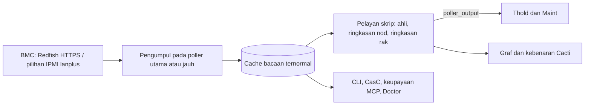

<!-- Source: README.md; SHA256: cf31b9f80d6c00020bbe08e80951d4de1c910793911d040ae7a66b54e8a2eaf0 -->

<!-- translations:start -->
[English](../../../README.md) | [简体中文](../zh-CN/README.md) | [हिन्दी](../hi-IN/README.md) | [Español (España)](../es-ES/README.md) | [Español (Latinoamérica)](../es-419/README.md) | [العربية (السعودية)](../ar-SA/README.md) | [Afrikaans](../af-ZA/README.md) | [አማርኛ](../am-ET/README.md) | [العربية (مصر)](../ar-EG/README.md) | [العربية (المغرب)](../ar-MA/README.md) | [বাংলা](../bn-BD/README.md) | [Bosanski](../bs-BA/README.md) | [Deutsch](../de-DE/README.md) | [فارسی](../fa-IR/README.md) | [Filipino](../fil-PH/README.md) | [Français](../fr-FR/README.md) | [Français (Maroc)](../fr-MA/README.md) | [Français (Sénégal)](../fr-SN/README.md) | [Hausa](../ha-NG/README.md) | [עברית](../he-IL/README.md) | [Hrvatski](../hr-HR/README.md) | [Bahasa Indonesia](../id-ID/README.md) | [Igbo](../ig-NG/README.md) | [Italiano](../it-IT/README.md) | [日本語](../ja-JP/README.md) | [한국어](../ko-KR/README.md) | [Malagasy](../mg-MG/README.md) | [मराठी](../mr-IN/README.md) | [Bahasa Melayu](README.md) | [Nederlands](../nl-NL/README.md) | [Polski](../pl-PL/README.md) | [Português (Brasil)](../pt-BR/README.md) | [Русский](../ru-RU/README.md) | [Kinyarwanda](../rw-RW/README.md) | [Soomaali](../so-SO/README.md) | [Српски](../sr-RS/README.md) | [Svenska](../sv-SE/README.md) | [Kiswahili](../sw-KE/README.md) | [தமிழ்](../ta-IN/README.md) | [తెలుగు](../te-IN/README.md) | [ไทย](../th-TH/README.md) | [Türkçe](../tr-TR/README.md) | [Українська](../uk-UA/README.md) | [اردو](../ur-PK/README.md) | [Tiếng Việt](../vi-VN/README.md) | [isiXhosa](../xh-ZA/README.md) | [Yorùbá](../yo-NG/README.md) | [繁體中文](../zh-TW/README.md) | [isiZulu](../zu-ZA/README.md)
<!-- translations:end -->

# plugin_redfish

Pemalam Cacti 1.2 yang membawa penggunaan kuasa pelayan, suhu masuk, keadaan kipas, dan kesihatan bekalan kuasa daripada pengawal pengurusan papan induk (BMC) ke dalam Cacti sebagai peranti, sumber data, dan graf biasa, menggunakan Redfish dengan pilihan sandaran IPMI baca sahaja dan pengagregatan kuasa peringkat rak. Thold dan Maint memberi amaran dan menyekatnya melalui sumber data Cacti yang standard.

> **Status: dalam pembangunan, belum ada keluaran lagi (`0.1.0-dev`).** Pemalam ini tidak bersekutu dengan projek Cacti. Ia dipasang pada Cacti 1.2.31 atau lebih baharu di bawah PHP 8.2 atau lebih baharu dan melaksanakan pengumpul Redfish, peti besi kelayakan tersulit, penyediaan peranti dan graf Cacti, pilihan sandaran IPMI baca sahaja, pengagregatan kuasa rak, paparan tetingkap Cacti Maint, replikasi pengumpul data jauh dan titik akhir ejen, penyedia CasC dan CLI pengendali, keupayaan (abilities) MCP, serta semakan diagnostik Doctor. CI menguji lekapan, DMTF Redfish Mockup Server (tiruan subsistem, legasi sahaja, dan HPE iLO Gen11), serta Thold v1.8.2 bersama Maint v1.3; tiada BMC fizikal sebenar atau kumpulan perintis yang telah disahkan lagi. Reka bentuk dan penyelidikan terdapat dalam [docs/PLAN.md](../../PLAN.md), [docs/research/](../../research/), dan [docs/decisions/](../../decisions/).

## Keupayaan yang dilaksanakan

### Pengumpul teras, peti besi, dan objek Cacti

- **Kitaran hayat dan skema.** Dipasang, dinaik taraf, dinyahdayakan, dan dinyahpasang melalui API pemalam Cacti (`Schema::VERSION = 3`, 12 jadual). Jadual dikekalkan semasa nyahpasang melainkan *Keep Plugin Tables on Uninstall* dikosongkan. Titik masuk boleh dihuraikan pada PHP 8.0 dan menolak PHP di bawah 8.2 atau ketiadaan `ext-openssl` dengan mesej ralat yang jelas.
- **Pendaftaran dan kebenaran.** Realm *Redfish View* (`redfish_health.php`), *Redfish Operator* (`redfish_operator.php`), dan *Redfish Admin* (`redfish_bmcs.php`, `redfish_credentials.php`), serta tetapan di bawah **Configuration > Settings > Redfish**. Pendaftaran BMC menyokong import CSV (kelayakan dirujuk mengikut nama; kata laluan dalam fail import ditolak) dan eksport JSON. Rekod dan kelayakan BMC mengikut kebenaran peranti Cacti.
- **Peti besi kelayakan tersulit.** Kata laluan disimpan secara disulitkan dengan AES-256-GCM dalam `plugin_redfish_secret`. Kunci berada di luar pangkalan data (`/etc/cacti/redfish-vault.key` secara lalai) sebagai 64 aksara perenambelasan (`openssl rand -hex 32`) atau 32 bait mentah, dimiliki oleh pengguna poller, tidak boleh dibaca oleh pengguna lain, dalam direktori yang hanya boleh ditulis oleh root atau pengguna tersebut. Frasa laluan 32 aksara boleh cetak ditolak. **Sandarkan fail kunci bersama pangkalan data**; tanpanya, kata laluan yang disimpan mesti dimasukkan semula.
- **TLS dan klien Redfish baca sahaja.** Pengesahan TLS diaktifkan secara lalai menggunakan stor CA sistem, himpunan CA per BMC, atau pin SHA-256 SPKI; pilihan keluar tidak disahkan per BMC kekal kelihatan sebagai amaran kesihatan dan amaran semakan Doctor. Klien hanya membenarkan `GET` serta log masuk (`POST`) dan log keluar (`DELETE`) sesi Redfish, dengan sandaran Basic pilihan per BMC apabila sesi tidak tersedia. Penemuan mengutamakan sumber subsistem dan penderia Redfish baharu dan beralih kepada sumber `Power` dan `Thermal` yang ditamatkan sebagai sandaran.
- **Pelaksanaan pengumpul.** `poller_redfish.php` dimulakan daripada `poller_bottom`, menjalankan satu proses induk bagi setiap poller melalui pendaftaran proses Cacti dengan proses pekerja boleh dikonfigurasikan (`redfish_workers`), memperoleh pajakan per BMC, menguatkuasakan belanjawan masa (`redfish_collector_budget`), menggunakan pengunduran eksponen, dan membersihkan sesi terdahulu pemalam sendiri selepas ranap.
- **Templat, peranti, dan graf.** Mengimport `templates/redfish-templates.xml` mengikut cincangan dan menyalin tiga fail XML pertanyaan data pelayan skrip (`redfish_fans.xml`, `redfish_temperatures.xml`, `redfish_psus.xml`) ke dalam `<cacti>/resource/script_server/` tanpa menulis ganti fail yang diubah suai oleh pengguna. **Create Device** dan **Add Graphs** memerlukan pengesahan pelan penyediaan, melampirkan pertanyaan pada peranti pelayan yang dipetakan atau mencipta peranti "Redfish BMC" di bawah `.invalid` dengan semakan ketersediaan dimatikan, dan memautkan setiap graf Redfish kembali ke graf Redfish peranti tersebut melalui `graph_buttons`.
- **Input pelayan skrip cache sahaja.** `scripts/ss_redfish_members.php` menyediakan bacaan kipas, suhu, dan PSU per ahli, dan `scripts/ss_redfish_summary.php` menyediakan metrik "Redfish Node Summary" (kuasa, suhu masuk dan maksimum, kiraan kipas dan PSU rosak, kesihatan nod, dan usia bacaan baik terakhir). Panggilan pelayan skrip hanya membaca cache tempatan dan tidak pernah menghubungi BMC. Bacaan yang hilang, lapuk, atau daripada ahli yang telah tiada mengembalikan `U` (tidak pernah `0`), manakala `age` sentiasa melaporkan nilai supaya ambang dapat mengesan BMC yang senyap.

**Apabila ahli BMC berubah** (seperti kipas diganti atau kemas kini perisian tegar yang menamakan semula penderia), jalankan **Add Graphs** sekali lagi. Kipas atau bekalan kuasa yang sebelum ini wujud dan menjadi tidak hadir akan dikira dalam `fans_bad` atau `psus_bad` sehingga diterima; slot yang tidak pernah diisi tidak dikira. Ahli yang telah tiada mengekalkan sumber data dan graf sedia ada mereka, yang membaca `U` selepas itu sehingga dipadamkan secara manual. Memadamkan peranti Cacti akan menyahpeta BMCnya dan mengeluarkan penetapan raknya sambil mengekalkan BMC dan cache; memadamkan BMC atau menyahpasang pemalam mengekalkan peranti dan graf Cacti.

### Pilihan sandaran IPMI

- **Pilihan per BMC.** Dimatikan secara lalai (`protocols` lalai kepada `redfish`; mengaktifkan sandaran IPMI menetapkan `redfish,ipmi`).
- **Pencetus sandaran berskop.** Hanya berjalan apabila pengumpulan Redfish gagal dengan kelas kegagalan yang layak; tidak pernah tercetus pada `AuthRejected`, `CredentialUnavailable`, `AddressRefused`, `OperationRefused`, atau `Deadline`.
- **Pelaksanaan selamat.** Memanggil `ipmitool` melalui `-I lanplus` menggunakan `proc_open()` bentuk tatasusunan tanpa shell, had masa jam dinding terhad, dan had output 256 KiB. Kata laluan dibekalkan melalui `IPMITOOL_PASSWORD` (`-E`) atau fail sementara mod-0600 (`-f`) yang dipadamkan dalam `finally`, tidak pernah pada argv CLI.
- **Senarai dibenarkan perintah baca sahaja.** Hanya lima subperintah baca sahaja yang dibenarkan: `dcmi power reading`, `sdr type Temperature`, `sdr type Fan`, `sdr type Power Supply`, dan `chassis status`. Perintah yang mengubah keadaan ditolak.
- **Output ternormal dan amaran postur.** `IpmiNormalizer` memetakan bacaan ke dalam model `Observation`/`Member`/`Reading` yang sama, mengeluarkan `U` untuk penderia yang hilang atau tidak dapat dihuraikan. Mengaktifkan sandaran IPMI menimbulkan amaran pada halaman kesihatan dan dalam semakan Doctor `redfish.bmc_security` yang mengingatkan pengendali untuk mengehadkan UDP 623 kepada VLAN pengurusan.

### Pengagregatan kuasa rak

- **Pendaftaran rak.** Skema versi 3 menambah `plugin_redfish_rack` (`(site_id, name)` unik, `power_budget_watts` pilihan, `min_coverage_pct` lalai kepada `80`, dan nota) dan `plugin_redfish_rack_member` (paling banyak satu penetapan rak bagi setiap `host_id`, `bmc_id` dan `unit_position` pilihan, dikeluarkan secara automatik apabila peranti Cacti dipadamkan).
- **Jumlah terlindung liputan.** `RackPowerSummary` menjumlahkan bacaan `power_watts` ahli yang segar daripada cache tempatan dan mengira penggunaan bajet serta ruang kepala. Apabila liputan ahli yang melaporkan jatuh di bawah `min_coverage_pct`, `power_watts`, `utilization_pct`, dan `headroom_watts` mengembalikan `U` supaya kegagalan pengumpul tidak pernah kelihatan sebagai penurunan kuasa rak.
- **Input pelayan skrip sedia Thold.** `scripts/ss_redfish_rack.php` (`ss_redfish_rack(<rack_id>)`) mengembalikan `power_watts`, `power_budget_watts`, `utilization_pct`, `headroom_watts`, `members_total`, `members_reporting`, dan `coverage_pct` daripada cache tempatan sahaja.

### Integrasi Cacti Maint

- Ambang Thold pada sumber data Redfish memberi amaran dan Cacti Maint menyekatnya tanpa sebarang perubahan pada kedua-dua pemalam.
- `MaintWindow` menyemak jadual Maint aktif bagi setiap hos Cacti yang dipetakan (jadual sekali sahaja `mtype=1` dan berulang `mtype=2`, serta `plugin_maint_check_cacti_host()` apabila dimuatkan) dan menandakan penyelenggaraan aktif pada halaman Redfish Health (`[MAINT]`), dalam output `cli/redfish.php health`, dan dalam keupayaan `redfish-get-health`.

### Pengumpul data jauh

- `INFO` mengisytiharkan `remote_collect:1`. BMC menerima mana-mana `poller_id >= 1`, dan `poller_redfish.php --poller=N` hanya mengumpul BMC yang didayakan yang ditetapkan kepada poller tersebut.
- **Cangkuk `replicate_out`.** Hanya mereplikasikan jadual konfigurasi bukan rahsia yang diskopkan kepada poller jauh sasaran melalui `replicate_out_table()`: `plugin_redfish_bmc`, metadata `plugin_redfish_credential` (tanpa teks sifir), `plugin_redfish_rack`, dan `plugin_redfish_rack_member`. `plugin_redfish_secret` tidak direplikasikan, dan fail kunci peti besi kekal setempat secara ketat pada setiap poller.
- **Cangkuk `remote_agent`.** Mendedahkan tindakan baca sahaja `redfish_health` dan `redfish_discovery` yang hanya menerima parameter berangka `poller_id` dan `bmc_id`. Parameter yang tidak dijangka ditolak dan sifar kelayakan atau rahsia dikembalikan.

### Cangkuk ekosistem (CasC, keupayaan MCP, dan Doctor)

- **Penyedia CasC (`casc_register_providers`).** Mendaftarkan penyedia `redfish` (skema versi `1`) dengan eksport YAML dan XML PHP tulen, penghuraian (dengan XXE ditolak), pengesahan, perancangan diff, dan penerapan. Kelayakan hanya muncul sebagai rujukan peti besi (`vault:redfish:<name>`); kunci rahsia mentah (`pass`, `secret`, `token`, `private_key`, `vault_key`, `auth_token`) ditolak. Penerapan memerlukan `PLAN_HASH` SHA-256 yang tepat.
- **MCP / Abilities API (`abilities_register`).** Mendaftarkan tiga keupayaan baca sahaja yang dikawal oleh realm Redfish View (`redfish_health.php`) dan kebenaran peranti Cacti, dengan mengembalikan sifar kelayakan:
  - `redfish-list-bmcs` (`poller_id` pilihan)
  - `redfish-get-rack-power` (`rack_id` pilihan)
  - `redfish-get-health` (`bmc_id` pilihan)
- **Semakan Doctor (`doctor_register_checks`).** Mendaftarkan lima semakan diagnostik tempatan baca sahaja yang tidak pernah menghubungi BMC atau mengembalikan bahan kunci:
  - `redfish.schema`: kekinian versi skema
  - `redfish.vault_key`: kebolehbacaan dan kebenaran kunci peti besi
  - `redfish.collector_runs`: belanjawan dan kesegaran pengumpul poller
  - `redfish.bmc_security`: BMC yang didayakan dengan TLS tidak disahkan atau sandaran IPMI
  - `redfish.rack_power`: pematuhan bajet kuasa rak dan paras lantai liputan

## CLI

Jalankan daripada direktori akar Cacti dengan PHP 8.2 atau lebih baharu:

```sh
# Operator and CasC CLI (reads --file=PATH or stdin for validate, plan, and apply)
php plugins/redfish/cli/redfish.php export --format=yaml|xml
php plugins/redfish/cli/redfish.php validate [--file=PATH] [--format=yaml|xml]
php plugins/redfish/cli/redfish.php plan [--file=PATH] [--format=yaml|xml]
php plugins/redfish/cli/redfish.php apply [--file=PATH] [--format=yaml|xml] --confirm=<PLAN_HASH>
php plugins/redfish/cli/redfish.php health --format=text|json

# Collector entry point (normally started by poller_bottom)
php plugins/redfish/poller_redfish.php [--poller=N] [--force] [--debug]

# Rack power summary script server entry point
php plugins/redfish/scripts/ss_redfish_rack.php <rack_id>
```

## Peranan akses

| Realm | Akses |
| --- | --- |
| Redfish View | Halaman pemantauan sedia ada. |
| Redfish Operator | Pemantauan serta halaman Operasi dan pengakuan triaj peribadi. |
| Redfish Admin | Akses Operator serta konfigurasi sedia ada dan tindakan pentadbiran. |

Selepas menyalin fail naik taraf, buka halaman Plugins sebagai pentadbir untuk mendaftarkan realm. Tetapkan realm Operator secara eksplisit di bawah **Configuration > Users** atau kumpulan pengguna. Naik taraf mengekalkan ID realm View dan Admin serta pemberian sedia ada. Akses Admin mewarisi akses Operator, dan akses Operator mewarisi akses View pada setiap permintaan; ini tidak menambah pemberian tersimpan kepada pengguna atau kumpulan. Tetapan pemalam juga memerlukan akses Redfish Admin sebagai tambahan kepada kebenaran Settings Cacti.

Kebenaran peranti Cacti mengehadkan baris dan tindakan yang tersedia kepada setiap pengguna; objek yang tidak dipetakan memerlukan pentadbir. Operator boleh melepaskan tahanan pengumpulan pada BMC yang dibenarkan untuk larian berjadual seterusnya. Kelayakan, konfigurasi, pemetaan, pemadaman, dan perubahan pentadbiran lain kekal dalam halaman pentadbiran. Pengakuan hanya bertahan dalam sesi pengguna semasa, untuk paling lama satu jam dan hanya sementara pemerhatian yang sama kekal segar. Pemerhatian baharu atau berubah membatalkannya. Ia tidak pernah menandakan pengukuran yang gagal sebagai sihat atau menyekat amaran.

## Mengapa

Setiap pelayan mempunyai BMC yang melaporkan keadaan kuasa dan terma secara bebas daripada sistem pengendalian, jadi ia terus menjawab apabila OS tergendala. Data ini digunakan untuk penjejakan kapasiti dan kos, amaran awal kipas atau bekalan kuasa yang gagal, dan, dalam pengkomputeran berprestasi tinggi, keputusan pengehadan kuasa. Pemalam ini tidak khusus untuk HPC.

Cacti meliputi sebahagian daripada perkara ini hari ini:

- **Pakej SNMP vendor.** Cawangan 1.2.x menyertakan templat Dell iDRAC dan HPE iLO yang memerlukan ejen SNMP dan khusus untuk vendor; penyelidikan pencapaian 1 mendapati bahawa kedua-duanya tidak melaporkan penggunaan kuasa dalam watt ([docs/research/overlap.md](../../research/overlap.md)).
- **Jenis kelayakan tanpa pengumpul.** plugin_credentials mentakrifkan kelayakan "IPMI / Redfish (BMC)" tetapi tidak membaca mana-mana BMC.
- **Tiada paparan peringkat rak.** Teras Cacti tidak mempunyai objek rak; peranti mempunyai medan `location` teks bebas.

Pemalam ini meninjau BMC di luar jalur daripada kitaran tinjauan Cacti pada poller utama atau pengumpul data jauh, menyimpan bacaan ternormal dalam cache, dan mendedahkannya melalui pertanyaan data pelayan skrip, ringkasan nod, dan ringkasan kuasa rak. Ia menggunakan semula penggrafan, kebenaran, Thold, dan Maint Cacti, dan tidak mengubah keadaan BMC.

## Skop dan status

| Fasa | Skop | Pencapaian | Status |
|---|---|---|---|
| 0, penyelidikan | Matriks vendor, pengesahan kelakuan huluan pada BMC langsung, kos peninjauan, percubaan pertanyaan data | [M1](https://github.com/somethingwithproof/plugin_redfish/milestone/1) | Selesai, menunggu tangkapan perisian tegar BMC sebenar |
| 1, pemerhatian | Pendaftaran BMC, kelayakan, TLS, pengumpul Redfish, bacaan ternormal, peranti, graf per indeks, pemakluman Thold, integrasi Maint, halaman kesihatan | [M2](https://github.com/somethingwithproof/plugin_redfish/milestone/2), [M3](https://github.com/somethingwithproof/plugin_redfish/milestone/3), [M4](https://github.com/somethingwithproof/plugin_redfish/milestone/4) | Dilaksanakan; pengesahan kumpulan perintis M4 belum selesai |
| 2, ipmi | Sandaran IPMI (`lanplus`) baca sahaja melalui `ipmitool`, dimatikan secara lalai | [M5](https://github.com/somethingwithproof/plugin_redfish/milestone/5) | Dilaksanakan |
| 3, rak | Pendaftaran rak, jumlah kuasa rak dengan paras lantai liputan, ruang kepala bajet, `ss_redfish_rack.php` | [M6](https://github.com/somethingwithproof/plugin_redfish/milestone/6) | Dilaksanakan |
| 4, jauh dan ekosistem | Pengumpul data jauh (`replicate_out`, `remote_agent`), penyedia CasC dan CLI, keupayaan MCP, semakan Doctor | [M7](https://github.com/somethingwithproof/plugin_redfish/milestone/7) | Dilaksanakan |

Di luar skop: menetapkan had kuasa atau sebarang konfigurasi BMC lain, kawalan kuasa, kemas kini perisian tegar, akses konsol, enjin pemakluman milik pemalam, dan integrasi penjadual.

## Sasaran keserasian

| Komponen | Sasaran |
|---|---|
| Cacti | 1.2.31 atau lebih baharu, tiada tampalan teras |
| Pangkalan data | MariaDB 10.2 atau MySQL 5.7 atau lebih baharu: satu BMC per peranti dipegang oleh kunci unik pada lajur terjana |
| PHP | 8.2 atau lebih baharu; titik masuk kekal boleh dihuraikan pada 8.0 supaya masa jalan yang tidak disokong mendapat penolakan dan bukannya UI Cacti yang rosak |
| Sambungan PHP | `ext-openssl` (diperlukan oleh Cacti 1.2.31); tiada `ext-curl` dan tiada kebergantungan masa jalan Composer |
| Alat pilihan | `ipmitool` pada poller yang mengumpul BMC dengan sandaran IPMI didayakan |
| BMC | Dell iDRAC, HPE iLO, Lenovo XCC, dan OpenBMC, mengikut julat perisian tegar; lihat [matriks vendor](../../research/vendor-matrix.md) |
| Redfish | Sumber subsistem dan penderia baharu dahulu, `Power` dan `Thermal` yang ditamatkan sebagai sandaran |
| Thold, Maint | Tiada perubahan diperlukan (CI menguji Thold v1.8.2 dan Maint v1.3) |

## Reka bentuk

- [docs/PLAN.md](../../PLAN.md) ialah pelan penuh: seni bina, fakta huluan yang menjadi sandarannya, model pengukuran, sempadan keselamatan, aritmetik prestasi, pengujian, dan risiko.
- [docs/decisions/](../../decisions/) menyimpan rekod keputusan seni bina untuk pilihan yang telah dibuat.
- [docs/REQUIREMENTS.md](../../REQUIREMENTS.md) memetakan setiap ID keperluan kepada isunya.



## Keselamatan

Kelayakan BMC mengawal pengurusan luar jalur pelayan. Reka bentuk ini menjauhkan rahsia daripada baris perintah, log, eksport CasC, muatan ejen jauh, respons MCP, dan halaman web; menyulitkan kata laluan yang disimpan dengan AES-256-GCM menggunakan fail kunci peti besi tempatan bagi setiap poller; mengesahkan TLS secara lalai; menjalankan `ipmitool` daripada tatasusunan argumen eksplisit dengan subperintah baca sahaja yang dibenarkan; dan menggunakan akaun BMC baca sahaja. Lihat [docs/PLAN.md](../../PLAN.md#security) dan [SECURITY.md](../../../SECURITY.md).

## Panduan pengendali

Lihat [docs/operator-guide.md](../../operator-guide.md) untuk prasyarat pemasangan, persediaan peti besi dan TLS, pendaftaran BMC, penciptaan graf, selang amaran, sandaran, dan pengendalian kegagalan. Panduan ini tidak mengisytiharkan barisan perisian tegar vendor sebenar disokong sehingga tangkapan yang disunting daripada perisian tegar tersebut lulus suit ujian.

## Pembangunan dan pengujian

CI (`.github/workflows/plugin-ci-workflow.yml`) melakukan lint titik masuk pada PHP 8.0, menjalankan suit unit Pest (`phpunit.xml`) dan integrasi kitaran hayat (`phpunit-integration.xml`) serta PHPStan tahap 9 merentas PHP 8.2 hingga 8.5 terhadap Cacti `release/1.2.31` dan `1.2.x`, mengesahkan penolakan pada PHP 8.1, menguji DMTF Redfish Mockup Server (tiruan subsistem, legasi sahaja, dan HPE iLO Gen11) dan Thold v1.8.2 / Maint v1.3 secara menyeluruh, serta menyemak katalog gettext, aliran kerja, dan pelesenan REUSE.

Semakan tempatan sebelum push:

```sh
sh tests/lint-workflows.sh
sh locales/build_gettext.sh --check
CACTI_PATH=/path/to/cacti phpstan analyse -c phpstan.neon --no-progress
```

Jalankan Pest dengan `--configuration=phpunit.xml` untuk ujian unit dan peraturan sumber, atau `--configuration=phpunit-integration.xml` dengan `CACTI_PATH` dan `REDFISH_TEST_DATABASE=disposable` terhadap pangkalan data Cacti pakai buang untuk ujian integrasi kitaran hayat.

## Cara kerja dijejaki

- **Pencapaian** mengikut pencapaian pelan. Setiap satunya mempunyai isu epik yang menyenaraikan sub-isu dan bukti keluarannya.
- **Isu** ditaipkan mengikut label: `type: requirement`, `type: research`, `type: decision`, `type: epic`. Isu keperluan menyatakan keperluan bernombor yang boleh diuji (`REQ-AREA-NNN`) dan kriteria penerimaan.
- **Label** juga membawa `area:`, `phase:`, `priority:`, dan `status:`. Lihat [CONTRIBUTING.md](../../../CONTRIBUTING.md#labels).
- [Papan projek](https://github.com/users/somethingwithproof/projects/12) menunjukkan semua isu merentas pencapaian.

## Menyumbang

Baca [CONTRIBUTING.md](../../../CONTRIBUTING.md). Komit memerlukan tandatangan DCO. Perbincangan reka bentuk berlaku pada isu; keputusan terbuka membawa label `type: decision`. Bukti daripada BMC sebenar ialah sumbangan yang paling berguna sekarang; sunting alamat, nombor siri, dan kelayakan sebelum menyiarkan sebarang tangkapan.

## Lesen

GNU General Public License v2.0, lesen yang sama seperti Cacti dan pemalamnya. Lihat [LICENSE](../../../LICENSE).
